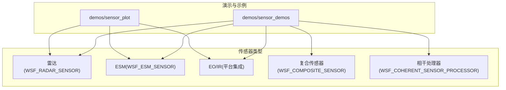
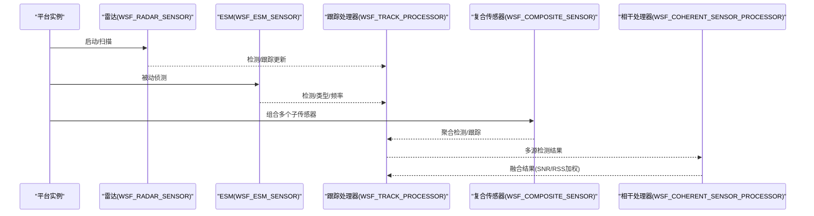
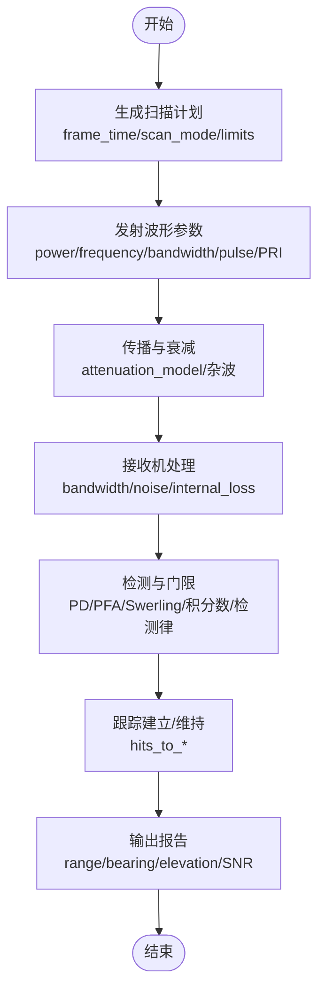
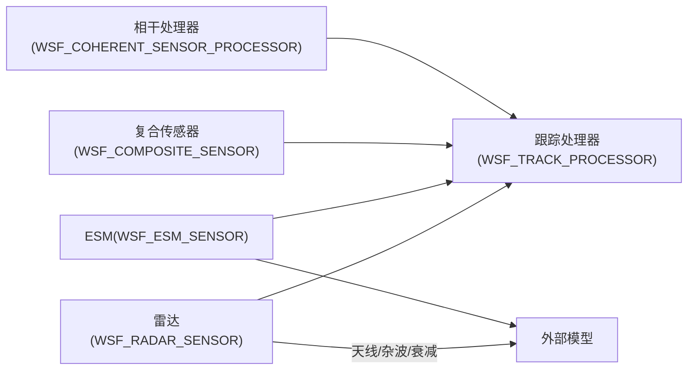

# 传感器系统

<cite>
**本文引用的文件**   
- [demos/sensor_demos/esm_demo.txt](file://demos/sensor_demos/esm_demo.txt)
- [demos/sensor_demos/composite_demo.txt](file://demos/sensor_demos/composite_demo.txt)
- [demos/sensor_demos/coherent_sensor_demo.txt](file://demos/sensor_demos/coherent_sensor_demo.txt)
- [demos/sensor_demos/eoir_demo.txt](file://demos/sensor_demos/eoir_demo.txt)
- [demos/sensor_plot/README.md](file://demos/sensor_plot/README.md)
</cite>

## 目录
1. [简介](#简介)
2. [项目结构](#项目结构)
3. [核心组件](#核心组件)
4. [架构总览](#架构总览)
5. [详细组件分析](#详细组件分析)
6. [依赖关系分析](#依赖关系分析)
7. [性能考虑](#性能考虑)
8. [故障排查指南](#故障排查指南)
9. [结论](#结论)
10. [附录](#附录)

## 简介
本技术文档面向AFSIM传感器子系统，聚焦雷达、红外（EO/IR）、电子支援措施（ESM）等传感器的抽象基类与具体实现、探测算法（距离/角度计算、信号衰减与噪声建模）、参数配置（频率、功率、波束形状、扫描模式等）、多传感器融合与数据关联、绘图工具使用（天线方向图、检测概率曲线、覆盖范围分析），以及复杂场景下的配置示例与调试技巧。同时提供自定义传感器类型的开发指引与最佳实践。

## 项目结构
仓库中与传感器相关的演示与工具主要位于以下路径：
- demos/sensor_demos：传感器功能演示（雷达、ESM、复合传感器、相干处理、EO/IR等）
- demos/sensor_plot：sensor_plot工具的示例与说明（天线方向图、杂波、通信、EO/IR、ESM、雷达、SAR等）

图示来源
- [demos/sensor_demos/esm_demo.txt:1-252](file://demos/sensor_demos/esm_demo.txt#L1-L252)
- [demos/sensor_demos/composite_demo.txt:1-178](file://demos/sensor_demos/composite_demo.txt#L1-L178)
- [demos/sensor_demos/coherent_sensor_demo.txt:1-279](file://demos/sensor_demos/coherent_sensor_demo.txt#L1-L279)
- [demos/sensor_plot/README.md:1-50](file://demos/sensor_plot/README.md#L1-L50)

章节来源
- [demos/sensor_demos/esm_demo.txt:1-252](file://demos/sensor_demos/esm_demo.txt#L1-L252)
- [demos/sensor_plot/README.md:1-50](file://demos/sensor_plot/README.md#L1-L50)

## 核心组件
- 雷达传感器（WSF_RADAR_SENSOR）
  - 支持多波束、发射机/接收机参数、杂波模型、Swerling目标起伏、检测概率与虚警率、跟踪建立/维持逻辑、报告项（距离、方位、俯仰、信噪比等）。
- 电子支援措施传感器（WSF_ESM_SENSOR）
  - 被动侦测，支持频段设置、接收机阈值/噪声功率/内部损耗、固定或扫描模式、输出位置/类型/频率等信息。
- 复合传感器（WSF_COMPOSITE_SENSOR）
  - 将多个子传感器组合为统一视图，支持同步/独立工作模式、内部链路到处理器。
- 相干传感器处理器（WSF_COHERENT_SENSOR_PROCESSOR）
  - 对多传感器结果进行融合（RSS/SNR加权平均等），可输出融合后的轨迹与SNR。
- EO/IR传感器
  - 通过平台集成与场景脚本驱动，常用于成像与跟踪演示。

章节来源
- [demos/sensor_demos/esm_demo.txt:26-113](file://demos/sensor_demos/esm_demo.txt#L26-L113)
- [demos/sensor_demos/composite_demo.txt:46-104](file://demos/sensor_demos/composite_demo.txt#L46-L104)
- [demos/sensor_demos/coherent_sensor_demo.txt:83-119](file://demos/sensor_demos/coherent_sensor_demo.txt#L83-L119)

## 架构总览
下图展示典型的多传感器与处理链交互：平台实例挂载雷达/ESM/EO/IR传感器，传感器输出检测事件至跟踪处理器；复合传感器聚合多个子传感器；相干处理器对多源检测结果进行融合。

图示来源
- [demos/sensor_demos/coherent_sensor_demo.txt:83-119](file://demos/sensor_demos/coherent_sensor_demo.txt#L83-L119)
- [demos/sensor_demos/composite_demo.txt:124-159](file://demos/sensor_demos/composite_demo.txt#L124-L159)
- [demos/sensor_demos/esm_demo.txt:119-149](file://demos/sensor_demos/esm_demo.txt#L119-L149)

## 详细组件分析

### 雷达传感器（WSF_RADAR_SENSOR）
- 工作原理
  - 主动发射电磁波，接收目标反射回波，经接收机处理后得到距离、方位、俯仰及信噪比等观测值。
  - 支持多波束独立配置（频率、极化、脉冲宽度、PRI、天线方向图等），并可选择杂波模型与衰减模型。
- 数学模型要点
  - 雷达方程：发射功率、天线增益、波长、目标RCS、传播衰减、接收带宽与噪声功率决定信噪比。
  - 检测概率与虚警率：由Swerling目标起伏类别、脉冲积分数、检测律（线性/平方律）与门限共同决定。
  - 角度估计：基于波束指向与扫描限制，结合天线方向图峰值增益与波束宽度。
- 关键参数
  - frame_time、scan_mode、azimuth_scan_limits、elevation_scan_limits、antenna_tilt
  - transmitter: power, frequency, bandwidth, pulse_width, pulse_repetition_interval, antenna_pattern, attenuation_model
  - receiver: antenna_pattern, bandwidth, noise_power, internal_loss
  - clutter_model、swerling_case、probability_of_false_alarm、number_of_pulses_integrated、detector_law
  - hits_to_establish_track、hits_to_maintain_track、reports_*
- 数据处理流程

图示来源
- [demos/sensor_demos/composite_demo.txt:46-104](file://demos/sensor_demos/composite_demo.txt#L46-L104)
- [demos/sensor_demos/coherent_sensor_demo.txt:29-72](file://demos/sensor_demos/coherent_sensor_demo.txt#L29-L72)

章节来源
- [demos/sensor_demos/composite_demo.txt:46-104](file://demos/sensor_demos/composite_demo.txt#L46-L104)
- [demos/sensor_demos/coherent_sensor_demo.txt:29-72](file://demos/sensor_demos/coherent_sensor_demo.txt#L29-L72)

### 电子支援措施传感器（WSF_ESM_SENSOR）
- 工作原理
  - 被动侦测敌方辐射源（如雷达），根据接收信号强度、频率与天线方向图判断是否满足检测阈值。
- 关键参数
  - slew_mode、maximum_range、receiver.antenna_pattern/detection_threshold/noise_power/internal_loss
  - frequency_band、reports_location/type/frequency
- 使用示例
  - 在平台类型中挂载ESM传感器，并启用跟踪处理器以形成轨迹。

章节来源
- [demos/sensor_demos/esm_demo.txt:90-113](file://demos/sensor_demos/esm_demo.txt#L90-L113)
- [demos/sensor_demos/esm_demo.txt:134-149](file://demos/sensor_demos/esm_demo.txt#L134-L149)

### 复合传感器（WSF_COMPOSITE_SENSOR）
- 工作原理
  - 将多个子传感器（如不同朝向的雷达）组合为一个逻辑传感器，支持同步或独立工作模式，并通过internal_link将结果送入指定处理器。
- 关键参数
  - operating_mode（synchronous/independent）、sensor列表、internal_link
- 使用示例
  - 四个子雷达分别偏转0/90/180/-90度，组成360度覆盖。

章节来源
- [demos/sensor_demos/composite_demo.txt:124-159](file://demos/sensor_demos/composite_demo.txt#L124-L159)

### 相干传感器处理器（WSF_COHERENT_SENSOR_PROCESSOR）
- 工作原理
  - 对来自多个传感器的检测结果进行融合，支持RSS或SNR为基础的融合方法，并可输出融合后的轨迹与SNR。
- 关键参数
  - update_interval、use_target_result、result_processing_type（RSS_BASED/SNR_BASED）、fusion_method（weighted_average）、sensors列表、processor（下游跟踪处理器）
- 使用示例
  - 两个雷达传感器作为输入，融合后输出到跟踪处理器。

章节来源
- [demos/sensor_demos/coherent_sensor_demo.txt:83-119](file://demos/sensor_demos/coherent_sensor_demo.txt#L83-L119)

### EO/IR传感器
- 工作原理
  - 通过平台集成与场景脚本驱动，常用于成像与跟踪演示，通常与区域注意力（zone attention）配合以提升效率。
- 使用示例
  - 包含uav_eoir与ground_site平台，运行eoir_demo场景。

章节来源
- [demos/sensor_demos/eoir_demo.txt:1-34](file://demos/sensor_demos/eoir_demo.txt#L1-L34)

## 依赖关系分析
- 传感器与处理器
  - 雷达/ESM/EO/IR传感器输出检测事件，由WSF_TRACK_PROCESSOR进行轨迹管理。
  - WSF_COMPOSITE_SENSOR聚合多个子传感器，并将结果链接到WSF_TRACK_PROCESSOR。
  - WSF_COHERENT_SENSOR_PROCESSOR对多传感器结果进行融合，再交由WSF_TRACK_PROCESSOR维护轨迹。
- 外部依赖
  - 天线方向图（antenna_pattern）、杂波模型（clutter_model）、衰减模型（attenuation_model）等。

图示来源
- [demos/sensor_demos/composite_demo.txt:124-159](file://demos/sensor_demos/composite_demo.txt#L124-L159)
- [demos/sensor_demos/coherent_sensor_demo.txt:83-119](file://demos/sensor_demos/coherent_sensor_demo.txt#L83-L119)
- [demos/sensor_demos/esm_demo.txt:119-149](file://demos/sensor_demos/esm_demo.txt#L119-L149)

章节来源
- [demos/sensor_demos/composite_demo.txt:124-159](file://demos/sensor_demos/composite_demo.txt#L124-L159)
- [demos/sensor_demos/coherent_sensor_demo.txt:83-119](file://demos/sensor_demos/coherent_sensor_demo.txt#L83-L119)
- [demos/sensor_demos/esm_demo.txt:119-149](file://demos/sensor_demos/esm_demo.txt#L119-L149)

## 性能考虑
- 帧时间与扫描策略
  - 合理设置frame_time与scan_mode，避免过度扫描导致CPU开销上升；在宽视场场景中采用分层扫描（先大波束后窄波束）。
- 检测概率与虚警率平衡
  - 通过调整probability_of_false_alarm、number_of_pulses_integrated与detector_law，在PD与PFA之间取得平衡。
- 杂波与衰减模型
  - 选择合适的clutter_model与attenuation_model，贴近实际环境以降低误检与漏检。
- 多传感器融合
  - 使用WSF_COHERENT_SENSOR_PROCESSOR的SNR_BASED加权平均融合，提升鲁棒性；注意update_interval与传感器帧时间匹配。
- 资源管理
  - 使用ignore_same_side减少同侧目标重复处理；合理设置minimum_range/maximum_range以减少无效计算。

[本节为通用指导，不直接分析具体文件]

## 故障排查指南
- 无检测或检测不稳定
  - 检查receiver.noise_power、internal_loss与transmitter.power/frequency/bandwidth是否匹配；确认antenna_pattern与扫描限制是否正确。
  - 验证probability_of_false_alarm与number_of_pulses_integrated是否过严或过松。
- 轨迹丢失或频繁重建
  - 调整hits_to_establish_track与hits_to_maintain_track，确保与frame_time和扫描周期匹配。
- 融合结果异常
  - 检查WSF_COHERENT_SENSOR_PROCESSOR的result_processing_type与fusion_method是否与传感器输出一致；确认sensors列表包含所有参与融合的传感器。
- 日志与事件
  - 启用SENSOR_DETECTION_ATTEMPT、SENSOR_TRACK_INITIATED/UPDATED/DROPPED等事件，定位问题阶段。

章节来源
- [demos/sensor_demos/esm_demo.txt:192-240](file://demos/sensor_demos/esm_demo.txt#L192-L240)
- [demos/sensor_demos/coherent_sensor_demo.txt:218-267](file://demos/sensor_demos/coherent_sensor_demo.txt#L218-L267)

## 结论
AFSIM传感器系统提供了从雷达、ESM到EO/IR的完整能力集，并通过复合传感器与相干处理器实现了灵活的多源融合与数据关联。通过合理的参数配置与性能调优，可在复杂场景中实现高可靠性的探测与跟踪。sensor_plot工具进一步支持天线方向图、杂波、通信、EO/IR、ESM、雷达与SAR的可视化与分析，便于工程验证与优化。

[本节为总结性内容，不直接分析具体文件]

## 附录

### 传感器参数配置速查
- 雷达（WSF_RADAR_SENSOR）
  - 基本：frame_time、scan_mode、azimuth_scan_limits、elevation_scan_limits、antenna_tilt
  - 发射机：power、frequency、bandwidth、pulse_width、pulse_repetition_interval、antenna_pattern、attenuation_model
  - 接收机：antenna_pattern、bandwidth、noise_power、internal_loss
  - 检测：clutter_model、swerling_case、probability_of_false_alarm、number_of_pulses_integrated、detector_law
  - 跟踪：hits_to_establish_track、hits_to_maintain_track、reports_*
- ESM（WSF_ESM_SENSOR）
  - 基本：slew_mode、maximum_range
  - 接收机：antenna_pattern、detection_threshold、noise_power、internal_loss
  - 频段：frequency_band
  - 报告：reports_location/type/frequency
- 复合传感器（WSF_COMPOSITE_SENSOR）
  - operating_mode（synchronous/independent）、sensor列表、internal_link
- 相干处理器（WSF_COHERENT_SENSOR_PROCESSOR）
  - update_interval、use_target_result、result_processing_type（RSS_BASED/SNR_BASED）、fusion_method（weighted_average）、sensors列表、processor

章节来源
- [demos/sensor_demos/composite_demo.txt:46-104](file://demos/sensor_demos/composite_demo.txt#L46-L104)
- [demos/sensor_demos/esm_demo.txt:90-113](file://demos/sensor_demos/esm_demo.txt#L90-L113)
- [demos/sensor_demos/coherent_sensor_demo.txt:83-119](file://demos/sensor_demos/coherent_sensor_demo.txt#L83-L119)

### 传感器绘图工具使用（sensor_plot）
- 用途
  - 绘制天线方向图、杂波特性、通信链路、EO/IR视场、ESM频段响应、雷达检测概率与覆盖范围等。
- 示例目录
  - demos/sensor_plot下包含antenna/clutter/comm/eoir/esm/radar/sar等分类示例，详见各子目录与doc说明。
- 使用方法
  - 参考demos/sensor_plot/README.md中的说明，准备输入文件并运行sensor_plot工具，查看输出图表。

章节来源
- [demos/sensor_plot/README.md:1-50](file://demos/sensor_plot/README.md#L1-L50)

### 复杂场景配置示例与调试技巧
- 复合雷达覆盖
  - 使用WSF_COMPOSITE_SENSOR组合四个子雷达，分别偏转0/90/180/-90度，实现360度覆盖；通过internal_link将结果送入WSF_TRACK_PROCESSOR。
- 多传感器融合
  - 使用WSF_COHERENT_SENSOR_PROCESSOR对两个雷达的检测结果进行SNR_BASED加权平均融合，提高鲁棒性；设置update_interval与传感器帧时间匹配。
- ESM与雷达协同
  - 在平台上同时部署雷达与ESM，利用ESM被动侦测敌方辐射源，辅助雷达搜索与跟踪；通过事件输出观察SENSOR_DETECTION_ATTEMPT与SENSOR_TRACK_*事件。

章节来源
- [demos/sensor_demos/composite_demo.txt:124-159](file://demos/sensor_demos/composite_demo.txt#L124-L159)
- [demos/sensor_demos/coherent_sensor_demo.txt:83-119](file://demos/sensor_demos/coherent_sensor_demo.txt#L83-L119)
- [demos/sensor_demos/esm_demo.txt:192-240](file://demos/sensor_demos/esm_demo.txt#L192-L240)

### 自定义传感器类型开发指引
- 步骤概览
  - 定义新的传感器类型（继承自相应基类），实现探测算法（距离/角度计算、衰减与噪声建模）、扫描与波束管理、检测与跟踪逻辑。
  - 注册新类型到工厂/类型系统，使其可在场景脚本中使用。
  - 编写示例场景与绘图脚本，验证功能与性能。
- 关键点
  - 保持与现有传感器接口一致（frame_time、scan_mode、reports_*等）。
  - 提供可调参数（频率、功率、波束形状、扫描模式等），便于分析与优化。
  - 支持与WSF_TRACK_PROCESSOR、WSF_COMPOSITE_SENSOR、WSF_COHERENT_SENSOR_PROCESSOR协作。

[本节为概念性指导，不直接分析具体文件]