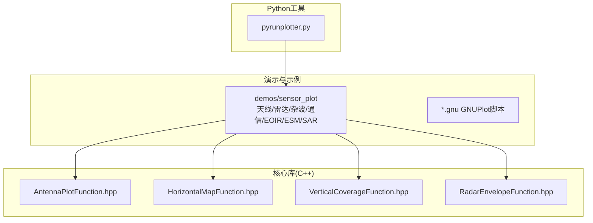
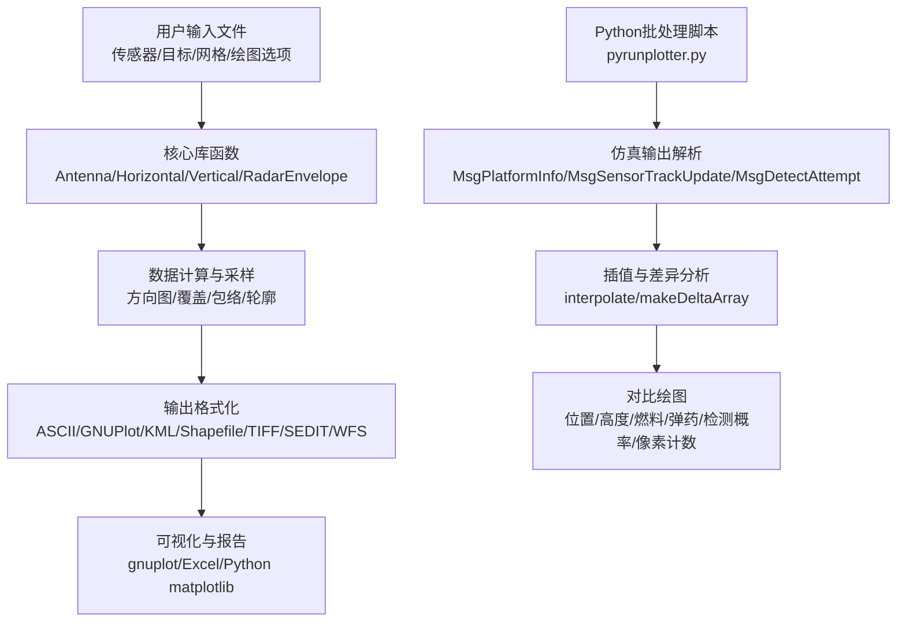
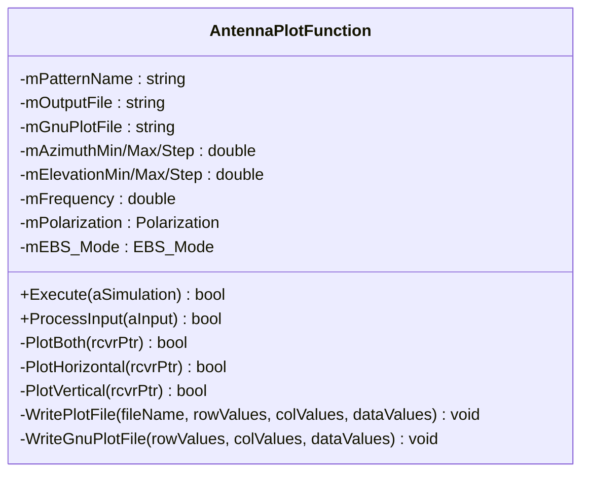
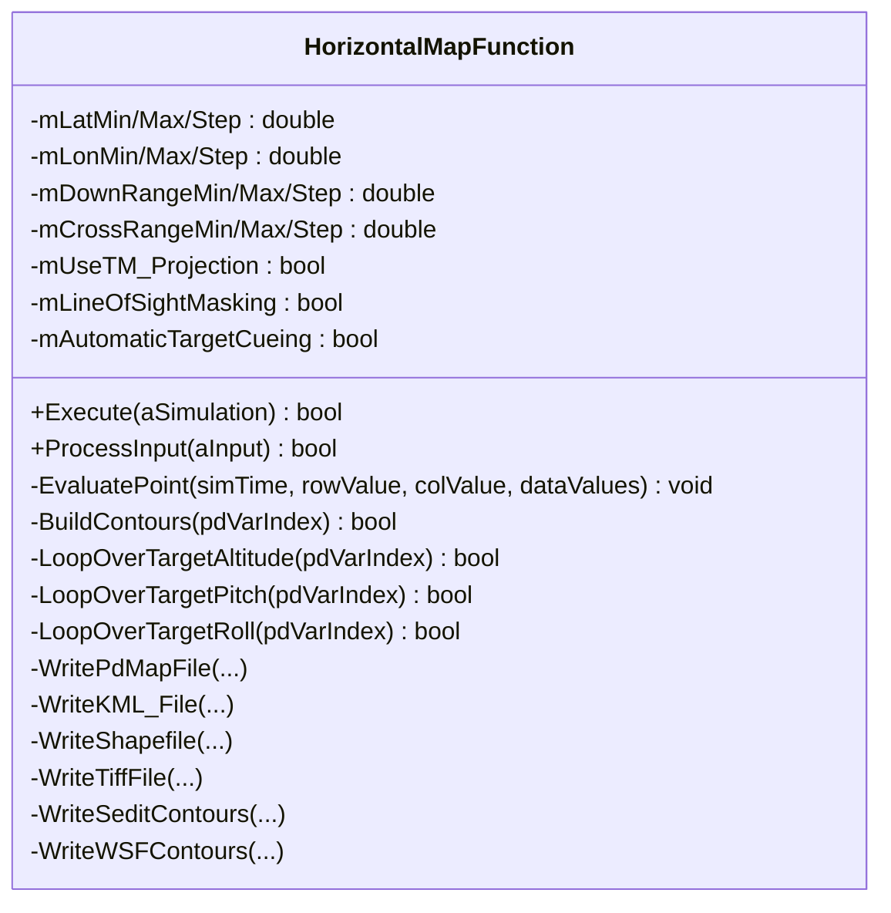
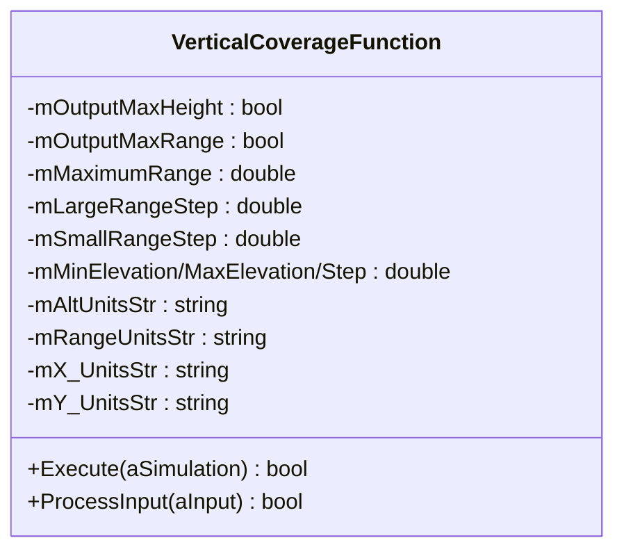
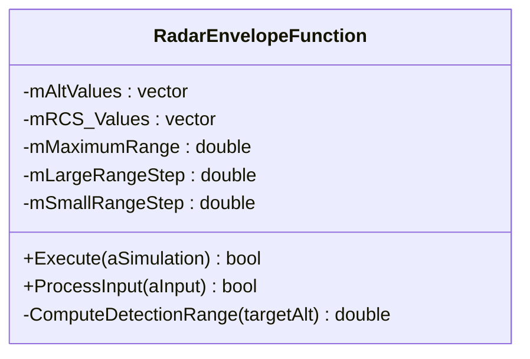
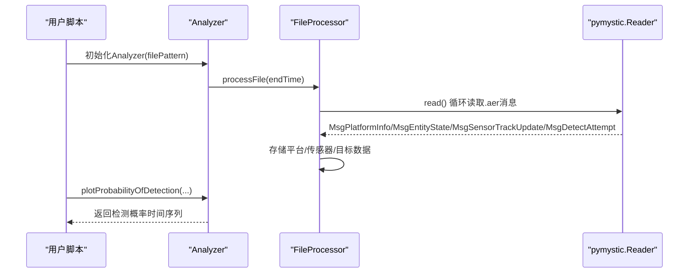
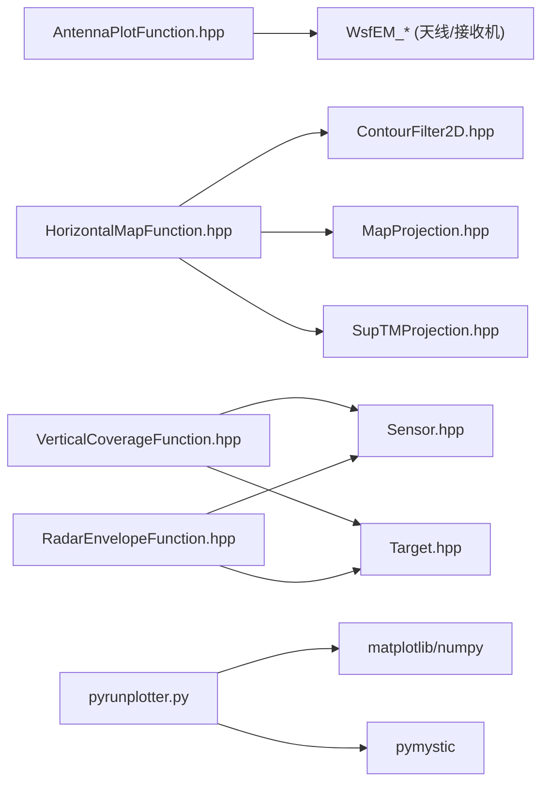

# 传感器绘图工具

<cite>
**本文引用的文件**   
- [README.md](file://demos/sensor_plot/README.md)
- [sensor_plot_demos.rst](file://demos/sensor_plot/doc/sensor_plot_demos.rst)
- [AntennaPlotFunction.hpp](file://swdev/src/core/sensor_plot_lib/source/AntennaPlotFunction.hpp)
- [HorizontalMapFunction.hpp](file://swdev/src/core/sensor_plot_lib/source/HorizontalMapFunction.hpp)
- [VerticalCoverageFunction.hpp](file://swdev/src/core/sensor_plot_lib/source/VerticalCoverageFunction.hpp)
- [RadarEnvelopeFunction.hpp](file://swdev/src/core/sensor_plot_lib/source/RadarEnvelopeFunction.hpp)
- [pyrunplotter.py](file://tools/pyrunplotter/pyrunplotter.py)
</cite>

## 目录
1. [简介](#简介)
2. [项目结构](#项目结构)
3. [核心组件](#核心组件)
4. [架构总览](#架构总览)
5. [详细组件分析](#详细组件分析)
6. [依赖关系分析](#依赖关系分析)
7. [性能与可视化建议](#性能与可视化建议)
8. [故障排查指南](#故障排查指南)
9. [结论](#结论)
10. [附录：Python脚本API使用示例](#附录python脚本api使用示例)

## 简介
本指南面向AFSIM传感器绘图工具（sensor_plot）的使用者，系统说明其架构、数据输入、处理与可视化流程，覆盖天线方向图绘制、检测概率曲线生成、覆盖范围分析、性能指标计算与图表输出，并提供Python脚本API的批量数据处理与自动化报告生成方法。文档同时给出完整工作流程与最佳实践，帮助读者高效完成传感器设计与优化。

## 项目结构
- demos/sensor_plot：包含各类传感器绘图的演示用例与GNUPlot脚本，涵盖天线、杂波、通信、EOIR、ESM、雷达、SAR等主题。
- swdev/src/core/sensor_plot_lib：传感器绘图库的核心C++实现，提供天线方向图、水平/垂直覆盖、雷达包络、地图投影、轮廓过滤等能力。
- tools/pyrunplotter：基于Python的批量化对比绘图工具，支持多仿真结果的数据解析、插值、差异分析与可视化。

图示来源
- [README.md:1-50](file://demos/sensor_plot/README.md#L1-L50)
- [sensor_plot_demos.rst:1-73](file://demos/sensor_plot/doc/sensor_plot_demos.rst#L1-L73)
- [AntennaPlotFunction.hpp:1-73](file://swdev/src/core/sensor_plot_lib/source/AntennaPlotFunction.hpp#L1-L73)
- [HorizontalMapFunction.hpp:1-294](file://swdev/src/core/sensor_plot_lib/source/HorizontalMapFunction.hpp#L1-L294)
- [VerticalCoverageFunction.hpp:1-54](file://swdev/src/core/sensor_plot_lib/source/VerticalCoverageFunction.hpp#L1-L54)
- [RadarEnvelopeFunction.hpp:1-49](file://swdev/src/core/sensor_plot_lib/source/RadarEnvelopeFunction.hpp#L1-L49)
- [pyrunplotter.py:1-800](file://tools/pyrunplotter/pyrunplotter.py#L1-L800)

章节来源
- [README.md:1-50](file://demos/sensor_plot/README.md#L1-L50)
- [sensor_plot_demos.rst:1-73](file://demos/sensor_plot/doc/sensor_plot_demos.rst#L1-L73)

## 核心组件
- 天线方向图绘制（AntennaPlotFunction）：支持二维/三维方向图、极坐标与直角坐标系输出，可配置方位角/俯仰角扫描范围、步进、频率、极化、EBS模式等参数。
- 水平覆盖/地图分析（HorizontalMapFunction）：在地理或笛卡尔网格上评估传感器对目标的探测概率，支持多种输出格式（ASCII、GNUPlot、KML、Shapefile、TIFF、SEDIT/WFS轮廓等），并具备遮蔽、地形影响与可视域分析能力。
- 垂直覆盖（VerticalCoverageFunction）：按距离/高度或角度采样，输出最大高度/最大距离等垂直剖面信息。
- 雷达包络（RadarEnvelopeFunction）：根据目标高度/雷达参数计算探测包络，用于灵敏度与动态范围分析。
- Python批处理绘图（pyrunplotter.py）：读取仿真输出（如.aer），提取平台状态、传感器跟踪、检测尝试等信息，进行时间序列插值、差异比较与多维可视化。

章节来源
- [AntennaPlotFunction.hpp:1-73](file://swdev/src/core/sensor_plot_lib/source/AntennaPlotFunction.hpp#L1-L73)
- [HorizontalMapFunction.hpp:1-294](file://swdev/src/core/sensor_plot_lib/source/HorizontalMapFunction.hpp#L1-L294)
- [VerticalCoverageFunction.hpp:1-54](file://swdev/src/core/sensor_plot_lib/source/VerticalCoverageFunction.hpp#L1-L54)
- [RadarEnvelopeFunction.hpp:1-49](file://swdev/src/core/sensor_plot_lib/source/RadarEnvelopeFunction.hpp#L1-L49)
- [pyrunplotter.py:1-800](file://tools/pyrunplotter/pyrunplotter.py#L1-L800)

## 架构总览
传感器绘图工具采用“输入定义→核心库计算→多格式输出”的分层架构。用户通过文本输入文件（demos中的示例）描述传感器、目标、网格与绘图选项；核心库执行计算并输出标准ASCII、GNUPlot脚本、地理空间格式（KML/Shapefile/TIFF）以及轮廓数据；Python工具可对仿真运行结果进行后处理与对比分析。

图示来源
- [sensor_plot_demos.rst:32-54](file://demos/sensor_plot/doc/sensor_plot_demos.rst#L32-L54)
- [pyrunplotter.py:254-519](file://tools/pyrunplotter/pyrunplotter.py#L254-L519)
- [pyrunplotter.py:573-800](file://tools/pyrunplotter/pyrunplotter.py#L573-L800)

## 详细组件分析

### 天线方向图绘制（AntennaPlotFunction）
- 功能要点
  - 支持二维/三维方向图输出，兼容极坐标与直角坐标系。
  - 可配置方位角/俯仰角范围与步进、频率、极化、EBS模式及失配损耗指数。
  - 输出标准行列ASCII数据与GNUPlot命令文件，便于后续可视化。
- 关键接口
  - Execute/ProcessInput：驱动仿真执行与输入解析。
  - PlotBoth/PlotHorizontal/PlotVertical：分别绘制全向、水平面与垂直面方向图。
  - WritePlotFile/WriteGnuPlotFile：写入数据与绘图脚本。
- 典型用法
  - 在demos/sensor_plot/antenna目录下准备pattern与.gnu脚本，运行sensor_plot生成方向图数据与绘图命令。

图示来源
- [AntennaPlotFunction.hpp:23-70](file://swdev/src/core/sensor_plot_lib/source/AntennaPlotFunction.hpp#L23-L70)

章节来源
- [AntennaPlotFunction.hpp:1-73](file://swdev/src/core/sensor_plot_lib/source/AntennaPlotFunction.hpp#L1-L73)

### 水平覆盖与地图分析（HorizontalMapFunction）
- 功能要点
  - 在经纬度或笛卡尔网格上评估传感器探测概率（pd）及其他变量。
  - 支持多种输出：ASCII、GNUPlot、KML、Shapefile、TIFF、SEDIT/WFS轮廓与分析地图。
  - 提供遮蔽（LineOfSightMasking）、自动目标提示（AutomaticTargetCueing）、TM投影转换等能力。
  - 支持选择器（Selector）对传感器/平台类型与类别进行筛选与排除。
- 关键接口
  - Execute/ProcessInput：驱动仿真执行与输入解析。
  - EvaluatePoint/LoopOverTargetAltitude/Pitch/Roll：逐点评估与目标姿态循环。
  - BuildContours/Write*：构建轮廓与导出多种格式。
- 典型用法
  - 在demos/sensor_plot/radar中准备hm-*.txt与*.gnu脚本，运行sensor_plot生成水平探测图与GNUPlot命令。

图示来源
- [HorizontalMapFunction.hpp:26-291](file://swdev/src/core/sensor_plot_lib/source/HorizontalMapFunction.hpp#L26-L291)

章节来源
- [HorizontalMapFunction.hpp:1-294](file://swdev/src/core/sensor_plot_lib/source/HorizontalMapFunction.hpp#L1-L294)

### 垂直覆盖（VerticalCoverageFunction）
- 功能要点
  - 按距离/高度或角度采样，输出最大高度/最大距离等垂直剖面信息。
  - 支持自定义单位字符串（海拔、距离、X/Y轴单位）。
- 关键接口
  - Execute/ProcessInput：驱动仿真执行与输入解析。
  - 内部字段控制输出项（最大高度/最大距离）与采样步长。
- 典型用法
  - 在demos/sensor_plot/radar中准备vcd-*.txt与vcdplot.gnu，运行sensor_plot生成垂直覆盖图。

图示来源
- [VerticalCoverageFunction.hpp:21-51](file://swdev/src/core/sensor_plot_lib/source/VerticalCoverageFunction.hpp#L21-L51)

章节来源
- [VerticalCoverageFunction.hpp:1-54](file://swdev/src/core/sensor_plot_lib/source/VerticalCoverageFunction.hpp#L1-L54)

### 雷达包络（RadarEnvelopeFunction）
- 功能要点
  - 根据目标高度与雷达参数计算探测包络，用于灵敏度与动态范围分析。
  - 支持自定义最大距离与步长，输出名称与单位字符串。
- 关键接口
  - Execute/ProcessInput：驱动仿真执行与输入解析。
  - ComputeDetectionRange：按目标高度计算探测距离。
- 典型用法
  - 结合雷达场景与目标RCS变化，生成包络曲线以评估不同高度下的探测能力。

图示来源
- [RadarEnvelopeFunction.hpp:23-46](file://swdev/src/core/sensor_plot_lib/source/RadarEnvelopeFunction.hpp#L23-L46)

章节来源
- [RadarEnvelopeFunction.hpp:1-49](file://swdev/src/core/sensor_plot_lib/source/RadarEnvelopeFunction.hpp#L1-L49)

### Python脚本API（pyrunplotter.py）
- 功能要点
  - 解析仿真输出（.aer），提取平台信息、传感器跟踪、检测尝试等消息。
  - 提供时间序列插值与差异比较，支持多维度对比绘图（位置、高度、燃料、弹药、检测概率、像素计数）。
  - 内置AFSIM颜色映射与线型样式，便于统一可视化风格。
- 关键类与方法
  - FileProcessor.processFile：单文件或批量文件解析。
  - Analyzer.plotProbabilityOfDetection：绘制检测概率随时间变化。
  - interpolate/makeDeltaArray：插值与差异数组生成。
- 典型用法
  - 使用Analyzer(filePattern).processFile()加载多个仿真结果，调用plot*方法进行对比分析。

图示来源
- [pyrunplotter.py:254-519](file://tools/pyrunplotter/pyrunplotter.py#L254-L519)
- [pyrunplotter.py:573-800](file://tools/pyrunplotter/pyrunplotter.py#L573-L800)

章节来源
- [pyrunplotter.py:1-800](file://tools/pyrunplotter/pyrunplotter.py#L1-L800)

## 依赖关系分析
- 核心库依赖
  - AntennaPlotFunction依赖WsfEM_Antenna与WsfEM_Rcvr进行天线与接收机相关计算。
  - HorizontalMapFunction依赖ContourFilter2D、MapProjection、SupTMProjection进行轮廓过滤与地图投影。
  - VerticalCoverageFunction与RadarEnvelopeFunction依赖Sensor与Target模型进行几何与探测计算。
- Python工具依赖
  - pyrunplotter依赖matplotlib与numpy进行可视化与数值计算，依赖pymystic读取仿真输出。
- 外部集成
  - GNUPlot脚本（*.gnu）用于快速绘制ASCII/GNUPlot输出。
  - KML/Shapefile/TIFF/SEDIT/WFS等地理空间格式便于在GIS或专业软件中进一步分析。

图示来源
- [AntennaPlotFunction.hpp:18-21](file://swdev/src/core/sensor_plot_lib/source/AntennaPlotFunction.hpp#L18-L21)
- [HorizontalMapFunction.hpp:18-21](file://swdev/src/core/sensor_plot_lib/source/HorizontalMapFunction.hpp#L18-L21)
- [VerticalCoverageFunction.hpp:17-19](file://swdev/src/core/sensor_plot_lib/source/VerticalCoverageFunction.hpp#L17-L19)
- [RadarEnvelopeFunction.hpp:18-21](file://swdev/src/core/sensor_plot_lib/source/RadarEnvelopeFunction.hpp#L18-L21)
- [pyrunplotter.py:27-38](file://tools/pyrunplotter/pyrunplotter.py#L27-L38)

## 性能与可视化建议
- 采样与分辨率
  - 合理设置方位角/俯仰角步进与网格步长，避免过密采样导致计算与输出体积过大。
  - 对于大范围地图分析，优先使用TM投影与分层网格，减少投影误差与内存占用。
- 输出格式选择
  - 快速预览使用GNUPlot脚本；生产报告建议使用TIFF/Shapefile/KML等地理空间格式。
  - 对大规模数据，限制输出列数（mOutputColumnLimit）以减少I/O压力。
- Python批处理
  - 使用interpolate对齐不同仿真运行的时间戳，再进行差异比较（makeDeltaArray）。
  - 利用内置颜色与线型样式保持图表一致性，便于多方案对比。

[本节为通用指导，不直接分析具体文件]

## 故障排查指南
- 无检测概率数据
  - 检查传感器是否启用检测尝试输出，确认MsgDetectAttempt消息存在。
  - 验证传感器平台、传感器名称与目标平台名称匹配。
- 无法绘制方向图
  - 确认天线模式与极化设置正确，频率与EBS参数有效。
  - 检查GNUPlot脚本路径与数据文件格式是否符合预期。
- 地图输出异常
  - 校验经纬度范围与步长设置，确保网格覆盖目标区域。
  - 若启用遮蔽或TM投影，检查投影参数与遮蔽开关。

章节来源
- [pyrunplotter.py:749-800](file://tools/pyrunplotter/pyrunplotter.py#L749-L800)
- [sensor_plot_demos.rst:32-54](file://demos/sensor_plot/doc/sensor_plot_demos.rst#L32-L54)

## 结论
AFSIM传感器绘图工具提供了从方向图到覆盖分析、从雷达包络到地理空间输出的完整能力链。结合demos中的示例与Python批处理脚本，用户可以高效完成传感器设计、性能评估与优化迭代。遵循本文的工作流程与最佳实践，可显著提升分析效率与结果质量。

[本节为总结性内容，不直接分析具体文件]

## 附录：Python脚本API使用示例
- 批量数据处理
  - 使用Analyzer(filePattern).processFile()加载多个仿真结果，支持通配符与编号分组。
  - 通过FileProcessor.processFile(endTime)限制处理时长，提升批处理效率。
- 自动化报告生成
  - 调用plotProbabilityOfDetection绘制检测概率曲线，结合plotPixelCount与plotAltitudeVsTime等多维图表。
  - 使用makeDeltaArray对不同运行结果进行差异分析，生成对比报告。
- 参考路径
  - 解析与存储：[pyrunplotter.py:254-519](file://tools/pyrunplotter/pyrunplotter.py#L254-L519)
  - 绘图接口：[pyrunplotter.py:573-800](file://tools/pyrunplotter/pyrunplotter.py#L573-L800)

章节来源
- [pyrunplotter.py:254-519](file://tools/pyrunplotter/pyrunplotter.py#L254-L519)
- [pyrunplotter.py:573-800](file://tools/pyrunplotter/pyrunplotter.py#L573-L800)