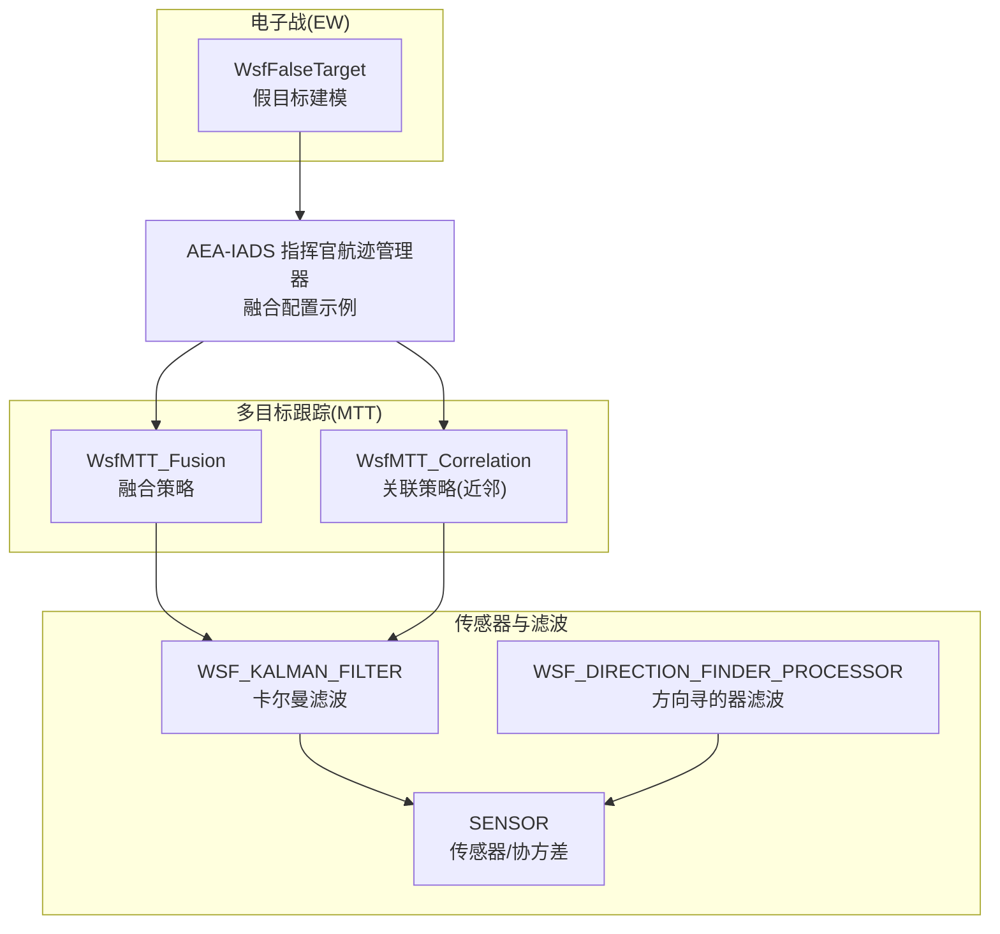
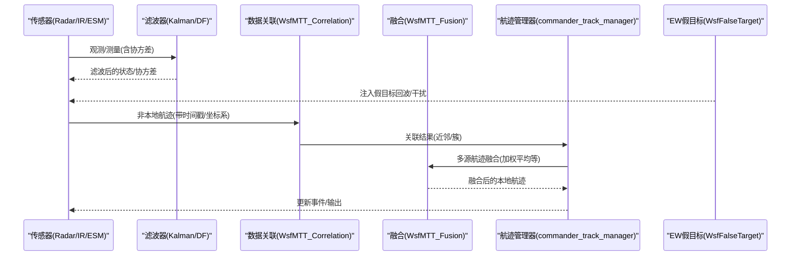
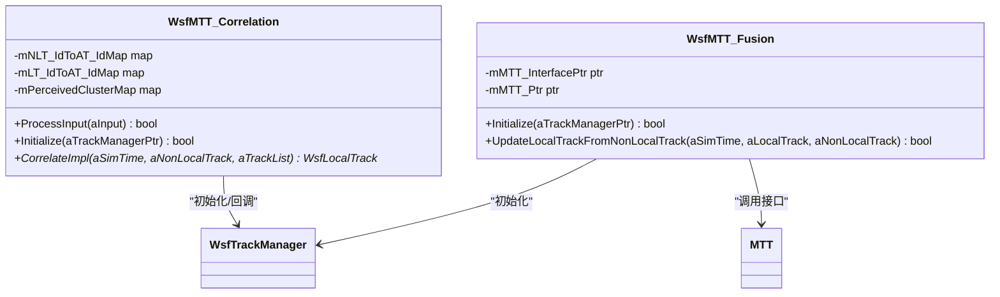
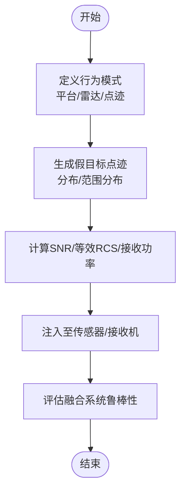
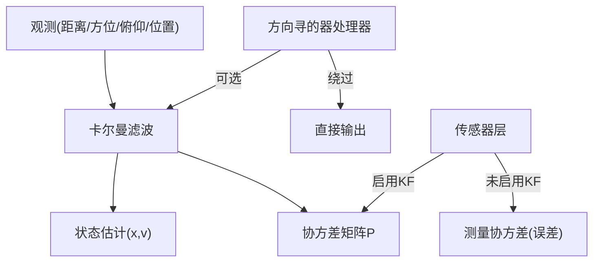
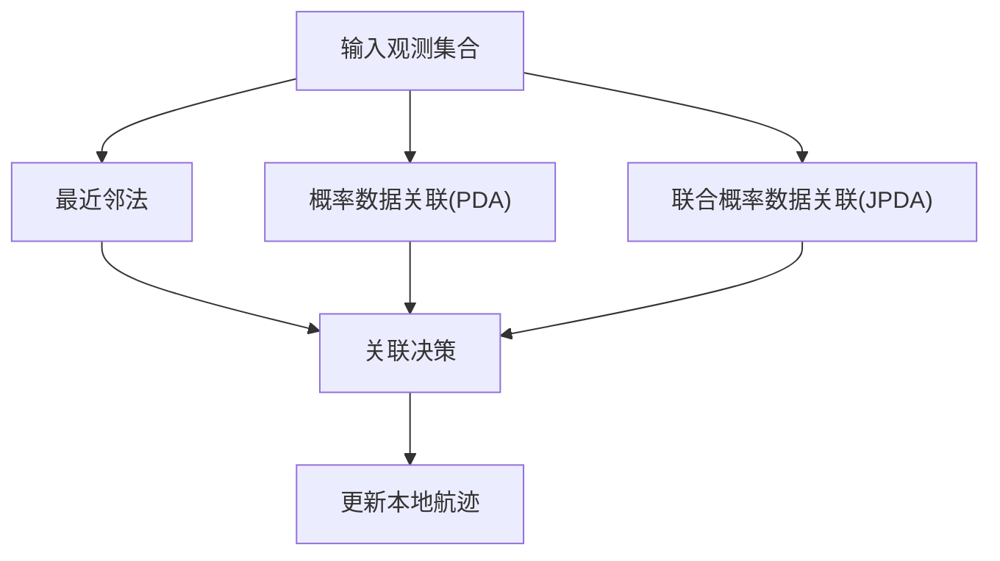
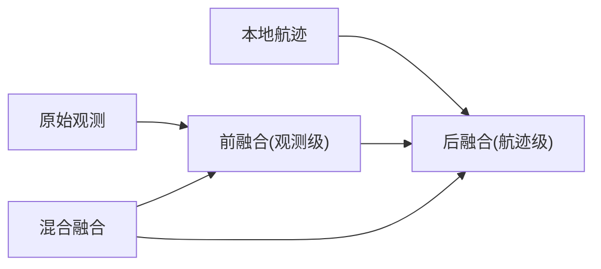
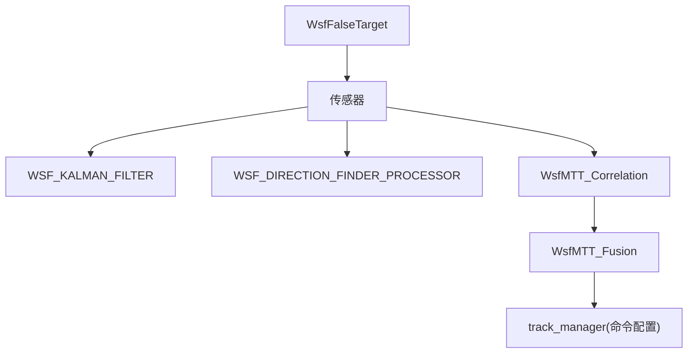

# 传感器融合技术

<cite>
**本文引用的文件**   
- [commander_track_manager.txt](file://demos/aea_iads/processors/commander_track_manager.txt)
- [WsfMTT_Fusion.hpp](file://swdev/src/core/wsf_mtt/source/WsfMTT_Fusion.hpp)
- [WsfMTT_Correlation.hpp](file://swdev/src/core/wsf_mtt/source/WsfMTT_Correlation.hpp)
- [WsfFalseTarget.hpp](file://swdev/src/core/wsf_mil/source/ew/WsfFalseTarget.hpp)
- [wsf_kalman_filter.rst](file://documentation/html/_sources/docs/wsf_kalman_filter.rst.txt)
- [wsf_direction_finder_processor.rst](file://documentation/html/_sources/docs/wsf_direction_finder_processor.rst.txt)
- [sensor.rst](file://documentation/html/_sources/docs/sensor.rst.txt)
- [tracking_primer.rst.txt](file://documentation/html/_sources/docs/analyst_ocd/tracking_primer.rst.txt)
- [coherent_sensor_demo.txt](file://demos/sensor_demos/coherent_sensor_demo.txt)
</cite>

## 目录
1. [引言](#引言)
2. [项目结构](#项目结构)
3. [核心组件](#核心组件)
4. [架构总览](#架构总览)
5. [详细组件分析](#详细组件分析)
6. [依赖关系分析](#依赖关系分析)
7. [性能考虑](#性能考虑)
8. [故障排查指南](#故障排查指南)
9. [结论](#结论)
10. [附录](#附录)

## 引言
本文件面向AFSIM中的多传感器数据融合，围绕贝叶斯估计、卡尔曼滤波与信息论方法展开，系统阐述前融合、后融合与混合融合架构；文档化最近邻法、概率数据关联(PDA)与联合概率数据关联(JPDA)等数据关联算法；说明雷达、红外、ESM等异构传感器的协调与时空配准（坐标变换、时间同步、误差校正）；给出多平台协同探测的数学模型与优化思路；提供复杂战场环境下的融合实例与评估方法，并展示如何设计鲁棒的融合系统以应对欺骗与干扰。

## 项目结构
AFSIM在“多目标跟踪(MTT)”“电子战(EW)”“传感器处理”“轨道确定与滤波”等模块中提供了融合相关能力：
- MTT模块提供数据关联与融合策略接口，支持近邻类关联与基于Suppressor 7 MTT的融合实现。
- EW模块提供假目标建模与对抗场景，用于评估融合系统在欺骗与干扰下的鲁棒性。
- 文档与示例展示了卡尔曼滤波、方向寻的器滤波、传感器协方差输出与事件输出等关键机制。

**图示来源** 
- [WsfMTT_Fusion.hpp:20-46](file://swdev/src/core/wsf_mtt/source/WsfMTT_Fusion.hpp#L20-L46)
- [WsfMTT_Correlation.hpp:28-64](file://swdev/src/core/wsf_mtt/source/WsfMTT_Correlation.hpp#L28-L64)
- [WsfFalseTarget.hpp:49-124](file://swdev/src/core/wsf_mil/source/ew/WsfFalseTarget.hpp#L49-L124)
- [wsf_kalman_filter.rst:26-27](file://documentation/html/_sources/docs/wsf_kalman_filter.rst.txt#L26-L27)
- [wsf_direction_finder_processor.rst:116-118](file://documentation/html/_sources/docs/wsf_direction_finder_processor.rst.txt#L116-L118)
- [sensor.rst:435-435](file://documentation/html/_sources/docs/sensor.rst.txt#L435-L435)
- [commander_track_manager.txt:9-18](file://demos/aea_iads/processors/commander_track_manager.txt#L9-L18)

**章节来源**
- [commander_track_manager.txt:9-18](file://demos/aea_iads/processors/commander_track_manager.txt#L9-L18)
- [WsfMTT_Fusion.hpp:20-46](file://swdev/src/core/wsf_mtt/source/WsfMTT_Fusion.hpp#L20-L46)
- [WsfMTT_Correlation.hpp:28-64](file://swdev/src/core/wsf_mtt/source/WsfMTT_Correlation.hpp#L28-L64)
- [WsfFalseTarget.hpp:49-124](file://swdev/src/core/wsf_mil/source/ew/WsfFalseTarget.hpp#L49-L124)
- [wsf_kalman_filter.rst:26-27](file://documentation/html/_sources/docs/wsf_kalman_filter.rst.txt#L26-L27)
- [wsf_direction_finder_processor.rst:116-118](file://documentation/html/_sources/docs/wsf_direction_finder_processor.rst.txt#L116-L118)
- [sensor.rst:435-435](file://documentation/html/_sources/docs/sensor.rst.txt#L435-L435)

## 核心组件
- 多目标跟踪(MTT)融合与关联
  - WsfMTT_Fusion：继承默认融合规则，封装Suppressor 7 MTT融合算法，负责将非本地航迹更新为本地航迹。
  - WsfMTT_Correlation：实现近邻类数据关联策略，维护感知簇与映射表，完成本地航迹与非本地航迹的关联。
- 电子战(EW)假目标
  - WsfFalseTarget：量化描述多假目标在雷达接收机上的表现，定义平台/雷达/点迹行为模式、分布与强度计算，支撑对抗与鲁棒性评估。
- 传感器与滤波
  - WSF_KALMAN_FILTER：对位置/速度状态进行卡尔曼滤波，输出状态协方差。
  - WSF_DIRECTION_FINDER_PROCESSOR：方向寻的器处理，可内置Kalman滤波或绕过。
  - SENSOR：传感器层可输出测量协方差或状态协方差（当启用KF时）。

**章节来源**
- [WsfMTT_Fusion.hpp:20-46](file://swdev/src/core/wsf_mtt/source/WsfMTT_Fusion.hpp#L20-L46)
- [WsfMTT_Correlation.hpp:28-64](file://swdev/src/core/wsf_mtt/source/WsfMTT_Correlation.hpp#L28-L64)
- [WsfFalseTarget.hpp:49-124](file://swdev/src/core/wsf_mil/source/ew/WsfFalseTarget.hpp#L49-L124)
- [wsf_kalman_filter.rst:26-27](file://documentation/html/_sources/docs/wsf_kalman_filter.rst.txt#L26-L27)
- [wsf_direction_finder_processor.rst:116-118](file://documentation/html/_sources/docs/wsf_direction_finder_processor.rst.txt#L116-L118)
- [sensor.rst:435-435](file://documentation/html/_sources/docs/sensor.rst.txt#L435-L435)

## 架构总览
下图展示从传感器到MTT融合再到航迹输出的典型流程，以及EW假目标对融合系统的注入路径。

**图示来源** 
- [WsfMTT_Correlation.hpp:48-64](file://swdev/src/core/wsf_mtt/source/WsfMTT_Correlation.hpp#L48-L64)
- [WsfMTT_Fusion.hpp:35-46](file://swdev/src/core/wsf_mtt/source/WsfMTT_Fusion.hpp#L35-L46)
- [commander_track_manager.txt:9-18](file://demos/aea_iads/processors/commander_track_manager.txt#L9-L18)
- [WsfFalseTarget.hpp:49-124](file://swdev/src/core/wsf_mil/source/ew/WsfFalseTarget.hpp#L49-L124)
- [wsf_kalman_filter.rst:26-27](file://documentation/html/_sources/docs/wsf_kalman_filter.rst.txt#L26-L27)

## 详细组件分析

### 多目标跟踪(MTT)融合与关联
- 关联策略(WsfMTT_Correlation)
  - 采用近邻类策略，维护本地航迹ID与非本地航迹ID的映射，以及感知簇管理。
  - 对外暴露CorrelateImpl接口，按仿真时间对输入的非本地航迹进行关联决策。
- 融合策略(WsfMTT_Fusion)
  - 继承默认融合规则，通过UpdateLocalTrackFromNonLocalTrack将非本地航迹转换为本地航迹，内部调用MTT接口。
- 配置示例(commander_track_manager.txt)
  - 使用perfect关联方法与weighted_average融合方法，体现后融合架构的典型配置。

**图示来源** 
- [WsfMTT_Correlation.hpp:28-64](file://swdev/src/core/wsf_mtt/source/WsfMTT_Correlation.hpp#L28-L64)
- [WsfMTT_Fusion.hpp:20-46](file://swdev/src/core/wsf_mtt/source/WsfMTT_Fusion.hpp#L20-L46)

**章节来源**
- [WsfMTT_Correlation.hpp:28-64](file://swdev/src/core/wsf_mtt/source/WsfMTT_Correlation.hpp#L28-L64)
- [WsfMTT_Fusion.hpp:20-46](file://swdev/src/core/wsf_mtt/source/WsfMTT_Fusion.hpp#L20-L46)
- [commander_track_manager.txt:9-18](file://demos/aea_iads/processors/commander_track_manager.txt#L9-L18)

### 电子战假目标与鲁棒性
- WsfFalseTarget定义了平台/雷达/点迹的行为模式（随机/一致）、分布（随机/圆形/扇形）、范围分布（均匀/对数/指数），并提供SNR、等效RCS、接收功率等计算方法，用于模拟复杂对抗环境。
- 通过控制PlatformBehavior/RadarBehavior/BlipBehavior，可在多平台/多雷达场景中构造一致的或随机的假目标感知，从而测试融合系统的鲁棒性与抗欺骗能力。

**图示来源** 
- [WsfFalseTarget.hpp:64-124](file://swdev/src/core/wsf_mil/source/ew/WsfFalseTarget.hpp#L64-L124)
- [WsfFalseTarget.hpp:405-423](file://swdev/src/core/wsf_mil/source/ew/WsfFalseTarget.hpp#L405-L423)

**章节来源**
- [WsfFalseTarget.hpp:64-124](file://swdev/src/core/wsf_mil/source/ew/WsfFalseTarget.hpp#L64-L124)
- [WsfFalseTarget.hpp:405-423](file://swdev/src/core/wsf_mil/source/ew/WsfFalseTarget.hpp#L405-L423)

### 传感器与滤波（卡尔曼滤波与方向寻的器）
- 卡尔曼滤波(WSF_KALMAN_FILTER)
  - 接受来自距离/方位/俯仰或位置的观测输入，输出状态估计与协方差矩阵。
- 方向寻的器处理器(WSF_DIRECTION_FINDER_PROCESSOR)
  - 支持内置Kalman滤波或绕过滤波，便于对比不同处理链路的性能。
- 传感器层(sensor.rst)
  - 若启用KF，则传感器可报告状态协方差；否则仅在传感器层具备有效误差时可报告测量协方差。

**图示来源** 
- [wsf_kalman_filter.rst:26-27](file://documentation/html/_sources/docs/wsf_kalman_filter.rst.txt#L26-L27)
- [wsf_direction_finder_processor.rst:116-118](file://documentation/html/_sources/docs/wsf_direction_finder_processor.rst.txt#L116-L118)
- [sensor.rst:435-435](file://documentation/html/_sources/docs/sensor.rst.txt#L435-L435)

**章节来源**
- [wsf_kalman_filter.rst:26-27](file://documentation/html/_sources/docs/wsf_kalman_filter.rst.txt#L26-L27)
- [wsf_direction_finder_processor.rst:116-118](file://documentation/html/_sources/docs/wsf_direction_finder_processor.rst.txt#L116-L118)
- [sensor.rst:435-435](file://documentation/html/_sources/docs/sensor.rst.txt#L435-L435)

### 时空配准与异构传感器协调
- 坐标变换与时间同步
  - 在多平台协同探测中，需将各传感器的观测统一到统一坐标系与时间基准，确保关联与融合的正确性。
- 误差校正
  - 利用传感器误差模型与协方差信息，对观测偏差进行校正，提升关联质量与融合精度。
- 异构传感器协调
  - 雷达提供距离/方位/俯仰与RCS；红外提供热信号与轨迹片段；ESM提供电磁频谱特征。三者互补，需在数据层或航迹层进行一致性校验与权重分配。

[本节为概念性说明，不直接分析具体文件]

### 数据关联算法（最近邻、PDA、JPDA）
- 最近邻法
  - AFSIM的WsfMTT_Correlation实现了近邻类策略，适合低杂波与稀疏目标场景。
- PDA与JPDA
  - 在高杂波与密集目标场景下，PDA/JPDA通过概率分配提高关联鲁棒性。AFSIM文档与示例中可通过扩展关联策略或自定义处理器实现。

**图示来源** 
- [WsfMTT_Correlation.hpp:28-64](file://swdev/src/core/wsf_mtt/source/WsfMTT_Correlation.hpp#L28-L64)

**章节来源**
- [WsfMTT_Correlation.hpp:28-64](file://swdev/src/core/wsf_mtt/source/WsfMTT_Correlation.hpp#L28-L64)

### 融合架构（前融合、后融合、混合融合）
- 前融合
  - 在原始观测层进行融合（如多站雷达的联合定位），需要高精度时空配准与误差模型。
- 后融合
  - 在航迹层进行融合（如加权平均），AFSIM示例中使用weighted_average作为融合方法。
- 混合融合
  - 结合前融合与后融合的优势，在部分链路进行观测级融合，再在航迹层进行二次融合。

**图示来源** 
- [commander_track_manager.txt:9-18](file://demos/aea_iads/processors/commander_track_manager.txt#L9-L18)

**章节来源**
- [commander_track_manager.txt:9-18](file://demos/aea_iads/processors/commander_track_manager.txt#L9-L18)

### 多平台协同探测数学模型与优化
- 数学模型
  - 状态向量x包含位置与速度；观测模型h(x)将状态映射到观测空间；过程噪声Q与观测噪声R分别刻画动态不确定性与传感器误差。
  - 卡尔曼滤波递归更新：预测步与更新步交替进行，协方差传播与增益计算决定融合权重。
- 优化思路
  - 自适应噪声调节：根据历史残差调整Q/R，提升鲁棒性。
  - 多模型融合：对不同机动模型进行组合估计（如CV/CA/CTRV），降低跟踪发散风险。
  - 资源调度：在扫描周期、波束指向与带宽之间做权衡，最大化信息增益。

[本节为概念性说明，不直接分析具体文件]

### 复杂战场环境下的融合实例与性能评估
- 实例
  - AEA-IADS指挥官航迹管理器演示了perfect关联与weighted_average融合的配置，可用于评估多源航迹的一致性。
  - coherent_sensor_demo.txt展示了相干传感器场景，有助于评估相位/幅度一致性对融合的影响。
- 评估指标
  - 关联成功率、虚警率、漏警率、轨迹连续性、定位误差RMSE、速度误差RMSE、计算复杂度与实时性。

**章节来源**
- [commander_track_manager.txt:9-18](file://demos/aea_iads/processors/commander_track_manager.txt#L9-L18)
- [coherent_sensor_demo.txt:110-110](file://demos/sensor_demos/coherent_sensor_demo.txt#L110-L110)

## 依赖关系分析
- 组件耦合
  - WsfMTT_Fusion依赖WsfTrackManager与MTT接口；WsfMTT_Correlation依赖WsfTrackManager与感知簇管理。
  - EW假目标通过影响传感器观测间接作用于关联与融合。
- 外部依赖
  - 卡尔曼滤波与方向寻的器处理作为通用滤波后端，被传感器与MTT模块复用。

**图示来源** 
- [WsfFalseTarget.hpp:49-124](file://swdev/src/core/wsf_mil/source/ew/WsfFalseTarget.hpp#L49-L124)
- [WsfMTT_Correlation.hpp:28-64](file://swdev/src/core/wsf_mtt/source/WsfMTT_Correlation.hpp#L28-L64)
- [WsfMTT_Fusion.hpp:20-46](file://swdev/src/core/wsf_mtt/source/WsfMTT_Fusion.hpp#L20-L46)
- [wsf_kalman_filter.rst:26-27](file://documentation/html/_sources/docs/wsf_kalman_filter.rst.txt#L26-L27)
- [wsf_direction_finder_processor.rst:116-118](file://documentation/html/_sources/docs/wsf_direction_finder_processor.rst.txt#L116-L118)
- [commander_track_manager.txt:9-18](file://demos/aea_iads/processors/commander_track_manager.txt#L9-L18)

**章节来源**
- [WsfMTT_Fusion.hpp:20-46](file://swdev/src/core/wsf_mtt/source/WsfMTT_Fusion.hpp#L20-L46)
- [WsfMTT_Correlation.hpp:28-64](file://swdev/src/core/wsf_mtt/source/WsfMTT_Correlation.hpp#L28-L64)
- [WsfFalseTarget.hpp:49-124](file://swdev/src/core/wsf_mil/source/ew/WsfFalseTarget.hpp#L49-L124)
- [wsf_kalman_filter.rst:26-27](file://documentation/html/_sources/docs/wsf_kalman_filter.rst.txt#L26-L27)
- [wsf_direction_finder_processor.rst:116-118](file://documentation/html/_sources/docs/wsf_direction_finder_processor.rst.txt#L116-L118)
- [commander_track_manager.txt:9-18](file://demos/aea_iads/processors/commander_track_manager.txt#L9-L18)

## 性能考虑
- 关联复杂度
  - 近邻法计算量低，适合实时场景；PDA/JPDA在高杂波下更稳健但计算开销大。
- 滤波稳定性
  - 合理设置过程噪声与观测噪声，避免协方差发散；必要时引入自适应机制。
- 资源调度
  - 在多传感器多平台环境下，优化扫描策略与波束指向，平衡覆盖范围与更新频率。
- 鲁棒性
  - 通过EW假目标注入与对抗场景，验证融合系统在欺骗与干扰下的性能退化与恢复能力。

[本节为一般性指导，不直接分析具体文件]

## 故障排查指南
- 关联失败或航迹分裂
  - 检查关联阈值与时间窗口；确认时空配准是否准确；观察是否存在大量虚警或假目标。
- 融合不稳定
  - 核查卡尔曼滤波参数（Q/R）；确认传感器协方差是否有效；检查是否有异常观测跳变。
- 事件输出缺失
  - 确认track_manager是否正确启用SENSOR_TRACK_UPDATED等事件；核对脚本函数绑定。

**章节来源**
- [commander_track_manager.txt:9-18](file://demos/aea_iads/processors/commander_track_manager.txt#L9-L18)
- [tracking_primer.rst.txt:91-91](file://documentation/html/_sources/docs/analyst_ocd/tracking_primer.rst.txt#L91-L91)

## 结论
AFSIM在多目标跟踪、电子战与传感器处理方面提供了完善的融合基础能力。通过MTT的关联与融合策略、EW的假目标建模、以及卡尔曼滤波与方向寻的器处理，可实现从观测到航迹的高质量融合。在实际工程中，应结合场景特点选择合适的关联与融合架构，完善时空配准与误差校正，并通过对抗场景评估鲁棒性，持续优化参数与资源调度策略。

[本节为总结性内容，不直接分析具体文件]

## 附录
- 术语
  - 前融合：观测级融合
  - 后融合：航迹级融合
  - 混合融合：观测级与航迹级结合的融合
  - 时空配准：坐标与时间的统一与校正
  - 鲁棒性：系统在欺骗与干扰下的稳定工作能力

[本节为概念性说明，不直接分析具体文件]