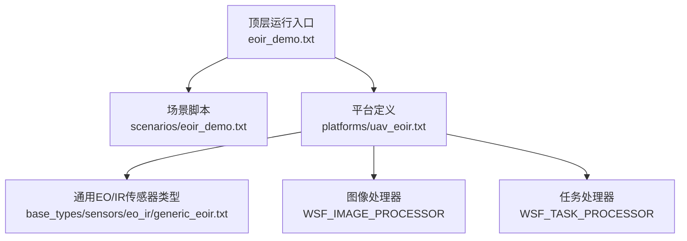
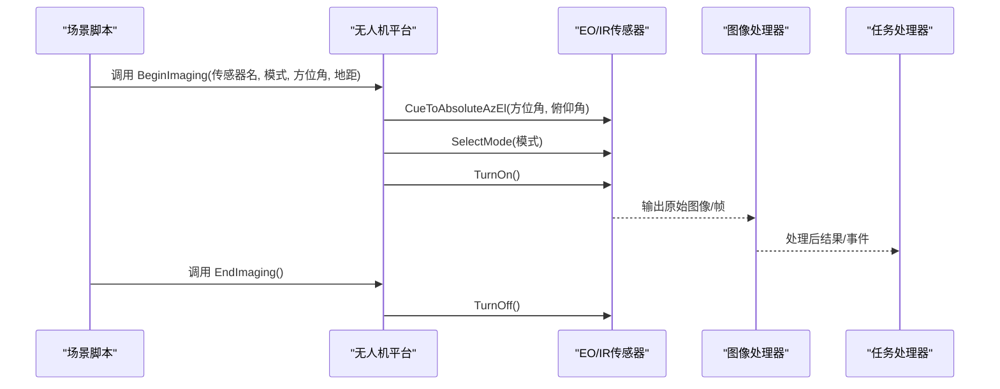
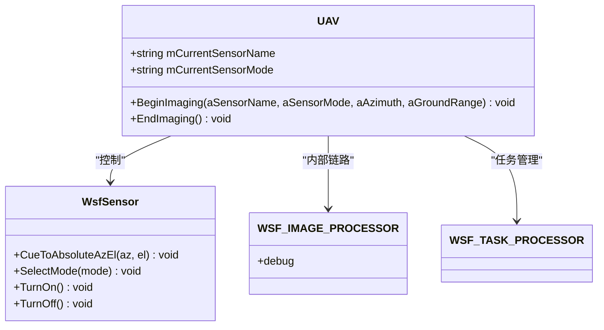
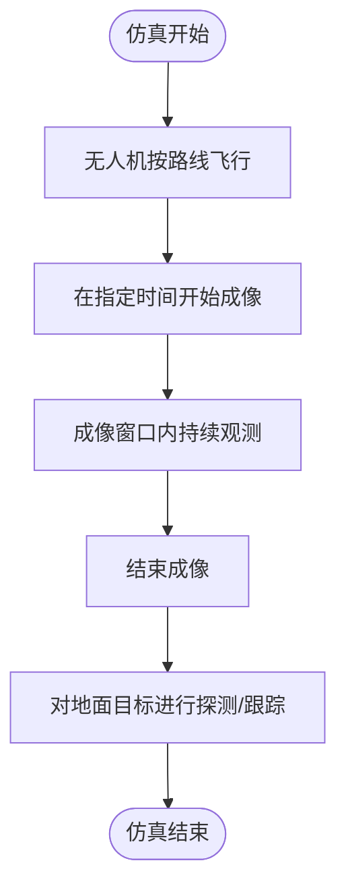
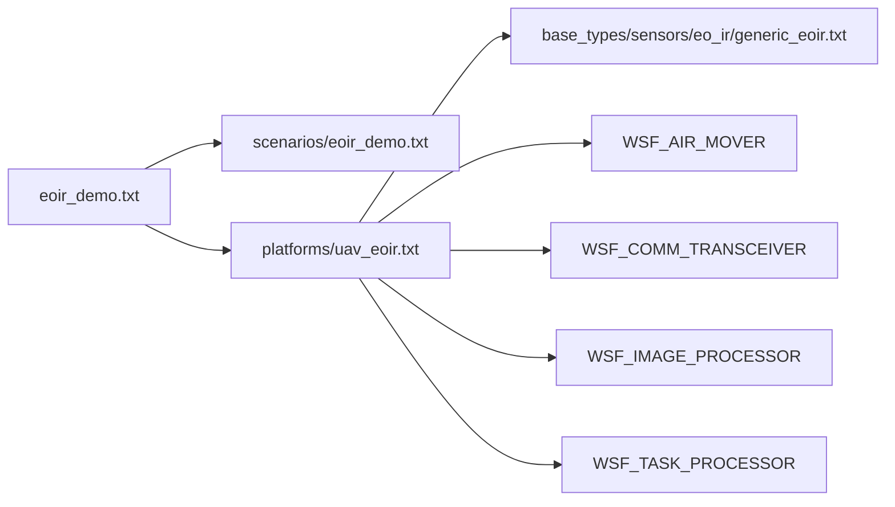

# 光电红外传感器

<cite>
**本文引用的文件**   
- [eoir_demo.txt](file://demos/sensor_demos/eoir_demo.txt)
- [eoir_demo.txt](file://demos/sensor_demos/scenarios/eoir_demo.txt)
- [uav_eoir.txt](file://demos/sensor_demos/platforms/uav_eoir.txt)
- [generic_eoir.txt](file://demos/base_types/sensors/eo_ir/generic_eoir.txt)
</cite>

## 目录
1. [简介](#简介)
2. [项目结构](#项目结构)
3. [核心组件](#核心组件)
4. [架构总览](#架构总览)
5. [详细组件分析](#详细组件分析)
6. [依赖关系分析](#依赖关系分析)
7. [性能考量](#性能考量)
8. [故障排查指南](#故障排查指南)
9. [结论](#结论)
10. [附录](#附录)

## 简介
本技术文档围绕AFSIM中的光电/红外（EO/IR）传感器系统，面向无人机载EO/IR成像与探测仿真场景，系统性阐述：
- 可见光、近红外、中波红外、长波红外的物理原理与应用场景
- 目标辐射特性建模（黑体辐射、大气传输、背景噪声）
- 光学系统设计参数（孔径、焦距、视场角、分辨率）
- 图像处理算法（图像增强、边缘检测、特征提取）
- 扫描模式配置（凝视、推扫、摆扫）
- EO/IR探测概率计算与性能分析方法
- 无人机载EO/IR实际配置示例与仿真场景
- 传感器参数优化以获取最佳探测效果

## 项目结构
在AFSIM的sensor_demos中，提供了完整的EO/IR演示工程，包含平台定义、场景脚本与顶层运行入口。关键文件组织如下：
- 顶层运行入口：demos/sensor_demos/eoir_demo.txt
- 场景脚本：demos/sensor_demos/scenarios/eoir_demo.txt
- 平台定义（含传感器与处理器）：demos/sensor_demos/platforms/uav_eoir.txt
- 通用EO/IR传感器类型定义：demos/base_types/sensors/eo_ir/generic_eoir.txt

图示来源
- [eoir_demo.txt:1-34](file://demos/sensor_demos/eoir_demo.txt#L1-L34)
- [eoir_demo.txt:1-83](file://demos/sensor_demos/scenarios/eoir_demo.txt#L1-L83)
- [uav_eoir.txt:1-68](file://demos/sensor_demos/platforms/uav_eoir.txt#L1-L68)
- [generic_eoir.txt](file://demos/base_types/sensors/eo_ir/generic_eoir.txt)

章节来源
- [eoir_demo.txt:1-34](file://demos/sensor_demos/eoir_demo.txt#L1-L34)
- [eoir_demo.txt:1-83](file://demos/sensor_demos/scenarios/eoir_demo.txt#L1-L83)
- [uav_eoir.txt:1-68](file://demos/sensor_demos/platforms/uav_eoir.txt#L1-L68)

## 核心组件
- 顶层运行入口（eoir_demo.txt）
  - 引入平台与场景
  - 配置事件管道与输出开关（如SENSOR_DETECTION_ATTEMPT、SENSOR_TRACK_INITIATED等）
  - 设置仿真结束时间
- 场景脚本（scenarios/eoir_demo.txt）
  - 定义无人机平台轨迹与执行动作（BeginImaging/EndImaging）
  - 定义地面目标位置（短程与远程目标）
- 平台定义（uav_eoir.txt）
  - 引入通用EO/IR传感器类型
  - 定义无人机平台类型、移动器、通信链路
  - 定义EO/IR传感器及其安装姿态（偏航、俯仰）
  - 连接图像处理器与任务处理器
  - 提供脚本接口用于控制传感器指向、模式选择、开关机
- 通用EO/IR传感器类型（generic_eoir.txt）
  - 定义EO/IR传感器的基础能力与参数（具体参数由该文件实现）

章节来源
- [eoir_demo.txt:1-34](file://demos/sensor_demos/eoir_demo.txt#L1-L34)
- [eoir_demo.txt:1-83](file://demos/sensor_demos/scenarios/eoir_demo.txt#L1-L83)
- [uav_eoir.txt:1-68](file://demos/sensor_demos/platforms/uav_eoir.txt#L1-L68)
- [generic_eoir.txt](file://demos/base_types/sensors/eo_ir/generic_eoir.txt)

## 架构总览
下图展示无人机载EO/IR系统的整体数据流与控制流：平台脚本驱动传感器指向与模式切换，传感器对目标进行探测并触发跟踪；图像处理器接收原始图像并进行处理；任务处理器协调任务调度。

图示来源
- [uav_eoir.txt:23-46](file://demos/sensor_demos/platforms/uav_eoir.txt#L23-L46)
- [eoir_demo.txt:16-28](file://demos/sensor_demos/scenarios/eoir_demo.txt#L16-L28)

## 详细组件分析

### 无人机平台与传感器控制
- 平台类型定义
  - 使用WSF_PLATFORM作为平台基类
  - 引入WSF_AIR_MOVER作为移动模型
  - 通过internal_link将传感器与图像处理器相连
- 传感器安装与姿态
  - yaw/pitch定义传感器相对于平台的安装角度
- 控制脚本接口
  - BeginImaging：计算俯仰角、指向绝对方位/俯仰、选择模式、开启传感器
  - EndImaging：关闭传感器

图示来源
- [uav_eoir.txt:15-67](file://demos/sensor_demos/platforms/uav_eoir.txt#L15-L67)

章节来源
- [uav_eoir.txt:15-67](file://demos/sensor_demos/platforms/uav_eoir.txt#L15-L67)

### 场景与目标配置
- 无人机轨迹与成像窗口
  - 在特定相对时间调用BeginImaging/EndImaging，控制成像时段
- 目标分布
  - 短程目标（sr_target_*）与远程目标（lr_target_01）
  - 目标位置以经纬度坐标给出

图示来源
- [eoir_demo.txt:16-28](file://demos/sensor_demos/scenarios/eoir_demo.txt#L16-L28)
- [eoir_demo.txt:37-83](file://demos/sensor_demos/scenarios/eoir_demo.txt#L37-L83)

章节来源
- [eoir_demo.txt:16-28](file://demos/sensor_demos/scenarios/eoir_demo.txt#L16-L28)
- [eoir_demo.txt:37-83](file://demos/sensor_demos/scenarios/eoir_demo.txt#L37-L83)

### 通用EO/IR传感器类型
- 作用
  - 封装EO/IR传感器的基础能力与参数（如波段、探测器特性、光学系统等）
- 使用方式
  - 通过include_once在平台定义中引入
  - 在平台中实例化并配置安装姿态与内部链路

章节来源
- [uav_eoir.txt:13-14](file://demos/sensor_demos/platforms/uav_eoir.txt#L13-L14)
- [generic_eoir.txt](file://demos/base_types/sensors/eo_ir/generic_eoir.txt)

## 依赖关系分析
- 顶层入口依赖平台与场景
- 平台依赖通用EO/IR传感器类型
- 平台内部依赖移动器、通信收发器、图像处理器、任务处理器
- 传感器与图像处理器通过内部链路耦合

图示来源
- [eoir_demo.txt:10-13](file://demos/sensor_demos/eoir_demo.txt#L10-L13)
- [uav_eoir.txt:48-66](file://demos/sensor_demos/platforms/uav_eoir.txt#L48-L66)

章节来源
- [eoir_demo.txt:10-13](file://demos/sensor_demos/eoir_demo.txt#L10-L13)
- [uav_eoir.txt:48-66](file://demos/sensor_demos/platforms/uav_eoir.txt#L48-L66)

## 性能考量
- 探测概率与信噪比
  - 探测概率受目标辐射强度、大气透过率、背景噪声、光学系统集光能力与探测器灵敏度影响
  - 提高信噪比的关键在于增大有效孔径、优化光学效率、降低系统噪声、提升积分时间（在运动模糊约束下）
- 光学系统参数
  - 孔径大小决定集光能力与衍射极限分辨率
  - 焦距影响视场角与像面辐照度
  - 视场角需匹配任务覆盖需求与目标尺寸
  - 空间分辨率需满足目标可分辨性要求（通常以瞬时视场IFOV或像素对应地面分辨率衡量）
- 大气与背景
  - 不同波段的大气吸收/散射差异显著，需结合环境条件（温湿度、气溶胶）评估透过率
  - 背景辐射（地表、天空、云）在不同波段差异明显，影响对比度与探测阈值
- 图像处理
  - 图像增强（直方图均衡、自适应滤波）可提升可视性与后续检测精度
  - 边缘检测与形态学操作有助于目标轮廓提取
  - 特征提取（纹理、形状、热异常）可用于分类与识别
- 扫描模式
  - 凝视模式：高驻留时间，适合高分辨率与低信噪比环境
  - 推扫模式：适合大范围条带成像，需考虑平台速度与同步
  - 摆扫模式：通过机械或电子扫描扩大视场，需权衡帧率与能量分配
- 优化建议
  - 根据任务目标尺寸与距离反推所需IFOV与孔径
  - 针对红外波段选择合适滤光片与探测器制冷方案
  - 调整扫描策略与积分时间以平衡帧率与信噪比
  - 利用多模态融合（可见光+红外）提升鲁棒性

[本节为通用指导，不直接分析具体文件]

## 故障排查指南
- 传感器未开启或未响应
  - 检查是否调用了TurnOn以及是否正确选择了模式
  - 确认传感器名称与平台定义的sensor块一致
- 成像窗口异常
  - 检查BeginImaging/EndImaging的时间点与相对时间语义
  - 确认方位角/俯仰角计算逻辑与安装姿态
- 事件输出缺失
  - 确保event_output中启用了相关事件（如SENSOR_DETECTION_ATTEMPT、SENSOR_TRACK_INITIATED等）
- 图像处理器无输出
  - 检查internal_link是否正确连接至image_proc
  - 启用debug选项以观察处理流程

章节来源
- [eoir_demo.txt:20-31](file://demos/sensor_demos/eoir_demo.txt#L20-L31)
- [uav_eoir.txt:55-63](file://demos/sensor_demos/platforms/uav_eoir.txt#L55-L63)

## 结论
AFSIM的EO/IR传感器体系通过平台-传感器-处理器分层架构，支持从可见光到红外多波段的成像与探测仿真。借助通用传感器类型与灵活的脚本控制，用户可构建无人机载EO/IR任务场景，并通过事件输出与分析工具评估探测性能。在实际工程中，应结合目标辐射特性、大气传输与背景噪声，合理设计光学系统与扫描策略，并辅以图像处理算法以提升探测与识别能力。

[本节为总结性内容，不直接分析具体文件]

## 附录
- 术语说明
  - EO：Electro-Optical，光电（可见光为主）
  - IR：Infrared，红外（近红外、中波红外、长波红外）
  - IFOV：Instantaneous Field of View，瞬时视场角
  - SNR：Signal-to-Noise Ratio，信噪比
- 参考路径
  - 顶层入口：demos/sensor_demos/eoir_demo.txt
  - 场景脚本：demos/sensor_demos/scenarios/eoir_demo.txt
  - 平台定义：demos/sensor_demos/platforms/uav_eoir.txt
  - 通用传感器类型：demos/base_types/sensors/eo_ir/generic_eoir.txt

[本节为补充信息，不直接分析具体文件]