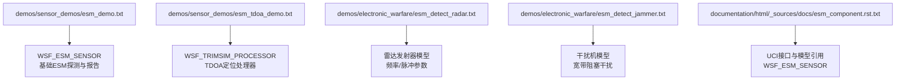
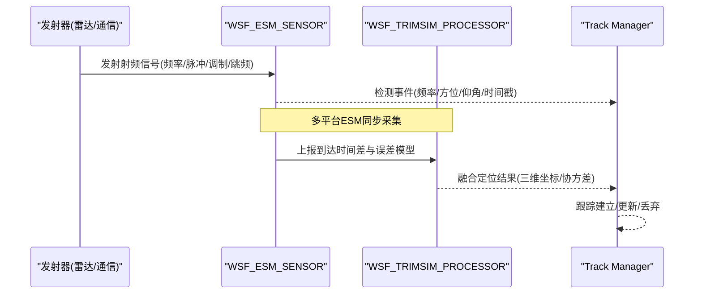
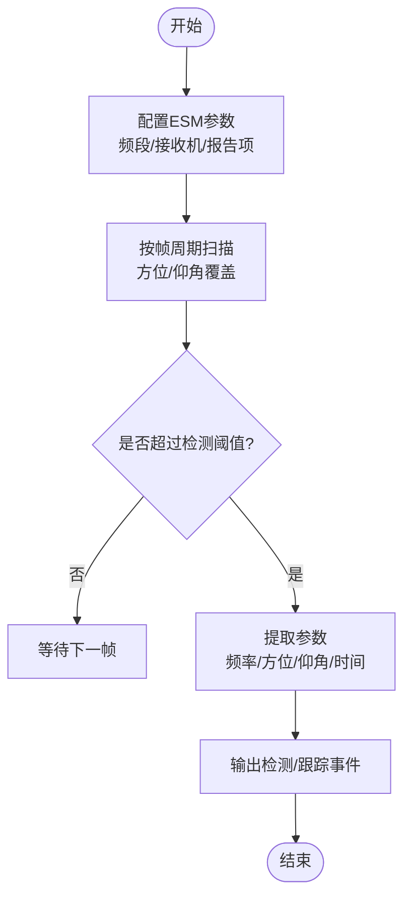
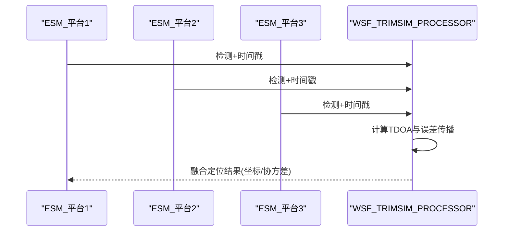
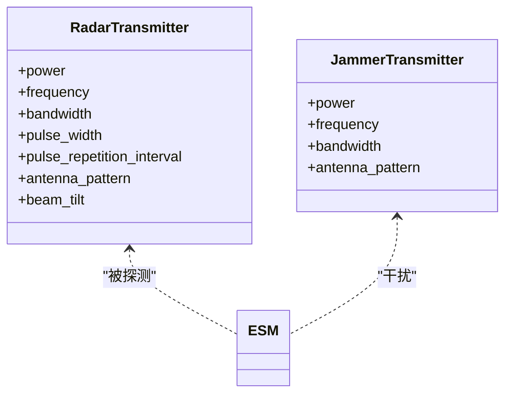
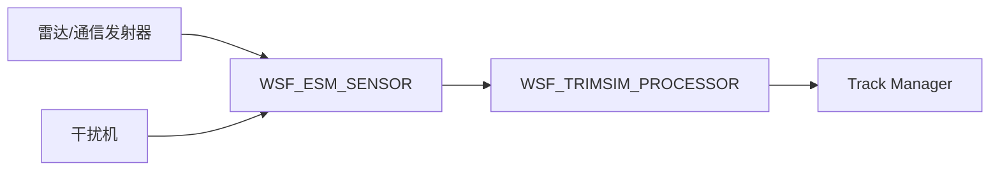

# 电子支援措施传感器

<cite>
**本文引用的文件**   
- [demos/sensor_demos/esm_demo.txt](file://demos/sensor_demos/esm_demo.txt)
- [demos/sensor_demos/esm_tdoa_demo.txt](file://demos/sensor_demos/esm_tdoa_demo.txt)
- [demos/electronic_warfare/esm_detect_radar.txt](file://demos/electronic_warfare/esm_detect_radar.txt)
- [demos/electronic_warfare/esm_detect_jammer.txt](file://demos/electronic_warfare/esm_detect_jammer.txt)
- [documentation/html/_sources/docs/esm_component.rst.txt](file://documentation/html/_sources/docs/esm_component.rst.txt)
</cite>

## 目录
1. [简介](#简介)
2. [项目结构](#项目结构)
3. [核心组件](#核心组件)
4. [架构总览](#架构总览)
5. [详细组件分析](#详细组件分析)
6. [依赖关系分析](#依赖关系分析)
7. [性能与电子战环境考量](#性能与电子战环境考量)
8. [故障排查指南](#故障排查指南)
9. [结论](#结论)
10. [附录](#附录)

## 简介
本技术文档面向AFSIM中的电子支援措施（ESM）传感器系统，围绕信号截获、参数测量、威胁识别、测向与定位、信号分选与识别、电子战对抗与抗截获能力、传感器网络协同配置以及自定义识别库开发等主题展开。文档以仓库中提供的示例场景为基础，结合官方文档片段，给出从概念到实现的可操作说明，并辅以架构图、流程图和时序图帮助理解。

## 项目结构
与ESM相关的示例与文档主要位于以下位置：
- 传感器演示：demos/sensor_demos/
- 电子战演示：demos/electronic_warfare/
- ESM组件文档源：documentation/html/_sources/docs/esm_component.rst.txt

图表来源
- [demos/sensor_demos/esm_demo.txt:90-113](file://demos/sensor_demos/esm_demo.txt#L90-L113)
- [demos/sensor_demos/esm_tdoa_demo.txt:90-132](file://demos/sensor_demos/esm_tdoa_demo.txt#L90-L132)
- [demos/electronic_warfare/esm_detect_radar.txt:81-124](file://demos/electronic_warfare/esm_detect_radar.txt#L81-L124)
- [demos/electronic_warfare/esm_detect_jammer.txt:39-53](file://demos/electronic_warfare/esm_detect_jammer.txt#L39-L53)
- [documentation/html/_sources/docs/esm_component.rst.txt:18-28](file://documentation/html/_sources/docs/esm_component.rst.txt#L18-L28)

章节来源
- [demos/sensor_demos/esm_demo.txt:1-252](file://demos/sensor_demos/esm_demo.txt#L1-L252)
- [demos/sensor_demos/esm_tdoa_demo.txt:1-292](file://demos/sensor_demos/esm_tdoa_demo.txt#L1-L292)
- [demos/electronic_warfare/esm_detect_radar.txt:1-253](file://demos/electronic_warfare/esm_detect_radar.txt#L1-L253)
- [demos/electronic_warfare/esm_detect_jammer.txt:1-328](file://demos/electronic_warfare/esm_detect_jammer.txt#L1-L328)
- [documentation/html/_sources/docs/esm_component.rst.txt:1-29](file://documentation/html/_sources/docs/esm_component.rst.txt#L1-L29)

## 核心组件
- WSF_ESM_SENSOR：被动射频传感器，负责在指定频段内对发射源进行探测、参数提取（如频率）、类型声明与跟踪输出。支持接收机噪声功率、检测阈值、内部损耗、天线方向图等参数配置；可报告位置、频率、类型等信息。
- WSF_TRIMSIM_PROCESSOR：基于TRIMSIM的TDOA定位处理器，聚合多个ESM传感器的到达时间差数据，计算三维目标点估计误差并应用于主传感器检测结果。需要传感器附带trimsim_error误差模型。
- 雷达发射器与干扰机模型：用于生成被测信号与对抗信号，包括载波频率、带宽、脉冲宽度、PRI、天线增益等参数，支撑ESM的信号截获与识别流程。

章节来源
- [demos/sensor_demos/esm_demo.txt:90-113](file://demos/sensor_demos/esm_demo.txt#L90-L113)
- [demos/sensor_demos/esm_tdoa_demo.txt:90-132](file://demos/sensor_demos/esm_tdoa_demo.txt#L90-L132)
- [demos/electronic_warfare/esm_detect_radar.txt:81-124](file://demos/electronic_warfare/esm_detect_radar.txt#L81-L124)
- [demos/electronic_warfare/esm_detect_jammer.txt:39-53](file://demos/electronic_warfare/esm_detect_jammer.txt#L39-L53)
- [documentation/html/_sources/docs/esm_component.rst.txt:18-28](file://documentation/html/_sources/docs/esm_component.rst.txt#L18-L28)

## 架构总览
ESM系统在AFSIM中的典型工作流如下：
- 发射端（雷达或通信设备）产生射频信号，包含载波频率、调制方式、脉冲参数与跳频图案（由发射器模型定义）。
- ESM传感器在宽频段内扫描，完成信号截获与参数测量（频率、方位、仰角、到达时间等），并输出检测事件与跟踪信息。
- 多传感器协同通过WSF_TRIMSIM_PROCESSOR进行TDOA融合，得到更精确的目标位置估计。
- 上层处理（如track_manager）将检测关联为稳定跟踪，并可驱动威胁评估与告警逻辑。

图表来源
- [demos/sensor_demos/esm_demo.txt:90-113](file://demos/sensor_demos/esm_demo.txt#L90-L113)
- [demos/sensor_demos/esm_tdoa_demo.txt:90-132](file://demos/sensor_demos/esm_tdoa_demo.txt#L90-L132)
- [demos/electronic_warfare/esm_detect_radar.txt:81-124](file://demos/electronic_warfare/esm_detect_radar.txt#L81-L124)

## 详细组件分析

### ESM传感器（WSF_ESM_SENSOR）
- 功能要点
  - 频段覆盖：frequency_band定义可探测的频率范围。
  - 接收机参数：detection_threshold、noise_power、internal_loss、antenna_pattern决定灵敏度与方向性。
  - 报告项：reports_location、reports_frequency、reports_type等，便于后续处理与可视化。
  - 类型声明：reported_emitter_type支持默认类型与声明时间控制，提高识别稳定性。
- 配置要点
  - slew_mode与maximum_range影响扫描策略与最大探测距离。
  - ranging_time可用于辅助测距或定位流程。
- 使用示例
  - 单平台ESM探测雷达辐射源，输出频率与位置跟踪。

图表来源
- [demos/sensor_demos/esm_demo.txt:90-113](file://demos/sensor_demos/esm_demo.txt#L90-L113)
- [demos/electronic_warfare/esm_detect_radar.txt:39-66](file://demos/electronic_warfare/esm_detect_radar.txt#L39-L66)

章节来源
- [demos/sensor_demos/esm_demo.txt:90-113](file://demos/sensor_demos/esm_demo.txt#L90-L113)
- [demos/electronic_warfare/esm_detect_radar.txt:39-66](file://demos/electronic_warfare/esm_detect_radar.txt#L39-L66)

### TDOA定位处理器（WSF_TRIMSIM_PROCESSOR）
- 功能要点
  - 聚合多个ESM传感器的检测数据，基于到达时间差计算目标三维位置估计。
  - 要求传感器附带trimsim_error误差模型，提供参考时间误差、系统间时延、传感器定时误差等参数。
  - minimum_detections控制触发融合所需的最小检测数。
- 配置要点
  - sensors块列出参与融合的传感器（本地或跨平台）。
  - debug与debug_level用于调试定位过程。
- 使用示例
  - 三架飞机上的ESM协同，对地面雷达辐射源进行TDOA定位。

图表来源
- [demos/sensor_demos/esm_tdoa_demo.txt:90-132](file://demos/sensor_demos/esm_tdoa_demo.txt#L90-L132)
- [demos/sensor_demos/esm_tdoa_demo.txt:199-206](file://demos/sensor_demos/esm_tdoa_demo.txt#L199-L206)

章节来源
- [demos/sensor_demos/esm_tdoa_demo.txt:90-132](file://demos/sensor_demos/esm_tdoa_demo.txt#L90-L132)
- [demos/sensor_demos/esm_tdoa_demo.txt:199-206](file://demos/sensor_demos/esm_tdoa_demo.txt#L199-L206)

### 雷达发射器与干扰机模型
- 雷达发射器
  - 关键参数：power、frequency、bandwidth、pulse_width、pulse_repetition_interval、antenna_pattern、beam_tilt等。
  - 作用：产生被测信号，供ESM截获与识别。
- 干扰机
  - 关键参数：power、frequency、bandwidth、antenna_pattern等。
  - 作用：模拟宽带阻塞干扰，降低雷达与ESM的检测概率，评估对抗效果。

图表来源
- [demos/electronic_warfare/esm_detect_radar.txt:95-103](file://demos/electronic_warfare/esm_detect_radar.txt#L95-L103)
- [demos/electronic_warfare/esm_detect_jammer.txt:46-53](file://demos/electronic_warfare/esm_detect_jammer.txt#L46-L53)

章节来源
- [demos/electronic_warfare/esm_detect_radar.txt:81-124](file://demos/electronic_warfare/esm_detect_radar.txt#L81-L124)
- [demos/electronic_warfare/esm_detect_jammer.txt:39-53](file://demos/electronic_warfare/esm_detect_jammer.txt#L39-L53)

### 信号数学模型与参数
- 载波频率与带宽：由transmitter.frequency与bandwidth定义，决定信号频谱特性。
- 调制方式：在AFSIM中通常由上层发射器模型或外部脚本定义；ESM侧可通过reported_emitter_type与模板匹配进行识别（见“信号分选与识别”）。
- 脉冲参数：pulse_width与pulse_repetition_interval描述脉冲宽度与重复间隔，影响PRF与最大无模糊距离。
- 跳频图案：可由外部脚本或发射器模式切换实现；ESM需具备足够快的扫描与频率分辨率以捕获跳变。

章节来源
- [demos/electronic_warfare/esm_detect_radar.txt:95-103](file://demos/electronic_warfare/esm_detect_radar.txt#L95-L103)
- [demos/sensor_demos/esm_demo.txt:90-113](file://demos/sensor_demos/esm_demo.txt#L90-L113)

### 测向技术与定位
- 干涉仪与多普勒测向：在AFSIM中可通过传感器方向图与角度测量体现；具体算法实现取决于传感器后端扩展。
- 到达时间差（TDOA）：通过WSF_TRIMSIM_PROCESSOR实现，结合trimsim_error误差模型，输出三维定位与协方差。

章节来源
- [demos/sensor_demos/esm_tdoa_demo.txt:90-132](file://demos/sensor_demos/esm_tdoa_demo.txt#L90-L132)

### 信号分选与识别算法
- 聚类分析：依据频率、方位、脉冲参数等进行分组，区分不同发射源。
- 模板匹配：利用reported_emitter_type与默认声明时间，匹配已知信号特征库。
- 机器学习方法：可扩展至外部识别引擎，通过UCI接口或脚本集成训练好的分类器。

章节来源
- [demos/electronic_warfare/esm_detect_radar.txt:55-59](file://demos/electronic_warfare/esm_detect_radar.txt#L55-L59)
- [documentation/html/_sources/docs/esm_component.rst.txt:18-28](file://documentation/html/_sources/docs/esm_component.rst.txt#L18-L28)

### 电子战环境下的性能分析
- 干扰对抗：宽带阻塞干扰可降低雷达与ESM的检测概率；通过调整干扰机功率与带宽评估影响。
- 抗截获能力：通过降低发射功率、采用低截获波形（如扩频/跳频）提升生存性；ESM侧通过提高灵敏度与快速扫描增强截获概率。

章节来源
- [demos/electronic_warfare/esm_detect_jammer.txt:39-53](file://demos/electronic_warfare/esm_detect_jammer.txt#L39-L53)
- [demos/electronic_warfare/esm_detect_radar.txt:81-124](file://demos/electronic_warfare/esm_detect_radar.txt#L81-L124)

### ESM传感器网络配置与协同
- 多平台ESM：在同一平台或多个平台上部署ESM传感器，并通过WSF_TRIMSIM_PROCESSOR进行数据融合。
- 协同模式：主传感器提供初始检测，从传感器补充时间与角度信息，提升定位精度与鲁棒性。

章节来源
- [demos/sensor_demos/esm_tdoa_demo.txt:199-206](file://demos/sensor_demos/esm_tdoa_demo.txt#L199-L206)

### 实际电子侦察场景与威胁评估示例
- 场景一：ESM探测地面雷达辐射源，输出频率与位置跟踪，结合track_manager形成稳定跟踪。
- 场景二：ESM在宽带阻塞干扰环境下工作，评估干扰对检测概率的影响。

章节来源
- [demos/sensor_demos/esm_demo.txt:90-113](file://demos/sensor_demos/esm_demo.txt#L90-L113)
- [demos/electronic_warfare/esm_detect_jammer.txt:127-146](file://demos/electronic_warfare/esm_detect_jammer.txt#L127-L146)

### 自定义信号识别库开发
- 接口与模型：通过UCI接口与WSF_ESM_SENSOR模型扩展识别逻辑，支持外部分类器接入。
- 开发步骤
  - 定义信号特征库（频率、调制、脉冲参数等）。
  - 在ESM中启用reported_emitter_type与声明时间控制。
  - 通过脚本或插件集成机器学习分类器，输出识别结果。

章节来源
- [documentation/html/_sources/docs/esm_component.rst.txt:18-28](file://documentation/html/_sources/docs/esm_component.rst.txt#L18-L28)

## 依赖关系分析
- ESM传感器依赖接收机参数与天线方向图，决定探测灵敏度与覆盖范围。
- TDOA处理器依赖多传感器时间同步与误差模型，确保定位精度。
- 雷达与干扰机模型为ESM提供被测信号与对抗信号，构成完整的电子战闭环。

图表来源
- [demos/electronic_warfare/esm_detect_radar.txt:81-124](file://demos/electronic_warfare/esm_detect_radar.txt#L81-L124)
- [demos/electronic_warfare/esm_detect_jammer.txt:39-53](file://demos/electronic_warfare/esm_detect_jammer.txt#L39-L53)
- [demos/sensor_demos/esm_tdoa_demo.txt:90-132](file://demos/sensor_demos/esm_tdoa_demo.txt#L90-L132)

## 性能与电子战环境考量
- 检测概率与虚警率：通过receiver.bandwidth、noise_power与detection_threshold调节；雷达侧可使用Swerling模型与概率参数优化检测性能。
- 干扰抑制：合理设置ESM频段与扫描策略，避免被宽带干扰淹没；必要时引入自适应滤波或频域抑制。
- 定位精度：TDOA误差模型参数（参考时间误差、系统间时延、传感器定时误差）直接影响三维定位精度，需根据平台同步能力校准。

章节来源
- [demos/electronic_warfare/esm_detect_radar.txt:105-118](file://demos/electronic_warfare/esm_detect_radar.txt#L105-L118)
- [demos/sensor_demos/esm_tdoa_demo.txt:117-125](file://demos/sensor_demos/esm_tdoa_demo.txt#L117-L125)

## 故障排查指南
- 未检测到信号
  - 检查ESM frequency_band是否覆盖发射频率。
  - 确认receiver.detection_threshold与noise_power设置合理。
- TDOA定位失败
  - 确认至少两个以上传感器有有效检测。
  - 检查trimsim_error参数是否正确配置。
- 跟踪不稳定
  - 调整track_manager的purge_interval与关联阈值。
  - 增加reported_emitter_type的time_to_declare以提高稳定性。

章节来源
- [demos/sensor_demos/esm_demo.txt:90-113](file://demos/sensor_demos/esm_demo.txt#L90-L113)
- [demos/sensor_demos/esm_tdoa_demo.txt:117-125](file://demos/sensor_demos/esm_tdoa_demo.txt#L117-L125)
- [demos/electronic_warfare/esm_detect_radar.txt:55-59](file://demos/electronic_warfare/esm_detect_radar.txt#L55-L59)

## 结论
AFSIM中的ESM传感器系统提供了从信号截获、参数测量到多传感器TDOA定位的完整能力链。通过合理配置ESM与TDOA处理器，并结合雷达与干扰机模型，可在复杂电子战环境中进行有效的侦察与对抗评估。进一步地，借助UCI接口与外部识别库，可实现更智能的信号分选与威胁识别。

## 附录
- 术语表
  - ESM：电子支援措施
  - TDOA：到达时间差
  - PRF：脉冲重复频率
  - RWR：雷达告警接收机
- 相关文档链接
  - ESM组件文档源：[documentation/html/_sources/docs/esm_component.rst.txt](file://documentation/html/_sources/docs/esm_component.rst.txt)