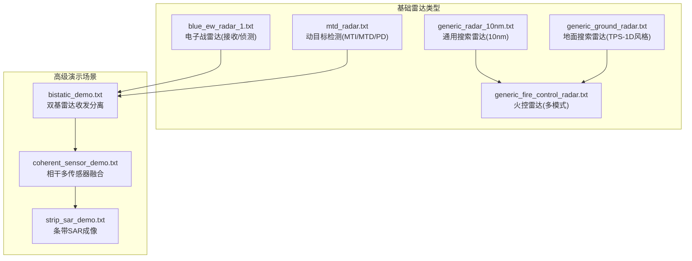
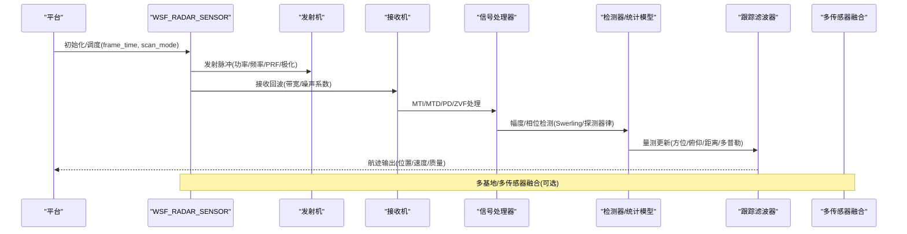
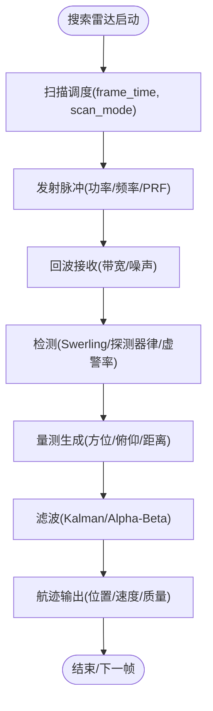
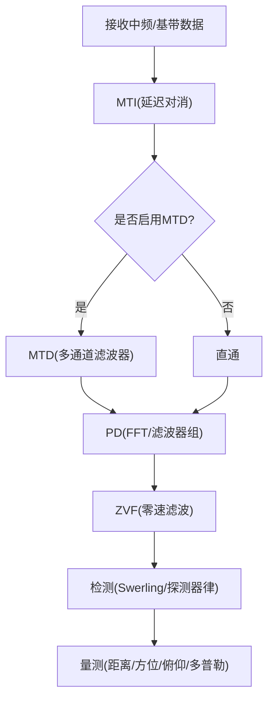
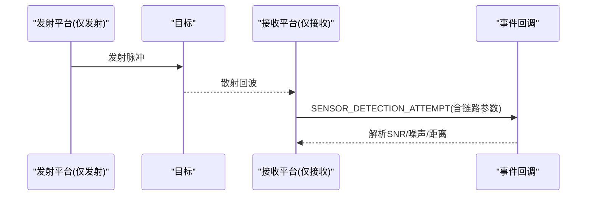
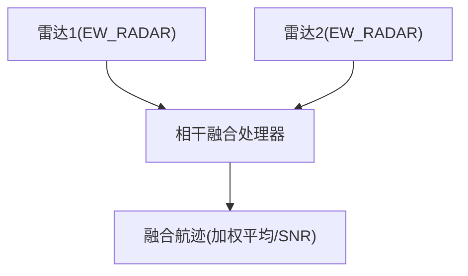
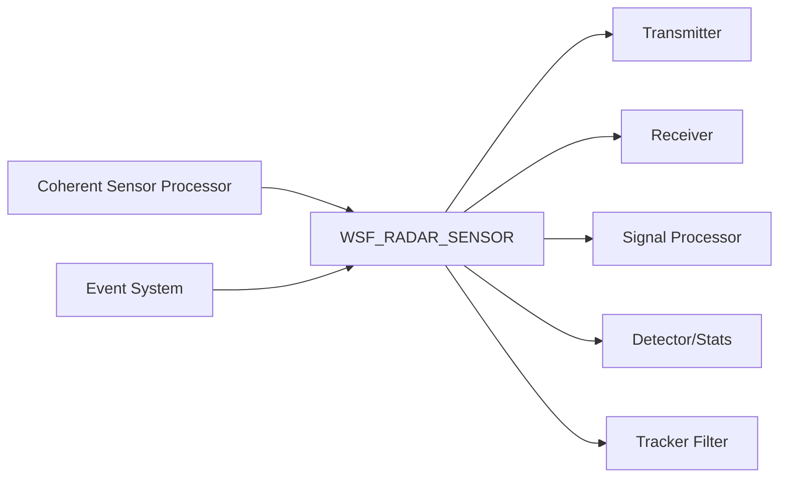

# 雷达传感器

<cite>
**本文引用的文件**   
- [generic_radar_10nm.txt](file://demos/base_types/sensors/radar/generic_radar_10nm.txt)
- [generic_ground_radar.txt](file://demos/base_types/sensors/radar/generic_ground_radar.txt)
- [generic_fire_control_radar.txt](file://demos/base_types/sensors/radar/generic_fire_control_radar.txt)
- [blue_ew_radar_1.txt](file://demos/base_types/sensors/radar/blue_ew_radar_1.txt)
- [mtd_radar.txt](file://demos/base_types/sensors/radar/mtd_radar.txt)
- [bistatic_demo.txt](file://demos/sensor_demos/bistatic_demo.txt)
- [coherent_sensor_demo.txt](file://demos/sensor_demos/coherent_sensor_demo.txt)
- [strip_sar_demo.txt](file://demos/sensor_demos/strip_sar_demo.txt)
</cite>

## 目录
1. [简介](#简介)
2. [项目结构](#项目结构)
3. [核心组件](#核心组件)
4. [架构总览](#架构总览)
5. [详细组件分析](#详细组件分析)
6. [依赖关系分析](#依赖关系分析)
7. [性能考量与优化](#性能考量与优化)
8. [故障排查指南](#故障排查指南)
9. [结论](#结论)
10. [附录：场景配置示例与调试方法](#附录场景配置示例与调试方法)

## 简介
本技术文档面向AFSIM中的雷达传感器子系统，系统性地解释搜索雷达、跟踪雷达、火控雷达与电子战雷达的工作原理与建模方式；给出雷达方程与探测距离计算思路、角度测量精度模型、多普勒效应处理流程；文档化雷达参数配置（工作频率、发射功率、波束宽度、扫描模式、脉冲重复频率）；说明信号处理技术（MTI、MTD、PD检测、SAR成像）；阐述多基地雷达配置与协同探测机制；并提供性能分析与优化最佳实践、杂波抑制、干扰对抗与目标检测算法的实操建议，以及实际场景配置与调试方法。

## 项目结构
AFSIM通过可复用的传感器定义文件组织雷达能力，典型路径位于 demos/base_types/sensors/radar 与 demos/sensor_demos。以下图展示与本主题相关的雷达配置文件及其职责划分。

图示来源
- [generic_radar_10nm.txt:155-271](file://demos/base_types/sensors/radar/generic_radar_10nm.txt#L155-L271)
- [generic_ground_radar.txt:80-199](file://demos/base_types/sensors/radar/generic_ground_radar.txt#L80-L199)
- [generic_fire_control_radar.txt:141-262](file://demos/base_types/sensors/radar/generic_fire_control_radar.txt#L141-L262)
- [blue_ew_radar_1.txt:10-29](file://demos/base_types/sensors/radar/blue_ew_radar_1.txt#L10-L29)
- [mtd_radar.txt:10-112](file://demos/base_types/sensors/radar/mtd_radar.txt#L10-L112)
- [bistatic_demo.txt:27-77](file://demos/sensor_demos/bistatic_demo.txt#L27-L77)
- [coherent_sensor_demo.txt:20-72](file://demos/sensor_demos/coherent_sensor_demo.txt#L20-L72)
- [strip_sar_demo.txt:10-39](file://demos/sensor_demos/strip_sar_demo.txt#L10-L39)

章节来源
- [generic_radar_10nm.txt:155-271](file://demos/base_types/sensors/radar/generic_radar_10nm.txt#L155-L271)
- [generic_ground_radar.txt:80-199](file://demos/base_types/sensors/radar/generic_ground_radar.txt#L80-L199)
- [generic_fire_control_radar.txt:141-262](file://demos/base_types/sensors/radar/generic_fire_control_radar.txt#L141-L262)
- [blue_ew_radar_1.txt:10-29](file://demos/base_types/sensors/radar/blue_ew_radar_1.txt#L10-L29)
- [mtd_radar.txt:10-112](file://demos/base_types/sensors/radar/mtd_radar.txt#L10-L112)
- [bistatic_demo.txt:27-77](file://demos/sensor_demos/bistatic_demo.txt#L27-L77)
- [coherent_sensor_demo.txt:20-72](file://demos/sensor_demos/coherent_sensor_demo.txt#L20-L72)
- [strip_sar_demo.txt:10-39](file://demos/sensor_demos/strip_sar_demo.txt#L10-L39)

## 核心组件
- 天线方向图与波束参数：峰值增益、方位/俯仰波束宽度、倾斜角等，决定空间分辨率与覆盖范围。
- 发射机：功率、频率、脉冲宽度、PRF、极化、压缩比、内部损耗等。
- 接收机：带宽、噪声系数、内部损耗、天线效率等。
- 信号处理器：MTI（固定目标抑制）、MTD（动目标检测）、PD（脉冲多普勒）、ZVF（零速度滤波）。
- 检测器与统计模型：Swerling起伏模型、探测器律（线性/平方/对数）、虚警概率、所需检测概率。
- 误差模型：方位/俯仰/距离测量标准差，用于定位精度评估。
- 跟踪与滤波：Kalman/Alpha-Beta滤波器，航迹建立/维持门限。
- 杂波与传播：杂波模型、地形遮蔽、大气衰减、多径等。
- 多传感器融合：相干传感器处理器、加权平均/SNR融合、RSS融合。

章节来源
- [generic_radar_10nm.txt:155-271](file://demos/base_types/sensors/radar/generic_radar_10nm.txt#L155-L271)
- [generic_ground_radar.txt:80-199](file://demos/base_types/sensors/radar/generic_ground_radar.txt#L80-L199)
- [generic_fire_control_radar.txt:141-262](file://demos/base_types/sensors/radar/generic_fire_control_radar.txt#L141-L262)
- [mtd_radar.txt:10-112](file://demos/base_types/sensors/radar/mtd_radar.txt#L10-L112)
- [coherent_sensor_demo.txt:101-119](file://demos/sensor_demos/coherent_sensor_demo.txt#L101-L119)

## 架构总览
下图展示从平台到传感器、信号处理、检测与跟踪的数据流，以及多基地与多传感器融合扩展点。

图示来源
- [generic_radar_10nm.txt:166-271](file://demos/base_types/sensors/radar/generic_radar_10nm.txt#L166-L271)
- [mtd_radar.txt:20-112](file://demos/base_types/sensors/radar/mtd_radar.txt#L20-L112)
- [coherent_sensor_demo.txt:101-119](file://demos/sensor_demos/coherent_sensor_demo.txt#L101-L119)

## 详细组件分析

### 搜索雷达（Generic Search Radar）
- 工作原理：宽波束、大视场、长帧时间，提供广域监视与初始发现。
- 关键参数：one_m2_detect_range或range_product约束探测距离；frame_time控制扫描周期；azimuth/elevation_field_of_view限定快速裁剪区域；transmitter/receiver定义链路预算；detector_law、probability_of_false_alarm、swerling_case影响检测性能；误差sigma决定角度/距离精度。
- 典型配置参考：
  - 10nm探测距离的通用搜索雷达，包含天线方向图、发射/接收参数、检测阈值、误差与滤波器设置。
  - 地面搜索雷达（TPS-1D风格），强调frame_time、one_m2_detect_range、receiver天线方向图与误差模型。

图示来源
- [generic_radar_10nm.txt:166-271](file://demos/base_types/sensors/radar/generic_radar_10nm.txt#L166-L271)
- [generic_ground_radar.txt:91-199](file://demos/base_types/sensors/radar/generic_ground_radar.txt#L91-L199)

章节来源
- [generic_radar_10nm.txt:155-271](file://demos/base_types/sensors/radar/generic_radar_10nm.txt#L155-L271)
- [generic_ground_radar.txt:80-199](file://demos/base_types/sensors/radar/generic_ground_radar.txt#L80-L199)

### 跟踪雷达（Tracking Radar）
- 工作原理：在搜索雷达提供的初始航迹基础上，提高重访率与数据率，提升跟踪精度与稳定性。
- 关键参数：revisit_time/dwell_time控制驻留与更新节奏；hits_to_establish_track/hits_to_maintain_track保障航迹鲁棒性；更小的误差sigma与更高track_quality。
- 典型配置参考：火控雷达的TRACK模式，支持同时跟踪多个目标，具备高track_quality与严格建立/维持门限。

章节来源
- [generic_fire_control_radar.txt:178-262](file://demos/base_types/sensors/radar/generic_fire_control_radar.txt#L178-L262)

### 火控雷达（Fire Control Radar）
- 工作原理：窄波束、高精度、多模式（ACQUIRE/TRACK），为武器制导提供高质量量测。
- 关键参数：mode_template统一帧时间、驻留时间、发射/接收参数；mode级覆盖FOV、请求计数、track_quality与门限；filter参数保证跟踪精度。
- 典型配置参考：圆形天线方向图、窄波束、较高功率与PRF，支持多目标跟踪与武器质量航迹。

章节来源
- [generic_fire_control_radar.txt:141-262](file://demos/base_types/sensors/radar/generic_fire_control_radar.txt#L141-L262)

### 电子战雷达（EW Radar）
- 工作原理：以接收为主，进行频谱监测、辐射源识别与干扰评估；可与主雷达协同形成抗干扰体系。
- 关键参数：低频段（如435MHz）、较宽带宽、较低功率；reports_location用于定位辐射源；可与jamming/ESM流程联动。
- 典型配置参考：单一天线均匀方向图，低频接收，定位报告。

章节来源
- [blue_ew_radar_1.txt:10-29](file://demos/base_types/sensors/radar/blue_ew_radar_1.txt#L10-L29)

### 动目标检测与多普勒处理（MTI/MTD/PD）
- 工作原理：
  - MTI：利用延迟线对消抑制静止杂波。
  - MTD：将MTI扩展为多通道滤波器组，改善杂波谱估计与抑制。
  - PD：脉冲多普勒处理，提取目标径向速度与多普勒谱。
  - ZVF：零速滤波，抑制地杂波中心谱峰。
- 关键参数：mti_num_delays、pd_num_filters/poles/filter_bandwidth/slr、zvf相关参数、clutter模型、PRF选择与PRF分集。
- 典型配置参考：含MTI/MTD/PD/ZVF开关与参数、杂波模型、Swerling Case与所需检测概率。

图示来源
- [mtd_radar.txt:17-112](file://demos/base_types/sensors/radar/mtd_radar.txt#L17-L112)

章节来源
- [mtd_radar.txt:10-112](file://demos/base_types/sensors/radar/mtd_radar.txt#L10-L112)

### 多基地雷达与协同探测
- 工作原理：发射端与接收端分离，利用几何优势与分集增益提升探测概率与抗干扰能力；可通过事件回调获取链路预算与SNR细节。
- 关键参数：receive_only/transmit_only、antenna_height、frequency/bandwidth/noise_figure、integration_gain；use_bisector_for_bistatic影响双基几何处理。
- 典型配置参考：收发平台分离，接收端仅接收并输出检测尝试事件，脚本打印链路参数。

图示来源
- [bistatic_demo.txt:27-77](file://demos/sensor_demos/bistatic_demo.txt#L27-L77)
- [bistatic_demo.txt:163-181](file://demos/sensor_demos/bistatic_demo.txt#L163-L181)

章节来源
- [bistatic_demo.txt:10-197](file://demos/sensor_demos/bistatic_demo.txt#L10-L197)

### 相干多传感器融合
- 工作原理：多个同频/相参传感器观测同一目标，通过SNR/RSS加权融合提升检测与跟踪质量。
- 关键参数：multi_sensor_detector WSF_COHERENT_SENSOR_PROCESSOR、result_processing_type(SNR_BASED/RSS_BASED)、fusion_method(weighted_average)、update_interval。
- 典型配置参考：两个EW雷达站点，使用相干处理器融合结果，可视化绘制轨迹与SNR标注。

图示来源
- [coherent_sensor_demo.txt:20-72](file://demos/sensor_demos/coherent_sensor_demo.txt#L20-L72)
- [coherent_sensor_demo.txt:101-119](file://demos/sensor_demos/coherent_sensor_demo.txt#L101-L119)

章节来源
- [coherent_sensor_demo.txt:10-279](file://demos/sensor_demos/coherent_sensor_demo.txt#L10-L279)

### SAR成像（条带SAR）
- 工作原理：沿飞行轨迹合成孔径，实现高分辨率二维成像；AFSIM中通过平台与场景组合驱动SAR仿真。
- 关键参数：平台运动学、传感器成像模式（strip/narrow_spot）、事件输出与轨道回放。
- 典型配置参考：包含UAV SAR平台与地面站场景，输出事件与AER回放。

章节来源
- [strip_sar_demo.txt:10-39](file://demos/sensor_demos/strip_sar_demo.txt#L10-L39)

## 依赖关系分析
- 传感器与处理器：WSF_RADAR_SENSOR依赖发射/接收模块、信号处理器、检测器与滤波器；WSF_TRACK_PROCESSOR管理航迹生命周期。
- 多传感器融合：WSF_COHERENT_SENSOR_PROCESSOR依赖多个雷达传感器的检测结果与SNR信息。
- 事件系统：SENSOR_DETECTION_ATTEMPT、LOCAL_TRACK_*等事件贯穿传感器与外部观察者/脚本。

图示来源
- [generic_radar_10nm.txt:166-271](file://demos/base_types/sensors/radar/generic_radar_10nm.txt#L166-L271)
- [coherent_sensor_demo.txt:101-119](file://demos/sensor_demos/coherent_sensor_demo.txt#L101-L119)

章节来源
- [generic_radar_10nm.txt:166-271](file://demos/base_types/sensors/radar/generic_radar_10nm.txt#L166-L271)
- [coherent_sensor_demo.txt:101-119](file://demos/sensor_demos/coherent_sensor_demo.txt#L101-L119)

## 性能考量与优化
- 杂波抑制
  - 合理设置MTI/MTD滤波器阶数与带宽，匹配杂波谱特性；使用ZVF抑制地杂波中心谱峰。
  - 调整clutter模型与杂波表，结合地形与海况。
- 干扰对抗
  - EW雷达与主雷达协同，采用频率捷变、PRF分集与多基地布局降低被干扰概率。
  - 在PD处理中增加滤波器数量与SLR，提升旁瓣抑制。
- 目标检测算法
  - 根据目标起伏选择合适的Swerling Case与探测器律；调节probability_of_false_alarm与required_pd平衡检测概率与虚警。
  - 通过number_of_pulses_integrated与integration_gain提升信噪比。
- 角度与距离精度
  - 减小azimuth/elevation/range_error_sigma以提升定位精度；合理设计波束宽度与驻留时间。
- 多传感器融合
  - 优先采用SNR_BASED加权融合，提升低SNR目标的可检测性；合理设置update_interval与融合权重。

[本节为通用指导，不直接分析具体文件]

## 故障排查指南
- 无检测或检测率低
  - 检查one_m2_detect_range或range_product是否与预期一致；确认transmitter power/frequency与receiver bandwidth/noise_figure设置合理。
  - 核查probability_of_false_alarm与required_pd是否过严；适当放宽或增加积分脉冲数。
- 角度/距离误差过大
  - 检查azimuth/elevation/range_error_sigma与滤波器参数；确保frame_time与scan_mode与目标机动匹配。
- MTI/MTD无效
  - 确认clutter_model已加载且参数合理；检查mti_num_delays、pd_num_filters与filter_bandwidth是否匹配PRF与目标速度范围。
- 多基地链路异常
  - 检查receive_only/transmit_only配置与antenna_height；确认event_output启用了SENSOR_DETECTION_ATTEMPT并通过脚本打印链路参数诊断SNR。
- 融合效果不佳
  - 调整result_processing_type与fusion_method；检查各传感器SNR差异与update_interval同步。

章节来源
- [generic_radar_10nm.txt:166-271](file://demos/base_types/sensors/radar/generic_radar_10nm.txt#L166-L271)
- [mtd_radar.txt:17-112](file://demos/base_types/sensors/radar/mtd_radar.txt#L17-L112)
- [bistatic_demo.txt:163-181](file://demos/sensor_demos/bistatic_demo.txt#L163-L181)
- [coherent_sensor_demo.txt:101-119](file://demos/sensor_demos/coherent_sensor_demo.txt#L101-L119)

## 结论
AFSIM的雷达传感器体系通过模块化配置实现了从搜索、跟踪到火控与电子战的完整能力链；借助MTI/MTD/PD/ZVF与Swerling检测模型，能够灵活适配不同环境与任务需求；多基地与相干多传感器融合进一步提升了探测鲁棒性与精度。通过合理的参数调优与杂波/干扰抑制策略，可在复杂场景中取得稳定可靠的雷达性能。

[本节为总结性内容，不直接分析具体文件]

## 附录：场景配置示例与调试方法
- 搜索雷达场景
  - 使用generic_radar_10nm.txt或generic_ground_radar.txt作为模板，调整one_m2_detect_range、frame_time、transmitter/receiver参数与误差sigma。
- 动目标检测场景
  - 基于mtd_radar.txt，启用MTI/MTD/PD/ZVF，配置clutter_model与PRF分集，观察检测概率与虚警率变化。
- 多基地雷达场景
  - 参考bistatic_demo.txt，分别配置仅发射与仅接收传感器，启用SENSOR_DETECTION_ATTEMPT事件并在脚本中打印链路参数进行验证。
- 相干多传感器融合场景
  - 参考coherent_sensor_demo.txt，部署两个EW雷达站点，使用WSF_COHERENT_SENSOR_PROCESSOR进行SNR/RSS融合，可视化轨迹与SNR。
- SAR成像场景
  - 参考strip_sar_demo.txt，组合UAV SAR平台与地面站场景，输出事件与AER回放，验证成像流程。

章节来源
- [generic_radar_10nm.txt:155-271](file://demos/base_types/sensors/radar/generic_radar_10nm.txt#L155-L271)
- [generic_ground_radar.txt:80-199](file://demos/base_types/sensors/radar/generic_ground_radar.txt#L80-L199)
- [mtd_radar.txt:10-112](file://demos/base_types/sensors/radar/mtd_radar.txt#L10-L112)
- [bistatic_demo.txt:10-197](file://demos/sensor_demos/bistatic_demo.txt#L10-L197)
- [coherent_sensor_demo.txt:10-279](file://demos/sensor_demos/coherent_sensor_demo.txt#L10-L279)
- [strip_sar_demo.txt:10-39](file://demos/sensor_demos/strip_sar_demo.txt#L10-L39)