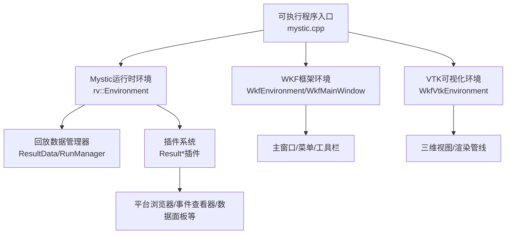
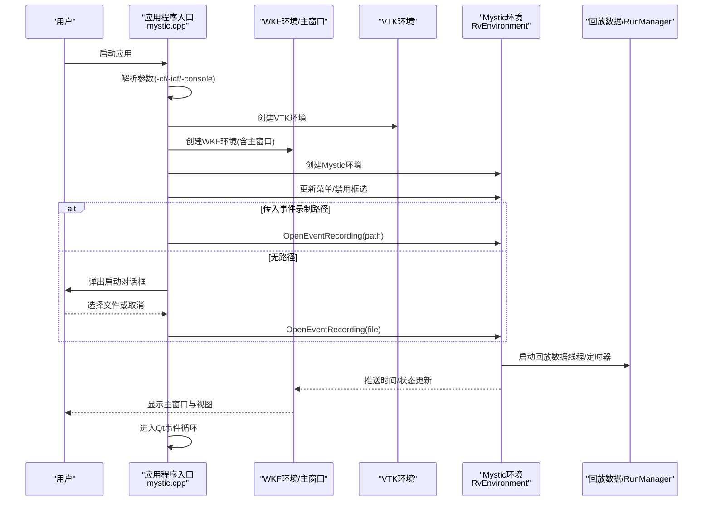
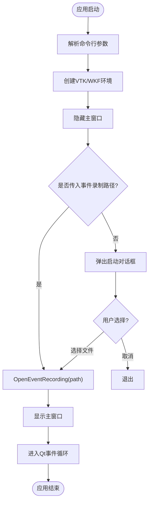
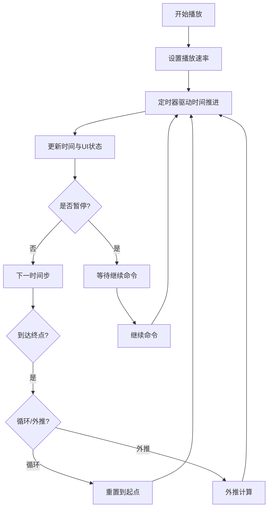
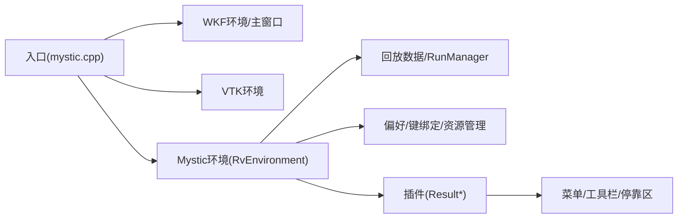

# Mystic GUI界面

<cite>
**本文引用的文件**   
- [mystic.cpp](file://swdev/src/mystic/exec/source/mystic.cpp)
- [RvEnvironment.cpp](file://swdev/src/mystic/lib/source/RvEnvironment.cpp)
- [README.md](file://swdev/src/mystic/README.md)
</cite>

## 目录
1. [简介](#简介)
2. [项目结构](#项目结构)
3. [核心组件](#核心组件)
4. [架构总览](#架构总览)
5. [详细组件分析](#详细组件分析)
6. [依赖关系分析](#依赖关系分析)
7. [性能考虑](#性能考虑)
8. [故障排查指南](#故障排查指南)
9. [结论](#结论)
10. [附录](#附录)

## 简介
本文件面向Mystic GUI的终端用户与二次开发者，系统性说明其界面架构、启动流程、主窗口布局与菜单系统、工具栏配置、用户交互模式（鼠标、键盘、拖拽）、视图控制系统（三维视图切换、视角控制、缩放）、仿真控制（播放、时间步进、速度调节）、平台浏览器/事件查看器/数据面板使用方法，以及界面自定义与主题配置。文档同时提供常用操作流程与最佳实践建议，帮助快速上手并高效使用Mystic进行仿真回放与分析。

## 项目结构
Mystic模块由可执行程序入口、运行时环境、插件体系与资源组成：
- 执行入口：负责应用初始化、命令行参数解析、环境与主窗口创建、事件记录加载与主循环运行。
- 运行时环境：封装回放数据管理、菜单更新、最近文件列表、播放控制、时间推进、错误恢复等。
- 插件体系：以Result*命名的功能插件（如平台浏览器、地图显示、轨道、统计、视频捕获等），通过统一接口注册到主窗口菜单与停靠区。
- 资源与主题：共享图标、样式与侧边栏模板等资源。

图表来源
- [mystic.cpp:107-262](file://swdev/src/mystic/exec/source/mystic.cpp#L107-L262)
- [RvEnvironment.cpp:94-128](file://swdev/src/mystic/lib/source/RvEnvironment.cpp#L94-L128)

章节来源
- [README.md:1-35](file://swdev/src/mystic/README.md#L1-L35)

## 核心组件
- 应用程序入口（mystic.cpp）
  - 设置应用标识、版本、图标；解析命令行参数（-cf/-icf/-console）；在Windows下关联文件类型；创建WKF/VTK环境；隐藏主窗口直至启动对话框完成；打开事件录制或弹出启动对话框；进入Qt事件循环；退出时清理环境。
- 运行时环境（RvEnvironment.cpp）
  - 维护单例实例；构建“文件”菜单与快捷键；启动回放数据线程；定时器驱动时间推进与UI刷新；处理播放控制（暂停/继续/重启/反向）；管理最近文件列表；分发各类消息（平台、网络、通信、注释、书签、区域、标注等）；日期与时区设置；DTED/GeoTIFF地形资源加载；平台名称查询与变体映射。

章节来源
- [mystic.cpp:107-262](file://swdev/src/mystic/exec/source/mystic.cpp#L107-L262)
- [RvEnvironment.cpp:94-128](file://swdev/src/mystic/lib/source/RvEnvironment.cpp#L94-L128)

## 架构总览
Mystic基于WKF（通用框架）与VTK（可视化）构建，采用“入口+环境+插件”的分层架构：
- 入口层：负责应用生命周期、参数解析、环境装配与主循环。
- 环境层：封装回放数据流、菜单/工具栏扩展、播放控制、时间推进、资源管理与消息分发。
- 插件层：以Result*为前缀的功能模块，按需挂载到菜单与停靠区，提供平台浏览、地图、轨道、统计、视频捕获等能力。
- 视图层：基于VTK的三维场景，支持视角旋转、平移、缩放、投影切换等。

图表来源
- [mystic.cpp:107-262](file://swdev/src/mystic/exec/source/mystic.cpp#L107-L262)
- [RvEnvironment.cpp:507-567](file://swdev/src/mystic/lib/source/RvEnvironment.cpp#L507-L567)

## 详细组件分析

### 启动流程与主窗口布局
- 启动流程
  - 应用信息设置与异常处理。
  - 命令行参数解析：-?/-h/-help显示帮助；-cf指定配置文件并保存修改；-icf导入配置文件但不保存；-console启用控制台输出。
  - Windows平台文件类型关联（.aer）。
  - 创建VTK与WKF环境，隐藏主窗口直到启动对话框完成。
  - 若未提供事件录制路径，则弹出启动对话框让用户选择文件。
  - 打开事件录制后，显示主窗口并进入事件循环。
- 主窗口布局
  - 主窗口由WKF框架提供，包含菜单栏、工具栏、停靠区与中央视图区。
  - “文件”菜单动态添加“打开...”动作与“最近打开”子菜单。
  - 帮助菜单中“文档”可见，“关于Mystic”文本调整为“关于”。

图表来源
- [mystic.cpp:107-262](file://swdev/src/mystic/exec/source/mystic.cpp#L107-L262)

章节来源
- [mystic.cpp:107-262](file://swdev/src/mystic/exec/source/mystic.cpp#L107-L262)

### 菜单系统与工具栏配置
- 菜单系统
  - “文件”菜单：动态插入“打开...”动作，绑定Ctrl+O快捷键；维护“最近打开”子菜单，自动填充最近的事件录制文件。
  - “帮助”菜单：根据Mystic需求调整“文档”与“关于”项的可见性与文本。
- 工具栏配置
  - 工具栏由WKF框架统一管理，Mystic通过插件扩展具体工具项（如播放控制、视图切换、测量工具等）。
  - 可通过插件注册接口将工具按钮添加到工具栏或菜单。

章节来源
- [RvEnvironment.cpp:94-128](file://swdev/src/mystic/lib/source/RvEnvironment.cpp#L94-L128)
- [RvEnvironment.cpp:569-600](file://swdev/src/mystic/lib/source/RvEnvironment.cpp#L569-L600)
- [mystic.cpp:221-236](file://swdev/src/mystic/exec/source/mystic.cpp#L221-L236)

### 用户交互模式
- 鼠标操作
  - 三维视图支持旋转、平移、缩放（滚轮或右键拖动），框选被默认禁用以避免误操作。
  - 地图与数据面板支持点击选中、双击聚焦、右键上下文菜单。
- 键盘快捷键
  - Ctrl+O：打开事件录制文件。
  - 其他快捷键由WKF键绑定对象统一管理，可在偏好设置中查看与修改。
- 拖拽功能
  - 支持从文件管理器拖入.aer文件直接打开。
  - 平台与轨迹在地图/视图中支持拖拽重定位（受平台定义约束）。

章节来源
- [mystic.cpp:218-219](file://swdev/src/mystic/exec/source/mystic.cpp#L218-L219)
- [RvEnvironment.cpp:101-107](file://swdev/src/mystic/lib/source/RvEnvironment.cpp#L101-L107)

### 视图控制系统
- 三维视图切换
  - 支持多种投影与视角预设（如俯视、侧视、跟随目标），通过菜单或工具栏切换。
- 视角控制
  - 鼠标左键旋转、右键平移、滚轮缩放；键盘方向键微调视角。
- 缩放操作
  - 滚轮缩放、工具栏缩放按钮、快捷键缩放；支持按平台/区域自适应缩放。

章节来源
- [mystic.cpp:218-219](file://swdev/src/mystic/exec/source/mystic.cpp#L218-L219)

### 仿真控制功能
- 播放控制
  - 暂停/继续/重启/反向播放，通过工具栏或菜单触发。
- 时间步进
  - 逐帧前进/后退，滑块拖动跳转时间点。
- 速度调节
  - 播放速率可调（慢放/快进），影响时间推进频率。
- 循环与外推
  - 支持循环播放与末尾外推，避免回放结束时中断。

图表来源
- [RvEnvironment.cpp:130-211](file://swdev/src/mystic/lib/source/RvEnvironment.cpp#L130-L211)
- [RvEnvironment.cpp:298-332](file://swdev/src/mystic/lib/source/RvEnvironment.cpp#L298-L332)

章节来源
- [RvEnvironment.cpp:130-211](file://swdev/src/mystic/lib/source/RvEnvironment.cpp#L130-L211)
- [RvEnvironment.cpp:298-332](file://swdev/src/mystic/lib/source/RvEnvironment.cpp#L298-L332)

### 平台浏览器、事件查看器与数据面板
- 平台浏览器
  - 列出当前回放中的平台实体，支持按名称/编号筛选、高亮选中、跟踪轨迹。
- 事件查看器
  - 展示武器发射、平台状态、通信链路等事件，支持时间轴过滤与详情查看。
- 数据面板
  - 显示平台属性、传感器模式、网络拓扑等结构化数据，支持导出与对比。

章节来源
- [RvEnvironment.cpp:334-499](file://swdev/src/mystic/lib/source/RvEnvironment.cpp#L334-L499)

### 界面自定义选项与主题配置
- 偏好设置
  - 内存缓存页数、插值策略、键绑定、主题外观等可通过偏好对话框配置。
- 主题与样式
  - 使用WKF主题系统，支持侧边栏HTML模板与图标资源替换。
- 语言与本地化
  - 通过WKF国际化机制切换界面语言。

章节来源
- [RvEnvironment.cpp:23-32](file://swdev/src/mystic/lib/source/RvEnvironment.cpp#L23-L32)

## 依赖关系分析
Mystic对WKF与VTK存在强依赖，并通过插件扩展功能：
- 入口依赖WKF主窗口与VTK环境，用于UI与渲染。
- 运行时环境依赖WKF偏好、资源管理与键绑定对象。
- 回放数据与RunManager负责事件流与最近文件管理。
- 插件通过统一接口注册到菜单与停靠区，形成松耦合扩展。

图表来源
- [mystic.cpp:207-213](file://swdev/src/mystic/exec/source/mystic.cpp#L207-L213)
- [RvEnvironment.cpp:23-32](file://swdev/src/mystic/lib/source/RvEnvironment.cpp#L23-L32)

章节来源
- [mystic.cpp:207-213](file://swdev/src/mystic/exec/source/mystic.cpp#L207-L213)
- [RvEnvironment.cpp:23-32](file://swdev/src/mystic/lib/source/RvEnvironment.cpp#L23-L32)

## 性能考虑
- 回放数据缓存
  - 通过内存缓存页数控制数据预取范围，平衡内存占用与回放流畅度。
- 定时器刷新
  - 固定频率定时器驱动UI更新，避免频繁重绘导致卡顿。
- 资源加载
  - DTED/GeoTIFF地形资源按需加载，减少初始启动开销。
- 插件优化
  - 仅启用必要插件，减少菜单与停靠区渲染压力。

章节来源
- [RvEnvironment.cpp:119-127](file://swdev/src/mystic/lib/source/RvEnvironment.cpp#L119-L127)
- [RvEnvironment.cpp:434-481](file://swdev/src/mystic/lib/source/RvEnvironment.cpp#L434-L481)

## 故障排查指南
- 文件类型不匹配
  - 当录制文件的schema与Mystic版本不兼容时，会提示失败并中止加载。
- 文件变更需重置
  - 录制文件被外部修改时，提示需要重置并自动重新加载。
- 文件不存在
  - 打开不存在的文件时，提示并从最近列表中移除无效条目。
- 控制台输出
  - 使用-console参数在Windows下启用控制台输出，便于调试日志。

章节来源
- [RvEnvironment.cpp:155-211](file://swdev/src/mystic/lib/source/RvEnvironment.cpp#L155-L211)
- [RvEnvironment.cpp:527-567](file://swdev/src/mystic/lib/source/RvEnvironment.cpp#L527-L567)
- [mystic.cpp:178-205](file://swdev/src/mystic/exec/source/mystic.cpp#L178-L205)

## 结论
Mystic GUI以WKF与VTK为基础，采用清晰的入口-环境-插件分层架构，提供稳定的回放控制、丰富的可视化与可扩展的分析工具。通过菜单与工具栏的动态配置、完善的快捷键与交互模式、灵活的视图控制与播放控制，用户能够高效地进行仿真回放、数据分析与结果展示。结合偏好设置与主题定制，Mystic能够满足不同用户的个性化需求。

## 附录
- 常用工作流程
  - 启动Mystic -> 选择事件录制文件 -> 调整播放速率与循环 -> 在三维视图中观察轨迹与事件 -> 使用平台浏览器与事件查看器进行分析 -> 导出数据与截图。
- 最佳实践
  - 合理设置内存缓存页数以提升回放流畅度。
  - 仅启用必要的插件以减少界面负载。
  - 使用快捷键提高操作效率（如Ctrl+O打开文件）。
  - 定期清理最近文件列表中的无效条目。