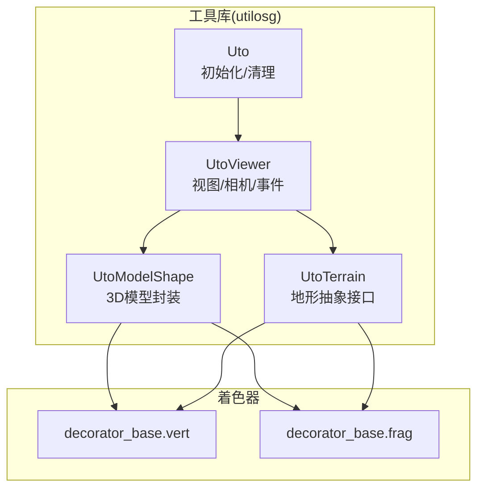
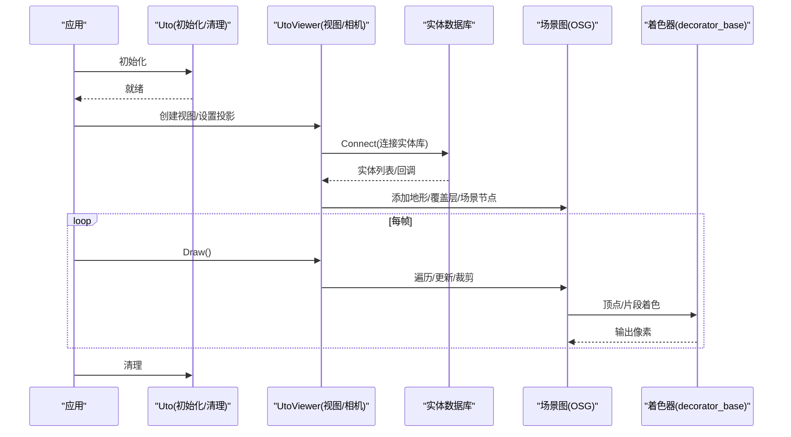
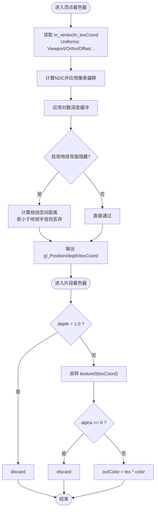
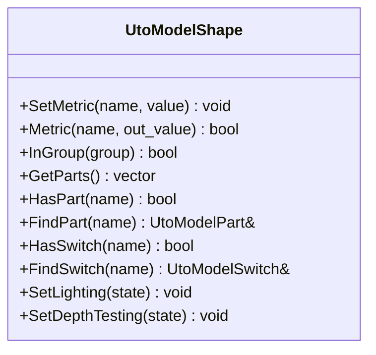
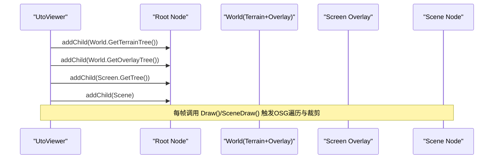
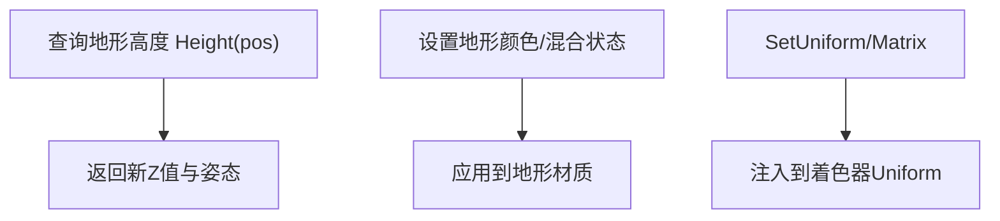
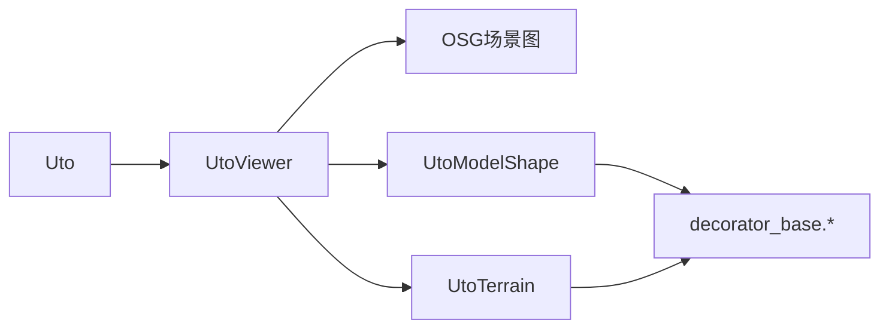

# 三维渲染引擎

<cite>
**本文引用的文件**   
- [Uto.cpp](file://swdev/src/tools/utilosg/source/Core/Uto.cpp)
- [UtoViewer.cpp](file://swdev/src/tools/utilosg/source/Viewer/UtoViewer.cpp)
- [UtoModelShape.cpp](file://swdev/src/tools/utilosg/source/Shape/UtoModelShape.cpp)
- [UtoTerrain.cpp](file://swdev/src/tools/utilosg/source/Terrain/UtoTerrain.cpp)
- [decorator_base.vert](file://resources/shaders/decorator_base.vert)
- [decorator_base.frag](file://resources/shaders/decorator_base.frag)
</cite>

## 目录
1. [简介](#简介)
2. [项目结构](#项目结构)
3. [核心组件](#核心组件)
4. [架构总览](#架构总览)
5. [详细组件分析](#详细组件分析)
6. [依赖关系分析](#依赖关系分析)
7. [性能考虑](#性能考虑)
8. [故障排查指南](#故障排查指南)
9. [结论](#结论)
10. [附录：自定义着色器开发指南](#附录自定义着色器开发指南)

## 简介
本文件面向 AFSIM 的可视化子系统（基于 OSG 的工具库 utilosg），系统化说明其三维渲染管线、模型与材质系统、场景图组织、地形与高度图处理、视锥剔除优化，以及调试与性能调优方法。文档同时给出可操作的自定义着色器开发指南，帮助读者扩展装饰面片、叠加层与通用渲染效果。

## 项目结构
该可视化子系统位于 swdev/src/tools/utilosg，资源与着色器位于 resources/shaders。关键路径如下：
- 核心初始化与清理：Uto.cpp
- 视图与相机管理：UtoViewer.cpp
- 3D 模型形状封装：UtoModelShape.cpp
- 地形抽象接口：UtoTerrain.cpp
- 通用装饰面片着色器：decorator_base.vert / .frag

图表来源
- [Uto.cpp:1-201](file://swdev/src/tools/utilosg/source/Core/Uto.cpp#L1-L201)
- [UtoViewer.cpp:1-800](file://swdev/src/tools/utilosg/source/Viewer/UtoViewer.cpp#L1-L800)
- [UtoModelShape.cpp:1-318](file://swdev/src/tools/utilosg/source/Shape/UtoModelShape.cpp#L1-L318)
- [UtoTerrain.cpp:1-180](file://swdev/src/tools/utilosg/source/Terrain/UtoTerrain.cpp#L1-L180)
- [decorator_base.vert:1-62](file://resources/shaders/decorator_base.vert#L1-L62)
- [decorator_base.frag:1-31](file://resources/shaders/decorator_base.frag#L1-L31)

章节来源
- [Uto.cpp:1-201](file://swdev/src/tools/utilosg/source/Core/Uto.cpp#L1-L201)
- [UtoViewer.cpp:1-800](file://swdev/src/tools/utilosg/source/Viewer/UtoViewer.cpp#L1-L800)
- [UtoModelShape.cpp:1-318](file://swdev/src/tools/utilosg/source/Shape/UtoModelShape.cpp#L1-L318)
- [UtoTerrain.cpp:1-180](file://swdev/src/tools/utilosg/source/Terrain/UtoTerrain.cpp#L1-L180)

## 核心组件
- 渲染生命周期管理：负责 OSG 上下文、对象管理器、着色器资源的初始化与销毁。
- 视图与相机：提供正交/透视双相机模式、投影更新、屏幕到世界坐标转换、命中测试策略。
- 模型形状：封装 3D 模型加载、部件（articulated parts）与开关（switches）控制、度量元数据访问。
- 地形接口：统一的地形查询 API（名称、颜色、高度、投影、Uniform 注入）。
- 着色器：通用装饰面片顶点/片段着色器，支持对地遮挡剔除、对数深度缓冲、纹理采样与颜色混合。

章节来源
- [Uto.cpp:1-201](file://swdev/src/tools/utilosg/source/Core/Uto.cpp#L1-L201)
- [UtoViewer.cpp:1-800](file://swdev/src/tools/utilosg/source/Viewer/UtoViewer.cpp#L1-L800)
- [UtoModelShape.cpp:1-318](file://swdev/src/tools/utilosg/source/Shape/UtoModelShape.cpp#L1-L318)
- [UtoTerrain.cpp:1-180](file://swdev/src/tools/utilosg/source/Terrain/UtoTerrain.cpp#L1-L180)
- [decorator_base.vert:1-62](file://resources/shaders/decorator_base.vert#L1-L62)
- [decorator_base.frag:1-31](file://resources/shaders/decorator_base.frag#L1-L31)

## 架构总览
下图展示从应用调用到 GPU 渲染的关键流程：初始化 → 视图构建 → 实体绑定 → 绘制循环 → 着色器执行。

图表来源
- [Uto.cpp:58-117](file://swdev/src/tools/utilosg/source/Core/Uto.cpp#L58-L117)
- [UtoViewer.cpp:91-149](file://swdev/src/tools/utilosg/source/Viewer/UtoViewer.cpp#L91-L149)
- [UtoViewer.cpp:306-327](file://swdev/src/tools/utilosg/source/Viewer/UtoViewer.cpp#L306-L327)
- [decorator_base.vert:28-61](file://resources/shaders/decorator_base.vert#L28-L61)
- [decorator_base.frag:18-30](file://resources/shaders/decorator_base.frag#L18-L30)

## 详细组件分析

### 渲染管线与着色器程序
- 顶点阶段（decorator_base.vert）
  - 输入：in_vertex、in_texCoord；Uniform：UTO_Viewport、UTO_OrthographicZoom、UTO_OrthographicMode、VA_IconScale、VA_TrueScale、offsetAndScale、osg_ViewMatrix。
  - 功能：将二维面片顶点转换为 NDC，应用像素偏移与缩放；使用对数深度缓冲（logDepth.h）提升远距精度；可选“地球背面隐藏”逻辑通过计算视线空间距离判断是否丢弃片段。
- 片段阶段（decorator_base.frag）
  - 输入：depth、texCoord；Uniform：texture0、color。
  - 功能：根据 depth 进行早弃；透明度为 0 时丢弃；最终颜色 = 纹理颜色 × 全局 color。

图表来源
- [decorator_base.vert:28-61](file://resources/shaders/decorator_base.vert#L28-L61)
- [decorator_base.frag:18-30](file://resources/shaders/decorator_base.frag#L18-L30)

章节来源
- [decorator_base.vert:1-62](file://resources/shaders/decorator_base.vert#L1-L62)
- [decorator_base.frag:1-31](file://resources/shaders/decorator_base.frag#L1-L31)

### 模型加载与渲染机制（网格、材质、高精度模型）
- 模型封装（UtoModelShape）
  - 提供 SetMetric/Metric 获取模型元数据（如观测点、尺寸等）。
  - 支持 articulated parts（活动部件）与 switches（可见性/LOD 切换），可通过 HasPart/FindPart、HasSwitch/FindSwitch 动态控制。
  - 暴露 SetLighting/SetDepthTesting 以控制光照与深度测试行为。
- 资源与实例化
  - 由资源数据库在加载模型资源时构造 UtoModelShape，用户无需手动构建。
- 高精度模型支持
  - 通过 switches 与 parts 实现多细节层次与部件动画；结合外部模型文件的组名与命名约定进行控制。

图表来源
- [UtoModelShape.cpp:118-276](file://swdev/src/tools/utilosg/source/Shape/UtoModelShape.cpp#L118-L276)

章节来源
- [UtoModelShape.cpp:1-318](file://swdev/src/tools/utilosg/source/Shape/UtoModelShape.cpp#L1-L318)

### 场景图管理与视锥剔除
- 场景树组织
  - UtoViewer 构造时将地形树、覆盖层树、窗口覆盖层树与主场景节点加入根节点，形成清晰的层级结构。
- 视锥剔除与近远平面
  - 关闭小特征剔除，启用默认剔除与远平面剔除，避免微小几何体导致的剔除抖动。
- 相机与投影
  - 支持正交/透视双相机，切换时更新 Uniform 与命中测试策略；投影变化后强制实体位置更新以保证一致性。
- 更新与绘制
  - 通过 UpdateVisitor 注入 UtoRenderInfo，便于统计与调试；Draw/PreSceneDraw/SceneDraw/PostSceneDraw 分阶段控制窗口与场景绘制。

图表来源
- [UtoViewer.cpp:113-149](file://swdev/src/tools/utilosg/source/Viewer/UtoViewer.cpp#L113-L149)
- [UtoViewer.cpp:306-327](file://swdev/src/tools/utilosg/source/Viewer/UtoViewer.cpp#L306-L327)

章节来源
- [UtoViewer.cpp:1-800](file://swdev/src/tools/utilosg/source/Viewer/UtoViewer.cpp#L1-L800)

### 地形渲染与高度图处理
- 地形抽象（UtoTerrain）
  - 提供 Name/Color/Height/IsColorBlendingDisabled 等统一接口。
  - 支持 SetUniform/SetUniformMatrix/SetUniformInverseMatrix 向着色器注入矩阵与标量。
  - PostLoad 与 SetProjection 用于加载后处理与投影配置。
- 高度查询
  - Height(pos) 返回指定位置的 Z 高度与姿态（yaw/pitch/roll），用于贴地或对齐。

图表来源
- [UtoTerrain.cpp:63-84](file://swdev/src/tools/utilosg/source/Terrain/UtoTerrain.cpp#L63-L84)
- [UtoTerrain.cpp:131-168](file://swdev/src/tools/utilosg/source/Terrain/UtoTerrain.cpp#L131-L168)

章节来源
- [UtoTerrain.cpp:1-180](file://swdev/src/tools/utilosg/source/Terrain/UtoTerrain.cpp#L1-L180)

### 粒子系统与效果组合（概念性说明）
- 发射器与粒子
  - 通常由独立模块生成粒子轨迹与属性（位置、速度、寿命、颜色、大小），并通过批渲染（如 Billboard 或 Instanced Rendering）提交给 GPU。
- 效果组合
  - 使用通用装饰面片着色器（decorator_base）进行半透明混合、对地遮挡剔除与对数深度缓冲，确保大量粒子的稳定显示。
- 与场景集成
  - 粒子几何作为覆盖层或场景子树的一部分，随视图更新而刷新。

[本节为概念性说明，不直接分析具体代码文件]

## 依赖关系分析
- 组件耦合
  - Uto 负责全局资源与着色器生命周期，UtoViewer 依赖 Uto 提供的资源管理能力。
  - UtoViewer 聚合地形与覆盖层，并通过 OSG 场景图驱动渲染。
  - UtoModelShape 与 UtoTerrain 通过 Uniform 与材质系统与着色器解耦。
- 外部依赖
  - OSG（图形框架）、OSGEarth（可选，用于地球与地形）、资源数据库与读写器。

图表来源
- [Uto.cpp:1-201](file://swdev/src/tools/utilosg/source/Core/Uto.cpp#L1-L201)
- [UtoViewer.cpp:1-800](file://swdev/src/tools/utilosg/source/Viewer/UtoViewer.cpp#L1-L800)
- [UtoModelShape.cpp:1-318](file://swdev/src/tools/utilosg/source/Shape/UtoModelShape.cpp#L1-L318)
- [UtoTerrain.cpp:1-180](file://swdev/src/tools/utilosg/source/Terrain/UtoTerrain.cpp#L1-L180)
- [decorator_base.vert:1-62](file://resources/shaders/decorator_base.vert#L1-L62)
- [decorator_base.frag:1-31](file://resources/shaders/decorator_base.frag#L1-L31)

章节来源
- [Uto.cpp:1-201](file://swdev/src/tools/utilosg/source/Core/Uto.cpp#L1-L201)
- [UtoViewer.cpp:1-800](file://swdev/src/tools/utilosg/source/Viewer/UtoViewer.cpp#L1-L800)
- [UtoModelShape.cpp:1-318](file://swdev/src/tools/utilosg/source/Shape/UtoModelShape.cpp#L1-L318)
- [UtoTerrain.cpp:1-180](file://swdev/src/tools/utilosg/source/Terrain/UtoTerrain.cpp#L1-L180)

## 性能考虑
- 剔除与裁剪
  - 关闭小特征剔除，启用远平面剔除，减少无效绘制。
- 深度缓冲
  - 使用对数深度缓冲（logDepth.h）缓解远距离浮点精度问题，提高大尺度场景稳定性。
- 纹理与混合
  - 在片段着色器中尽早 discard（深度/透明度），降低无意义片段处理。
- 模型与材质
  - 合理拆分模型部件与开关，按需加载与显示，减少一次性几何量。
- 视图与投影
  - 投影变更时批量更新实体位置，避免逐帧重复计算。

[本节为通用指导，不直接分析具体代码文件]

## 故障排查指南
- 初始化/清理异常
  - 检查 UtoTerm 是否正确释放对象管理器、着色器与隐藏窗口上下文。
- 视图未渲染或黑屏
  - 确认 UtoViewer::Connect 已正确绑定实体数据库，且根节点包含地形与覆盖层。
- 模型不可见或材质异常
  - 检查 UtoModelShape 的光照与深度测试设置；确认纹理资源存在且未被替换。
- 地形高度不正确
  - 验证 UtoTerrain::Height 调用参数与坐标系；确认投影设置与地形数据匹配。
- 着色器错误
  - 检查 decorator_base.vert/.frag 中的 Uniform 名称与类型是否与 C++ 侧一致；确认 logDepth.h 可用。

章节来源
- [Uto.cpp:58-143](file://swdev/src/tools/utilosg/source/Core/Uto.cpp#L58-L143)
- [UtoViewer.cpp:381-423](file://swdev/src/tools/utilosg/source/Viewer/UtoViewer.cpp#L381-L423)
- [UtoModelShape.cpp:268-276](file://swdev/src/tools/utilosg/source/Shape/UtoModelShape.cpp#L268-L276)
- [UtoTerrain.cpp:63-84](file://swdev/src/tools/utilosg/source/Terrain/UtoTerrain.cpp#L63-L84)
- [decorator_base.vert:12-26](file://resources/shaders/decorator_base.vert#L12-L26)
- [decorator_base.frag:10-16](file://resources/shaders/decorator_base.frag#L10-L16)

## 结论
AFSIM 的可视化子系统通过清晰的分层架构（Uto/UtoViewer/UtoModelShape/UtoTerrain）与通用着色器（decorator_base）实现了可扩展、高性能的三维渲染能力。借助 OSG 的场景图与剔除机制、对数深度缓冲与 Uniform 注入，系统能够稳定渲染大规模场景与复杂模型。开发者可在此基础上扩展粒子系统、材质与特效，并通过本章提供的调试与性能建议快速定位问题与优化瓶颈。

[本节为总结性内容，不直接分析具体代码文件]

## 附录：自定义着色器开发指南
- 目标
  - 复用 decorator_base 的通用能力（对地遮挡剔除、对数深度缓冲、纹理采样与颜色混合），快速实现新的装饰面片或叠加效果。
- 步骤
  - 复制 decorator_base.vert/.frag 作为模板。
  - 在顶点着色器中保持对数深度缓冲与对地遮挡剔除逻辑；根据需要调整 offsetAndScale 与 VA_IconScale/VA_TrueScale。
  - 在片段着色器中保留 depth 早弃与透明度检测；扩展纹理采样与颜色混合逻辑。
  - 在 C++ 侧通过 UtoTerrain/UtoModelShape 的 SetUniform/SetUniformMatrix 注入所需 Uniform。
- 示例要点
  - 顶点着色器：确保 gl_Position 与 depth 正确输出；必要时引入新的 Uniform（如时间、噪声参数）。
  - 片段着色器：在采样纹理后，按需求增加混合、遮罩或后处理步骤；注意 alpha 测试与 discard 的位置。
  - 资源绑定：确保纹理与材质在资源数据库中正确注册，并在模型/地形加载后绑定到对应 Uniform。

[本节为操作指南，不直接分析具体代码文件]