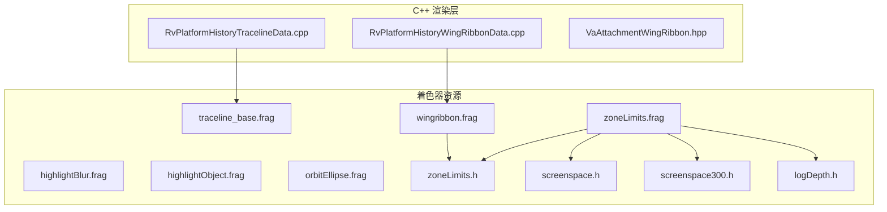
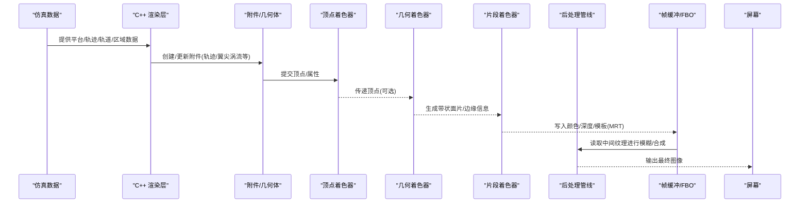
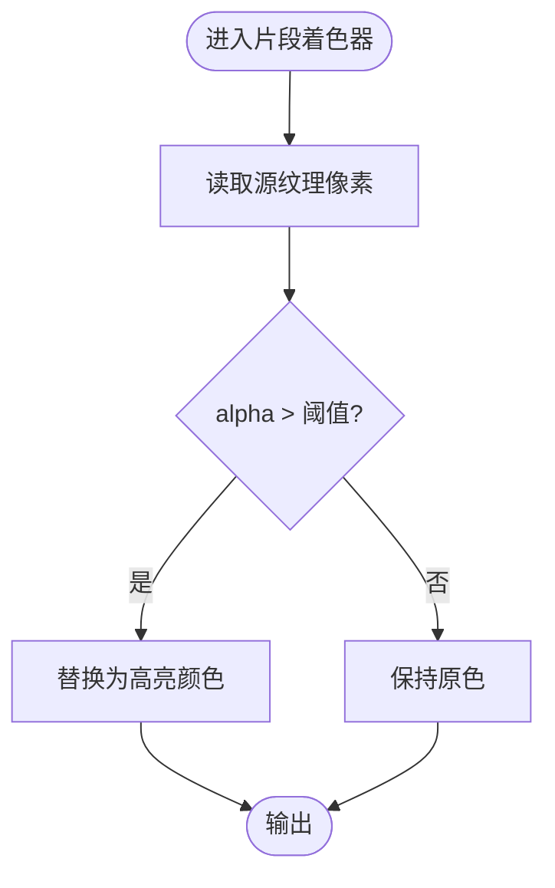
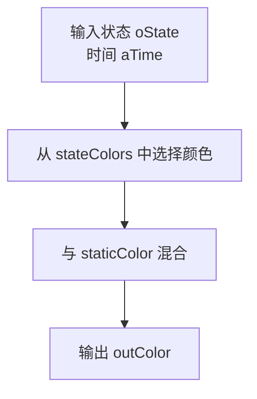
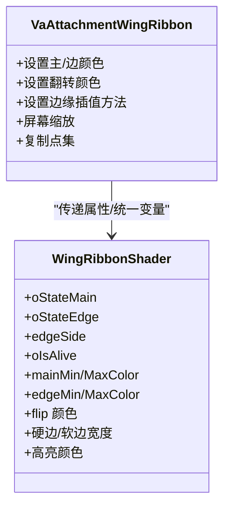
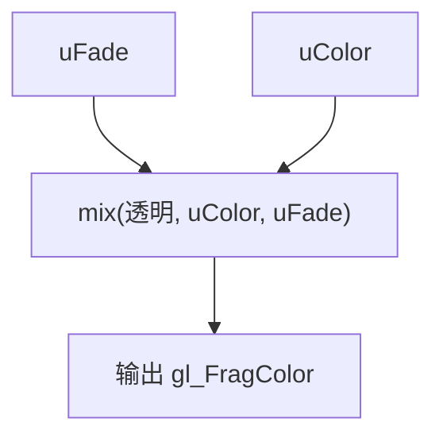
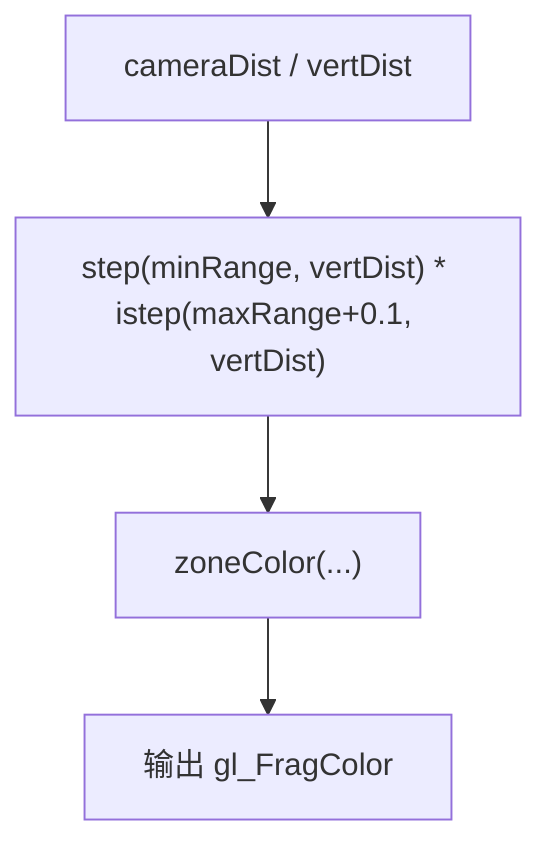
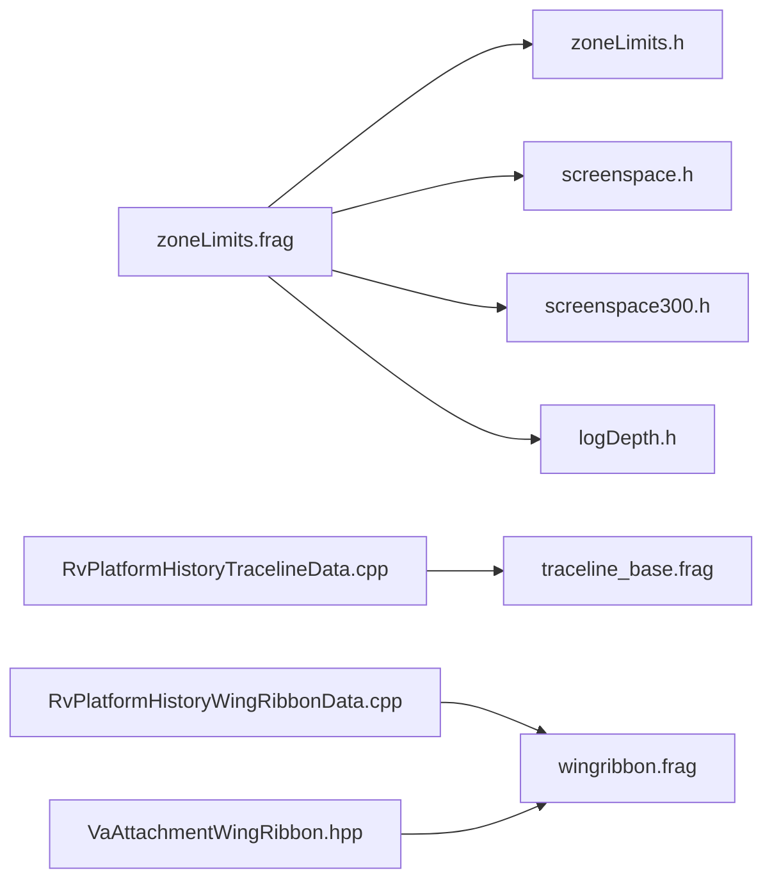

# 可视化特效

<cite>
**本文引用的文件**   
- [resources/shaders/highlightBlur.frag](file://resources/shaders/highlightBlur.frag)
- [resources/shaders/highlightObject.frag](file://resources/shaders/highlightObject.frag)
- [resources/shaders/traceline_base.frag](file://resources/shaders/traceline_base.frag)
- [resources/shaders/wingribbon.frag](file://resources/shaders/wingribbon.frag)
- [resources/shaders/orbitEllipse.frag](file://resources/shaders/orbitEllipse.frag)
- [resources/shaders/zoneLimits.frag](file://resources/shaders/zoneLimits.frag)
- [resources/shaders/zoneLimits.h](file://resources/shaders/zoneLimits.h)
- [resources/shaders/screenspace.h](file://resources/shaders/screenspace.h)
- [resources/shaders/screentime300.h](file://resources/shaders/screenspace300.h)
- [resources/shaders/logDepth.h](file://resources/shaders/logDepth.h)
- [swdev/src/mystic/plugins/ResultPlatformHistory/source/RvPlatformHistoryTracelineData.cpp](file://swdev/src/mystic/plugins/ResultPlatformHistory/source/RvPlatformHistoryTracelineData.cpp)
- [swdev/src/mystic/plugins/ResultPlatformHistory/source/RvPlatformHistoryWingRibbonData.cpp](file://swdev/src/mystic/plugins/ResultPlatformHistory/source/RvPlatformHistoryWingRibbonData.cpp)
- [swdev/src/tools/vespatk/source/VaAttachmentWingRibbon.hpp](file://swdev/src/tools/vespatk/source/VaAttachmentWingRibbon.hpp)
</cite>

## 目录
1. [简介](#简介)
2. [项目结构](#项目结构)
3. [核心组件](#核心组件)
4. [架构总览](#架构总览)
5. [详细组件分析](#详细组件分析)
6. [依赖关系分析](#依赖关系分析)
7. [性能考虑](#性能考虑)
8. [故障排查指南](#故障排查指南)
9. [结论](#结论)
10. [附录](#附录)

## 简介
本文件面向 AFSIM 可视化特效系统，系统性说明高亮显示、模糊效果与轨迹渲染等视觉效果的实现原理；阐述后处理管线中多重渲染目标（MRT）与帧缓冲对象（FBO）的使用方式；文档化翼尖涡流、轨道椭圆与区域限制显示等特殊效果的着色器实现；总结实时渲染优化技术（批处理与 GPU 并行计算）；给出视觉效果的可配置性与参数调节方法；并提供常用特效的代码示例路径与集成方式，以及性能分析与调优建议。

## 项目结构
可视化特效相关资源主要位于 shaders 目录，包含多种顶点/片段/几何着色器与公共头文件；C++ 侧通过 Mystics 插件与 VespaTK 附件系统加载并驱动这些着色器进行渲染。

**图表来源**
- [resources/shaders/highlightBlur.frag:1-42](file://resources/shaders/highlightBlur.frag#L1-L42)
- [resources/shaders/highlightObject.frag:1-19](file://resources/shaders/highlightObject.frag#L1-L19)
- [resources/shaders/traceline_base.frag:1-24](file://resources/shaders/traceline_base.frag#L1-L24)
- [resources/shaders/wingribbon.frag:1-70](file://resources/shaders/wingribbon.frag#L1-L70)
- [resources/shaders/orbitEllipse.frag:1-18](file://resources/shaders/orbitEllipse.frag#L1-L18)
- [resources/shaders/zoneLimits.frag:1-28](file://resources/shaders/zoneLimits.frag#L1-L28)
- [resources/shaders/zoneLimits.h](file://resources/shaders/zoneLimits.h)
- [resources/shaders/screenspace.h](file://resources/shaders/screenspace.h)
- [resources/shaders/screenspace300.h](file://resources/shaders/screenspace300.h)
- [resources/shaders/logDepth.h](file://resources/shaders/logDepth.h)
- [swdev/src/mystic/plugins/ResultPlatformHistory/source/RvPlatformHistoryTracelineData.cpp](file://swdev/src/mystic/plugins/ResultPlatformHistory/source/RvPlatformHistoryTracelineData.cpp)
- [swdev/src/mystic/plugins/ResultPlatformHistory/source/RvPlatformHistoryWingRibbonData.cpp](file://swdev/src/mystic/plugins/ResultPlatformHistory/source/RvPlatformHistoryWingRibbonData.cpp)
- [swdev/src/tools/vespatk/source/VaAttachmentWingRibbon.hpp](file://swdev/src/tools/vespatk/source/VaAttachmentWingRibbon.hpp)

**章节来源**
- [resources/shaders/highlightBlur.frag:1-42](file://resources/shaders/highlightBlur.frag#L1-L42)
- [resources/shaders/highlightObject.frag:1-19](file://resources/shaders/highlightObject.frag#L1-L19)
- [resources/shaders/traceline_base.frag:1-24](file://resources/shaders/traceline_base.frag#L1-L24)
- [resources/shaders/wingribbon.frag:1-70](file://resources/shaders/wingribbon.frag#L1-L70)
- [resources/shaders/orbitEllipse.frag:1-18](file://resources/shaders/orbitEllipse.frag#L1-L18)
- [resources/shaders/zoneLimits.frag:1-28](file://resources/shaders/zoneLimits.frag#L1-L28)
- [resources/shaders/zoneLimits.h](file://resources/shaders/zoneLimits.h)
- [resources/shaders/screenspace.h](file://resources/shaders/screenspace.h)
- [resources/shaders/screenspace300.h](file://resources/shaders/screenspace300.h)
- [resources/shaders/logDepth.h](file://resources/shaders/logDepth.h)
- [swdev/src/mystic/plugins/ResultPlatformHistory/source/RvPlatformHistoryTracelineData.cpp](file://swdev/src/mystic/plugins/ResultPlatformHistory/source/RvPlatformHistoryTracelineData.cpp)
- [swdev/src/mystic/plugins/ResultPlatformHistory/source/RvPlatformHistoryWingRibbonData.cpp](file://swdev/src/mystic/plugins/ResultPlatformHistory/source/RvPlatformHistoryWingRibbonData.cpp)
- [swdev/src/tools/vespatk/source/VaAttachmentWingRibbon.hpp](file://swdev/src/tools/vespatk/source/VaAttachmentWingRibbon.hpp)

## 核心组件
- 高亮显示：基于 alpha 阈值遮罩与颜色替换，突出选中对象或关键要素。
- 模糊效果：采用多邻域采样与加权最大值的快速近似模糊，用于辉光/泛光增强。
- 轨迹渲染：按状态混合静态色与动态色，支持时间渐变与状态切换。
- 翼尖涡流：使用几何着色器生成带状面片，在片段着色器中进行主/边颜色插值与边缘抗锯齿。
- 轨道椭圆：以淡入淡出控制透明度，配合颜色统一绘制轨道线。
- 区域限制显示：根据相机距离与法向高度判断是否在区域内，结合公共函数输出区域边界颜色。

**章节来源**
- [resources/shaders/highlightObject.frag:11-18](file://resources/shaders/highlightObject.frag#L11-L18)
- [resources/shaders/highlightBlur.frag:11-40](file://resources/shaders/highlightBlur.frag#L11-L40)
- [resources/shaders/traceline_base.frag:12-23](file://resources/shaders/traceline_base.frag#L12-L23)
- [resources/shaders/wingribbon.frag:11-69](file://resources/shaders/wingribbon.frag#L11-L69)
- [resources/shaders/orbitEllipse.frag:11-17](file://resources/shaders/orbitEllipse.frag#L11-L17)
- [resources/shaders/zoneLimits.frag:11-26](file://resources/shaders/zoneLimits.frag#L11-L26)

## 架构总览
可视化特效由“数据准备（C++）→ 附件/几何体构建 → 着色器执行 → 后处理合成”构成。C++ 侧负责将仿真数据转换为可绘制的几何与属性，VespaTK 附件系统组织绘制调用，GLSL 着色器完成逐像素特效，最终通过后处理阶段（如模糊、合成）输出到屏幕。

**图表来源**
- [swdev/src/mystic/plugins/ResultPlatformHistory/source/RvPlatformHistoryTracelineData.cpp](file://swdev/src/mystic/plugins/ResultPlatformHistory/source/RvPlatformHistoryTracelineData.cpp)
- [swdev/src/mystic/plugins/ResultPlatformHistory/source/RvPlatformHistoryWingRibbonData.cpp](file://swdev/src/mystic/plugins/ResultPlatformHistory/source/RvPlatformHistoryWingRibbonData.cpp)
- [swdev/src/tools/vespatk/source/VaAttachmentWingRibbon.hpp](file://swdev/src/tools/vespatk/source/VaAttachmentWingRibbon.hpp)
- [resources/shaders/wingribbon.frag:11-69](file://resources/shaders/wingribbon.frag#L11-L69)
- [resources/shaders/highlightBlur.frag:11-40](file://resources/shaders/highlightBlur.frag#L11-L40)

## 详细组件分析

### 高亮显示与模糊效果
- 高亮对象：根据输入纹理的 alpha 通道阈值决定是否覆盖为高亮色，实现“选中即显”的效果。
- 模糊处理：对当前像素周围多个偏移位置进行采样，取加权最大值，形成快速辉光/泛光近似。

**图表来源**
- [resources/shaders/highlightObject.frag:11-18](file://resources/shaders/highlightObject.frag#L11-L18)

**章节来源**
- [resources/shaders/highlightObject.frag:11-18](file://resources/shaders/highlightObject.frag#L11-L18)
- [resources/shaders/highlightBlur.frag:11-40](file://resources/shaders/highlightBlur.frag#L11-L40)

### 轨迹渲染
- 状态混合：根据状态索引选择状态颜色，并与静态颜色进行混合，支持时间维度渐变。
- 批量绘制：通过状态数组与统一变量减少 CPU-GPU 同步开销。

**图表来源**
- [resources/shaders/traceline_base.frag:12-23](file://resources/shaders/traceline_base.frag#L12-L23)

**章节来源**
- [resources/shaders/traceline_base.frag:12-23](file://resources/shaders/traceline_base.frag#L12-L23)
- [swdev/src/mystic/plugins/ResultPlatformHistory/source/RvPlatformHistoryTracelineData.cpp](file://swdev/src/mystic/plugins/ResultPlatformHistory/source/RvPlatformHistoryTracelineData.cpp)

### 翼尖涡流（Wing Ribbon）
- 几何生成：几何着色器将轨迹点扩展为带状面片，并计算中心/边缘坐标与朝向。
- 片段着色：根据 edgeSide 区分主区与边缘区，在主/边颜色之间平滑过渡，支持高亮模式与翻转颜色。

**图表来源**
- [swdev/src/tools/vespatk/source/VaAttachmentWingRibbon.hpp](file://swdev/src/tools/vespatk/source/VaAttachmentWingRibbon.hpp)
- [resources/shaders/wingribbon.frag:11-69](file://resources/shaders/wingribbon.frag#L11-L69)

**章节来源**
- [resources/shaders/wingribbon.frag:11-69](file://resources/shaders/wingribbon.frag#L11-L69)
- [swdev/src/mystic/plugins/ResultPlatformHistory/source/RvPlatformHistoryWingRibbonData.cpp](file://swdev/src/mystic/plugins/ResultPlatformHistory/source/RvPlatformHistoryWingRibbonData.cpp)
- [swdev/src/tools/vespatk/source/VaAttachmentWingRibbon.hpp](file://swdev/src/tools/vespatk/source/VaAttachmentWingRibbon.hpp)

### 轨道椭圆（Orbit Ellipse）
- 淡入淡出：通过 uFade 控制从透明到实色的过渡，uColor 指定轨道颜色。
- 简单高效：适合大量轨道线的批量绘制。

**图表来源**
- [resources/shaders/orbitEllipse.frag:11-17](file://resources/shaders/orbitEllipse.frag#L11-L17)

**章节来源**
- [resources/shaders/orbitEllipse.frag:11-17](file://resources/shaders/orbitEllipse.frag#L11-L17)

### 区域限制显示（Zone Limits）
- 范围判定：根据 minRange/maxRange 与 vertDist 判断是否处于区域范围内。
- 颜色输出：调用 zoneColor 函数输出区域边界颜色，结合 cameraDist 调整可见性。

**图表来源**
- [resources/shaders/zoneLimits.frag:11-26](file://resources/shaders/zoneLimits.frag#L11-L26)
- [resources/shaders/zoneLimits.h](file://resources/shaders/zoneLimits.h)

**章节来源**
- [resources/shaders/zoneLimits.frag:11-26](file://resources/shaders/zoneLimits.frag#L11-L26)
- [resources/shaders/zoneLimits.h](file://resources/shaders/zoneLimits.h)

## 依赖关系分析
- 着色器间依赖：
  - zoneLimits.frag 依赖 zoneLimits.h 中的公共函数。
  - zoneLimits.frag 还依赖 screenspace.h、screenspace300.h、logDepth.h 提供的屏幕空间与深度工具。
- C++ 与着色器的耦合：
  - RvPlatformHistoryTracelineData.cpp 驱动 traceline 着色器，提供状态与颜色数组。
  - RvPlatformHistoryWingRibbonData.cpp 驱动 wingribbon 着色器，设置主/边颜色与边缘插值方法。
  - VaAttachmentWingRibbon.hpp 定义翼尖涡流附件接口，供上层插件调用。

**图表来源**
- [resources/shaders/zoneLimits.frag:11-26](file://resources/shaders/zoneLimits.frag#L11-L26)
- [resources/shaders/zoneLimits.h](file://resources/shaders/zoneLimits.h)
- [resources/shaders/screenspace.h](file://resources/shaders/screenspace.h)
- [resources/shaders/screenspace300.h](file://resources/shaders/screenspace300.h)
- [resources/shaders/logDepth.h](file://resources/shaders/logDepth.h)
- [swdev/src/mystic/plugins/ResultPlatformHistory/source/RvPlatformHistoryTracelineData.cpp](file://swdev/src/mystic/plugins/ResultPlatformHistory/source/RvPlatformHistoryTracelineData.cpp)
- [swdev/src/mystic/plugins/ResultPlatformHistory/source/RvPlatformHistoryWingRibbonData.cpp](file://swdev/src/mystic/plugins/ResultPlatformHistory/source/RvPlatformHistoryWingRibbonData.cpp)
- [swdev/src/tools/vespatk/source/VaAttachmentWingRibbon.hpp](file://swdev/src/tools/vespatk/source/VaAttachmentWingRibbon.hpp)

**章节来源**
- [resources/shaders/zoneLimits.frag:11-26](file://resources/shaders/zoneLimits.frag#L11-L26)
- [resources/shaders/zoneLimits.h](file://resources/shaders/zoneLimits.h)
- [resources/shaders/screenspace.h](file://resources/shaders/screenspace.h)
- [resources/shaders/screenspace300.h](file://resources/shaders/screenspace300.h)
- [resources/shaders/logDepth.h](file://resources/shaders/logDepth.h)
- [swdev/src/mystic/plugins/ResultPlatformHistory/source/RvPlatformHistoryTracelineData.cpp](file://swdev/src/mystic/plugins/ResultPlatformHistory/source/RvPlatformHistoryTracelineData.cpp)
- [swdev/src/mystic/plugins/ResultPlatformHistory/source/RvPlatformHistoryWingRibbonData.cpp](file://swdev/src/mystic/plugins/ResultPlatformHistory/source/RvPlatformHistoryWingRibbonData.cpp)
- [swdev/src/tools/vespatk/source/VaAttachmentWingRibbon.hpp](file://swdev/src/tools/vespatk/source/VaAttachmentWingRibbon.hpp)

## 性能考虑
- 批处理与合并绘制：
  - 轨迹与轨道使用统一颜色数组与状态索引，减少状态切换与 draw call 次数。
  - 翼尖涡流通过几何着色器一次性生成带状面片，降低 CPU 端几何构建成本。
- GPU 并行计算：
  - 模糊效果采用固定邻域采样，适合 GPU 并行执行；可通过多次 pass 叠加提升质量。
  - 区域限制判定在片段着色器内完成，避免 CPU 分支与频繁回读。
- MRT 与 FBO：
  - 建议在中间渲染阶段使用 MRT 同时输出颜色、深度、模板或多通道数据，减少往返带宽。
  - 使用 FBO 缓存高亮掩膜与模糊结果，避免每帧重复计算。
- 纹理与内存：
  - 尽量复用纹理与缓冲区，减少分配与拷贝。
  - 控制采样半径与 pass 次数，平衡画质与性能。
- 可见性裁剪：
  - 在 C++ 侧剔除不可见轨迹/轨道/区域，减少无效绘制。
  - 根据相机距离与视锥体裁剪几何体，降低过绘。

[本节为通用指导，不直接分析具体文件]

## 故障排查指南
- 高亮不生效：
  - 检查 highlightObject 的 alpha 阈值与纹理 alpha 通道是否正确。
  - 确认 highlightColor 与 texture0 绑定正确。
- 模糊效果异常：
  - 检查 highlightBlur 的采样偏移与权重是否合理。
  - 确保 osg_FrameTime 与帧缓冲纹理尺寸一致。
- 轨迹颜色错乱：
  - 核对 stateColors 数组长度与 oState 索引范围。
  - 确认 staticColor 与状态颜色的混合逻辑符合预期。
- 翼尖涡流边缘闪烁：
  - 调整 hardEdgeWidth 与 softEdgeWidth，改善过渡带。
  - 检查 edgeSide 与 oIsAlive 的计算与传递。
- 区域限制显示不正确：
  - 校验 minRange/maxRange 与 vertDist 的单位与坐标系。
  - 确认 zoneColor 与 cameraDist 的缩放比例。

**章节来源**
- [resources/shaders/highlightObject.frag:11-18](file://resources/shaders/highlightObject.frag#L11-L18)
- [resources/shaders/highlightBlur.frag:11-40](file://resources/shaders/highlightBlur.frag#L11-L40)
- [resources/shaders/traceline_base.frag:12-23](file://resources/shaders/traceline_base.frag#L12-L23)
- [resources/shaders/wingribbon.frag:11-69](file://resources/shaders/wingribbon.frag#L11-L69)
- [resources/shaders/zoneLimits.frag:11-26](file://resources/shaders/zoneLimits.frag#L11-L26)

## 结论
AFSIM 可视化特效系统通过清晰的“数据准备—附件/几何—着色器—后处理”分层架构，实现了高亮、模糊、轨迹、翼尖涡流、轨道椭圆与区域限制等多种视觉效果。着色器实现简洁高效，C++ 侧通过附件系统组织绘制流程，便于扩展与维护。借助批处理、GPU 并行与 MRT/FBO 等技术，系统在实时渲染场景下具备良好的性能与可扩展性。

[本节为总结性内容，不直接分析具体文件]

## 附录
- 常用特效代码示例路径
  - 高亮显示：[resources/shaders/highlightObject.frag](file://resources/shaders/highlightObject.frag)
  - 模糊效果：[resources/shaders/highlinkBlur.frag](file://resources/shaders/highlightBlur.frag)
  - 轨迹渲染：[resources/shaders/traceline_base.frag](file://resources/shaders/traceline_base.frag)
  - 翼尖涡流：[resources/shaders/wingribbon.frag](file://resources/shaders/wingribbon.frag)
  - 轨道椭圆：[resources/shaders/orbitEllipse.frag](file://resources/shaders/orbitEllipse.frag)
  - 区域限制：[resources/shaders/zoneLimits.frag](file://resources/shaders/zoneLimits.frag), [resources/shaders/zoneLimits.h](file://resources/shaders/zoneLimits.h)
- 集成方法
  - 轨迹：在 ResultPlatformHistory 插件中使用 RvPlatformHistoryTracelineData.cpp 创建并更新轨迹附件，关联 traceline 着色器。
  - 翼尖涡流：在 ResultPlatformHistory 插件中使用 RvPlatformHistoryWingRibbonData.cpp 创建翼尖涡流附件，设置颜色与边缘插值方法，关联 wingribbon 着色器。
  - 区域限制：在场景配置中启用 zoneLimits 着色器，传入 minRange/maxRange 与颜色参数。

**章节来源**
- [swdev/src/mystic/plugins/ResultPlatformHistory/source/RvPlatformHistoryTracelineData.cpp](file://swdev/src/mystic/plugins/ResultPlatformHistory/source/RvPlatformHistoryTracelineData.cpp)
- [swdev/src/mystic/plugins/ResultPlatformHistory/source/RvPlatformHistoryWingRibbonData.cpp](file://swdev/src/mystic/plugins/ResultPlatformHistory/source/RvPlatformHistoryWingRibbonData.cpp)
- [resources/shaders/traceline_base.frag:12-23](file://resources/shaders/traceline_base.frag#L12-L23)
- [resources/shaders/wingribbon.frag:11-69](file://resources/shaders/wingribbon.frag#L11-L69)
- [resources/shaders/zoneLimits.frag:11-26](file://resources/shaders/zoneLimits.frag#L11-L26)
- [resources/shaders/zoneLimits.h](file://resources/shaders/zoneLimits.h)