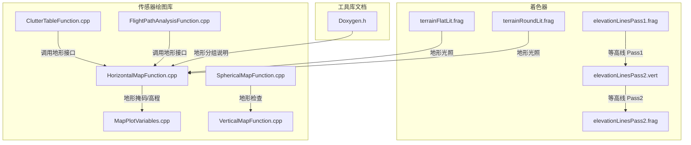
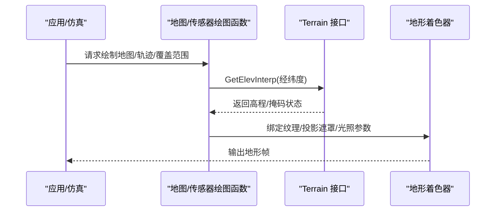
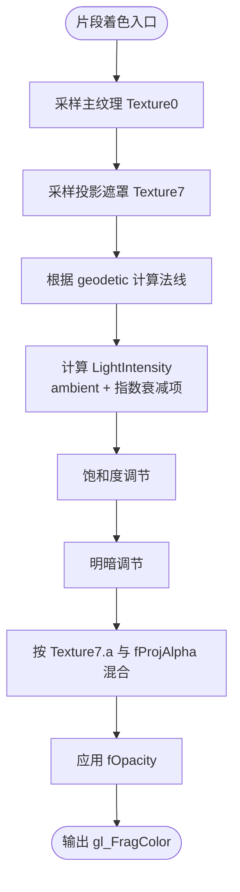
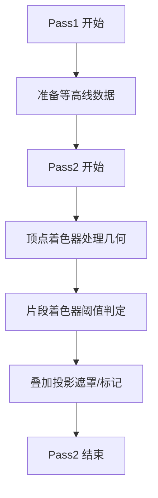
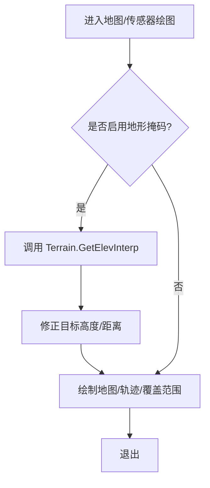
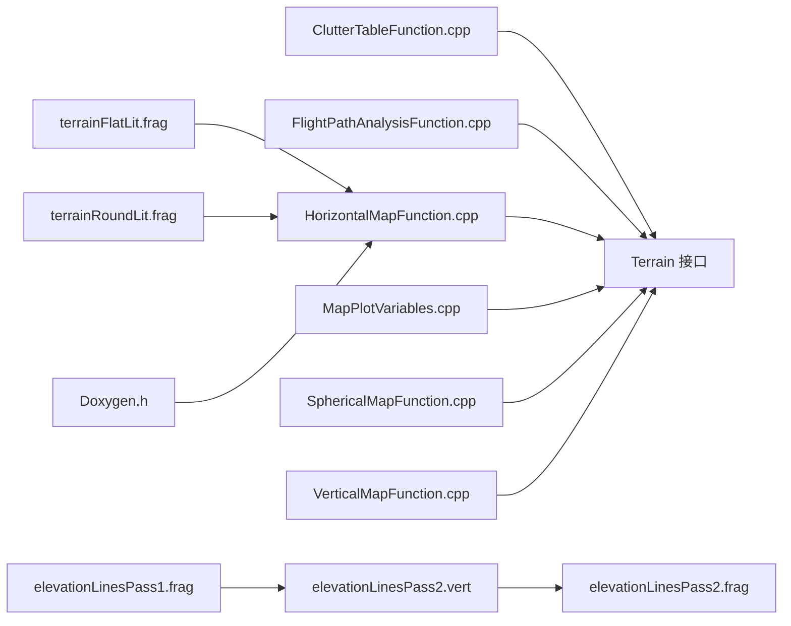

# 地形渲染

<cite>
**本文引用的文件**   
- [terrainFlatLit.frag](file://resources/shaders/terrainFlatLit.frag)
- [terrainRoundLit.frag](file://resources/shaders/terrainRoundLit.frag)
- [elevationLinesPass1.frag](file://resources/shaders/elevationLinesPass1.frag)
- [elevationLinesPass2.frag](file://resources/shaders/elevationLinesPass2.frag)
- [elevationLinesPass2.vert](file://resources/shaders/elevationLinesPass2.vert)
- [ClutterTableFunction.cpp](file://swdev/src/core/sensor_plot_lib/source/ClutterTableFunction.cpp)
- [FlightPathAnalysisFunction.cpp](file://swdev/src/core/sensor_plot_lib/source/FlightPathAnalysisFunction.cpp)
- [HorizontalMapFunction.cpp](file://swdev/src/core/sensor_plot_lib/source/HorizontalMapFunction.cpp)
- [MapPlotVariables.cpp](file://swdev/src/core/sensor_plot_lib/source/MapPlotVariables.cpp)
- [SphericalMapFunction.cpp](file://swdev/src/core/sensor_plot_lib/source/SphericalMapFunction.cpp)
- [VerticalMapFunction.cpp](file://swdev/src/core/sensor_plot_lib/source/VerticalMapFunction.cpp)
- [Doxygen.h](file://swdev/src/tools/utilosg/source/include/Doxygen.h)
</cite>

## 目录
1. [简介](#简介)
2. [项目结构](#项目结构)
3. [核心组件](#核心组件)
4. [架构总览](#架构总览)
5. [详细组件分析](#详细组件分析)
6. [依赖关系分析](#依赖关系分析)
7. [性能考虑](#性能考虑)
8. [故障排查指南](#故障排查指南)
9. [结论](#结论)

## 简介
本文件面向 AFSIM 中的地形渲染子系统，围绕高度图数据的加载与处理、地形网格生成与优化、多分辨率与视距相关的细节层次（LOD）切换、地形着色器（纹理混合、坡度着色、水体渲染）、光照与环境光遮蔽、等高线与地形标记叠加、数据压缩与流式加载，以及大规模地形的性能优化进行系统化说明。文档以仓库中实际存在的着色器与传感器绘图模块为锚点，给出可追溯的实现路径与可视化图示，帮助读者从高层到代码层逐步理解地形渲染管线。

## 项目结构
与地形渲染直接相关的资源与代码主要分布在以下位置：
- 着色器资源：位于 resources/shaders，包含地形平面/圆形两种光照变体着色器，以及等高线绘制所需的 pass 着色器。
- 传感器绘图库：位于 swdev/src/core/sensor_plot_lib，提供地形高程查询、遮挡掩码、地图投影等能力，供多种绘图函数调用。
- 工具库文档：tools/utilosg 的 Doxygen 文档对“地形”分组进行了说明，表明存在地形相关图形对象集合。

图表来源
- [terrainFlatLit.frag:1-34](file://resources/shaders/terrainFlatLit.frag#L1-L34)
- [terrainRoundLit.frag:1-38](file://resources/shaders/terrainRoundLit.frag#L1-L38)
- [elevationLinesPass1.frag](file://resources/shaders/elevationLinesPass1.frag)
- [elevationLinesPass2.frag](file://resources/shaders/elevationLinesPass2.frag)
- [elevationLinesPass2.vert](file://resources/shaders/elevationLinesPass2.vert)
- [ClutterTableFunction.cpp:69-73](file://swdev/src/core/sensor_plot_lib/source/ClutterTableFunction.cpp#L69-L73)
- [FlightPathAnalysisFunction.cpp:342-379](file://swdev/src/core/sensor_plot_lib/source/FlightPathAnalysisFunction.cpp#L342-L379)
- [HorizontalMapFunction.cpp:466-505](file://swdev/src/core/sensor_plot_lib/source/HorizontalMapFunction.cpp#L466-L505)
- [MapPlotVariables.cpp:2109-2140](file://swdev/src/core/sensor_plot_lib/source/MapPlotVariables.cpp#L2109-L2140)
- [SphericalMapFunction.cpp:113](file://swdev/src/core/sensor_plot_lib/source/SphericalMapFunction.cpp#L113)
- [VerticalMapFunction.cpp:106](file://swdev/src/core/sensor_plot_lib/source/VerticalMapFunction.cpp#L106)
- [Doxygen.h:165-207](file://swdev/src/tools/utilosg/source/include/Doxygen.h#L165-L207)

章节来源
- [terrainFlatLit.frag:1-34](file://resources/shaders/terrainFlatLit.frag#L1-L34)
- [terrainRoundLit.frag:1-38](file://resources/shaders/terrainRoundLit.frag#L1-L38)
- [ClutterTableFunction.cpp:69-73](file://swdev/src/core/sensor_plot_lib/source/ClutterTableFunction.cpp#L69-L73)
- [FlightPathAnalysisFunction.cpp:342-379](file://swdev/src/core/sensor_plot_lib/source/FlightPathAnalysisFunction.cpp#L342-L379)
- [HorizontalMapFunction.cpp:466-505](file://swdev/src/core/sensor_plot_lib/source/HorizontalMapFunction.cpp#L466-L505)
- [MapPlotVariables.cpp:2109-2140](file://swdev/src/core/sensor_plot_lib/source/MapPlotVariables.cpp#L2109-L2140)
- [SphericalMapFunction.cpp:113](file://swdev/src/core/sensor_plot_lib/source/SphericalMapFunction.cpp#L113)
- [VerticalMapFunction.cpp:106](file://swdev/src/core/sensor_plot_lib/source/VerticalMapFunction.cpp#L106)
- [Doxygen.h:165-207](file://swdev/src/tools/utilosg/source/include/Doxygen.h#L165-L207)

## 核心组件
- 地形光照着色器
  - 平面光照变体：读取主纹理与投影遮罩纹理，基于地理坐标计算法线并应用光源强度、饱和度、明暗调节与透明度混合。
  - 圆形光照变体：在平面光照基础上引入雾/穿透参数与额外环境色叠加，用于不同几何或相机模式下的视觉一致性。
- 等高线叠加
  - 通过两阶段 pass 实现：第一阶段准备数据，第二阶段根据顶点着色器输出与片段着色器逻辑绘制等高线。
- 地形高程与遮挡
  - 传感器绘图库通过 Terrain 接口获取高程插值，并在水平/垂直/球面地图函数中进行地形掩码与可见性判断。

章节来源
- [terrainFlatLit.frag:1-34](file://resources/shaders/terrainFlatLit.frag#L1-L34)
- [terrainRoundLit.frag:1-38](file://resources/shaders/terrainRoundLit.frag#L1-L38)
- [elevationLinesPass1.frag](file://resources/shaders/elevationLinesPass1.frag)
- [elevationLinesPass2.frag](file://resources/shaders/elevationLinesPass2.frag)
- [elevationLinesPass2.vert](file://resources/shaders/elevationLinesPass2.vert)
- [ClutterTableFunction.cpp:69-73](file://swdev/src/core/sensor_plot_lib/source/ClutterTableFunction.cpp#L69-L73)
- [FlightPathAnalysisFunction.cpp:342-379](file://swdev/src/core/sensor_plot_lib/source/FlightPathAnalysisFunction.cpp#L342-L379)
- [HorizontalMapFunction.cpp:466-505](file://swdev/src/core/sensor_plot_lib/source/HorizontalMapFunction.cpp#L466-L505)
- [MapPlotVariables.cpp:2109-2140](file://swdev/src/core/sensor_plot_lib/source/MapPlotVariables.cpp#L2109-L2140)

## 架构总览
地形渲染管线由“数据访问层（Terrain 接口）— 场景构建层（地图/传感器绘图函数）— 渲染层（着色器）”组成。数据访问层负责高程插值与掩码；场景构建层决定何时启用地形检查、如何调整目标高度；渲染层负责将纹理、光照、等高线叠加到最终帧缓冲。

图表来源
- [HorizontalMapFunction.cpp:466-505](file://swdev/src/core/sensor_plot_lib/source/HorizontalMapFunction.cpp#L466-L505)
- [ClutterTableFunction.cpp:69-73](file://swdev/src/core/sensor_plot_lib/source/ClutterTableFunction.cpp#L69-L73)
- [terrainFlatLit.frag:1-34](file://resources/shaders/terrainFlatLit.frag#L1-L34)
- [terrainRoundLit.frag:1-38](file://resources/shaders/terrainRoundLit.frag#L1-L38)

## 详细组件分析

### 地形光照着色器
- 平面光照变体（terrainFlatLit.frag）
  - 输入：主纹理（Texture0）、投影遮罩纹理（Texture7）、亮度/暗化/饱和度/投影透明度/不透明度统一变量。
  - 处理：基于地理坐标 geodetic 计算法线，使用内置光源 ambient 与指数衰减项合成 LightIntensity；对颜色进行饱和度与明暗调节；按投影遮罩 alpha 与全局不透明度混合。
- 圆形光照变体（terrainRoundLit.frag）
  - 在平面光照基础上增加 Penetration（穿透/雾）与 LightIntensity 的环境色叠加，增强远距离或特定视角下的视觉过渡。

图表来源
- [terrainFlatLit.frag:1-34](file://resources/shaders/terrainFlatLit.frag#L1-L34)
- [terrainRoundLit.frag:1-38](file://resources/shaders/terrainRoundLit.frag#L1-L38)

章节来源
- [terrainFlatLit.frag:1-34](file://resources/shaders/terrainFlatLit.frag#L1-L34)
- [terrainRoundLit.frag:1-38](file://resources/shaders/terrainRoundLit.frag#L1-L38)

### 等高线与地形标记叠加
- 等高线采用两阶段 pass：
  - Pass1（elevationLinesPass1.frag）：准备等高线所需数据（如高程阈值、深度/屏幕空间信息）。
  - Pass2（elevationLinesPass2.vert + elevationLinesPass2.frag）：根据顶点着色器输出的几何信息与片段着色器的阈值比较绘制等高线。
- 地形标记（如投影遮罩）通过 Texture7 与 fProjAlpha 控制叠加区域与透明度，使地形与上层 UI/标注融合。

图表来源
- [elevationLinesPass1.frag](file://resources/shaders/elevationLinesPass1.frag)
- [elevationLinesPass2.frag](file://resources/shaders/elevationLinesPass2.frag)
- [elevationLinesPass2.vert](file://resources/shaders/elevationLinesPass2.vert)
- [terrainFlatLit.frag:1-34](file://resources/shaders/terrainFlatLit.frag#L1-L34)

章节来源
- [elevationLinesPass1.frag](file://resources/shaders/elevationLinesPass1.frag)
- [elevationLinesPass2.frag](file://resources/shaders/elevationLinesPass2.frag)
- [elevationLinesPass2.vert](file://resources/shaders/elevationLinesPass2.vert)
- [terrainFlatLit.frag:1-34](file://resources/shaders/terrainFlatLit.frag#L1-L34)

### 地形高程与遮挡（传感器绘图）
- 高程插值：ClutterTableFunction 与 FlightPathAnalysisFunction 通过 Terrain::GetElevInterp 获取指定经纬度的高程，用于杂波表查找与航迹高度修正。
- 地形掩码：HorizontalMapFunction 在绘制前对目标高度进行地形高程校正，确保可视性与距离计算准确；MapPlotVariables 维护 terrainMaskingFlags 与失败状态位，决定是否执行地形检查。
- 球面/垂直地图：SphericalMapFunction 与 VerticalMapFunction 在关键流程中避免让 Pd（探测概率）中断地形检查处理，保证地形掩码始终生效。

图表来源
- [ClutterTableFunction.cpp:69-73](file://swdev/src/core/sensor_plot_lib/source/ClutterTableFunction.cpp#L69-L73)
- [FlightPathAnalysisFunction.cpp:342-379](file://swdev/src/core/sensor_plot_lib/source/FlightPathAnalysisFunction.cpp#L342-L379)
- [HorizontalMapFunction.cpp:466-505](file://swdev/src/core/sensor_plot_lib/source/HorizontalMapFunction.cpp#L466-L505)
- [MapPlotVariables.cpp:2109-2140](file://swdev/src/core/sensor_plot_lib/source/MapPlotVariables.cpp#L2109-L2140)
- [SphericalMapFunction.cpp:113](file://swdev/src/core/sensor_plot_lib/source/SphericalMapFunction.cpp#L113)
- [VerticalMapFunction.cpp:106](file://swdev/src/core/sensor_plot_lib/source/VerticalMapFunction.cpp#L106)

章节来源
- [ClutterTableFunction.cpp:69-73](file://swdev/src/core/sensor_plot_lib/source/ClutterTableFunction.cpp#L69-L73)
- [FlightPathAnalysisFunction.cpp:342-379](file://swdev/src/core/sensor_plot_lib/source/FlightPathAnalysisFunction.cpp#L342-L379)
- [HorizontalMapFunction.cpp:466-505](file://swdev/src/core/sensor_plot_lib/source/HorizontalMapFunction.cpp#L466-L505)
- [MapPlotVariables.cpp:2109-2140](file://swdev/src/core/sensor_plot_lib/source/MapPlotVariables.cpp#L2109-L2140)
- [SphericalMapFunction.cpp:113](file://swdev/src/core/sensor_plot_lib/source/SphericalMapFunction.cpp#L113)
- [VerticalMapFunction.cpp:106](file://swdev/src/core/sensor_plot_lib/source/VerticalMapFunction.cpp#L106)

### 多分辨率地形与视距 LOD
- 概念说明：多分辨率地形通常通过分块（tile）与层级（level）组织高度图数据，结合视距与屏幕像素误差阈值动态选择 LOD，以减少三角面数与带宽压力。
- 在本仓库中，地形数据访问与掩码逻辑集中在传感器绘图库，具体分块与 LOD 调度策略未在已检索到的文件中直接暴露；建议结合 UtoTerrain 与地形资源数据库扩展实现。

[本节为概念性说明，不涉及具体文件分析]

### 地形数据压缩与流式加载
- 概念说明：为提高大规模地形数据的存储与传输效率，常采用有损/无损压缩（如 DEM 量化、ZStandard/LZ4），并结合流式加载（按需下载/解码）与缓存管理。
- 在本仓库中，未检索到显式的压缩与流式加载实现；可在 UtoResourceDB 与地形资源迭代器策略处扩展，配合外部数据源（DTED/TMS）进行按需加载。

[本节为概念性说明，不涉及具体文件分析]

## 依赖关系分析
- 着色器依赖：地形光照着色器依赖 OpenGL 内置光源与纹理单元；等高线 pass 依赖顶点/片段着色器之间的数据传递。
- 模块耦合：传感器绘图函数依赖 Terrain 接口进行高程与掩码查询；地图函数之间共享地形掩码标志与失败状态位。
- 工具库文档：Doxygen 中对“地形”分组的说明提示了地形相关图形对象的集合，便于后续扩展。

图表来源
- [ClutterTableFunction.cpp:69-73](file://swdev/src/core/sensor_plot_lib/source/ClutterTableFunction.cpp#L69-L73)
- [FlightPathAnalysisFunction.cpp:342-379](file://swdev/src/core/sensor_plot_lib/source/FlightPathAnalysisFunction.cpp#L342-L379)
- [HorizontalMapFunction.cpp:466-505](file://swdev/src/core/sensor_plot_lib/source/HorizontalMapFunction.cpp#L466-L505)
- [MapPlotVariables.cpp:2109-2140](file://swdev/src/core/sensor_plot_lib/source/MapPlotVariables.cpp#L2109-L2140)
- [SphericalMapFunction.cpp:113](file://swdev/src/core/sensor_plot_lib/source/SphericalMapFunction.cpp#L113)
- [VerticalMapFunction.cpp:106](file://swdev/src/core/sensor_plot_lib/source/VerticalMapFunction.cpp#L106)
- [terrainFlatLit.frag:1-34](file://resources/shaders/terrainFlatLit.frag#L1-L34)
- [terrainRoundLit.frag:1-38](file://resources/shaders/terrainRoundLit.frag#L1-L38)
- [elevationLinesPass1.frag](file://resources/shaders/elevationLinesPass1.frag)
- [elevationLinesPass2.frag](file://resources/shaders/elevationLinesPass2.frag)
- [elevationLinesPass2.vert](file://resources/shaders/elevationLinesPass2.vert)
- [Doxygen.h:165-207](file://swdev/src/tools/utilosg/source/include/Doxygen.h#L165-L207)

章节来源
- [ClutterTableFunction.cpp:69-73](file://swdev/src/core/sensor_plot_lib/source/ClutterTableFunction.cpp#L69-L73)
- [FlightPathAnalysisFunction.cpp:342-379](file://swdev/src/core/sensor_plot_lib/source/FlightPathAnalysisFunction.cpp#L342-L379)
- [HorizontalMapFunction.cpp:466-505](file://swdev/src/core/sensor_plot_lib/source/HorizontalMapFunction.cpp#L466-L505)
- [MapPlotVariables.cpp:2109-2140](file://swdev/src/core/sensor_plot_lib/source/MapPlotVariables.cpp#L2109-L2140)
- [SphericalMapFunction.cpp:113](file://swdev/src/core/sensor_plot_lib/source/SphericalMapFunction.cpp#L113)
- [VerticalMapFunction.cpp:106](file://swdev/src/core/sensor_plot_lib/source/VerticalMapFunction.cpp#L106)
- [terrainFlatLit.frag:1-34](file://resources/shaders/terrainFlatLit.frag#L1-L34)
- [terrainRoundLit.frag:1-38](file://resources/shaders/terrainRoundLit.frag#L1-L38)
- [elevationLinesPass1.frag](file://resources/shaders/elevationLinesPass1.frag)
- [elevationLinesPass2.frag](file://resources/shaders/elevationLinesPass2.frag)
- [elevationLinesPass2.vert](file://resources/shaders/elevationLinesPass2.vert)
- [Doxygen.h:165-207](file://swdev/src/tools/utilosg/source/include/Doxygen.h#L165-L207)

## 性能考虑
- 减少不必要的地形检查：仅在需要掩码或高程校正的路径调用 Terrain 接口，避免每像素重复查询。
- 合并纹理采样：在着色器中复用主纹理与投影遮罩纹理，减少纹理单元切换与带宽占用。
- 合理设置 LOD：对远距区域降低网格密度，近距区域提高精度；结合屏幕像素误差阈值进行平滑过渡。
- 批处理与实例化：对地形分块与标记进行批渲染，减少 draw call 数量。
- 异步与流式加载：对大尺寸高度图数据进行分块解压与后台加载，前台仅维持必要缓存。

[本节为通用性能建议，不涉及具体文件分析]

## 故障排查指南
- 地形高程异常
  - 现象：地图或轨迹显示高度不正确。
  - 排查：确认 Terrain::GetElevInterp 被正确调用且经纬度有效；检查 MapPlotVariables 中的地形掩码标志是否被置位。
  - 参考路径：[ClutterTableFunction.cpp:69-73](file://swdev/src/core/sensor_plot_lib/source/ClutterTableFunction.cpp#L69-L73)、[FlightPathAnalysisFunction.cpp:342-379](file://swdev/src/core/sensor_plot_lib/source/FlightPathAnalysisFunction.cpp#L342-L379)、[MapPlotVariables.cpp:2109-2140](file://swdev/src/core/sensor_plot_lib/source/MapPlotVariables.cpp#L2109-L2140)
- 地形掩码未生效
  - 现象：遮挡判断错误，导致不可见目标被绘制。
  - 排查：检查 HorizontalMapFunction 中是否对目标高度进行地形校正；确认 SphericalMapFunction 与 VerticalMapFunction 中地形检查未被 Pd 中断。
  - 参考路径：[HorizontalMapFunction.cpp:466-505](file://swdev/src/core/sensor_plot_lib/source/HorizontalMapFunction.cpp#L466-L505)、[SphericalMapFunction.cpp:113](file://swdev/src/core/sensor_plot_lib/source/SphericalMapFunction.cpp#L113)、[VerticalMapFunction.cpp:106](file://swdev/src/core/sensor_plot_lib/source/VerticalMapFunction.cpp#L106)
- 等高线不显示或错位
  - 现象：等高线 pass 无输出或与地形错位。
  - 排查：确认 Pass1 与 Pass2 的数据传递正确；检查顶点着色器与片段着色器中的阈值与屏幕空间坐标计算。
  - 参考路径：[elevationLinesPass1.frag](file://resources/shaders/elevationLinesPass1.frag)、[elevationLinesPass2.frag](file://resources/shaders/elevationLinesPass2.frag)、[elevationLinesPass2.vert](file://resources/shaders/elevationLinesPass2.vert)
- 地形光照异常
  - 现象：颜色过亮/过暗、饱和度异常或投影遮罩不生效。
  - 排查：检查统一变量（fBrightener/fDarkener/fSaturation/fProjAlpha/fOpacity）是否正确设置；确认 Texture0 与 Texture7 绑定无误。
  - 参考路径：[terrainFlatLit.frag:1-34](file://resources/shaders/terrainFlatLit.frag#L1-L34)、[terrainRoundLit.frag:1-38](file://resources/shaders/terrainRoundLit.frag#L1-L38)

章节来源
- [ClutterTableFunction.cpp:69-73](file://swdev/src/core/sensor_plot_lib/source/ClutterTableFunction.cpp#L69-L73)
- [FlightPathAnalysisFunction.cpp:342-379](file://swdev/src/core/sensor_plot_lib/source/FlightPathAnalysisFunction.cpp#L342-L379)
- [HorizontalMapFunction.cpp:466-505](file://swdev/src/core/sensor_plot_lib/source/HorizontalMapFunction.cpp#L466-L505)
- [MapPlotVariables.cpp:2109-2140](file://swdev/src/core/sensor_plot_lib/source/MapPlotVariables.cpp#L2109-L2140)
- [SphericalMapFunction.cpp:113](file://swdev/src/core/sensor_plot_lib/source/SphericalMapFunction.cpp#L113)
- [VerticalMapFunction.cpp:106](file://swdev/src/core/sensor_plot_lib/source/VerticalMapFunction.cpp#L106)
- [elevationLinesPass1.frag](file://resources/shaders/elevationLinesPass1.frag)
- [elevationLinesPass2.frag](file://resources/shaders/elevationLinesPass2.frag)
- [elevationLinesPass2.vert](file://resources/shaders/elevationLinesPass2.vert)
- [terrainFlatLit.frag:1-34](file://resources/shaders/terrainFlatLit.frag#L1-L34)
- [terrainRoundLit.frag:1-38](file://resources/shaders/terrainRoundLit.frag#L1-L38)

## 结论
AFSIM 的地形渲染以传感器绘图库为中枢，通过 Terrain 接口完成高程与掩码查询，并由地形光照着色器与等高线 pass 完成最终渲染。当前仓库提供了地形光照与等高线的着色器实现，以及多处地形高程与掩码的使用示例。对于多分辨率地形、数据压缩与流式加载等高级特性，建议在现有架构基础上扩展分块调度与资源加载策略，以实现大规模地形的高效渲染。