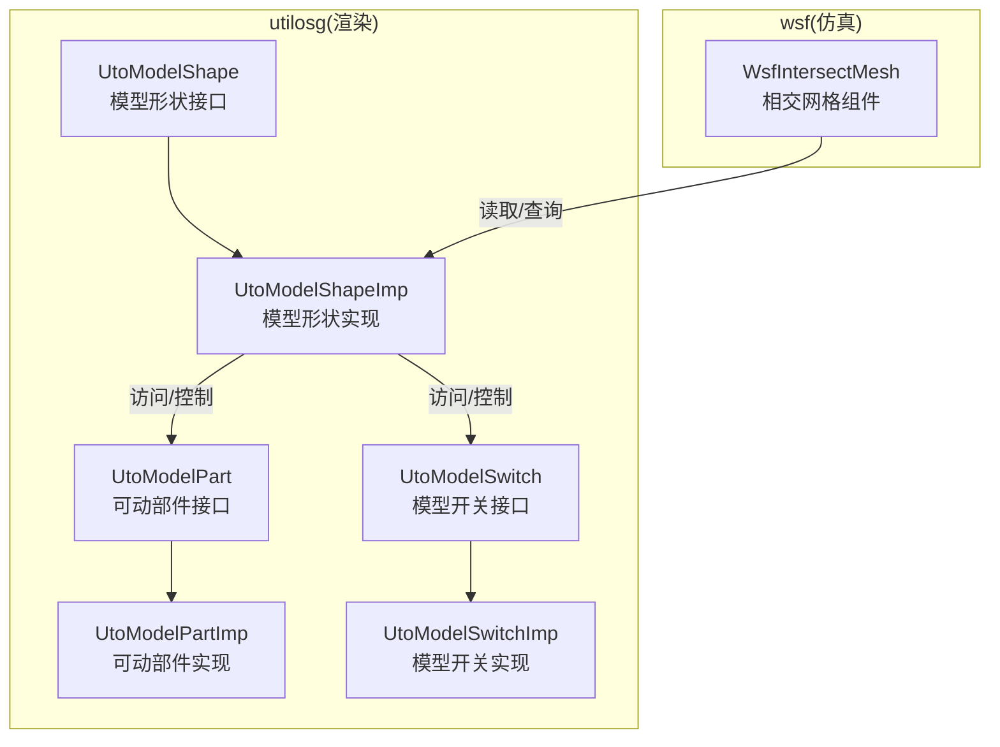
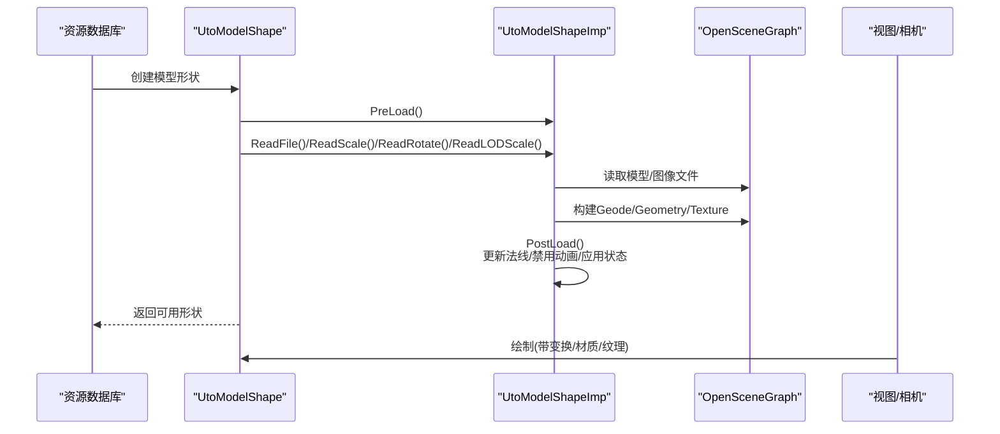
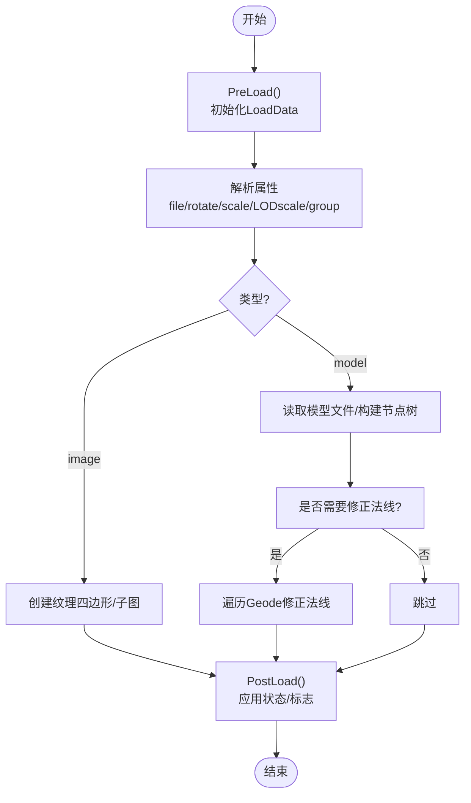
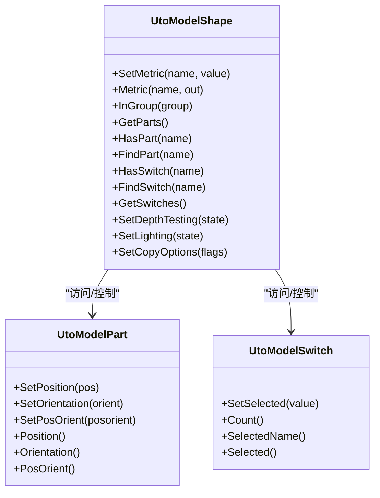
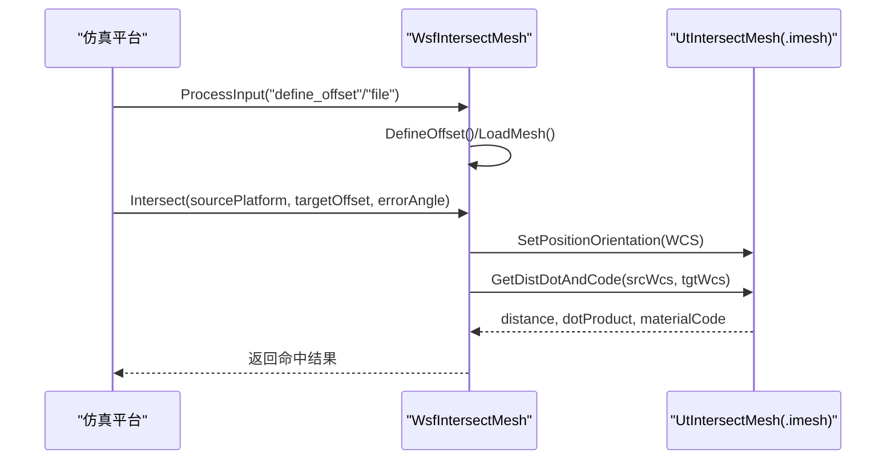
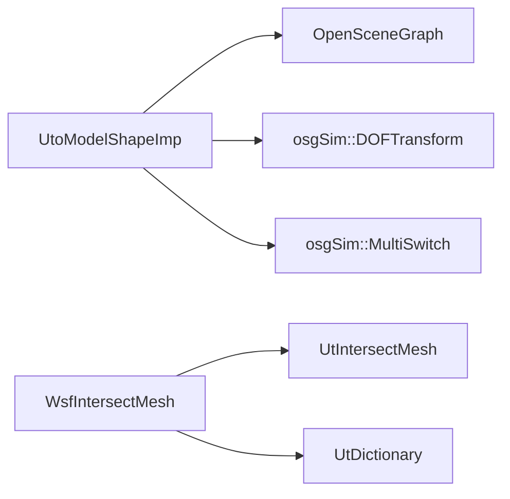

# 模型渲染

<cite>
**本文引用的文件**   
- [UtoModelShape.cpp](file://swdev/src/tools/utilosg/source/Shape/UtoModelShape.cpp)
- [UtoModelShapeImp.cpp](file://swdev/src/tools/utilosg/source/Shape/UtoModelShapeImp.cpp)
- [UtoModelPart.cpp](file://swdev/src/tools/utilosg/source/Shape/UtoModelPart.cpp)
- [UtoModelPartImp.cpp](file://swdev/src/tools/utilosg/source/Shape/UtoModelPartImp.cpp)
- [UtoModelSwitch.cpp](file://swdev/src/tools/utilosg/source/Shape/UtoModelSwitch.cpp)
- [UtoModelSwitchImp.cpp](file://swdev/src/tools/utilosg/source/Shape/UtoModelSwitchImp.cpp)
- [WsfIntersectMesh.cpp](file://swdev/src/core/wsf/source/WsfIntersectMesh.cpp)
</cite>

## 目录
1. [简介](#简介)
2. [项目结构](#项目结构)
3. [核心组件](#核心组件)
4. [架构总览](#架构总览)
5. [详细组件分析](#详细组件分析)
6. [依赖关系分析](#依赖关系分析)
7. [性能考虑](#性能考虑)
8. [故障排查指南](#故障排查指南)
9. [结论](#结论)
10. [附录](#附录)

## 简介
本文件面向 AFSIM 的模型渲染子系统，聚焦以下目标：
- 3D 模型的加载机制与数据解析（基于 OpenSceneGraph）
- 顶点与索引缓冲区的组织方式（由 OSG 管理）
- 实例化渲染与批量绘制能力（通过共享几何与状态集）
- 材质系统与纹理映射（漫反射、法线、透明度）
- LOD（细节层次）与视锥剔除优化
- 模型动画与可动部件（DOFTransform）支持
- 模型格式支持与转换工具使用指南
- 渲染性能调优方法与案例

## 项目结构
本渲染子系统位于 utilosg 模块中，核心类围绕 UtoModelShape 及其实现展开，配合 osgSim 提供的 DOFTransform 与 MultiSwitch 完成可动部件与多状态切换。碰撞检测相关网格在 wsf 层提供 WsfIntersectMesh 组件。

图表来源
- [UtoModelShape.cpp:21-43](file://swdev/src/tools/utilosg/source/Shape/UtoModelShape.cpp#L21-L43)
- [UtoModelShapeImp.cpp:50-57](file://swdev/src/tools/utilosg/source/Shape/UtoModelShapeImp.cpp#L50-L57)
- [UtoModelPart.cpp:17-25](file://swdev/src/tools/utilosg/source/Shape/UtoModelPart.cpp#L17-L25)
- [UtoModelSwitch.cpp:17-25](file://swdev/src/tools/utilosg/source/Shape/UtoModelSwitch.cpp#L17-L25)
- [WsfIntersectMesh.cpp:126-161](file://swdev/src/core/wsf/source/WsfIntersectMesh.cpp#L126-L161)

章节来源
- [UtoModelShape.cpp:21-43](file://swdev/src/tools/utilosg/source/Shape/UtoModelShape.cpp#L21-L43)
- [UtoModelShapeImp.cpp:50-57](file://swdev/src/tools/utilosg/source/Shape/UtoModelShapeImp.cpp#L50-L57)
- [WsfIntersectMesh.cpp:126-161](file://swdev/src/core/wsf/source/WsfIntersectMesh.cpp#L126-L161)

## 核心组件
- UtoModelShape / UtoModelShapeImp：负责从资源定义加载模型或图像，构建场景图节点，管理材质、纹理、缩放、旋转、分组、LODscale 等属性；提供对可动部件与开关的访问。
- UtoModelPart / UtoModelPartImp：封装 osgSim::DOFTransform，暴露位置与姿态设置接口，用于驱动可动部件（如起落架、舵面）。
- UtoModelSwitch / UtoModelSwitchImp：封装 osgSim::MultiSwitch，提供多状态选择（如不同涂装、挂载配置）。
- WsfIntersectMesh：仿真侧的相交网格组件，负责加载 .imesh 网格并执行射线相交计算，返回命中距离、表面点积与材料代码。

章节来源
- [UtoModelShape.cpp:21-43](file://swdev/src/tools/utilosg/source/Shape/UtoModelShape.cpp#L21-L43)
- [UtoModelPart.cpp:17-25](file://swdev/src/tools/utilosg/source/Shape/UtoModelPart.cpp#L17-L25)
- [UtoModelSwitch.cpp:17-25](file://swdev/src/tools/utilosg/source/Shape/UtoModelSwitch.cpp#L17-L25)
- [WsfIntersectMesh.cpp:126-161](file://swdev/src/core/wsf/source/WsfIntersectMesh.cpp#L126-L161)

## 架构总览
下图展示从资源定义到渲染管线的主要流程：资源数据库创建 UtoModelShape，解析 file/rotate/scale/LODscale/group 等属性，调用 PostLoad 构建 osg::Node 树，启用深度测试与光照，必要时调整法线以匹配缩放；可动部件与开关通过 DOFTransform/MultiSwitch 暴露给上层控制。

图表来源
- [UtoModelShapeImp.cpp:484-503](file://swdev/src/tools/utilosg/source/Shape/UtoModelShapeImp.cpp#L484-L503)
- [UtoModelShapeImp.cpp:571-683](file://swdev/src/tools/utilosg/source/Shape/UtoModelShapeImp.cpp#L571-L683)
- [UtoModelShapeImp.cpp:703-800](file://swdev/src/tools/utilosg/source/Shape/UtoModelShapeImp.cpp#L703-L800)

## 详细组件分析

### 模型加载与数据解析
- 资源类型注册：模型与图像两种类型分别绑定属性解析器（file、rotate_x/y/z、rotate3、scale3、scale、LODscale、translate、group 等）。
- 预加载阶段：初始化 LoadData，区分 model/image/subimage，默认抗锯齿与mipmap策略来自全局选项。
- 后处理阶段：
  - 图像模式：创建纹理四边形，支持透明通道与子图裁剪。
  - 模型模式：遍历节点，若存在非单位缩放则修正法线；关闭内置动画（避免与外部驱动冲突）。
  - 应用形状标志位（如 SHARED_STATESET），复用材质与纹理以减少状态切换。

图表来源
- [UtoModelShapeImp.cpp:484-503](file://swdev/src/tools/utilosg/source/Shape/UtoModelShapeImp.cpp#L484-L503)
- [UtoModelShapeImp.cpp:511-569](file://swdev/src/tools/utilosg/source/Shape/UtoModelShapeImp.cpp#L511-L569)
- [UtoModelShapeImp.cpp:571-683](file://swdev/src/tools/utilosg/source/Shape/UtoModelShapeImp.cpp#L571-L683)

章节来源
- [UtoModelShapeImp.cpp:484-503](file://swdev/src/tools/utilosg/source/Shape/UtoModelShapeImp.cpp#L484-L503)
- [UtoModelShapeImp.cpp:511-569](file://swdev/src/tools/utilosg/source/Shape/UtoModelShapeImp.cpp#L511-L569)
- [UtoModelShapeImp.cpp:571-683](file://swdev/src/tools/utilosg/source/Shape/UtoModelShapeImp.cpp#L571-L683)
- [UtoModelShapeImp.cpp:703-800](file://swdev/src/tools/utilosg/source/Shape/UtoModelShapeImp.cpp#L703-L800)

### 顶点缓冲区与索引缓冲区管理
- 顶点/索引数据由 OSG 的 Geometry 对象承载，UtoModelShapeImp 通过 osgDB 读取模型文件生成 Geode/Drawable。
- 当模型被缩放时，系统会遍历所有 Geometry 的法线数组进行反向缩放补偿，确保光照正确。
- 纹理坐标与颜色数组在图像模式下由 UtoTexturedPolygonImp 创建，并在需要时暴露颜色数组指针供上层修改。

章节来源
- [UtoModelShapeImp.cpp:511-569](file://swdev/src/tools/utilosg/source/Shape/UtoModelShapeImp.cpp#L511-L569)
- [UtoModelShapeImp.cpp:571-683](file://swdev/src/tools/utilosg/source/Shape/UtoModelShapeImp.cpp#L571-L683)

### 实例化渲染与批量绘制
- 通过设置 SHARED_STATESET 标志，多个模型实例可共享材质与纹理状态，减少 GPU 状态切换开销。
- 对于大量相同模型，建议：
  - 复用同一 UtoModelShape 实例（浅拷贝）
  - 使用不同的世界矩阵（通过父节点变换）
  - 将可见性判断与批处理合并（例如按材质/纹理分组）

章节来源
- [UtoModelShapeImp.cpp:607-608](file://swdev/src/tools/utilosg/source/Shape/UtoModelShapeImp.cpp#L607-L608)
- [UtoModelShapeImp.cpp:643-644](file://swdev/src/tools/utilosg/source/Shape/UtoModelShapeImp.cpp#L643-L644)

### 材质系统与纹理映射
- 材质与纹理由 OSG 的 Material/TexEnv/Texture 管理，UtoModelShapeImp 在 PostLoad 中统一设置 StateSet 标志。
- 图像模式支持抗锯齿与 mipmap 开关，以及子图矩形裁剪与 Y 轴翻转。
- 透明度处理：图像模式可返回是否包含透明通道，以便上层开启混合（Blending）。

章节来源
- [UtoModelShapeImp.cpp:571-683](file://swdev/src/tools/utilosg/source/Shape/UtoModelShapeImp.cpp#L571-L683)
- [UtoModelShapeImp.cpp:452-482](file://swdev/src/tools/utilosg/source/Shape/UtoModelShapeImp.cpp#L452-L482)

### LOD（细节层次）与视锥剔除
- 资源属性支持 LODscale，用于根据观察距离或缩放因子选择合适的模型细节级别。
- OSG 内部已实现视锥剔除（Frustum Culling），UtoModelShapeImp 不直接干预剔除逻辑，但可通过节点层级与可见性标记间接影响。

章节来源
- [UtoModelShapeImp.cpp:432-446](file://swdev/src/tools/utilosg/source/Shape/UtoModelShapeImp.cpp#L432-L446)

### 模型动画与可动部件
- 可动部件通过 osgSim::DOFTransform 表示，UtoModelPartImp 暴露 SetPosition/SetOrientation/PosOrient 等方法。
- 系统默认关闭模型内建动画（避免与外部驱动冲突），允许上层通过 DOFTransform 精确控制部件运动。
- 开关（MultiSwitch）用于切换不同子树（如不同挂载、涂装），UtoModelSwitchImp 提供 Selected/SetSelected 接口。

图表来源
- [UtoModelShape.cpp:111-266](file://swdev/src/tools/utilosg/source/Shape/UtoModelShape.cpp#L111-L266)
- [UtoModelPart.cpp:40-93](file://swdev/src/tools/utilosg/source/Shape/UtoModelPart.cpp#L40-L93)
- [UtoModelSwitch.cpp:40-79](file://swdev/src/tools/utilosg/source/Shape/UtoModelSwitch.cpp#L40-L79)

章节来源
- [UtoModelShape.cpp:111-266](file://swdev/src/tools/utilosg/source/Shape/UtoModelShape.cpp#L111-L266)
- [UtoModelPart.cpp:40-93](file://swdev/src/tools/utilosg/source/Shape/UtoModelPart.cpp#L40-L93)
- [UtoModelSwitch.cpp:40-79](file://swdev/src/tools/utilosg/source/Shape/UtoModelSwitch.cpp#L40-L79)
- [UtoModelPartImp.cpp:21-68](file://swdev/src/tools/utilosg/source/Shape/UtoModelPartImp.cpp#L21-L68)
- [UtoModelSwitchImp.cpp:19-49](file://swdev/src/tools/utilosg/source/Shape/UtoModelSwitchImp.cpp#L19-L49)

### 相交网格与仿真集成
- WsfIntersectMesh 提供 define_offset/file 命令，加载 .imesh 网格并维护偏移名称映射。
- Intersect 方法计算源平台到目标偏移的射线与网格的交点，返回命中距离、表面点积与材料代码（机身/座舱盖/传感器等）。
- 支持角度误差扰动，便于模拟传感器误差与随机性。

图表来源
- [WsfIntersectMesh.cpp:87-124](file://swdev/src/core/wsf/source/WsfIntersectMesh.cpp#L87-L124)
- [WsfIntersectMesh.cpp:162-257](file://swdev/src/core/wsf/source/WsfIntersectMesh.cpp#L162-L257)
- [WsfIntersectMesh.cpp:259-283](file://swdev/src/core/wsf/source/WsfIntersectMesh.cpp#L259-L283)

章节来源
- [WsfIntersectMesh.cpp:87-124](file://swdev/src/core/wsf/source/WsfIntersectMesh.cpp#L87-L124)
- [WsfIntersectMesh.cpp:162-257](file://swdev/src/core/wsf/source/WsfIntersectMesh.cpp#L162-L257)
- [WsfIntersectMesh.cpp:259-283](file://swdev/src/core/wsf/source/WsfIntersectMesh.cpp#L259-L283)

## 依赖关系分析
- UtoModelShapeImp 依赖 OSG 的 Node/Geode/Geometry/Texture/Material 等基础图形对象。
- 可动部件依赖 osgSim::DOFTransform，开关依赖 osgSim::MultiSwitch。
- WsfIntersectMesh 依赖 UtIntersectMesh 与 UtDictionary 进行网格缓存与查找。

图表来源
- [UtoModelShapeImp.cpp:22-38](file://swdev/src/tools/utilosg/source/Shape/UtoModelShapeImp.cpp#L22-L38)
- [UtoModelPartImp.cpp:17-23](file://swdev/src/tools/utilosg/source/Shape/UtoModelPartImp.cpp#L17-L23)
- [UtoModelSwitchImp.cpp:17-20](file://swdev/src/tools/utilosg/source/Shape/UtoModelSwitchImp.cpp#L17-L20)
- [WsfIntersectMesh.cpp:23-46](file://swdev/src/core/wsf/source/WsfIntersectMesh.cpp#L23-L46)

章节来源
- [UtoModelShapeImp.cpp:22-38](file://swdev/src/tools/utilosg/source/Shape/UtoModelShapeImp.cpp#L22-L38)
- [UtoModelPartImp.cpp:17-23](file://swdev/src/tools/utilosg/source/Shape/UtoModelPartImp.cpp#L17-L23)
- [UtoModelSwitchImp.cpp:17-20](file://swdev/src/tools/utilosg/source/Shape/UtoModelSwitchImp.cpp#L17-L20)
- [WsfIntersectMesh.cpp:23-46](file://swdev/src/core/wsf/source/WsfIntersectMesh.cpp#L23-L46)

## 性能考虑
- 共享状态集：通过 SHARED_STATESET 标志复用材质与纹理，降低状态切换成本。
- 批量绘制：对相同模型实例采用浅拷贝与统一材质/纹理，结合视锥剔除与遮挡剔除提升吞吐。
- 法线修正：在缩放时修正法线，避免光照异常导致的重绘与调试开销。
- 关闭内建动画：避免不必要的动画更新，交由上层按需驱动 DOFTransform。
- 纹理优化：合理设置抗锯齿与 mipmap，权衡清晰度与带宽。

章节来源
- [UtoModelShapeImp.cpp:607-608](file://swdev/src/tools/utilosg/source/Shape/UtoModelShapeImp.cpp#L607-L608)
- [UtoModelShapeImp.cpp:511-569](file://swdev/src/tools/utilosg/source/Shape/UtoModelShapeImp.cpp#L511-L569)
- [UtoModelShapeImp.cpp:452-482](file://swdev/src/tools/utilosg/source/Shape/UtoModelShapeImp.cpp#L452-L482)

## 故障排查指南
- 模型未显示：检查 PreLoad/PostLoad 是否成功，确认 file 路径与资源定位；查看是否因浅拷贝导致节点未克隆。
- 光照异常：确认是否在缩放后触发了法线修正；检查材质与纹理是否正确绑定。
- 部件不可控：确认 DOFTransform 未被内建动画覆盖；检查 FindPart 是否返回有效部件。
- 开关无效：检查 MultiSwitch 是否存在且 Selected 值在范围内。
- 相交失败：确认 .imesh 文件加载成功，偏移名称映射正确；检查射线方向与误差角设置。

章节来源
- [UtoModelShapeImp.cpp:484-503](file://swdev/src/tools/utilosg/source/Shape/UtoModelShapeImp.cpp#L484-L503)
- [UtoModelShapeImp.cpp:571-683](file://swdev/src/tools/utilosg/source/Shape/UtoModelShapeImp.cpp#L571-L683)
- [UtoModelShape.cpp:159-202](file://swdev/src/tools/utilosg/source/Shape/UtoModelShape.cpp#L159-L202)
- [UtoModelSwitchImp.cpp:26-49](file://swdev/src/tools/utilosg/source/Shape/UtoModelSwitchImp.cpp#L26-L49)
- [WsfIntersectMesh.cpp:162-257](file://swdev/src/core/wsf/source/WsfIntersectMesh.cpp#L162-L257)

## 结论
AFSIM 的模型渲染子系统以 UtoModelShape 为核心，借助 OSG 强大的场景图与资源管理能力，实现了从模型加载、材质纹理、可动部件到开关切换的完整流程。通过共享状态集与视锥剔除，系统在大规模实例化场景中具备良好的扩展性与性能表现。仿真侧的 WsfIntersectMesh 为传感器与武器提供了可靠的网格相交能力，形成“可视化+物理”的一体化方案。

## 附录
- 模型格式支持：
  - 3D 模型：通过 osgDB 支持的常见格式（由 OSG 插件决定）
  - 图像：PNG/JPG 等（由 OSG Image 插件决定）
  - 相交网格：.imesh（由 UtIntersectMesh 解析）
- 转换工具：
  - 可使用 AFSIM 提供的工具链将原始模型转换为 OSG 可读格式或 .imesh 网格（具体工具取决于部署环境）
- 最佳实践：
  - 尽量复用模型与纹理资源
  - 使用 LODscale 控制细节层次
  - 将可见性判断与批处理合并，减少 DrawCall
  - 谨慎使用抗锯齿与高分辨率纹理，平衡画质与性能