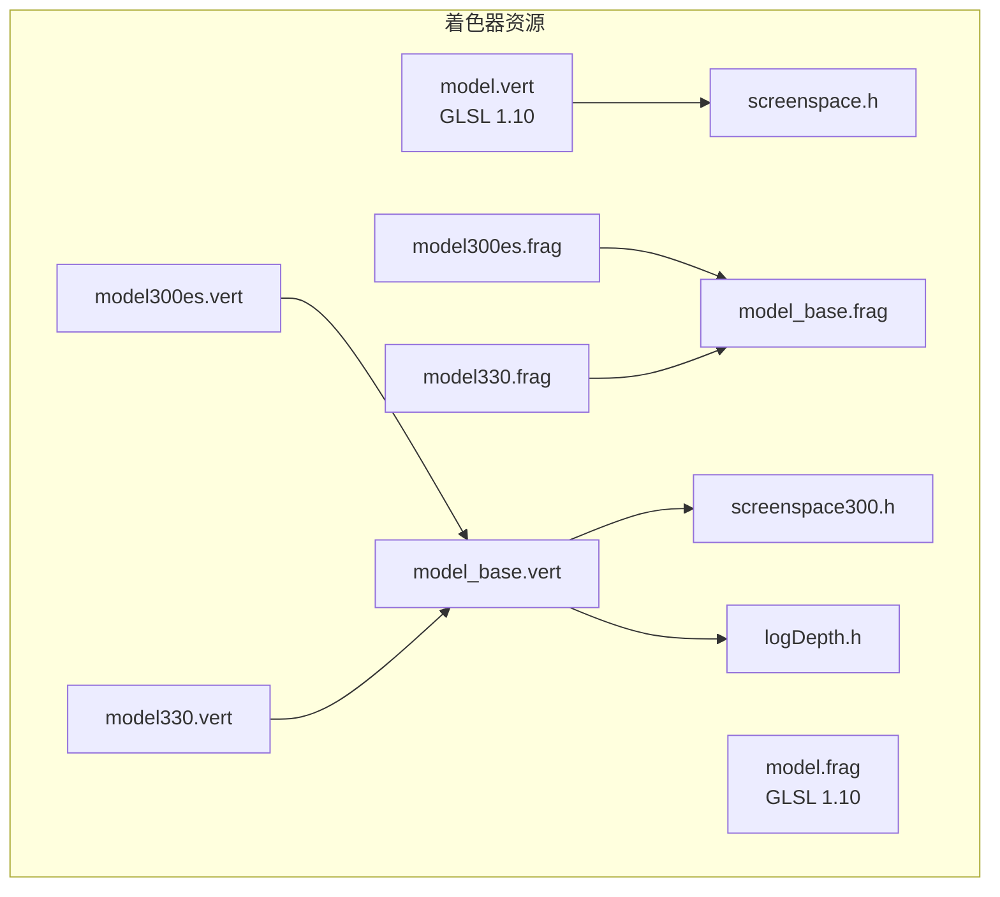
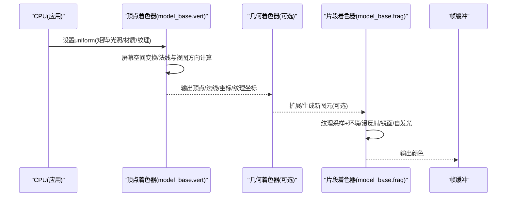
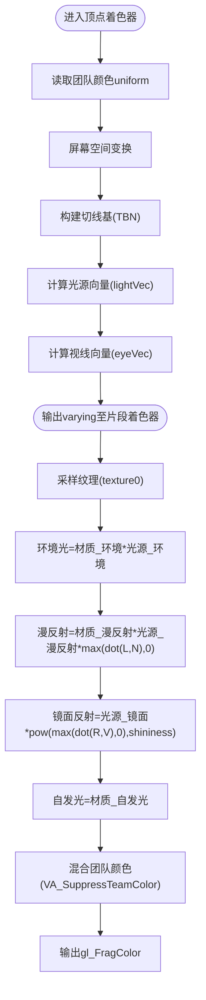
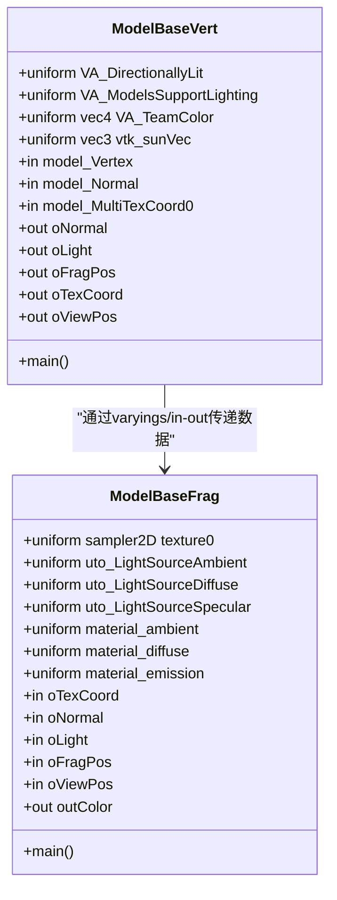
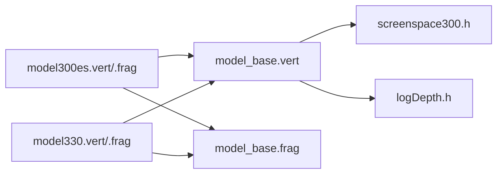

# 着色器系统

<cite>
**本文引用的文件**   
- [resources/shaders/model.vert](file://resources/shaders/model.vert)
- [resources/shaders/model.frag](file://resources/shaders/model.frag)
- [resources/shaders/model300es.vert](file://resources/shaders/model300es.vert)
- [resources/shaders/model300es.frag](file://resources/shaders/model300es.frag)
- [resources/shaders/model330.vert](file://resources/shaders/model330.vert)
- [resources/shaders/model330.frag](file://resources/shaders/model330.frag)
- [resources/shaders/model_base.vert](file://resources/shaders/model_base.vert)
- [resources/shaders/model_base.frag](file://resources/shaders/model_base.frag)
- [resources/shaders/screenspace.h](file://resources/shaders/screenspace.h)
- [resources/shaders/screenspace300.h](file://resources/shaders/screenspace300.h)
- [resources/shaders/logDepth.h](file://resources/shaders/logDepth.h)
</cite>

## 目录
1. [简介](#简介)
2. [项目结构](#项目结构)
3. [核心组件](#核心组件)
4. [架构总览](#架构总览)
5. [详细组件分析](#详细组件分析)
6. [依赖关系分析](#依赖关系分析)
7. [性能考虑](#性能考虑)
8. [故障排查指南](#故障排查指南)
9. [结论](#结论)
10. [附录：自定义着色器开发指南](#附录自定义着色器开发指南)

## 简介
本文件系统化梳理 AFSIM 渲染管线中的 OpenGL 着色器子系统，重点围绕模型渲染的顶点/片段着色器实现、多版本 GLSL（OpenGL ES 3.00 与桌面 GL 3.3）的兼容策略、uniform 变量传递机制、光照与材质处理流程，以及几何着色器的使用场景。文档同时提供可操作的自定义着色器开发指南、调试技巧与性能优化建议，帮助开发者在保持跨平台兼容性的前提下扩展渲染能力。

## 项目结构
着色器资源位于 resources/shaders 目录，采用“基础实现 + 版本适配”的组织方式：
- 旧版固定管线示例：model.vert / model.frag（GLSL 1.10）
- 现代可编程管线基础实现：model_base.vert / model_base.frag
- 版本入口文件：model300es.* 与 model330.* 通过 include 复用基础实现
- 公共头文件：screenspace.h / screenspace300.h / logDepth.h 等



图示来源
- [resources/shaders/model.vert:1-49](file://resources/shaders/model.vert#L1-L49)
- [resources/shaders/model.frag:1-50](file://resources/shaders/model.frag#L1-L50)
- [resources/shaders/model300es.vert:1-12](file://resources/shaders/model300es.vert#L1-L12)
- [resources/shaders/model300es.frag:1-12](file://resources/shaders/model300es.frag#L1-L12)
- [resources/shaders/model330.vert:1-12](file://resources/shaders/model330.vert#L1-L12)
- [resources/shaders/model330.frag:1-12](file://resources/shaders/model330.frag#L1-L12)
- [resources/shaders/model_base.vert:1-42](file://resources/shaders/model_base.vert#L1-L42)
- [resources/shaders/model_base.frag:1-45](file://resources/shaders/model_base.frag#L1-L45)
- [resources/shaders/screenspace.h](file://resources/shaders/screenspace.h)
- [resources/shaders/screenspace300.h](file://resources/shaders/screenspace300.h)
- [resources/shaders/logDepth.h](file://resources/shaders/logDepth.h)

章节来源
- [resources/shaders/model.vert:1-49](file://resources/shaders/model.vert#L1-L49)
- [resources/shaders/model.frag:1-50](file://resources/shaders/model.frag#L1-L50)
- [resources/shaders/model_base.vert:1-42](file://resources/shaders/model_base.vert#L1-L42)
- [resources/shaders/model_base.frag:1-45](file://resources/shaders/model_base.frag#L1-L45)

## 核心组件
- 顶点着色器（Vertex Shader）
  - 负责将模型顶点从模型空间变换到屏幕空间，计算法线、切线空间、视图方向与光源方向，并输出给片段着色器。
  - 在 GLSL 1.10 中通过内置矩阵与属性访问；在现代管线中通过 uniform/in/out 语义与自定义变换函数完成。
- 片段着色器（Fragment Shader）
  - 采样纹理，结合环境光、漫反射、镜面反射与自发光进行逐像素光照计算，最终输出颜色。
- 几何着色器（Geometry Shader）
  - 用于生成或扩展图元（如轨迹线、翼尖涡流、热力图等），在项目中以 .geom 文件存在，配合顶点/片段着色器工作。

章节来源
- [resources/shaders/model.vert:1-49](file://resources/shaders/model.vert#L1-L49)
- [resources/shaders/model.frag:1-50](file://resources/shaders/model.frag#L1-L50)
- [resources/shaders/model_base.vert:1-42](file://resources/shaders/model_base.vert#L1-L42)
- [resources/shaders/model_base.frag:1-45](file://resources/shaders/model_base.frag#L1-L45)

## 架构总览
下图展示模型渲染的关键阶段：CPU 设置 uniform → GPU 顶点着色器变换与数据准备 → 可选几何着色器扩展 → 片段着色器光照与纹理采样 → 帧缓冲输出。



图示来源
- [resources/shaders/model_base.vert:1-42](file://resources/shaders/model_base.vert#L1-L42)
- [resources/shaders/model_base.frag:1-45](file://resources/shaders/model_base.frag#L1-L45)

## 详细组件分析

### 模型着色器（GLSL 1.10 固定管线风格）
- 顶点着色器职责
  - 团队颜色传递、屏幕空间变换、法线/切线空间构建、光源与视线向量计算。
  - 关键 uniform：VA_DirectionallyLit、VA_ModelsSupportLighting、VA_TeamColor。
  - 参考路径：[resources/shaders/model.vert:1-49](file://resources/shaders/model.vert#L1-L49)
- 片段着色器职责
  - 纹理采样、材质与环境光/漫反射/镜面反射/自发光混合、团队颜色融合。
  - 关键 uniform：texture0、material_ambient/diffuse/emission、VA_SuppressTeamColor。
  - 参考路径：[resources/shaders/model.frag:1-50](file://resources/shaders/model.frag#L1-L50)



图示来源
- [resources/shaders/model.vert:1-49](file://resources/shaders/model.vert#L1-L49)
- [resources/shaders/model.frag:1-50](file://resources/shaders/model.frag#L1-L50)

章节来源
- [resources/shaders/model.vert:1-49](file://resources/shaders/model.vert#L1-L49)
- [resources/shaders/model.frag:1-50](file://resources/shaders/model.frag#L1-L50)

### 现代可编程管线基础实现（GLSL 3.00ES / 3.3）
- 顶点着色器（model_base.vert）
  - 输入：model_Vertex、model_Normal、model_MultiTexCoord0
  - 输出：oNormal、oLight、oFragPos、oTexCoord、oViewPos
  - 功能：统一屏幕空间变换、对数深度处理、法线/视图位置/光源方向计算
  - 参考路径：[resources/shaders/model_base.vert:1-42](file://resources/shaders/model_base.vert#L1-L42)
- 片段着色器（model_base.frag）
  - 输入：oTexCoord、oNormal、oLight、oFragPos、oViewPos
  - 输出：outColor
  - 功能：纹理采样、环境光/漫反射/镜面反射/自发光组合
  - 参考路径：[resources/shaders/model_base.frag:1-45](file://resources/shaders/model_base.frag#L1-L45)



图示来源
- [resources/shaders/model_base.vert:1-42](file://resources/shaders/model_base.vert#L1-L42)
- [resources/shaders/model_base.frag:1-45](file://resources/shaders/model_base.frag#L1-L45)

章节来源
- [resources/shaders/model_base.vert:1-42](file://resources/shaders/model_base.vert#L1-L42)
- [resources/shaders/model_base.frag:1-45](file://resources/shaders/model_base.frag#L1-L45)

### 不同渲染管线的兼容性处理（300ES vs 330）
- 版本入口文件
  - model300es.vert / model300es.frag：声明 #version 300 es，include model_base.*
  - model330.vert / model330.frag：声明 #version 330，include model_base.*
- 公共头文件
  - screenspace300.h：为 300ES/330 提供屏幕空间变换工具
  - logDepth.h：对数深度处理，提升大场景深度精度
- 设计要点
  - 通过“版本入口 + 基础实现 + 公共头”的分层，避免重复代码，保证行为一致
  - 针对移动端（ES）与桌面端（Desktop GL）的差异，仅修改必要的接口与精度声明



图示来源
- [resources/shaders/model300es.vert:1-12](file://resources/shaders/model300es.vert#L1-L12)
- [resources/shaders/model300es.frag:1-12](file://resources/shaders/model300es.frag#L1-L12)
- [resources/shaders/model330.vert:1-12](file://resources/shaders/model330.vert#L1-L12)
- [resources/shaders/model330.frag:1-12](file://resources/shaders/model330.frag#L1-L12)
- [resources/shaders/model_base.vert:1-42](file://resources/shaders/model_base.vert#L1-L42)
- [resources/shaders/model_base.frag:1-45](file://resources/shaders/model_base.frag#L1-L45)
- [resources/shaders/screenspace300.h](file://resources/shaders/screenspace300.h)
- [resources/shaders/logDepth.h](file://resources/shaders/logDepth.h)

章节来源
- [resources/shaders/model300es.vert:1-12](file://resources/shaders/model300es.vert#L1-L12)
- [resources/shaders/model300es.frag:1-12](file://resources/shaders/model300es.frag#L1-L12)
- [resources/shaders/model330.vert:1-12](file://resources/shaders/model330.vert#L1-L12)
- [resources/shaders/model330.frag:1-12](file://resources/shaders/model330.frag#L1-L12)
- [resources/shaders/model_base.vert:1-42](file://resources/shaders/model_base.vert#L1-L42)
- [resources/shaders/model_base.frag:1-45](file://resources/shaders/model_base.frag#L1-L45)

### 几何着色器（扩展图元）
- 用途
  - 轨迹线、翼尖涡流、热力图等需要动态生成或扩展图元的场景
- 典型文件
  - traceline.geom、wingribbon.geom、heatmapoverlay.geom 等
- 工作模式
  - 接收来自顶点着色器的图元，按规则生成新的顶点/边/三角形，再交由片段着色器渲染

章节来源
- [resources/shaders/traceline.geom](file://resources/shaders/traceline.geom)
- [resources/shaders/wingribbon.geom](file://resources/shaders/wingribbon.geom)
- [resources/shaders/heatmapoverlay.geom](file://resources/shaders/heatmapoverlay.geom)

### Uniform 变量传递机制
- 顶点着色器常用 uniform
  - 矩阵类：osg_ViewMatrix、osg_ProjectionMatrix、ScreenSpaceTransform 所需矩阵
  - 光照类：vtk_sunVec、uto_LightSourceAmbient/Diffuse/Specular
  - 材质类：material_ambient/diffuse/emission
  - 控制类：VA_DirectionallyLit、VA_ModelsSupportLighting、VA_TeamColor、VA_SuppressTeamColor
- 片段着色器常用 uniform
  - 纹理：sampler2D texture0
  - 光照：uto_LightSourceAmbient/Diffuse/Specular
  - 材质：material_ambient/diffuse/emission
- 传递流程
  - CPU 侧在绘制前绑定纹理单元、设置 uniform 值
  - GPU 在对应阶段读取 uniform 参与计算

章节来源
- [resources/shaders/model_base.vert:1-42](file://resources/shaders/model_base.vert#L1-L42)
- [resources/shaders/model_base.frag:1-45](file://resources/shaders/model_base.frag#L1-L45)
- [resources/shaders/model.vert:1-49](file://resources/shaders/model.vert#L1-L49)
- [resources/shaders/model.frag:1-50](file://resources/shaders/model.frag#L1-L50)

## 依赖关系分析
- 模块内聚性
  - model_base.* 集中实现通用光照与变换逻辑，提高复用性与一致性
- 耦合点
  - 版本入口文件强依赖基础实现与公共头文件
  - 片段着色器依赖顶点着色器输出的 varyings/in-out 数据
- 外部依赖
  - screenspace*.h 提供屏幕空间变换工具
  - logDepth.h 提供对数深度处理

```mermaid
graph TB
M300V["model300es.vert"] --> MBV["model_base.vert"]
M300F["model300es.frag"] --> MBF["model_base.frag"]
M330V["model330.vert"] --> MBV
M330F["model330.frag"] --> MBF
MBV --> SH["screenspace300.h"]
MBV --> LD["logDepth.h"]
MBF -.-> MBV : "读取varyings/in-out"
```

图示来源
- [resources/shaders/model300es.vert:1-12](file://resources/shaders/model300es.vert#L1-L12)
- [resources/shaders/model300es.frag:1-12](file://resources/shaders/model300es.frag#L1-L12)
- [resources/shaders/model330.vert:1-12](file://resources/shaders/model330.vert#L1-L12)
- [resources/shaders/model330.frag:1-12](file://resources/shaders/model330.frag#L1-L12)
- [resources/shaders/model_base.vert:1-42](file://resources/shaders/model_base.vert#L1-L42)
- [resources/shaders/model_base.frag:1-45](file://resources/shaders/model_base.frag#L1-L45)
- [resources/shaders/screenspace300.h](file://resources/shaders/screenspace300.h)
- [resources/shaders/logDepth.h](file://resources/shaders/logDepth.h)

章节来源
- [resources/shaders/model_base.vert:1-42](file://resources/shaders/model_base.vert#L1-L42)
- [resources/shaders/model_base.frag:1-45](file://resources/shaders/model_base.frag#L1-L45)

## 性能考虑
- 减少状态切换
  - 合并相同材质的批次绘制，降低 uniform 与纹理切换开销
- 合理选择精度
  - 在移动端优先使用 mediump/lowp 类型，减少带宽与计算压力
- 避免分支与冗余计算
  - 尽量向量化运算，减少条件分支；将不变量提升到顶点阶段
- 纹理优化
  - 使用合适的纹理格式与压缩格式，减少带宽占用
- 深度优化
  - 启用对数深度（logDepth.h）以提升大场景深度稳定性
- 几何着色器慎用
  - 仅在必要时启用几何着色器，避免过度图元生成

## 故障排查指南
- 编译失败
  - 检查 #version 与语法是否匹配目标平台（ES 3.00 与 Desktop 3.3）
  - 确认 include 的头文件路径与内容正确
- 链接失败
  - 确保顶点与片段着色器的 in/out 变量名与类型一致
- 渲染异常
  - 检查 uniform 是否正确设置（矩阵、光照、材质、纹理单元）
  - 验证纹理是否正确绑定且采样坐标有效
- 性能问题
  - 使用 GPU 分析工具（RenderDoc/Nsight）定位瓶颈
  - 减少不必要的几何着色器与复杂片段计算

章节来源
- [resources/shaders/model_base.vert:1-42](file://resources/shaders/model_base.vert#L1-L42)
- [resources/shaders/model_base.frag:1-45](file://resources/shaders/model_base.frag#L1-L45)

## 结论
AFSIM 的着色器系统通过“基础实现 + 版本入口 + 公共头”的分层设计，实现了在 OpenGL ES 3.00 与桌面 GL 3.3 之间的良好兼容。模型着色器清晰分离了顶点与片段阶段的职责，支持光照、纹理与材质属性的灵活配置。几何着色器为特定可视化需求提供了扩展能力。遵循本文的开发指南与优化建议，可在保证性能与稳定性的前提下快速扩展自定义着色器。

## 附录：自定义着色器开发指南
- 开发步骤
  - 确定目标平台（ES 3.00 或 Desktop 3.3），创建对应的入口文件（如 custom300es.vert / custom330.vert）
  - 复用 model_base.* 的基础实现，按需扩展顶点/片段逻辑
  - 在公共头文件中添加必要的工具函数（如屏幕空间变换、对数深度）
- 最佳实践
  - 将不变量（如世界矩阵、光源方向）放在顶点阶段计算
  - 使用合理的精度修饰符，避免不必要的高精度计算
  - 尽量减少分支与复杂数学运算，利用内置函数与向量化
- 调试技巧
  - 分阶段输出中间结果（如法线、视图方向、反射向量）到颜色通道进行可视化
  - 使用 RenderDoc/Nsight 抓取单帧，逐步定位问题
- 示例参考
  - 模型着色器：[resources/shaders/model_base.vert:1-42](file://resources/shaders/model_base.vert#L1-L42)、[resources/shaders/model_base.frag:1-45](file://resources/shaders/model_base.frag#L1-L45)
  - 版本入口：[resources/shaders/model300es.vert:1-12](file://resources/shaders/model300es.vert#L1-L12)、[resources/shaders/model330.vert:1-12](file://resources/shaders/model330.vert#L1-L12)
  - 公共头：[resources/shaders/screenspace300.h](file://resources/shaders/screenspace300.h)、[resources/shaders/logDepth.h](file://resources/shaders/logDepth.h)