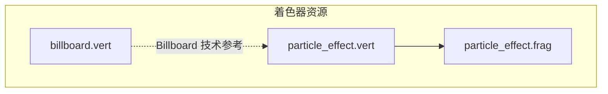
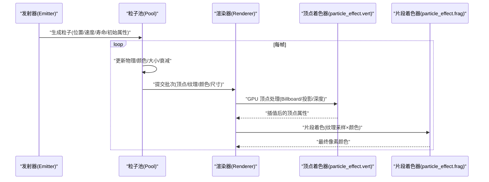
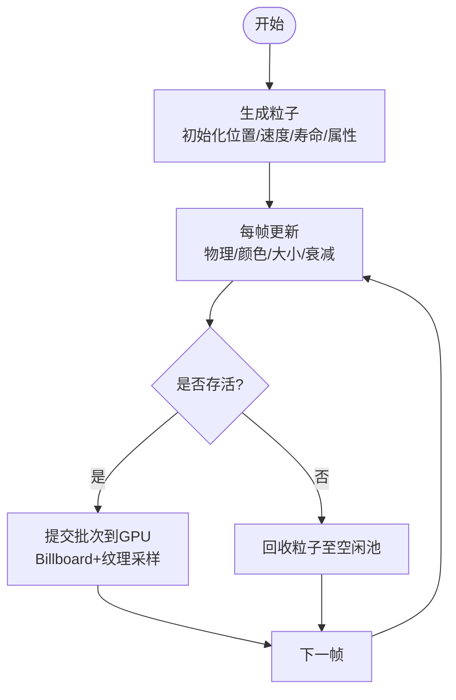
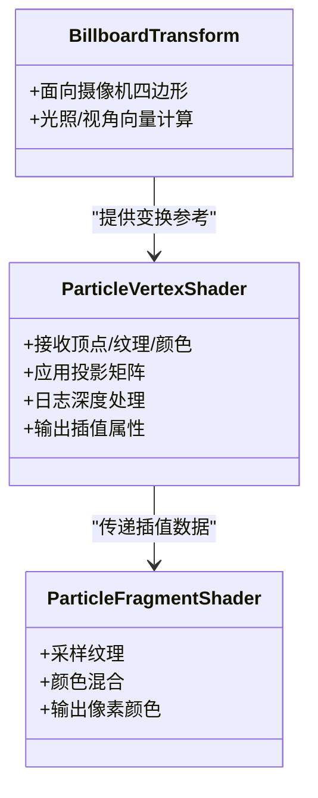

# 粒子系统

<cite>
**本文引用的文件**   
- [particle_effect.vert](file://resources/shaders/particle_effect.vert)
- [particle_effect.frag](file://resources/shaders/particle_effect.frag)
- [billboard.vert](file://resources/shaders/billboard.vert)
</cite>

## 目录
1. [简介](#简介)
2. [项目结构](#项目结构)
3. [核心组件](#核心组件)
4. [架构总览](#架构总览)
5. [详细组件分析](#详细组件分析)
6. [依赖关系分析](#依赖关系分析)
7. [性能考虑](#性能考虑)
8. [故障排查指南](#故障排查指南)
9. [结论](#结论)
10. [附录](#附录)

## 简介
本文件为 AFSIM 中“粒子系统”的技术文档，聚焦于以下方面：
- 发射器架构：点、面、体积发射器的设计思路与数据流
- 生命周期管理：粒子的生成、更新、渲染与销毁流程
- 效果计算：物理模拟、颜色渐变、大小变化等
- 着色器实现：Billboard 技术与 GPU 加速路径
- 性能优化：批处理与 GPU 实例化策略
- 常见效果示例：爆炸、烟雾、火焰等
- 配置参数与调优建议

说明：仓库中与粒子渲染直接相关的可见资产位于 resources/shaders 目录。本文基于这些着色器文件进行分析与扩展说明，并结合通用图形管线实践给出可操作的指导。

## 项目结构
与粒子系统直接相关的资源集中在 shaders 目录，包含：
- 粒子效果着色器：用于顶点变换与片段着色
- Billboard 相关着色器：用于面向摄像机的四边形绘制
- 其他可视化着色器（如模型、地形、轨迹线等）

图表来源
- [particle_effect.vert:1-24](file://resources/shaders/particle_effect.vert#L1-L24)
- [particle_effect.frag:1-18](file://resources/shaders/particle_effect.frag#L1-L18)
- [billboard.vert:1-46](file://resources/shaders/billboard.vert#L1-L46)

章节来源
- [particle_effect.vert:1-24](file://resources/shaders/particle_effect.vert#L1-L24)
- [particle_effect.frag:1-18](file://resources/shaders/particle_effect.frag#L1-L18)
- [billboard.vert:1-46](file://resources/shaders/billboard.vert#L1-L46)

## 核心组件
- 粒子发射器（Emitter）
  - 点发射器：从单一位置以随机方向/速度分布发射粒子
  - 面发射器：从二维区域（平面或曲面采样）发射粒子
  - 体积发射器：从三维体（球、盒、自定义网格）内采样发射粒子
- 粒子池（Particle Pool）
  - 负责粒子的分配、回收、状态更新与批量提交到 GPU
- 渲染管线（Renderer）
  - 将粒子几何（通常为四边形）与纹理、颜色、尺寸等属性通过批处理提交给 GPU
  - 使用 Billboard 技术确保粒子始终面向摄像机
- 着色器（Shaders）
  - 顶点着色器：完成投影变换、深度处理、纹理坐标与颜色传递
  - 片段着色器：对纹理进行采样并与颜色混合输出

章节来源
- [particle_effect.vert:1-24](file://resources/shaders/particle_effect.vert#L1-L24)
- [particle_effect.frag:1-18](file://resources/shaders/particle_effect.frag#L1-L18)
- [billboard.vert:1-46](file://resources/shaders/billboard.vert#L1-L46)

## 架构总览
下图展示粒子系统的端到端数据流：从发射器生成粒子，到 CPU 侧更新，再到 GPU 批渲染。

图表来源
- [particle_effect.vert:1-24](file://resources/shaders/particle_effect.vert#L1-L24)
- [particle_effect.frag:1-18](file://resources/shaders/particle_effect.frag#L1-L18)

## 详细组件分析

### 发射器架构（点/面/体积）
- 点发射器
  - 输入：发射位置、发射速率、角度/速度分布、初始属性（颜色、大小、寿命）
  - 输出：每帧生成的粒子集合
- 面发射器
  - 输入：面片定义（平面法向、范围）、采样策略（均匀/加权）、出射方向分布
  - 输出：沿表面法向或指定方向分布的粒子
- 体积发射器
  - 输入：体积形状（球/盒/网格）、密度函数、出射速度场
  - 输出：在体积内按密度采样的粒子

提示：上述为通用设计模式；具体实现细节需结合引擎内部数据结构与配置语法。

章节来源
- （本节为概念性说明，不直接分析具体文件）

### 生命周期管理（生成/更新/渲染/销毁）
- 生成
  - 根据发射器参数与时间步长，批量创建新粒子并写入粒子池
- 更新
  - 物理：重力、阻力、浮力、湍流等
  - 外观：颜色随时间渐变、大小随时间缩放、透明度衰减
  - 状态：剩余寿命、是否死亡标记
- 渲染
  - 将存活粒子打包为批次，绑定纹理与颜色缓冲，调用 GPU 绘制
- 销毁
  - 达到寿命上限或触发外部事件时回收粒子，归还至空闲池

图表来源
- [particle_effect.vert:1-24](file://resources/shaders/particle_effect.vert#L1-L24)
- [particle_effect.frag:1-18](file://resources/shaders/particle_effect.frag#L1-L18)

章节来源
- [particle_effect.vert:1-24](file://resources/shaders/particle_effect.vert#L1-L24)
- [particle_effect.frag:1-18](file://resources/shaders/particle_effect.frag#L1-L18)

### 效果计算（物理/颜色/大小）
- 物理模拟
  - 基础运动学：位置 = 位置 + 速度 × Δt
  - 受力模型：重力、空气阻力、浮力、风力场
  - 碰撞与约束：地面/地形高度、边界限制
- 颜色渐变
  - 基于时间的线性/非线性插值（例如从亮白到暗红）
  - 支持多段曲线控制（分段关键帧）
- 大小变化
  - 生命周期驱动的缩放曲线（先膨胀后收缩）
  - 可选噪声扰动增加自然感

章节来源
- （本节为通用算法说明，不直接分析具体文件）

### 粒子着色器实现（Billboard 与 GPU 加速）
- 顶点着色器（particle_effect.vert）
  - 功能要点：
    - 接收顶点位置、纹理坐标、颜色
    - 应用视图-投影矩阵得到裁剪空间坐标
    - 使用日志深度工具提升远距精度
    - 将纹理坐标与颜色传递给片段阶段
- 片段着色器（particle_effect.frag）
  - 功能要点：
    - 采样纹理贴图
    - 与传入的颜色相乘得到最终颜色
- Billboard 技术（billboard.vert）
  - 功能要点：
    - 计算面向摄像机的四边形变换
    - 提供光照与视角向量供后续着色使用
    - 保证粒子在任何视角下均正面朝向摄像机

图表来源
- [particle_effect.vert:1-24](file://resources/shaders/particle_effect.vert#L1-L24)
- [particle_effect.frag:1-18](file://resources/shaders/particle_effect.frag#L1-L18)
- [billboard.vert:1-46](file://resources/shaders/billboard.vert#L1-L46)

章节来源
- [particle_effect.vert:1-24](file://resources/shaders/particle_effect.vert#L1-L24)
- [particle_effect.frag:1-18](file://resources/shaders/particle_effect.frag#L1-L18)
- [billboard.vert:1-46](file://resources/shaders/billboard.vert#L1-L46)

### 常见效果示例
- 爆炸
  - 高初速、短寿命、快速膨胀与褪色
  - 颜色从亮白→橙黄→暗红→透明
- 烟雾
  - 低初速、较长寿命、缓慢上升与扩散
  - 颜色偏灰黑，透明度逐渐降低
- 火焰
  - 中等初速、向上漂移、闪烁与脉动
  - 颜色从亮黄→橙红→暗红，叠加噪声扰动

章节来源
- （本节为效果设计说明，不直接分析具体文件）

## 依赖关系分析
- 着色器依赖
  - particle_effect.vert 依赖深度处理工具（logDepth.h），并在主函数中进行投影变换与插值属性传递
  - particle_effect.frag 依赖纹理采样与颜色混合
  - billboard.vert 提供面向摄像机的变换逻辑，可作为粒子四边形的参考实现
- 运行时依赖
  - 渲染器需要维护批次缓冲区（顶点、纹理、颜色、尺寸）
  - 粒子池需要高效的分配/回收机制以减少内存抖动

图表来源
- [particle_effect.vert:1-24](file://resources/shaders/particle_effect.vert#L1-L24)
- [particle_effect.frag:1-18](file://resources/shaders/particle_effect.frag#L1-L18)
- [billboard.vert:1-46](file://resources/shaders/billboard.vert#L1-L46)

章节来源
- [particle_effect.vert:1-24](file://resources/shaders/particle_effect.vert#L1-L24)
- [particle_effect.frag:1-18](file://resources/shaders/particle_effect.frag#L1-L18)
- [billboard.vert:1-46](file://resources/shaders/billboard.vert#L1-L46)

## 性能考虑
- 批处理（Batching）
  - 将同材质/同纹理的粒子合并为单次绘制调用，减少 CPU-GPU 同步开销
  - 合理划分批次以避免过大导致缓存抖动
- GPU 实例化（Instancing）
  - 使用实例化绘制（glDrawElementsInstanced 或等效 API）一次性提交大量粒子
  - 将每粒子属性（位置、颜色、大小、寿命）放入实例缓冲，由顶点着色器读取
- 纹理与混合
  - 使用图集（Texture Atlas）减少纹理切换
  - 启用 Alpha 混合但避免过度排序开销（可使用深度预写或分层渲染）
- 数值精度
  - 使用日志深度（logDepth）改善远距离渲染稳定性
- 物理简化
  - 对远处粒子采用简化物理或冻结更新，降低 CPU 压力

章节来源
- [particle_effect.vert:1-24](file://resources/shaders/particle_effect.vert#L1-L24)

## 故障排查指南
- 粒子不显示
  - 检查纹理是否正确绑定与 UV 坐标是否有效
  - 确认片段着色器输出颜色非零且混合模式正确
- 粒子闪烁或深度错误
  - 检查是否启用正确的深度测试与日志深度处理
- 性能骤降
  - 检查批次大小是否过大，尝试拆分批次
  - 评估是否启用了不必要的逐粒子排序
- 颜色异常
  - 检查颜色插值曲线与透明度衰减设置
- 尺寸异常
  - 检查每粒子尺寸缓冲与顶点着色器中的尺寸应用逻辑

章节来源
- [particle_effect.frag:1-18](file://resources/shaders/particle_effect.frag#L1-L18)
- [particle_effect.vert:1-24](file://resources/shaders/particle_effect.vert#L1-L24)

## 结论
AFSIM 的粒子系统通过清晰的发射器-粒子池-渲染器分层，配合轻量级的顶点/片段着色器与 Billboard 技术，实现了高效且可扩展的视觉效果管线。借助批处理与 GPU 实例化，可在大规模粒子场景下保持良好性能。通过合理的物理、颜色与大小曲线设计，能够覆盖爆炸、烟雾、火焰等常见效果。

## 附录
- 配置参数建议（示例）
  - 发射器
    - 类型：点/面/体积
    - 发射速率：每秒粒子数
    - 角度/速度分布：均值/方差或自定义分布
    - 初始属性：颜色、大小、寿命
  - 物理
    - 重力系数、阻力系数、浮力系数
    - 风场强度与方向
  - 外观
    - 颜色渐变关键帧（时间→颜色）
    - 大小缩放曲线（时间→缩放因子）
    - 透明度衰减曲线（时间→Alpha）
- 调优清单
  - 控制每帧最大粒子数与批次大小
  - 使用纹理图集与实例化绘制
  - 对远处粒子降级物理与细节
  - 监控 GPU 占用与帧时间，定位瓶颈

章节来源
- （本节为通用建议，不直接分析具体文件）