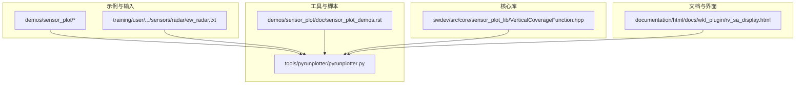
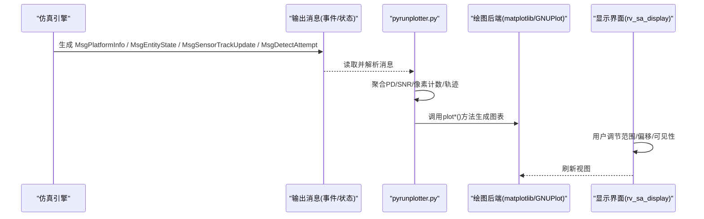
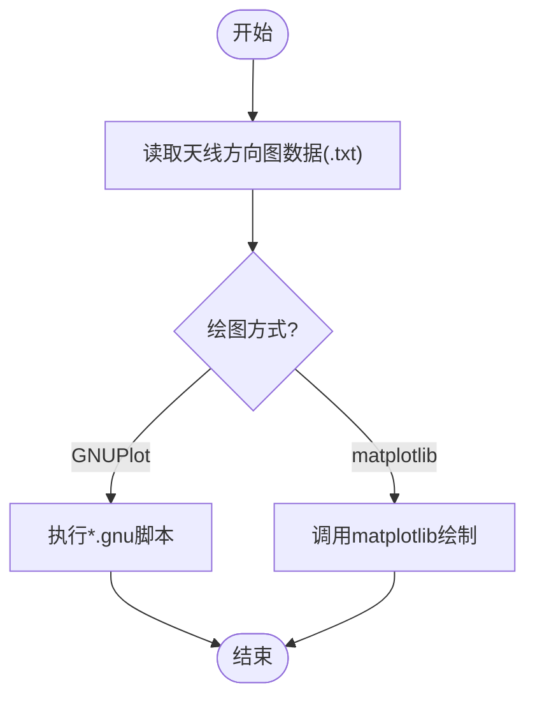
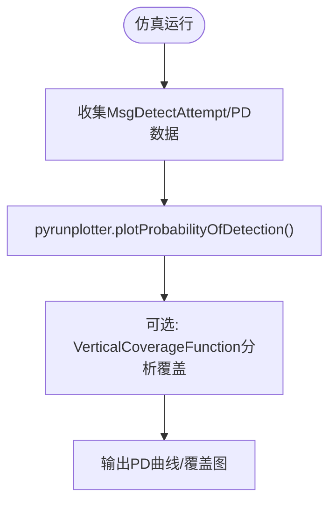
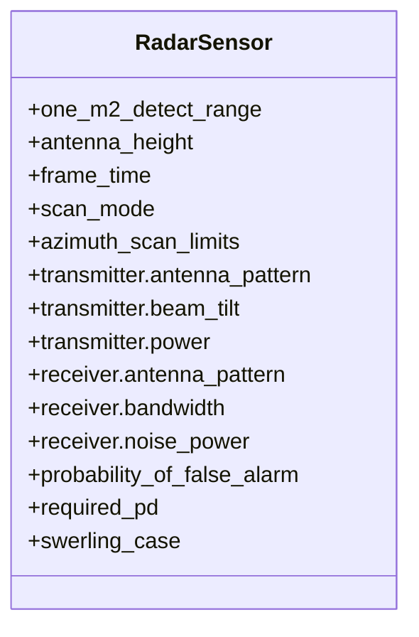
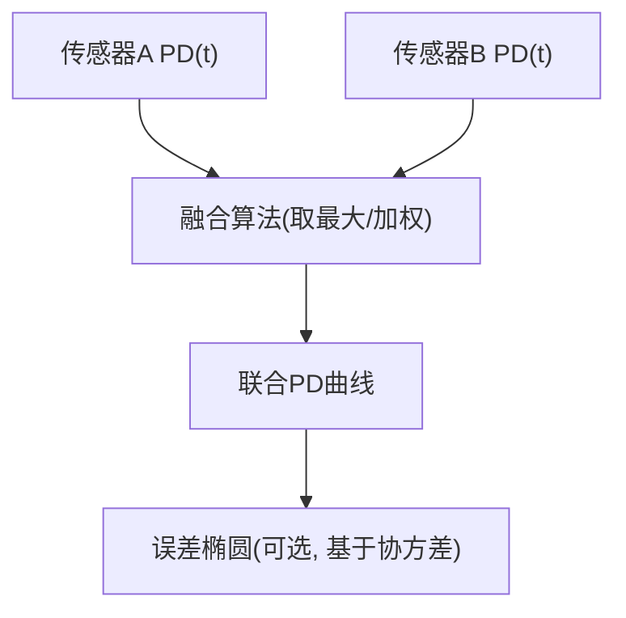
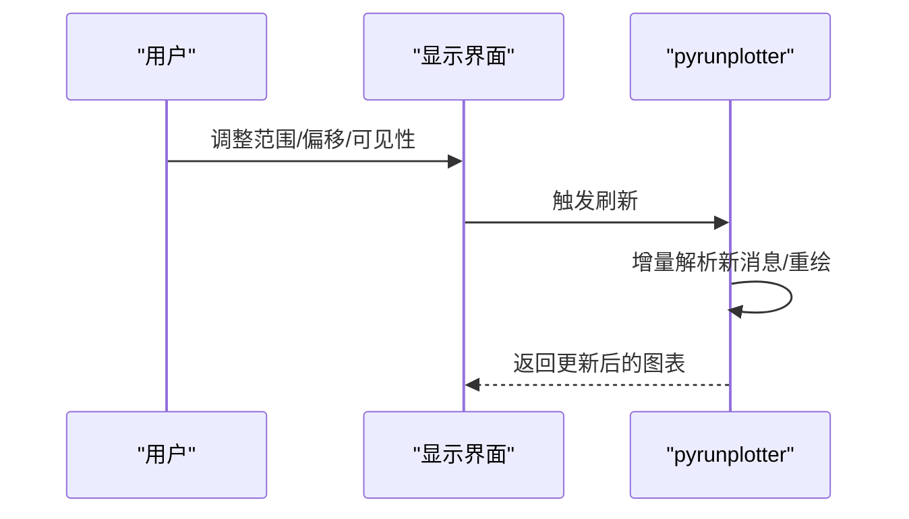
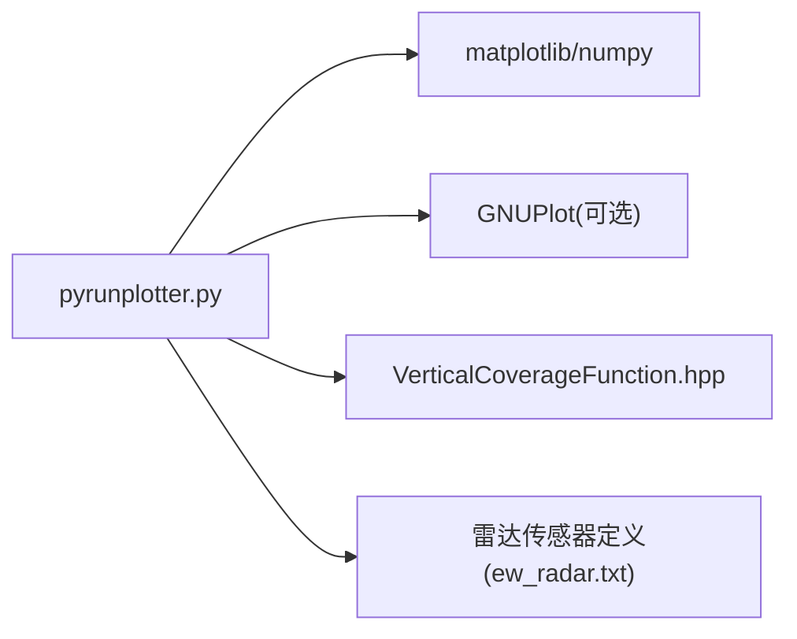

# 传感器可视化

<cite>
**本文引用的文件**   
- [pyrunplotter.py](file://tools/pyrunplotter/pyrunplotter.py)
- [sensor_plot_demos.rst](file://demos/sensor_plot/doc/sensor_plot_demos.rst)
- [README.md](file://demos/sensor_plot/README.md)
- [VerticalCoverageFunction.hpp](file://swdev/src/core/sensor_plot_lib/source/VerticalCoverageFunction.hpp)
- [ew_radar.txt](file://training/user/10_Other_Topics/bam/scenarios/floridistan/27_floridistan_cluster_gci/sensors/radar/ew_radar.txt)
- [rv_sa_display.html](file://documentation/html/docs/wkf_plugin/rv_sa_display.html)
</cite>

## 目录
1. [简介](#简介)
2. [项目结构](#项目结构)
3. [核心组件](#核心组件)
4. [架构总览](#架构总览)
5. [详细组件分析](#详细组件分析)
6. [依赖关系分析](#依赖关系分析)
7. [性能与可伸缩性](#性能与可伸缩性)
8. [故障排查指南](#故障排查指南)
9. [结论](#结论)
10. [附录：配置示例与最佳实践](#附录配置示例与最佳实践)

## 简介
本文件面向AFSIM中的“传感器可视化”能力，系统性说明天线方向图绘制、检测概率分析与覆盖范围可视化、传感器体积（波束形状/扫描模式/探测区域）展示、多传感器融合效果可视化、交互式参数调整与数据实时更新，以及性能分析与报告输出。文档以仓库中现有工具与示例为依据，提供从原理到实践的完整路径，并给出可直接复现的配置与脚本参考。

## 项目结构
围绕传感器可视化的关键资源分布如下：
- 演示与示例
  - demos/sensor_plot：包含天线、雷达、ESM、通信、SAR等子目录的绘图输入与GNUPlot脚本示例
  - training/user：包含雷达传感器定义示例（含发射/接收机、扫描模式、PD/虚警等参数）
- 绘图与分析工具
  - tools/pyrunplotter：Python脚本，用于解析仿真输出消息、提取平台状态与传感器探测信息，并生成多种图表（2D/3D位置、高度、燃料、弹药、检测概率、像素计数等）
- 核心库函数
  - swdev/src/core/sensor_plot_lib：垂直覆盖函数类，支持垂直覆盖图（VCD）等分析
- 文档与界面
  - documentation/html/docs/wkf_plugin/rv_sa_display.html：显示控制选项与交互说明（如范围缩放、视图偏移、实体可见性开关等）

图示来源
- [sensor_plot_demos.rst:32-54](file://demos/sensor_plot/doc/sensor_plot_demos.rst#L32-L54)
- [pyrunplotter.py:14-16](file://tools/pyrunplotter/pyrunplotter.py#L14-L16)
- [VerticalCoverageFunction.hpp:21-51](file://swdev/src/core/sensor_plot_lib/source/VerticalCoverageFunction.hpp#L21-L51)
- [rv_sa_display.html:196-200](file://documentation/html/docs/wkf_plugin/rv_sa_display.html#L196-L200)

章节来源
- [README.md:1-9](file://demos/sensor_plot/README.md#L1-L9)
- [sensor_plot_demos.rst:32-54](file://demos/sensor_plot/doc/sensor_plot_demos.rst#L32-L54)

## 核心组件
- 天线方向图绘制
  - 通过demos/sensor_plot/antenna下的*.txt与*.gnu脚本，支持二维/三维方向图绘制；GNUPlot命令示例见文档说明
- 检测概率与覆盖范围
  - pyrunplotter.py提供plotProbabilityOfDetection()接口，基于MsgDetectAttempt消息提取PD随时间变化曲线
  - VerticalCoverageFunction.hpp提供垂直覆盖分析能力（最大高度/最大距离输出）
- 传感器体积可视化
  - 雷达传感器定义中包含扫描模式、方位/俯仰扫描限制、波束倾斜等参数，结合GNUPlot或自定义脚本可绘制波束形状与扫描轨迹
- 多传感器融合
  - 通过多平台/多传感器的PD时序叠加对比，结合误差椭圆（需扩展绘图逻辑）实现联合探测概率可视化
- 交互式调整与实时更新
  - rv_sa_display.html描述显示控制项（范围缩放、视图偏移、实体可见性开关），可与pyrunplotter实时数据流结合实现动态更新

章节来源
- [sensor_plot_demos.rst:32-54](file://demos/sensor_plot/doc/sensor_plot_demos.rst#L32-L54)
- [pyrunplotter.py:749-774](file://tools/pyrunplotter/pyrunplotter.py#L749-L774)
- [VerticalCoverageFunction.hpp:21-51](file://swdev/src/core/sensor_plot_lib/source/VerticalCoverageFunction.hpp#L21-L51)
- [rv_sa_display.html:196-200](file://documentation/html/docs/wkf_plugin/rv_sa_display.html#L196-L200)

## 架构总览
传感器可视化整体流程如下：
- 输入层：场景与传感器定义（雷达/ESM/通信/SAR等）
- 仿真运行：产生平台状态、传感器跟踪、探测尝试等消息
- 数据处理：pyrunplotter解析消息，提取PD、SNR、像素计数、位置轨迹等
- 可视化层：matplotlib/GNUPlot生成2D/3D图表、覆盖图、地图叠加
- 交互层：显示控制项（范围、偏移、可见性）与实时更新

图示来源
- [pyrunplotter.py:270-299](file://tools/pyrunplotter/pyrunplotter.py#L270-L299)
- [pyrunplotter.py:749-774](file://tools/pyrunplotter/pyrunplotter.py#L749-L774)
- [rv_sa_display.html:196-200](file://documentation/html/docs/wkf_plugin/rv_sa_display.html#L196-L200)

## 详细组件分析

### 天线方向图绘制（二维/三维、极坐标与直角坐标）
- 二维/三维方向图
  - 使用demos/sensor_plot/antenna/*.txt作为数据源，配合*.gnu脚本进行GNUPlot渲染
  - 文档明确列出circular_2d.gnu、circular_3d.gnu等命令文件，便于快速绘图
- 极坐标与直角坐标系转换
  - 在pyrunplotter.py中实现了LLA↔WCS坐标转换函数，可用于将地理坐标转换为笛卡尔坐标，便于在直角坐标系下绘制方向图或覆盖区域
- 典型流程
  - 准备天线方向图数据（.txt）
  - 选择GNUPlot脚本（.gnu）或直接使用matplotlib绘制
  - 如需地理投影，使用LLA/WCS转换函数进行坐标变换

图示来源
- [sensor_plot_demos.rst:43-54](file://demos/sensor_plot/doc/sensor_plot_demos.rst#L43-L54)
- [pyrunplotter.py:102-148](file://tools/pyrunplotter/pyrunplotter.py#L102-L148)

章节来源
- [sensor_plot_demos.rst:43-54](file://demos/sensor_plot/doc/sensor_plot_demos.rst#L43-L54)
- [pyrunplotter.py:102-148](file://tools/pyrunplotter/pyrunplotter.py#L102-L148)

### 检测概率分析与覆盖范围可视化
- 检测概率曲线
  - pyrunplotter.py的plotProbabilityOfDetection()方法从MsgDetectAttempt消息中提取PD序列，按时间绘制曲线
- 覆盖范围分析
  - VerticalCoverageFunction.hpp提供垂直覆盖分析能力，支持输出最大高度/最大距离等指标，辅助评估不同仰角/距离下的探测能力
- 灵敏度分析
  - 通过改变雷达/ESM参数（如功率、带宽、噪声功率、内部损耗、PD阈值等），比较PD曲线差异，评估系统灵敏度

图示来源
- [pyrunplotter.py:384-395](file://tools/pyrunplotter/pyrunplotter.py#L384-L395)
- [pyrunplotter.py:749-774](file://tools/pyrunplotter/pyrunplotter.py#L749-L774)
- [VerticalCoverageFunction.hpp:21-51](file://swdev/src/core/sensor_plot_lib/source/VerticalCoverageFunction.hpp#L21-L51)

章节来源
- [pyrunplotter.py:384-395](file://tools/pyrunplotter/pyrunplotter.py#L384-L395)
- [pyrunplotter.py:749-774](file://tools/pyrunplotter/pyrunplotter.py#L749-L774)
- [VerticalCoverageFunction.hpp:21-51](file://swdev/src/core/sensor_plot_lib/source/VerticalCoverageFunction.hpp#L21-L51)

### 传感器体积可视化（波束形状、扫描模式、探测区域）
- 波束形状
  - 雷达传感器定义中包含发射/接收天线方向图、波束倾斜、方位/俯仰波束宽度等参数，可据此绘制三维波束体
- 扫描模式
  - 通过scan_mode与azimuth_scan_limits等参数定义扫描策略，结合GNUPlot或自定义脚本绘制扫描轨迹与覆盖扇区
- 探测区域
  - 将PD阈值与覆盖范围结合，绘制探测区域等高线或网格覆盖图

图示来源
- [ew_radar.txt:15-42](file://training/user/10_Other_Topics/bam/scenarios/floridistan/27_floridistan_cluster_gci/sensors/radar/ew_radar.txt#L15-L42)
- [ew_radar.txt:43-63](file://training/user/10_Other_Topics/bam/scenarios/floridistan/27_floridistan_cluster_gci/sensors/radar/ew_radar.txt#L43-L63)

章节来源
- [ew_radar.txt:15-42](file://training/user/10_Other_Topics/bam/scenarios/floridistan/27_floridistan_cluster_gci/sensors/radar/ew_radar.txt#L15-L42)
- [ew_radar.txt:43-63](file://training/user/10_Other_Topics/bam/scenarios/floridistan/27_floridistan_cluster_gci/sensors/radar/ew_radar.txt#L43-L63)

### 多传感器融合可视化（联合探测概率与误差椭圆）
- 联合探测概率
  - 对多个传感器的PD时序进行叠加或组合（例如取最大值或加权平均），在同一图中对比不同传感器/平台的探测表现
- 误差椭圆
  - 基于多传感器定位误差协方差计算误差椭圆，并在地图上叠加显示（需在pyrunplotter基础上扩展绘图逻辑）

[本节为概念性流程图，不直接映射具体源码文件]

### 交互式参数调整与数据实时更新
- 显示控制
  - rv_sa_display.html描述了显示界面的交互选项，包括范围缩放、视图偏移、实体可见性开关等
- 实时更新
  - 结合pyrunplotter的消息解析与绘图接口，可在仿真运行时逐步刷新图表，实现交互式观察

图示来源
- [rv_sa_display.html:196-200](file://documentation/html/docs/wkf_plugin/rv_sa_display.html#L196-L200)
- [pyrunplotter.py:270-299](file://tools/pyrunplotter/pyrunplotter.py#L270-L299)

章节来源
- [rv_sa_display.html:196-200](file://documentation/html/docs/wkf_plugin/rv_sa_display.html#L196-L200)
- [pyrunplotter.py:270-299](file://tools/pyrunplotter/pyrunplotter.py#L270-L299)

## 依赖关系分析
- 外部依赖
  - matplotlib/numpy：pyrunplotter.py在导入时检查可用性，缺失时会抛出ImportError
  - GNUPlot：用于部分示例的绘图脚本
- 内部依赖
  - sensor_plot_lib：提供垂直覆盖分析函数
  - 传感器定义文件：雷达/ESM/通信/SAR等示例输入

图示来源
- [pyrunplotter.py:27-35](file://tools/pyrunplotter/pyrunplotter.py#L27-L35)
- [VerticalCoverageFunction.hpp:21-51](file://swdev/src/core/sensor_plot_lib/source/VerticalCoverageFunction.hpp#L21-L51)
- [ew_radar.txt:15-42](file://training/user/10_Other_Topics/bam/scenarios/floridistan/27_floridistan_cluster_gci/sensors/radar/ew_radar.txt#L15-L42)

章节来源
- [pyrunplotter.py:27-35](file://tools/pyrunplotter/pyrunplotter.py#L27-L35)
- [VerticalCoverageFunction.hpp:21-51](file://swdev/src/core/sensor_plot_lib/source/VerticalCoverageFunction.hpp#L21-L51)
- [ew_radar.txt:15-42](file://training/user/10_Other_Topics/bam/scenarios/floridistan/27_floridistan_cluster_gci/sensors/radar/ew_radar.txt#L15-L42)

## 性能与可伸缩性
- 数据量与I/O
  - pyrunplotter采用单遍读取消息的方式处理文件，适合大规模仿真输出的离线分析
- 绘图性能
  - matplotlib在大数据集上可能较慢，建议按需采样或使用分块绘图
- 可扩展性
  - 可通过新增plot*()方法扩展新的可视化类型（如误差椭圆、联合PD热力图等）

[本节为通用指导，不直接分析具体文件]

## 故障排查指南
- 缺少依赖
  - 若未安装matplotlib/numpy，pyrunplotter会抛出ImportError；请安装所需依赖后重试
- 无PD数据
  - 若目标传感器未产生MsgDetectAttempt或目标平台不存在，plotProbabilityOfDetection将提示无可用数据
- 坐标转换异常
  - LLA/WCS转换在极点附近需要特殊处理；确保输入坐标有效

章节来源
- [pyrunplotter.py:476-480](file://tools/pyrunplotter/pyrunplotter.py#L476-L480)
- [pyrunplotter.py:749-774](file://tools/pyrunplotter/pyrunplotter.py#L749-L774)

## 结论
AFSIM提供了完善的传感器可视化生态：从天线方向图、检测概率曲线、覆盖范围到传感器体积与多传感器融合可视化，均具备示例与工具支撑。通过pyrunplotter与GNUPlot/matplotlib的组合，用户可以快速构建从数据到图表的完整链路，并结合显示界面的交互选项实现实时观察与参数调优。

## 附录：配置示例与最佳实践
- 天线方向图
  - 使用demos/sensor_plot/antenna/*.txt与*.gnu脚本快速绘制二维/三维方向图
- 雷达传感器定义
  - 参考training/user/.../sensors/radar/ew_radar.txt，合理设置发射/接收机参数、扫描模式与PD阈值
- 检测概率分析
  - 使用pyrunplotter.plotProbabilityOfDetection()绘制PD曲线；必要时结合VerticalCoverageFunction进行覆盖分析
- 多传感器融合
  - 叠加多传感器PD时序，扩展误差椭圆绘制逻辑以表达定位不确定性
- 交互与更新
  - 利用rv_sa_display.html的显示控制项，结合pyrunplotter的增量绘图实现实时刷新

章节来源
- [sensor_plot_demos.rst:32-54](file://demos/sensor_plot/doc/sensor_plot_demos.rst#L32-L54)
- [ew_radar.txt:15-42](file://training/user/10_Other_Topics/bam/scenarios/floridistan/27_floridistan_cluster_gci/sensors/radar/ew_radar.txt#L15-L42)
- [pyrunplotter.py:749-774](file://tools/pyrunplotter/pyrunplotter.py#L749-L774)
- [VerticalCoverageFunction.hpp:21-51](file://swdev/src/core/sensor_plot_lib/source/VerticalCoverageFunction.hpp#L21-L51)
- [rv_sa_display.html:196-200](file://documentation/html/docs/wkf_plugin/rv_sa_display.html#L196-L200)