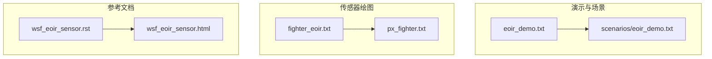
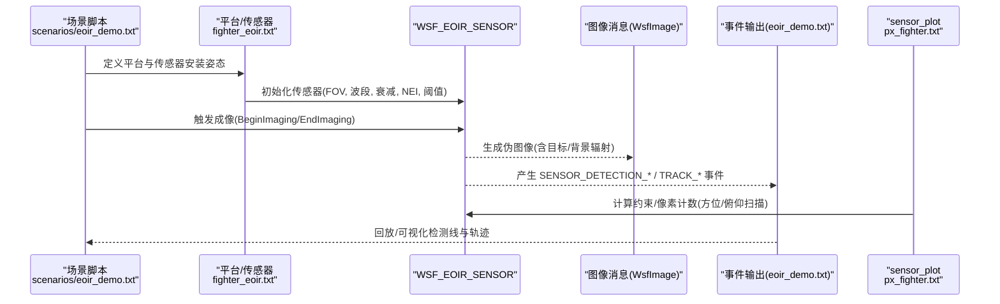
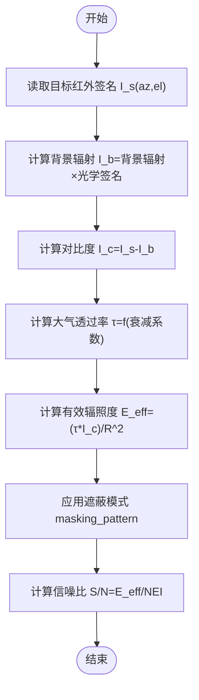
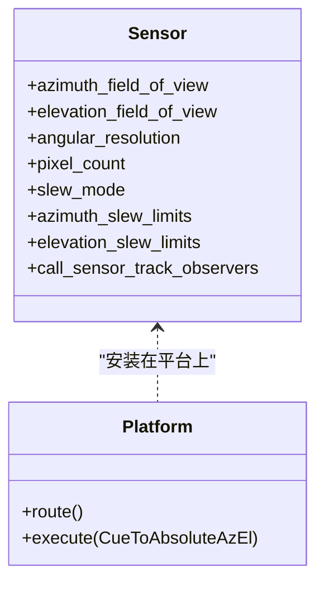
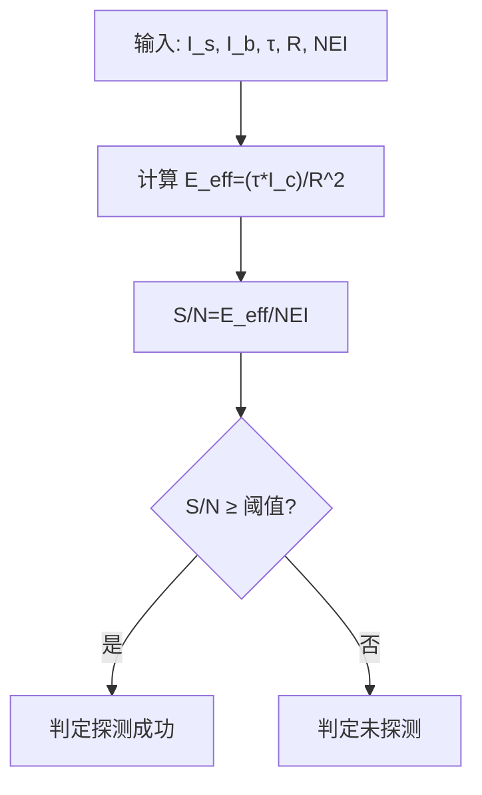
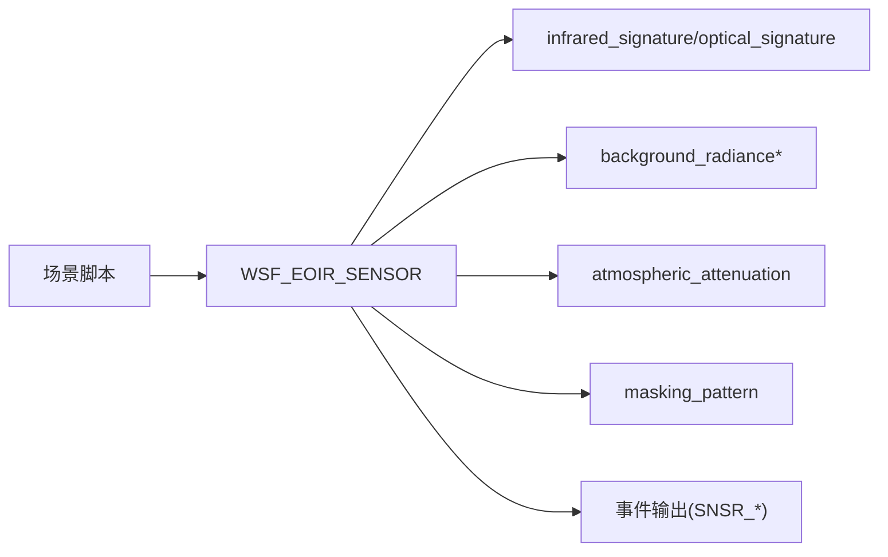
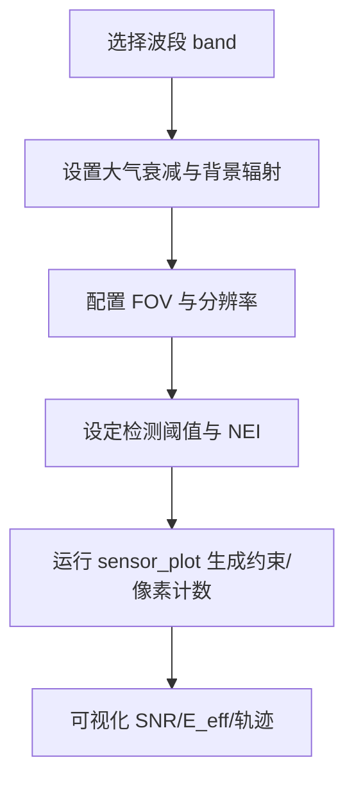

# 光电红外传感器可视化

<cite>
**本文引用的文件**   
- [eoir_demo.txt](file://demos/sensor_demos/eoir_demo.txt)
- [eoir_demo.txt（场景）](file://demos/sensor_demos/scenarios/eoir_demo.txt)
- [fighter_eoir.txt](file://demos/sensor_plot/eoir/fighter_eoir.txt)
- [px_fighter.txt](file://demos/sensor_plot/eoir/px_fighter.txt)
- [wsf_eoir_sensor.rst（源码文档）](file://swdev/src/core/wsf_mil/doc/wsf_eoir_sensor.rst)
- [wsf_eoir_sensor.html（HTML文档）](file://documentation/html/docs/wsf_eoir_sensor.html)
</cite>

## 目录
1. [引言](#引言)
2. [项目结构](#项目结构)
3. [核心组件](#核心组件)
4. [架构总览](#架构总览)
5. [详细组件分析](#详细组件分析)
6. [依赖关系分析](#依赖关系分析)
7. [性能与可视化工作流](#性能与可视化工作流)
8. [故障排查指南](#故障排查指南)
9. [结论](#结论)

## 引言
本文件面向使用 AFSIM 进行光电红外（EOIR）传感器建模与可视化的用户，系统说明以下能力：
- 红外辐射传输模型与大气衰减效应的可视化表示
- 不同波段的光谱响应曲线展示方法
- 目标红外特征的可视化（温度分布、热辐射强度、红外信号强度）
- 光学传感器的视场角（FOV）与视轴指向的可视化（扫描模式、跟踪轨迹）
- 探测概率与识别概率的可视化分析（信噪比 SNR、对比度影响）
- 环境因素对 EOIR 性能的可视化（云量、雾气、背景辐射）
- EOIR 参数优化与性能评估的可视化工作流

## 项目结构
与本主题直接相关的示例与文档位于以下路径：
- 传感器演示与场景配置：demos/sensor_demos/*
- EOIR 传感器绘图输入：demos/sensor_plot/eoir/*
- WSF_EOIR_SENSOR 参考文档：documentation/html/docs/wsf_eoir_sensor.html 与 swdev/src/core/wsf_mil/doc/wsf_eoir_sensor.rst

**图表来源** 
- [eoir_demo.txt:10-13](file://demos/sensor_demos/eoir_demo.txt#L10-L13)
- [eoir_demo.txt（场景）:1-83](file://demos/sensor_demos/scenarios/eoir_demo.txt#L1-L83)
- [fighter_eoir.txt:9-21](file://demos/sensor_plot/eoir/fighter_eoir.txt#L9-L21)
- [px_fighter.txt:16-76](file://demos/sensor_plot/eoir/px_fighter.txt#L16-L76)
- [wsf_eoir_sensor.rst:10-38](file://swdev/src/core/wsf_mil/doc/wsf_eoir_sensor.rst#L10-L38)
- [wsf_eoir_sensor.html:72-98](file://documentation/html/docs/wsf_eoir_sensor.html#L72-L98)

**章节来源**
- [eoir_demo.txt:10-13](file://demos/sensor_demos/eoir_demo.txt#L10-L13)
- [eoir_demo.txt（场景）:1-83](file://demos/sensor_demos/scenarios/eoir_demo.txt#L1-L83)
- [fighter_eoir.txt:9-21](file://demos/sensor_plot/eoir/fighter_eoir.txt#L9-L21)
- [px_fighter.txt:16-76](file://demos/sensor_plot/eoir/px_fighter.txt#L16-L76)
- [wsf_eoir_sensor.rst:10-38](file://swdev/src/core/wsf_mil/doc/wsf_eoir_sensor.rst#L10-L38)
- [wsf_eoir_sensor.html:72-98](file://documentation/html/docs/wsf_eoir_sensor.html#L72-L98)

## 核心组件
- WSF_EOIR_SENSOR：实现简易光学/红外成像传感器，输出伪图像（WsfImage），可连接图像处理器生成航迹。支持多波段（可见光、短波/中波/长波/极长波红外）、大气衰减、背景辐射、检测阈值与噪声等效辐照度等关键参数。
- 传感器绘图子系统：通过 sensor_plot 输入定义传感器几何、平台运动、目标区域网格与绘图变量，以生成约束图与像素计数等可视化数据。

关键能力映射到可视化需求：
- 波段选择：band（visual/short/medium/long/very_long）用于绘制光谱响应曲线
- 大气衰减：atmospheric_attenuation 控制路径透过率，用于可视化衰减效果
- 背景辐射：background_radiance* 系列命令控制天空/地面背景，用于背景可视化
- FOV 与指向：azimuth_field_of_view、slew_mode、angular_resolution/pixel_count 决定视场与分辨率
- 探测判据：detection_threshold、noise_equivalent_irradiance 决定 SNR 与探测概率
- 事件输出：SENSOR_* 事件便于可视化检测线与轨迹

**章节来源**
- [wsf_eoir_sensor.rst:32-38](file://swdev/src/core/wsf_mil/doc/wsf_eoir_sensor.rst#L32-L38)
- [wsf_eoir_sensor.rst:75-143](file://swdev/src/core/wsf_mil/doc/wsf_eoir_sensor.rst#L75-L143)
- [wsf_eoir_sensor.rst:172-194](file://swdev/src/core/wsf_mil/doc/wsf_eoir_sensor.rst#L172-L194)
- [wsf_eoir_sensor.html:137-208](file://documentation/html/docs/wsf_eoir_sensor.html#L137-L208)
- [eoir_demo.txt:20-31](file://demos/sensor_demos/eoir_demo.txt#L20-L31)

## 架构总览
下图展示了从场景驱动到传感器成像、再到事件输出的端到端流程，以及绘图子系统的参与方式。

**图表来源** 
- [eoir_demo.txt（场景）:16-28](file://demos/sensor_demos/scenarios/eoir_demo.txt#L16-L28)
- [fighter_eoir.txt:9-21](file://demos/sensor_plot/eoir/fighter_eoir.txt#L9-L21)
- [px_fighter.txt:34-76](file://demos/sensor_plot/eoir/px_fighter.txt#L34-L76)
- [eoir_demo.txt:20-31](file://demos/sensor_demos/eoir_demo.txt#L20-L31)
- [wsf_eoir_sensor.rst:32-38](file://swdev/src/core/wsf_mil/doc/wsf_eoir_sensor.rst#L32-L38)

## 详细组件分析

### 红外辐射传输与大气衰减可视化
- 物理模型要点：
  - 目标红外辐射强度 I_s = infrared_signature(az,el)
  - 背景辐射强度 I_b = background_radiance * optical_signature(az,el)
  - 对比度辐射强度 I_c = I_s - I_b
  - 大气透过率 τ = f(atmospheric_attenuation)，按层积分计算
  - 有效目标辐照度 E_eff = (τ * I_c) / R^2，再乘以遮蔽模式 masking_pattern
  - 信噪比 S/N = E_eff / NEI
- 可视化建议：
  - 绘制 τ 随距离/高度变化的曲线，叠加不同 atmospheric_attenuation 设置
  - 将 I_s、I_b、I_c 在同一坐标系下对比，突出对比度变化
  - 用热力图展示 E_eff 在目标区域的二维分布

**图表来源** 
- [wsf_eoir_sensor.rst:172-194](file://swdev/src/core/wsf_mil/doc/wsf_eoir_sensor.rst#L172-L194)
- [wsf_eoir_sensor.html:238-255](file://documentation/html/docs/wsf_eoir_sensor.html#L238-L255)

**章节来源**
- [wsf_eoir_sensor.rst:89-103](file://swdev/src/core/wsf_mil/doc/wsf_eoir_sensor.rst#L89-L103)
- [wsf_eoir_sensor.rst:172-194](file://swdev/src/core/wsf_mil/doc/wsf_eoir_sensor.rst#L172-L194)
- [wsf_eoir_sensor.html:149-160](file://documentation/html/docs/wsf_eoir_sensor.html#L149-L160)
- [wsf_eoir_sensor.html:238-255](file://documentation/html/docs/wsf_eoir_sensor.html#L238-L255)

### 不同波段的光谱响应曲线
- 支持波段：visual、short、medium、long、very_long，对应不同波长范围
- 可视化建议：
  - 为每个 band 绘制归一化响应曲线（相对峰值）
  - 叠加大气透过率窗口，标注典型气体吸收带
  - 结合背景辐射 L_b 与路径辐射 path_radiance，比较不同波段的对比度优势

**章节来源**
- [wsf_eoir_sensor.rst:75-87](file://swdev/src/core/wsf_mil/doc/wsf_eoir_sensor.rst#L75-L87)
- [wsf_eoir_sensor.html:137-146](file://documentation/html/docs/wsf_eoir_sensor.html#L137-L146)

### 目标红外特征可视化（温度分布、热辐射强度、信号强度）
- 温度分布：可通过红外签名与背景辐射差异生成二维热力图
- 热辐射强度：I_s 与 I_c 的时空演化曲线
- 红外信号强度：E_eff 或 SNR 的二维分布，叠加遮蔽模式影响
- 实践要点：
  - 使用 pixel_count 或 angular_resolution 控制空间采样密度
  - 利用 masking_pattern 体现结构遮挡对信号的影响

**章节来源**
- [wsf_eoir_sensor.rst:54-69](file://swdev/src/core/wsf_mil/doc/wsf_eoir_sensor.rst#L54-L69)
- [wsf_eoir_sensor.rst:172-194](file://swdev/src/core/wsf_mil/doc/wsf_eoir_sensor.rst#L172-L194)

### 传感器 FOV 与视轴指向可视化（扫描模式、跟踪轨迹）
- FOV 与分辨率：
  - azimuth_field_of_view/elevation_field_of_view 定义视场范围
  - angular_resolution 或 pixel_count 决定角分辨率
- 扫描与指向：
  - slew_mode 支持方位+俯仰联动
  - azimuth_slew_limits/elevation_slew_limits 限制扫描范围
- 跟踪轨迹：
  - 启用 call_sensor_track_observers 后，可在图像形成过程中输出检测线事件，便于可视化
- 示例：
  - fighter_eoir.txt 定义了方位/俯仰 FOV 与扫描限制
  - px_fighter.txt 通过 CueToAbsoluteAzEl 驱动视轴指向，并生成像素计数约束图

**图表来源** 
- [fighter_eoir.txt:9-21](file://demos/sensor_plot/eoir/fighter_eoir.txt#L9-L21)
- [px_fighter.txt:34-43](file://demos/sensor_plot/eoir/px_fighter.txt#L34-L43)
- [wsf_eoir_sensor.rst:54-69](file://swdev/src/core/wsf_mil/doc/wsf_eoir_sensor.rst#L54-L69)
- [wsf_eoir_sensor.rst:45-49](file://swdev/src/core/wsf_mil/doc/wsf_eoir_sensor.rst#L45-L49)

**章节来源**
- [fighter_eoir.txt:9-21](file://demos/sensor_plot/eoir/fighter_eoir.txt#L9-L21)
- [px_fighter.txt:34-43](file://demos/sensor_plot/eoir/px_fighter.txt#L34-L43)
- [wsf_eoir_sensor.rst:54-69](file://swdev/src/core/wsf_mil/doc/wsf_eoir_sensor.rst#L54-L69)
- [wsf_eoir_sensor.rst:45-49](file://swdev/src/core/wsf_mil/doc/wsf_eoir_sensor.rst#L45-L49)

### 探测概率与识别概率可视化（SNR 与对比度影响）
- 探测判据：
  - detection_threshold 设定成功探测所需的 SNR
  - noise_equivalent_irradiance (NEI) 表征接收机噪声水平
- 可视化建议：
  - 绘制 SNR 随距离/角度/波段的变化曲线
  - 对比度 C_s 与背景辐射 L_b/L_bs 的关系图
  - 在不同 atmospheric_attenuation 与 masking_pattern 下的探测概率面

**图表来源** 
- [wsf_eoir_sensor.rst:133-143](file://swdev/src/core/wsf_mil/doc/wsf_eoir_sensor.rst#L133-L143)
- [wsf_eoir_sensor.rst:172-194](file://swdev/src/core/wsf_mil/doc/wsf_eoir_sensor.rst#L172-L194)
- [wsf_eoir_sensor.html:197-208](file://documentation/html/docs/wsf_eoir_sensor.html#L197-L208)

**章节来源**
- [wsf_eoir_sensor.rst:133-143](file://swdev/src/core/wsf_mil/doc/wsf_eoir_sensor.rst#L133-L143)
- [wsf_eoir_sensor.rst:172-194](file://swdev/src/core/wsf_mil/doc/wsf_eoir_sensor.rst#L172-L194)
- [wsf_eoir_sensor.html:197-208](file://documentation/html/docs/wsf_eoir_sensor.html#L197-L208)

### 环境因素可视化（云量、雾气、背景辐射）
- 背景辐射：
  - background_radiance_above_horizon/below_horizon 分别设置天/地背景
  - background_transition_angle 提供地平线附近的平滑过渡
- 大气衰减：
  - atmospheric_attenuation 模拟气溶胶/水汽导致的衰减，可按高度分层计算
- 可视化建议：
  - 绘制 L_b 与 L_bs 随仰角的变化，展示地平线过渡区
  - 对比不同 atmospheric_attenuation 下的 τ 与 SNR 曲线
  - 叠加云层/雾层的衰减因子，观察探测概率下降

**章节来源**
- [wsf_eoir_sensor.rst:105-131](file://swdev/src/core/wsf_mil/doc/wsf_eoir_sensor.rst#L105-L131)
- [wsf_eoir_sensor.rst:89-103](file://swdev/src/core/wsf_mil/doc/wsf_eoir_sensor.rst#L89-L103)
- [wsf_eoir_sensor.html:149-194](file://documentation/html/docs/wsf_eoir_sensor.html#L149-L194)

## 依赖关系分析
- 场景脚本驱动平台与传感器行为，并通过 BeginImaging/EndImaging 控制成像时段
- 传感器内部依赖：
  - 目标红外签名 infrared_signature
  - 目标光学签名 optical_signature
  - 遮蔽模式 masking_pattern
  - 背景辐射 background_radiance*
  - 大气衰减 atmospheric_attenuation
  - 接收机噪声 NEI 与检测阈值 detection_threshold
- 事件输出与可视化：
  - eoir_demo.txt 启用 SENSOR_DETECTION_ATTEMPT/DETECTED、TRACK_* 等事件，便于回放与可视化

**图表来源** 
- [eoir_demo.txt（场景）:16-28](file://demos/sensor_demos/scenarios/eoir_demo.txt#L16-L28)
- [eoir_demo.txt:20-31](file://demos/sensor_demos/eoir_demo.txt#L20-L31)
- [wsf_eoir_sensor.rst:172-194](file://swdev/src/core/wsf_mil/doc/wsf_eoir_sensor.rst#L172-L194)

**章节来源**
- [eoir_demo.txt:20-31](file://demos/sensor_demos/eoir_demo.txt#L20-L31)
- [eoir_demo.txt（场景）:16-28](file://demos/sensor_demos/scenarios/eoir_demo.txt#L16-L28)
- [wsf_eoir_sensor.rst:172-194](file://swdev/src/core/wsf_mil/doc/wsf_eoir_sensor.rst#L172-L194)

## 性能与可视化工作流
- 参数优化步骤：
  1) 确定观测波段 band（短/中/长波红外）
  2) 设置 atmospheric_attenuation 与 background_radiance* 以匹配环境
  3) 调整 FOV 与 angular_resolution/pixel_count 平衡覆盖与分辨率
  4) 配置 detection_threshold 与 NEI 以评估探测概率
  5) 运行 sensor_plot 生成像素计数与约束图，评估扫描策略
- 可视化产出：
  - 光谱响应曲线（按 band）
  - 大气透过率 τ 与 SNR 曲线
  - 背景辐射 L_b/L_bs 随仰角变化
  - 目标 E_eff/SNR 二维热力图
  - 检测线与跟踪轨迹（基于事件输出）

**章节来源**
- [wsf_eoir_sensor.rst:75-143](file://swdev/src/core/wsf_mil/doc/wsf_eoir_sensor.rst#L75-L143)
- [fighter_eoir.txt:9-21](file://demos/sensor_plot/eoir/fighter_eoir.txt#L9-L21)
- [px_fighter.txt:60-76](file://demos/sensor_plot/eoir/px_fighter.txt#L60-L76)
- [eoir_demo.txt:20-31](file://demos/sensor_demos/eoir_demo.txt#L20-L31)

## 故障排查指南
- 未出现检测事件：
  - 检查是否启用 SENSOR_DETECTION_ATTEMPT/DETECTED 等事件输出
  - 确认 detection_threshold 与 NEI 设置合理
- 无图像或像素计数异常：
  - 检查 angular_resolution 与 pixel_count 是否至少指定其一
  - 确认 FOV 与 slew_mode 设置与平台安装姿态一致
- 背景辐射不真实：
  - 检查 background_radiance_above_horizon/below_horizon 与 transition 角度
- 大气衰减不符合预期：
  - 核对 atmospheric_attenuation 的单位与数值，确保分层计算正确

**章节来源**
- [eoir_demo.txt:20-31](file://demos/sensor_demos/eoir_demo.txt#L20-L31)
- [wsf_eoir_sensor.rst:54-69](file://swdev/src/core/wsf_mil/doc/wsf_eoir_sensor.rst#L54-L69)
- [wsf_eoir_sensor.rst:105-131](file://swdev/src/core/wsf_mil/doc/wsf_eoir_sensor.rst#L105-L131)
- [wsf_eoir_sensor.rst:89-103](file://swdev/src/core/wsf_mil/doc/wsf_eoir_sensor.rst#L89-L103)

## 结论
AFSIM 的 WSF_EOIR_SENSOR 提供了完整的 EOIR 成像与探测建模能力，配合 sensor_plot 与事件输出，可实现从辐射传输、大气衰减、背景辐射到探测概率的全链路可视化。通过合理设置波段、FOV、衰减与噪声参数，并结合场景脚本驱动扫描与跟踪，能够高效完成 EOIR 传感器参数优化与性能评估。