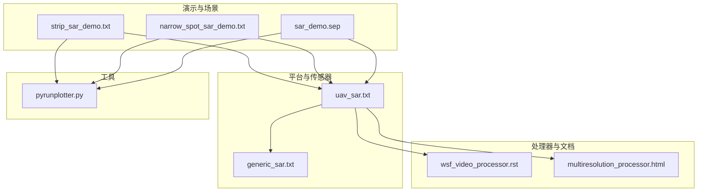
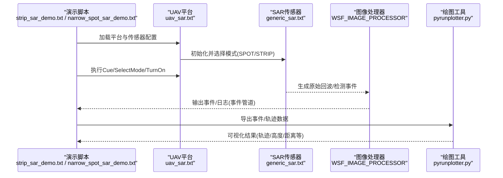
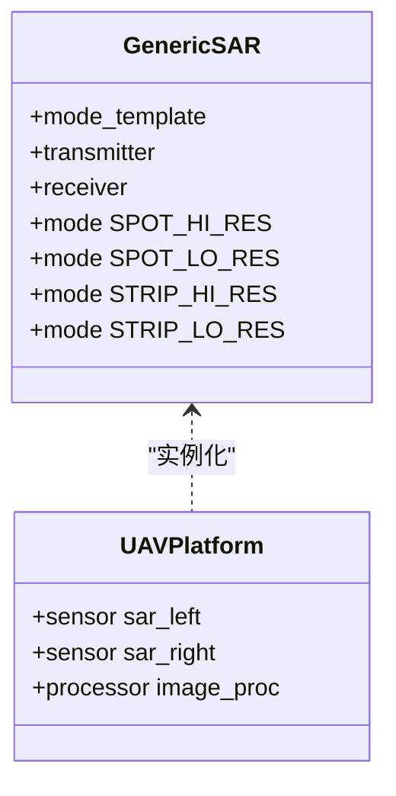
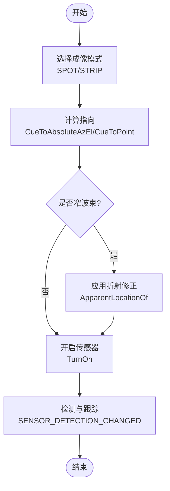
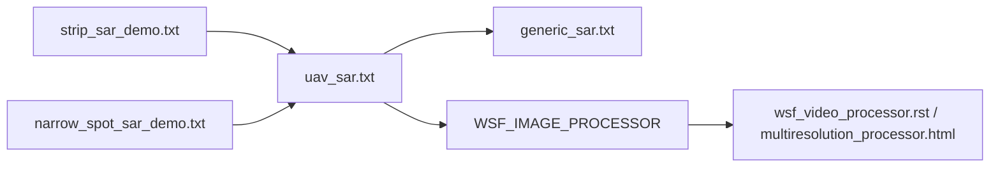

# 合成孔径雷达成像可视化

<cite>
**本文引用的文件**   
- [demos/sensor_demos/sar_demo.sep](file://demos/sensor_demos/sar_demo.sep)
- [demos/sensor_demos/strip_sar_demo.txt](file://demos/sensor_demos/strip_sar_demo.txt)
- [demos/sensor_demos/narrow_spot_sar_demo.txt](file://demos/sensor_demos/narrow_spot_sar_demo.txt)
- [demos/base_types/sensors/radar/generic_sar.txt](file://demos/base_types/sensors/radar/generic_sar.txt)
- [demos/sensor_demos/platforms/uav_sar.txt](file://demos/sensor_demos/platforms/uav_sar.txt)
- [swdev/src/core/wsf_mil/doc/wsf_video_processor.rst](file://swdev/src/core/wsf_mil/doc/wsf_video_processor.rst)
- [documentation/html/docs/multiresolution_processor.html](file://documentation/html/docs/multiresolution_processor.html)
- [tools/pyrunplotter/pyrunplotter.py](file://tools/pyrunplotter/pyrunplotter.py)
</cite>

## 目录
1. [引言](#引言)
2. [项目结构](#项目结构)
3. [核心组件](#核心组件)
4. [架构总览](#架构总览)
5. [详细组件分析](#详细组件分析)
6. [依赖关系分析](#依赖关系分析)
7. [性能与分辨率特性](#性能与分辨率特性)
8. [故障排查指南](#故障排查指南)
9. [结论](#结论)
10. [附录：交互式工具使用指南](#附录交互式工具使用指南)

## 引言
本文件面向SAR（合成孔径雷达）成像可视化的需求，结合仓库中的传感器定义、演示脚本与文档，系统阐述以下主题：
- SAR成像原理的可视化表示：合成孔径形成过程与分辨率计算思路
- 不同成像模式的可视化：条带模式（Strip/SB）、聚束模式（Spot/IB），以及扫描模式（Scan/SW）在AFSIM中的可用性与可视化要点
- SAR图像的几何校正与地理编码可视化：地形起伏与投影变换的影响
- SAR图像频谱分析与去噪处理的可视化方法：点目标响应与线目标响应的图形表达
- InSAR干涉测量可视化：相位差、高程提取与形变监测的展示方式
- 交互式工具使用指南：基于现有工具的可视化与分析流程

说明：仓库中未提供完整的InSAR处理管线或专用SAR图像后处理GUI。本文对InSAR与图像处理部分以概念性说明为主，并结合现有WSF_IMAGE_PROCESSOR与pyrunplotter工具给出可操作的可视化建议。

## 项目结构
与SAR相关的代码与配置主要分布在以下位置：
- 传感器定义与平台集成：demos/base_types/sensors/radar/generic_sar.txt、demos/sensor_demos/platforms/uav_sar.txt
- 演示场景与运行入口：demos/sensor_demos/strip_sar_demo.txt、demos/sensor_demos/narrow_spot_sar_demo.txt、demos/sensor_demos/sar_demo.sep
- 处理器文档与接口：swdev/src/core/wsf_mil/doc/wsf_video_processor.rst、documentation/html/docs/multiresolution_processor.html
- 可视化与绘图工具：tools/pyrunplotter/pyrunplotter.py

图表来源
- [demos/sensor_demos/strip_sar_demo.txt:1-39](file://demos/sensor_demos/strip_sar_demo.txt#L1-L39)
- [demos/sensor_demos/narrow_spot_sar_demo.txt:1-84](file://demos/sensor_demos/narrow_spot_sar_demo.txt#L1-L84)
- [demos/sensor_demos/sar_demo.sep:1-308](file://demos/sensor_demos/sar_demo.sep#L1-L308)
- [demos/sensor_demos/platforms/uav_sar.txt:1-82](file://demos/sensor_demos/platforms/uav_sar.txt#L1-L82)
- [demos/base_types/sensors/radar/generic_sar.txt:1-105](file://demos/base_types/sensors/radar/generic_sar.txt#L1-L105)
- [swdev/src/core/wsf_mil/doc/wsf_video_processor.rst:1-19](file://swdev/src/core/wsf_mil/doc/wsf_video_processor.rst#L1-L19)
- [documentation/html/docs/multiresolution_processor.html:72-77](file://documentation/html/docs/multiresolution_processor.html#L72-L77)
- [tools/pyrunplotter/pyrunplotter.py](file://tools/pyrunplotter/pyrunplotter.py)

章节来源
- [demos/sensor_demos/strip_sar_demo.txt:1-39](file://demos/sensor_demos/strip_sar_demo.txt#L1-L39)
- [demos/sensor_demos/narrow_spot_sar_demo.txt:1-84](file://demos/sensor_demos/narrow_spot_sar_demo.txt#L1-L84)
- [demos/sensor_demos/sar_demo.sep:1-308](file://demos/sensor_demos/sar_demo.sep#L1-L308)
- [demos/sensor_demos/platforms/uav_sar.txt:1-82](file://demos/sensor_demos/platforms/uav_sar.txt#L1-L82)
- [demos/base_types/sensors/radar/generic_sar.txt:1-105](file://demos/base_types/sensors/radar/generic_sar.txt#L1-L105)

## 核心组件
- WSF_SAR_SENSOR（通用SAR传感器模板）
  - 支持SPOT与STRIP两种工作模式，并提供HI_RES与LO_RES两种分辨率档位
  - 包含发射机、接收机、天线方向图、电子波束扫描、多普勒滤波等参数
- UAV平台集成SAR传感器
  - 左右两个SAR通道（sar_left、sar_right），通过脚本控制Cue、SelectMode、TurnOn/Off
  - 内置WSF_IMAGE_PROCESSOR用于图像数据处理链路
- 演示脚本
  - strip_sar_demo.txt：条带模式演示入口，输出事件与日志
  - narrow_spot_sar_demo.txt：窄波束聚束模式示例，演示ApparentLocationOf与CueToPoint的使用
- 可视化与绘图工具
  - pyrunplotter.py：用于绘制仿真输出的轨迹、高度、距离等数据，便于辅助SAR观测与成像效果验证

章节来源
- [demos/base_types/sensors/radar/generic_sar.txt:1-105](file://demos/base_types/sensors/radar/generic_sar.txt#L1-L105)
- [demos/sensor_demos/platforms/uav_sar.txt:1-82](file://demos/sensor_demos/platforms/uav_sar.txt#L1-L82)
- [demos/sensor_demos/strip_sar_demo.txt:1-39](file://demos/sensor_demos/strip_sar_demo.txt#L1-L39)
- [demos/sensor_demos/narrow_spot_sar_demo.txt:1-84](file://demos/sensor_demos/narrow_spot_sar_demo.txt#L1-L84)
- [tools/pyrunplotter/pyrunplotter.py](file://tools/pyrunplotter/pyrunplotter.py)

## 架构总览
下图展示了从平台到传感器、再到处理器与可视化工具的数据流与控制流。

图表来源
- [demos/sensor_demos/strip_sar_demo.txt:1-39](file://demos/sensor_demos/strip_sar_demo.txt#L1-L39)
- [demos/sensor_demos/narrow_spot_sar_demo.txt:1-84](file://demos/sensor_demos/narrow_spot_sar_demo.txt#L1-L84)
- [demos/sensor_demos/platforms/uav_sar.txt:1-82](file://demos/sensor_demos/platforms/uav_sar.txt#L1-L82)
- [demos/base_types/sensors/radar/generic_sar.txt:1-105](file://demos/base_types/sensors/radar/generic_sar.txt#L1-L105)
- [swdev/src/core/wsf_mil/doc/wsf_video_processor.rst:1-19](file://swdev/src/core/wsf_mil/doc/wsf_video_processor.rst#L1-L19)

## 详细组件分析

### SAR传感器与成像模式
- 支持的成像模式
  - SPOT（聚束模式）：高/低分辨率两档，适用于高分辨率点目标成像
  - STRIP（条带模式）：高/低分辨率两档，适用于区域覆盖成像
- 关键参数
  - 频率、脉冲宽度、脉冲压缩比、带宽、噪声系数
  - 电子波束扫描（方位/俯仰）、多普勒滤波展宽因子、折叠裕度
  - 最大作用距离、探测阈值、报告位置
- 可视化要点
  - 通过事件输出观察SENSOR_MODE_ACTIVATED/DEACTIVATED切换
  - 通过事件管道记录SENSOR_DETECTION_CHANGED、LOCAL_TRACK_*等事件，辅助成像质量评估

图表来源
- [demos/base_types/sensors/radar/generic_sar.txt:43-105](file://demos/base_types/sensors/radar/generic_sar.txt#L43-L105)
- [demos/sensor_demos/platforms/uav_sar.txt:55-80](file://demos/sensor_demos/platforms/uav_sar.txt#L55-L80)

章节来源
- [demos/base_types/sensors/radar/generic_sar.txt:1-105](file://demos/base_types/sensors/radar/generic_sar.txt#L1-L105)
- [demos/sensor_demos/platforms/uav_sar.txt:1-82](file://demos/sensor_demos/platforms/uav_sar.txt#L1-L82)

### 条带模式（SB）与聚束模式（IB）可视化
- 条带模式（Strip/SB）
  - 特点：沿飞行路径连续成像，覆盖较宽区域，适合大范围监视
  - 可视化：通过事件输出观察MODE切换与检测变化；结合轨迹与高度曲线评估覆盖范围与分辨率一致性
- 聚束模式（Spot/IB）
  - 特点：聚焦小区域，获得更高分辨率；窄波束下需考虑大气折射修正（ApparentLocationOf）
  - 可视化：演示脚本中使用CueToPoint与ApparentLocationOf确保指向正确；通过事件管道记录检测尝试与结果

图表来源
- [demos/sensor_demos/narrow_spot_sar_demo.txt:44-63](file://demos/sensor_demos/narrow_spot_sar_demo.txt#L44-L63)
- [demos/sensor_demos/platforms/uav_sar.txt:23-46](file://demos/sensor_demos/platforms/uav_sar.txt#L23-L46)

章节来源
- [demos/sensor_demos/narrow_spot_sar_demo.txt:1-84](file://demos/sensor_demos/narrow_spot_sar_demo.txt#L1-L84)
- [demos/sensor_demos/platforms/uav_sar.txt:1-82](file://demos/sensor_demos/platforms/uav_sar.txt#L1-L82)

### 扫描模式（SW）与可用性说明
- 仓库中的通用SAR传感器模板仅定义了SPOT与STRIP模式，未直接提供SW（扫描模式）
- 若需SW模式，可在模式模板基础上扩展新的operating_mode与相关参数；当前演示脚本未包含SW用例
- 可视化建议：参考SPOT/STRIP的事件输出与轨迹可视化，扩展SW模式时保持一致的事件与日志规范

章节来源
- [demos/base_types/sensors/radar/generic_sar.txt:84-105](file://demos/base_types/sensors/radar/generic_sar.txt#L84-L105)

### SAR图像几何校正与地理编码可视化
- 几何校正
  - 在AFSIM中，可通过事件管道与轨迹数据间接评估几何畸变（如斜距到地面的映射误差）
  - 地形起伏影响：通过对比真实位置与检测位置，评估高程引起的几何偏差
- 地理编码与投影
  - sar_demo.sep中包含地图与投影设置（ProjectionMode、Living Earth等），可用于地理坐标显示
  - 可视化：在仿真回放中叠加轨迹与地图，观察投影一致性与地理定位精度

章节来源
- [demos/sensor_demos/sar_demo.sep:22-50](file://demos/sensor_demos/sar_demo.sep#L22-L50)

### 频谱分析与去噪处理的可视化
- 频谱分析
  - 通过事件输出与轨迹数据，绘制距离-时间谱（Range-Time Spectrum）与方位-时间谱（Azimuth-Time Spectrum）
  - 点目标响应：在距离-方位二维图上呈现为强散射点；线目标响应：表现为线性特征
- 去噪处理
  - 利用WSF_IMAGE_PROCESSOR进行基础图像预处理（如增益控制、背景抑制）
  - 可视化：对比处理前后图像的能量分布与信噪比指标

章节来源
- [swdev/src/core/wsf_mil/doc/wsf_video_processor.rst:1-19](file://swdev/src/core/wsf_mil/doc/wsf_video_processor.rst#L1-L19)
- [documentation/html/docs/multiresolution_processor.html:72-77](file://documentation/html/docs/multiresolution_processor.html#L72-L77)

### InSAR干涉测量可视化
- 相位差与高程提取
  - 概念上，InSAR通过双视或多视相位差反演地表高程；AFSIM未提供完整InSAR处理链
  - 可视化建议：使用pyrunplotter绘制高程剖面与相位差曲线，辅助理解地形起伏对相位的影响
- 形变监测
  - 概念上，通过时序InSAR观测地表形变；AFSIM未提供形变反演模块
  - 可视化建议：将多次观测的高程或相位差结果叠加，形成形变趋势图

[本节为概念性说明，不直接分析具体文件]

## 依赖关系分析
- 平台与传感器
  - uav_sar.txt引用generic_sar.txt，实例化左右两个SAR传感器
- 处理器与文档
  - WSF_IMAGE_PROCESSOR作为图像处理的统一接口（视频处理器已合并至图像处理器）
- 演示脚本与事件输出
  - strip_sar_demo.txt与narrow_spot_sar_demo.txt通过event_output与event_pipe输出检测与模式切换事件

图表来源
- [demos/sensor_demos/strip_sar_demo.txt:1-39](file://demos/sensor_demos/strip_sar_demo.txt#L1-L39)
- [demos/sensor_demos/narrow_spot_sar_demo.txt:1-84](file://demos/sensor_demos/narrow_spot_sar_demo.txt#L1-L84)
- [demos/sensor_demos/platforms/uav_sar.txt:1-82](file://demos/sensor_demos/platforms/uav_sar.txt#L1-L82)
- [demos/base_types/sensors/radar/generic_sar.txt:1-105](file://demos/base_types/sensors/radar/generic_sar.txt#L1-L105)
- [swdev/src/core/wsf_mil/doc/wsf_video_processor.rst:1-19](file://swdev/src/core/wsf_mil/doc/wsf_video_processor.rst#L1-L19)
- [documentation/html/docs/multiresolution_processor.html:72-77](file://documentation/html/docs/multiresolution_processor.html#L72-L77)

章节来源
- [demos/sensor_demos/strip_sar_demo.txt:1-39](file://demos/sensor_demos/strip_sar_demo.txt#L1-L39)
- [demos/sensor_demos/narrow_spot_sar_demo.txt:1-84](file://demos/sensor_demos/narrow_spot_sar_demo.txt#L1-L84)
- [demos/sensor_demos/platforms/uav_sar.txt:1-82](file://demos/sensor_demos/platforms/uav_sar.txt#L1-L82)
- [demos/base_types/sensors/radar/generic_sar.txt:1-105](file://demos/base_types/sensors/radar/generic_sar.txt#L1-L105)

## 性能与分辨率特性
- 分辨率档位
  - SPOT_HI_RES/STRIP_HI_RES：1 m
  - SPOT_LO_RES/STRIP_LO_RES：5 m
- 关键性能参数
  - 频率10 GHz、脉冲宽度50 μs、脉冲压缩比7500、带宽20 kHz
  - 内部损耗6.5 dB、噪声系数4 dB、探测阈值6 dB
- 电子波束扫描与多普勒处理
  - 方位/俯仰电子扫描，限制±70°
  - 多普勒滤波展宽因子1.20、折叠裕度1.20（或azimuth_overcollect_ratio）
- 可视化建议
  - 通过事件输出观察模式切换与检测变化，结合轨迹与高度曲线评估成像质量
  - 使用pyrunplotter绘制距离-时间谱与方位-时间谱，评估分辨率与去噪效果

章节来源
- [demos/base_types/sensors/radar/generic_sar.txt:43-105](file://demos/base_types/sensors/radar/generic_sar.txt#L43-L105)

## 故障排查指南
- 无法检测到目标（窄波束聚束模式）
  - 检查是否使用ApparentLocationOf进行折射修正
  - 确认CueToPoint与CueToAbsoluteAzEl的参数设置
- 模式切换异常
  - 检查SENSOR_MODE_ACTIVATED/DEACTIVATED事件输出
  - 确认SelectMode调用与模式名称匹配
- 图像处理器无输出
  - 确认WSF_IMAGE_PROCESSOR已正确链接到传感器
  - 查看事件管道与日志输出，确认数据处理链路正常

章节来源
- [demos/sensor_demos/narrow_spot_sar_demo.txt:44-63](file://demos/sensor_demos/narrow_spot_sar_demo.txt#L44-L63)
- [demos/sensor_demos/strip_sar_demo.txt:18-36](file://demos/sensor_demos/strip_sar_demo.txt#L18-L36)
- [demos/sensor_demos/platforms/uav_sar.txt:71-80](file://demos/sensor_demos/platforms/uav_sar.txt#L71-L80)

## 结论
- AFSIM提供了通用的SAR传感器模板与平台集成，支持SPOT与STRIP模式的高/低分辨率成像
- 演示脚本展示了条带模式与窄波束聚束模式的关键用法，包括折射修正与指向控制
- 图像处理器与事件管道为SAR成像可视化与分析提供了基础支撑
- 对于InSAR与高级图像处理，仓库未提供完整实现；本文以概念性说明与工具使用建议为主

[本节为总结性内容，不直接分析具体文件]

## 附录：交互式工具使用指南
- pyrunplotter.py
  - 功能：读取仿真输出（如轨迹、高度、距离等），绘制二维/三维图表
  - 适用场景：辅助SAR观测与成像效果验证，如绘制平台轨迹、高度曲线、距离-时间谱等
  - 使用步骤：准备仿真输出文件 -> 运行pyrunplotter.py -> 选择数据列与图表类型 -> 生成可视化结果

章节来源
- [tools/pyrunplotter/pyrunplotter.py](file://tools/pyrunplotter/pyrunplotter.py)