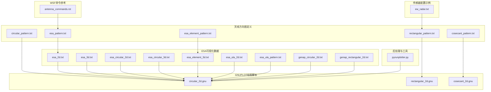
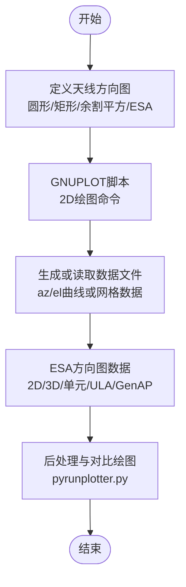
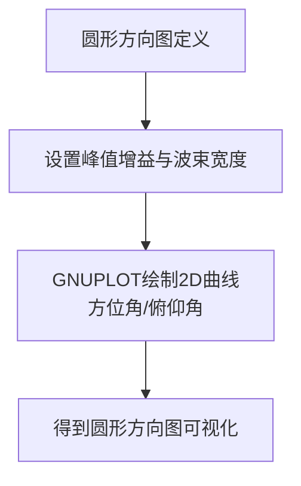
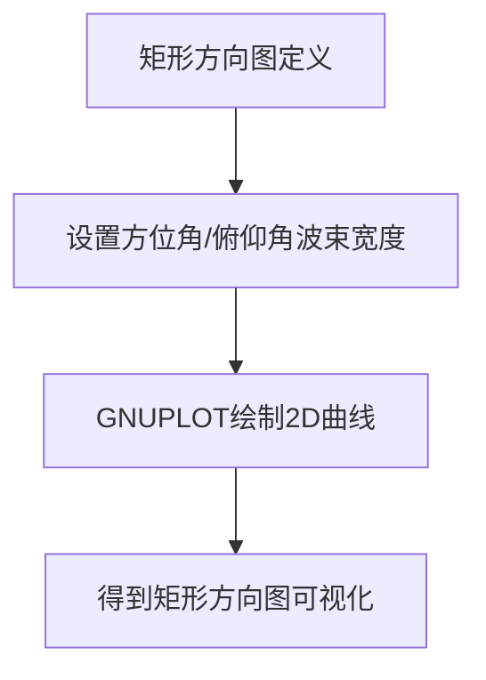
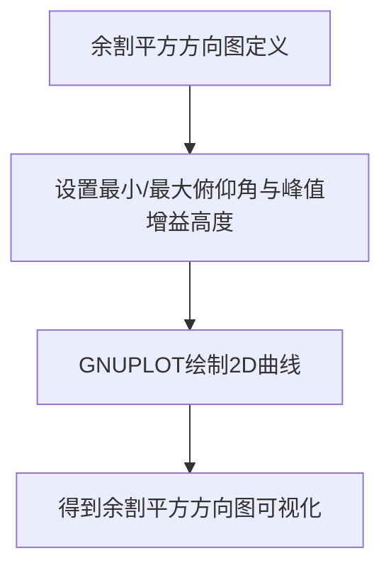
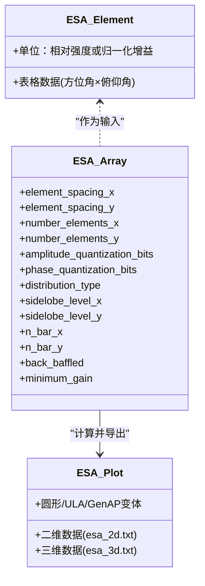
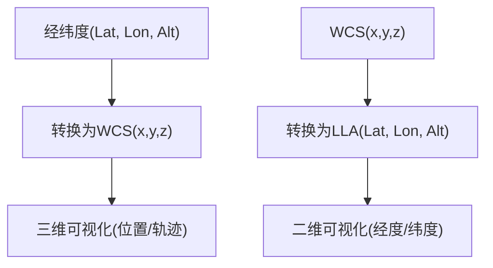
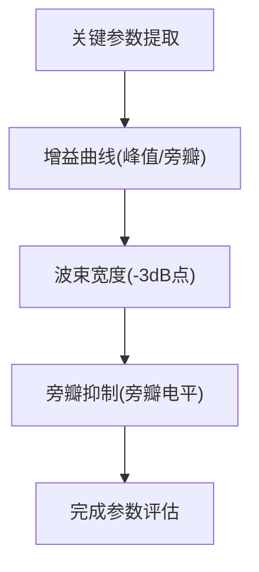
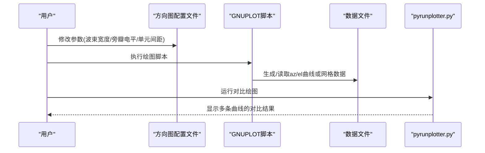
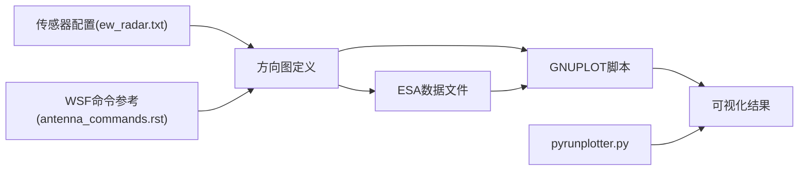

# 天线方向图可视化

<cite>
**本文引用的文件**   
- [circular_pattern.txt](file://demos/sensor_plot/antenna/circular_pattern.txt)
- [rectangular_pattern.txt](file://demos/sensor_plot/antenna/rectangular_pattern.txt)
- [cosecant_pattern.txt](file://demos/sensor_plot/antenna/cosecant_pattern.txt)
- [esa_pattern.txt](file://demos/sensor_plot/antenna/esa_pattern.txt)
- [esa_element_pattern.txt](file://demos/sensor_plot/antenna/esa_element_pattern.txt)
- [circular_2d.gnu](file://demos/sensor_plot/antenna/circular_2d.gnu)
- [rectangular_2d.gnu](file://demos/sensor_plot/antenna/rectangular_2d.gnu)
- [cosecant_2d.gnu](file://demos/sensor_plot/antenna/cosecant_2d.gnu)
- [esa_2d.txt](file://demos/sensor_plot/antenna/esa_2d.txt)
- [esa_3d.txt](file://demos/sensor_plot/antenna/esa_3d.txt)
- [esa_circular_2d.txt](file://demos/sensor_plot/antenna/esa_circular_2d.txt)
- [esa_circular_3d.txt](file://demos/sensor_plot/antenna/esa_circular_3d.txt)
- [esa_element_3d.txt](file://demos/sensor_plot/antenna/esa_element_3d.txt)
- [esa_ula_2d.txt](file://demos/sensor_plot/antenna/esa_ula_2d.txt)
- [esa_ula_pattern.txt](file://demos/sensor_plot/antenna/esa_ula_pattern.txt)
- [genap_circular_2d.txt](file://demos/sensor_plot/antenna/genap_circular_2d.txt)
- [genap_rectangular_2d.txt](file://demos/sensor_plot/antenna/genap_rectangular_2d.txt)
- [pyrunplotter.py](file://tools/pyrunplotter/pyrunplotter.py)
- [antenna_commands.rst](file://swdev/src/core/wsf/doc/antenna_commands.rst)
- [ew_radar.txt](file://training/user/10_Other_Topics/bam/scenarios/floridistan/27_floridistan_cluster_gci/sensors/radar/ew_radar.txt)
</cite>

## 目录
1. [简介](#简介)
2. [项目结构](#项目结构)
3. [核心组件](#核心组件)
4. [架构总览](#架构总览)
5. [详细组件分析](#详细组件分析)
6. [依赖关系分析](#依赖关系分析)
7. [性能与精度考虑](#性能与精度考虑)
8. [故障排查指南](#故障排查指南)
9. [结论](#结论)
10. [附录：参数配置示例与最佳实践](#附录参数配置示例与最佳实践)

## 简介
本文件面向“天线方向图可视化”的完整技术说明，覆盖二维与三维方向图的绘制原理、常见天线类型（圆形、矩形、余割平方）的方向图表示方法，以及相控阵天线（ESA）单元方向图与阵列方向图的区别与计算方法。文档同时给出极坐标与直角坐标系的转换思路、关键指标（增益、波束宽度、旁瓣抑制）的可视化方式，并基于仓库中的脚本与示例数据提供交互式调整与实时预览的实践路径。

## 项目结构
本项目中与天线方向图可视化直接相关的资源集中在以下位置：
- 天线方向图定义与示例：demos/sensor_plot/antenna/*.txt
- GNUPLOT绘图脚本：demos/sensor_plot/antenna/*_2d.gnu
- ESA相关示例与数据：demos/sensor_plot/antenna/esa_*.txt, esa_element_*.txt
- 通用后处理与绘图工具：tools/pyrunplotter/pyrunplotter.py
- 传感器与雷达配置示例：training/.../sensors/radar/ew_radar.txt
- WSF天线命令参考：swdev/src/core/wsf/doc/antenna_commands.rst

图表来源
- [circular_pattern.txt:1-18](file://demos/sensor_plot/antenna/circular_pattern.txt#L1-L18)
- [rectangular_pattern.txt:1-15](file://demos/sensor_plot/antenna/rectangular_pattern.txt#L1-L15)
- [cosecant_pattern.txt:1-22](file://demos/sensor_plot/antenna/cosecant_pattern.txt#L1-L22)
- [esa_pattern.txt:1-36](file://demos/sensor_plot/antenna/esa_pattern.txt#L1-L36)
- [esa_element_pattern.txt:1-129](file://demos/sensor_plot/antenna/esa_element_pattern.txt#L1-L129)
- [circular_2d.gnu:1-22](file://demos/sensor_plot/antenna/circular_2d.gnu#L1-L22)
- [rectangular_2d.gnu:1-21](file://demos/sensor_plot/antenna/rectangular_2d.gnu#L1-L21)
- [cosecant_2d.gnu:1-22](file://demos/sensor_plot/antenna/cosecant_2d.gnu#L1-L22)
- [esa_2d.txt](file://demos/sensor_plot/antenna/esa_2d.txt)
- [esa_3d.txt](file://demos/sensor_plot/antenna/esa_3d.txt)
- [esa_circular_2d.txt](file://demos/sensor_plot/antenna/esa_circular_2d.txt)
- [esa_circular_3d.txt](file://demos/sensor_plot/antenna/esa_circular_3d.txt)
- [esa_element_3d.txt](file://demos/sensor_plot/antenna/esa_element_3d.txt)
- [esa_ula_2d.txt](file://demos/sensor_plot/antenna/esa_ula_2d.txt)
- [esa_ula_pattern.txt](file://demos/sensor_plot/antenna/esa_ula_pattern.txt)
- [genap_circular_2d.txt](file://demos/sensor_plot/antenna/genap_circular_2d.txt)
- [genap_rectangular_2d.txt](file://demos/sensor_plot/antenna/genap_rectangular_2d.txt)
- [pyrunplotter.py:1-800](file://tools/pyrunplotter/pyrunplotter.py#L1-L800)
- [ew_radar.txt:1-42](file://training/user/10_Other_Topics/bam/scenarios/floridistan/27_floridistan_cluster_gci/sensors/radar/ew_radar.txt#L1-L42)
- [antenna_commands.rst:108-134](file://swdev/src/core/wsf/doc/antenna_commands.rst#L108-L134)

章节来源
- [circular_pattern.txt:1-18](file://demos/sensor_plot/antenna/circular_pattern.txt#L1-L18)
- [rectangular_pattern.txt:1-15](file://demos/sensor_plot/antenna/rectangular_pattern.txt#L1-L15)
- [cosecant_pattern.txt:1-22](file://demos/sensor_plot/antenna/cosecant_pattern.txt#L1-L22)
- [esa_pattern.txt:1-36](file://demos/sensor_plot/antenna/esa_pattern.txt#L1-L36)
- [esa_element_pattern.txt:1-129](file://demos/sensor_plot/antenna/esa_element_pattern.txt#L1-L129)
- [circular_2d.gnu:1-22](file://demos/sensor_plot/antenna/circular_2d.gnu#L1-L22)
- [rectangular_2d.gnu:1-21](file://demos/sensor_plot/antenna/rectangular_2d.gnu#L1-L21)
- [cosecant_2d.gnu:1-22](file://demos/sensor_plot/antenna/cosecant_2d.gnu#L1-L22)
- [pyrunplotter.py:1-800](file://tools/pyrunplotter/pyrunplotter.py#L1-L800)
- [ew_radar.txt:1-42](file://training/user/10_Other_Topics/bam/scenarios/floridistan/27_floridistan_cluster_gci/sensors/radar/ew_radar.txt#L1-L42)
- [antenna_commands.rst:108-134](file://swdev/src/core/wsf/doc/antenna_commands.rst#L108-L134)

## 核心组件
- 天线方向图定义文件
  - 圆形方向图：circular_pattern.txt
  - 矩形方向图：rectangular_pattern.txt
  - 余割平方方向图：cosecant_pattern.txt
  - ESA阵列方向图：esa_pattern.txt（引用单元方向图）
  - ESA单元方向图：esa_element_pattern.txt（表格数据）
- GNUPLOT绘图脚本
  - circular_2d.gnu、rectangular_2d.gnu、cosecant_2d.gnu
- ESA可视化数据
  - esa_2d.txt、esa_3d.txt、esa_circular_2d.txt、esa_circular_3d.txt、esa_element_3d.txt、esa_ula_2d.txt、esa_ula_pattern.txt、genap_circular_2d.txt、genap_rectangular_2d.txt
- 后处理与绘图工具
  - pyrunplotter.py（Python脚本，用于读取仿真输出并进行对比绘图）
- 传感器与雷达配置示例
  - ew_radar.txt（展示如何在雷达传感器中引用矩形方向图）
- WSF天线命令参考
  - antenna_commands.rst（电子扫描、波束倾斜等命令说明）

章节来源
- [circular_pattern.txt:1-18](file://demos/sensor_plot/antenna/circular_pattern.txt#L1-L18)
- [rectangular_pattern.txt:1-15](file://demos/sensor_plot/antenna/rectangular_pattern.txt#L1-L15)
- [cosecant_pattern.txt:1-22](file://demos/sensor_plot/antenna/cosecant_pattern.txt#L1-L22)
- [esa_pattern.txt:1-36](file://demos/sensor_plot/antenna/esa_pattern.txt#L1-L36)
- [esa_element_pattern.txt:1-129](file://demos/sensor_plot/antenna/esa_element_pattern.txt#L1-L129)
- [circular_2d.gnu:1-22](file://demos/sensor_plot/antenna/circular_2d.gnu#L1-L22)
- [rectangular_2d.gnu:1-21](file://demos/sensor_plot/antenna/rectangular_2d.gnu#L1-L21)
- [cosecant_2d.gnu:1-22](file://demos/sensor_plot/antenna/cosecant_2d.gnu#L1-L22)
- [pyrunplotter.py:1-800](file://tools/pyrunplotter/pyrunplotter.py#L1-L800)
- [ew_radar.txt:1-42](file://training/user/10_Other_Topics/bam/scenarios/floridistan/27_floridistan_cluster_gci/sensors/radar/ew_radar.txt#L1-L42)
- [antenna_commands.rst:108-134](file://swdev/src/core/wsf/doc/antenna_commands.rst#L108-L134)

## 架构总览
下图展示了从“天线方向图定义”到“GNUPLOT绘图”再到“ESA可视化数据”的整体流程，以及“后处理工具”如何参与数据读取与绘图。

图表来源
- [circular_pattern.txt:1-18](file://demos/sensor_plot/antenna/circular_pattern.txt#L1-L18)
- [rectangular_pattern.txt:1-15](file://demos/sensor_plot/antenna/rectangular_pattern.txt#L1-L15)
- [cosecant_pattern.txt:1-22](file://demos/sensor_plot/antenna/cosecant_pattern.txt#L1-L22)
- [esa_pattern.txt:1-36](file://demos/sensor_plot/antenna/esa_pattern.txt#L1-L36)
- [circular_2d.gnu:1-22](file://demos/sensor_plot/antenna/circular_2d.gnu#L1-L22)
- [rectangular_2d.gnu:1-21](file://demos/sensor_plot/antenna/rectangular_2d.gnu#L1-L21)
- [cosecant_2d.gnu:1-22](file://demos/sensor_plot/antenna/cosecant_2d.gnu#L1-L22)
- [pyrunplotter.py:1-800](file://tools/pyrunplotter/pyrunplotter.py#L1-L800)

## 详细组件分析

### 圆形方向图（Circular Pattern）
- 定义要点
  - 峰值增益与波束宽度是主要参数
  - 适用于全向或近似全向场景的简化建模
- 可视化
  - 使用 circular_2d.gnu 绘制方位角与俯仰角的增益曲线
  - 典型输出为 azimuth/elevation 两条线，便于比较主瓣宽度与对称性

图表来源
- [circular_pattern.txt:1-18](file://demos/sensor_plot/antenna/circular_pattern.txt#L1-L18)
- [circular_2d.gnu:1-22](file://demos/sensor_plot/antenna/circular_2d.gnu#L1-L22)

章节来源
- [circular_pattern.txt:1-18](file://demos/sensor_plot/antenna/circular_pattern.txt#L1-L18)
- [circular_2d.gnu:1-22](file://demos/sensor_plot/antenna/circular_2d.gnu#L1-L22)

### 矩形方向图（Rectangular Pattern）
- 定义要点
  - 分别指定方位角与俯仰角波束宽度
  - 常用于机载或地基雷达的主波束建模
- 可视化
  - rectangular_2d.gnu 绘制方位角与俯仰角增益曲线
  - 可直观观察不同维度的波束宽度差异

图表来源
- [rectangular_pattern.txt:1-15](file://demos/sensor_plot/antenna/rectangular_pattern.txt#L1-L15)
- [rectangular_2d.gnu:1-21](file://demos/sensor_plot/antenna/rectangular_2d.gnu#L1-L21)

章节来源
- [rectangular_pattern.txt:1-15](file://demos/sensor_plot/antenna/rectangular_pattern.txt#L1-L15)
- [rectangular_2d.gnu:1-21](file://demos/sensor_plot/antenna/rectangular_2d.gnu#L1-L21)

### 余割平方方向图（Cosecant Squared Pattern）
- 定义要点
  - 通过最小俯仰角、峰值增益高度、最大俯仰角等参数控制余割平方形状
  - 常用于地面雷达对空覆盖的均匀照射
- 可视化
  - cosecant_2d.gnu 绘制方位角与俯仰角增益曲线
  - 重点观察俯仰方向的平坦化效果与边界过渡

图表来源
- [cosecant_pattern.txt:1-22](file://demos/sensor_plot/antenna/cosecant_pattern.txt#L1-L22)
- [cosecant_2d.gnu:1-22](file://demos/sensor_plot/antenna/cosecant_2d.gnu#L1-L22)

章节来源
- [cosecant_pattern.txt:1-22](file://demos/sensor_plot/antenna/cosecant_pattern.txt#L1-L22)
- [cosecant_2d.gnu:1-22](file://demos/sensor_plot/antenna/cosecant_2d.gnu#L1-L22)

### 相控阵天线（ESA）方向图
- 单元方向图 vs 阵列方向图
  - 单元方向图：单个辐射单元的三维方向图数据（表格形式），如 esa_element_pattern.txt
  - 阵列方向图：由单元方向图与阵列分布（间距、数量、加权分布）共同决定，如 esa_pattern.txt
- 关键参数
  - 单元间距（element_spacing_x/y）、单元数量（number_elements_x/y）
  - 幅度量化位数（amplitude_quantization_bits）、相位量化位数（phase_quantization_bits）
  - 分布类型（distribution_type，例如 Taylor），旁瓣电平（sidelobe_level_x/y）
  - 背板屏蔽（back_baffled）与最小增益（minimum_gain）
- 可视化
  - 二维：esa_2d.txt、esa_circular_2d.txt、esa_ula_2d.txt、genap_circular_2d.txt、genap_rectangular_2d.txt
  - 三维：esa_3d.txt、esa_circular_3d.txt、esa_element_3d.txt

图表来源
- [esa_element_pattern.txt:1-129](file://demos/sensor_plot/antenna/esa_element_pattern.txt#L1-L129)
- [esa_pattern.txt:1-36](file://demos/sensor_plot/antenna/esa_pattern.txt#L1-L36)
- [esa_2d.txt](file://demos/sensor_plot/antenna/esa_2d.txt)
- [esa_3d.txt](file://demos/sensor_plot/antenna/esa_3d.txt)
- [esa_circular_2d.txt](file://demos/sensor_plot/antenna/esa_circular_2d.txt)
- [esa_circular_3d.txt](file://demos/sensor_plot/antenna/esa_circular_3d.txt)
- [esa_element_3d.txt](file://demos/sensor_plot/antenna/esa_element_3d.txt)
- [esa_ula_2d.txt](file://demos/sensor_plot/antenna/esa_ula_2d.txt)
- [esa_ula_pattern.txt](file://demos/sensor_plot/antenna/esa_ula_pattern.txt)
- [genap_circular_2d.txt](file://demos/sensor_plot/antenna/genap_circular_2d.txt)
- [genap_rectangular_2d.txt](file://demos/sensor_plot/antenna/genap_rectangular_2d.txt)

章节来源
- [esa_element_pattern.txt:1-129](file://demos/sensor_plot/antenna/esa_element_pattern.txt#L1-L129)
- [esa_pattern.txt:1-36](file://demos/sensor_plot/antenna/esa_pattern.txt#L1-L36)
- [esa_2d.txt](file://demos/sensor_plot/antenna/esa_2d.txt)
- [esa_3d.txt](file://demos/sensor_plot/antenna/esa_3d.txt)
- [esa_circular_2d.txt](file://demos/sensor_plot/antenna/esa_circular_2d.txt)
- [esa_circular_3d.txt](file://demos/sensor_plot/antenna/esa_circular_3d.txt)
- [esa_element_3d.txt](file://demos/sensor_plot/antenna/esa_element_3d.txt)
- [esa_ula_2d.txt](file://demos/sensor_plot/antenna/esa_ula_2d.txt)
- [esa_ula_pattern.txt](file://demos/sensor_plot/antenna/esa_ula_pattern.txt)
- [genap_circular_2d.txt](file://demos/sensor_plot/antenna/genap_circular_2d.txt)
- [genap_rectangular_2d.txt](file://demos/sensor_plot/antenna/genap_rectangular_2d.txt)

### 坐标系与可视化转换
- 极坐标与直角坐标
  - 在GNUPLOT中通常以方位角/俯仰角（角度）为横轴，增益（dB）为纵轴绘制二维曲线
  - 三维方向图常采用球坐标（方位角、俯仰角、增益）映射到三维空间进行可视化
- 坐标转换工具
  - pyrunplotter.py 提供了经纬度与地心直角坐标之间的转换函数，可用于将地理坐标转换为WCS坐标，便于在三维场景中定位传感器与目标
  - 这些转换函数体现了从地理坐标（LLA）到地心坐标（ECEF/WCS）的双向映射

图表来源
- [pyrunplotter.py:102-148](file://tools/pyrunplotter/pyrunplotter.py#L102-L148)

章节来源
- [pyrunplotter.py:102-148](file://tools/pyrunplotter/pyrunplotter.py#L102-L148)

### 关键参数的可视化展示
- 增益（Gain）
  - 二维曲线纵轴为增益（dB），可直接读取峰值增益与旁瓣电平
- 波束宽度（Beamwidth）
  - 通过半功率点（-3 dB）确定方位角与俯仰角波束宽度
  - 在矩形与圆形方向图中尤为明显
- 旁瓣抑制（Sidelobe Suppression）
  - 在ESA方向图中通过分布类型（如Taylor）与旁瓣电平参数控制
  - 可视化上表现为旁瓣峰值低于主瓣一定分贝数

图表来源
- [circular_pattern.txt:1-18](file://demos/sensor_plot/antenna/circular_pattern.txt#L1-L18)
- [rectangular_pattern.txt:1-15](file://demos/sensor_plot/antenna/rectangular_pattern.txt#L1-L15)
- [cosecant_pattern.txt:1-22](file://demos/sensor_plot/antenna/cosecant_pattern.txt#L1-L22)
- [esa_pattern.txt:1-36](file://demos/sensor_plot/antenna/esa_pattern.txt#L1-L36)

章节来源
- [circular_pattern.txt:1-18](file://demos/sensor_plot/antenna/circular_pattern.txt#L1-L18)
- [rectangular_pattern.txt:1-15](file://demos/sensor_plot/antenna/rectangular_pattern.txt#L1-L15)
- [cosecant_pattern.txt:1-22](file://demos/sensor_plot/antenna/cosecant_pattern.txt#L1-L22)
- [esa_pattern.txt:1-36](file://demos/sensor_plot/antenna/esa_pattern.txt#L1-L36)

### 交互式调整与实时预览
- 交互式调整
  - 修改天线方向图定义文件（如调整波束宽度、旁瓣电平、单元间距等）
  - 重新运行GNUPLOT脚本以更新二维曲线
  - 对于ESA，调整阵列参数后重新生成二维/三维数据文件
- 实时预览
  - 使用GNUPLOT脚本快速查看变化后的方向图
  - 借助pyrunplotter.py对仿真输出进行对比绘图，实现多组配置的并行比较

图表来源
- [circular_2d.gnu:1-22](file://demos/sensor_plot/antenna/circular_2d.gnu#L1-L22)
- [rectangular_2d.gnu:1-21](file://demos/sensor_plot/antenna/rectangular_2d.gnu#L1-L21)
- [cosecant_2d.gnu:1-22](file://demos/sensor_plot/antenna/cosecant_2d.gnu#L1-L22)
- [pyrunplotter.py:1-800](file://tools/pyrunplotter/pyrunplotter.py#L1-L800)

章节来源
- [circular_2d.gnu:1-22](file://demos/sensor_plot/antenna/circular_2d.gnu#L1-L22)
- [rectangular_2d.gnu:1-21](file://demos/sensor_plot/antenna/rectangular_2d.gnu#L1-L21)
- [cosecant_2d.gnu:1-22](file://demos/sensor_plot/antenna/cosecant_2d.gnu#L1-L22)
- [pyrunplotter.py:1-800](file://tools/pyrunplotter/pyrunplotter.py#L1-L800)

## 依赖关系分析
- 天线方向图定义文件被GNUPLOT脚本引用，用于绘制二维曲线
- ESA方向图数据由阵列参数与单元方向图共同决定，并导出为二维/三维数据文件供可视化
- pyrunplotter.py作为通用后处理工具，支持读取仿真输出并进行对比绘图
- 传感器配置示例（ew_radar.txt）展示了如何在雷达传感器中引用矩形方向图
- WSF天线命令参考（antenna_commands.rst）提供了电子扫描、波束倾斜等命令说明

图表来源
- [circular_pattern.txt:1-18](file://demos/sensor_plot/antenna/circular_pattern.txt#L1-L18)
- [rectangular_pattern.txt:1-15](file://demos/sensor_plot/antenna/rectangular_pattern.txt#L1-L15)
- [cosecant_pattern.txt:1-22](file://demos/sensor_plot/antenna/cosecant_pattern.txt#L1-L22)
- [esa_pattern.txt:1-36](file://demos/sensor_plot/antenna/esa_pattern.txt#L1-L36)
- [circular_2d.gnu:1-22](file://demos/sensor_plot/antenna/circular_2d.gnu#L1-L22)
- [rectangular_2d.gnu:1-21](file://demos/sensor_plot/antenna/rectangular_2d.gnu#L1-L21)
- [cosecant_2d.gnu:1-22](file://demos/sensor_plot/antenna/cosecant_2d.gnu#L1-L22)
- [pyrunplotter.py:1-800](file://tools/pyrunplotter/pyrunplotter.py#L1-L800)
- [ew_radar.txt:1-42](file://training/user/10_Other_Topics/bam/scenarios/floridistan/27_floridistan_cluster_gci/sensors/radar/ew_radar.txt#L1-L42)
- [antenna_commands.rst:108-134](file://swdev/src/core/wsf/doc/antenna_commands.rst#L108-L134)

章节来源
- [circular_pattern.txt:1-18](file://demos/sensor_plot/antenna/circular_pattern.txt#L1-L18)
- [rectangular_pattern.txt:1-15](file://demos/sensor_plot/antenna/rectangular_pattern.txt#L1-L15)
- [cosecant_pattern.txt:1-22](file://demos/sensor_plot/antenna/cosecant_pattern.txt#L1-L22)
- [esa_pattern.txt:1-36](file://demos/sensor_plot/antenna/esa_pattern.txt#L1-L36)
- [circular_2d.gnu:1-22](file://demos/sensor_plot/antenna/circular_2d.gnu#L1-L22)
- [rectangular_2d.gnu:1-21](file://demos/sensor_plot/antenna/rectangular_2d.gnu#L1-L21)
- [cosecant_2d.gnu:1-22](file://demos/sensor_plot/antenna/cosecant_2d.gnu#L1-L22)
- [pyrunplotter.py:1-800](file://tools/pyrunplotter/pyrunplotter.py#L1-L800)
- [ew_radar.txt:1-42](file://training/user/10_Other_Topics/bam/scenarios/floridistan/27_floridistan_cluster_gci/sensors/radar/ew_radar.txt#L1-L42)
- [antenna_commands.rst:108-134](file://swdev/src/core/wsf/doc/antenna_commands.rst#L108-L134)

## 性能与精度考虑
- 栅格分辨率
  - ESA单元方向图为表格数据，行列数影响插值精度与计算开销
  - 建议在满足精度需求的前提下降低行列数以提升性能
- 量化误差
  - 幅度与相位量化位数直接影响旁瓣电平与波束质量
  - 提高量化位数可降低量化噪声，但会增加计算复杂度
- 扫描模式与损失
  - WSF命令参考中定义了电子扫描模式与扫描损失指数，需在方向图计算中考虑
- 可视化渲染
  - 三维方向图的数据量较大，建议按需采样或使用降采样策略

[本节为一般性指导，不直接分析具体文件]

## 故障排查指南
- GNUPLOT无法找到数据文件
  - 检查GNUPLOT脚本中的数据文件名是否与生成的数据文件一致
  - 确认工作目录与脚本所在目录一致
- ESA方向图异常
  - 检查单元方向图数据是否完整（方位角/俯仰角范围）
  - 核对阵列参数（单元间距、数量、分布类型）是否合理
- 传感器配置错误
  - 确保雷达传感器正确引用了天线方向图名称
  - 检查波束倾斜与扫描模式是否符合预期

章节来源
- [circular_2d.gnu:1-22](file://demos/sensor_plot/antenna/circular_2d.gnu#L1-L22)
- [rectangular_2d.gnu:1-21](file://demos/sensor_plot/antenna/rectangular_2d.gnu#L1-L21)
- [cosecant_2d.gnu:1-22](file://demos/sensor_plot/antenna/cosecant_2d.gnu#L1-L22)
- [esa_element_pattern.txt:1-129](file://demos/sensor_plot/antenna/esa_element_pattern.txt#L1-L129)
- [esa_pattern.txt:1-36](file://demos/sensor_plot/antenna/esa_pattern.txt#L1-L36)
- [ew_radar.txt:1-42](file://training/user/10_Other_Topics/bam/scenarios/floridistan/27_floridistan_cluster_gci/sensors/radar/ew_radar.txt#L1-L42)
- [antenna_commands.rst:108-134](file://swdev/src/core/wsf/doc/antenna_commands.rst#L108-L134)

## 结论
本文件系统梳理了AFSIM仓库中天线方向图可视化的关键组件与流程，涵盖圆形、矩形、余割平方与ESA等多种天线类型的方向图定义与可视化方法。通过GNUPLOT脚本与ESA数据文件，用户可以快速获得二维与三维方向图；借助pyrunplotter.py可实现多组配置的对比分析与交互式调整。结合WSF天线命令参考与传感器配置示例，用户能够灵活配置雷达传感器的方向图与扫描模式，从而在实际工程中高效完成天线方向图的建模与可视化。

[本节为总结性内容，不直接分析具体文件]

## 附录：参数配置示例与最佳实践
- 圆形方向图
  - 设置峰值增益与波束宽度，适用于全向或近似全向场景
- 矩形方向图
  - 分别设置方位角与俯仰角波束宽度，适用于主波束建模
- 余割平方方向图
  - 设置最小/最大俯仰角与峰值增益高度，实现对空覆盖的均匀照射
- ESA方向图
  - 合理选择单元间距与数量，控制旁瓣电平与主瓣宽度
  - 使用合适的分布类型（如Taylor）与量化位数，平衡旁瓣抑制与计算开销
- 传感器配置
  - 在雷达传感器中引用正确的天线方向图名称
  - 根据任务需求设置波束倾斜与扫描模式

章节来源
- [circular_pattern.txt:1-18](file://demos/sensor_plot/antenna/circular_pattern.txt#L1-L18)
- [rectangular_pattern.txt:1-15](file://demos/sensor_plot/antenna/rectangular_pattern.txt#L1-L15)
- [cosecant_pattern.txt:1-22](file://demos/sensor_plot/antenna/cosecant_pattern.txt#L1-L22)
- [esa_pattern.txt:1-36](file://demos/sensor_plot/antenna/esa_pattern.txt#L1-L36)
- [esa_element_pattern.txt:1-129](file://demos/sensor_plot/antenna/esa_element_pattern.txt#L1-L129)
- [ew_radar.txt:1-42](file://training/user/10_Other_Topics/bam/scenarios/floridistan/27_floridistan_cluster_gci/sensors/radar/ew_radar.txt#L1-L42)
- [antenna_commands.rst:108-134](file://swdev/src/core/wsf/doc/antenna_commands.rst#L108-L134)