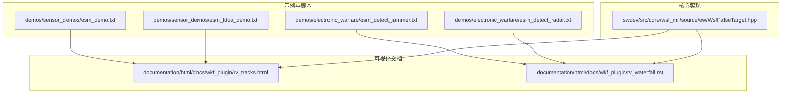
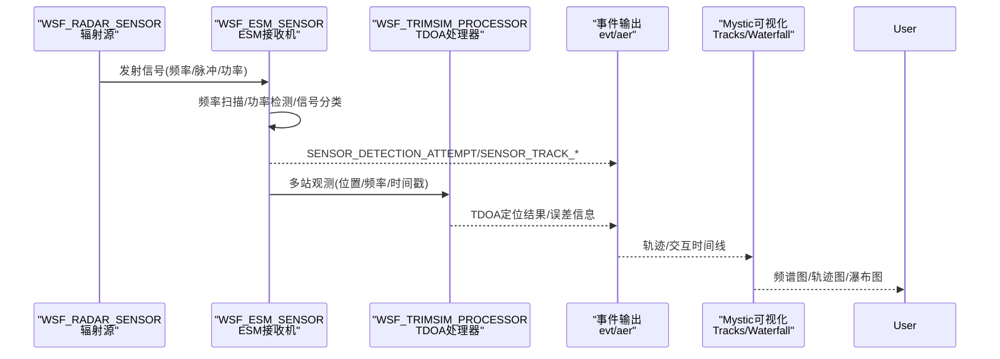
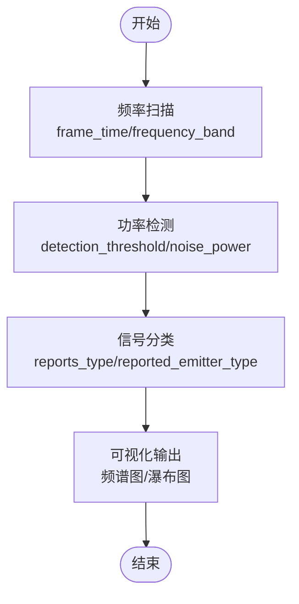
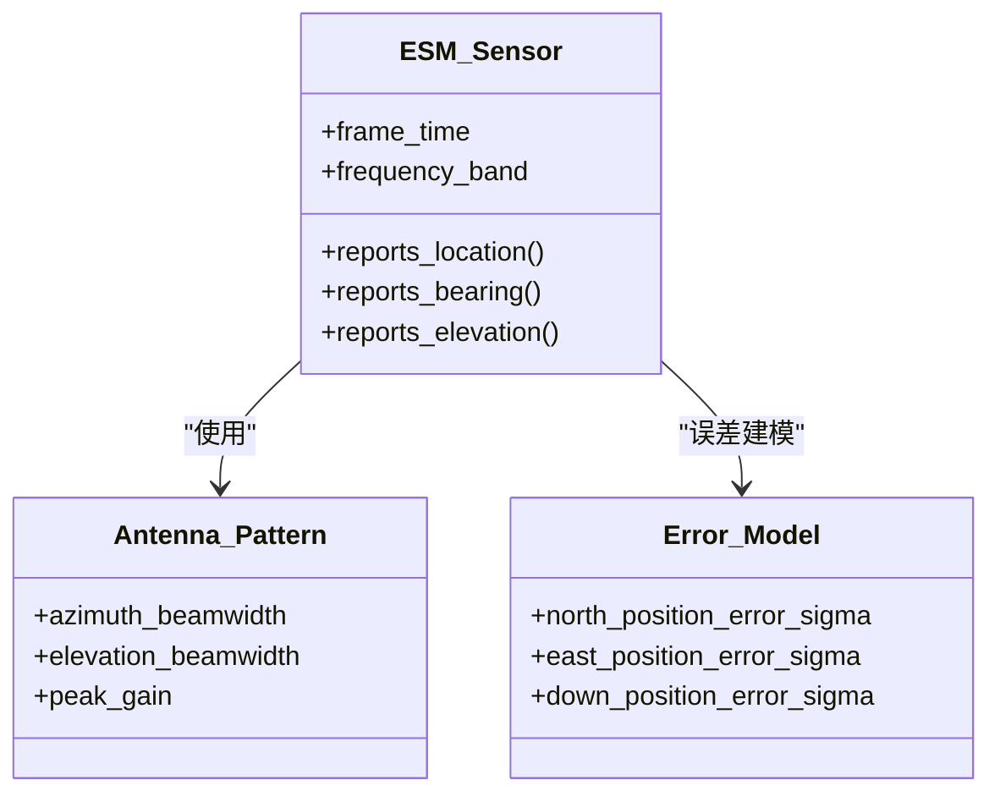
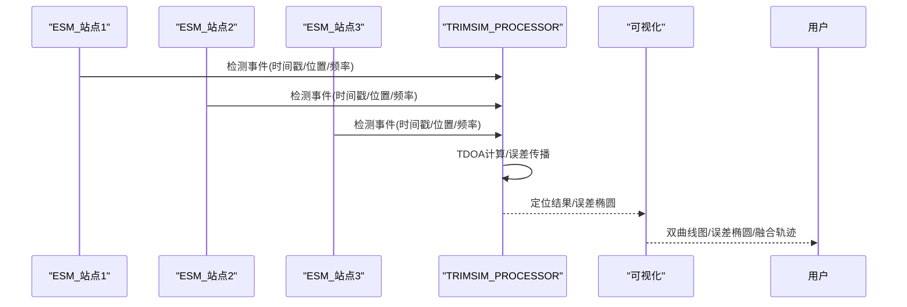
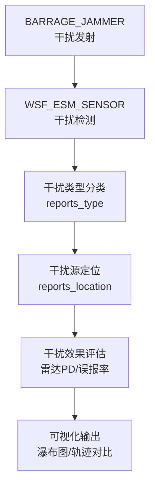
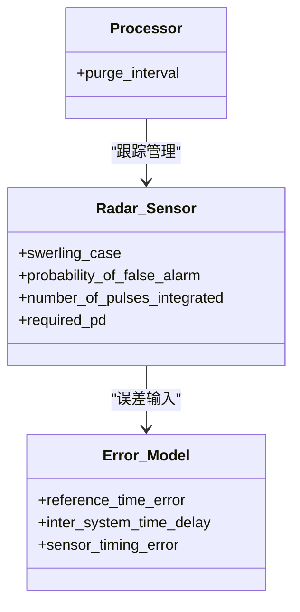
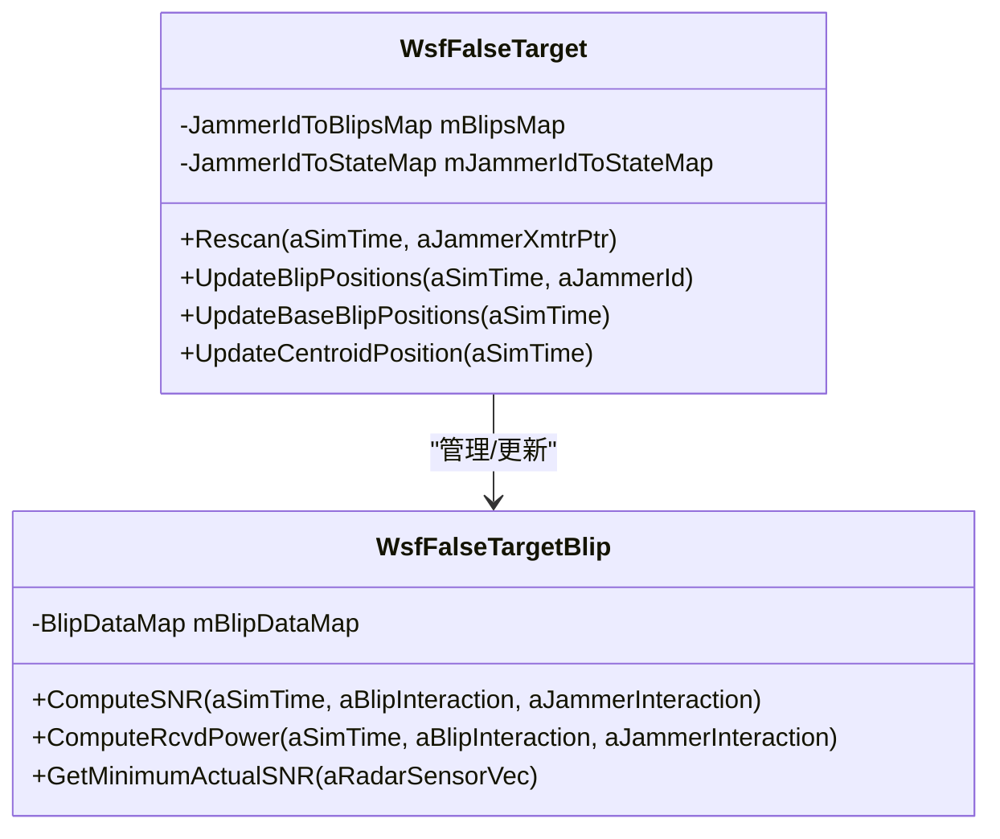
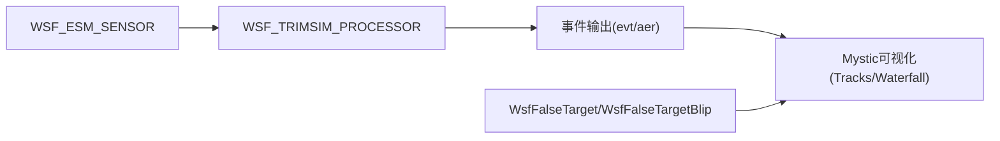

# 电子支援措施可视化

<cite>
**本文引用的文件**   
- [demos/sensor_demos/esm_demo.txt](file://demos/sensor_demos/esm_demo.txt)
- [demos/sensor_demos/esm_tdoa_demo.txt](file://demos/sensor_demos/esm_tdoa_demo.txt)
- [demos/electronic_warfare/esm_detect_jammer.txt](file://demos/electronic_warfare/esm_detect_jammer.txt)
- [demos/electronic_warfare/esm_detect_radar.txt](file://demos/electronic_warfare/esm_detect_radar.txt)
- [swdev/src/core/wsf_mil/source/ew/WsfFalseTarget.hpp](file://swdev/src/core/wsf_mil/source/ew/WsfFalseTarget.hpp)
- [documentation/html/docs/wkf_plugin/rv_tracks.html](file://documentation/html/docs/wkf_plugin/rv_tracks.html)
- [documentation/html/docs/wkf_plugin/rv_waterfall.rst](file://documentation/html/docs/wkf_plugin/rv_waterfall.rst)
</cite>

## 目录
1. [简介](#简介)
2. [项目结构](#项目结构)
3. [核心组件](#核心组件)
4. [架构总览](#架构总览)
5. [详细组件分析](#详细组件分析)
6. [依赖关系分析](#依赖关系分析)
7. [性能考量](#性能考量)
8. [故障排查指南](#故障排查指南)
9. [结论](#结论)
10. [附录](#附录)

## 简介
本文件面向电子支援措施（ESM）可视化的系统化说明，聚焦以下方面：
- 电磁频谱监测的可视化表示：频率扫描、功率检测与信号分类的图形化呈现。
- 测向（DF）技术的可视化：到达角估计、方位角误差与定位精度的图表展示。
- 时差定位（TDOA）的可视化：双曲线定位、误差椭圆与多站融合的定位效果。
- 干扰检测与识别的可视化：干扰类型分类、干扰源定位与干扰效果评估。
- ESM系统性能分析的可视化：探测概率、定位精度与响应时间的综合评估。
- ESM配置优化的可视化工作流与最佳实践。

## 项目结构
仓库中与ESM可视化直接相关的示例与文档主要位于：
- demos/sensor_demos：包含基础ESM与TDOA场景脚本，用于演示频谱监测、测向与多站融合。
- demos/electronic_warfare：包含干扰与雷达对抗场景，用于可视化干扰检测与识别。
- swdev/src/core/wsf_mil/source/ew：包含电子战相关的数据结构与算法接口，支撑可视化所需的状态与指标。
- documentation/html/docs：Mystic可视化插件文档，提供轨迹、瀑布图等可视化能力说明。

图示来源
- [demos/sensor_demos/esm_demo.txt:1-252](file://demos/sensor_demos/esm_demo.txt#L1-L252)
- [demos/sensor_demos/esm_tdoa_demo.txt:1-292](file://demos/sensor_demos/esm_tdoa_demo.txt#L1-L292)
- [demos/electronic_warfare/esm_detect_jammer.txt:1-328](file://demos/electronic_warfare/esm_detect_jammer.txt#L1-L328)
- [demos/electronic_warfare/esm_detect_radar.txt:1-253](file://demos/electronic_warfare/esm_detect_radar.txt#L1-L253)
- [swdev/src/core/wsf_mil/source/ew/WsfFalseTarget.hpp:41-434](file://swdev/src/core/wsf_mil/source/ew/WsfFalseTarget.hpp#L41-L434)
- [documentation/html/docs/wkf_plugin/rv_tracks.html:73-76](file://documentation/html/docs/wkf_plugin/rv_tracks.html#L73-L76)
- [documentation/html/docs/wkf_plugin/rv_waterfall.rst:10-30](file://documentation/html/docs/wkf_plugin/rv_waterfall.rst#L10-L30)

章节来源
- [demos/sensor_demos/esm_demo.txt:1-252](file://demos/sensor_demos/esm_demo.txt#L1-L252)
- [demos/sensor_demos/esm_tdoa_demo.txt:1-292](file://demos/sensor_demos/esm_tdoa_demo.txt#L1-L292)
- [demos/electronic_warfare/esm_detect_jammer.txt:1-328](file://demos/electronic_warfare/esm_detect_jammer.txt#L1-L328)
- [demos/electronic_warfare/esm_detect_radar.txt:1-253](file://demos/electronic_warfare/esm_detect_radar.txt#L1-L253)
- [swdev/src/core/wsf_mil/source/ew/WsfFalseTarget.hpp:41-434](file://swdev/src/core/wsf_mil/source/ew/WsfFalseTarget.hpp#L41-L434)
- [documentation/html/docs/wkf_plugin/rv_tracks.html:73-76](file://documentation/html/docs/wkf_plugin/rv_tracks.html#L73-L76)
- [documentation/html/docs/wkf_plugin/rv_waterfall.rst:10-30](file://documentation/html/docs/wkf_plugin/rv_waterfall.rst#L10-L30)

## 核心组件
- WSF_ESM_SENSOR：在示例中定义ESM传感器，支持频率范围、接收机阈值、噪声功率等参数，并输出位置、类型、频率等信息，为可视化提供数据源。
- WSF_RADAR_SENSOR：作为被监视的辐射源，其发射参数与扫描模式影响ESM的检测与分类。
- WSF_TRIMSIM_PROCESSOR：在TDOA场景中用于多站时间差处理，结合误差模型生成定位结果。
- WsfFalseTarget / WsfFalseTargetBlip：电子战中的假目标与回波强度管理，支撑干扰效果的可视化与评估。
- Mystic可视化插件：Tracks与Waterfall图提供轨迹与交互时间线的可视化能力。

章节来源
- [demos/sensor_demos/esm_demo.txt:87-113](file://demos/sensor_demos/esm_demo.txt#L87-L113)
- [demos/sensor_demos/esm_tdoa_demo.txt:87-132](file://demos/sensor_demos/esm_tdoa_demo.txt#L87-L132)
- [demos/electronic_warfare/esm_detect_jammer.txt:120-146](file://demos/electronic_warfare/esm_detect_jammer.txt#L120-L146)
- [demos/electronic_warfare/esm_detect_radar.txt:32-66](file://demos/electronic_warfare/esm_detect_radar.txt#L32-L66)
- [swdev/src/core/wsf_mil/source/ew/WsfFalseTarget.hpp:41-434](file://swdev/src/core/wsf_mil/source/ew/WsfFalseTarget.hpp#L41-L434)
- [documentation/html/docs/wkf_plugin/rv_tracks.html:73-76](file://documentation/html/docs/wkf_plugin/rv_tracks.html#L73-L76)
- [documentation/html/docs/wkf_plugin/rv_waterfall.rst:10-30](file://documentation/html/docs/wkf_plugin/rv_waterfall.rst#L10-L30)

## 架构总览
ESM可视化架构由“传感器与处理器”、“事件与日志”、“可视化插件”三部分构成。传感器负责采集与初步处理，处理器完成测向与TDOA融合，事件输出驱动可视化界面显示轨迹与交互时间线。

图示来源
- [demos/sensor_demos/esm_demo.txt:37-85](file://demos/sensor_demos/esm_demo.txt#L37-L85)
- [demos/sensor_demos/esm_tdoa_demo.txt:87-132](file://demos/sensor_demos/esm_tdoa_demo.txt#L87-L132)
- [documentation/html/docs/wkf_plugin/rv_tracks.html:73-76](file://documentation/html/docs/wkf_plugin/rv_tracks.html#L73-L76)
- [documentation/html/docs/wkf_plugin/rv_waterfall.rst:10-30](file://documentation/html/docs/wkf_plugin/rv_waterfall.rst#L10-L30)

## 详细组件分析

### 电磁频谱监测可视化（频率扫描、功率检测、信号分类）
- 频率扫描：通过WSF_ESM_SENSOR的频率范围与帧时间控制扫描周期，可视化可绘制频率-时间瀑布图或频谱柱状图。
- 功率检测：接收机阈值与噪声功率决定检测门限，可视化可叠加SNR曲线与检测事件标记。
- 信号分类：reported_emitter_type与type报告字段用于分类标签，可视化以不同颜色或图标区分类别。

图示来源
- [demos/sensor_demos/esm_demo.txt:94-113](file://demos/sensor_demos/esm_demo.txt#L94-L113)
- [demos/electronic_warfare/esm_detect_radar.txt:39-66](file://demos/electronic_warfare/esm_detect_radar.txt#L39-L66)
- [documentation/html/docs/wkf_plugin/rv_waterfall.rst:10-30](file://documentation/html/docs/wkf_plugin/rv_waterfall.rst#L10-L30)

章节来源
- [demos/sensor_demos/esm_demo.txt:94-113](file://demos/sensor_demos/esm_demo.txt#L94-L113)
- [demos/electronic_warfare/esm_detect_radar.txt:39-66](file://demos/electronic_warfare/esm_detect_radar.txt#L39-L66)
- [documentation/html/docs/wkf_plugin/rv_waterfall.rst:10-30](file://documentation/html/docs/wkf_plugin/rv_waterfall.rst#L10-L30)

### 测向（DF）技术可视化（到达角估计、方位角误差、定位精度）
- 到达角估计：通过方位扫描与天线方向图，ESM可估计来波方位；可视化以极坐标或方位角直方图展示。
- 方位角误差：可通过误差模型与多次观测统计得到方位角分布；可视化以误差条或置信区间呈现。
- 定位精度：结合平台运动与多站观测，可视化以定位点云与误差椭圆表达精度。

图示来源
- [demos/sensor_demos/esm_demo.txt:26-33](file://demos/sensor_demos/esm_demo.txt#L26-L33)
- [demos/sensor_demos/esm_tdoa_demo.txt:117-125](file://demos/sensor_demos/esm_tdoa_demo.txt#L117-L125)

章节来源
- [demos/sensor_demos/esm_demo.txt:26-33](file://demos/sensor_demos/esm_demo.txt#L26-L33)
- [demos/sensor_demos/esm_tdoa_demo.txt:117-125](file://demos/sensor_demos/esm_tdoa_demo.txt#L117-L125)

### 时差定位（TDOA）可视化（双曲线定位、误差椭圆、多站融合）
- 双曲线定位：利用多站时间差构建双曲线交点，可视化以双曲线族与交点标注展示。
- 误差椭圆：基于误差模型协方差，可视化以椭圆区域表达不确定性。
- 多站融合：TRIMSIM处理器聚合多站观测，输出融合定位结果；可视化以轨迹对比与误差统计呈现。

图示来源
- [demos/sensor_demos/esm_tdoa_demo.txt:87-132](file://demos/sensor_demos/esm_tdoa_demo.txt#L87-L132)
- [demos/sensor_demos/esm_tdoa_demo.txt:199-206](file://demos/sensor_demos/esm_tdoa_demo.txt#L199-L206)

章节来源
- [demos/sensor_demos/esm_tdoa_demo.txt:87-132](file://demos/sensor_demos/esm_tdoa_demo.txt#L87-L132)
- [demos/sensor_demos/esm_tdoa_demo.txt:199-206](file://demos/sensor_demos/esm_tdoa_demo.txt#L199-L206)

### 干扰检测与识别可视化（干扰类型、干扰源定位、干扰效果评估）
- 干扰类型分类：通过jammer武器与radar_signature区分干扰源类型；可视化以不同符号或颜色标识。
- 干扰源定位：结合ESM对干扰信号的检测与测向，可视化以干扰源位置与覆盖范围展示。
- 干扰效果评估：通过雷达探测概率下降与误报率变化，可视化以瀑布图与跟踪状态对比呈现。

图示来源
- [demos/electronic_warfare/esm_detect_jammer.txt:39-53](file://demos/electronic_warfare/esm_detect_jammer.txt#L39-L53)
- [demos/electronic_warfare/esm_detect_jammer.txt:120-146](file://demos/electronic_warfare/esm_detect_jammer.txt#L120-L146)
- [documentation/html/docs/wkf_plugin/rv_waterfall.rst:10-30](file://documentation/html/docs/wkf_plugin/rv_waterfall.rst#L10-L30)

章节来源
- [demos/electronic_warfare/esm_detect_jammer.txt:39-53](file://demos/electronic_warfare/esm_detect_jammer.txt#L39-L53)
- [demos/electronic_warfare/esm_detect_jammer.txt:120-146](file://demos/electronic_warfare/esm_detect_jammer.txt#L120-L146)
- [documentation/html/docs/wkf_plugin/rv_waterfall.rst:10-30](file://documentation/html/docs/wkf_plugin/rv_waterfall.rst#L10-L30)

### ESM系统性能分析可视化（探测概率、定位精度、响应时间）
- 探测概率：雷达Swerling模型与required_pd参数影响检测性能；可视化以PD曲线与ROC图呈现。
- 定位精度：误差模型sigma与多站几何因子影响定位精度；可视化以误差椭圆与定位偏差直方图展示。
- 响应时间：frame_time与processor purge_interval影响系统响应；可视化以时间轴与延迟分布呈现。

图示来源
- [demos/electronic_warfare/esm_detect_radar.txt:112-124](file://demos/electronic_warfare/esm_detect_radar.txt#L112-L124)
- [demos/sensor_demos/esm_tdoa_demo.txt:117-125](file://demos/sensor_demos/esm_tdoa_demo.txt#L117-L125)
- [demos/electronic_warfare/esm_detect_radar.txt:130-143](file://demos/electronic_warfare/esm_detect_radar.txt#L130-L143)

章节来源
- [demos/electronic_warfare/esm_detect_radar.txt:112-124](file://demos/electronic_warfare/esm_detect_radar.txt#L112-L124)
- [demos/sensor_demos/esm_tdoa_demo.txt:117-125](file://demos/sensor_demos/esm_tdoa_demo.txt#L117-L125)
- [demos/electronic_warfare/esm_detect_radar.txt:130-143](file://demos/electronic_warfare/esm_detect_radar.txt#L130-L143)

### 假目标与干扰效果可视化（WsfFalseTarget/WsfFalseTargetBlip）
- 假目标生成：根据JammerState与BaseData维护假目标状态与位置，支持多雷达站点的一致性策略。
- 回波强度：BlipStrength与BlipData记录实际SNR与等效RCS，支撑干扰效果量化与可视化。
- 可视化映射：将BlipData与JammerState映射到地图上的假目标轨迹与强度热力图。

图示来源
- [swdev/src/core/wsf_mil/source/ew/WsfFalseTarget.hpp:41-434](file://swdev/src/core/wsf_mil/source/ew/WsfFalseTarget.hpp#L41-L434)

章节来源
- [swdev/src/core/wsf_mil/source/ew/WsfFalseTarget.hpp:41-434](file://swdev/src/core/wsf_mil/source/ew/WsfFalseTarget.hpp#L41-L434)

## 依赖关系分析
- 传感器与处理器耦合：WSF_ESM_SENSOR与WSF_TRIMSIM_PROCESSOR通过事件与数据管道耦合，形成TDOA融合链路。
- 可视化与数据解耦：Mystic Tracks与Waterfall仅消费事件与轨迹数据，不反向依赖传感器逻辑，便于扩展新的可视化视图。
- 电子战模块与可视化：WsfFalseTarget/WsfFalseTargetBlip提供干扰与假目标的内部状态，供可视化层渲染干扰效果。

图示来源
- [demos/sensor_demos/esm_tdoa_demo.txt:87-132](file://demos/sensor_demos/esm_tdoa_demo.txt#L87-L132)
- [documentation/html/docs/wkf_plugin/rv_tracks.html:73-76](file://documentation/html/docs/wkf_plugin/rv_tracks.html#L73-L76)
- [documentation/html/docs/wkf_plugin/rv_waterfall.rst:10-30](file://documentation/html/docs/wkf_plugin/rv_waterfall.rst#L10-L30)
- [swdev/src/core/wsf_mil/source/ew/WsfFalseTarget.hpp:41-434](file://swdev/src/core/wsf_mil/source/ew/WsfFalseTarget.hpp#L41-L434)

章节来源
- [demos/sensor_demos/esm_tdoa_demo.txt:87-132](file://demos/sensor_demos/esm_tdoa_demo.txt#L87-L132)
- [documentation/html/docs/wkf_plugin/rv_tracks.html:73-76](file://documentation/html/docs/wkf_plugin/rv_tracks.html#L73-L76)
- [documentation/html/docs/wkf_plugin/rv_waterfall.rst:10-30](file://documentation/html/docs/wkf_plugin/rv_waterfall.rst#L10-L30)
- [swdev/src/core/wsf_mil/source/ew/WsfFalseTarget.hpp:41-434](file://swdev/src/core/wsf_mil/source/ew/WsfFalseTarget.hpp#L41-L434)

## 性能考量
- 扫描与帧时间：缩短frame_time提升响应速度但增加计算负载；需权衡实时性与精度。
- 检测阈值与噪声：降低detection_threshold提高灵敏度但可能增加虚警；需结合probability_of_false_alarm调优。
- 多站几何与误差：TDOA几何因子与误差模型sigma直接影响定位精度；合理布局站点可降低误差椭圆面积。
- 处理器清理间隔：purge_interval过短可能导致跟踪丢失，过长则占用内存；需根据场景动态调整。

[本节为通用指导，无需特定文件引用]

## 故障排查指南
- 无检测事件：检查WSF_ESM_SENSOR的receiver阈值与noise_power设置，确认frequency_band覆盖目标频段。
- 定位发散：核查WSF_TRIMSIM_PROCESSOR的minimum_detections与error_model sigma值，确保足够观测与合理误差。
- 干扰误判：确认BARRAGE_JAMMER的transmitter参数与radar_signature匹配，检查ESM的reported_emitter_type分类规则。
- 可视化缺失：验证event_output是否启用SENSOR_DETECTION_ATTEMPT/SENSOR_TRACK_*，并确保Mystic插件已加载。

章节来源
- [demos/sensor_demos/esm_demo.txt:94-113](file://demos/sensor_demos/esm_demo.txt#L94-L113)
- [demos/sensor_demos/esm_tdoa_demo.txt:117-132](file://demos/sensor_demos/esm_tdoa_demo.txt#L117-L132)
- [demos/electronic_warfare/esm_detect_jammer.txt:120-146](file://demos/electronic_warfare/esm_detect_jammer.txt#L120-L146)
- [documentation/html/docs/wkf_plugin/rv_tracks.html:73-76](file://documentation/html/docs/wkf_plugin/rv_tracks.html#L73-L76)

## 结论
本文件系统梳理了AFSIM中ESM可视化的关键要素：从频谱监测、测向估计、TDOA融合到干扰检测与性能评估，均提供了对应的可视化方法与配置要点。通过示例脚本与Mystic可视化插件，用户可快速构建ESM系统的可视化工作流，并结合WsfFalseTarget/WsfFalseTargetBlip进行干扰效果的综合评估。

[本节为总结性内容，无需特定文件引用]

## 附录
- 可视化工作流建议：
  - 先以esm_demo.txt为基础搭建ESM与雷达场景，验证频谱监测与信号分类。
  - 引入esm_tdoa_demo.txt，添加TRIMSIM处理器与误差模型，观察多站融合定位效果。
  - 使用esm_detect_jammer.txt与esm_detect_radar.txt，加入干扰源与雷达对抗，评估干扰效果。
  - 借助Mystic Tracks与Waterfall，绘制轨迹与交互时间线，形成完整的可视化闭环。

章节来源
- [demos/sensor_demos/esm_demo.txt:1-252](file://demos/sensor_demos/esm_demo.txt#L1-L252)
- [demos/sensor_demos/esm_tdoa_demo.txt:1-292](file://demos/sensor_demos/esm_tdoa_demo.txt#L1-L292)
- [demos/electronic_warfare/esm_detect_jammer.txt:1-328](file://demos/electronic_warfare/esm_detect_jammer.txt#L1-L328)
- [demos/electronic_warfare/esm_detect_radar.txt:1-253](file://demos/electronic_warfare/esm_detect_radar.txt#L1-L253)
- [documentation/html/docs/wkf_plugin/rv_tracks.html:73-76](file://documentation/html/docs/wkf_plugin/rv_tracks.html#L73-L76)
- [documentation/html/docs/wkf_plugin/rv_waterfall.rst:10-30](file://documentation/html/docs/wkf_plugin/rv_waterfall.rst#L10-L30)