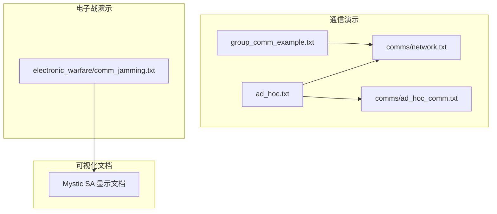
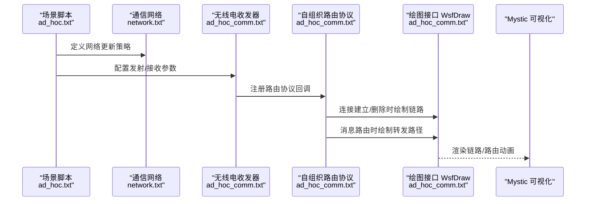
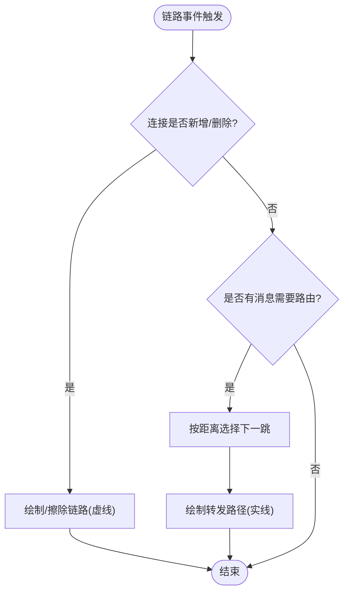
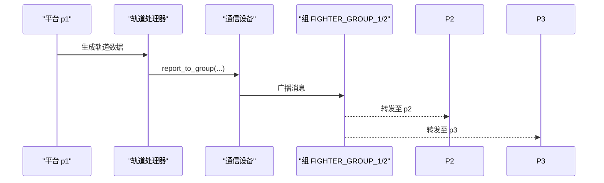
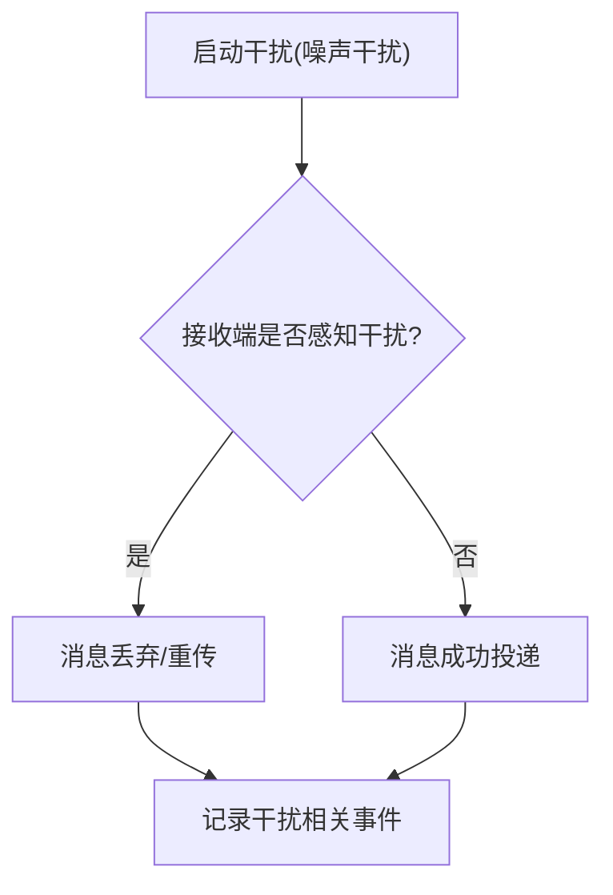
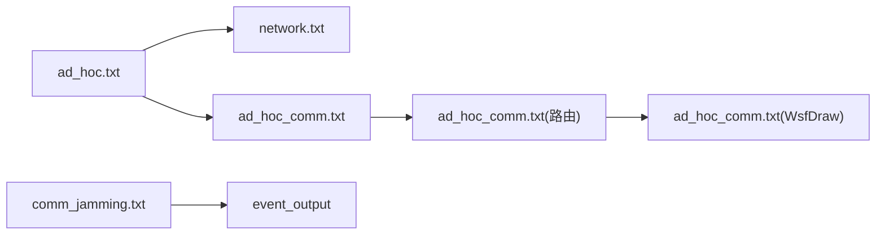

# 通信链路可视化

<cite>
**本文引用的文件**   
- [demos/comm/ad_hoc.txt](file://demos/comm/ad_hoc.txt)
- [demos/comm/group_comm_example.txt](file://demos/comm/group_comm_example.txt)
- [demos/comm/comms/network.txt](file://demos/comm/comms/network.txt)
- [demos/comm/comms/ad_hoc_comm.txt](file://demos/comm/comms/ad_hoc_comm.txt)
- [demos/electronic_warfare/comm_jamming.txt](file://demos/electronic_warfare/comm_jamming.txt)
- [documentation/html/docs/wkf_plugin/rv_sa_display.html](file://documentation/html/docs/wkf_plugin/rv_sa_display.html)
</cite>

## 目录
1. [简介](#简介)
2. [项目结构](#项目结构)
3. [核心组件](#核心组件)
4. [架构总览](#架构总览)
5. [详细组件分析](#详细组件分析)
6. [依赖关系分析](#依赖关系分析)
7. [性能与可视化注意事项](#性能与可视化注意事项)
8. [故障排查指南](#故障排查指南)
9. [结论](#结论)

## 简介
本文件面向“通信链路可视化”的系统性说明，围绕以下目标展开：
- 无线电信号传播模型的可视化表示（路径损耗、多径效应、衰落特性）
- 通信链路连通性分析的可视化（覆盖范围、信号强度、误码率的地图显示）
- 通信网络拓扑结构的可视化（节点连接关系、中继链路、网络容量）
- 通信干扰与抗干扰效果的可视化（干扰源定位、抑制效果、通信质量评估）
- 动态通信场景的实时可视化（移动节点的链路变化、网络重构动画）
- 通信系统设计与优化的可视化分析方法

AFSIM 提供了通信模型、路由协议、电子战对抗以及 Mystic 可视化插件等能力。通过示例场景与脚本回调，可将通信链路、路由过程、干扰感知与事件输出进行可视化呈现。

## 项目结构
与通信链路可视化直接相关的示例与配置位于 demos/comm 与 demos/electronic_warfare 两个目录，配合 documentation/html 中的 Mystic 文档说明。

图示来源
- [demos/comm/ad_hoc.txt:10-26](file://demos/comm/ad_hoc.txt#L10-L26)
- [demos/comm/comms/network.txt:10-12](file://demos/comm/comms/network.txt#L10-L12)
- [demos/comm/comms/ad_hoc_comm.txt:50-61](file://demos/comm/comms/ad_hoc_comm.txt#L50-L61)
- [documentation/html/docs/wkf_plugin/rv_sa_display.html:73-76](file://documentation/html/docs/wkf_plugin/rv_sa_display.html#L73-L76)

章节来源
- [demos/comm/ad_hoc.txt:10-26](file://demos/comm/ad_hoc.txt#L10-L26)
- [demos/comm/comms/network.txt:10-12](file://demos/comm/comms/network.txt#L10-L12)
- [demos/comm/comms/ad_hoc_comm.txt:50-61](file://demos/comm/comms/ad_hoc_comm.txt#L50-L61)
- [documentation/html/docs/wkf_plugin/rv_sa_display.html:73-76](file://documentation/html/docs/wkf_plugin/rv_sa_display.html#L73-L76)

## 核心组件
- 自组织通信网络（Ad-hoc Network）
  - 使用 WSF_COMM_NETWORK_AD_HOC 定义网络更新节奏，驱动链路建立/删除。
  - 参考：[demos/comm/comms/network.txt:10-12](file://demos/comm/comms/network.txt#L10-L12)
- 无线电收发器（WSF_RADIO_TRANSCEIVER）
  - 定义发射机频率/功率/最大范围、接收机频率等参数，作为链路可视化的基础物理层。
  - 参考：[demos/comm/comms/ad_hoc_comm.txt:50-61](file://demos/comm/comms/ad_hoc_comm.txt#L50-L61)
- 自组织路由协议（WSF_COMM_ROUTER_PROTOCOL_AD_HOC）
  - 提供 OnConnectionAdded/Removed、OnMessageRouting 等回调，用于绘制链路和路由轨迹。
  - 参考：[demos/comm/comms/ad_hoc_comm.txt:63-130](file://demos/comm/comms/ad_hoc_comm.txt#L63-L130)
- 绘图接口（WsfDraw）
  - 在路由与连接事件中绘制虚线/实线，展示链路状态与消息转发路径。
  - 参考：[demos/comm/comms/ad_hoc_comm.txt:14-48](file://demos/comm/comms/ad_hoc_comm.txt#L14-L48)
- 组播通信（Group Communication）
  - 通过 group_join 将平台加入不同通信组，实现跨组的消息转发与可视化。
  - 参考：[demos/comm/group_comm_example.txt:44-54](file://demos/comm/group_comm_example.txt#L44-L54), [demos/comm/group_comm_example.txt:98-151](file://demos/comm/group_comm_example.txt#L98-L151)
- 电子战与干扰（Jamming & EP）
  - 使用 WSF_ELECTRONIC_ATTACK/WSF_ELECTRONIC_PROTECT 与 WSF_RF_JAMMER 模拟干扰，并通过 jamming_perception_threshold/timeout 控制感知。
  - 参考：[demos/electronic_warfare/comm_jamming.txt:63-99](file://demos/electronic_warfare/comm_jamming.txt#L63-L99), [demos/electronic_warfare/comm_jamming.txt:216-240](file://demos/electronic_warfare/comm_jamming.txt#L216-L240)

章节来源
- [demos/comm/comms/network.txt:10-12](file://demos/comm/comms/network.txt#L10-L12)
- [demos/comm/comms/ad_hoc_comm.txt:14-48](file://demos/comm/comms/ad_hoc_comm.txt#L14-L48)
- [demos/comm/comms/ad_hoc_comm.txt:50-61](file://demos/comm/comms/ad_hoc_comm.txt#L50-L61)
- [demos/comm/comms/ad_hoc_comm.txt:63-130](file://demos/comm/comms/ad_hoc_comm.txt#L63-L130)
- [demos/comm/group_comm_example.txt:44-54](file://demos/comm/group_comm_example.txt#L44-L54)
- [demos/comm/group_comm_example.txt:98-151](file://demos/comm/group_comm_example.txt#L98-L151)
- [demos/electronic_warfare/comm_jamming.txt:63-99](file://demos/electronic_warfare/comm_jamming.txt#L63-L99)
- [demos/electronic_warfare/comm_jamming.txt:216-240](file://demos/electronic_warfare/comm_jamming.txt#L216-L240)

## 架构总览
下图展示了从场景输入到通信仿真、路由与绘制的整体流程，并标注了关键文件位置。

图示来源
- [demos/comm/ad_hoc.txt:10-26](file://demos/comm/ad_hoc.txt#L10-L26)
- [demos/comm/comms/network.txt:10-12](file://demos/comm/comms/network.txt#L10-L12)
- [demos/comm/comms/ad_hoc_comm.txt:50-61](file://demos/comm/comms/ad_hoc_comm.txt#L50-L61)
- [demos/comm/comms/ad_hoc_comm.txt:63-130](file://demos/comm/comms/ad_hoc_comm.txt#L63-L130)
- [demos/comm/comms/ad_hoc_comm.txt:14-48](file://demos/comm/comms/ad_hoc_comm.txt#L14-L48)

## 详细组件分析

### 自组织通信与链路可视化
- 网络更新
  - 使用 WSF_COMM_NETWORK_AD_HOC 设置平均更新间隔与方差，驱动链路拓扑的动态变化。
  - 参考：[demos/comm/comms/network.txt:10-12](file://demos/comm/comms/network.txt#L10-L12)
- 无线电收发器
  - 配置频率、功率、最大范围；这些参数直接影响可视化的覆盖范围与链路存在性。
  - 参考：[demos/comm/comms/ad_hoc_comm.txt:50-61](file://demos/comm/comms/ad_hoc_comm.txt#L50-L61)
- 路由协议与绘图
  - OnConnectionAdded/Removed 回调中调用 WsfDraw 绘制虚线表示链路；OnMessageRouting 选择下一跳并绘制实线表示消息转发路径。
  - 参考：[demos/comm/comms/ad_hoc_comm.txt:63-130](file://demos/comm/comms/ad_hoc_comm.txt#L63-L130), [demos/comm/comms/ad_hoc_comm.txt:14-48](file://demos/comm/comms/ad_hoc_comm.txt#L14-L48)

图示来源
- [demos/comm/comms/ad_hoc_comm.txt:63-130](file://demos/comm/comms/ad_hoc_comm.txt#L63-L130)
- [demos/comm/comms/ad_hoc_comm.txt:14-48](file://demos/comm/comms/ad_hoc_comm.txt#L14-L48)

章节来源
- [demos/comm/comms/network.txt:10-12](file://demos/comm/comms/network.txt#L10-L12)
- [demos/comm/comms/ad_hoc_comm.txt:50-61](file://demos/comm/comms/ad_hoc_comm.txt#L50-L61)
- [demos/comm/comms/ad_hoc_comm.txt:63-130](file://demos/comm/comms/ad_hoc_comm.txt#L63-L130)
- [demos/comm/comms/ad_hoc_comm.txt:14-48](file://demos/comm/comms/ad_hoc_comm.txt#L14-L48)

### 组播通信与跨组转发可视化
- 组创建与加入
  - 通过脚本创建组模板并在平台通信设备上执行 group_join，使平台加入指定组。
  - 参考：[demos/comm/group_comm_example.txt:44-54](file://demos/comm/group_comm_example.txt#L44-L54), [demos/comm/group_comm_example.txt:98-151](file://demos/comm/group_comm_example.txt#L98-L151)
- 处理器与消息
  - 使用 WSF_TRACK_PROCESSOR 处理轨道消息，并通过 report_to_group via datalink 向组内成员广播。
  - 参考：[demos/comm/group_comm_example.txt:27-42](file://demos/comm/group_comm_example.txt#L27-L42), [demos/comm/group_comm_example.txt:111-114](file://demos/comm/group_comm_example.txt#L111-L114)

图示来源
- [demos/comm/group_comm_example.txt:27-42](file://demos/comm/group_comm_example.txt#L27-L42)
- [demos/comm/group_comm_example.txt:98-151](file://demos/comm/group_comm_example.txt#L98-L151)

章节来源
- [demos/comm/group_comm_example.txt:27-42](file://demos/comm/group_comm_example.txt#L27-L42)
- [demos/comm/group_comm_example.txt:44-54](file://demos/comm/group_comm_example.txt#L44-L54)
- [demos/comm/group_comm_example.txt:98-151](file://demos/comm/group_comm_example.txt#L98-L151)

### 干扰与抗干扰可视化
- 电子战与干扰建模
  - 使用 WSF_ELECTRONIC_ATTACK + noise_jamming 技术，结合 WSF_RF_JAMMER 发射干扰信号。
  - 参考：[demos/electronic_warfare/comm_jamming.txt:216-240](file://demos/electronic_warfare/comm_jamming.txt#L216-L240)
- 接收端抗干扰
  - 通过 WSF_ELECTRONIC_PROTECT + processing_gain 提升抗噪能力，并设置 jamming_perception_threshold/timeout 控制干扰感知。
  - 参考：[demos/electronic_warfare/comm_jamming.txt:63-99](file://demos/electronic_warfare/comm_jamming.txt#L63-L99)
- 事件输出与日志
  - 启用 MESSAGE_RECEIVED/MESSAGE_TRANSMITTED/JAMMING_* 等事件，便于事后分析与可视化关联。
  - 参考：[demos/electronic_warfare/comm_jamming.txt:309-358](file://demos/electronic_warfare/comm_jamming.txt#L309-L358)

图示来源
- [demos/electronic_warfare/comm_jamming.txt:63-99](file://demos/electronic_warfare/comm_jamming.txt#L63-L99)
- [demos/electronic_warfare/comm_jamming.txt:216-240](file://demos/electronic_warfare/comm_jamming.txt#L216-L240)
- [demos/electronic_warfare/comm_jamming.txt:309-358](file://demos/electronic_warfare/comm_jamming.txt#L309-L358)

章节来源
- [demos/electronic_warfare/comm_jamming.txt:63-99](file://demos/electronic_warfare/comm_jamming.txt#L63-L99)
- [demos/electronic_warfare/comm_jamming.txt:216-240](file://demos/electronic_warfare/comm_jamming.txt#L216-L240)
- [demos/electronic_warfare/comm_jamming.txt:309-358](file://demos/electronic_warfare/comm_jamming.txt#L309-L358)

### 动态场景与实时可视化
- 移动节点与链路变化
  - 场景中包含随机放置的检测器与高速穿越平台的移动轨迹，导致链路频繁建立/删除，适合观察动态拓扑。
  - 参考：[demos/comm/ad_hoc.txt:10-26](file://demos/comm/ad_hoc.txt#L10-L26)
- 可视化呈现
  - 通过 WsfDraw 在 ad_hoc 图层绘制链路和路由，支持持续时间与线型设置，形成动画效果。
  - 参考：[demos/comm/comms/ad_hoc_comm.txt:14-48](file://demos/comm/comms/ad_hoc_comm.txt#L14-L48)

章节来源
- [demos/comm/ad_hoc.txt:10-26](file://demos/comm/ad_hoc.txt#L10-L26)
- [demos/comm/comms/ad_hoc_comm.txt:14-48](file://demos/comm/comms/ad_hoc_comm.txt#L14-L48)

### 通信系统设计优化与可视化分析工具
- Mystic 显示界面
  - Mystic 的 SA Display 提供平台、航路、组、视场等可视化元素，可用于辅助分析通信拓扑与态势。
  - 参考：[documentation/html/docs/wkf_plugin/rv_sa_display.html:73-76](file://documentation/html/docs/wkf_plugin/rv_sa_display.html#L73-L76)
- 建议方法
  - 将通信链路绘制于独立图层，结合 Mystic 的图层管理与时间轴回放，对比不同参数（功率、带宽、EP增益）下的链路稳定性与消息投递率。
  - 通过 event_output 导出 MESSAGE_* 与 JAMMING_* 事件，统计成功率与时延分布，指导参数调优。

章节来源
- [documentation/html/docs/wkf_plugin/rv_sa_display.html:73-76](file://documentation/html/docs/wkf_plugin/rv_sa_display.html#L73-L76)

## 依赖关系分析
- 场景脚本依赖通信网络与无线电收发器定义
- 路由协议依赖收发器提供的图结构与地址信息
- 绘图模块依赖路由协议回调以获取连接与路由事件
- 电子战演示依赖事件输出以记录干扰与通信状态

图示来源
- [demos/comm/ad_hoc.txt:10-26](file://demos/comm/ad_hoc.txt#L10-L26)
- [demos/comm/comms/network.txt:10-12](file://demos/comm/comms/network.txt#L10-L12)
- [demos/comm/comms/ad_hoc_comm.txt:50-61](file://demos/comm/comms/ad_hoc_comm.txt#L50-L61)
- [demos/comm/comms/ad_hoc_comm.txt:63-130](file://demos/comm/comms/ad_hoc_comm.txt#L63-L130)
- [demos/electronic_warfare/comm_jamming.txt:309-358](file://demos/electronic_warfare/comm_jamming.txt#L309-L358)

章节来源
- [demos/comm/ad_hoc.txt:10-26](file://demos/comm/ad_hoc.txt#L10-L26)
- [demos/comm/comms/network.txt:10-12](file://demos/comm/comms/network.txt#L10-L12)
- [demos/comm/comms/ad_hoc_comm.txt:50-61](file://demos/comm/comms/ad_hoc_comm.txt#L50-L61)
- [demos/comm/comms/ad_hoc_comm.txt:63-130](file://demos/comm/comms/ad_hoc_comm.txt#L63-L130)
- [demos/electronic_warfare/comm_jamming.txt:309-358](file://demos/electronic_warfare/comm_jamming.txt#L309-L358)

## 性能与可视化注意事项
- 链路绘制频率
  - 避免在高频回调中频繁创建/销毁图形对象；复用图层与样式以减少开销。
- 路由算法复杂度
  - 当前采用基于距离的贪心选择，需避免重复访问已遍历节点；在大图中应限制边遍历范围。
- 事件输出规模
  - 大量 MESSAGE_* 与 JAMMING_* 事件可能产生大体积日志；按需启用必要事件类型。
- 可视化图层管理
  - 将链路、路由、干扰区域分别置于不同图层，便于分层查看与回放控制。

## 故障排查指南
- 链路未显示
  - 检查路由协议回调是否正确注册，确认 OnConnectionAdded/Removed 是否被调用。
  - 参考：[demos/comm/comms/ad_hoc_comm.txt:63-130](file://demos/comm/comms/ad_hoc_comm.txt#L63-L130)
- 路由路径不出现
  - 确认 OnMessageRouting 返回的下一跳地址非空，且未被标记为已访问。
  - 参考：[demos/comm/comms/ad_hoc_comm.txt:92-129](file://demos/comm/comms/ad_hoc_comm.txt#L92-L129)
- 干扰未生效或感知异常
  - 检查 jamming_perception_threshold/timeout 配置与电子战保护增益设置。
  - 参考：[demos/electronic_warfare/comm_jamming.txt:63-99](file://demos/electronic_warfare/comm_jamming.txt#L63-L99)
- 事件缺失
  - 确保 event_output 启用了所需的事件类型（如 MESSAGE_RECEIVED、JAMMING_ATTEMPT）。
  - 参考：[demos/electronic_warfare/comm_jamming.txt:309-358](file://demos/electronic_warfare/comm_jamming.txt#L309-L358)

章节来源
- [demos/comm/comms/ad_hoc_comm.txt:63-130](file://demos/comm/comms/ad_hoc_comm.txt#L63-L130)
- [demos/comm/comms/ad_hoc_comm.txt:92-129](file://demos/comm/comms/ad_hoc_comm.txt#L92-L129)
- [demos/electronic_warfare/comm_jamming.txt:63-99](file://demos/electronic_warfare/comm_jamming.txt#L63-L99)
- [demos/electronic_warfare/comm_jamming.txt:309-358](file://demos/electronic_warfare/comm_jamming.txt#L309-L358)

## 结论
通过 AFSIM 的通信模型、路由协议与 Mystic 可视化插件，可以构建完整的通信链路可视化体系：
- 使用 WSF_COMM_NETWORK_AD_HOC 与 WSF_RADIO_TRANSCEIVER 描述物理层与网络层行为
- 借助 WSF_COMM_ROUTER_PROTOCOL_AD_HOC 与 WsfDraw 实现链路/路由的实时可视化
- 利用电子战模型与事件输出评估干扰对通信质量的影响
- 结合 Mystic 的显示能力进行态势分析与设计优化

该体系适用于自组织网络、组播通信、干扰对抗与动态场景的可视化分析与优化。