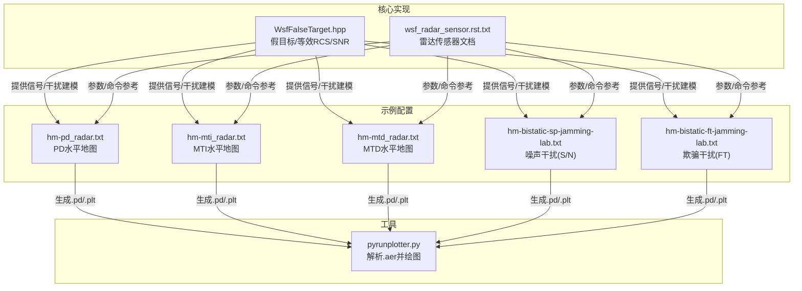
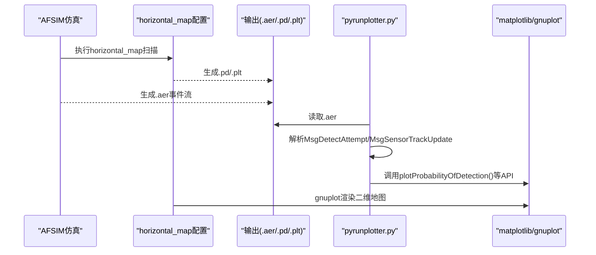
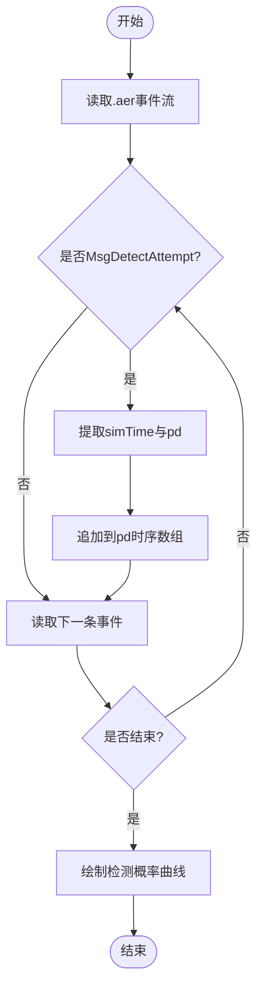
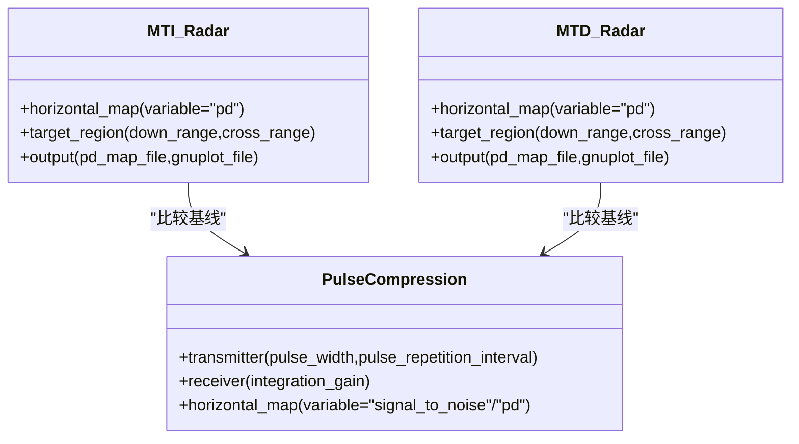
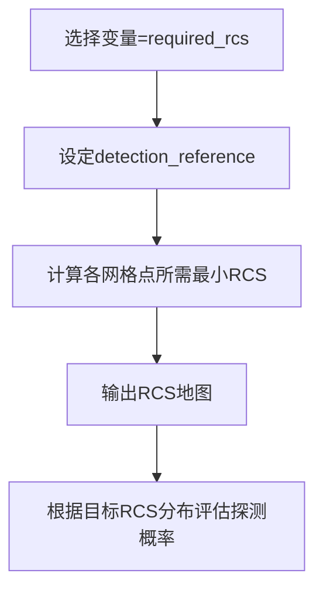
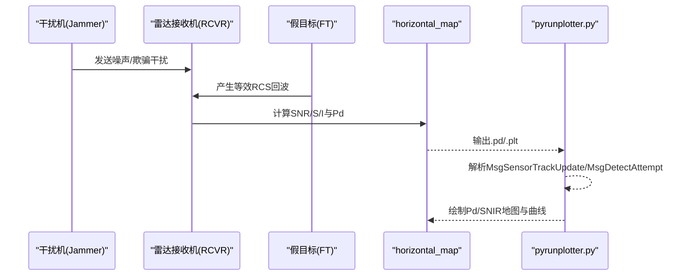
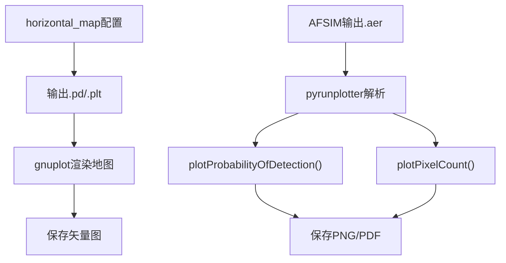
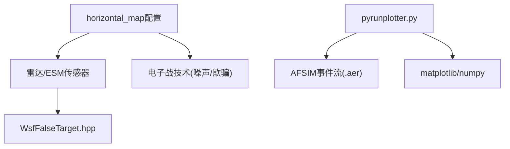

# 雷达性能可视化

<cite>
**本文引用的文件**   
- [pyrunplotter.py](file://tools/pyrunplotter/pyrunplotter.py)
- [hm-mti_radar.txt](file://demos/sensor_plot/radar/hm-mti_radar.txt)
- [hm-mtd_radar.txt](file://demos/sensor_plot/radar/hm-mtd_radar.txt)
- [hm-pd_radar.txt](file://demos/sensor_plot/radar/hm-pd_radar.txt)
- [hm-bistatic-ft-jamming-lab.txt](file://demos/sensor_plot/radar/hm-bistatic-ft-jamming-lab.txt)
- [hm-bistatic-sp-jamming-lab.txt](file://demos/sensor_plot/radar/hm-bistatic-sp-jamming-lab.txt)
- [WsfFalseTarget.hpp](file://swdev/src/core/wsf_mil/source/ew/WsfFalseTarget.hpp)
- [wsf_radar_sensor.rst.txt](file://documentation/html/_sources/docs/wsf_radar_sensor.rst.txt)
</cite>

## 目录
1. [简介](#简介)
2. [项目结构](#项目结构)
3. [核心组件](#核心组件)
4. [架构总览](#架构总览)
5. [详细组件分析](#详细组件分析)
6. [依赖关系分析](#依赖关系分析)
7. [性能考量](#性能考量)
8. [故障排查指南](#故障排查指南)
9. [结论](#结论)
10. [附录](#附录)

## 简介
本文件面向雷达性能可视化，系统性说明以下能力与实现路径：
- 检测概率（Pd）曲线绘制、覆盖范围分析与灵敏度分析图表
- 雷达方程可视化的关键指标：最大探测距离、信噪比（SNR）、杂波抑制效果
- 多普勒处理效果的可视化对比：MTI、MTD、脉冲压缩
- 目标雷达截面积（RCS）对探测概率的影响可视化
- 干扰与反干扰的可视化方法：噪声干扰、欺骗干扰对检测概率的影响
- 自动化报告生成与数据导出流程

## 项目结构
仓库中与雷达性能可视化直接相关的资源主要分布在：
- 工具脚本：tools/pyrunplotter/pyrunplotter.py（用于解析仿真输出并绘制时序图、统计图等）
- 传感器绘图示例：demos/sensor_plot/radar/*（水平地图、PD/SNR/干扰等可视化配置）
- 电子战与假目标：swdev/src/core/wsf_mil/source/ew/WsfFalseTarget.hpp（假目标强度、等效RCS、SNR计算接口）
- 文档参考：documentation/html/_sources/docs/wsf_radar_sensor.rst.txt（雷达传感器命令与参数说明）

图示来源
- [pyrunplotter.py:254-518](file://tools/pyrunplotter/pyrunplotter.py#L254-L518)
- [hm-pd_radar.txt:43-90](file://demos/sensor_plot/radar/hm-pd_radar.txt#L43-L90)
- [hm-mti_radar.txt:43-90](file://demos/sensor_plot/radar/hm-mti_radar.txt#L43-L90)
- [hm-mtd_radar.txt:43-90](file://demos/sensor_plot/radar/hm-mtd_radar.txt#L43-L90)
- [hm-bistatic-sp-jamming-lab.txt:116-185](file://demos/sensor_plot/radar/hm-bistatic-sp-jamming-lab.txt#L116-L185)
- [hm-bistatic-ft-jamming-lab.txt:163-234](file://demos/sensor_plot/radar/hm-bistatic-ft-jamming-lab.txt#L163-L234)
- [WsfFalseTarget.hpp:331-434](file://swdev/src/core/wsf_mil/source/ew/WsfFalseTarget.hpp#L331-L434)
- [wsf_radar_sensor.rst.txt](file://documentation/html/_sources/docs/wsf_radar_sensor.rst.txt)

章节来源
- [pyrunplotter.py:254-518](file://tools/pyrunplotter/pyrunplotter.py#L254-L518)
- [hm-pd_radar.txt:43-90](file://demos/sensor_plot/radar/hm-pd_radar.txt#L43-L90)
- [hm-mti_radar.txt:43-90](file://demos/sensor_plot/radar/hm-mti_radar.txt#L43-L90)
- [hm-mtd_radar.txt:43-90](file://demos/sensor_plot/radar/hm-mtd_radar.txt#L43-L90)
- [hm-bistatic-sp-jamming-lab.txt:116-185](file://demos/sensor_plot/radar/hm-bistatic-sp-jamming-lab.txt#L116-L185)
- [hm-bistatic-ft-jamming-lab.txt:163-234](file://demos/sensor_plot/radar/hm-bistatic-ft-jamming-lab.txt#L163-L234)
- [WsfFalseTarget.hpp:331-434](file://swdev/src/core/wsf_mil/source/ew/WsfFalseTarget.hpp#L331-L434)
- [wsf_radar_sensor.rst.txt](file://documentation/html/_sources/docs/wsf_radar_sensor.rst.txt)

## 核心组件
- pyrunplotter.py：读取AFSIM输出的.aer事件流，提取平台状态、传感器跟踪、检测尝试等消息，并提供多种绘图API（如检测概率随时间变化、像素计数、位置轨迹等）。
- 传感器绘图示例（horizontal_map）：通过配置文件定义要绘制的变量（pd、signal_to_noise、clutter_power等），输出二维网格上的地图数据（.pd）和gnuplot脚本（.plt）。
- WsfFalseTarget.hpp：提供假目标的强度、等效RCS、实际SNR等计算接口，支撑欺骗干扰场景下的雷达探测建模。
- wsf_radar_sensor.rst.txt：雷达传感器的命令与参数参考，包括检测概率表、虚警率、Swerling模型、所需Pd等。

章节来源
- [pyrunplotter.py:254-518](file://tools/pyrunplotter/pyrunplotter.py#L254-L518)
- [hm-pd_radar.txt:43-90](file://demos/sensor_plot/radar/hm-pd_radar.txt#L43-L90)
- [hm-mti_radar.txt:43-90](file://demos/sensor_plot/radar/hm-mti_radar.txt#L43-L90)
- [hm-mtd_radar.txt:43-90](file://demos/sensor_plot/radar/hm-mtd_radar.txt#L43-L90)
- [hm-bistatic-sp-jamming-lab.txt:116-185](file://demos/sensor_plot/radar/hm-bistatic-sp-jamming-lab.txt#L116-L185)
- [hm-bistatic-ft-jamming-lab.txt:163-234](file://demos/sensor_plot/radar/hm-bistatic-ft-jamming-lab.txt#L163-L234)
- [WsfFalseTarget.hpp:331-434](file://swdev/src/core/wsf_mil/source/ew/WsfFalseTarget.hpp#L331-L434)
- [wsf_radar_sensor.rst.txt](file://documentation/html/_sources/docs/wsf_radar_sensor.rst.txt)

## 架构总览
雷达性能可视化整体流程如下：
- 仿真运行：使用sensor_plot示例配置（horizontal_map）驱动雷达/ESM传感器进行空间扫描，输出.pd与.gnuplot脚本。
- 数据处理：pyrunplotter解析.aer事件流，聚合检测概率、SNR、像素计数等时序数据。
- 可视化呈现：基于matplotlib绘制时序曲线、三维/二维轨迹、平台数量统计等；同时结合gnuplot脚本渲染二维地图。

图示来源
- [hm-pd_radar.txt:43-90](file://demos/sensor_plot/radar/hm-pd_radar.txt#L43-L90)
- [hm-mti_radar.txt:43-90](file://demos/sensor_plot/radar/hm-mti_radar.txt#L43-L90)
- [hm-mtd_radar.txt:43-90](file://demos/sensor_plot/radar/hm-mtd_radar.txt#L43-L90)
- [hm-bistatic-sp-jamming-lab.txt:116-185](file://demos/sensor_plot/radar/hm-bistatic-sp-jamming-lab.txt#L116-L185)
- [hm-bistatic-ft-jamming-lab.txt:163-234](file://demos/sensor_plot/radar/hm-bistatic-ft-jamming-lab.txt#L163-L234)
- [pyrunplotter.py:366-395](file://tools/pyrunplotter/pyrunplotter.py#L366-L395)
- [pyrunplotter.py:749-774](file://tools/pyrunplotter/pyrunplotter.py#L749-L774)

## 详细组件分析

### 检测概率曲线绘制与覆盖范围分析
- 检测概率曲线：通过解析MsgDetectAttempt中的pd字段，按时间序列绘制检测概率曲线。
- 覆盖范围分析：horizontal_map支持以pd为变量输出二维网格地图，可叠加defended_area_report_file生成防护区域报告。

图示来源
- [pyrunplotter.py:384-395](file://tools/pyrunplotter/pyrunplotter.py#L384-L395)
- [pyrunplotter.py:749-774](file://tools/pyrunplotter/pyrunplotter.py#L749-L774)
- [hm-pd_radar.txt:43-90](file://demos/sensor_plot/radar/hm-pd_radar.txt#L43-L90)

章节来源
- [pyrunplotter.py:384-395](file://tools/pyrunplotter/pyrunplotter.py#L384-L395)
- [pyrunplotter.py:749-774](file://tools/pyrunplotter/pyrunplotter.py#L749-L774)
- [hm-pd_radar.txt:43-90](file://demos/sensor_plot/radar/hm-pd_radar.txt#L43-L90)

### 雷达方程可视化：最大探测距离、信噪比与杂波抑制
- 最大探测距离：可通过horizontal_coverage或水平地图中“required_rcs”变量推导满足特定Pd的最小RCS，从而反推不同距离下的探测能力边界。
- 信噪比（SNR）：在horizontal_map中选择variable signal_to_noise，输出空间分布的dB值，直观展示SNR随距离/方位的变化。
- 杂波抑制：可选择variable clutter_power或signal_to_interference，评估杂波/干扰对探测的影响。

图示来源
- [hm-pd_radar.txt:43-90](file://demos/sensor_plot/radar/hm-pd_radar.txt#L43-L90)
- [hm-bistatic-sp-jamming-lab.txt:116-185](file://demos/sensor_plot/radar/hm-bistatic-sp-jamming-lab.txt#L116-L185)
- [wsf_radar_sensor.rst.txt](file://documentation/html/_sources/docs/wsf_radar_sensor.rst.txt)

章节来源
- [hm-pd_radar.txt:43-90](file://demos/sensor_plot/radar/hm-pd_radar.txt#L43-L90)
- [hm-bistatic-sp-jamming-lab.txt:116-185](file://demos/sensor_plot/radar/hm-bistatic-sp-jamming-lab.txt#L116-L185)
- [wsf_radar_sensor.rst.txt](file://documentation/html/_sources/docs/wsf_radar_sensor.rst.txt)

### 多普勒处理效果可视化：MTI、MTD与脉冲压缩
- MTI（动目标显示）：通过hm-mti_radar.txt配置，输出PD水平地图，体现对静止杂波的抑制能力。
- MTD（动目标检测）：通过hm-mtd_radar.txt配置，输出PD水平地图，体现速度滤波后的探测性能。
- 脉冲压缩：在雷达传感器配置中设置pulse_width与pulse_repetition_interval，并通过integration_gain或相关参数提升处理增益，可在horizontal_map中以signal_to_noise或pd变量观察效果。

图示来源
- [hm-mti_radar.txt:43-90](file://demos/sensor_plot/radar/hm-mti_radar.txt#L43-L90)
- [hm-mtd_radar.txt:43-90](file://demos/sensor_plot/radar/hm-mtd_radar.txt#L43-L90)
- [hm-bistatic-sp-jamming-lab.txt:71-89](file://demos/sensor_plot/radar/hm-bistatic-sp-jamming-lab.txt#L71-L89)

章节来源
- [hm-mti_radar.txt:43-90](file://demos/sensor_plot/radar/hm-mti_radar.txt#L43-L90)
- [hm-mtd_radar.txt:43-90](file://demos/sensor_plot/radar/hm-mtd_radar.txt#L43-L90)
- [hm-bistatic-sp-jamming-lab.txt:71-89](file://demos/sensor_plot/radar/hm-bistatic-sp-jamming-lab.txt#L71-L89)

### RCS对探测性能的影响可视化
- 在horizontal_map中选择variable required_rcs，并结合detection_reference，可得到满足指定检测概率所需的RCS分布图，从而评估不同目标类型（RCS大小）的探测概率分布。
- 也可通过改变radar_signature（constant或表格）来模拟不同目标类型的RCS特性。

图示来源
- [hm-pd_radar.txt:56-57](file://demos/sensor_plot/radar/hm-pd_radar.txt#L56-L57)
- [hm-mti_radar.txt:56-57](file://demos/sensor_plot/radar/hm-mti_radar.txt#L56-L57)
- [hm-mtd_radar.txt:56-57](file://demos/sensor_plot/radar/hm-mtd_radar.txt#L56-L57)

章节来源
- [hm-pd_radar.txt:56-57](file://demos/sensor_plot/radar/hm-pd_radar.txt#L56-L57)
- [hm-mti_radar.txt:56-57](file://demos/sensor_plot/radar/hm-mti_radar.txt#L56-L57)
- [hm-mtd_radar.txt:56-57](file://demos/sensor_plot/radar/hm-mtd_radar.txt#L56-L57)

### 干扰与反干扰效果可视化：噪声干扰与欺骗干扰
- 噪声干扰：在hm-bistatic-sp-jamming-lab.txt中配置WSF_RF_JAMMER，设置bandwidth与power，并在horizontal_map中选择variable signal_to_noise或signal_to_interference，观察S/N或S/I的空间分布及Pd下降情况。
- 欺骗干扰：在hm-bistatic-ft-jamming-lab.txt中启用false_target_jamming技术，结合WsfFalseTarget.hpp提供的等效RCS与实际SNR计算，评估假目标对雷达检测概率的影响。

图示来源
- [hm-bistatic-sp-jamming-lab.txt:14-22](file://demos/sensor_plot/radar/hm-bistatic-sp-jamming-lab.txt#L14-L22)
- [hm-bistatic-sp-jamming-lab.txt:116-185](file://demos/sensor_plot/radar/hm-bistatic-sp-jamming-lab.txt#L116-L185)
- [hm-bistatic-ft-jamming-lab.txt:10-20](file://demos/sensor_plot/radar/hm-bistatic-ft-jamming-lab.txt#L10-L20)
- [hm-bistatic-ft-jamming-lab.txt:163-234](file://demos/sensor_plot/radar/hm-bistatic-ft-jamming-lab.txt#L163-L234)
- [WsfFalseTarget.hpp:331-434](file://swdev/src/core/wsf_mil/source/ew/WsfFalseTarget.hpp#L331-L434)
- [pyrunplotter.py:366-395](file://tools/pyrunplotter/pyrunplotter.py#L366-L395)

章节来源
- [hm-bistatic-sp-jamming-lab.txt:14-22](file://demos/sensor_plot/radar/hm-bistatic-sp-jamming-lab.txt#L14-L22)
- [hm-bistatic-sp-jamming-lab.txt:116-185](file://demos/sensor_plot/radar/hm-bistatic-sp-jamming-lab.txt#L116-L185)
- [hm-bistatic-ft-jamming-lab.txt:10-20](file://demos/sensor_plot/radar/hm-bistatic-ft-jamming-lab.txt#L10-L20)
- [hm-bistatic-ft-jamming-lab.txt:163-234](file://demos/sensor_plot/radar/hm-bistatic-ft-jamming-lab.txt#L163-L234)
- [WsfFalseTarget.hpp:331-434](file://swdev/src/core/wsf_mil/source/ew/WsfFalseTarget.hpp#L331-L434)
- [pyrunplotter.py:366-395](file://tools/pyrunplotter/pyrunplotter.py#L366-L395)

### 自动化报告生成与数据导出
- 数据导出：horizontal_map输出.pd（二维网格数据）与.gnuplot脚本，便于后续批量渲染与归档。
- 报告生成：pyrunplotter.py提供plotProbabilityOfDetection、plotPixelCount等方法，可将时序检测结果与像素计数导出为图像；结合平台数量统计、燃料消耗等辅助信息，形成综合分析报告。

图示来源
- [hm-pd_radar.txt:43-47](file://demos/sensor_plot/radar/hm-pd_radar.txt#L43-L47)
- [hm-mti_radar.txt:43-47](file://demos/sensor_plot/radar/hm-mti_radar.txt#L43-L47)
- [hm-mtd_radar.txt:43-47](file://demos/sensor_plot/radar/hm-mtd_radar.txt#L43-L47)
- [hm-bistatic-sp-jamming-lab.txt:116-120](file://demos/sensor_plot/radar/hm-bistatic-sp-jamming-lab.txt#L116-L120)
- [hm-bistatic-ft-jamming-lab.txt:163-167](file://demos/sensor_plot/radar/hm-bistatic-ft-jamming-lab.txt#L163-L167)
- [pyrunplotter.py:749-800](file://tools/pyrunplotter/pyrunplotter.py#L749-L800)

章节来源
- [hm-pd_radar.txt:43-47](file://demos/sensor_plot/radar/hm-pd_radar.txt#L43-L47)
- [hm-mti_radar.txt:43-47](file://demos/sensor_plot/radar/hm-mti_radar.txt#L43-L47)
- [hm-mtd_radar.txt:43-47](file://demos/sensor_plot/radar/hm-mtd_radar.txt#L43-L47)
- [hm-bistatic-sp-jamming-lab.txt:116-120](file://demos/sensor_plot/radar/hm-bistatic-sp-jamming-lab.txt#L116-L120)
- [hm-bistatic-ft-jamming-lab.txt:163-167](file://demos/sensor_plot/radar/hm-bistatic-ft-jamming-lab.txt#L163-L167)
- [pyrunplotter.py:749-800](file://tools/pyrunplotter/pyrunplotter.py#L749-L800)

## 依赖关系分析
- horizontal_map配置依赖雷达/ESM传感器模型与电子战技术（噪声/欺骗干扰）。
- pyrunplotter依赖AFSIM事件格式（MsgDetectAttempt、MsgSensorTrackUpdate等）与matplotlib/numpy库。
- WsfFalseTarget.hpp为欺骗干扰建模提供底层接口，影响Pd与SNR的计算结果。

图示来源
- [hm-pd_radar.txt:43-90](file://demos/sensor_plot/radar/hm-pd_radar.txt#L43-L90)
- [hm-bistatic-sp-jamming-lab.txt:14-22](file://demos/sensor_plot/radar/hm-bistatic-sp-jamming-lab.txt#L14-L22)
- [hm-bistatic-ft-jamming-lab.txt:10-20](file://demos/sensor_plot/radar/hm-bistatic-ft-jamming-lab.txt#L10-L20)
- [WsfFalseTarget.hpp:331-434](file://swdev/src/core/wsf_mil/source/ew/WsfFalseTarget.hpp#L331-L434)
- [pyrunplotter.py:254-518](file://tools/pyrunplotter/pyrunplotter.py#L254-L518)

章节来源
- [hm-pd_radar.txt:43-90](file://demos/sensor_plot/radar/hm-pd_radar.txt#L43-L90)
- [hm-bistatic-sp-jamming-lab.txt:14-22](file://demos/sensor_plot/radar/hm-bistatic-sp-jamming-lab.txt#L14-L22)
- [hm-bistatic-ft-jamming-lab.txt:10-20](file://demos/sensor_plot/radar/hm-bistatic-ft-jamming-lab.txt#L10-L20)
- [WsfFalseTarget.hpp:331-434](file://swdev/src/core/wsf_mil/source/ew/WsfFalseTarget.hpp#L331-L434)
- [pyrunplotter.py:254-518](file://tools/pyrunplotter/pyrunplotter.py#L254-L518)

## 性能考量
- 网格分辨率：horizontal_map的down_range_step/cross_range_step越小，精度越高但计算量越大。
- 事件采样：pyrunplotter.processFile支持timestep控制打印频率，避免过大日志带来的IO压力。
- 绘图库依赖：确保安装matplotlib与numpy，否则pyrunplotter会抛出ImportError。

[本节为通用指导，不直接分析具体文件]

## 故障排查指南
- 未找到匹配文件：当Analyzer._processMultiFile未发现匹配文件时，将抛出FileNotFoundError。检查filePattern是否正确。
- 缺少平台/传感器信息：若_getPlatformInfo或_getSensorDetectInfo找不到对应条目，将打印有效平台/传感器列表以便定位。
- 无检测概率数据：当目标平台无MsgDetectAttempt记录时，plotProbabilityOfDetection会提示无可用数据。

章节来源
- [pyrunplotter.py:487-518](file://tools/pyrunplotter/pyrunplotter.py#L487-L518)
- [pyrunplotter.py:520-572](file://tools/pyrunplotter/pyrunplotter.py#L520-L572)
- [pyrunplotter.py:749-774](file://tools/pyrunplotter/pyrunplotter.py#L749-L774)

## 结论
通过AFSIM的horizontal_map与pyrunplotter工具链，可以系统性地完成雷达性能的可视化与分析：从检测概率曲线、覆盖范围与灵敏度分析，到多普勒处理（MTI/MTD/脉冲压缩）的效果对比，再到RCS与干扰/反干扰的综合评估。该流程具备良好可扩展性，便于自动化报告生成与数据导出，适用于工程验证与方案优化。

[本节为总结性内容，不直接分析具体文件]

## 附录
- 常用horizontal_map变量：pd、required_rcs、signal_to_noise、signal_to_interference、clutter_power、noise_power、noise_jammer_power等。
- 雷达传感器关键参数：frequency、bandwidth、pulse_width、pulse_repetition_interval、internal_loss、probability_of_false_alarm、required_pd、swerling_case、detector_law等。

章节来源
- [hm-pd_radar.txt:56-76](file://demos/sensor_plot/radar/hm-pd_radar.txt#L56-L76)
- [hm-mti_radar.txt:56-76](file://demos/sensor_plot/radar/hm-mti_radar.txt#L56-L76)
- [hm-mtd_radar.txt:56-76](file://demos/sensor_plot/radar/hm-mtd_radar.txt#L56-L76)
- [hm-bistatic-sp-jamming-lab.txt:146-163](file://demos/sensor_plot/radar/hm-bistatic-sp-jamming-lab.txt#L146-L163)
- [wsf_radar_sensor.rst.txt](file://documentation/html/_sources/docs/wsf_radar_sensor.rst.txt)