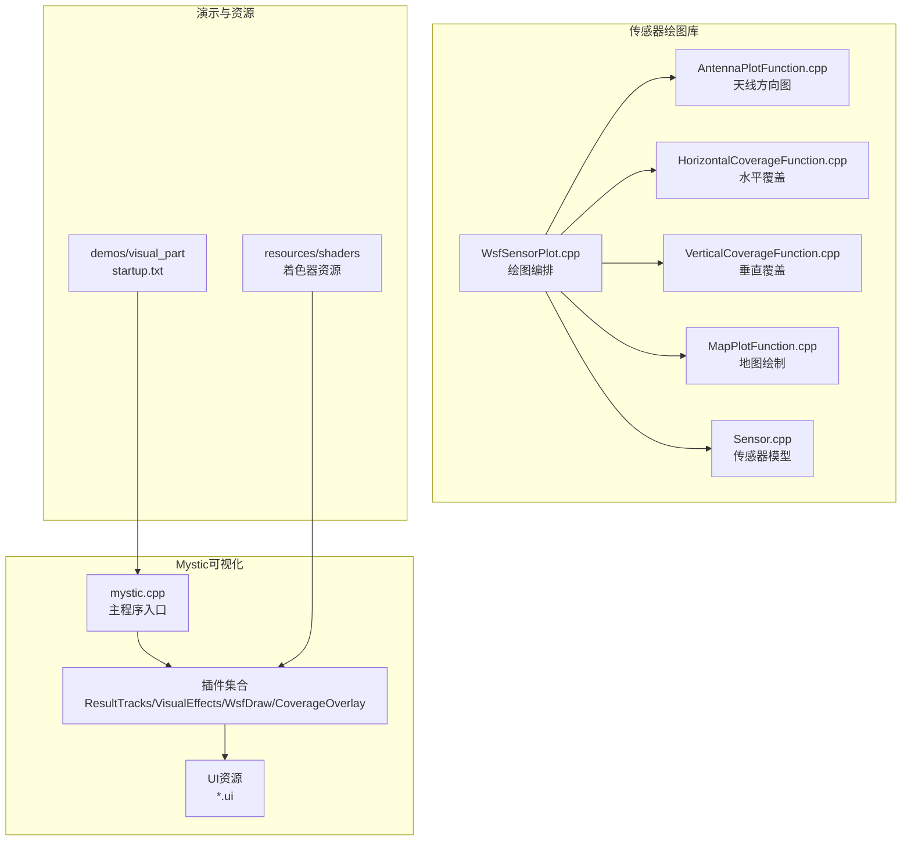
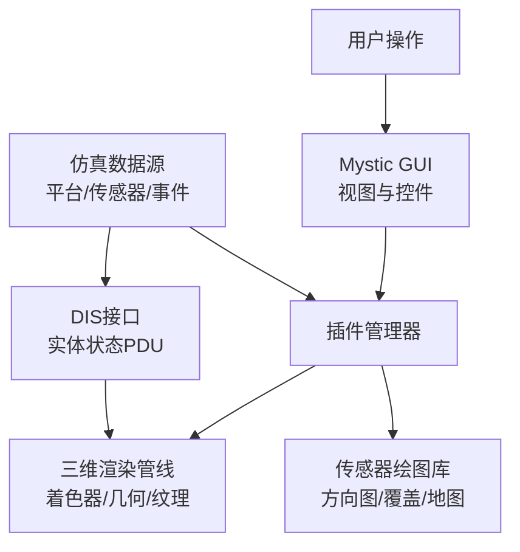
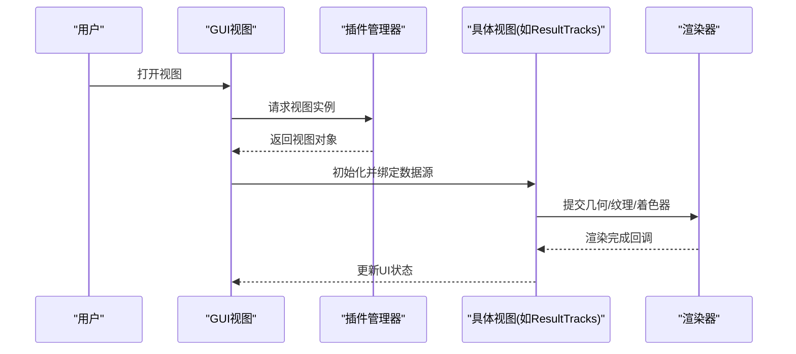
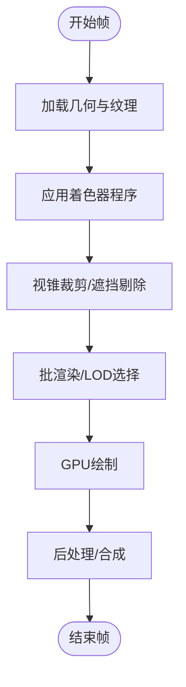
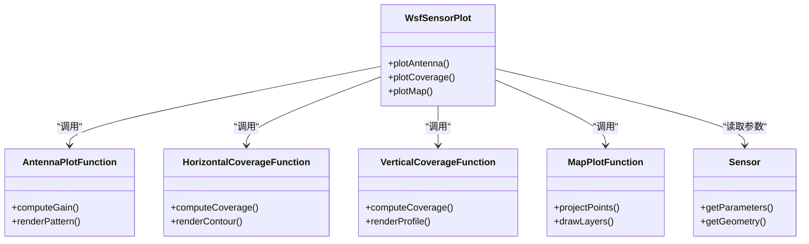
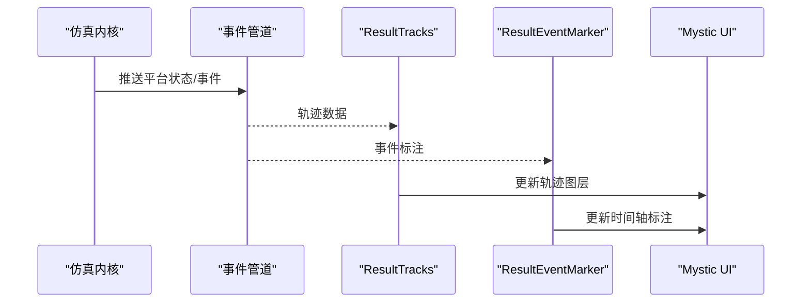
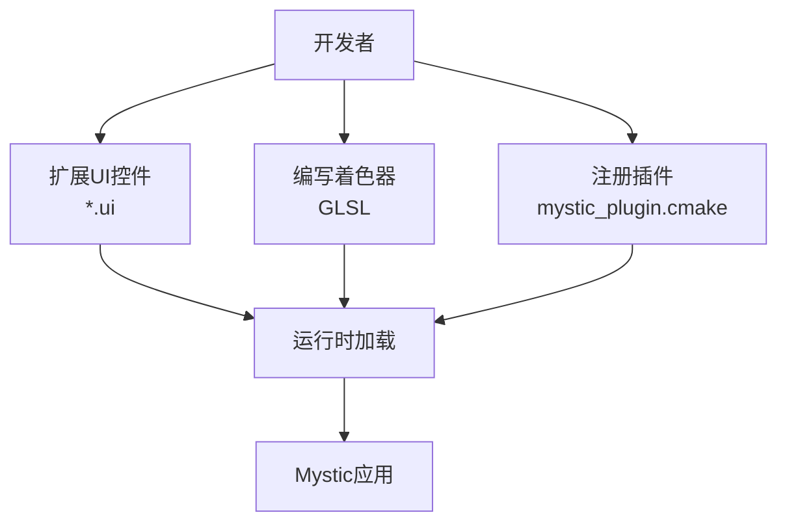
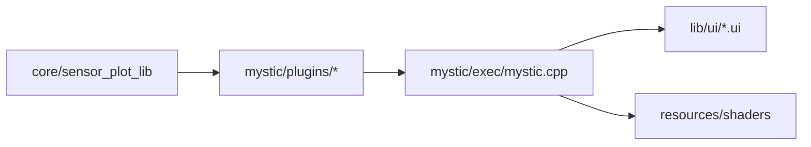

# 可视化系统

<cite>
**本文引用的文件**   
- [README.md](file://demos/visual_part/README.md)
- [startup.txt](file://demos/visual_part/startup.txt)
- [mystic.cpp](file://swdev/src/mystic/exec/source/mystic.cpp)
- [README.md](file://swdev/src/mystic/README.md)
- [RvChooserDialog.ui](file://swdev/src/mystic/lib/ui/RvChooserDialog.ui)
- [RvInterpolationPrefWidget.ui](file://swdev/src/mystic/lib/ui/RvInterpolationPrefWidget.ui)
- [RvMemoryPrefWidget.ui](file://swdev/src/mystic/lib/ui/RvMemoryPrefWidget.ui)
- [RvPlottingWidget.ui](file://swdev/src/mystic/lib/ui/RvPlottingWidget.ui)
- [ResultTracks.mystic_plugin.cmake](file://swdev/src/mystic/plugins/ResultTracks/mystic_plugin.cmake)
- [ResultVisualEffects.mystic_plugin.cmake](file://swdev/src/mystic/plugins/ResultVisualEffects/mystic_plugin.cmake)
- [ResultWsfDraw.mystic_plugin.cmake](file://swdev/src/mystic/plugins/ResultWsfDraw/mystic_plugin.cmake)
- [ResultCoverageOverlay.mystic_plugin.cmake](file://swdev/src/mystic/plugins/ResultCoverageOverlay/mystic_plugin.cmake)
- [AntennaPlotFunction.cpp](file://swdev/src/core/sensor_plot_lib/source/AntennaPlotFunction.cpp)
- [HorizontalCoverageFunction.cpp](file://swdev/src/core/sensor_plot_lib/source/HorizontalCoverageFunction.cpp)
- [VerticalCoverageFunction.cpp](file://swdev/src/core/sensor_plot_lib/source/VerticalCoverageFunction.cpp)
- [MapPlotFunction.cpp](file://swdev/src/core/sensor_plot_lib/source/MapPlotFunction.cpp)
- [Sensor.cpp](file://swdev/src/core/sensor_plot_lib/source/Sensor.cpp)
- [WsfSensorPlot.cpp](file://swdev/src/core/sensor_plot_lib/source/WsfSensorPlot.cpp)
</cite>

## 目录
1. [简介](#简介)
2. [项目结构](#项目结构)
3. [核心组件](#核心组件)
4. [架构总览](#架构总览)
5. [详细组件分析](#详细组件分析)
6. [依赖关系分析](#依赖关系分析)
7. [性能考虑](#性能考虑)
8. [故障排查指南](#故障排查指南)
9. [结论](#结论)
10. [附录](#附录)

## 简介
本文件面向AFSIM的可视化子系统，聚焦Mystic GUI界面、三维可视化引擎、传感器绘图工具、实时显示与回放能力，以及自定义可视化扩展方法。文档从系统架构、组件职责、数据流与交互流程入手，结合仓库中的示例与源码路径，提供可操作的配置示例与最佳实践，帮助读者快速搭建并优化可视化场景。

## 项目结构
AFSIM可视化相关代码主要分布在以下区域：
- swdev/src/mystic：Mystic主程序入口、插件框架与UI资源
- swdev/src/core/sensor_plot_lib：传感器绘图库（天线方向图、覆盖范围、地图投影等）
- demos/visual_part：可视化部件演示（DIS实体状态发布、可视部件更新）
- resources/shaders：图形渲染着色器资源（供三维引擎使用）

图示来源
- [mystic.cpp:1-200](file://swdev/src/mystic/exec/source/mystic.cpp#L1-L200)
- [ResultTracks.mystic_plugin.cmake:1-50](file://swdev/src/mystic/plugins/ResultTracks/mystic_plugin.cmake#L1-L50)
- [ResultVisualEffects.mystic_plugin.cmake:1-50](file://swdev/src/mystic/plugins/ResultVisualEffects/mystic_plugin.cmake#L1-L50)
- [ResultWsfDraw.mystic_plugin.cmake:1-50](file://swdev/src/mystic/plugins/ResultWsfDraw/mystic_plugin.cmake#L1-L50)
- [ResultCoverageOverlay.mystic_plugin.cmake:1-50](file://swdev/src/mystic/plugins/ResultCoverageOverlay/mystic_plugin.cmake#L1-L50)
- [RvChooserDialog.ui:1-200](file://swdev/src/mystic/lib/ui/RvChooserDialog.ui#L1-L200)
- [RvInterpolationPrefWidget.ui:1-200](file://swdev/src/mystic/lib/ui/RvInterpolationPrefWidget.ui#L1-L200)
- [RvMemoryPrefWidget.ui:1-200](file://swdev/src/mystic/lib/ui/RvMemoryPrefWidget.ui#L1-L200)
- [RvPlottingWidget.ui:1-200](file://swdev/src/mystic/lib/ui/RvPlottingWidget.ui#L1-L200)
- [WsfSensorPlot.cpp:1-200](file://swdev/src/core/sensor_plot_lib/source/WsfSensorPlot.cpp#L1-L200)
- [AntennaPlotFunction.cpp:1-200](file://swdev/src/core/sensor_plot_lib/source/AntennaPlotFunction.cpp#L1-L200)
- [HorizontalCoverageFunction.cpp:1-200](file://swdev/src/core/sensor_plot_lib/source/HorizontalCoverageFunction.cpp#L1-L200)
- [VerticalCoverageFunction.cpp:1-200](file://swdev/src/core/sensor_plot_lib/source/VerticalCoverageFunction.cpp#L1-L200)
- [MapPlotFunction.cpp:1-200](file://swdev/src/core/sensor_plot_lib/source/MapPlotFunction.cpp#L1-L200)
- [Sensor.cpp:1-200](file://swdev/src/core/sensor_plot_lib/source/Sensor.cpp#L1-L200)
- [startup.txt:1-26](file://demos/visual_part/startup.txt#L1-L26)

章节来源
- [README.md:1-51](file://demos/visual_part/README.md#L1-L51)
- [startup.txt:1-26](file://demos/visual_part/startup.txt#L1-L26)
- [README.md:1-35](file://swdev/src/mystic/README.md#L1-L35)

## 核心组件
- Mystic主程序与插件框架
  - 负责GUI生命周期、插件加载、视图管理、事件分发与脚本接口。
  - 通过插件机制扩展功能，如轨迹显示、视觉效果、WSF绘图、覆盖层叠加等。
- UI资源与偏好设置
  - 基于Qt的UI布局与偏好控件，包括视图选择对话框、插值偏好、内存管理与绘图控件。
- 传感器绘图库
  - 提供天线方向图、雷达包络、覆盖范围（水平/垂直）、地图投影与变量计算等能力。
- 可视化部件演示
  - 展示如何发布可视部件到DIS，并通过事件管道控制更新频率。

章节来源
- [mystic.cpp:1-200](file://swdev/src/mystic/exec/source/mystic.cpp#L1-L200)
- [RvChooserDialog.ui:1-200](file://swdev/src/mystic/lib/ui/RvChooserDialog.ui#L1-L200)
- [RvInterpolationPrefWidget.ui:1-200](file://swdev/src/mystic/lib/ui/RvInterpolationPrefWidget.ui#L1-L200)
- [RvMemoryPrefWidget.ui:1-200](file://swdev/src/mystic/lib/ui/RvMemoryPrefWidget.ui#L1-L200)
- [RvPlottingWidget.ui:1-200](file://swdev/src/mystic/lib/ui/RvPlottingWidget.ui#L1-L200)
- [WsfSensorPlot.cpp:1-200](file://swdev/src/core/sensor_plot_lib/source/WsfSensorPlot.cpp#L1-L200)
- [AntennaPlotFunction.cpp:1-200](file://swdev/src/core/sensor_plot_lib/source/AntennaPlotFunction.cpp#L1-L200)
- [HorizontalCoverageFunction.cpp:1-200](file://swdev/src/core/sensor_plot_lib/source/HorizontalCoverageFunction.cpp#L1-L200)
- [VerticalCoverageFunction.cpp:1-200](file://swdev/src/core/sensor_plot_lib/source/VerticalCoverageFunction.cpp#L1-L200)
- [MapPlotFunction.cpp:1-200](file://swdev/src/core/sensor_plot_lib/source/MapPlotFunction.cpp#L1-L200)
- [Sensor.cpp:1-200](file://swdev/src/core/sensor_plot_lib/source/Sensor.cpp#L1-L200)
- [startup.txt:1-26](file://demos/visual_part/startup.txt#L1-L26)

## 架构总览
Mystic可视化系统采用“主程序+插件”的架构，GUI与渲染解耦，传感器绘图作为独立库被上层调用。

图示来源
- [mystic.cpp:1-200](file://swdev/src/mystic/exec/source/mystic.cpp#L1-L200)
- [ResultTracks.mystic_plugin.cmake:1-50](file://swdev/src/mystic/plugins/ResultTracks/mystic_plugin.cmake#L1-L50)
- [ResultVisualEffects.mystic_plugin.cmake:1-50](file://swdev/src/mystic/plugins/ResultVisualEffects/mystic_plugin.cmake#L1-L50)
- [ResultWsfDraw.mystic_plugin.cmake:1-50](file://swdev/src/mystic/plugins/ResultWsfDraw/mystic_plugin.cmake#L1-L50)
- [ResultCoverageOverlay.mystic_plugin.cmake:1-50](file://swdev/src/mystic/plugins/ResultCoverageOverlay/mystic_plugin.cmake#L1-L50)
- [WsfSensorPlot.cpp:1-200](file://swdev/src/core/sensor_plot_lib/source/WsfSensorPlot.cpp#L1-L200)
- [startup.txt:1-26](file://demos/visual_part/startup.txt#L1-L26)

## 详细组件分析

### Mystic GUI界面与交互模式
- 主界面布局
  - 视图选择对话框用于切换不同结果视图（如轨迹、态势、轨道等）。
  - 绘图控件支持多图层叠加、缩放平移、时间轴控制。
  - 偏好设置包含插值策略、内存管理与渲染质量选项。
- 视图控制与交互
  - 通过插件注册视图类型，GUI根据当前场景动态加载可用视图。
  - 鼠标与键盘事件映射到视图控制器，实现旋转、缩放、框选、标注等操作。
  - 时间控制器支持播放、暂停、步进与回放定位。

图示来源
- [RvChooserDialog.ui:1-200](file://swdev/src/mystic/lib/ui/RvChooserDialog.ui#L1-L200)
- [RvPlottingWidget.ui:1-200](file://swdev/src/mystic/lib/ui/RvPlottingWidget.ui#L1-L200)
- [ResultTracks.mystic_plugin.cmake:1-50](file://swdev/src/mystic/plugins/ResultTracks/mystic_plugin.cmake#L1-L50)

章节来源
- [RvChooserDialog.ui:1-200](file://swdev/src/mystic/lib/ui/RvChooserDialog.ui#L1-L200)
- [RvInterpolationPrefWidget.ui:1-200](file://swdev/src/mystic/lib/ui/RvInterpolationPrefWidget.ui#L1-L200)
- [RvMemoryPrefWidget.ui:1-200](file://swdev/src/mystic/lib/ui/RvMemoryPrefWidget.ui#L1-L200)
- [RvPlottingWidget.ui:1-200](file://swdev/src/mystic/lib/ui/RvPlottingWidget.ui#L1-L200)

### 三维可视化引擎与渲染管线
- 渲染管线
  - 几何装配：将平台、地形、传感器体积等几何体组织为场景图。
  - 材质与着色器：使用resources/shaders下的GLSL程序进行光照、阴影、雾效与后处理。
  - 批渲染与LOD：对大量目标进行合并绘制与细节层次控制，降低CPU/GPU压力。
- 图形优化
  - 视锥裁剪与遮挡剔除减少无效绘制。
  - 纹理压缩与图集减少显存占用。
  - 多线程渲染与异步IO提升吞吐。

图示来源
- [ResultVisualEffects.mystic_plugin.cmake:1-50](file://swdev/src/mystic/plugins/ResultVisualEffects/mystic_plugin.cmake#L1-L50)

章节来源
- [ResultVisualEffects.mystic_plugin.cmake:1-50](file://swdev/src/mystic/plugins/ResultVisualEffects/mystic_plugin.cmake#L1-L50)

### 传感器绘图工具
- 天线方向图绘制
  - 基于AntennaPlotFunction计算方位/俯仰增益曲线，支持极坐标与直角坐标输出。
- 检测概率分析
  - 结合雷达包络与杂波表函数，评估在不同距离/角度下的探测概率。
- 覆盖范围可视化
  - HorizontalCoverageFunction与VerticalCoverageFunction生成水平/垂直覆盖面，叠加于地图或球面投影。
- 地图投影与变量
  - MapPlotFunction提供多种投影方式，MapPlotVariables管理绘图变量与样式。

图示来源
- [WsfSensorPlot.cpp:1-200](file://swdev/src/core/sensor_plot_lib/source/WsfSensorPlot.cpp#L1-L200)
- [AntennaPlotFunction.cpp:1-200](file://swdev/src/core/sensor_plot_lib/source/AntennaPlotFunction.cpp#L1-L200)
- [HorizontalCoverageFunction.cpp:1-200](file://swdev/src/core/sensor_plot_lib/source/HorizontalCoverageFunction.cpp#L1-L200)
- [VerticalCoverageFunction.cpp:1-200](file://swdev/src/core/sensor_plot_lib/source/VerticalCoverageFunction.cpp#L1-L200)
- [MapPlotFunction.cpp:1-200](file://swdev/src/core/sensor_plot_lib/source/MapPlotFunction.cpp#L1-L200)
- [Sensor.cpp:1-200](file://swdev/src/core/sensor_plot_lib/source/Sensor.cpp#L1-L200)

章节来源
- [WsfSensorPlot.cpp:1-200](file://swdev/src/core/sensor_plot_lib/source/WsfSensorPlot.cpp#L1-L200)
- [AntennaPlotFunction.cpp:1-200](file://swdev/src/core/sensor_plot_lib/source/AntennaPlotFunction.cpp#L1-L200)
- [HorizontalCoverageFunction.cpp:1-200](file://swdev/src/core/sensor_plot_lib/source/HorizontalCoverageFunction.cpp#L1-L200)
- [VerticalCoverageFunction.cpp:1-200](file://swdev/src/core/sensor_plot_lib/source/VerticalCoverageFunction.cpp#L1-L200)
- [MapPlotFunction.cpp:1-200](file://swdev/src/core/sensor_plot_lib/source/MapPlotFunction.cpp#L1-L200)
- [Sensor.cpp:1-200](file://swdev/src/core/sensor_plot_lib/source/Sensor.cpp#L1-L200)

### 实时显示与回放
- 轨迹跟踪
  - ResultTracks插件订阅平台位置与姿态数据，实时更新轨迹线与标记。
- 状态监控
  - 通过ResultPlatformData/ResultStatistics等插件展示关键指标与统计图表。
- 事件标注
  - ResultEventMarker在时间轴上标注关键事件点，支持回放跳转与高亮。

图示来源
- [ResultTracks.mystic_plugin.cmake:1-50](file://swdev/src/mystic/plugins/ResultTracks/mystic_plugin.cmake#L1-L50)
- [ResultEventMarker.mystic_plugin.cmake:1-50](file://swdev/src/mystic/plugins/ResultEventMarker/mystic_plugin.cmake#L1-L50)

章节来源
- [ResultTracks.mystic_plugin.cmake:1-50](file://swdev/src/mystic/plugins/ResultTracks/mystic_plugin.cmake#L1-L50)
- [ResultEventMarker.mystic_plugin.cmake:1-50](file://swdev/src/mystic/plugins/ResultEventMarker/mystic_plugin.cmake#L1-L50)

### 自定义可视化开发方法
- GUI控件扩展
  - 基于现有*.ui模板创建新控件，继承基类并注册到插件管理器。
  - 在RvPlottingWidget中集成自定义图层与交互逻辑。
- 图形渲染定制
  - 编写新的着色器程序并放入resources/shaders，通过ResultVisualEffects或自定义插件接入渲染管线。
  - 使用ResultWsfDraw扩展二维绘图能力，结合传感器绘图库生成专业图表。

图示来源
- [RvPlottingWidget.ui:1-200](file://swdev/src/mystic/lib/ui/RvPlottingWidget.ui#L1-L200)
- [ResultWsfDraw.mystic_plugin.cmake:1-50](file://swdev/src/mystic/plugins/ResultWsfDraw/mystic_plugin.cmake#L1-L50)

章节来源
- [RvPlottingWidget.ui:1-200](file://swdev/src/mystic/lib/ui/RvPlottingWidget.ui#L1-L200)
- [ResultWsfDraw.mystic_plugin.cmake:1-50](file://swdev/src/mystic/plugins/ResultWsfDraw/mystic_plugin.cmake#L1-L50)

## 依赖关系分析
- 组件耦合
  - Mystic主程序与插件松耦合，通过插件接口通信；UI与渲染分离，便于替换后端。
  - 传感器绘图库独立于GUI，可被其他工具复用。
- 外部依赖
  - Qt用于GUI构建；OpenGL/GLSL用于渲染；DIS协议用于跨仿真互操作。
- 循环依赖
  - 插件之间避免直接依赖，统一通过插件管理器与数据总线交互。

图示来源
- [mystic.cpp:1-200](file://swdev/src/mystic/exec/source/mystic.cpp#L1-L200)
- [WsfSensorPlot.cpp:1-200](file://swdev/src/core/sensor_plot_lib/source/WsfSensorPlot.cpp#L1-L200)

章节来源
- [mystic.cpp:1-200](file://swdev/src/mystic/exec/source/mystic.cpp#L1-L200)
- [WsfSensorPlot.cpp:1-200](file://swdev/src/core/sensor_plot_lib/source/WsfSensorPlot.cpp#L1-L200)

## 性能考虑
- 渲染优化
  - 启用视锥裁剪与遮挡剔除，减少无效绘制。
  - 使用纹理图集与压缩格式降低显存带宽压力。
  - 对大规模目标采用批渲染与LOD策略。
- 数据流优化
  - 合理设置事件管道更新间隔，避免高频刷新导致卡顿。
  - 按需加载传感器数据与地图资源，减少I/O瓶颈。
- 内存管理
  - 通过RvMemoryPrefWidget调整缓存大小与回收策略。
  - 及时释放不再使用的几何与纹理对象。

[本节为通用指导，不直接分析具体文件]

## 故障排查指南
- 常见问题
  - 视图无法加载：检查插件是否正确注册与依赖是否满足。
  - 渲染异常：确认着色器编译成功且资源路径正确。
  - 轨迹不更新：核查事件管道配置与更新间隔设置。
- 调试建议
  - 启用日志输出，定位插件加载与数据订阅失败原因。
  - 使用ResultPerformance插件观察帧率与资源占用。
  - 逐步禁用插件以隔离问题模块。

章节来源
- [ResultPerformance.mystic_plugin.cmake:1-50](file://swdev/src/mystic/plugins/ResultPerformance/mystic_plugin.cmake#L1-L50)

## 结论
AFSIM可视化系统以Mystic为核心，通过插件化架构与独立的传感器绘图库，提供了灵活的GUI交互、强大的三维渲染与专业的传感器分析能力。结合演示场景与源码路径，用户可快速搭建可视化环境并进行二次开发。遵循本文的性能优化与调试建议，可获得稳定高效的可视化体验。

[本节为总结性内容，不直接分析具体文件]

## 附录
- 常用可视化场景配置示例
  - 可视化部件演示
    - 启动脚本包含仿真名称、文件路径、平台引入、事件管道与结束时间等关键配置。
    - 通过event_pipe设置visual_part_update_interval控制可视部件更新频率。
  - 传感器绘图
    - 使用WsfSensorPlot编排天线方向图与覆盖范围绘制，结合MapPlotFunction输出地图视图。
  - 轨迹与事件标注
    - 启用ResultTracks与ResultEventMarker，配合时间控制器实现回放与标注。

章节来源
- [startup.txt:1-26](file://demos/visual_part/startup.txt#L1-L26)
- [WsfSensorPlot.cpp:1-200](file://swdev/src/core/sensor_plot_lib/source/WsfSensorPlot.cpp#L1-L200)
- [ResultTracks.mystic_plugin.cmake:1-50](file://swdev/src/mystic/plugins/ResultTracks/mystic_plugin.cmake#L1-L50)
- [ResultEventMarker.mystic_plugin.cmake:1-50](file://swdev/src/mystic/plugins/ResultEventMarker/mystic_plugin.cmake#L1-L50)