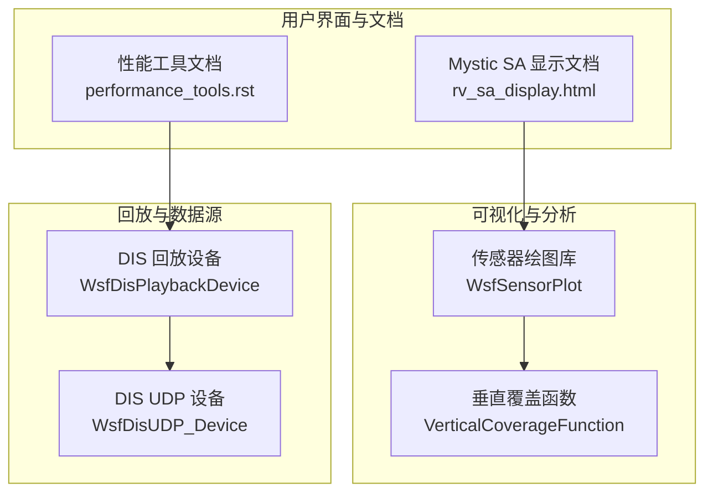
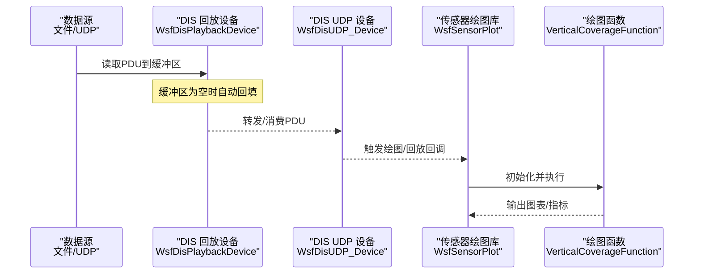
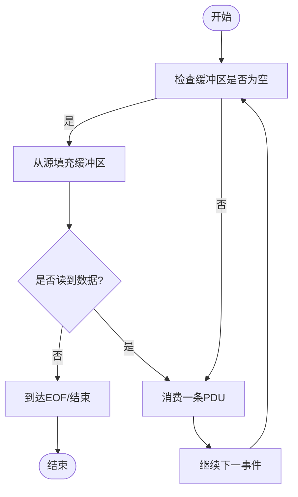
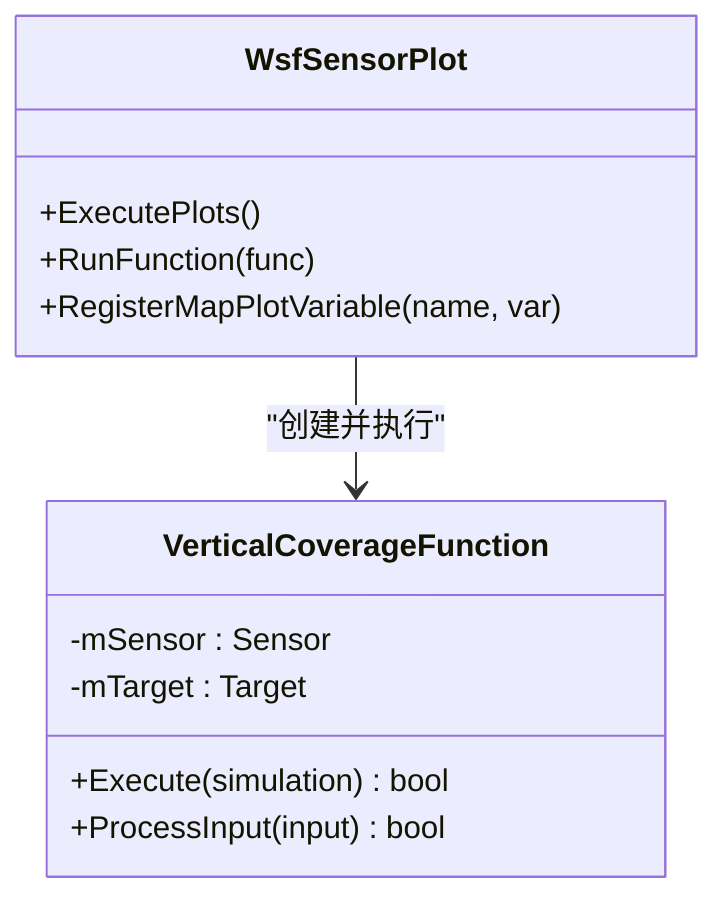
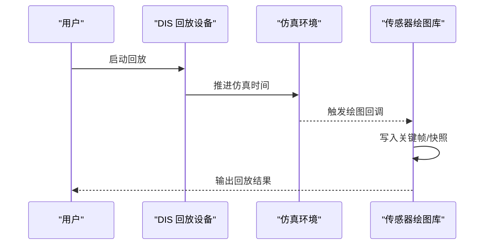
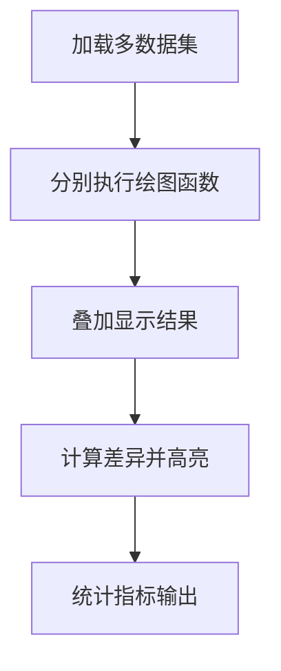
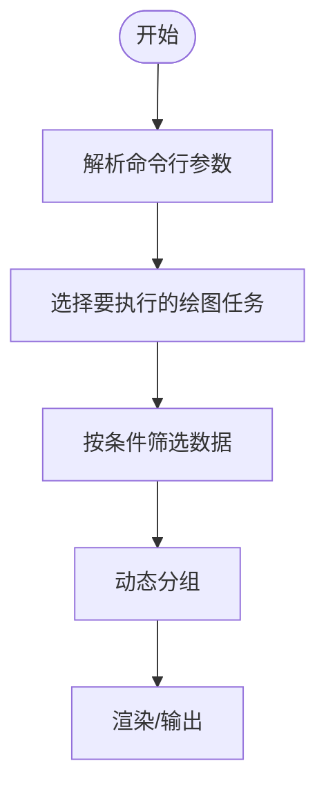
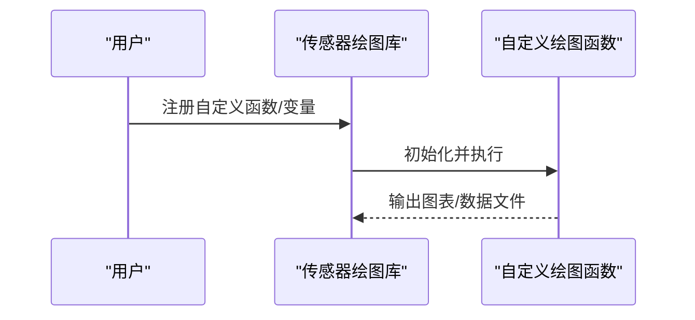
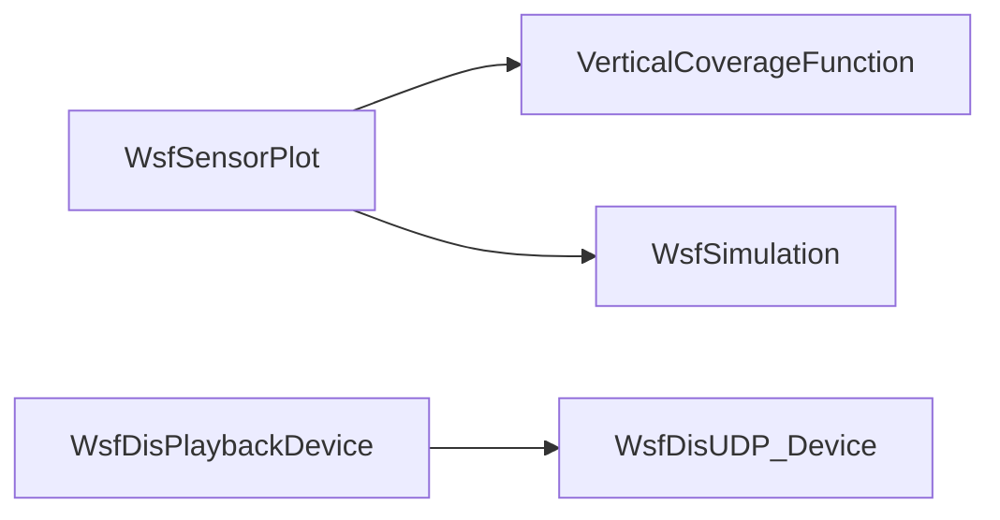
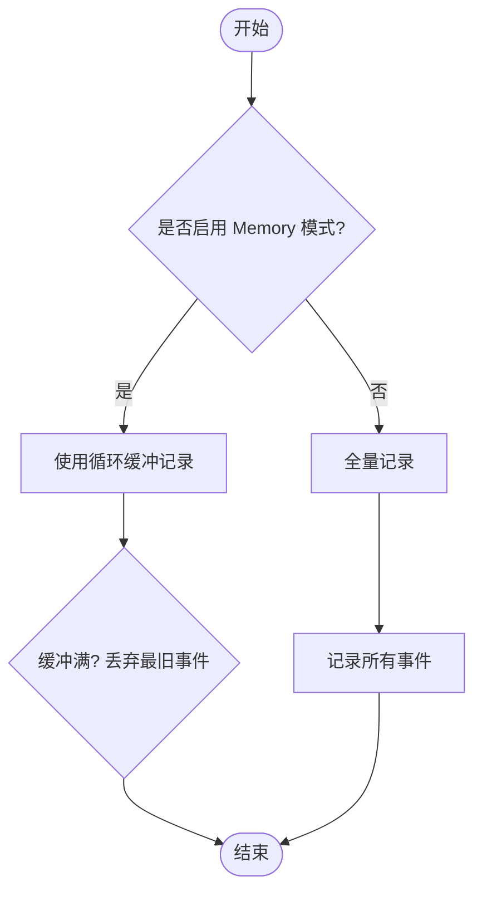

# 数据显示与回放

<cite>
**本文引用的文件**   
- [WsfSensorPlot.cpp](file://swdev/src/core/sensor_plot_lib/source/WsfSensorPlot.cpp)
- [VerticalCoverageFunction.hpp](file://swdev/src/core/sensor_plot_lib/source/VerticalCoverageFunction.hpp)
- [WsfDisPlaybackDevice.cpp](file://swdev/src/core/wsf/source/dis/WsfDisPlaybackDevice.cpp)
- [WsfDisUDP_Device.cpp](file://swdev/src/core/wsf/source/dis/WsfDisUDP_Device.cpp)
- [performance_tools.rst](file://swdev/src/doc/developer/performance_tools.rst)
- [rv_sa_display.html](file://documentation/html/docs/wkf_plugin/rv_sa_display.html)
</cite>

## 目录
1. [简介](#简介)
2. [项目结构](#项目结构)
3. [核心组件](#核心组件)
4. [架构总览](#架构总览)
5. [详细组件分析](#详细组件分析)
6. [依赖关系分析](#依赖关系分析)
7. [性能考虑](#性能考虑)
8. [故障排查指南](#故障排查指南)
9. [结论](#结论)
10. [附录](#附录)

## 简介
本文件面向“数据显示与回放”能力，覆盖以下主题：
- 实时数据流处理机制：事件管道、数据缓冲与增量更新
- 轨迹跟踪可视化：路径绘制、运动状态显示与预测轨迹
- 历史数据回放：时间轴控制、关键帧标记与状态快照
- 多数据集对比分析：叠加显示、差异高亮与统计分析
- 数据过滤与选择：条件筛选、属性查询与动态分组
- 数据导出与自定义图表生成
- 大数据集优化策略与内存管理技巧

## 项目结构
围绕“数据显示与回放”，仓库中与可视化、回放与数据处理相关的核心位置包括：
- 传感器绘图库（sensor_plot_lib）：提供多种绘图函数与执行框架，用于离线或批量的数据可视化与分析
- WSF DIS 回放设备：负责从文件或网络读取并回放 DIS 数据包，包含缓冲区管理与填充逻辑
- Wizard UI 文档（Mystic SA Display）：描述态势显示中的可见性开关、航路、组、真实/感知实体等可视化元素
- 开发者性能工具文档：说明循环缓冲与内存模式下的记录行为

**图示来源**
- [WsfSensorPlot.cpp:145-179](file://swdev/src/core/sensor_plot_lib/source/WsfSensorPlot.cpp#L145-L179)
- [VerticalCoverageFunction.hpp:21-51](file://swdev/src/core/sensor_plot_lib/source/VerticalCoverageFunction.hpp#L21-L51)
- [WsfDisPlaybackDevice.cpp:192-206](file://swdev/src/core/wsf/source/dis/WsfDisPlaybackDevice.cpp#L192-L206)
- [WsfDisUDP_Device.cpp:130-134](file://swdev/src/core/wsf/source/dis/WsfDisUDP_Device.cpp#L130-L134)
- [rv_sa_display.html:154-173](file://documentation/html/docs/wkf_plugin/rv_sa_display.html#L154-L173)
- [performance_tools.rst:76-76](file://swdev/src/doc/developer/performance_tools.rst#L76-L76)

**章节来源**
- [WsfSensorPlot.cpp:145-179](file://swdev/src/core/sensor_plot_lib/source/WsfSensorPlot.cpp#L145-L179)
- [VerticalCoverageFunction.hpp:21-51](file://swdev/src/core/sensor_plot_lib/source/VerticalCoverageFunction.hpp#L21-L51)
- [WsfDisPlaybackDevice.cpp:192-206](file://swdev/src/core/wsf/source/dis/WsfDisPlaybackDevice.cpp#L192-L206)
- [WsfDisUDP_Device.cpp:130-134](file://swdev/src/core/wsf/source/dis/WsfDisUDP_Device.cpp#L130-L134)
- [rv_sa_display.html:154-173](file://documentation/html/docs/wkf_plugin/rv_sa_display.html#L154-L173)
- [performance_tools.rst:76-76](file://swdev/src/doc/developer/performance_tools.rst#L76-L76)

## 核心组件
- 传感器绘图库（WsfSensorPlot）
  - 功能：注册绘图函数、解析输入块、按名称或编号执行指定绘图任务、在仿真环境中运行函数并输出结果
  - 关键点：支持批量/选择性执行；为地图类函数注册变量扩展；封装仿真生命周期（Initialize/Start/Complete）
- 垂直覆盖函数（VerticalCoverageFunction）
  - 功能：计算传感器垂直覆盖范围，输出最大高度/距离等指标
  - 关键点：参数化扫描范围、步长、单位；与 Sensor/Target 模型交互
- DIS 回放设备（WsfDisPlaybackDevice）
  - 功能：从文件/流中读取 DIS PDU，维护内部缓冲区，按需填充并消费
  - 关键点：缓冲区为空时自动回填；EOF 检测与错误处理
- DIS UDP 设备（WsfDisUDP_Device）
  - 功能：通过 UDP 接收 DIS 数据，检查缓冲区是否有剩余数据，必要时重新填充
- Mystic SA 显示文档（rv_sa_display.html）
  - 功能：描述态势图上的可见性开关、航路、组、真实/感知实体等可视化元素
- 性能工具文档（performance_tools.rst）
  - 功能：说明“Memory”模式下使用循环缓冲记录数据，超出容量后丢弃最旧事件

**章节来源**
- [WsfSensorPlot.cpp:145-179](file://swdev/src/core/sensor_plot_lib/source/WsfSensorPlot.cpp#L145-L179)
- [WsfSensorPlot.cpp:217-253](file://swdev/src/core/sensor_plot_lib/source/WsfSensorPlot.cpp#L217-L253)
- [WsfSensorPlot.cpp:274-308](file://swdev/src/core/sensor_plot_lib/source/WsfSensorPlot.cpp#L274-L308)
- [VerticalCoverageFunction.hpp:21-51](file://swdev/src/core/sensor_plot_lib/source/VerticalCoverageFunction.hpp#L21-L51)
- [WsfDisPlaybackDevice.cpp:192-206](file://swdev/src/core/wsf/source/dis/WsfDisPlaybackDevice.cpp#L192-L206)
- [WsfDisUDP_Device.cpp:130-134](file://swdev/src/core/wsf/source/dis/WsfDisUDP_Device.cpp#L130-L134)
- [rv_sa_display.html:154-173](file://documentation/html/docs/wkf_plugin/rv_sa_display.html#L154-L173)
- [performance_tools.rst:76-76](file://swdev/src/doc/developer/performance_tools.rst#L76-L76)

## 架构总览
下图展示“数据显示与回放”的整体数据流：外部数据源（文件/UDP）经回放设备进入系统，驱动可视化与回放流程；同时，传感器绘图库提供离线/批量的数据分析与图表生成能力。

**图示来源**
- [WsfDisPlaybackDevice.cpp:192-206](file://swdev/src/core/wsf/source/dis/WsfDisPlaybackDevice.cpp#L192-L206)
- [WsfDisUDP_Device.cpp:130-134](file://swdev/src/core/wsf/source/dis/WsfDisUDP_Device.cpp#L130-L134)
- [WsfSensorPlot.cpp:217-253](file://swdev/src/core/sensor_plot_lib/source/WsfSensorPlot.cpp#L217-L253)
- [VerticalCoverageFunction.hpp:21-51](file://swdev/src/core/sensor_plot_lib/source/VerticalCoverageFunction.hpp#L21-L51)

## 详细组件分析

### 实时数据流处理机制（事件管道、数据缓冲、增量更新）
- 事件管道
  - DIS 回放设备负责从文件/流中读取 PDU，并在缓冲区耗尽时自动回填，形成稳定的事件管道
  - UDP 设备检查缓冲区是否仍有数据，若无则重新填充，保证持续的数据流
- 数据缓冲
  - 回放设备在首次调用或上次调用已消费完缓冲区时尝试再次填充
  - UDP 设备在每次请求前判断缓冲区剩余量，避免空读
- 增量更新
  - 绘图库在执行具体函数时，基于当前仿真时间与平台可用性进行增量渲染与统计
  - 可通过命令参数选择性执行特定绘图任务，减少不必要的计算

**图示来源**
- [WsfDisPlaybackDevice.cpp:192-206](file://swdev/src/core/wsf/source/dis/WsfDisPlaybackDevice.cpp#L192-L206)
- [WsfDisUDP_Device.cpp:130-134](file://swdev/src/core/wsf/source/dis/WsfDisUDP_Device.cpp#L130-L134)

**章节来源**
- [WsfDisPlaybackDevice.cpp:192-206](file://swdev/src/core/wsf/source/dis/WsfDisPlaybackDevice.cpp#L192-L206)
- [WsfDisUDP_Device.cpp:130-134](file://swdev/src/core/wsf/source/dis/WsfDisUDP_Device.cpp#L130-L134)

### 轨迹跟踪可视化（路径绘制、运动状态显示、预测轨迹）
- 路径绘制
  - 态势图中可显示平台航路与航点，便于观察轨迹走向
- 运动状态显示
  - 右侧信息区展示本机运动学数据（如高度、速度、马赫数、过载等），辅助理解瞬时运动状态
- 预测轨迹
  - 结合传感器覆盖与目标模型，可在绘图函数中计算并输出预测覆盖区域或包络线

**图示来源**
- [WsfSensorPlot.cpp:217-253](file://swdev/src/core/sensor_plot_lib/source/WsfSensorPlot.cpp#L217-L253)
- [WsfSensorPlot.cpp:274-308](file://swdev/src/core/sensor_plot_lib/source/WsfSensorPlot.cpp#L274-L308)
- [VerticalCoverageFunction.hpp:21-51](file://swdev/src/core/sensor_plot_lib/source/VerticalCoverageFunction.hpp#L21-L51)

**章节来源**
- [rv_sa_display.html:154-173](file://documentation/html/docs/wkf_plugin/rv_sa_display.html#L154-L173)
- [WsfSensorPlot.cpp:217-253](file://swdev/src/core/sensor_plot_lib/source/WsfSensorPlot.cpp#L217-L253)
- [VerticalCoverageFunction.hpp:21-51](file://swdev/src/core/sensor_plot_lib/source/VerticalCoverageFunction.hpp#L21-L51)

### 历史数据回放（时间轴控制、关键帧标记、状态快照）
- 时间轴控制
  - 通过回放设备按时间顺序消费事件，实现回放的时间推进
- 关键帧标记
  - 可在绘图函数中根据时间戳或事件类型插入关键帧标记，便于后续分析与定位
- 状态快照
  - 在仿真生命周期（Initialize/Start/Complete）中保存平台状态快照，供回放时重建场景

**图示来源**
- [WsfDisPlaybackDevice.cpp:192-206](file://swdev/src/core/wsf/source/dis/WsfDisPlaybackDevice.cpp#L192-L206)
- [WsfSensorPlot.cpp:274-308](file://swdev/src/core/sensor_plot_lib/source/WsfSensorPlot.cpp#L274-L308)

**章节来源**
- [WsfDisPlaybackDevice.cpp:192-206](file://swdev/src/core/wsf/source/dis/WsfDisPlaybackDevice.cpp#L192-L206)
- [WsfSensorPlot.cpp:274-308](file://swdev/src/core/sensor_plot_lib/source/WsfSensorPlot.cpp#L274-L308)

### 多数据集对比分析（叠加显示、差异高亮、统计分析）
- 叠加显示
  - 通过多个绘图函数并行执行，将不同数据集的结果叠加在同一坐标系中比较
- 差异高亮
  - 在绘图函数中计算差值并输出高亮区域或阈值告警
- 统计分析
  - 利用覆盖函数输出最大高度/距离等指标，进行跨数据集的统计对比

**图示来源**
- [WsfSensorPlot.cpp:217-253](file://swdev/src/core/sensor_plot_lib/source/WsfSensorPlot.cpp#L217-L253)
- [VerticalCoverageFunction.hpp:21-51](file://swdev/src/core/sensor_plot_lib/source/VerticalCoverageFunction.hpp#L21-L51)

**章节来源**
- [WsfSensorPlot.cpp:217-253](file://swdev/src/core/sensor_plot_lib/source/WsfSensorPlot.cpp#L217-L253)
- [VerticalCoverageFunction.hpp:21-51](file://swdev/src/core/sensor_plot_lib/source/VerticalCoverageFunction.hpp#L21-L51)

### 数据过滤与选择（条件筛选、属性查询、动态分组）
- 条件筛选
  - 通过命令行参数选择要执行的绘图任务（名称或编号），实现按需处理
- 属性查询
  - 在绘图函数中访问平台/目标属性，进行过滤与聚合
- 动态分组
  - 态势图中支持“组”的可视化，依据感知或真实实体进行分组显示

**图示来源**
- [WsfSensorPlot.cpp:77-113](file://swdev/src/core/sensor_plot_lib/source/WsfSensorPlot.cpp#L77-L113)
- [rv_sa_display.html:160-173](file://documentation/html/docs/wkf_plugin/rv_sa_display.html#L160-L173)

**章节来源**
- [WsfSensorPlot.cpp:77-113](file://swdev/src/core/sensor_plot_lib/source/WsfSensorPlot.cpp#L77-L113)
- [rv_sa_display.html:160-173](file://documentation/html/docs/wkf_plugin/rv_sa_display.html#L160-L173)

### 数据导出与自定义图表生成
- 数据导出
  - 绘图函数可将计算结果输出为文件（例如覆盖范围、包络线、统计表）
- 自定义图表
  - 通过注册新的绘图函数与地图变量扩展，定制专属图表与可视化样式

**图示来源**
- [WsfSensorPlot.cpp:166-179](file://swdev/src/core/sensor_plot_lib/source/WsfSensorPlot.cpp#L166-L179)
- [WsfSensorPlot.cpp:274-308](file://swdev/src/core/sensor_plot_lib/source/WsfSensorPlot.cpp#L274-L308)

**章节来源**
- [WsfSensorPlot.cpp:166-179](file://swdev/src/core/sensor_plot_lib/source/WsfSensorPlot.cpp#L166-L179)
- [WsfSensorPlot.cpp:274-308](file://swdev/src/core/sensor_plot_lib/source/WsfSensorPlot.cpp#L274-L308)

## 依赖关系分析
- 组件耦合
  - 传感器绘图库依赖具体的绘图函数（如垂直覆盖函数）完成计算与输出
  - 回放设备与 UDP 设备共同构成数据源层，为上层可视化提供稳定事件流
- 外部依赖
  - 仿真框架（WsfSimulation）提供生命周期钩子，供绘图函数在合适时机执行
- 潜在循环依赖
  - 绘图函数仅依赖传感器/目标模型，不反向依赖回放设备，降低耦合度

**图示来源**
- [WsfSensorPlot.cpp:217-253](file://swdev/src/core/sensor_plot_lib/source/WsfSensorPlot.cpp#L217-L253)
- [WsfDisPlaybackDevice.cpp:192-206](file://swdev/src/core/wsf/source/dis/WsfDisPlaybackDevice.cpp#L192-L206)
- [WsfDisUDP_Device.cpp:130-134](file://swdev/src/core/wsf/source/dis/WsfDisUDP_Device.cpp#L130-L134)

**章节来源**
- [WsfSensorPlot.cpp:217-253](file://swdev/src/core/sensor_plot_lib/source/WsfSensorPlot.cpp#L217-L253)
- [WsfDisPlaybackDevice.cpp:192-206](file://swdev/src/core/wsf/source/dis/WsfDisPlaybackDevice.cpp#L192-L206)
- [WsfDisUDP_Device.cpp:130-134](file://swdev/src/core/wsf/source/dis/WsfDisUDP_Device.cpp#L130-L134)

## 性能考虑
- 循环缓冲与内存模式
  - 在“Memory”模式下，记录器使用循环缓冲存储数据；当数据量超过缓冲大小时，会丢弃最旧的事件，以控制内存占用
- 选择性执行
  - 通过命令行参数仅执行需要的绘图任务，减少不必要的计算开销
- 增量更新
  - 在回放过程中，按事件增量推进仿真时间，避免全量重算

**图示来源**
- [performance_tools.rst:76-76](file://swdev/src/doc/developer/performance_tools.rst#L76-L76)

**章节来源**
- [performance_tools.rst:76-76](file://swdev/src/doc/developer/performance_tools.rst#L76-L76)

## 故障排查指南
- 回放设备缓冲区问题
  - 现象：回放卡顿或数据中断
  - 排查：检查缓冲区是否为空以及是否成功回填；确认 EOF 检测逻辑
- UDP 设备数据缺失
  - 现象：部分事件未到达
  - 排查：检查缓冲区剩余量与重新填充逻辑；确认网络丢包与端口配置
- 绘图函数执行失败
  - 现象：图表未生成或输出异常
  - 排查：查看日志中的初始化与执行错误；确认命令参数与函数注册是否正确

**章节来源**
- [WsfDisPlaybackDevice.cpp:192-206](file://swdev/src/core/wsf/source/dis/WsfDisPlaybackDevice.cpp#L192-L206)
- [WsfDisUDP_Device.cpp:130-134](file://swdev/src/core/wsf/source/dis/WsfDisUDP_Device.cpp#L130-L134)
- [WsfSensorPlot.cpp:274-308](file://swdev/src/core/sensor_plot_lib/source/WsfSensorPlot.cpp#L274-L308)

## 结论
本文件系统化梳理了 AFSIM 中“数据显示与回放”的关键机制与实践要点：
- 通过 DIS 回放设备与 UDP 设备构建稳定的事件管道
- 借助传感器绘图库实现灵活的可视化与离线分析
- 在 UI 层面提供丰富的态势显示选项
- 采用循环缓冲与选择性执行提升性能与可扩展性

## 附录
- 相关术语
  - PDU：DIS 协议数据单元
  - 态势图：SA（Situation Awareness）显示
  - 覆盖函数：用于计算传感器覆盖范围的绘图函数
- 参考路径
  - 传感器绘图库入口与函数注册：[WsfSensorPlot.cpp:145-179](file://swdev/src/core/sensor_plot_lib/source/WsfSensorPlot.cpp#L145-L179)
  - 垂直覆盖函数定义：[VerticalCoverageFunction.hpp:21-51](file://swdev/src/core/sensor_plot_lib/source/VerticalCoverageFunction.hpp#L21-L51)
  - DIS 回放设备缓冲区逻辑：[WsfDisPlaybackDevice.cpp:192-206](file://swdev/src/core/wsf/source/dis/WsfDisPlaybackDevice.cpp#L192-L206)
  - DIS UDP 设备缓冲区检查：[WsfDisUDP_Device.cpp:130-134](file://swdev/src/core/wsf/source/dis/WsfDisUDP_Device.cpp#L130-L134)
  - Mystic SA 显示文档（航路、组、可见性）：[rv_sa_display.html:154-173](file://documentation/html/docs/wkf_plugin/rv_sa_display.html#L154-L173)
  - 性能工具文档（循环缓冲）：[performance_tools.rst:76-76](file://swdev/src/doc/developer/performance_tools.rst#L76-L76)