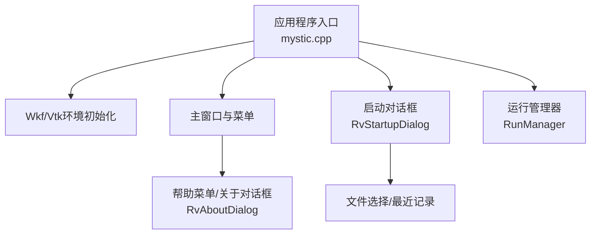
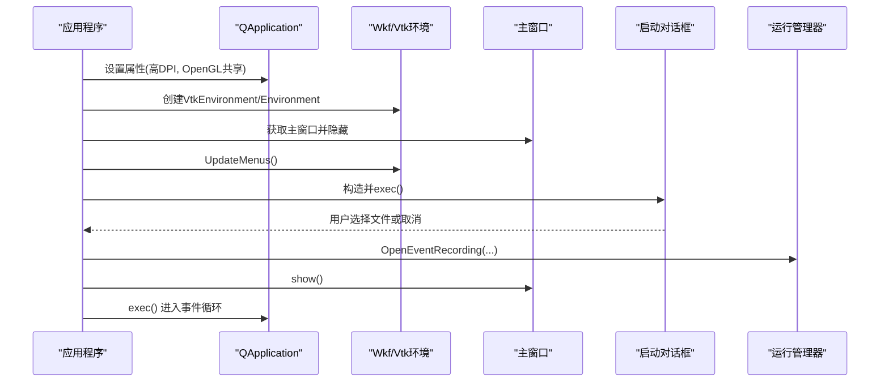
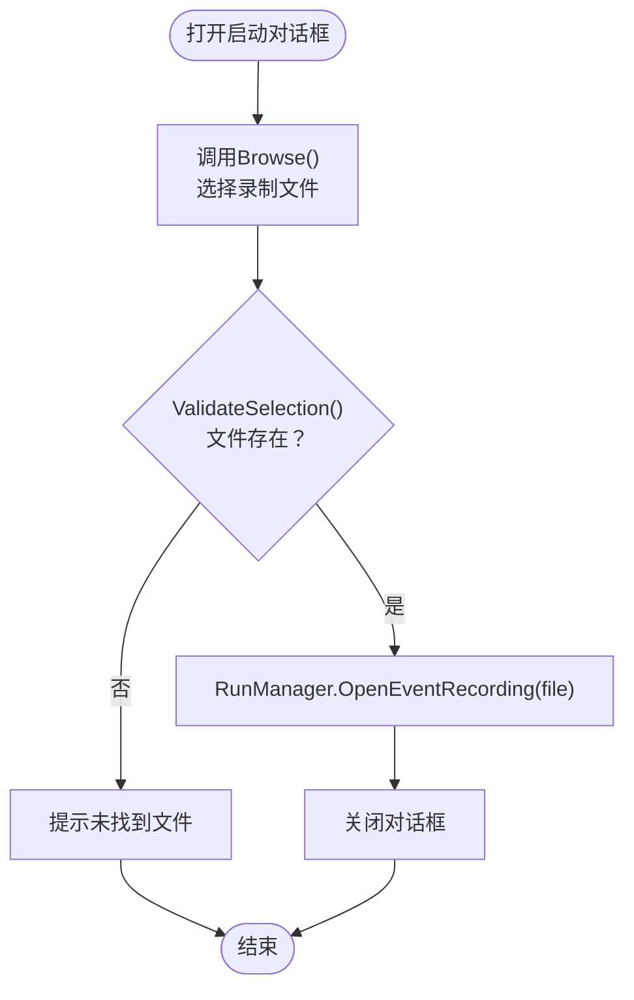
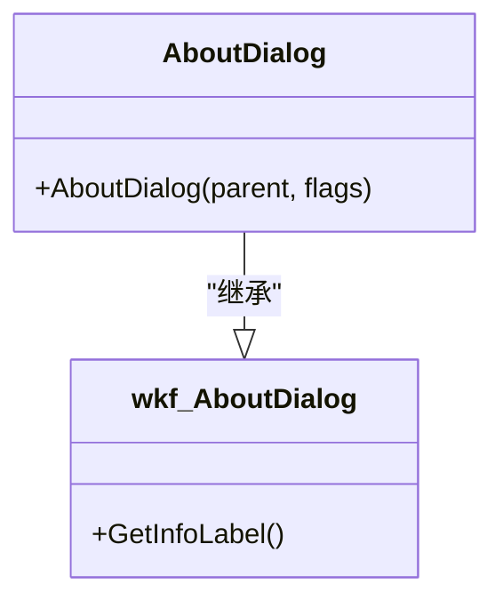
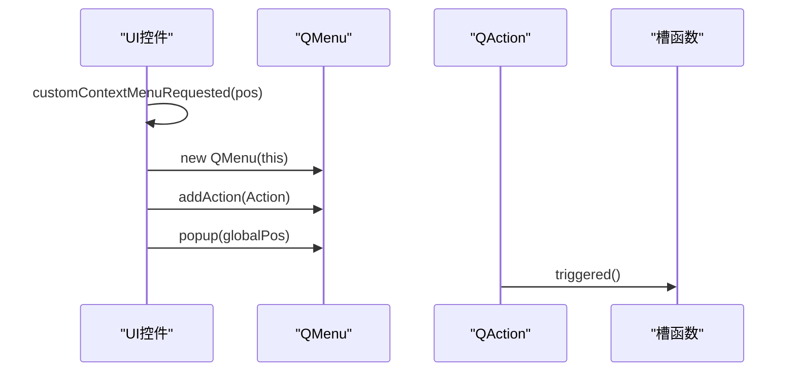
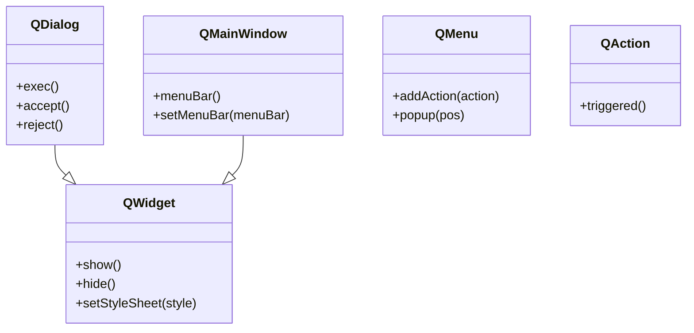
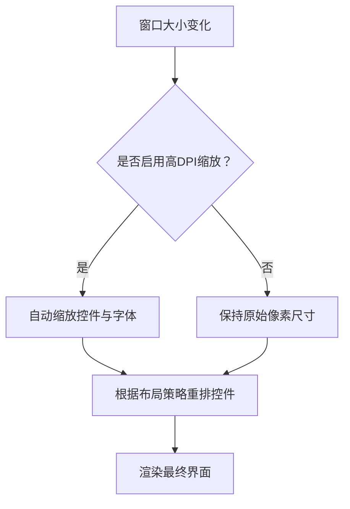
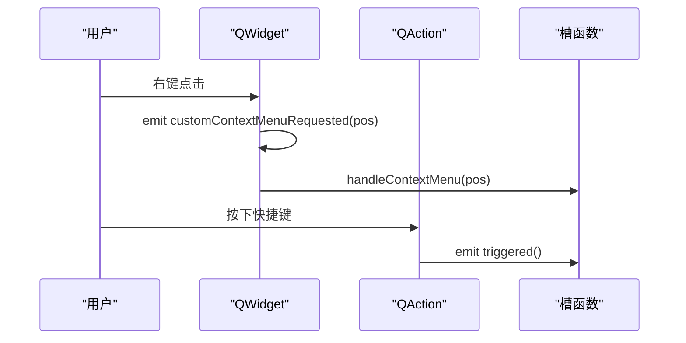
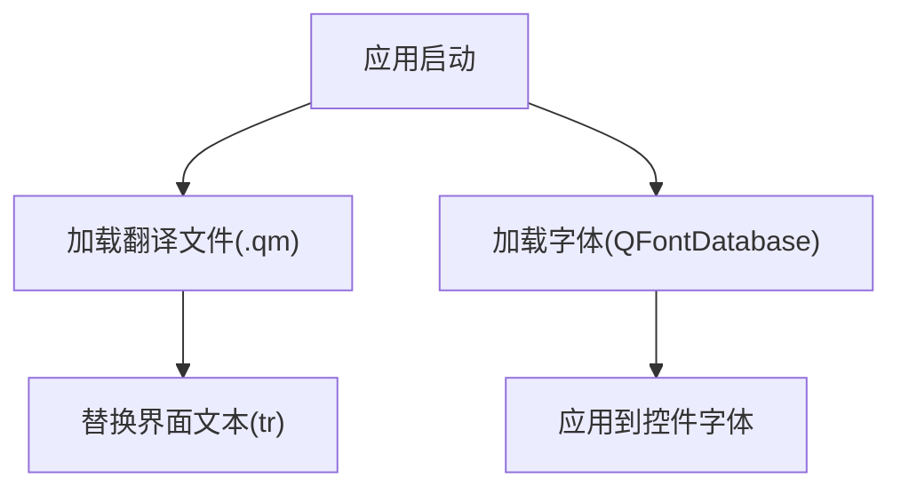
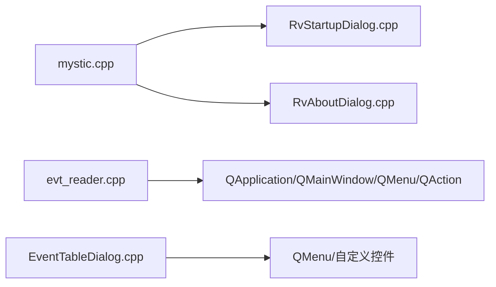

# GUI控件扩展

<cite>
**本文引用的文件**   
- [mystic.cpp](file://swdev/src/mystic/exec/source/mystic.cpp)
- [RvStartupDialog.cpp](file://swdev/src/mystic/lib/source/RvStartupDialog.cpp)
- [RvAboutDialog.cpp](file://swdev/src/mystic/lib/source/RvAboutDialog.cpp)
- [evt_reader.cpp](file://swdev/src/evt_reader/source/evt_reader.cpp)
- [EventTableDialog.cpp](file://swdev/src/evt_reader/source/EventTableDialog.cpp)
</cite>

## 目录
1. [简介](#简介)
2. [项目结构](#项目结构)
3. [核心组件](#核心组件)
4. [架构总览](#架构总览)
5. [详细组件分析](#详细组件分析)
6. [依赖关系分析](#依赖关系分析)
7. [性能考虑](#性能考虑)
8. [故障排查指南](#故障排查指南)
9. [结论](#结论)
10. [附录](#附录)

## 简介
本文件面向Mystic GUI框架的GUI控件扩展，聚焦于以下主题：
- 自定义对话框、工具栏按钮与上下文菜单的开发方法
- Qt控件集成方式（QWidget封装、信号槽机制、样式定制）
- 布局管理（网格布局、绝对定位、响应式设计）
- 用户交互处理（事件监听、键盘快捷键、鼠标操作）
- 国际化支持（多语言文本、本地化资源、字体管理）
- 完整GUI控件开发示例与UI设计规范

为便于读者快速上手，文档以仓库中实际代码为依据，给出可追溯的实现要点与图示。

## 项目结构
Mystic应用基于Qt构建，入口在exec层，启动流程负责初始化Qt应用环境、创建Wkf/Vtk环境、主窗口、启动对话框以及运行管理器；lib层提供通用对话框与运行时能力；插件层提供具体可视化结果视图。

**图表来源**
- [mystic.cpp:107-263](file://swdev/src/mystic/exec/source/mystic.cpp#L107-L263)
- [RvStartupDialog.cpp:16-83](file://swdev/src/mystic/lib/source/RvStartupDialog.cpp#L16-L83)
- [RvAboutDialog.cpp:15-19](file://swdev/src/mystic/lib/source/RvAboutDialog.cpp#L15-L19)

**章节来源**
- [mystic.cpp:107-263](file://swdev/src/mystic/exec/source/mystic.cpp#L107-L263)

## 核心组件
- 应用入口与生命周期
  - 设置组织/应用信息、图标、版本等
  - 解析命令行参数（配置文件、控制台输出等）
  - 创建Wkf/Vtk环境、主窗口、启动对话框、运行管理器
  - 进入Qt事件循环并清理资源
- 启动对话框
  - 继承wkf::StartupDialog，实现浏览、最近记录、验证、标签填充等功能
- 关于对话框
  - 继承wkf::AboutDialog，显示应用名称与版本
- 事件读取器示例（展示QMenu/QMenuBar/QMainWindow用法）
  - 使用QApplication、QMainWindow、QMenuBar、QMenu、QAction进行基础UI搭建
  - 通过connect绑定动作到槽函数

**章节来源**
- [mystic.cpp:107-263](file://swdev/src/mystic/exec/source/mystic.cpp#L107-L263)
- [RvStartupDialog.cpp:16-83](file://swdev/src/mystic/lib/source/RvStartupDialog.cpp#L16-L83)
- [RvAboutDialog.cpp:15-19](file://swdev/src/mystic/lib/source/RvAboutDialog.cpp#L15-L19)
- [evt_reader.cpp:194-204](file://swdev/src/evt_reader/source/evt_reader.cpp#L194-L204)

## 架构总览
下图展示了从应用入口到UI组件的关键调用链，包括环境初始化、菜单更新、启动对话框与主窗口的显隐控制。

**图表来源**
- [mystic.cpp:207-256](file://swdev/src/mystic/exec/source/mystic.cpp#L207-L256)
- [RvStartupDialog.cpp:27-48](file://swdev/src/mystic/lib/source/RvStartupDialog.cpp#L27-L48)

## 详细组件分析

### 自定义对话框（启动对话框）
- 设计要点
  - 继承wkf::StartupDialog，重写关键行为：Browse、RemoveRecent、ClearRecents、GetRecents、GetRecentLabelDisplayName、PopulateLabels、ValidateSelection、ParseDroppedUrls
  - 通过RunManager访问最近记录与显示名
  - 使用QFileDialog打开文件选择，支持拖放URL转本地路径
- 交互流程
  - 用户点击“浏览”或拖放文件 -> 校验文件存在性 -> 打开录制文件 -> 关闭对话框

**图表来源**
- [RvStartupDialog.cpp:27-83](file://swdev/src/mystic/lib/source/RvStartupDialog.cpp#L27-L83)

**章节来源**
- [RvStartupDialog.cpp:16-83](file://swdev/src/mystic/lib/source/RvStartupDialog.cpp#L16-L83)

### 关于对话框
- 设计要点
  - 继承wkf::AboutDialog，设置InfoLabel内容为应用名称与版本
- 使用场景
  - 通过“帮助”菜单触发，显示应用信息

**图表来源**
- [RvAboutDialog.cpp:15-19](file://swdev/src/mystic/lib/source/RvAboutDialog.cpp#L15-L19)

**章节来源**
- [RvAboutDialog.cpp:15-19](file://swdev/src/mystic/lib/source/RvAboutDialog.cpp#L15-L19)

### 工具栏按钮与上下文菜单
- 工具栏/菜单栏
  - 使用QMenuBar、QMenu、QAction构建菜单项，并通过connect将triggered信号连接到槽函数
- 上下文菜单
  - 在表格或规则控件上监听customContextMenuRequested信号，动态生成QMenu并弹出

**图表来源**
- [EventTableDialog.cpp:44-55](file://swdev/src/evt_reader/source/EventTableDialog.cpp#L44-L55)
- [EventTableDialog.cpp:117-150](file://swdev/src/evt_reader/source/EventTableDialog.cpp#L117-L150)
- [evt_reader.cpp:194-204](file://swdev/src/evt_reader/source/evt_reader.cpp#L194-L204)

**章节来源**
- [EventTableDialog.cpp:44-55](file://swdev/src/evt_reader/source/EventTableDialog.cpp#L44-L55)
- [EventTableDialog.cpp:117-150](file://swdev/src/evt_reader/source/EventTableDialog.cpp#L117-L150)
- [evt_reader.cpp:194-204](file://swdev/src/evt_reader/source/evt_reader.cpp#L194-L204)

### Qt控件集成（QWidget封装、信号槽、样式）
- QWidget封装
  - 所有对话框与控件均继承自QWidget或其子类，遵循Qt对象树与父子关系管理
- 信号槽机制
  - 使用QObject::connect连接信号与槽，如QAction::triggered、QWidget::customContextMenuRequested
- 样式定制
  - 可通过QSS或Qt样式表对控件外观进行统一定制（本仓库示例未直接展示样式表，但可在任意QWidget上使用setStyleSheet）

**图表来源**
- [evt_reader.cpp:194-204](file://swdev/src/evt_reader/source/evt_reader.cpp#L194-L204)
- [EventTableDialog.cpp:117-150](file://swdev/src/evt_reader/source/EventTableDialog.cpp#L117-L150)

**章节来源**
- [evt_reader.cpp:194-204](file://swdev/src/evt_reader/source/evt_reader.cpp#L194-L204)
- [EventTableDialog.cpp:117-150](file://swdev/src/evt_reader/source/EventTableDialog.cpp#L117-L150)

### 布局管理（网格布局、绝对定位、响应式）
- 网格布局
  - 使用QGridLayout将控件按行列排布，适合表单类界面
- 绝对定位
  - 使用move/setGeometry精确控制控件位置，适用于固定尺寸或特殊排版
- 响应式设计
  - 结合QApplication::setAttribute(Qt::AA_EnableHighDpiScaling)启用高DPI缩放，使界面在不同分辨率下自适应
  - 在窗口resize事件中重新计算布局或使用弹性布局（QVBoxLayout/QHBoxLayout）提升适配性

**图表来源**
- [mystic.cpp:272-274](file://swdev/src/mystic/exec/source/mystic.cpp#L272-L274)

**章节来源**
- [mystic.cpp:272-274](file://swdev/src/mystic/exec/source/mystic.cpp#L272-L274)

### 用户交互处理（事件监听、键盘快捷键、鼠标操作）
- 事件监听
  - 通过connect订阅信号，如QAction::triggered、QWidget::customContextMenuRequested
- 键盘快捷键
  - 为QAction设置快捷键（例如Ctrl+O），并在菜单项中显示提示
- 鼠标操作
  - 捕获鼠标移动、按下、释放事件，用于拖拽、框选等交互

**图表来源**
- [EventTableDialog.cpp:44-55](file://swdev/src/evt_reader/source/EventTableDialog.cpp#L44-L55)
- [evt_reader.cpp:204-204](file://swdev/src/evt_reader/source/evt_reader.cpp#L204-L204)

**章节来源**
- [EventTableDialog.cpp:44-55](file://swdev/src/evt_reader/source/EventTableDialog.cpp#L44-L55)
- [evt_reader.cpp:204-204](file://swdev/src/evt_reader/source/evt_reader.cpp#L204-L204)

### 国际化支持（多语言文本、本地化资源、字体管理）
- 多语言文本
  - 使用tr()或QLocale加载翻译文件，替换硬编码字符串
- 本地化资源
  - 将图片、图标等资源放入资源系统（:images/...），避免路径问题
- 字体管理
  - 使用QFontDatabase加载系统字体或自定义字体，确保跨平台一致性

[本节为概念性说明，不直接分析具体文件]

## 依赖关系分析
- 入口依赖
  - mystic.cpp依赖RvEnvironment、RvFactory、RvRunManager、RvStartupDialog等库组件
- UI依赖
  - evt_reader.cpp依赖QApplication、QMainWindow、QMenuBar、QMenu、QAction
  - EventTableDialog.cpp依赖QMenu及自定义控件的信号槽

**图表来源**
- [mystic.cpp:19-30](file://swdev/src/mystic/exec/source/mystic.cpp#L19-L30)
- [evt_reader.cpp:15-22](file://swdev/src/evt_reader/source/evt_reader.cpp#L15-L22)
- [EventTableDialog.cpp:22-55](file://swdev/src/evt_reader/source/EventTableDialog.cpp#L22-L55)

**章节来源**
- [mystic.cpp:19-30](file://swdev/src/mystic/exec/source/mystic.cpp#L19-L30)
- [evt_reader.cpp:15-22](file://swdev/src/evt_reader/source/evt_reader.cpp#L15-L22)
- [EventTableDialog.cpp:22-55](file://swdev/src/evt_reader/source/EventTableDialog.cpp#L22-L55)

## 性能考虑
- 高DPI缩放
  - 启用Qt的高DPI缩放可减少模糊与错位，提升清晰度
- OpenGL上下文共享
  - 共享OpenGL上下文有助于多个视图同时渲染时的性能优化
- 事件循环
  - 合理拆分耗时任务至后台线程，避免阻塞UI事件循环

**章节来源**
- [mystic.cpp:272-274](file://swdev/src/mystic/exec/source/mystic.cpp#L272-L274)

## 故障排查指南
- 启动对话框文件未找到
  - 现象：弹出“文件未找到”警告
  - 排查：检查ValidateSelection逻辑与文件路径是否正确
- 菜单项不可见或文本异常
  - 现象：帮助菜单中的“Documentation”或“About Mystic”显示异常
  - 排查：检查UpdateMenus中对菜单项的可见性与文本设置
- 控制台输出未显示
  - 现象：-console参数无效
  - 排查：确认Windows控制台附加与stdout/stderr重定向逻辑

**章节来源**
- [RvStartupDialog.cpp:67-76](file://swdev/src/mystic/lib/source/RvStartupDialog.cpp#L67-L76)
- [mystic.cpp:221-236](file://swdev/src/mystic/exec/source/mystic.cpp#L221-L236)
- [mystic.cpp:185-205](file://swdev/src/mystic/exec/source/mystic.cpp#L185-L205)

## 结论
Mystic GUI框架基于Qt提供了完善的GUI扩展能力。通过继承wkf基类、使用QMenu/QAction构建菜单、利用信号槽机制处理交互、并结合高DPI与OpenGL共享提升体验，开发者可以快速实现自定义对话框、工具栏按钮与上下文菜单。建议在项目中统一采用网格布局与响应式设计，配合国际化与字体管理，确保跨平台一致性与可维护性。

## 附录
- 开发建议
  - 优先使用布局管理器而非绝对定位，提高可维护性
  - 将用户可见文本全部走国际化流程，避免硬编码
  - 对复杂交互拆分为独立槽函数，便于测试与维护
- 参考路径
  - 入口与生命周期：[mystic.cpp:107-263](file://swdev/src/mystic/exec/source/mystic.cpp#L107-L263)
  - 启动对话框：[RvStartupDialog.cpp:16-83](file://swdev/src/mystic/lib/source/RvStartupDialog.cpp#L16-L83)
  - 关于对话框：[RvAboutDialog.cpp:15-19](file://swdev/src/mystic/lib/source/RvAboutDialog.cpp#L15-L19)
  - 菜单与上下文菜单示例：[evt_reader.cpp:194-204](file://swdev/src/evt_reader/source/evt_reader.cpp#L194-L204), [EventTableDialog.cpp:117-150](file://swdev/src/evt_reader/source/EventTableDialog.cpp#L117-L150)