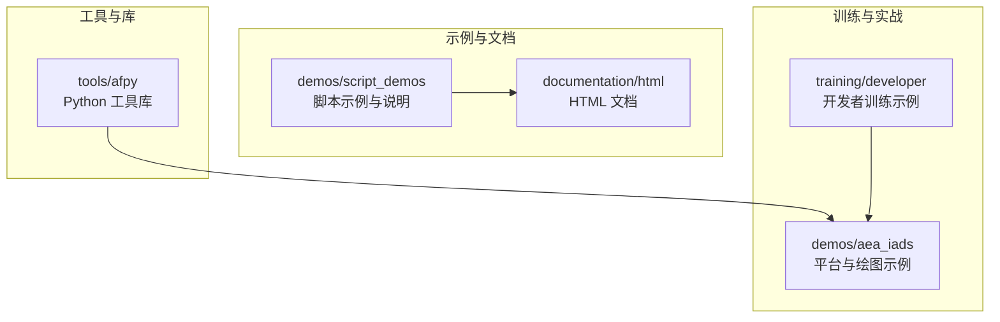
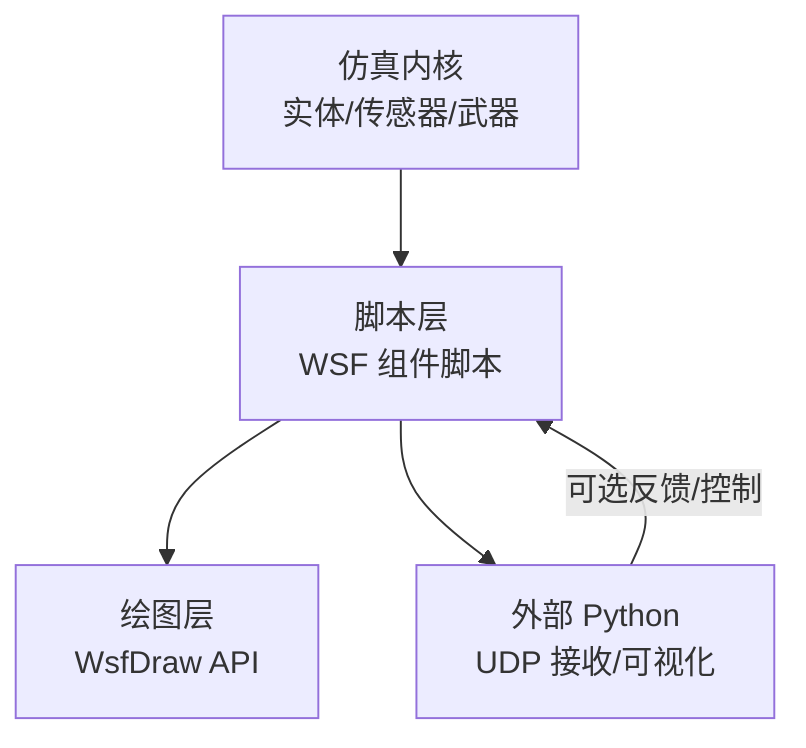
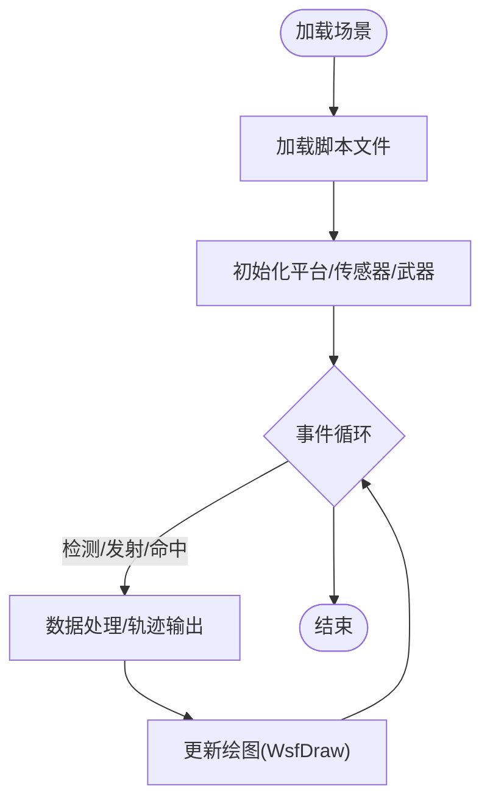
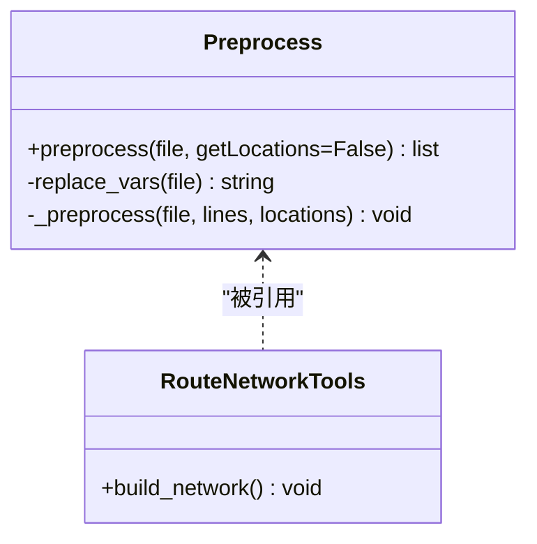
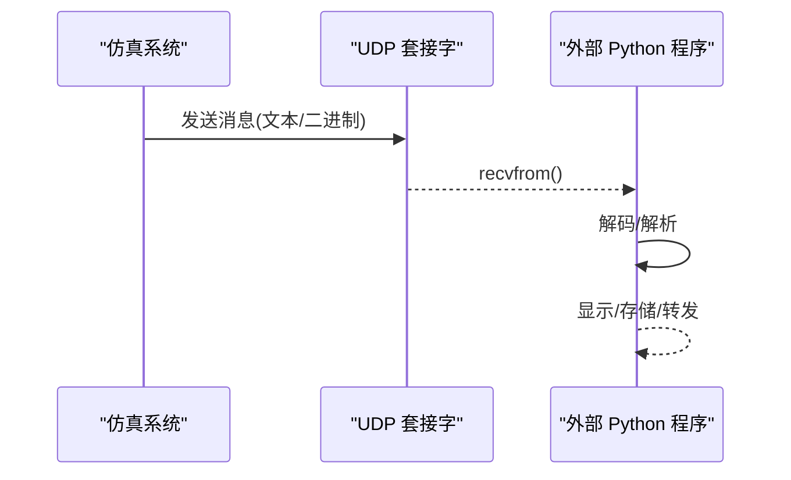
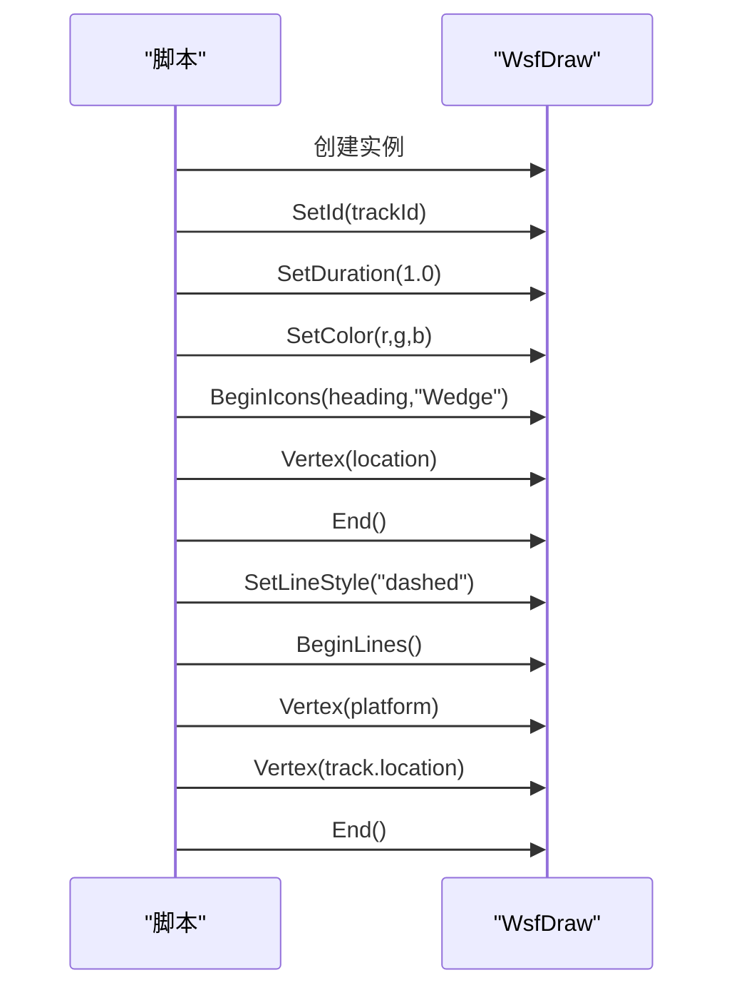
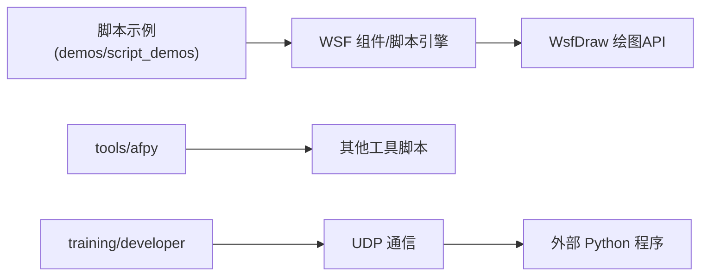

# 可视化脚本开发

<cite>
**本文引用的文件**   
- [script_demos.rst](file://demos/script_demos/doc/script_demos.rst)
- [README.md](file://demos/script_demos/README.md)
- [afsim_preprocess.py](file://tools/afpy/afsim_preprocess.py)
- [route_network_tools.py](file://tools/afpy/route_network_tools.py)
- [receiver.py](file://training/developer/core/labs/solution/observer/receiver.py)
- [large_sam_battalion.txt](file://demos/aea_iads/platforms/large_sam_battalion.txt)
- [red_radar_company.txt](file://demos/aea_iads/platforms/red_radar_company.txt)
</cite>

## 目录
1. [简介](#简介)
2. [项目结构](#项目结构)
3. [核心组件](#核心组件)
4. [架构总览](#架构总览)
5. [详细组件分析](#详细组件分析)
6. [依赖关系分析](#依赖关系分析)
7. [性能考虑](#性能考虑)
8. [故障排查指南](#故障排查指南)
9. [结论](#结论)
10. [附录](#附录)

## 简介
本文件面向“可视化脚本开发”，聚焦于在 AFSIM 环境中通过脚本进行仿真数据访问、图形绘制与交互控制。文档覆盖以下方面：
- Python API 使用方式（仿真数据访问、图形绘制函数、交互控制）
- 脚本语法与编程模型（对象模型、事件驱动、异步处理）
- 脚本调试工具（断点调试、日志输出、性能分析）
- 脚本与 GUI 集成（参数面板、实时控制、结果导出）
- 常用可视化模式模板（时间序列图、空间分布图、统计分析图）
- 完整工作流程与最佳实践

## 项目结构
仓库中与可视化脚本相关的资源主要分布在以下位置：
- demos/script_demos：脚本示例与说明，展示脚本语言特性与 WSF 组件中的用法
- tools/afpy：Python 工具库，提供输入预处理、路径解析等通用能力
- training/developer：开发者训练材料，包含外部程序与仿真系统通信的示例
- demos/aea_iads：平台定义中演示了 WsfDraw 绘图 API 的使用

图表来源
- [script_demos.rst:10-25](file://demos/script_demos/doc/script_demos.rst#L10-L25)
- [afsim_preprocess.py:11-59](file://tools/afpy/afsim_preprocess.py#L11-L59)
- [receiver.py:10-23](file://training/developer/core/labs/solution/observer/receiver.py#L10-L23)
- [large_sam_battalion.txt:122-155](file://demos/aea_iads/platforms/large_sam_battalion.txt#L122-L155)

章节来源
- [script_demos.rst:10-86](file://demos/script_demos/doc/script_demos.rst#L10-L86)
- [README.md:1-45](file://demos/script_demos/README.md#L1-L45)

## 核心组件
- 脚本示例与文档（demos/script_demos）
  - 提供基础到综合的脚本示例，涵盖对象访问、几何计算、移动器命令、处理器输出等
  - 文档以 RST 形式组织，便于生成 HTML 文档
- Python 工具库（tools/afpy）
  - afsim_preprocess.py：对 AFSIM 输入文件进行预处理，支持 include/include_once、变量替换、路径扩展，并返回行与位置映射
  - route_network_tools.py：基于 afpy 共享代码构建路线网络工具
- 外部通信示例（training/developer）
  - receiver.py：通过 UDP 接收来自观测器/仿真系统的消息，用于外部可视化或记录
- 绘图 API 示例（demos/aea_iads）
  - large_sam_battalion.txt、red_radar_company.txt：演示 WsfDraw 对象的创建、ID/颜色/线型设置、图标与线条绘制

章节来源
- [script_demos.rst:27-86](file://demos/script_demos/doc/script_demos.rst#L27-L86)
- [afsim_preprocess.py:11-59](file://tools/afpy/afsim_preprocess.py#L11-L59)
- [route_network_tools.py:1-20](file://tools/afpy/route_network_tools.py#L1-L20)
- [receiver.py:10-23](file://training/developer/core/labs/solution/observer/receiver.py#L10-L23)
- [large_sam_battalion.txt:122-155](file://demos/aea_iads/platforms/large_sam_battalion.txt#L122-L155)
- [red_radar_company.txt:54-79](file://demos/aea_iads/platforms/red_radar_company.txt#L54-L79)

## 架构总览
AFSIM 可视化脚本的典型架构由“仿真内核 + 脚本层 + 绘图/通信层”组成：
- 仿真内核：运行场景、实体、传感器、武器等逻辑
- 脚本层：嵌入在 WSF 组件中，响应事件、访问对象、调用绘图 API
- 绘图/通信层：WsfDraw 负责实时渲染；UDP/Socket 用于与外部 Python 程序通信

图表来源
- [large_sam_battalion.txt:122-155](file://demos/aea_iads/platforms/large_sam_battalion.txt#L122-L155)
- [receiver.py:10-23](file://training/developer/core/labs/solution/observer/receiver.py#L10-L23)

## 详细组件分析

### 组件A：脚本示例与文档（demos/script_demos）
- 目标：展示脚本语言特性与在 WSF 组件中的使用方法
- 关键内容：
  - 基础脚本示例：平台飞行、配置打印
  - 综合脚本示例：ESM 探测、打击平台、威胁雷达、处理器轨迹输出
  - 相对几何方法、移动器命令等
- 适用场景：快速上手脚本语法、理解对象模型与事件回调

图表来源
- [script_demos.rst:27-86](file://demos/script_demos/doc/script_demos.rst#L27-L86)

章节来源
- [script_demos.rst:27-86](file://demos/script_demos/doc/script_demos.rst#L27-L86)

### 组件B：Python 工具库（tools/afpy）
- afsim_preprocess.py
  - 功能：预处理 AFSIM 输入文件，展开 include/include_once，替换变量，收集所有行及其源位置
  - 复杂度：线性扫描文件行，递归展开 include，整体 O(N+M)，N 为总行数，M 为 include 次数
  - 优化点：避免重复 include（completeFiles），减少 IO 开销
- route_network_tools.py
  - 功能：复用 afpy 共享代码，构建路线网络工具（如路径规划、连通性分析）

图表来源
- [afsim_preprocess.py:11-59](file://tools/afpy/afsim_preprocess.py#L11-L59)
- [route_network_tools.py:1-20](file://tools/afpy/route_network_tools.py#L1-L20)

章节来源
- [afsim_preprocess.py:11-59](file://tools/afpy/afsim_preprocess.py#L11-L59)
- [route_network_tools.py:1-20](file://tools/afpy/route_network_tools.py#L1-L20)

### 组件C：外部通信示例（training/developer）
- receiver.py
  - 功能：通过 UDP 监听端口，接收来自观测器/仿真系统的消息并打印
  - 用途：外部可视化、实时记录、与仿真系统进行双向通信的基础

图表来源
- [receiver.py:10-23](file://training/developer/core/labs/solution/observer/receiver.py#L10-L23)

章节来源
- [receiver.py:10-23](file://training/developer/core/labs/solution/observer/receiver.py#L10-L23)

### 组件D：绘图 API 示例（demos/aea_iads）
- large_sam_battalion.txt、red_radar_company.txt
  - 功能：演示 WsfDraw 对象的生命周期与方法调用
  - 关键点：
    - 创建 draw = WsfDraw()
    - 设置 ID、持续时间、颜色、线型
    - BeginIcons/BeginLines 绘制图标与连线
    - Vertex/End 完成顶点集合绘制

图表来源
- [large_sam_battalion.txt:122-155](file://demos/aea_iads/platforms/large_sam_battalion.txt#L122-L155)
- [red_radar_company.txt:54-79](file://demos/aea_iads/platforms/red_radar_company.txt#L54-L79)

章节来源
- [large_sam_battalion.txt:122-155](file://demos/aea_iads/platforms/large_sam_battalion.txt#L122-L155)
- [red_radar_company.txt:54-79](file://demos/aea_iads/platforms/red_radar_company.txt#L54-L79)

## 依赖关系分析
- 脚本示例依赖 WSF 组件与绘图 API
- Python 工具库被其他工具脚本引用，提供预处理与路径解析能力
- 外部 Python 程序通过 UDP 与仿真系统通信，形成松耦合集成

图表来源
- [script_demos.rst:27-86](file://demos/script_demos/doc/script_demos.rst#L27-L86)
- [afsim_preprocess.py:11-59](file://tools/afpy/afsim_preprocess.py#L11-L59)
- [receiver.py:10-23](file://training/developer/core/labs/solution/observer/receiver.py#L10-L23)

章节来源
- [script_demos.rst:27-86](file://demos/script_demos/doc/script_demos.rst#L27-L86)
- [afsim_preprocess.py:11-59](file://tools/afpy/afsim_preprocess.py#L11-L59)
- [receiver.py:10-23](file://training/developer/core/labs/solution/observer/receiver.py#L10-L23)

## 性能考虑
- 绘图频率控制
  - 使用 SetDuration 延长绘制生命周期，减少频繁擦除与重绘
  - 批量绘制（Begin...End）降低 API 调用开销
- I/O 与预处理
  - 利用 afsim_preprocess 的 include_once 去重机制，避免重复解析
  - 合理组织 include 层级，减少递归深度
- 外部通信
  - UDP 接收端采用非阻塞或缓冲策略，避免丢包
  - 将高频数据聚合后批量写入磁盘或转发

[本节为通用指导，不直接分析具体文件]

## 故障排查指南
- 脚本无法加载或 include 失败
  - 检查 include/include_once 路径与变量替换是否正确
  - 使用 afsim_preprocess 的输出定位问题行号
- 绘图不显示或闪烁严重
  - 确认 WsfDraw ID 唯一性与持续时间设置
  - 检查 Begin/End 配对与 Vertex 数量
- 外部通信无数据
  - 核对 UDP 端口与地址是否与仿真侧一致
  - 检查防火墙与网络权限

章节来源
- [afsim_preprocess.py:11-59](file://tools/afpy/afsim_preprocess.py#L11-L59)
- [large_sam_battalion.txt:122-155](file://demos/aea_iads/platforms/large_sam_battalion.txt#L122-L155)
- [receiver.py:10-23](file://training/developer/core/labs/solution/observer/receiver.py#L10-L23)

## 结论
AFSIM 的可视化脚本体系通过脚本层桥接仿真内核与绘图/通信层，提供了灵活的数据访问、实时渲染与外部集成能力。借助脚本示例、Python 工具库与绘图 API，用户可快速构建时间序列、空间分布与统计分析等可视化模式，并通过 UDP 与外部程序协作，实现参数面板、实时控制与结果导出等高级功能。遵循本文的最佳实践与性能建议，可有效提升脚本的可维护性与运行效率。

[本节为总结性内容，不直接分析具体文件]

## 附录

### 常用可视化模式模板
- 时间序列图
  - 数据源：传感器输出、处理器统计
  - 绘制：按时间步更新折线图，使用 BeginLines/Vertex/End
  - 参考：脚本示例中的处理器输出与绘图调用
- 空间分布图
  - 数据源：平台位置、轨迹点
  - 绘制：图标（BeginIcons）与连线（BeginLines）组合
  - 参考：large_sam_battalion.txt、red_radar_company.txt
- 统计分析图
  - 数据源：命中率、误差分布、资源消耗
  - 绘制：柱状图/直方图（通过外部 Python 工具或绘图 API）
  - 参考：tools/afpy 提供的预处理与数据处理能力

[本节为概念性内容，不直接分析具体文件]

### 脚本开发工作流程与最佳实践
- 需求分析与数据流设计
  - 明确需要可视化的指标与更新频率
  - 选择合适的数据源（传感器、处理器、外部通信）
- 脚本编写与模块化
  - 将绘图逻辑封装为函数，复用 WsfDraw 调用
  - 使用 include_once 管理模块，避免重复
- 调试与测试
  - 使用日志输出与断点调试（结合 IDE 或脚本引擎）
  - 通过 afsim_preprocess 定位 include 与变量替换问题
- 性能优化
  - 控制绘图频率，批量绘制，减少 API 调用
  - 外部通信采用缓冲与批处理
- 集成与部署
  - 与 GUI 集成：参数面板绑定脚本变量，实时更新
  - 结果导出：CSV/JSON 格式，供后续分析

[本节为通用指导，不直接分析具体文件]