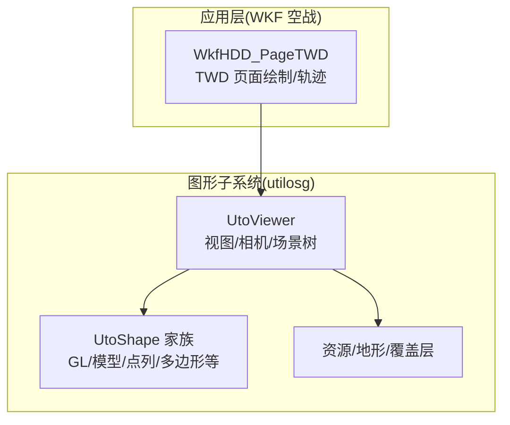
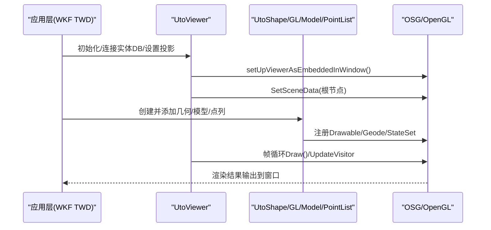
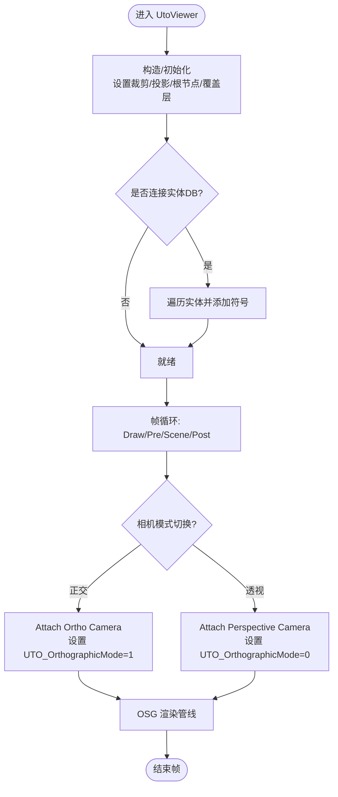
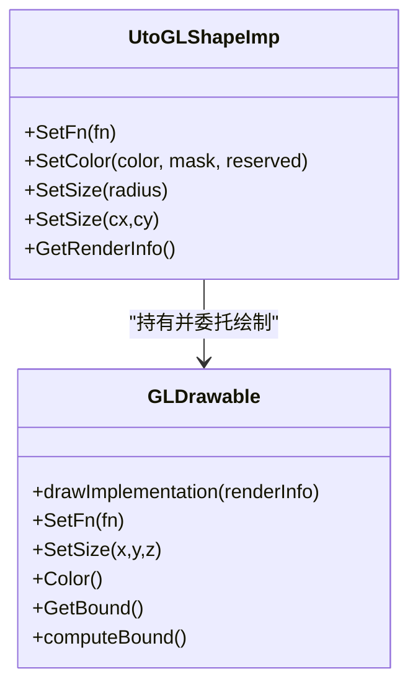
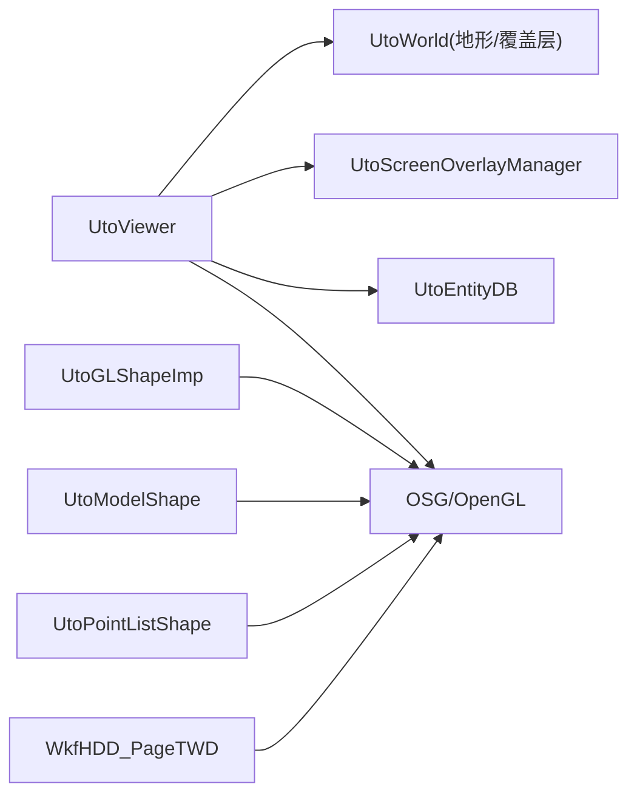

# 图形渲染定制

<cite>
**本文引用的文件**   
- [UtoViewer.cpp](file://swdev/src/tools/utilosg/source/Viewer/UtoViewer.cpp)
- [UtoGLShapeImp.cpp](file://swdev/src/tools/utilosg/source/Shape/UtoGLShapeImp.cpp)
- [UtoModelShape.cpp](file://swdev/src/tools/utilosg/source/Shape/UtoModelShape.cpp)
- [UtoPointListShape.cpp](file://swdev/src/tools/utilosg/source/Shape/UtoPointListShape.cpp)
- [WkfHDD_PageTWD.hpp](file://swdev/src/tools/wkf/air_combat/wkf_air_combat_common/source/hdd/WkfHDD_PageTWD.hpp)
</cite>

## 目录
1. [引言](#引言)
2. [项目结构](#项目结构)
3. [核心组件](#核心组件)
4. [架构总览](#架构总览)
5. [详细组件分析](#详细组件分析)
6. [依赖关系分析](#依赖关系分析)
7. [性能考虑](#性能考虑)
8. [故障排查指南](#故障排查指南)
9. [结论](#结论)
10. [附录：开发示例与调优清单](#附录开发示例与调优清单)

## 引言
本文件面向在 AFSIM 中进行图形渲染定制的开发者，系统阐述 OpenGL 与 VTK（通过 OSG/UtilOSG 管线）的集成方式、渲染管线配置、着色器与几何体绘制、自定义绘制函数开发（2D/3D/粒子）、材质与纹理、光照与透明度、动画效果、传感器数据可视化映射（雷达图、热力图、轨迹追踪），以及批处理渲染、LOD 与内存优化等性能技术。文档以代码级分析为基础，提供图示与可操作的实践建议。

## 项目结构
AFSIM 的图形子系统主要位于 utilosg 工具库中，围绕 UtoViewer（视图控制）、UtoShape（形状抽象）及其具体实现（如 GL 自定义绘制、模型加载、点列绘制）展开；同时，WKF 空战插件中的 TWD（战术武器显示）页面展示了基于 OSG 的 UI 元素绘制与轨迹绘制流程。

图表来源
- [UtoViewer.cpp:91-149](file://swdev/src/tools/utilosg/source/Viewer/UtoViewer.cpp#L91-L149)
- [UtoGLShapeImp.cpp:103-125](file://swdev/src/tools/utilosg/source/Shape/UtoGLShapeImp.cpp#L103-L125)
- [UtoModelShape.cpp:58-87](file://swdev/src/tools/utilosg/source/Shape/UtoModelShape.cpp#L58-L87)
- [UtoPointListShape.cpp:48-79](file://swdev/src/tools/utilosg/source/Shape/UtoPointListShape.cpp#L48-L79)
- [WkfHDD_PageTWD.hpp:63-125](file://swdev/src/tools/wkf/air_combat/wkf_air_combat_common/source/hdd/WkfHDD_PageTWD.hpp#L63-L125)

章节来源
- [UtoViewer.cpp:91-149](file://swdev/src/tools/utilosg/source/Viewer/UtoViewer.cpp#L91-L149)
- [UtoGLShapeImp.cpp:103-125](file://swdev/src/tools/utilosg/source/Shape/UtoGLShapeImp.cpp#L103-L125)
- [UtoModelShape.cpp:58-87](file://swdev/src/tools/utilosg/source/Shape/UtoModelShape.cpp#L58-L87)
- [UtoPointListShape.cpp:48-79](file://swdev/src/tools/utilosg/source/Shape/UtoPointListShape.cpp#L48-L79)
- [WkfHDD_PageTWD.hpp:63-125](file://swdev/src/tools/wkf/air_combat/wkf_air_combat_common/source/hdd/WkfHDD_PageTWD.hpp#L63-L125)

## 核心组件
- UtoViewer：封装 osgViewer::Viewer，管理窗口、相机（正交/透视）、场景根节点、世界地形与覆盖层、屏幕叠加管理器、更新访客与命中测试策略。负责连接实体数据库、事件分发、投影切换、视口变换等。
- UtoGLShapeImp：基于 osg::Drawable 的自定义绘制封装，允许注入 DrawFn 回调，直接调用 OpenGL 绘制命令，支持颜色、混合与深度排序。
- UtoModelShape：从模型文件加载 3D 几何，暴露部件（Part）与开关（Switch）接口，支持度量值访问、分组查询、光照与深度测试控制。
- UtoPointListShape：批量点绘制，支持点大小与平滑设置，适合粒子系统与轨迹点集。
- WkfHDD_PageTWD：TWD 页面绘制逻辑，包含罗盘、航向框、对抗措施标签、角度目标轨迹绘制等，体现 OSG 场景图的构建与分层绘制。

章节来源
- [UtoViewer.cpp:91-149](file://swdev/src/tools/utilosg/source/Viewer/UtoViewer.cpp#L91-L149)
- [UtoGLShapeImp.cpp:103-125](file://swdev/src/tools/utilosg/source/Shape/UtoGLShapeImp.cpp#L103-L125)
- [UtoModelShape.cpp:58-87](file://swdev/src/tools/utilosg/source/Shape/UtoModelShape.cpp#L58-L87)
- [UtoPointListShape.cpp:48-79](file://swdev/src/tools/utilosg/source/Shape/UtoPointListShape.cpp#L48-L79)
- [WkfHDD_PageTWD.hpp:63-125](file://swdev/src/tools/wkf/air_combat/wkf_air_combat_common/source/hdd/WkfHDD_PageTWD.hpp#L63-L125)

## 架构总览
下图展示 AFSIM 图形渲染的关键路径：应用层（如 WKF TWD）通过 UtoViewer 管理场景与相机，使用 UtoShape 家族进行几何与模型绘制，底层由 OSG/OpenGL 完成最终光栅化。

图表来源
- [UtoViewer.cpp:91-149](file://swdev/src/tools/utilosg/source/Viewer/UtoViewer.cpp#L91-L149)
- [UtoGLShapeImp.cpp:26-87](file://swdev/src/tools/utilosg/source/Shape/UtoGLShapeImp.cpp#L26-L87)
- [UtoModelShape.cpp:58-87](file://swdev/src/tools/utilosg/source/Shape/UtoModelShape.cpp#L58-L87)
- [UtoPointListShape.cpp:48-79](file://swdev/src/tools/utilosg/source/Shape/UtoPointListShape.cpp#L48-L79)

## 详细组件分析

### UtoViewer：视图与渲染管线控制
- 功能要点
  - 构造时设置裁剪模式、默认投影、根节点、地形与覆盖层、屏幕叠加管理器、UpdateVisitor 与命中测试策略。
  - 支持正交/透视相机切换，统一设置着色器 uniform（如 UTO_OrthographicMode）。
  - 连接实体数据库后遍历实体并添加符号，订阅增删事件。
  - 提供 DisplayToWorld/DisplayToWorld(Rect) 坐标转换、视口尺寸设置、截图与统计处理器。
- 关键流程
  - 相机切换：SetActiveCamera 切换 Ortho/Perspective，更新命中策略与 uniform。
  - 连接数据库：Connect 设置 dummy texture、调整子图顺序、遍历实体并绑定 viewer。
  - 帧绘制：Draw/PreSceneDraw/SceneDraw/PostSceneDraw 分阶段驱动窗口与场景。

图表来源
- [UtoViewer.cpp:91-149](file://swdev/src/tools/utilosg/source/Viewer/UtoViewer.cpp#L91-L149)
- [UtoViewer.cpp:338-367](file://swdev/src/tools/utilosg/source/Viewer/UtoViewer.cpp#L338-L367)
- [UtoViewer.cpp:381-423](file://swdev/src/tools/utilosg/source/Viewer/UtoViewer.cpp#L381-L423)
- [UtoViewer.cpp:306-327](file://swdev/src/tools/utilosg/source/Viewer/UtoViewer.cpp#L306-L327)

章节来源
- [UtoViewer.cpp:91-149](file://swdev/src/tools/utilosg/source/Viewer/UtoViewer.cpp#L91-L149)
- [UtoViewer.cpp:338-367](file://swdev/src/tools/utilosg/source/Viewer/UtoViewer.cpp#L338-L367)
- [UtoViewer.cpp:381-423](file://swdev/src/tools/utilosg/source/Viewer/UtoViewer.cpp#L381-L423)
- [UtoViewer.cpp:306-327](file://swdev/src/tools/utilosg/source/Viewer/UtoViewer.cpp#L306-L327)

### UtoGLShapeImp：自定义 OpenGL 绘制
- 设计要点
  - 内部定义 GLDrawable 继承自 osg::Drawable，封装 drawImplementation，调用用户提供的 DrawFn 执行 OpenGL 命令。
  - 支持颜色设置、混合启用/禁用、深度排序渲染桶（DepthSortedBin）。
  - 提供 GetRenderInfo 以便在回调中获取当前渲染上下文信息。
- 典型用法
  - 通过 SetFn 注入自定义绘制函数，用于 2D 图标、HUD 元素或简单几何。
  - 根据透明度自动开启混合与深度排序，确保正确合成。

图表来源
- [UtoGLShapeImp.cpp:26-87](file://swdev/src/tools/utilosg/source/Shape/UtoGLShapeImp.cpp#L26-L87)
- [UtoGLShapeImp.cpp:103-125](file://swdev/src/tools/utilosg/source/Shape/UtoGLShapeImp.cpp#L103-L125)
- [UtoGLShapeImp.cpp:127-160](file://swdev/src/tools/utilosg/source/Shape/UtoGLShapeImp.cpp#L127-L160)

章节来源
- [UtoGLShapeImp.cpp:26-87](file://swdev/src/tools/utilosg/source/Shape/UtoGLShapeImp.cpp#L26-L87)
- [UtoGLShapeImp.cpp:103-125](file://swdev/src/tools/utilosg/source/Shape/UtoGLShapeImp.cpp#L103-L125)
- [UtoGLShapeImp.cpp:127-160](file://swdev/src/tools/utilosg/source/Shape/UtoGLShapeImp.cpp#L127-L160)

### UtoModelShape：3D 模型与部件/开关
- 功能要点
  - 从模型文件加载几何，暴露 Metric/InGroup/Parts/Switches 等元数据接口。
  - 支持 HasPart/FindPart 与 HasSwitch/FindSwitch 对可动部件与状态开关的控制。
  - 提供 SetDepthTesting/SetLighting 控制渲染状态，便于在不同场景下切换光照与深度行为。
- 适用场景
  - 平台 3D 模型、载具部件动画（舵面、起落架等）、按状态切换外观。

章节来源
- [UtoModelShape.cpp:58-87](file://swdev/src/tools/utilosg/source/Shape/UtoModelShape.cpp#L58-L87)
- [UtoModelShape.cpp:118-174](file://swdev/src/tools/utilosg/source/Shape/UtoModelShape.cpp#L118-L174)
- [UtoModelShape.cpp:186-254](file://swdev/src/tools/utilosg/source/Shape/UtoModelShape.cpp#L186-L254)
- [UtoModelShape.cpp:268-287](file://swdev/src/tools/utilosg/source/Shape/UtoModelShape.cpp#L268-L287)

### UtoPointListShape：点列与粒子系统
- 功能要点
  - 维护顶点位置数组，支持插入、删除、清空、按索引设置。
  - 提供 PointSize/PointSmooth 控制点大小与抗锯齿，适合粒子与轨迹点集的高效绘制。
- 适用场景
  - 粒子系统（尾迹、爆炸碎片）、轨迹历史点、雷达扫描线采样点。

章节来源
- [UtoPointListShape.cpp:48-79](file://swdev/src/tools/utilosg/source/Shape/UtoPointListShape.cpp#L48-L79)
- [UtoPointListShape.cpp:117-141](file://swdev/src/tools/utilosg/source/Shape/UtoPointListShape.cpp#L117-L141)
- [UtoPointListShape.cpp:171-242](file://swdev/src/tools/utilosg/source/Shape/UtoPointListShape.cpp#L171-L242)

### WkfHDD_PageTWD：TWD 页面绘制与轨迹
- 功能要点
  - 绘制罗盘、航向框、对抗措施标签、角度目标轨迹等 HUD 元素。
  - 通过 osg::Group 作为矢量组，将几何添加到场景树中。
- 适用场景
  - 空战态势显示、实时轨迹标注、航向与姿态指示。

章节来源
- [WkfHDD_PageTWD.hpp:63-125](file://swdev/src/tools/wkf/air_combat/wkf_air_combat_common/source/hdd/WkfHDD_PageTWD.hpp#L63-L125)

## 依赖关系分析
- UtoViewer 依赖 OSG/OSGViewer 提供窗口与渲染循环，依赖 UtoWorld（地形/覆盖层）、UtoScreenOverlayManager（屏幕叠加）、UtoEntityDB（实体数据源）。
- UtoGLShapeImp 依赖 osg::Drawable 与 OpenGL 状态机，通过 StateSet 控制混合与渲染桶。
- UtoModelShape 依赖模型资源与部件/开关机制，提供高层 API 给上层应用。
- UtoPointListShape 为轻量几何容器，配合 OSG 批量绘制。
- WkfHDD_PageTWD 依赖 OSG 场景图组织与绘制流程。

图表来源
- [UtoViewer.cpp:91-149](file://swdev/src/tools/utilosg/source/Viewer/UtoViewer.cpp#L91-L149)
- [UtoGLShapeImp.cpp:26-87](file://swdev/src/tools/utilosg/source/Shape/UtoGLShapeImp.cpp#L26-L87)
- [UtoModelShape.cpp:58-87](file://swdev/src/tools/utilosg/source/Shape/UtoModelShape.cpp#L58-L87)
- [UtoPointListShape.cpp:48-79](file://swdev/src/tools/utilosg/source/Shape/UtoPointListShape.cpp#L48-L79)
- [WkfHDD_PageTWD.hpp:63-125](file://swdev/src/tools/wkf/air_combat/wkf_air_combat_common/source/hdd/WkfHDD_PageTWD.hpp#L63-L125)

章节来源
- [UtoViewer.cpp:91-149](file://swdev/src/tools/utilosg/source/Viewer/UtoViewer.cpp#L91-L149)
- [UtoGLShapeImp.cpp:26-87](file://swdev/src/tools/utilosg/source/Shape/UtoGLShapeImp.cpp#L26-L87)
- [UtoModelShape.cpp:58-87](file://swdev/src/tools/utilosg/source/Shape/UtoModelShape.cpp#L58-L87)
- [UtoPointListShape.cpp:48-79](file://swdev/src/tools/utilosg/source/Shape/UtoPointListShape.cpp#L48-L79)
- [WkfHDD_PageTWD.hpp:63-125](file://swdev/src/tools/wkf/air_combat/wkf_air_combat_common/source/hdd/WkfHDD_PageTWD.hpp#L63-L125)

## 性能考虑
- 批处理渲染
  - 使用 UtoPointListShape 批量提交点数据，减少 Draw Call 次数。
  - 对静态几何优先使用显示列表或顶点缓冲（通过 OSG 的 Geode/VertexArray 机制）。
- LOD 管理
  - 利用 UtoModelShape 的 Switch/Part 机制切换不同细节级别模型或部件状态。
  - 结合距离阈值与可见性过滤（UtoViewFilter）动态增减实体。
- 内存优化
  - 复用 UtoShape 实例，避免频繁创建销毁。
  - 合理设置 StateSet 与渲染桶，减少状态切换开销。
- 透明与混合
  - 仅在需要透明度时启用混合与深度排序（UtoGLShapeImp 已自动处理），避免全局开启带来的额外开销。
- 相机与投影
  - 正交模式下关闭小特征剔除，提升大规模 2D 元素绘制效率（UtoViewer 已配置）。

[本节为通用指导，不直接分析具体文件]

## 故障排查指南
- 现象：自定义绘制未生效
  - 检查 UtoGLShapeImp::SetFn 是否正确注入 DrawFn，且未因 UtoOptions::GLCallbacksDisabled 被禁用。
  - 确认 GLDrawable::drawImplementation 被调用，颜色与混合状态设置正确。
- 现象：透明物体渲染顺序错误
  - 检查是否启用了混合与 DepthSortedBin（UtoGLShapeImp::SetColor 中已根据透明度自动设置）。
- 现象：3D 模型部件不可控
  - 确认 HasPart/FindPart 与 HasSwitch/FindSwitch 的使用，确保部件名称与模型一致。
- 现象：点列绘制异常
  - 检查 UtoPointListShape 的点数量与点大小/平滑设置，确保顶点数组有效。
- 现象：HUD/TWD 元素错位
  - 检查 WkfHDD_PageTWD 的绘制坐标与缩放参数，确认 osg::Group 层级与变换矩阵。

章节来源
- [UtoGLShapeImp.cpp:75-87](file://swdev/src/tools/utilosg/source/Shape/UtoGLShapeImp.cpp#L75-L87)
- [UtoGLShapeImp.cpp:135-160](file://swdev/src/tools/utilosg/source/Shape/UtoGLShapeImp.cpp#L135-L160)
- [UtoModelShape.cpp:186-254](file://swdev/src/tools/utilosg/source/Shape/UtoModelShape.cpp#L186-L254)
- [UtoPointListShape.cpp:171-242](file://swdev/src/tools/utilosg/source/Shape/UtoPointListShape.cpp#L171-L242)
- [WkfHDD_PageTWD.hpp:63-125](file://swdev/src/tools/wkf/air_combat/wkf_air_combat_common/source/hdd/WkfHDD_PageTWD.hpp#L63-L125)

## 结论
AFSIM 的图形渲染以 UtoViewer 为核心，结合 UtoShape 家族与 OSG/OpenGL 管线，提供了灵活的 2D/3D 绘制能力。通过 UtoGLShapeImp 的自定义绘制回调、UtoModelShape 的模型与部件控制、UtoPointListShape 的批量点绘制，以及 WkfHDD_PageTWD 的 HUD 绘制示例，开发者可以高效实现传感器数据可视化、粒子系统与复杂 UI。配合批处理、LOD 与内存优化策略，可在大规模场景中保持良好性能。

[本节为总结，不直接分析具体文件]

## 附录：开发示例与调优清单

- 自定义 2D 图形（HUD/图标）
  - 步骤
    - 创建 UtoGLShapeImp 实例。
    - 通过 SetFn 注入 DrawFn，使用 OpenGL 命令绘制图标或线条。
    - 根据需要设置颜色与透明度，自动启用混合与深度排序。
  - 参考
    - [UtoGLShapeImp.cpp:127-160](file://swdev/src/tools/utilosg/source/Shape/UtoGLShapeImp.cpp#L127-L160)

- 3D 模型与部件动画
  - 步骤
    - 使用 UtoModelShape 加载模型。
    - 通过 HasPart/FindPart 与 HasSwitch/FindSwitch 控制部件与状态。
    - 使用 SetLighting/SetDepthTesting 调整渲染状态。
  - 参考
    - [UtoModelShape.cpp:186-254](file://swdev/src/tools/utilosg/source/Shape/UtoModelShape.cpp#L186-L254)
    - [UtoModelShape.cpp:268-287](file://swdev/src/tools/utilosg/source/Shape/UtoModelShape.cpp#L268-L287)

- 粒子系统与轨迹追踪
  - 步骤
    - 使用 UtoPointListShape 维护点集，定期 Insert/Clear/SetAt。
    - 设置 PointSize/PointSmooth 以获得平滑视觉效果。
  - 参考
    - [UtoPointListShape.cpp:171-242](file://swdev/src/tools/utilosg/source/Shape/UtoPointListShape.cpp#L171-L242)

- 传感器数据可视化（雷达图/热力图）
  - 思路
    - 雷达图：使用 UtoGLShapeImp 绘制极坐标网格与扇区，结合 UtoPointListShape 绘制回波点。
    - 热力图：将二维场数据离散化为点列或纹理贴图，通过 UtoModelShape 或 UtoGLShapeImp 渲染。
  - 参考
    - [UtoGLShapeImp.cpp:75-87](file://swdev/src/tools/utilosg/source/Shape/UtoGLShapeImp.cpp#L75-L87)
    - [UtoPointListShape.cpp:171-242](file://swdev/src/tools/utilosg/source/Shape/UtoPointListShape.cpp#L171-L242)

- 性能调优清单
  - 批处理：合并几何、减少状态切换、使用显示列表/顶点缓冲。
  - LOD：按距离与重要性切换模型与部件。
  - 透明：仅在必要时启用混合与深度排序。
  - 相机：正交模式关闭小特征剔除，提升 2D 绘制效率。
  - 参考
    - [UtoViewer.cpp:109-115](file://swdev/src/tools/utilosg/source/Viewer/UtoViewer.cpp#L109-L115)
    - [UtoGLShapeImp.cpp:147-157](file://swdev/src/tools/utilosg/source/Shape/UtoGLShapeImp.cpp#L147-L157)