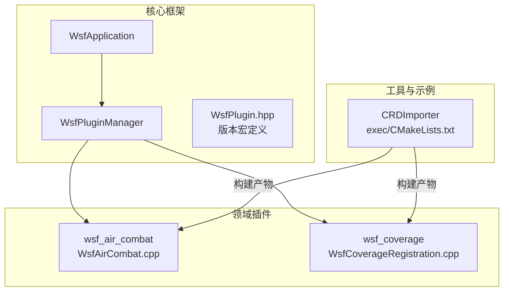
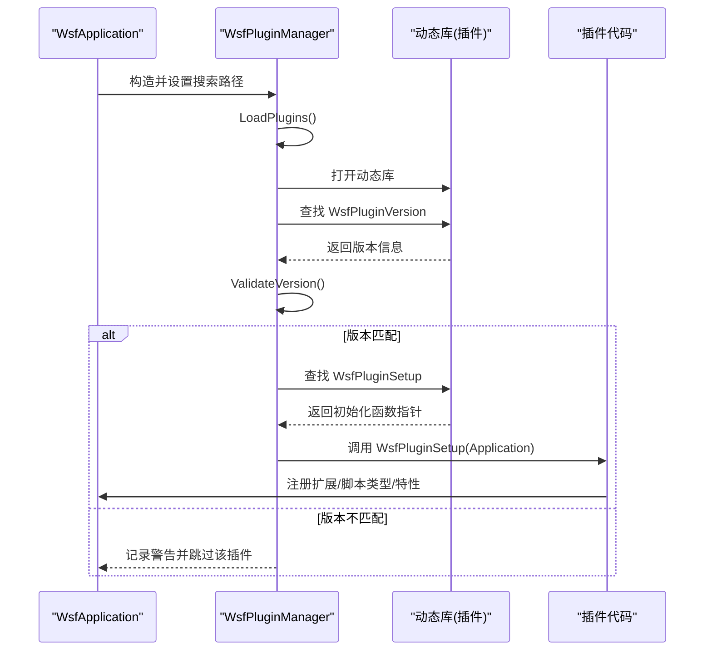
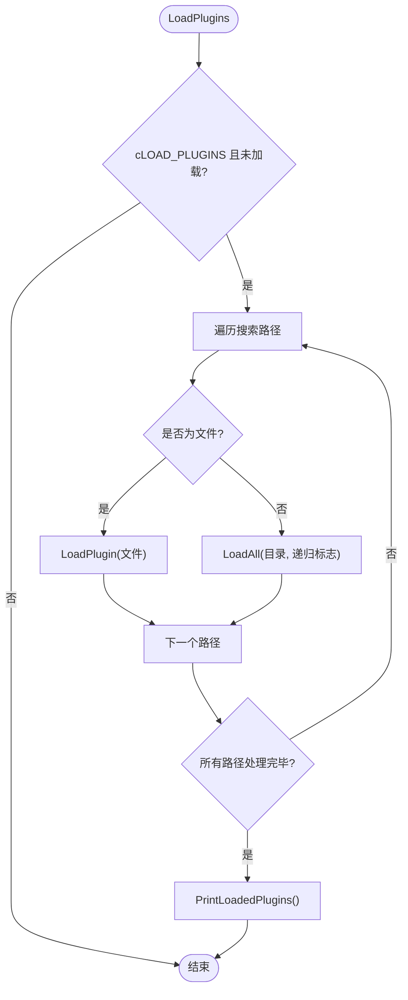
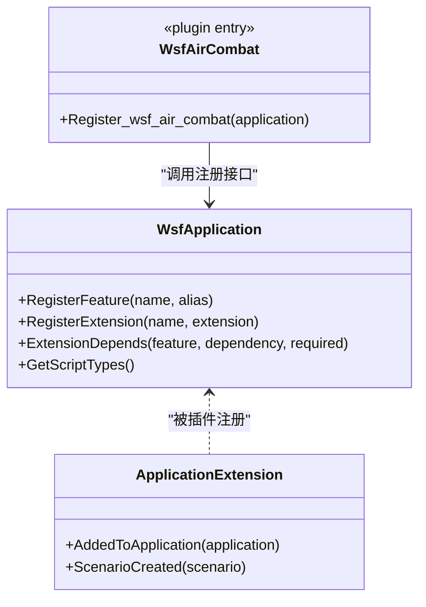
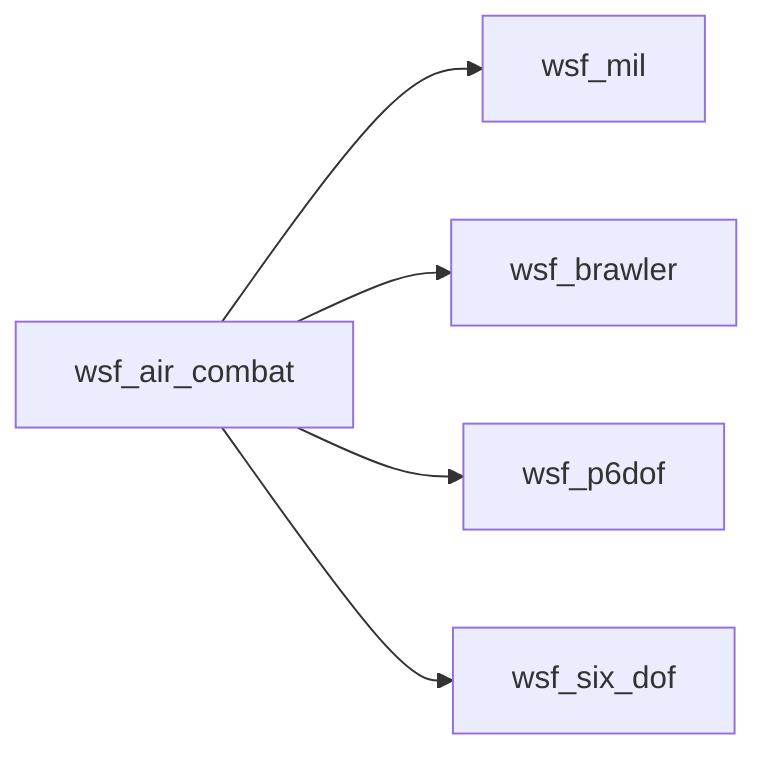

# 插件架构设计

<cite>
**本文引用的文件**   
- [WsfPluginManager.hpp](file://swdev/src/core/wsf/source/WsfPluginManager.hpp)
- [WsfPluginManager.cpp](file://swdev/src/core/wsf/source/WsfPluginManager.cpp)
- [WsfPlugin.hpp](file://swdev/src/core/wsf/source/WsfPlugin.hpp)
- [WsfApplication.cpp](file://swdev/src/core/wsf/source/WsfApplication.cpp)
- [WsfAirCombat.cpp](file://swdev/src/wsf_plugins/wsf_air_combat/source/WsfAirCombat.cpp)
- [WsfCoverageRegistration.cpp](file://swdev/src/wsf_plugins/wsf_coverage/source/WsfCoverageRegistration.cpp)
- [CMakeLists.txt（CRDImporter exec）](file://swdev/src/wizard/plugins/CRDImporter/exec/CMakeLists.txt)
</cite>

## 目录
1. [简介](#简介)
2. [项目结构](#项目结构)
3. [核心组件](#核心组件)
4. [架构总览](#架构总览)
5. [详细组件分析](#详细组件分析)
6. [依赖分析](#依赖分析)
7. [性能考虑](#性能考虑)
8. [故障排查指南](#故障排查指南)
9. [结论](#结论)
10. [附录：插件开发模板与最佳实践](#附录插件开发模板与最佳实践)

## 简介
本文件系统化阐述 AFSIM 中 WSF（Warfare Simulation Framework）插件体系的设计与实现，覆盖以下关键主题：
- 模块注册机制：通过 WsfApplication 扩展点、脚本类型注册与场景扩展进行能力注入。
- 生命周期管理：插件加载、初始化、运行期扩展与销毁清理的完整流程。
- 接口规范：统一的插件入口函数与版本校验协议。
- 编译配置：基于 CMake 的插件构建、依赖管理与安装路径。
- 插件发现机制：动态库扫描、显式路径加载与环境变量支持。
- 插件间通信：事件管道、XIO 接口与扩展依赖关系。
- 安全机制：版本与编译器匹配校验、沙箱隔离建议与资源限制策略。
- 开发模板与最佳实践：从零到一的插件创建步骤与注意事项。

## 项目结构
AFSIM 的插件生态主要位于 swdev/src 下：
- 核心框架：core/wsf 提供应用容器、插件管理器与通用工具。
- 领域插件：wsf_plugins/* 提供具体功能域（如空战、覆盖分析等）。
- 工具与示例：wizard/plugins/* 展示插件化应用的工程组织方式。

图表来源
- [WsfApplication.cpp:46-120](file://swdev/src/core/wsf/source/WsfApplication.cpp#L46-L120)
- [WsfPluginManager.hpp:35-68](file://swdev/src/core/wsf/source/WsfPluginManager.hpp#L35-L68)
- [WsfPluginManager.cpp:32-100](file://swdev/src/core/wsf/source/WsfPluginManager.cpp#L32-L100)
- [WsfAirCombat.cpp:44-82](file://swdev/src/wsf_plugins/wsf_air_combat/source/WsfAirCombat.cpp#L44-L82)
- [WsfCoverageRegistration.cpp:41-59](file://swdev/src/wsf_plugins/wsf_coverage/source/WsfCoverageRegistration.cpp#L41-L59)
- [CMakeLists.txt（CRDImporter exec）:12-22](file://swdev/src/wizard/plugins/CRDImporter/exec/CMakeLists.txt#L12-L22)

章节来源
- [WsfApplication.cpp:46-120](file://swdev/src/core/wsf/source/WsfApplication.cpp#L46-L120)
- [WsfPluginManager.hpp:35-68](file://swdev/src/core/wsf/source/WsfPluginManager.hpp#L35-L68)
- [WsfPluginManager.cpp:32-100](file://swdev/src/core/wsf/source/WsfPluginManager.cpp#L32-L100)

## 核心组件
- WsfApplication：应用容器，负责创建插件管理器、设置插件搜索路径并触发插件加载。
- WsfPluginManager：插件管理器，负责动态库扫描、符号解析、版本校验、调用插件初始化函数。
- 插件入口：每个插件需导出 WsfPluginVersion 与 WsfPluginSetup，用于版本协商与能力注册。
- 扩展系统：通过 WsfApplicationExtension 在应用启动时注册脚本类型、场景扩展与特性开关。

章节来源
- [WsfApplication.cpp:46-120](file://swdev/src/core/wsf/source/WsfApplication.cpp#L46-L120)
- [WsfPluginManager.hpp:35-68](file://swdev/src/core/wsf/source/WsfPluginManager.hpp#L35-L68)
- [WsfPluginManager.cpp:104-149](file://swdev/src/core/wsf/source/WsfPluginManager.cpp#L104-L149)
- [WsfAirCombat.cpp:25-64](file://swdev/src/wsf_plugins/wsf_air_combat/source/WsfAirCombat.cpp#L25-L64)

## 架构总览
WSF 插件采用“应用容器 + 插件管理器 + 插件动态库”的分层架构。应用容器在启动阶段完成插件管理器实例化与搜索路径配置；插件管理器按路径扫描并加载动态库，执行版本检查后调用插件初始化函数；插件通过扩展点向应用注册脚本类型、场景扩展与特性依赖。

图表来源
- [WsfApplication.cpp:90-120](file://swdev/src/core/wsf/source/WsfApplication.cpp#L90-L120)
- [WsfPluginManager.cpp:72-149](file://swdev/src/core/wsf/source/WsfPluginManager.cpp#L72-L149)
- [WsfAirCombat.cpp:67-82](file://swdev/src/wsf_plugins/wsf_air_combat/source/WsfAirCombat.cpp#L67-L82)

## 详细组件分析

### 插件管理器（WsfPluginManager）
职责与行为：
- 维护插件搜索路径列表，支持递归与非递归扫描。
- 根据路径是文件或目录分别处理：直接加载指定插件或遍历目录批量加载。
- 对每个动态库解析 WsfPluginVersion 与 WsfPluginSetup 符号，并进行版本与编译器字符串校验。
- 在析构阶段尝试调用插件提供的清理函数（若存在），确保资源释放。

关键接口：
- AddPluginSearchPath：添加搜索路径。
- LoadPlugins：统一加载入口。
- LoadPluginInitialize：单插件初始化流程（版本检查与 Setup 调用）。
- PrintLoadedPlugins：输出已加载插件清单。

图表来源
- [WsfPluginManager.cpp:72-100](file://swdev/src/core/wsf/source/WsfPluginManager.cpp#L72-L100)
- [WsfPluginManager.cpp:104-149](file://swdev/src/core/wsf/source/WsfPluginManager.cpp#L104-L149)

章节来源
- [WsfPluginManager.hpp:35-68](file://swdev/src/core/wsf/source/WsfPluginManager.hpp#L35-L68)
- [WsfPluginManager.cpp:32-100](file://swdev/src/core/wsf/source/WsfPluginManager.cpp#L32-L100)
- [WsfPluginManager.cpp:104-149](file://swdev/src/core/wsf/source/WsfPluginManager.cpp#L104-L149)

### 应用容器（WsfApplication）
职责与行为：
- 构造时创建 WsfPluginManager 实例。
- 读取环境变量 WSF_PLUGIN_PATH 作为额外搜索路径。
- 默认追加应用专属插件目录与通用 wsf_plugins 目录。
- 调用插件管理器执行加载。

章节来源
- [WsfApplication.cpp:90-120](file://swdev/src/core/wsf/source/WsfApplication.cpp#L90-L120)

### 插件入口与扩展注册（以 wsf_air_combat 为例）
插件需提供两个 C 链接入口：
- WsfPluginVersion：返回插件 API 版本与编译器字符串。
- WsfPluginSetup：接收 WsfApplication 引用，进行扩展与脚本类型注册。

wsf_air_combat 的典型流程：
- 定义 ApplicationExtension，重写 AddedToApplication 与 ScenarioCreated。
- 在 Register_wsf_air_combat 中注册特性与扩展，声明对其他扩展的依赖（如 wsf_mil、wsf_brawler、wsf_p6dof、wsf_six_dof）。
- 通过 UT_PLUGIN_EXPORT 暴露 WsfPluginVersion 与 WsfPluginSetup。

图表来源
- [WsfAirCombat.cpp:25-64](file://swdev/src/wsf_plugins/wsf_air_combat/source/WsfAirCombat.cpp#L25-L64)
- [WsfAirCombat.cpp:67-82](file://swdev/src/wsf_plugins/wsf_air_combat/source/WsfAirCombat.cpp#L67-L82)

章节来源
- [WsfAirCombat.cpp:25-82](file://swdev/src/wsf_plugins/wsf_air_combat/source/WsfAirCombat.cpp#L25-L82)

### 插件版本与编译器兼容性
- 插件通过 WsfPluginVersion 返回 WSF_PLUGIN_API_MAJOR_VERSION、WSF_PLUGIN_API_MINOR_VERSION 与 WSF_PLUGIN_API_COMPILER_STRING。
- 管理器使用这些信息进行版本与编译器字符串比对，不匹配则拒绝加载并记录警告。

章节来源
- [WsfPlugin.hpp:18-20](file://swdev/src/core/wsf/source/WsfPlugin.hpp#L18-L20)
- [WsfPluginManager.cpp:108-149](file://swdev/src/core/wsf/source/WsfPluginManager.cpp#L108-L149)

### 插件发现机制
- 环境变量 WSF_PLUGIN_PATH：可追加多个路径。
- 默认路径：应用专属目录 ../<app>_plugins 与通用目录 ../wsf_plugins。
- 支持两种模式：
  - 显式文件路径：直接加载指定动态库。
  - 目录扫描：递归或非递归地扫描目录中的动态库。

章节来源
- [WsfApplication.cpp:97-116](file://swdev/src/core/wsf/source/WsfApplication.cpp#L97-L116)
- [WsfPluginManager.cpp:82-100](file://swdev/src/core/wsf/source/WsfPluginManager.cpp#L82-L100)

### 插件间通信与集成点
- 事件管道（Event Pipe）：插件可通过事件管道序列化消息，供外部工具或可视化消费。
- XIO 接口：面向仿真与用户应用的外部交互接口，支持连接类型与应用类型配置。
- 扩展依赖：通过 ExtensionDepends 声明插件间的依赖关系，保证加载顺序与可用性。

章节来源
- [WsfAirCombat.cpp:44-64](file://swdev/src/wsf_plugins/wsf_air_combat/source/WsfAirCombat.cpp#L44-L64)
- [documentation/html/_sources/docs/xio_interface_development.rst.txt:22-30](file://documentation/html/_sources/docs/xio_interface_development.rst.txt#L22-L30)

### 安全机制
- 版本与编译器匹配：防止 ABI 不兼容导致的崩溃或未定义行为。
- 权限控制与沙箱隔离：建议在应用层对插件访问系统资源进行限制（文件系统、网络、进程间通信），并通过白名单机制控制插件能力。
- 资源限制：为插件分配 CPU/内存配额，避免资源耗尽影响宿主应用稳定性。

说明：上述安全机制为架构层面的建议与实践指导，具体实现需在应用层与运行时策略中补充。

## 依赖分析
WSF 插件依赖关系主要体现在扩展依赖与脚本类型依赖上。例如 wsf_air_combat 依赖 wsf_mil、wsf_brawler、wsf_p6dof、wsf_six_dof，并在应用启动时依次注册。

图表来源
- [WsfAirCombat.cpp:44-64](file://swdev/src/wsf_plugins/wsf_air_combat/source/WsfAirCombat.cpp#L44-L64)

章节来源
- [WsfAirCombat.cpp:44-64](file://swdev/src/wsf_plugins/wsf_air_combat/source/WsfAirCombat.cpp#L44-L64)

## 性能考虑
- 插件加载开销：尽量减少插件数量与体积，按需加载，避免不必要的动态库解析。
- 初始化成本：将重型初始化逻辑延迟至首次使用时触发，降低冷启动时间。
- 事件总线吞吐：合理设置事件队列大小与批处理策略，避免阻塞主循环。
- 内存与对象复用：在插件内部复用对象池，减少频繁分配与释放带来的碎片化。

[本节为通用性能建议，不直接分析具体文件]

## 故障排查指南
常见问题与定位方法：
- 插件未加载：
  - 检查 WSF_PLUGIN_PATH 是否包含目标路径。
  - 确认插件所在目录是否存在，且文件名符合平台动态库命名约定。
- 版本不匹配：
  - 核对插件导出的 WSF_PLUGIN_API_* 宏是否与宿主一致。
  - 查看管理器日志中的版本与编译器字符串差异。
- 缺少初始化函数：
  - 确认插件导出 WsfPluginSetup 且签名正确。
- 扩展依赖缺失：
  - 检查插件是否声明了对其他扩展的依赖，并确保依赖插件已先加载。

章节来源
- [WsfPluginManager.cpp:108-149](file://swdev/src/core/wsf/source/WsfPluginManager.cpp#L108-L149)
- [WsfAirCombat.cpp:44-64](file://swdev/src/wsf_plugins/wsf_air_combat/source/WsfAirCombat.cpp#L44-L64)

## 结论
AFSIM 的 WSF 插件体系通过清晰的应用容器与插件管理器分离，结合统一的入口函数与版本校验机制，实现了可扩展、可维护且安全的插件生态。借助扩展系统与脚本类型注册，插件能够灵活地向宿主应用注入能力；通过事件管道与 XIO 接口，插件可与外部系统进行高效通信。配合合理的编译配置与安全策略，开发者可以构建稳定可靠的领域插件。

[本节为总结性内容，不直接分析具体文件]

## 附录：插件开发模板与最佳实践

### 最小插件模板要点
- 导出入口函数：
  - WsfPluginVersion：返回插件 API 版本与编译器字符串。
  - WsfPluginSetup：接收 WsfApplication 引用，进行扩展与脚本类型注册。
- 定义 ApplicationExtension：
  - 在 AddedToApplication 中注册脚本类型。
  - 在 ScenarioCreated 中注册场景扩展。
- 声明扩展依赖：
  - 使用 ExtensionDepends 声明对其他扩展的依赖关系。

章节来源
- [WsfAirCombat.cpp:25-82](file://swdev/src/wsf_plugins/wsf_air_combat/source/WsfAirCombat.cpp#L25-L82)
- [WsfCoverageRegistration.cpp:41-59](file://swdev/src/wsf_plugins/wsf_coverage/source/WsfCoverageRegistration.cpp#L41-L59)

### CMake 集成与依赖管理
- 使用 swdev_project 基础配置，定义可执行或库目标。
- 设置 INSTALL_RPATH 以便运行时动态库查找。
- 通过 target_link_libraries 链接所需库。
- 使用 install 命令将产物安装至目标目录。

章节来源
- [CMakeLists.txt（CRDImporter exec）:12-22](file://swdev/src/wizard/plugins/CRDImporter/exec/CMakeLists.txt#L12-L22)

### 最佳实践清单
- 保持插件 API 版本与宿主一致，避免混用不同编译器构建的插件。
- 仅在必要时启用插件，减少启动时间与内存占用。
- 明确声明扩展依赖，避免运行时缺失能力。
- 对插件输入进行严格校验，防止非法数据导致异常。
- 使用事件管道与 XIO 接口进行跨进程通信，避免共享内存带来的同步复杂度。
- 为插件提供清晰的文档与测试用例，便于回归验证。

[本节为通用实践建议，不直接分析具体文件]