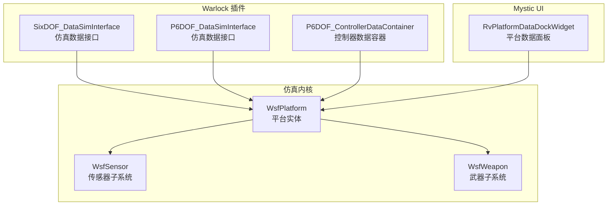
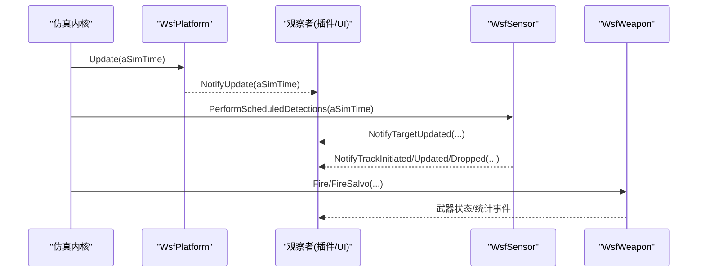
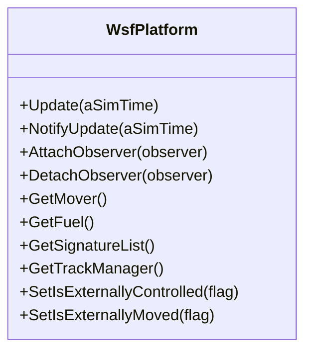
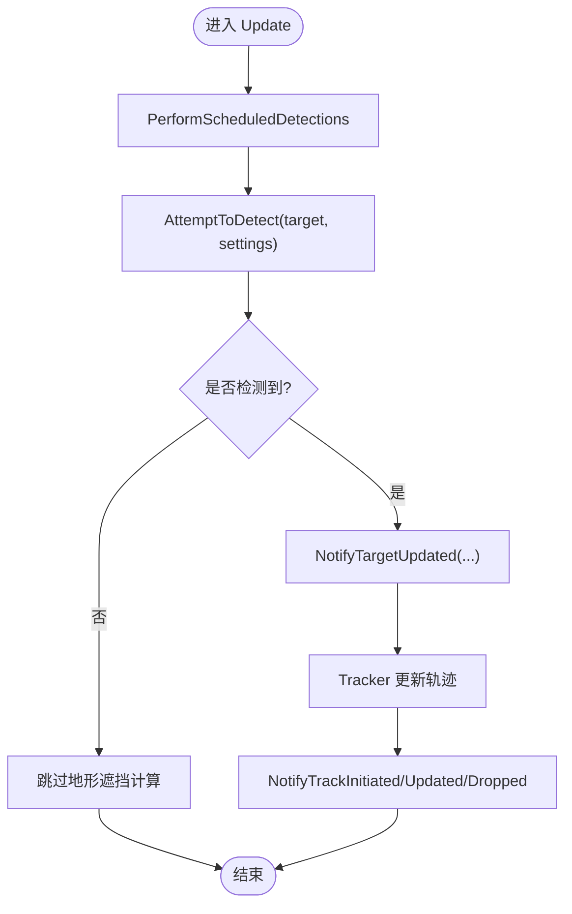
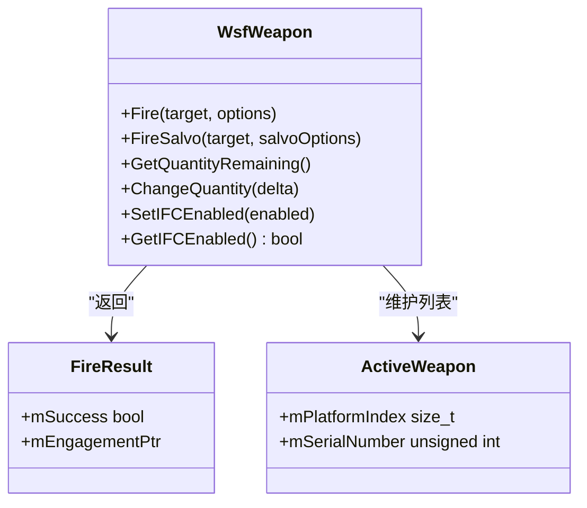
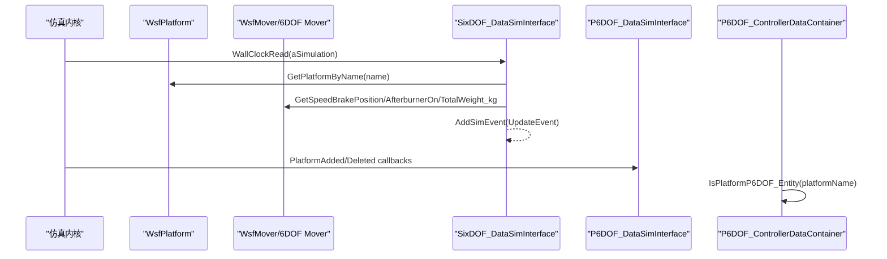
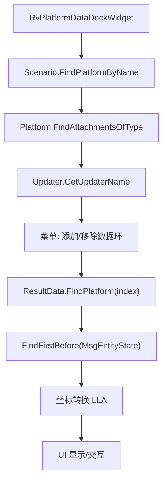
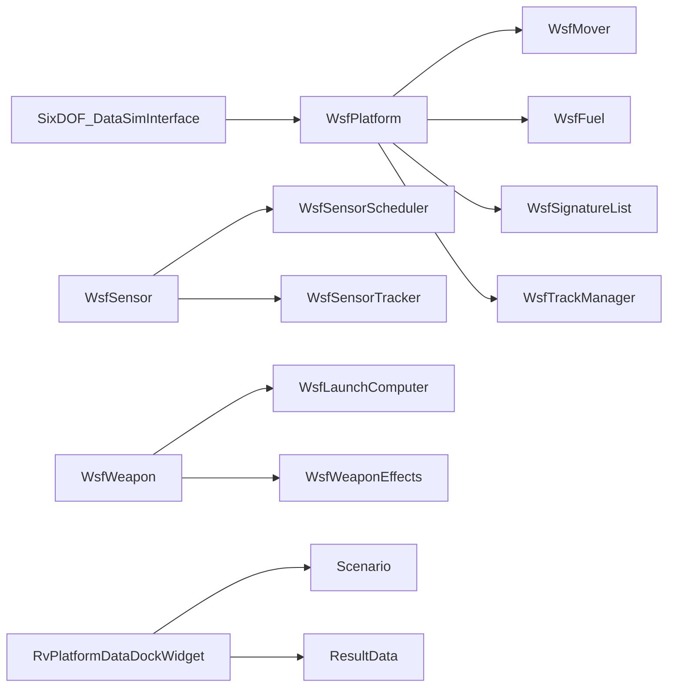

# 数据绑定机制

<cite>
**本文引用的文件**   
- [WsfPlatform.hpp](file://swdev/src/core/wsf/source/WsfPlatform.hpp)
- [WsfSensor.hpp](file://swdev/src/core/wsf/source/sensor/WsfSensor.hpp)
- [WsfWeapon.hpp](file://swdev/src/core/wsf_mil/source/weapon/WsfWeapon.hpp)
- [SixDOF_DataSimInterface.cpp](file://swdev/src/warlock/plugins/SixDOF_Data/source/SixDOF_DataSimInterface.cpp)
- [P6DOF_DataSimInterface.hpp](file://swdev/src/warlock/plugins/P6DOF_Data/source/P6DOF_DataSimInterface.hpp)
- [P6DOF_ControllerDataContainer.cpp](file://swdev/src/warlock/plugins/P6DOF_Controller/source/P6DOF_ControllerDataContainer.cpp)
- [RvPlatformDataDockWidget.cpp](file://swdev/src/mystic/lib/source/RvPlatformDataDockWidget.cpp)
</cite>

## 目录
1. [简介](#简介)
2. [项目结构](#项目结构)
3. [核心组件](#核心组件)
4. [架构总览](#架构总览)
5. [详细组件分析](#详细组件分析)
6. [依赖关系分析](#依赖关系分析)
7. [性能考虑](#性能考虑)
8. [故障排查指南](#故障排查指南)
9. [结论](#结论)
10. [附录](#附录)

## 简介
本文件系统化阐述 AFSIM 中的数据绑定机制与数据流架构，重点覆盖：
- 属性观察与事件处理：平台、传感器、武器等对象如何通过观察者模式与事件驱动实现实时更新。
- 数据模型定义：平台属性、传感器状态、武器参数的数据结构与职责边界。
- 数据同步机制：双向绑定、脏标记更新与增量刷新策略。
- 数据转换与格式化：单位转换、坐标变换与数据序列化。
- 实时可视化：图表绘制、动画效果与交互式探索。
- 开发示例与性能优化：端到端的数据绑定示例与关键优化点。

## 项目结构
AFSIM 的核心数据绑定能力由“仿真内核 + 插件/扩展”构成：
- 仿真内核（wsf）提供平台、传感器、武器等基础对象与观察者/事件基础设施。
- Warlock/Mystic 插件层负责将仿真数据拉取到 UI 或外部系统，完成展示与交互。
- 六自由度（6DOF）相关插件在仿真线程中读取平台运动学与控制面数据，封装为事件并推送给前端。

**图示来源**
- [WsfPlatform.hpp:108-115](file://swdev/src/core/wsf/source/WsfPlatform.hpp#L108-L115)
- [WsfSensor.hpp:91-92](file://swdev/src/core/wsf/source/sensor/WsfSensor.hpp#L91-L92)
- [WsfWeapon.hpp:62-63](file://swdev/src/core/wsf_mil/source/weapon/WsfWeapon.hpp#L62-L63)
- [SixDOF_DataSimInterface.cpp:21-43](file://swdev/src/warlock/plugins/SixDOF_Data/source/SixDOF_DataSimInterface.cpp#L21-L43)
- [P6DOF_DataSimInterface.hpp:25-41](file://swdev/src/warlock/plugins/P6DOF_Data/source/P6DOF_DataSimInterface.hpp#L25-L41)
- [P6DOF_ControllerDataContainer.cpp:17-24](file://swdev/src/warlock/plugins/P6DOF_Controller/source/P6DOF_ControllerDataContainer.cpp#L17-L24)
- [RvPlatformDataDockWidget.cpp:227-297](file://swdev/src/mystic/lib/source/RvPlatformDataDockWidget.cpp#L227-L297)

**章节来源**
- [WsfPlatform.hpp:108-115](file://swdev/src/core/wsf/source/WsfPlatform.hpp#L108-L115)
- [WsfSensor.hpp:91-92](file://swdev/src/core/wsf/source/sensor/WsfSensor.hpp#L91-L92)
- [WsfWeapon.hpp:62-63](file://swdev/src/core/wsf_mil/source/weapon/WsfWeapon.hpp#L62-L63)
- [SixDOF_DataSimInterface.cpp:21-43](file://swdev/src/warlock/plugins/SixDOF_Data/source/SixDOF_DataSimInterface.cpp#L21-L43)
- [P6DOF_DataSimInterface.hpp:25-41](file://swdev/src/warlock/plugins/P6DOF_Data/source/P6DOF_DataSimInterface.hpp#L25-L41)
- [P6DOF_ControllerDataContainer.cpp:17-24](file://swdev/src/warlock/plugins/P6DOF_Controller/source/P6DOF_ControllerDataContainer.cpp#L17-L24)
- [RvPlatformDataDockWidget.cpp:227-297](file://swdev/src/mystic/lib/source/RvPlatformDataDockWidget.cpp#L227-L297)

## 核心组件
- 平台（WsfPlatform）
  - 作为仿真实体的容器，聚合 Mover、Fuel、SignatureList、TrackManager 等子系统。
  - 提供 Update/NotifyUpdate/ExecuteScript/SendQueuedMessages 等生命周期与调度方法。
  - 支持观察者 AttachObserver/DetachObserver，用于订阅位置、状态变化。
- 传感器（WsfSensor）
  - 多模式检测器，包含 Scheduler/Tracker 控制探测时机与轨迹管理。
  - 提供 AttemptToDetect 抽象接口，以及 NotifyTargetUpdated/NotifyTrack* 等事件通知。
- 武器（WsfWeapon）
  - 支持显式/隐式武器，管理发射、齐射、库存、补弹、目标选择等。
  - 通过 Fire/FireSalvo 等方法触发武器行为，维护武器状态与统计。

**章节来源**
- [WsfPlatform.hpp:155-206](file://swdev/src/core/wsf/source/WsfPlatform.hpp#L155-L206)
- [WsfPlatform.hpp:567-574](file://swdev/src/core/wsf/source/WsfPlatform.hpp#L567-L574)
- [WsfSensor.hpp:45-89](file://swdev/src/core/wsf/source/sensor/WsfSensor.hpp#L45-L89)
- [WsfSensor.hpp:192-213](file://swdev/src/core/wsf/source/sensor/WsfSensor.hpp#L192-L213)
- [WsfSensor.hpp:230-244](file://swdev/src/core/wsf/source/sensor/WsfSensor.hpp#L230-L244)
- [WsfWeapon.hpp:39-59](file://swdev/src/core/wsf_mil/source/weapon/WsfWeapon.hpp#L39-L59)
- [WsfWeapon.hpp:343-363](file://swdev/src/core/wsf_mil/source/weapon/WsfWeapon.hpp#L343-L363)

## 架构总览
AFSIM 的数据绑定采用“观察者 + 事件”的双通道机制：
- 属性观察：平台/传感器暴露观察者接口，订阅方接收位置、状态、检测结果等变更。
- 事件处理：仿真阶段产生事件（如平台增删、传感器模式切换、武器发射），UI/插件消费事件进行渲染与交互。

**图示来源**
- [WsfPlatform.hpp:155-206](file://swdev/src/core/wsf/source/WsfPlatform.hpp#L155-L206)
- [WsfSensor.hpp:210-213](file://swdev/src/core/wsf/source/sensor/WsfSensor.hpp#L210-L213)
- [WsfSensor.hpp:230-244](file://swdev/src/core/wsf/source/sensor/WsfSensor.hpp#L230-L244)
- [WsfWeapon.hpp:343-363](file://swdev/src/core/wsf_mil/source/weapon/WsfWeapon.hpp#L343-L363)

## 详细组件分析

### 平台数据绑定与观察者
- 平台提供 Update/NotifyUpdate 等入口，内部根据更新时间戳与锁标志避免重复更新。
- 观察者通过 AttachObserver/DetachObserver 订阅平台事件，典型包括位置更新、删除通知。
- 平台还暴露 IsExternallyControlled/IsExternallyMoved 等标志位，支持外部应用驱动平台。

**图示来源**
- [WsfPlatform.hpp:155-206](file://swdev/src/core/wsf/source/WsfPlatform.hpp#L155-L206)
- [WsfPlatform.hpp:567-574](file://swdev/src/core/wsf/source/WsfPlatform.hpp#L567-L574)
- [WsfPlatform.hpp:401-414](file://swdev/src/core/wsf/source/WsfPlatform.hpp#L401-L414)
- [WsfPlatform.hpp:468-531](file://swdev/src/core/wsf/source/WsfPlatform.hpp#L468-L531)
- [WsfPlatform.hpp:542-548](file://swdev/src/core/wsf/source/WsfPlatform.hpp#L542-L548)
- [WsfPlatform.hpp:228-255](file://swdev/src/core/wsf/source/WsfPlatform.hpp#L228-L255)

**章节来源**
- [WsfPlatform.hpp:155-206](file://swdev/src/core/wsf/source/WsfPlatform.hpp#L155-L206)
- [WsfPlatform.hpp:567-574](file://swdev/src/core/wsf/source/WsfPlatform.hpp#L567-L574)
- [WsfPlatform.hpp:228-255](file://swdev/src/core/wsf/source/WsfPlatform.hpp#L228-L255)

### 传感器数据流与事件
- 传感器通过 AttemptToDetect 执行探测逻辑，结合 Scheduler/Tracker 管理探测时机与轨迹。
- 结果通过 NotifyTargetUpdated/NotifyTrack* 通知观察者，支持轨迹的初始化、更新、丢失。
- 支持多模式（ModeList）、线程安全标记（ThreadSafe）、更新间隔（UpdateInterval）。

**图示来源**
- [WsfSensor.hpp:210-213](file://swdev/src/core/wsf/source/sensor/WsfSensor.hpp#L210-L213)
- [WsfSensor.hpp:192-196](file://swdev/src/core/wsf/source/sensor/WsfSensor.hpp#L192-L196)
- [WsfSensor.hpp:230-244](file://swdev/src/core/wsf/source/sensor/WsfSensor.hpp#L230-L244)
- [WsfSensor.hpp:400-417](file://swdev/src/core/wsf/source/sensor/WsfSensor.hpp#L400-L417)
- [WsfSensor.hpp:419-451](file://swdev/src/core/wsf/source/sensor/WsfSensor.hpp#L419-L451)

**章节来源**
- [WsfSensor.hpp:45-89](file://swdev/src/core/wsf/source/sensor/WsfSensor.hpp#L45-L89)
- [WsfSensor.hpp:192-213](file://swdev/src/core/wsf/source/sensor/WsfSensor.hpp#L192-L213)
- [WsfSensor.hpp:230-244](file://swdev/src/core/wsf/source/sensor/WsfSensor.hpp#L230-L244)
- [WsfSensor.hpp:400-451](file://swdev/src/core/wsf/source/sensor/WsfSensor.hpp#L400-L451)

### 武器参数与状态管理
- 武器支持多种发射方式（单发/齐射），管理库存、补弹、发射延迟与间隔。
- 通过 FireResult/ActiveWeapon 跟踪发射结果与活跃武器平台。
- 支持 IFC（集成火控）与武器服务器对接。

**图示来源**
- [WsfWeapon.hpp:317-341](file://swdev/src/core/wsf_mil/source/weapon/WsfWeapon.hpp#L317-L341)
- [WsfWeapon.hpp:343-363](file://swdev/src/core/wsf_mil/source/weapon/WsfWeapon.hpp#L343-L363)
- [WsfWeapon.hpp:404-418](file://swdev/src/core/wsf_mil/source/weapon/WsfWeapon.hpp#L404-L418)
- [WsfWeapon.hpp:597-612](file://swdev/src/core/wsf_mil/source/weapon/WsfWeapon.hpp#L597-L612)
- [WsfWeapon.hpp:679-690](file://swdev/src/core/wsf_mil/source/weapon/WsfWeapon.hpp#L679-L690)

**章节来源**
- [WsfWeapon.hpp:39-59](file://swdev/src/core/wsf_mil/source/weapon/WsfWeapon.hpp#L39-L59)
- [WsfWeapon.hpp:317-363](file://swdev/src/core/wsf_mil/source/weapon/WsfWeapon.hpp#L317-L363)
- [WsfWeapon.hpp:404-418](file://swdev/src/core/wsf_mil/source/weapon/WsfWeapon.hpp#L404-L418)
- [WsfWeapon.hpp:597-612](file://swdev/src/core/wsf_mil/source/weapon/WsfWeapon.hpp#L597-L612)
- [WsfWeapon.hpp:679-690](file://swdev/src/core/wsf_mil/source/weapon/WsfWeapon.hpp#L679-L690)

### 六自由度数据绑定与事件推送
- SixDOF_DataSimInterface 在仿真线程中读取平台运动学与控制器数据，封装为 UpdateEvent 推送。
- P6DOF_DataSimInterface 提供通用仿真接口，支持设置感兴趣平台、监听平台增删。
- P6DOF_ControllerDataContainer 维护控制器数据容器，判断平台是否为 6DOF 实体。

**图示来源**
- [SixDOF_DataSimInterface.cpp:32-43](file://swdev/src/warlock/plugins/SixDOF_Data/source/SixDOF_DataSimInterface.cpp#L32-L43)
- [SixDOF_DataSimInterface.cpp:84-105](file://swdev/src/warlock/plugins/SixDOF_Data/source/SixDOF_DataSimInterface.cpp#L84-L105)
- [SixDOF_DataSimInterface.cpp:114-128](file://swdev/src/warlock/plugins/SixDOF_Data/source/SixDOF_DataSimInterface.cpp#L114-L128)
- [P6DOF_DataSimInterface.hpp:25-41](file://swdev/src/warlock/plugins/P6DOF_Data/source/P6DOF_DataSimInterface.hpp#L25-L41)
- [P6DOF_ControllerDataContainer.cpp:26-37](file://swdev/src/warlock/plugins/P6DOF_Controller/source/P6DOF_ControllerDataContainer.cpp#L26-L37)

**章节来源**
- [SixDOF_DataSimInterface.cpp:32-43](file://swdev/src/warlock/plugins/SixDOF_Data/source/SixDOF_DataSimInterface.cpp#L32-L43)
- [SixDOF_DataSimInterface.cpp:84-105](file://swdev/src/warlock/plugins/SixDOF_Data/source/SixDOF_DataSimInterface.cpp#L84-L105)
- [SixDOF_DataSimInterface.cpp:114-128](file://swdev/src/warlock/plugins/SixDOF_Data/source/SixDOF_DataSimInterface.cpp#L114-L128)
- [P6DOF_DataSimInterface.hpp:25-41](file://swdev/src/warlock/plugins/P6DOF_Data/source/P6DOF_DataSimInterface.hpp#L25-L41)
- [P6DOF_ControllerDataContainer.cpp:26-37](file://swdev/src/warlock/plugins/P6DOF_Controller/source/P6DOF_ControllerDataContainer.cpp#L26-L37)

### UI 数据绑定与交互
- RvPlatformDataDockWidget 从场景中找到平台，查询附件环（AttachmentDataRing）以添加/移除数据环（如纬度、经度、海拔）。
- 通过 ResultData/ResultPlatform 获取当前仿真时间点的实体状态，转换为 LLA 坐标供 UI 显示。

**图示来源**
- [RvPlatformDataDockWidget.cpp:227-297](file://swdev/src/mystic/lib/source/RvPlatformDataDockWidget.cpp#L227-L297)

**章节来源**
- [RvPlatformDataDockWidget.cpp:227-297](file://swdev/src/mystic/lib/source/RvPlatformDataDockWidget.cpp#L227-L297)

## 依赖关系分析
- 组件耦合
  - WsfPlatform 聚合 Mover/Fuel/SignatureList/TrackManager，形成平台级数据源。
  - WsfSensor 依赖 Scheduler/Tracker 管理探测与轨迹；WsfWeapon 依赖 LaunchComputer/Effects 管理发射与效果。
- 直接/间接依赖
  - SixDOF_DataSimInterface 依赖 WsfPlatform/WsfMover 读取运动学数据。
  - RvPlatformDataDockWidget 依赖 Scenario/ResultData 获取平台与状态。
- 循环依赖
  - 未见明显循环依赖；观察者模式解耦了数据生产者与消费者。
- 外部依赖
  - Warlock/Mystic 插件依赖 Qt 框架进行 UI 交互。
  - 传感器/武器可能涉及 DIS/UCI 等协议扩展。

**图示来源**
- [WsfPlatform.hpp:401-414](file://swdev/src/core/wsf/source/WsfPlatform.hpp#L401-L414)
- [WsfPlatform.hpp:468-531](file://swdev/src/core/wsf/source/WsfPlatform.hpp#L468-L531)
- [WsfPlatform.hpp:542-548](file://swdev/src/core/wsf/source/WsfPlatform.hpp#L542-L548)
- [WsfSensor.hpp:400-417](file://swdev/src/core/wsf/source/sensor/WsfSensor.hpp#L400-L417)
- [WsfWeapon.hpp:223-229](file://swdev/src/core/wsf_mil/source/weapon/WsfWeapon.hpp#L223-L229)
- [SixDOF_DataSimInterface.cpp:32-43](file://swdev/src/warlock/plugins/SixDOF_Data/source/SixDOF_DataSimInterface.cpp#L32-L43)
- [RvPlatformDataDockWidget.cpp:227-297](file://swdev/src/mystic/lib/source/RvPlatformDataDockWidget.cpp#L227-L297)

**章节来源**
- [WsfPlatform.hpp:401-414](file://swdev/src/core/wsf/source/WsfPlatform.hpp#L401-L414)
- [WsfPlatform.hpp:468-531](file://swdev/src/core/wsf/source/WsfPlatform.hpp#L468-L531)
- [WsfPlatform.hpp:542-548](file://swdev/src/core/wsf/source/WsfPlatform.hpp#L542-L548)
- [WsfSensor.hpp:400-417](file://swdev/src/core/wsf/source/sensor/WsfSensor.hpp#L400-L417)
- [WsfWeapon.hpp:223-229](file://swdev/src/core/wsf_mil/source/weapon/WsfWeapon.hpp#L223-L229)
- [SixDOF_DataSimInterface.cpp:32-43](file://swdev/src/warlock/plugins/SixDOF_Data/source/SixDOF_DataSimInterface.cpp#L32-L43)
- [RvPlatformDataDockWidget.cpp:227-297](file://swdev/src/mystic/lib/source/RvPlatformDataDockWidget.cpp#L227-L297)

## 性能考虑
- 更新节流与锁
  - 平台 Update/UpdateMultiThread 使用 mUpdateAllowed/mUpdateLocked 与 mLastUpdateTime 避免重复更新与并发冲突。
- 传感器探测优化
  - Settings.mRequiredPd 允许提前跳过昂贵地形遮挡计算，提升大规模目标探测效率。
- 多线程安全
  - 传感器 ThreadSafe 标记允许在多核环境下并行更新；非线程安全的传感器需串行化。
- 增量刷新
  - 通过观察者只推送变更数据，减少 UI 重绘与网络传输开销。
- 资源复用
  - 武器库存与补弹逻辑避免频繁分配/释放，降低 GC/内存碎片压力。

[本节为通用指导，不直接分析具体文件]

## 故障排查指南
- 平台未更新
  - 检查 mUpdateAllowed/mUpdateLocked 标志与 mLastUpdateTime 是否被正确设置。
  - 确认 AttachObserver 已调用且未提前 DetachObserver。
- 传感器无检测结果
  - 检查 AttemptToDetect 实现是否符合“先易后难”的检测顺序。
  - 验证 Scheduler/Tracker 是否正确配置与激活。
- 武器未发射
  - 检查 Fire/FireSalvo 调用参数与库存状态（QuantityRemaining/Committed）。
  - 确认 IFC 与武器服务器连接正常。
- 6DOF 数据缺失
  - 确认 SimInterface.WallClockRead 能获取到目标平台与 Mover。
  - 检查 P6DOF_ControllerDataContainer.IsPlatformP6DOF_Entity 返回值。

**章节来源**
- [WsfPlatform.hpp:155-206](file://swdev/src/core/wsf/source/WsfPlatform.hpp#L155-L206)
- [WsfSensor.hpp:192-196](file://swdev/src/core/wsf/source/sensor/WsfSensor.hpp#L192-L196)
- [WsfWeapon.hpp:404-418](file://swdev/src/core/wsf_mil/source/weapon/WsfWeapon.hpp#L404-L418)
- [SixDOF_DataSimInterface.cpp:32-43](file://swdev/src/warlock/plugins/SixDOF_Data/source/SixDOF_DataSimInterface.cpp#L32-L43)
- [P6DOF_ControllerDataContainer.cpp:26-37](file://swdev/src/warlock/plugins/P6DOF_Controller/source/P6DOF_ControllerDataContainer.cpp#L26-L37)

## 结论
AFSIM 的数据绑定机制以平台为核心，通过观察者与事件驱动实现传感器、武器等子系统的实时数据同步。其设计强调：
- 清晰的职责分离：平台提供数据源，传感器/武器专注领域逻辑。
- 可扩展性：插件层可灵活接入 UI 或外部系统。
- 高性能：更新节流、探测优化与多线程安全保障大规模仿真下的流畅体验。

[本节为总结性内容，不直接分析具体文件]

## 附录
- 数据绑定开发示例
  - 订阅平台位置更新：实现 WsfSinglePlatformObserver，在 OnUpdate 中读取位置并刷新 UI。
  - 订阅传感器轨迹：实现 WsfSingleSensorObserver，在 NotifyTrackInitiated/Updated/Dropped 中维护轨迹列表。
  - 6DOF 数据绑定：在 SimInterface.WallClockRead 中读取 Mover 数据并封装为 UpdateEvent 推送。
- 数据转换与格式化
  - 单位转换：统一使用米/秒/千克等标准单位，必要时在 UI 层进行显示转换。
  - 坐标变换：WCS/LLA/ECEF 之间转换，建议在工具类中集中实现。
  - 数据序列化：JSON/CSV 输出用于离线分析与回放。
- 实时可视化
  - 图表绘制：基于 Qt/QChart 或第三方库绘制轨迹、功率谱、覆盖率等。
  - 动画效果：按仿真时间步进更新图形元素，避免全量重绘。
  - 交互式探索：支持缩放、过滤、导出等功能。

[本节为概念性内容，不直接分析具体文件]