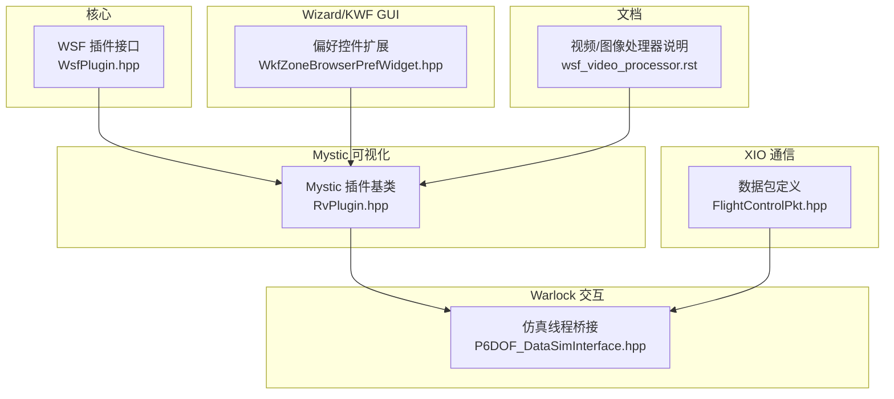
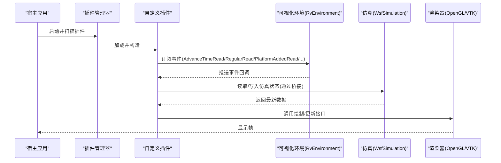
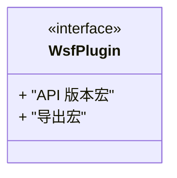
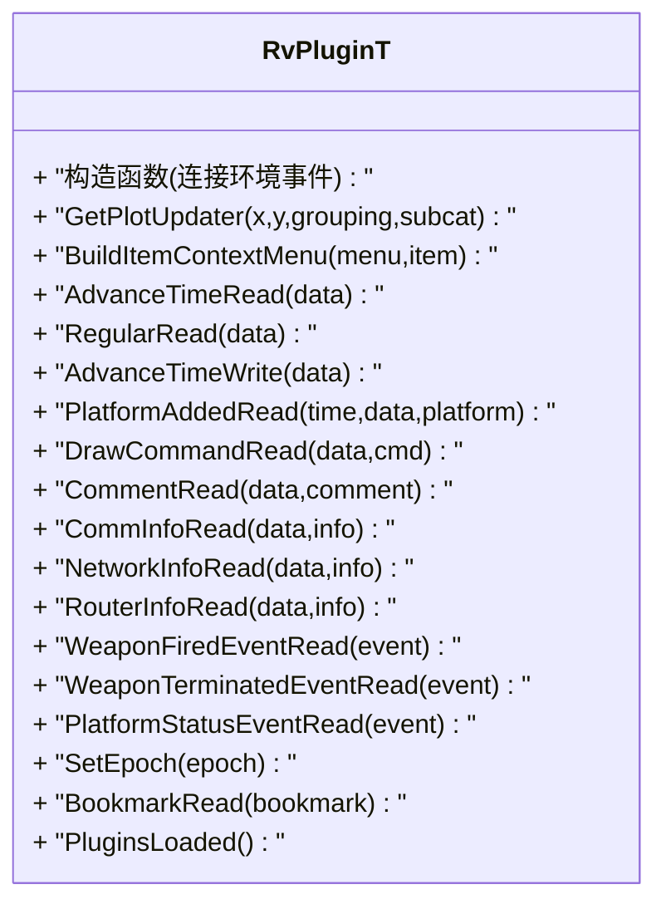
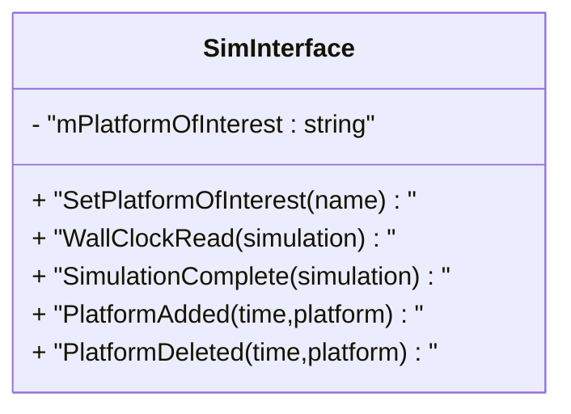
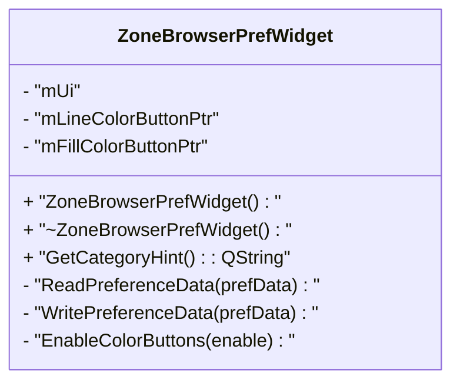
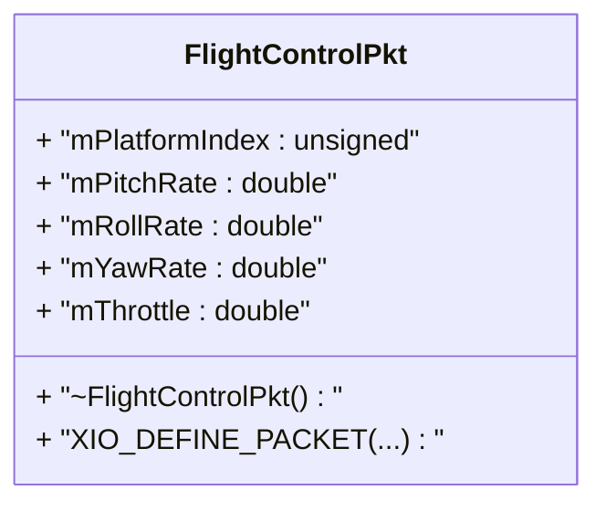
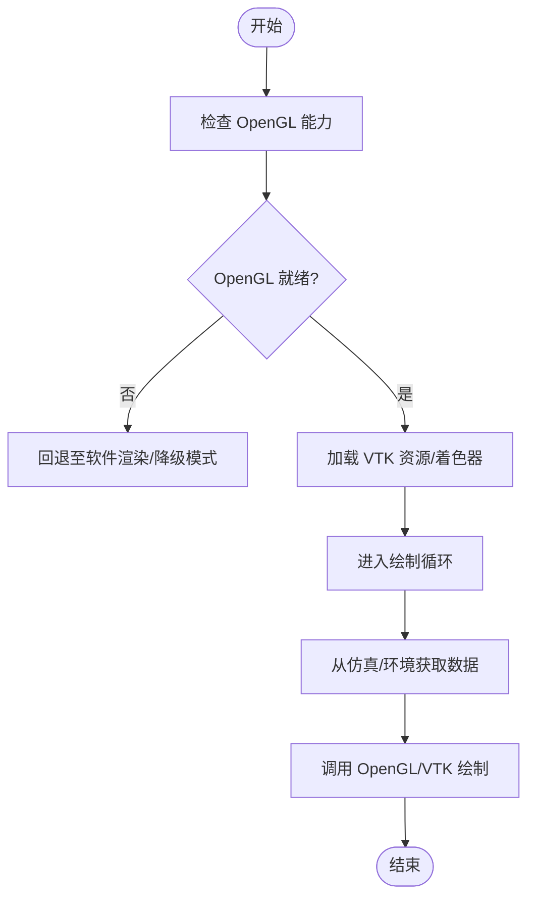
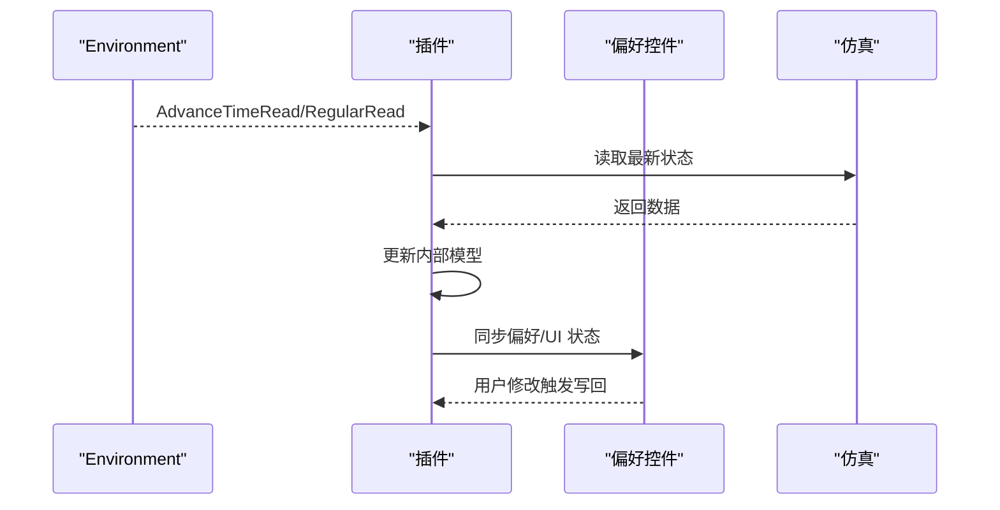
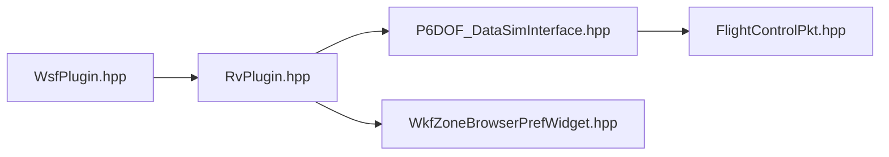

# 自定义可视化开发

<cite>
**本文引用的文件**   
- [WsfPlugin.hpp](file://swdev/src/core/wsf/source/WsfPlugin.hpp)
- [RvPlugin.hpp](file://swdev/src/mystic/lib/source/RvPlugin.hpp)
- [WkfZoneBrowserPrefWidget.hpp](file://swdev/src/tools/wkf/common/source/zone_browser/WkfZoneBrowserPrefWidget.hpp)
- [P6DOF_DataSimInterface.hpp](file://swdev/src/warlock/plugins/P6DOF_Data/source/P6DOF_DataSimInterface.hpp)
- [WsfCoverageRegistration.cpp](file://swdev/src/wsf_plugins/wsf_coverage/source/WsfCoverageRegistration.cpp)
- [FlightControlPkt.hpp](file://training/developer/core/labs/solution/xio/source/FlightControlPkt.hpp)
- [wsf_video_processor.rst](file://swdev/src/core/wsf_mil/doc/wsf_video_processor.rst)
</cite>

## 目录
1. [简介](#简介)
2. [项目结构](#项目结构)
3. [核心组件](#核心组件)
4. [架构总览](#架构总览)
5. [详细组件分析](#详细组件分析)
6. [依赖关系分析](#依赖关系分析)
7. [性能考虑](#性能考虑)
8. [故障排查指南](#故障排查指南)
9. [结论](#结论)
10. [附录](#附录)

## 简介
本文件面向“自定义可视化开发”，围绕 AFSIM 的插件化架构与可视化扩展能力，系统阐述：
- 插件架构的设计原理：模块注册、生命周期管理、接口规范
- GUI 控件扩展方法：自定义对话框、工具栏按钮、上下文菜单
- 图形渲染定制：OpenGL 集成、VTK 可视化、自定义绘制函数
- 数据绑定机制：属性观察、事件处理、实时更新
- 可视化脚本：Python API 使用、脚本语法、调试方法
- 插件打包、部署与版本管理
- 完整示例与模板代码路径指引

## 项目结构
AFSIM 的可视化与插件体系主要分布在以下区域：
- 核心 WSF 插件接口与版本宏定义
- Mystic（结果可视化）插件基类与事件总线
- Warlock（交互控制）仿真线程桥接
- Wizard/KWF（GUI 偏好与控件扩展）
- XIO（跨进程/跨应用通信包）
- 文档与示例（含视频/图像处理器说明）

**图表来源**
- [WsfPlugin.hpp:1-23](file://swdev/src/core/wsf/source/WsfPlugin.hpp#L1-L23)
- [RvPlugin.hpp:1-122](file://swdev/src/mystic/lib/source/RvPlugin.hpp#L1-L122)
- [P6DOF_DataSimInterface.hpp:1-44](file://swdev/src/warlock/plugins/P6DOF_Data/source/P6DOF_DataSimInterface.hpp#L1-L44)
- [WkfZoneBrowserPrefWidget.hpp:1-43](file://swdev/src/tools/wkf/common/source/zone_browser/WkfZoneBrowserPrefWidget.hpp#L1-L43)
- [FlightControlPkt.hpp:1-45](file://training/developer/core/labs/solution/xio/source/FlightControlPkt.hpp#L1-L45)
- [wsf_video_processor.rst:1-19](file://swdev/src/core/wsf_mil/doc/wsf_video_processor.rst#L1-L19)

**章节来源**
- [WsfPlugin.hpp:1-23](file://swdev/src/core/wsf/source/WsfPlugin.hpp#L1-L23)
- [RvPlugin.hpp:1-122](file://swdev/src/mystic/lib/source/RvPlugin.hpp#L1-L122)
- [WkfZoneBrowserPrefWidget.hpp:1-43](file://swdev/src/tools/wkf/common/source/zone_browser/WkfZoneBrowserPrefWidget.hpp#L1-L43)
- [P6DOF_DataSimInterface.hpp:1-44](file://swdev/src/warlock/plugins/P6DOF_Data/source/P6DOF_DataSimInterface.hpp#L1-L44)
- [FlightControlPkt.hpp:1-45](file://training/developer/core/labs/solution/xio/source/FlightControlPkt.hpp#L1-L45)
- [wsf_video_processor.rst:1-19](file://swdev/src/core/wsf_mil/doc/wsf_video_processor.rst#L1-L19)

## 核心组件
- WSF 插件接口与版本宏：提供插件 API 的版本常量与基础导出宏，确保插件与宿主 ABI 兼容。
- Mystic 插件基类：封装了与可视化环境的事件订阅、时间推进回调、平台/武器/通信等消息处理，以及上下文菜单扩展点。
- Warlock 仿真桥接：在仿真线程中读取/写入仿真状态，驱动 UI 更新或控制器逻辑。
- Wizard/KWF 偏好控件：通过继承通用偏好控件模板，实现配置面板与颜色选择器等 GUI 扩展。
- XIO 数据包：用于跨进程/跨应用的数据交换，支持序列化/反序列化宏。

**章节来源**
- [WsfPlugin.hpp:1-23](file://swdev/src/core/wsf/source/WsfPlugin.hpp#L1-L23)
- [RvPlugin.hpp:1-122](file://swdev/src/mystic/lib/source/RvPlugin.hpp#L1-L122)
- [P6DOF_DataSimInterface.hpp:1-44](file://swdev/src/warlock/plugins/P6DOF_Data/source/P6DOF_DataSimInterface.hpp#L1-L44)
- [WkfZoneBrowserPrefWidget.hpp:1-43](file://swdev/src/tools/wkf/common/source/zone_browser/WkfZoneBrowserPrefWidget.hpp#L1-L43)
- [FlightControlPkt.hpp:1-45](file://training/developer/core/labs/solution/xio/source/FlightControlPkt.hpp#L1-L45)

## 架构总览
下图展示插件从加载到渲染更新的典型流程：插件通过 WSF 接口注册，Mystic 插件基类订阅环境与时间事件，Warlock 侧在仿真线程中读写数据，最终驱动 OpenGL/VTK 渲染管线。

**图表来源**
- [RvPlugin.hpp:44-71](file://swdev/src/mystic/lib/source/RvPlugin.hpp#L44-L71)
- [P6DOF_DataSimInterface.hpp:25-41](file://swdev/src/warlock/plugins/P6DOF_Data/source/P6DOF_DataSimInterface.hpp#L25-L41)

## 详细组件分析

### 插件接口与版本管理（WSF）
- 作用：定义插件 API 的主/次版本号与编译器字符串宏，保证插件与宿主 ABI 一致。
- 关键点：
  - 版本宏由核心库版本导出，避免编译期不一致导致的运行时崩溃。
  - 插件需遵循统一的导出与命名约定，便于动态加载。

**图表来源**
- [WsfPlugin.hpp:18-21](file://swdev/src/core/wsf/source/WsfPlugin.hpp#L18-L21)

**章节来源**
- [WsfPlugin.hpp:1-23](file://swdev/src/core/wsf/source/WsfPlugin.hpp#L1-L23)

### Mystic 可视化插件基类（RvPlugin）
- 作用：为可视化插件提供统一的事件订阅、时间推进回调、平台/武器/通信等消息处理，以及上下文菜单扩展点。
- 关键特性：
  - 通过 Qt 信号槽将环境事件直接投递到插件回调（DirectConnection），确保在仿真主线程执行。
  - 暴露 BuildItemContextMenu 钩子以扩展右键菜单。
  - 提供 GetPlotUpdater 钩子以接入绘图更新器。

**图表来源**
- [RvPlugin.hpp:35-117](file://swdev/src/mystic/lib/source/RvPlugin.hpp#L35-L117)

**章节来源**
- [RvPlugin.hpp:1-122](file://swdev/src/mystic/lib/source/RvPlugin.hpp#L1-L122)

### Warlock 仿真线程桥接（P6DOF_DataSimInterface）
- 作用：在仿真线程中读取/写入仿真状态，触发 UI 更新或控制器逻辑。
- 关键点：
  - 继承 warlock::SimInterfaceT，重写 WallClockRead/SimulationComplete 等生命周期回调。
  - 维护感兴趣的平台集合，过滤无关数据，降低 UI 压力。

**图表来源**
- [P6DOF_DataSimInterface.hpp:25-41](file://swdev/src/warlock/plugins/P6DOF_Data/source/P6DOF_DataSimInterface.hpp#L25-L41)

**章节来源**
- [P6DOF_DataSimInterface.hpp:1-44](file://swdev/src/warlock/plugins/P6DOF_Data/source/P6DOF_DataSimInterface.hpp#L1-L44)

### Wizard/KWF 偏好控件扩展（WkfZoneBrowserPrefWidget）
- 作用：通过继承通用偏好控件模板，实现配置面板与颜色选择器等 GUI 扩展。
- 关键点：
  - 覆盖 ReadPreferenceData/WritePreferenceData 以持久化用户设置。
  - 提供 GetCategoryHint 指定分类提示。

**图表来源**
- [WkfZoneBrowserPrefWidget.hpp:24-40](file://swdev/src/tools/wkf/common/source/zone_browser/WkfZoneBrowserPrefWidget.hpp#L24-L40)

**章节来源**
- [WkfZoneBrowserPrefWidget.hpp:1-43](file://swdev/src/tools/wkf/common/source/zone_browser/WkfZoneBrowserPrefWidget.hpp#L1-L43)

### XIO 数据包（FlightControlPkt）
- 作用：定义跨进程/跨应用的飞行控制数据包，包含平台索引与控制指令字段。
- 关键点：
  - 使用预定义宏生成序列化/反序列化方法。
  - 字段类型与范围明确，便于两端协议对齐。

**图表来源**
- [FlightControlPkt.hpp:25-43](file://training/developer/core/labs/solution/xio/source/FlightControlPkt.hpp#L25-L43)

**章节来源**
- [FlightControlPkt.hpp:1-45](file://training/developer/core/labs/solution/xio/source/FlightControlPkt.hpp#L1-L45)

### 图形渲染定制（OpenGL/VTK/自定义绘制）
- OpenGL 集成：Mystic 插件通过环境事件驱动渲染管线；参考文档中对 OpenGL 与绘制顺序的说明。
- VTK 可视化：构建选项与资源路径可通过 CMake 变量配置，便于开发者替换资源与着色器。
- 自定义绘制函数：传感器/地图/轨迹等绘制函数位于 sensor_plot_lib，可复用或扩展。

**图表来源**
- [wsf_video_processor.rst:10-19](file://swdev/src/core/wsf_mil/doc/wsf_video_processor.rst#L10-L19)

**章节来源**
- [wsf_video_processor.rst:1-19](file://swdev/src/core/wsf_mil/doc/wsf_video_processor.rst#L1-L19)

### 数据绑定机制（属性观察/事件处理/实时更新）
- 事件驱动：Mystic 插件通过 Environment 信号订阅 AdvanceTimeRead/RegularRead 等事件，实现实时刷新。
- 属性观察：偏好控件通过 Read/Write 偏好数据实现属性双向绑定。
- 仿真线程隔离：Warlock 桥接确保仿真线程与 UI 线程解耦，避免竞态。

**图表来源**
- [RvPlugin.hpp:44-71](file://swdev/src/mystic/lib/source/RvPlugin.hpp#L44-L71)
- [WkfZoneBrowserPrefWidget.hpp:33-35](file://swdev/src/tools/wkf/common/source/zone_browser/WkfZoneBrowserPrefWidget.hpp#L33-L35)

**章节来源**
- [RvPlugin.hpp:1-122](file://swdev/src/mystic/lib/source/RvPlugin.hpp#L1-L122)
- [WkfZoneBrowserPrefWidget.hpp:1-43](file://swdev/src/tools/wkf/common/source/zone_browser/WkfZoneBrowserPrefWidget.hpp#L1-L43)

### 可视化脚本（Python API/语法/调试）
- Python API：通过 PyMystic 进行批处理与脚本化可视化操作（参见文档导航）。
- 脚本语法：场景/处理器/观测器等均可通过脚本扩展，结合事件管道输出进行分析。
- 调试方法：利用日志输出、事件管道与离线后处理工具定位问题。

[本节为概念性说明，不直接分析具体源码文件]

### 插件打包、部署与版本管理
- 版本兼容性：插件必须与宿主应用使用相同的异常提升标志（PROMOTE_HARDWARE_EXCEPTIONS）编译，否则可能引发运行时错误。
- 插件发现路径：通过环境变量 WSF_PLUGIN_PATH 或默认目录（../application_plugin 或 ../wsf_plugins）搜索插件。
- 兼容性检查：插件管理器在执行前会进行操作系统、编译器与构建类型检查，确保 ABI 一致。

**章节来源**
- [afsim_2.9.html:122-122](file://documentation/html/docs/changelog/afsim_2.9.html#L122-L122)
- [integration_guide.rst:130-130](file://documentation/html/_sources/docs/developer/integration_guide.rst.txt#L130-L130)

## 依赖关系分析
- WSF 插件接口是所有插件的基础，Mystic/Warlock/GUI 均依赖其版本宏与导出约定。
- Mystic 插件基类依赖 Qt 信号槽与环境对象，负责事件分发与 UI 回调。
- Warlock 仿真桥接依赖 WsfSimulation 与平台抽象，确保仿真线程安全。
- Wizard/KWF 偏好控件依赖 Qt UI 框架与通用偏好模板。
- XIO 数据包依赖序列化宏与网络/进程间传输层。

**图表来源**
- [WsfPlugin.hpp:1-23](file://swdev/src/core/wsf/source/WsfPlugin.hpp#L1-L23)
- [RvPlugin.hpp:1-122](file://swdev/src/mystic/lib/source/RvPlugin.hpp#L1-L122)
- [P6DOF_DataSimInterface.hpp:1-44](file://swdev/src/warlock/plugins/P6DOF_Data/source/P6DOF_DataSimInterface.hpp#L1-L44)
- [WkfZoneBrowserPrefWidget.hpp:1-43](file://swdev/src/tools/wkf/common/source/zone_browser/WkfZoneBrowserPrefWidget.hpp#L1-L43)
- [FlightControlPkt.hpp:1-45](file://training/developer/core/labs/solution/xio/source/FlightControlPkt.hpp#L1-L45)

**章节来源**
- [WsfPlugin.hpp:1-23](file://swdev/src/core/wsf/source/WsfPlugin.hpp#L1-L23)
- [RvPlugin.hpp:1-122](file://swdev/src/mystic/lib/source/RvPlugin.hpp#L1-L122)
- [P6DOF_DataSimInterface.hpp:1-44](file://swdev/src/warlock/plugins/P6DOF_Data/source/P6DOF_DataSimInterface.hpp#L1-L44)
- [WkfZoneBrowserPrefWidget.hpp:1-43](file://swdev/src/tools/wkf/common/source/zone_browser/WkfZoneBrowserPrefWidget.hpp#L1-L43)
- [FlightControlPkt.hpp:1-45](file://training/developer/core/labs/solution/xio/source/FlightControlPkt.hpp#L1-L45)

## 性能考虑
- 事件频率控制：仅在必要时订阅高频事件（如 RegularRead），避免 UI 抖动。
- 数据裁剪：在 Warlock 桥接中仅关注感兴趣平台，减少不必要的数据拷贝。
- 渲染优化：批量提交绘制命令，减少 OpenGL 状态切换；合理使用 VTK 管线缓存。
- 资源管理：延迟加载大型资源（纹理/模型），按需释放。

[本节为通用指导，不直接分析具体源码文件]

## 故障排查指南
- 插件 ABI 不匹配：确认插件与宿主使用相同编译选项（如 PROMOTE_HARDWARE_EXCEPTIONS），并检查编译器/平台一致性。
- 插件未加载：检查 WSF_PLUGIN_PATH 环境变量与默认插件目录，确认插件文件名与导出符号正确。
- 渲染异常：检查 OpenGL 能力与资源路径，确认着色器/纹理加载成功。
- 事件未触发：确认插件已正确订阅 Environment 事件，且回调未被阻塞。

**章节来源**
- [afsim_2.9.html:122-122](file://documentation/html/docs/changelog/afsim_2.9.html#L122-L122)
- [integration_guide.rst:130-130](file://documentation/html/_sources/docs/developer/integration_guide.rst.txt#L130-L130)

## 结论
AFSIM 的可视化扩展以 WSF 插件接口为基础，通过 Mystic 插件基类提供事件驱动的渲染与交互能力，Warlock 桥接确保仿真线程安全，Wizard/KWF 提供丰富的 GUI 扩展点。借助 XIO 可实现跨进程控制，配合 OpenGL/VTK 完成高性能渲染。遵循本文的架构与最佳实践，可高效构建可扩展、可维护的自定义可视化方案。

[本节为总结性内容，不直接分析具体源码文件]

## 附录

### 示例与模板代码路径
- 插件注册与扩展点：
  - [WsfCoverageRegistration.cpp:24-44](file://swdev/src/wsf_plugins/wsf_coverage/source/WsfCoverageRegistration.cpp#L24-L44)
- 仿真线程桥接示例：
  - [P6DOF_DataSimInterface.hpp:25-41](file://swdev/src/warlock/plugins/P6DOF_Data/source/P6DOF_DataSimInterface.hpp#L25-L41)
- 偏好控件扩展示例：
  - [WkfZoneBrowserPrefWidget.hpp:24-40](file://swdev/src/tools/wkf/common/source/zone_browser/WkfZoneBrowserPrefWidget.hpp#L24-L40)
- XIO 数据包示例：
  - [FlightControlPkt.hpp:25-43](file://training/developer/core/labs/solution/xio/source/FlightControlPkt.hpp#L25-L43)

**章节来源**
- [WsfCoverageRegistration.cpp:24-44](file://swdev/src/wsf_plugins/wsf_coverage/source/WsfCoverageRegistration.cpp#L24-L44)
- [P6DOF_DataSimInterface.hpp:25-41](file://swdev/src/warlock/plugins/P6DOF_Data/source/P6DOF_DataSimInterface.hpp#L25-L41)
- [WkfZoneBrowserPrefWidget.hpp:24-40](file://swdev/src/tools/wkf/common/source/zone_browser/WkfZoneBrowserPrefWidget.hpp#L24-L40)
- [FlightControlPkt.hpp:25-43](file://training/developer/core/labs/solution/xio/source/FlightControlPkt.hpp#L25-L43)