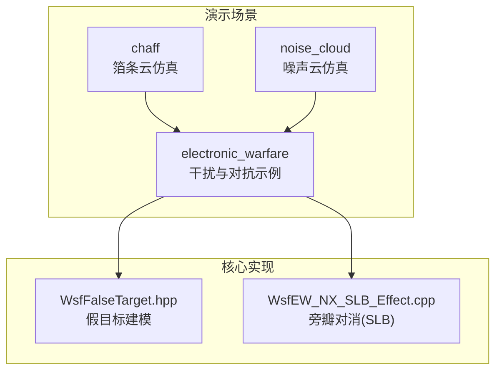
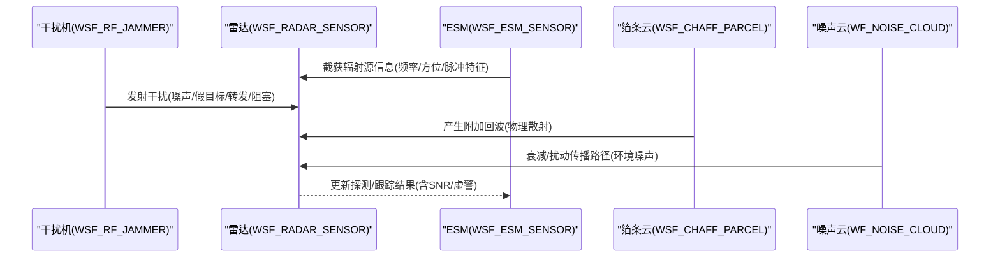
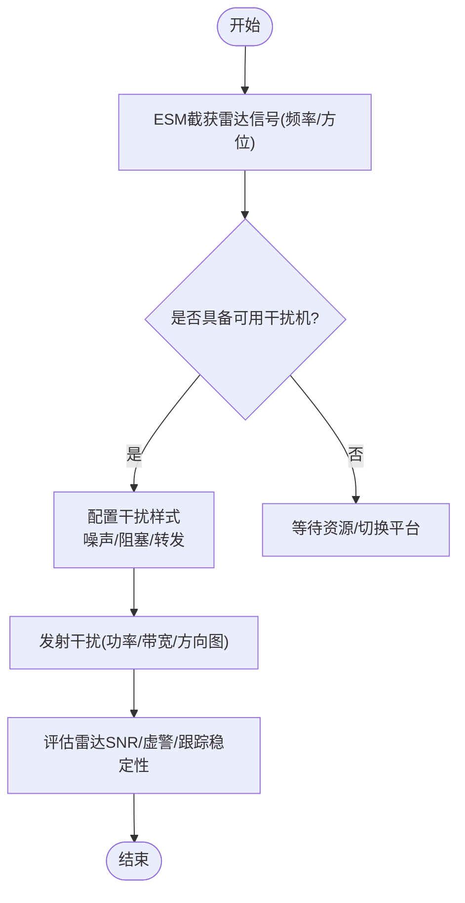
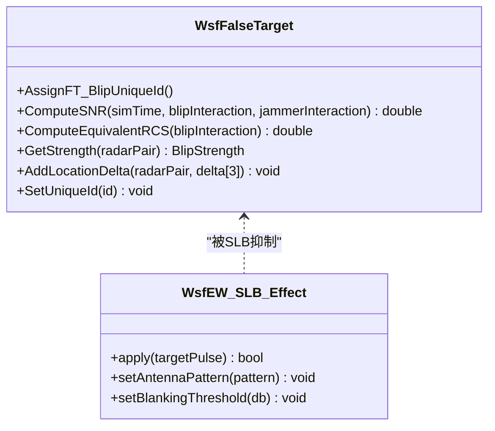
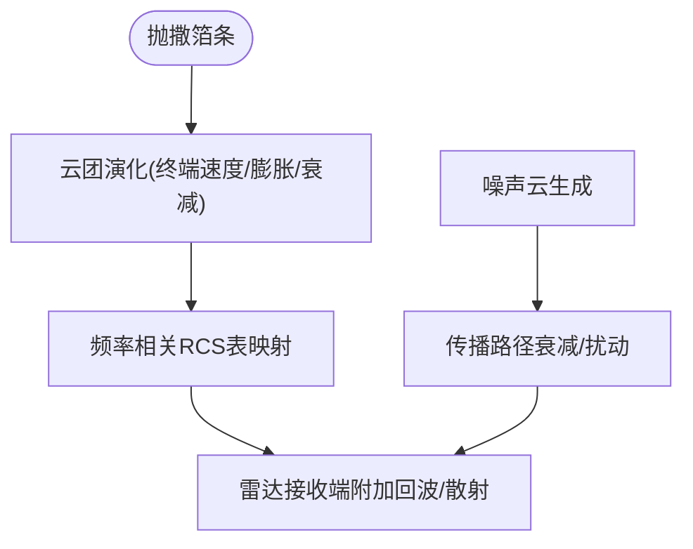
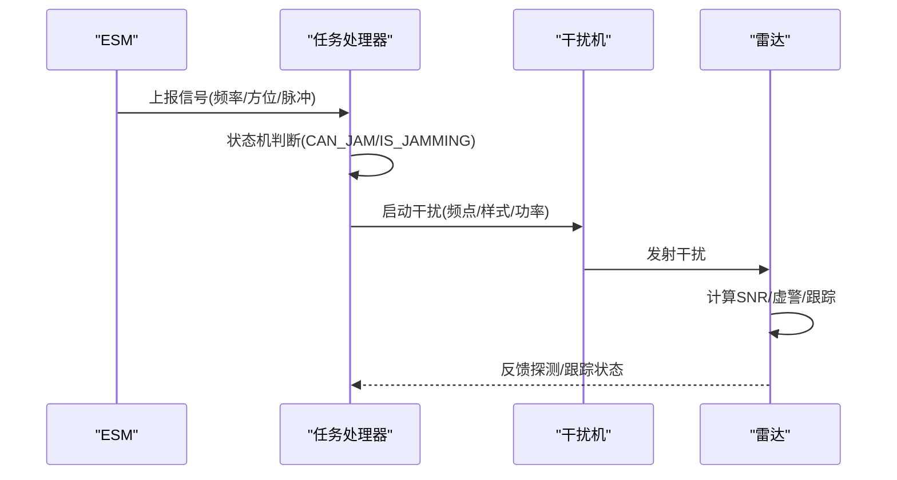
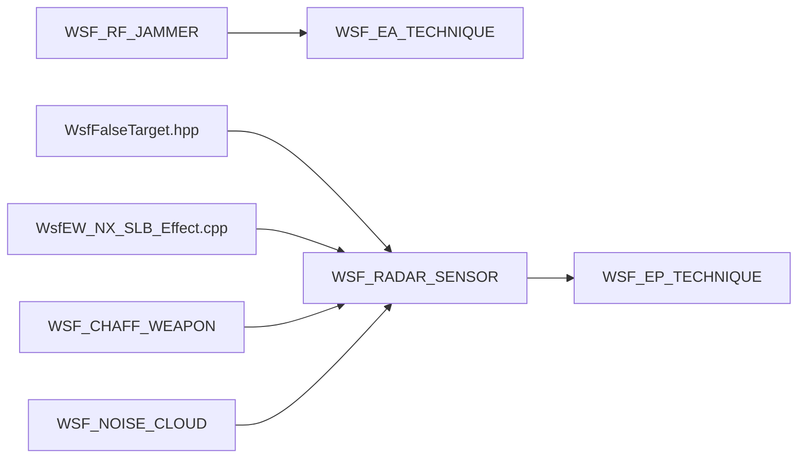

# 传感器干扰与对抗

<cite>
**本文引用的文件**   
- [agile_jamming.txt](file://demos/electronic_warfare/agile_jamming.txt)
- [barrage_jamming.txt](file://demos/electronic_warfare/barrage_jamming.txt)
- [repeater_jamming.txt](file://demos/electronic_warfare/repeater_jamming.txt)
- [false-target_jamming_1.txt](file://demos/electronic_warfare/false-target_jamming_1.txt)
- [chaff_example.txt](file://demos/chaff/chaff_example.txt)
- [noise_cloud.txt](file://demos/noise_cloud/noise_cloud.txt)
- [WsfFalseTarget.hpp](file://swdev/src/core/wsf_mil/source/ew/WsfFalseTarget.hpp)
- [WsfEW_NX_SLB_Effect.cpp](file://swdev/src/core/wsf_nx/source/ew/WsfEW_NX_SLB_Effect.cpp)
</cite>

## 目录
1. [引言](#引言)
2. [项目结构](#项目结构)
3. [核心组件](#核心组件)
4. [架构总览](#架构总览)
5. [详细组件分析](#详细组件分析)
6. [依赖关系分析](#依赖关系分析)
7. [性能与效果评估](#性能与效果评估)
8. [故障排查指南](#故障排查指南)
9. [结论](#结论)
10. [附录：配置清单与参考示例](#附录配置清单与参考示例)

## 引言
本文件面向AFSIM电子战仿真，系统性说明传感器干扰与对抗的实现方法、样式配置、效果评估与可视化分析方法。内容覆盖：
- 电子干扰（噪声压制、阻塞式干扰）
- 欺骗干扰（假目标、转发式干扰）
- 物理干扰（箔条云、噪声云）
- 干扰源与目标传感器的交互机制
- 干扰策略优化与自适应配置
- 复杂电子战场景下的对抗配置
- 干扰效果的可视化与数据分析方法

## 项目结构
AFSIM在演示场景中提供了丰富的电子战样例，主要位于以下目录：
- demos/electronic_warfare：雷达/通信干扰、敏捷干扰、阻塞干扰、假目标干扰、转发干扰等
- demos/chaff：箔条投放与云团演化
- demos/noise_cloud：环境噪声云对雷达探测的影响
- swdev/src：核心实现（如假目标模型、旁瓣对消效应）

图表来源
- [agile_jamming.txt:1-472](file://demos/electronic_warfare/agile_jamming.txt#L1-L472)
- [barrage_jamming.txt:1-260](file://demos/electronic_warfare/barrage_jamming.txt#L1-L260)
- [repeater_jamming.txt:1-428](file://demos/electronic_warfare/repeater_jamming.txt#L1-L428)
- [false-target_jamming_1.txt:1-392](file://demos/electronic_warfare/false-target_jamming_1.txt#L1-L392)
- [chaff_example.txt:1-234](file://demos/chaff/chaff_example.txt#L1-L234)
- [noise_cloud.txt:1-55](file://demos/noise_cloud/noise_cloud.txt#L1-L55)
- [WsfFalseTarget.hpp:40-434](file://swdev/src/core/wsf_mil/source/ew/WsfFalseTarget.hpp#L40-L434)
- [WsfEW_NX_SLB_Effect.cpp:1-45](file://swdev/src/core/wsf_nx/source/ew/WsfEW_NX_SLB_Effect.cpp#L1-L45)

章节来源
- [agile_jamming.txt:1-472](file://demos/electronic_warfare/agile_jamming.txt#L1-L472)
- [barrage_jamming.txt:1-260](file://demos/electronic_warfare/barrage_jamming.txt#L1-L260)
- [repeater_jamming.txt:1-428](file://demos/electronic_warfare/repeater_jamming.txt#L1-L428)
- [false-target_jamming_1.txt:1-392](file://demos/electronic_warfare/false-target_jamming_1.txt#L1-L392)
- [chaff_example.txt:1-234](file://demos/chaff/chaff_example.txt#L1-L234)
- [noise_cloud.txt:1-55](file://demos/noise_cloud/noise_cloud.txt#L1-L55)

## 核心组件
- 电子攻击（EA）与电子防护（EP）
  - EA：噪声干扰、假目标干扰、转发干扰、阻塞干扰等
  - EP：敏捷性（模式/频率）、旁瓣对消（SLB）、信号增益等
- 传感器类型
  - WSF_RADAR_SENSOR：雷达传感器，支持多波束、多模式、检测/跟踪参数
  - WSF_ESM_SENSOR：电子支援措施传感器，用于截获与识别辐射源
- 武器平台
  - WSF_RF_JAMMER：射频干扰机，支持发射机、天线、电子攻击技术
  - WSF_CHAFF_WEAPON：箔条武器，支持抛撒器、云团演化
- 处理器
  - WSF_TRACK_PROCESSOR：航迹处理
  - WSF_TASK_PROCESSOR：任务调度与干扰控制逻辑（脚本驱动）

章节来源
- [agile_jamming.txt:60-88](file://demos/electronic_warfare/agile_jamming.txt#L60-L88)
- [false-target_jamming_1.txt:88-124](file://demos/electronic_warfare/false-target_jamming_1.txt#L88-L124)
- [chaff_example.txt:43-78](file://demos/chaff/chaff_example.txt#L43-L78)

## 架构总览
下图展示干扰源（干扰机/箔条/噪声云）与目标传感器（雷达/ESM）之间的交互流程，以及电子攻击与防护的耦合关系。

图表来源
- [agile_jamming.txt:39-58](file://demos/electronic_warfare/agile_jamming.txt#L39-L58)
- [agile_jamming.txt:67-88](file://demos/electronic_warfare/agile_jamming.txt#L67-L88)
- [false-target_jamming_1.txt:126-184](file://demos/electronic_warfare/false-target_jamming_1.txt#L126-L184)
- [chaff_example.txt:135-176](file://demos/chaff/chaff_example.txt#L135-L176)
- [noise_cloud.txt:36-43](file://demos/noise_cloud/noise_cloud.txt#L36-L43)

## 详细组件分析

### 电子干扰：噪声与阻塞干扰
- 噪声干扰（Spot/Noise Jamming）
  - 通过WSF_EA_TECHNIQUE noise_jamming定义干扰样式，结合WSF_POWER_EFFECT设置功率影响
  - 典型配置：固定频点或窄带噪声，针对特定雷达接收带宽进行压制
- 阻塞干扰（Barrage Jamming）
  - 使用宽频带发射机，将功率分散到多个频点，降低单频点干扰效能但提高覆盖范围
  - 适用于多雷达同时威胁场景

图表来源
- [agile_jamming.txt:67-88](file://demos/electronic_warfare/agile_jamming.txt#L67-L88)
- [barrage_jamming.txt:43-49](file://demos/electronic_warfare/barrage_jamming.txt#L43-L49)

章节来源
- [agile_jamming.txt:67-88](file://demos/electronic_warfare/agile_jamming.txt#L67-L88)
- [barrage_jamming.txt:43-49](file://demos/electronic_warfare/barrage_jamming.txt#L43-L49)

### 欺骗干扰：假目标与转发干扰
- 假目标干扰（False Target Jamming）
  - 通过WSF_FALSE_TARGET_EFFECT配置假目标的密度、扫描倍率、等效RCS等
  - 雷达侧可启用WSF_FT_SCREENER进行假目标筛选，结合旁瓣对消（SLB）抑制
- 转发干扰（Repeater Jamming）
  - 自动/半自动转发雷达脉冲，生成与真实目标一致的时延/幅度/相位特性
  - 通过repeater模块与frequency_following实现频率跟随

图表来源
- [WsfFalseTarget.hpp:40-434](file://swdev/src/core/wsf_mil/source/ew/WsfFalseTarget.hpp#L40-L434)
- [WsfEW_NX_SLB_Effect.cpp:1-45](file://swdev/src/core/wsf_nx/source/ew/WsfEW_NX_SLB_Effect.cpp#L1-L45)

章节来源
- [false-target_jamming_1.txt:40-66](file://demos/electronic_warfare/false-target_jamming_1.txt#L40-L66)
- [false-target_jamming_1.txt:88-124](file://demos/electronic_warfare/false-target_jamming_1.txt#L88-L124)
- [repeater_jamming.txt:82-120](file://demos/electronic_warfare/repeater_jamming.txt#L82-L120)

### 物理干扰：箔条与噪声云
- 箔条（Chaff）
  - 通过WSF_CHAFF_WEAPON与WSF_CHAFF_PARCEL定义抛撒器、数量、终端速度、膨胀时间、频率相关RCS表
  - 可在不同时间点按抛撒器组合释放，形成空间分布的云团
- 噪声云（Noise Cloud）
  - 通过WSF_NOISE_CLOUD定义噪声频率、八度数、高度、阈值等，对雷达传播路径产生衰减/扰动

图表来源
- [chaff_example.txt:24-78](file://demos/chaff/chaff_example.txt#L24-L78)
- [chaff_example.txt:135-176](file://demos/chaff/chaff_example.txt#L135-L176)
- [noise_cloud.txt:36-43](file://demos/noise_cloud/noise_cloud.txt#L36-L43)

章节来源
- [chaff_example.txt:24-78](file://demos/chaff/chaff_example.txt#L24-L78)
- [chaff_example.txt:135-176](file://demos/chaff/chaff_example.txt#L135-L176)
- [noise_cloud.txt:36-43](file://demos/noise_cloud/noise_cloud.txt#L36-L43)

### 干扰源与目标传感器的交互机制
- ESM截获与任务调度
  - ESM传感器输出频率、方位、脉冲特征；任务处理器根据状态机选择干扰机并启动干扰任务
- 雷达检测与跟踪
  - 雷达接收端计算SNR、虚警概率、Swerling起伏模型；跟踪建立/维持条件受干扰影响
- 电子防护
  - 敏捷性（模式/频率变化）提升抗干扰能力；旁瓣对消抑制假目标与旁瓣干扰

图表来源
- [agile_jamming.txt:90-197](file://demos/electronic_warfare/agile_jamming.txt#L90-L197)
- [agile_jamming.txt:211-228](file://demos/electronic_warfare/agile_jamming.txt#L211-L228)

章节来源
- [agile_jamming.txt:90-197](file://demos/electronic_warfare/agile_jamming.txt#L90-L197)
- [agile_jamming.txt:211-228](file://demos/electronic_warfare/agile_jamming.txt#L211-L228)

### 干扰策略优化与自适应配置
- 自适应频率跟随
  - 基于ESM实时频率估计，动态调整干扰机频点，避免雷达频率捷变
- 多目标/多雷达协同
  - 阻塞干扰覆盖多雷达；转发干扰针对关键雷达生成高保真假目标
- 资源管理与任务优先级
  - 任务处理器根据FOV、资源占用、干扰有效性动态分配干扰机

章节来源
- [agile_jamming.txt:90-197](file://demos/electronic_warfare/agile_jamming.txt#L90-L197)
- [barrage_jamming.txt:43-49](file://demos/electronic_warfare/barrage_jamming.txt#L43-L49)

### 复杂电子战场景下的对抗配置
- 雷达敏捷性+旁瓣对消
  - 雷达采用模式/频率敏捷，配合SLB抑制假目标与旁瓣干扰
- 多传感器融合
  - 多波束/多传感器雷达提升抗干扰鲁棒性
- 多层防护
  - 信号增益、SLB、滤波器组合作为多层防护

章节来源
- [false-target_jamming_1.txt:88-124](file://demos/electronic_warfare/false-target_jamming_1.txt#L88-L124)
- [repeater_jamming.txt:177-214](file://demos/electronic_warfare/repeater_jamming.txt#L177-L214)

## 依赖关系分析
- 组件耦合
  - 干扰机依赖电子攻击技术（噪声/假目标/转发）
  - 雷达依赖电子防护技术（敏捷性/SLB/信号增益）
  - 假目标模型与SLB效应在核心库中实现
- 外部依赖
  - 事件输出（event_output）与事件管道（event_pipe）用于数据记录与分析
  - 地形与环境（terrain/noise_cloud）影响传播路径

图表来源
- [agile_jamming.txt:67-88](file://demos/electronic_warfare/agile_jamming.txt#L67-L88)
- [false-target_jamming_1.txt:88-124](file://demos/electronic_warfare/false-target_jamming_1.txt#L88-L124)
- [chaff_example.txt:43-78](file://demos/chaff/chaff_example.txt#L43-L78)
- [noise_cloud.txt:36-43](file://demos/noise_cloud/noise_cloud.txt#L36-L43)
- [WsfFalseTarget.hpp:40-434](file://swdev/src/core/wsf_mil/source/ew/WsfFalseTarget.hpp#L40-L434)
- [WsfEW_NX_SLB_Effect.cpp:1-45](file://swdev/src/core/wsf_nx/source/ew/WsfEW_NX_SLB_Effect.cpp#L1-L45)

章节来源
- [agile_jamming.txt:67-88](file://demos/electronic_warfare/agile_jamming.txt#L67-L88)
- [false-target_jamming_1.txt:88-124](file://demos/electronic_warfare/false-target_jamming_1.txt#L88-L124)
- [chaff_example.txt:43-78](file://demos/chaff/chaff_example.txt#L43-L78)
- [noise_cloud.txt:36-43](file://demos/noise_cloud/noise_cloud.txt#L36-L43)
- [WsfFalseTarget.hpp:40-434](file://swdev/src/core/wsf_mil/source/ew/WsfFalseTarget.hpp#L40-L434)
- [WsfEW_NX_SLB_Effect.cpp:1-45](file://swdev/src/core/wsf_nx/source/ew/WsfEW_NX_SLB_Effect.cpp#L1-L45)

## 性能与效果评估
- 干扰成功率指标
  - 基于雷达SNR下降、虚警概率上升、跟踪丢失率等综合评估
  - 可通过event_output中的JAMMING_ATTEMPT、SENSOR_DETECTION_ATTEMPT等事件统计
- 干扰样式对比
  - 噪声干扰：短时效强压制，适合单雷达
  - 阻塞干扰：广域覆盖，适合多雷达
  - 假目标干扰：高保真欺骗，需配合SLB与FT筛除
- 可视化与分析
  - 使用event_pipe输出.aer文件，结合绘图工具绘制轨迹、SNR曲线、干扰时段
  - 脚本绘制假目标轨迹（绿色）与真实目标轨迹（蓝色），辅助人工判读

章节来源
- [agile_jamming.txt:412-460](file://demos/electronic_warfare/agile_jamming.txt#L412-L460)
- [false-target_jamming_1.txt:216-249](file://demos/electronic_warfare/false-target_jamming_1.txt#L216-L249)

## 故障排查指南
- 干扰未生效
  - 检查干扰机功率、带宽、天线方向图与目标雷达匹配性
  - 确认任务处理器状态机是否正确进入IS_JAMMING
- 假目标被过滤
  - 检查雷达侧WSF_FT_SCREENER容量与allow_track_reporting_when_flooded设置
  - 确认SLB阈值与目标模糊概率配置合理
- 箔条云无效
  - 检查抛撒器数量、终端速度、膨胀时间与雷达帧时间匹配
  - 确认频率相关RCS表与实际雷达频段一致

章节来源
- [agile_jamming.txt:90-197](file://demos/electronic_warfare/agile_jamming.txt#L90-L197)
- [false-target_jamming_1.txt:149-159](file://demos/electronic_warfare/false-target_jamming_1.txt#L149-L159)
- [chaff_example.txt:43-78](file://demos/chaff/chaff_example.txt#L43-L78)

## 结论
AFSIM提供了完整的电子战仿真能力，涵盖电子干扰、欺骗干扰与物理干扰的全链路建模。通过灵活的配置与脚本化控制，可实现从单雷达对抗到多传感器融合的复杂场景。建议在实际应用中：
- 以ESM感知为基础，构建自适应干扰策略
- 结合雷达防护技术（敏捷性/SLB）评估对抗效果
- 利用事件输出与可视化手段进行效果分析与优化

## 附录：配置清单与参考示例
- 噪声干扰
  - 参考：[agile_jamming.txt:67-88](file://demos/electronic_warfare/agile_jamming.txt#L67-L88)
- 阻塞干扰
  - 参考：[barrage_jamming.txt:43-49](file://demos/electronic_warfare/barrage_jamming.txt#L43-L49)
- 假目标干扰
  - 参考：[false-target_jamming_1.txt:40-66](file://demos/electronic_warfare/false-target_jamming_1.txt#L40-L66)
- 转发干扰
  - 参考：[repeater_jamming.txt:82-120](file://demos/electronic_warfare/repeater_jamming.txt#L82-L120)
- 箔条干扰
  - 参考：[chaff_example.txt:24-78](file://demos/chaff/chaff_example.txt#L24-L78)
- 噪声云
  - 参考：[noise_cloud.txt:36-43](file://demos/noise_cloud/noise_cloud.txt#L36-L43)