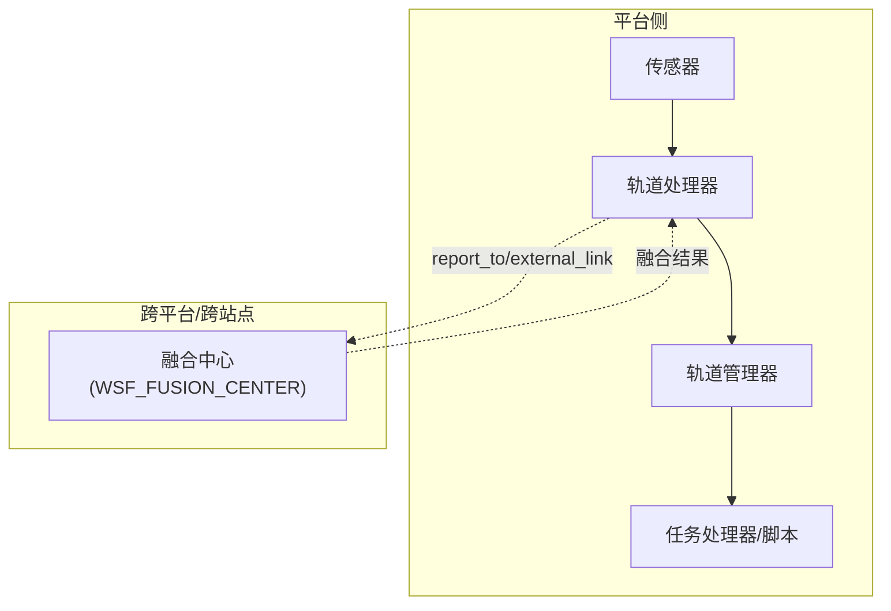
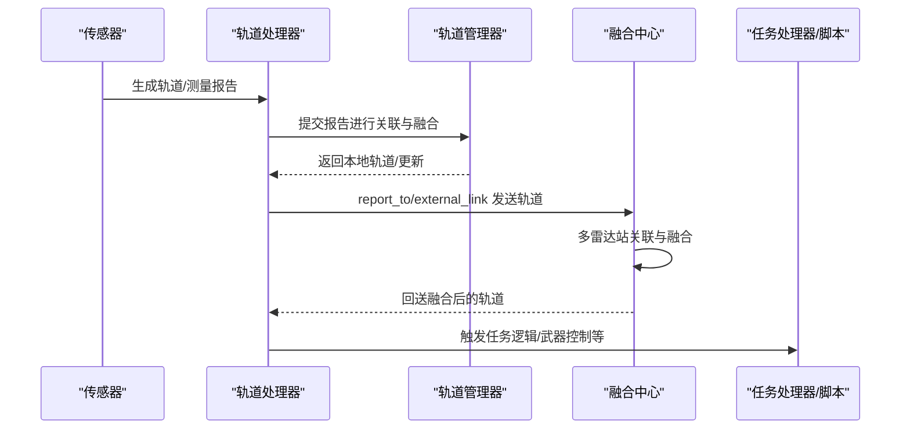
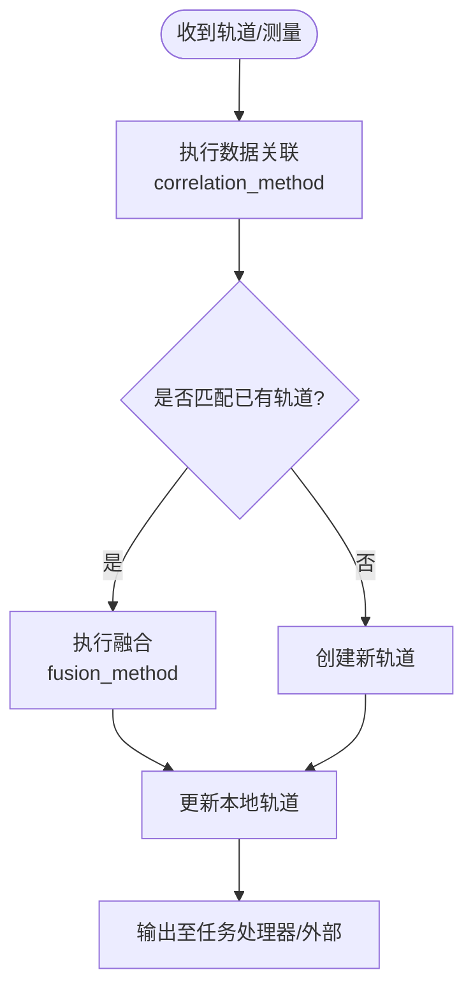
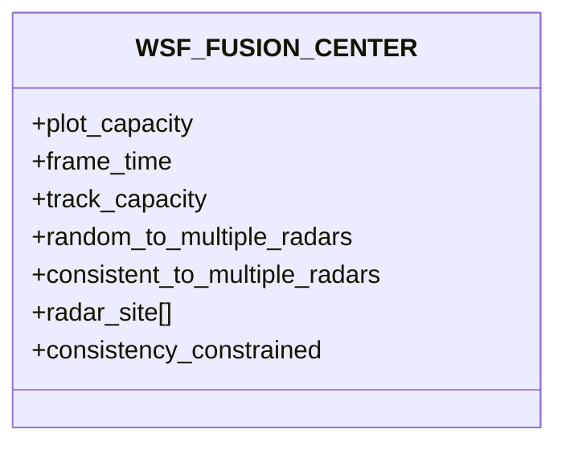
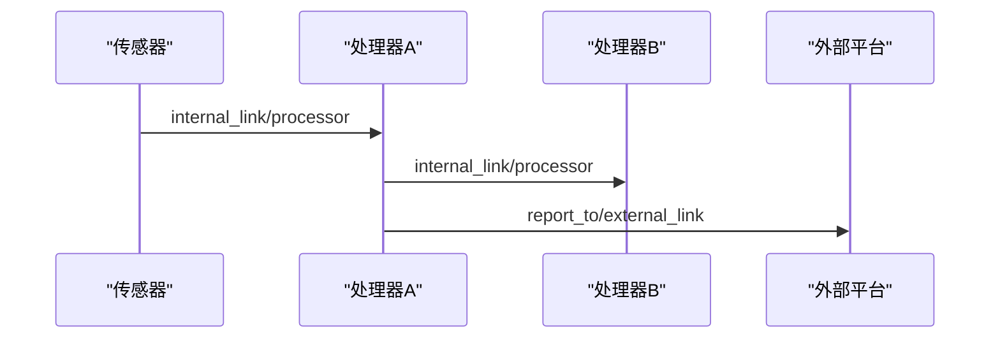
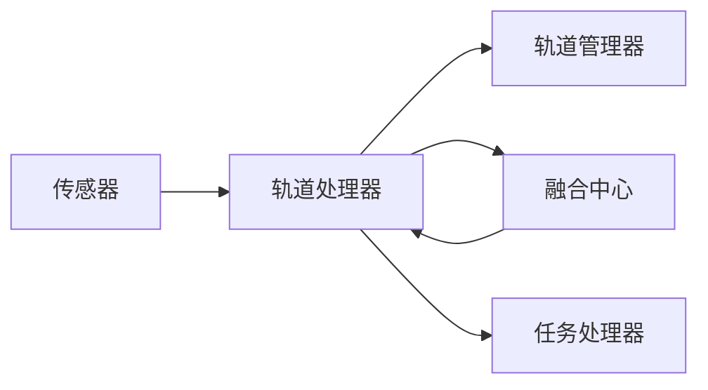

# 传感器数据融合

<cite>
**本文引用的文件**   
- [wsf_fusion_center.rst.txt](file://documentation/html/_sources/docs/wsf_fusion_center.rst.txt)
- [track_manager.rst.txt](file://documentation/html/_sources/docs/track_manager.rst.txt)
- [tracking_primer.rst.txt](file://documentation/html/_sources/docs/analyst_ocd/tracking_primer.rst.txt)
- [correlation_types.txt](file://swdev/src/core/wsf/doc/correlation_types.txt)
- [fusion_types.txt](file://swdev/src/core/wsf/doc/fusion_types.txt)
- [commander_track_manager.txt](file://demos/aea_iads/processors/commander_track_manager.txt)
</cite>

## 目录
1. [引言](#引言)
2. [项目结构](#项目结构)
3. [核心组件](#核心组件)
4. [架构总览](#架构总览)
5. [详细组件分析](#详细组件分析)
6. [依赖关系分析](#依赖关系分析)
7. [性能与精度评估](#性能与精度评估)
8. [故障排查指南](#故障排查指南)
9. [结论](#结论)
10. [附录](#附录)

## 引言
本文件面向AFSIM中的多传感器数据融合，系统阐述数据关联、轨迹融合与状态估计的实现思路与配置方法；说明不同传感器数据的协调与同步机制；给出融合中心的配置要点与数据流管理；提供传感器网络拓扑与通信协议（内部/外部链路）的配置指引；包含融合精度评估与性能分析方法；并展示多平台协同探测的仿真配置示例。文档以AFSIM官方文档与示例为基础，确保内容可追溯、可复现。

## 项目结构
AFSIM在“跟踪与融合”方面的能力由以下关键部分构成：
- 轨道管理器（Track Manager）：负责本地主轨道列表的维护、数据关联与融合策略选择。
- 轨道处理器（Track Processor）：将传感器或外部来源的轨道报告提交给轨道管理器进行关联与融合，并可向任务处理器或其他平台输出。
- 融合中心（Fusion Center）：跨多个雷达站对轨道进行关联与融合，支持虚假目标抑制与一致性约束。
- 相关与融合算法类型：提供完美/最近邻/真值等关联方法与替换/加权平均等融合方法。
- 示例场景：IADS/Air-to-Air等演示中展示了典型的多传感器融合配置。

图示来源
- [tracking_primer.rst.txt:26-31](file://documentation/html/_sources/docs/analyst_ocd/tracking_primer.rst.txt#L26-L31)
- [wsf_fusion_center.rst.txt:32-36](file://documentation/html/_sources/docs/wsf_fusion_center.rst.txt#L32-L36)

章节来源
- [tracking_primer.rst.txt:15-31](file://documentation/html/_sources/docs/analyst_ocd/tracking_primer.rst.txt#L15-L31)
- [wsf_fusion_center.rst.txt:32-36](file://documentation/html/_sources/docs/wsf_fusion_center.rst.txt#L32-L36)

## 核心组件
- 轨道管理器（track_manager）
  - 职责：维护平台的主轨道列表；执行数据关联（correlation_method）与融合（fusion_method）；可选地保留原始轨道与历史；支持辅助数据融合规则与过滤器。
  - 关键命令：correlation_method、fusion_method、tracker_type、retain_raw_tracks、retain_track_history、filter、aux_data_fusion_rules等。
- 轨道处理器（WSF_TRACK_PROCESSOR）
  - 职责：接收本地/外部轨道报告，提交给轨道管理器进行关联与融合；可按需转发或过滤。
- 融合中心（WSF_FUSION_CENTER）
  - 职责：对来自多个雷达站的轨道进行关联与融合；支持虚假目标抑制（random_to_multiple_radars、consistent_to_multiple_radars）、一致性约束（consistency_constrained）；可配置帧时间（frame_time）与容量（plot_capacity、track_capacity）。

章节来源
- [track_manager.rst.txt:35-79](file://documentation/html/_sources/docs/track_manager.rst.txt#L35-L79)
- [wsf_fusion_center.rst.txt:32-84](file://documentation/html/_sources/docs/wsf_fusion_center.rst.txt#L32-L84)

## 架构总览
下图展示从传感器到融合中心再到下游处理的数据流与控制关系。

图示来源
- [tracking_primer.rst.txt:60-73](file://documentation/html/_sources/docs/analyst_ocd/tracking_primer.rst.txt#L60-L73)
- [wsf_fusion_center.rst.txt:32-36](file://documentation/html/_sources/docs/wsf_fusion_center.rst.txt#L32-L36)

## 详细组件分析

### 轨道管理器（track_manager）
- 数据关联（correlation_method）
  - 可用类型：perfect、nearest_neighbor、truth。
  - 作用：决定新轨道/测量是否与已有轨道匹配；若匹配则进入融合流程，否则创建新轨道。
- 数据融合（fusion_method）
  - 可用类型：replacement、weighted_average。
  - 作用：将来自多源的同一实体信息合并为一致的轨道信息。
- 其他能力
  - tracker_type：标准跟踪器类型（如MTT），可简化关联/融合配置。
  - retain_raw_tracks / retain_track_history：保留原始轨道与历史，便于离线分析或高级算法。
  - filter：将“未滤波传感器”类型的输入用指定滤波器转换（例如位置滤波）。
  - aux_data_fusion_rules：定义辅助变量在融合时的覆盖策略（private、only_local、prefer_local）。

图示来源
- [track_manager.rst.txt:49-79](file://documentation/html/_sources/docs/track_manager.rst.txt#L49-L79)
- [correlation_types.txt:10-12](file://swdev/src/core/wsf/doc/correlation_types.txt#L10-L12)
- [fusion_types.txt:10-11](file://swdev/src/core/wsf/doc/fusion_types.txt#L10-L11)

章节来源
- [track_manager.rst.txt:49-158](file://documentation/html/_sources/docs/track_manager.rst.txt#L49-L158)
- [correlation_types.txt:10-12](file://swdev/src/core/wsf/doc/correlation_types.txt#L10-L12)
- [fusion_types.txt:10-11](file://swdev/src/core/wsf/doc/fusion_types.txt#L10-L11)

### 融合中心（WSF_FUSION_CENTER）
- 功能概述
  - 对来自不同雷达站的轨道进行关联与融合。
  - 必须定义以处理来自虚假目标干扰效果的false_target。
- 关键参数
  - frame_time：融合中心更新周期（秒）。
  - plot_capacity / track_capacity：显示与维持轨道数量上限。
  - random_to_multiple_radars / consistent_to_multiple_radars：按随机/一致出现在多雷达的比例拒绝虚假目标。
  - radar_site：参与融合的雷达站点名称（对应平台player名）。
  - consistency_constrained：是否要求轨道在所有雷达站均被检测到才融合。

图示来源
- [wsf_fusion_center.rst.txt:43-84](file://documentation/html/_sources/docs/wsf_fusion_center.rst.txt#L43-L84)

章节来源
- [wsf_fusion_center.rst.txt:32-84](file://documentation/html/_sources/docs/wsf_fusion_center.rst.txt#L32-L84)

### 数据流与通信（内部/外部链路）
- 同平台内传递
  - internal_link 或 processor <processor-name>：将对象（传感器/通信/处理器）的消息路由到同平台的指定处理器。
- 跨平台传递
  - report_to 或 external_link：将轨道发送到其他平台。
- 典型流程
  - 传感器产生轨道 -> 轨道处理器收集 -> 轨道管理器关联与融合 -> 任务处理器消费 -> 通过report_to/external_link分发到其他平台或融合中心。

图示来源
- [tracking_primer.rst.txt:60-73](file://documentation/html/_sources/docs/analyst_ocd/tracking_primer.rst.txt#L60-L73)

章节来源
- [tracking_primer.rst.txt:60-73](file://documentation/html/_sources/docs/analyst_ocd/tracking_primer.rst.txt#L60-L73)

### 示例：IADS指挥官轨道管理器
- 配置要点
  - correlation_method perfect
  - fusion_method weighted_average
  - 使用自定义滤波器 FILTER_TACTICS
- 适用场景
  - IADS指挥链路的轨道管理与融合，结合战术滤波器进行后续决策。

章节来源
- [commander_track_manager.txt:9-18](file://demos/aea_iads/processors/commander_track_manager.txt#L9-L18)

## 依赖关系分析
- 组件耦合
  - 轨道处理器依赖轨道管理器完成关联与融合。
  - 融合中心依赖多雷达站输入，并通过一致性约束与虚假目标抑制提升融合质量。
- 外部依赖
  - 通信链路（internal_link/report_to/external_link）用于轨道在不同处理器与平台间流转。
- 可能的循环依赖
  - 应避免处理器之间相互依赖形成闭环；建议单向数据流：传感器->处理器->融合中心->任务处理器。

图示来源
- [tracking_primer.rst.txt:26-31](file://documentation/html/_sources/docs/analyst_ocd/tracking_primer.rst.txt#L26-L31)
- [wsf_fusion_center.rst.txt:32-36](file://documentation/html/_sources/docs/wsf_fusion_center.rst.txt#L32-L36)

## 性能与精度评估
- 融合精度
  - 使用加权平均融合时，协方差矩阵融合遵循参考公式（见轨道不确定性文档），在多源原始轨道融合时能更稳健地估计状态与不确定性。
- 性能指标
  - 融合中心帧时间（frame_time）影响实时性；track_capacity/plot_capacity影响并发处理能力。
  - 相关性算法复杂度：perfect通常较低，nearest_neighbor随候选数增长而增加。
- 评估方法
  - 对比真实轨迹与融合轨迹的位置误差、速度误差、航迹连续性、虚警率与漏警率。
  - 通过retain_raw_tracks与retain_track_history导出原始与历史数据，进行离线统计与分析。

章节来源
- [wsf_fusion_center.rst.txt:47-59](file://documentation/html/_sources/docs/wsf_fusion_center.rst.txt#L47-L59)
- [track_manager.rst.txt:103-115](file://documentation/html/_sources/docs/track_manager.rst.txt#L103-L115)

## 故障排查指南
- 常见问题
  - 轨道未融合：检查correlation_method与fusion_method是否合理；确认雷达站点名称与radar_site配置一致。
  - 虚假目标过多：调整random_to_multiple_radars与consistent_to_multiple_radars比例；必要时启用consistency_constrained。
  - 数据丢失：检查internal_link/report_to/external_link是否正确配置；确认report_to目标存在且可达。
  - 性能瓶颈：增大track_capacity/plot_capacity；降低frame_time或优化关联算法。
- 调试手段
  - 启用track_manager debug输出；保留原始轨道与历史以便离线分析。

章节来源
- [wsf_fusion_center.rst.txt:61-84](file://documentation/html/_sources/docs/wsf_fusion_center.rst.txt#L61-L84)
- [track_manager.rst.txt:45-48](file://documentation/html/_sources/docs/track_manager.rst.txt#L45-L48)

## 结论
AFSIM提供了完善的传感器数据融合框架：以轨道管理器为核心实现数据关联与融合，以融合中心支撑多雷达站协同，配合灵活的通信链路实现跨平台数据共享。通过合理的算法选择与参数调优，可在保证实时性的同时提升融合精度与鲁棒性。建议在复杂场景中结合示例配置与调试工具，逐步验证与优化融合效果。

## 附录
- 多平台协同探测仿真配置要点
  - 在每个平台定义传感器与轨道处理器，并通过report_to/external_link将轨道发送至融合中心或其他平台。
  - 在融合中心配置radar_site、frame_time、capacity与一致性约束。
  - 在轨道管理器中选择合适的correlation_method与fusion_method，并根据需要启用滤波器与辅助数据融合规则。
- 参考示例
  - IADS指挥官轨道管理器：[commander_track_manager.txt:9-18](file://demos/aea_iads/processors/commander_track_manager.txt#L9-L18)