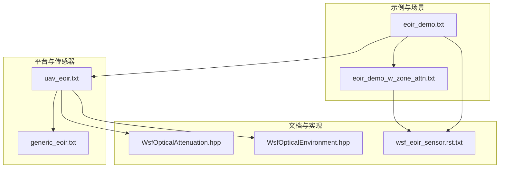
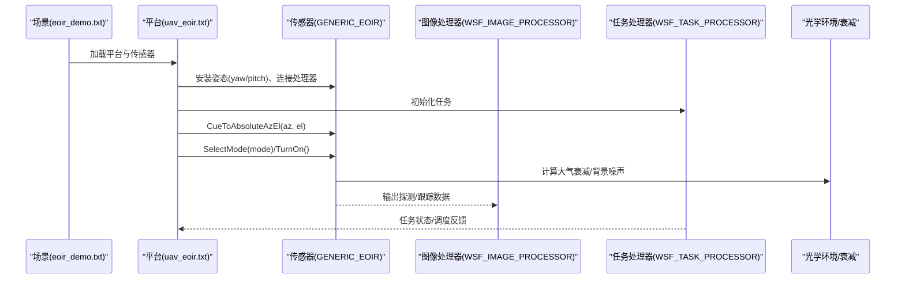
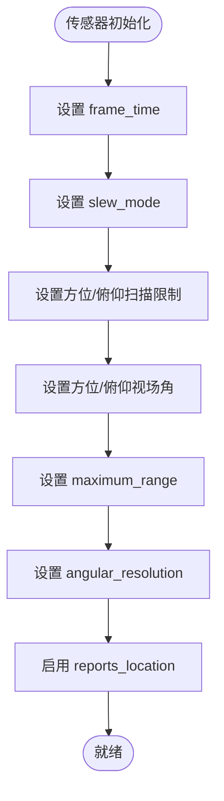
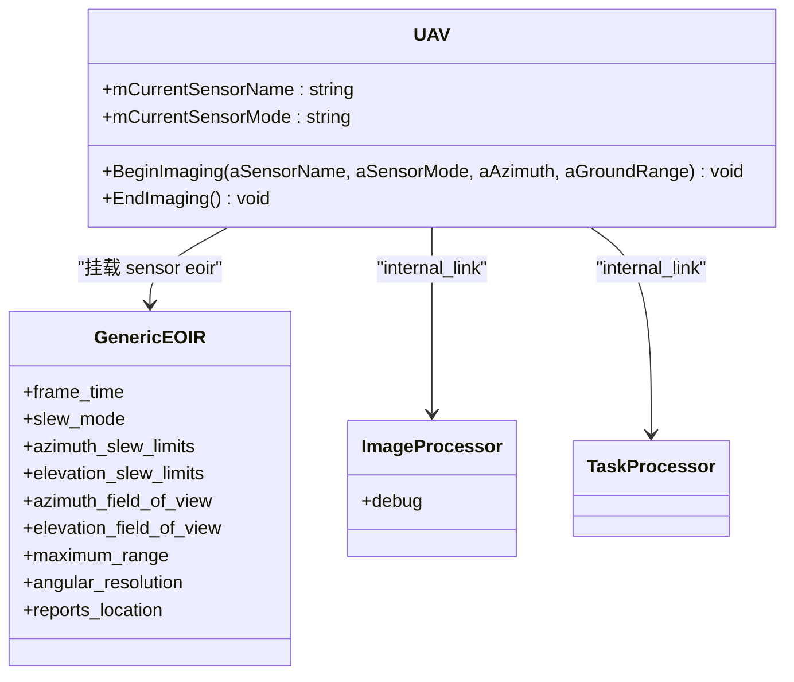
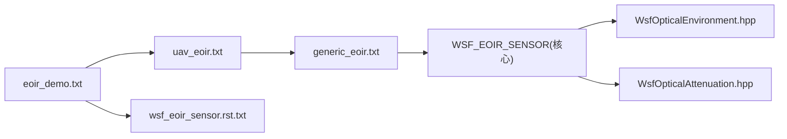

# 光电红外传感器集成

<cite>
**本文引用的文件**   
- [generic_eoir.txt](file://demos/base_types/sensors/eo_ir/generic_eoir.txt)
- [uav_eoir.txt](file://demos/sensor_demos/platforms/uav_eoir.txt)
- [eoir_demo.txt](file://demos/sensor_demos/eoir_demo.txt)
- [eoir_demo_w_zone_attn.txt](file://demos/sensor_demos/scenarios/eoir_demo_w_zone_attn.txt)
- [wsf_eoir_sensor.rst.txt](file://documentation/html/_sources/docs/wsf_eoir_sensor.rst.txt)
- [WsfOpticalAttenuation.hpp](file://swdev/src/core/wsf_mil/source/WsfOpticalAttenuation.hpp)
- [WsfOpticalEnvironment.hpp](file://swdev/src/core/wsf_mil/source/sensor/WsfOpticalEnvironment.hpp)
</cite>

## 目录
1. [简介](#简介)
2. [项目结构](#项目结构)
3. [核心组件](#核心组件)
4. [架构总览](#架构总览)
5. [详细组件分析](#详细组件分析)
6. [依赖关系分析](#依赖关系分析)
7. [性能考量与优化](#性能考量与优化)
8. [故障排查指南](#故障排查指南)
9. [结论](#结论)
10. [附录](#附录)

## 简介
本文件面向在 AFSIM 中集成与配置 EO（光电）/IR（红外）传感器的用户，提供从原理到配置的完整说明。内容涵盖：
- EO/IR 传感器在 AFSIM 中的定义、安装与扫描控制
- 光学成像与红外辐射探测的基本原理与关键参数
- 传感器参数设置（帧时间、视场角、方位/俯仰限制、最大作用距离、角度分辨率等）
- 目标识别与跟踪流程的配置要点
- 大气衰减与背景噪声的影响及环境建模
- 不同环境条件下的性能评估与优化方法

## 项目结构
AFSIM 的 EO/IR 相关示例与文档主要分布在以下位置：
- 基础传感器定义：demos/base_types/sensors/eo_ir/generic_eoir.txt
- 平台集成示例：demos/sensor_demos/platforms/uav_eoir.txt
- 场景与事件输出：demos/sensor_demos/eoir_demo.txt、demos/sensor_demos/scenarios/eoir_demo_w_zone_attn.txt
- 官方文档参考：documentation/html/_sources/docs/wsf_eoir_sensor.rst.txt
- 核心实现头文件（用于理解内部模型与环境）：swdev/src/core/wsf_mil/source/WsfOpticalAttenuation.hpp、swdev/src/core/wsf_mil/source/sensor/WsfOpticalEnvironment.hpp

**图示来源**
- [eoir_demo.txt:1-34](file://demos/sensor_demos/eoir_demo.txt#L1-L34)
- [uav_eoir.txt:1-68](file://demos/sensor_demos/platforms/uav_eoir.txt#L1-L68)
- [generic_eoir.txt:1-40](file://demos/base_types/sensors/eo_ir/generic_eoir.txt#L1-L40)
- [wsf_eoir_sensor.rst.txt](file://documentation/html/_sources/docs/wsf_eoir_sensor.rst.txt)
- [WsfOpticalAttenuation.hpp](file://swdev/src/core/wsf_mil/source/WsfOpticalAttenuation.hpp)
- [WsfOpticalEnvironment.hpp](file://swdev/src/core/wsf_mil/source/sensor/WsfOpticalEnvironment.hpp)

**章节来源**
- [eoir_demo.txt:1-34](file://demos/sensor_demos/eoir_demo.txt#L1-L34)
- [uav_eoir.txt:1-68](file://demos/sensor_demos/platforms/uav_eoir.txt#L1-L68)
- [generic_eoir.txt:1-40](file://demos/base_types/sensors/eo_ir/generic_eoir.txt#L1-L40)

## 核心组件
- WSF_EOIR_SENSOR：通用 EO/IR 传感器类型，提供视场、扫描、采样率、最大作用距离、角度分辨率等能力。
- 平台集成：通过 platform_type 将 GENERIC_EOIR 实例化到无人机等平台，并配置安装姿态（yaw/pitch）。
- 图像处理器：WSF_IMAGE_PROCESSOR 接收传感器输出，进行后续处理（如检测、跟踪、成像）。
- 任务处理器：WSF_TASK_PROCESSOR 协调传感器模式切换、开机/关机、指向控制等任务流。
- 光学环境与衰减：WSF_OPTICAL_ENVIRONMENT 与 WsfOpticalAttenuation 提供大气衰减、背景噪声等物理建模支撑。

**章节来源**
- [generic_eoir.txt:23-39](file://demos/base_types/sensors/eo_ir/generic_eoir.txt#L23-L39)
- [uav_eoir.txt:55-66](file://demos/sensor_demos/platforms/uav_eoir.txt#L55-L66)
- [wsf_eoir_sensor.rst.txt](file://documentation/html/_sources/docs/wsf_eoir_sensor.rst.txt)
- [WsfOpticalEnvironment.hpp:28](file://swdev/src/core/wsf_mil/source/sensor/WsfOpticalEnvironment.hpp#L28)
- [WsfOpticalAttenuation.hpp:228](file://swdev/src/core/wsf_mil/source/WsfOpticalAttenuation.hpp#L228)

## 架构总览
EO/IR 传感器在 AFSIM 中的数据与控制流如下：
- 场景驱动：eoir_demo.txt 引入平台与场景，开启事件输出以观测传感器状态与检测结果。
- 平台层：uav_eoir.txt 定义无人机平台，挂载 GENERIC_EOIR 传感器，并通过脚本控制指向、模式选择与开关机。
- 传感器层：GENERIC_EOIR 基于 WSF_EOIR_SENSOR 实现，负责 FOV、扫描、采样、最大作用距离与角度分辨率等。
- 处理层：WSF_IMAGE_PROCESSOR 接收数据，执行检测/跟踪；WSF_TASK_PROCESSOR 管理任务调度。
- 环境层：WSF_OPTICAL_ENVIRONMENT 与衰减模型影响探测概率与信噪比。

**图示来源**
- [eoir_demo.txt:10-31](file://demos/sensor_demos/eoir_demo.txt#L10-L31)
- [uav_eoir.txt:23-46](file://demos/sensor_demos/platforms/uav_eoir.txt#L23-L46)
- [uav_eoir.txt:55-66](file://demos/sensor_demos/platforms/uav_eoir.txt#L55-L66)
- [generic_eoir.txt:23-39](file://demos/base_types/sensors/eo_ir/generic_eoir.txt#L23-L39)
- [WsfOpticalEnvironment.hpp:28](file://swdev/src/core/wsf_mil/source/sensor/WsfOpticalEnvironment.hpp#L28)
- [WsfOpticalAttenuation.hpp:228](file://swdev/src/core/wsf_mil/source/WsfOpticalAttenuation.hpp#L228)

## 详细组件分析

### 传感器定义与参数（WSF_EOIR_SENSOR）
- 采样率：frame_time（例如 2 sec）
- 扫描模式：slew_mode（方位+俯仰）
- 扫描范围：azimuth_slew_limits、elevation_slew_limits
- 视场角：azimuth_field_of_view、elevation_field_of_view
- 最大作用距离：maximum_range
- 角度分辨率：angular_resolution
- 报告位置：reports_location

这些参数决定了 EO/IR 的观测能力与覆盖范围，是性能评估与优化的关键输入。

**图示来源**
- [generic_eoir.txt:23-39](file://demos/base_types/sensors/eo_ir/generic_eoir.txt#L23-L39)

**章节来源**
- [generic_eoir.txt:23-39](file://demos/base_types/sensors/eo_ir/generic_eoir.txt#L23-L39)

### 平台集成与脚本控制（UAV + GENERIC_EOIR）
- 安装姿态：sensor eoir 下 yaw、pitch 指定传感器相对平台的安装方向。
- 内部链路：internal_link image_proc 将传感器输出连接到图像处理器。
- 脚本控制：BeginImaging 函数完成指向（CueToAbsoluteAzEl）、模式选择（SelectMode）、开机（TurnOn）；EndImaging 关闭传感器。
- 处理器：WSF_IMAGE_PROCESSOR 与 WSF_TASK_PROCESSOR 分别承担数据处理与任务调度。

**图示来源**
- [uav_eoir.txt:18-46](file://demos/sensor_demos/platforms/uav_eoir.txt#L18-L46)
- [uav_eoir.txt:55-66](file://demos/sensor_demos/platforms/uav_eoir.txt#L55-L66)
- [generic_eoir.txt:23-39](file://demos/base_types/sensors/eo_ir/generic_eoir.txt#L23-L39)

**章节来源**
- [uav_eoir.txt:18-46](file://demos/sensor_demos/platforms/uav_eoir.txt#L18-L46)
- [uav_eoir.txt:55-66](file://demos/sensor_demos/platforms/uav_eoir.txt#L55-L66)

### 场景与事件输出（eoir_demo.txt）
- 引入平台与场景：include platforms/uav_eoir.txt、scenarios/eoir_demo.txt
- 事件管道与输出：event_pipe 与 event_output 启用多种传感器事件（如 SENSOR_DETECTION_ATTEMPT、SENSOR_TRACK_INITIATED、SENSOR_TURNED_ON/OFF 等），便于分析与可视化。

**章节来源**
- [eoir_demo.txt:10-31](file://demos/sensor_demos/eoir_demo.txt#L10-L31)

### 区域衰减与遮挡（eoir_demo_w_zone_attn.txt）
- 使用多边形区域对 EO/IR 传感器进行衰减，模拟地形遮蔽或云层遮挡等效果。
- 通过 edit sensor eoir 动态调整传感器行为，结合区域衰减评估探测性能变化。

**章节来源**
- [eoir_demo_w_zone_attn.txt:10-52](file://demos/sensor_demos/scenarios/eoir_demo_w_zone_attn.txt#L10-L52)

### 光学成像与红外探测原理（概念性说明）
- 光学成像（EO）：通过可见光/近红外波段收集目标反射或发射的光子，受大气透射、散射与背景辐射影响。
- 红外探测（IR）：探测目标的热辐射（中远红外），受目标温度、发射率、大气吸收与背景热噪声影响。
- 关键指标：信噪比（SNR）、对比度、探测概率、跟踪稳定性。

[本节为概念性说明，不直接分析具体文件]

## 依赖关系分析
- 场景依赖平台与传感器定义：eoir_demo.txt 包含 uav_eoir.txt 与场景文件。
- 平台依赖传感器类型：uav_eoir.txt include_once generic_eoir.txt 并使用 GENERIC_EOIR。
- 传感器类型依赖核心实现：WSF_EOIR_SENSOR 由核心库提供，光学环境与衰减模型由 WsfOpticalEnvironment 与 WsfOpticalAttenuation 支持。
- 文档引用：wsf_eoir_sensor.rst.txt 提供 API 与用法参考。

**图示来源**
- [eoir_demo.txt:10-13](file://demos/sensor_demos/eoir_demo.txt#L10-L13)
- [uav_eoir.txt:13-13](file://demos/sensor_demos/platforms/uav_eoir.txt#L13-L13)
- [generic_eoir.txt:23-23](file://demos/base_types/sensors/eo_ir/generic_eoir.txt#L23-L23)
- [wsf_eoir_sensor.rst.txt](file://documentation/html/_sources/docs/wsf_eoir_sensor.rst.txt)
- [WsfOpticalEnvironment.hpp:28](file://swdev/src/core/wsf_mil/source/sensor/WsfOpticalEnvironment.hpp#L28)
- [WsfOpticalAttenuation.hpp:228](file://swdev/src/core/wsf_mil/source/WsfOpticalAttenuation.hpp#L228)

**章节来源**
- [eoir_demo.txt:10-13](file://demos/sensor_demos/eoir_demo.txt#L10-L13)
- [uav_eoir.txt:13-13](file://demos/sensor_demos/platforms/uav_eoir.txt#L13-L13)
- [generic_eoir.txt:23-23](file://demos/base_types/sensors/eo_ir/generic_eoir.txt#L23-L23)

## 性能考量与优化
- 视场角与扫描范围：增大 FOV 可提升覆盖但降低空间分辨率；需根据任务权衡。
- 帧时间与采样率：较短 frame_time 提高时序分辨率但增加处理负载。
- 最大作用距离：受大气衰减与背景噪声影响显著，需结合环境模型校准。
- 角度分辨率：更细的角度分辨率有助于目标定位与跟踪，但可能降低帧率。
- 区域衰减：利用多边形区域模拟遮挡/衰减，评估复杂环境下的探测概率。
- 环境建模：通过 WSF_OPTICAL_ENVIRONMENT 与衰减模型调整大气条件（湿度、气溶胶、云量等），评估不同天气与地理条件下的性能。

[本节为通用指导，不直接分析具体文件]

## 故障排查指南
- 传感器未输出事件：检查 event_output 是否启用所需事件（如 SENSOR_DETECTION_ATTEMPT、SENSOR_TRACK_INITIATED、SENSOR_TURNED_ON/OFF）。
- 传感器无响应：确认 BeginImaging 是否正确调用 TurnOn 与 SelectMode，以及 internal_link 是否连接到图像处理器。
- 探测距离异常：检查 atmospheric attenuation 与背景噪声设置，必要时调整 maximum_range 与 FOV。
- 区域衰减无效：确认多边形区域定义与 edit sensor eoir 的参数更新逻辑。

**章节来源**
- [eoir_demo.txt:20-31](file://demos/sensor_demos/eoir_demo.txt#L20-L31)
- [uav_eoir.txt:23-46](file://demos/sensor_demos/platforms/uav_eoir.txt#L23-L46)
- [eoir_demo_w_zone_attn.txt:28-52](file://demos/sensor_demos/scenarios/eoir_demo_w_zone_attn.txt#L28-L52)

## 结论
通过在 AFSIM 中使用 GENERIC_EOIR（WSF_EOIR_SENSOR）并结合平台脚本与环境模型，可以灵活配置 EO/IR 传感器的成像与探测能力。合理设置视场角、扫描范围、采样率与作用距离，并结合区域衰减与大气衰减模型，能够准确评估不同环境条件下的传感器性能。借助事件输出与图像处理器，可实现目标检测与跟踪的闭环验证与优化。

[本节为总结性内容，不直接分析具体文件]

## 附录
- 官方文档参考：wsf_eoir_sensor.rst.txt
- 核心实现头文件：WsfOpticalEnvironment.hpp、WsfOpticalAttenuation.hpp

[本节为补充信息，不直接分析具体文件]