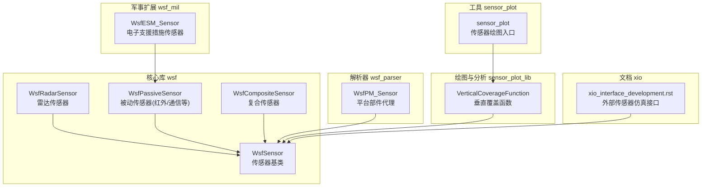
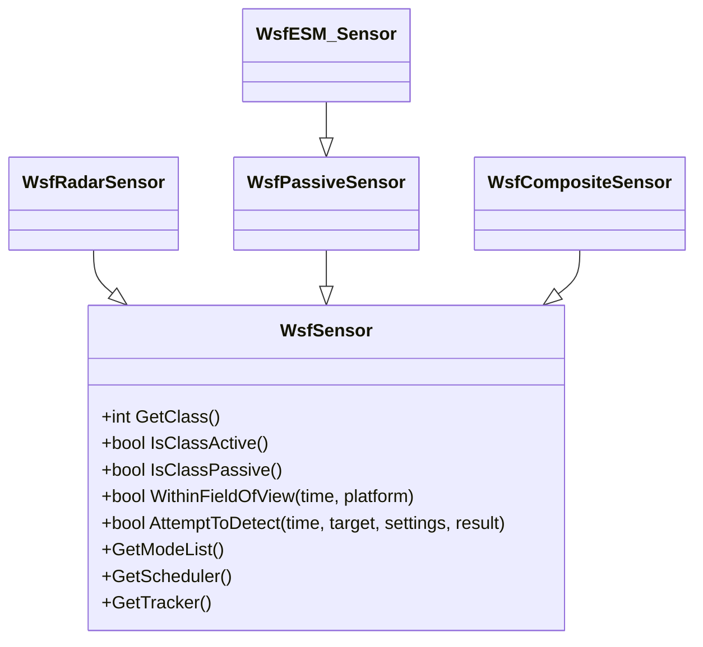
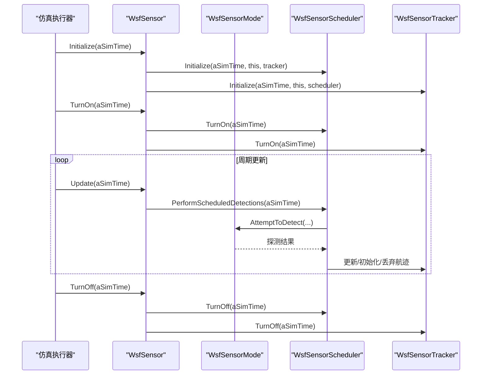
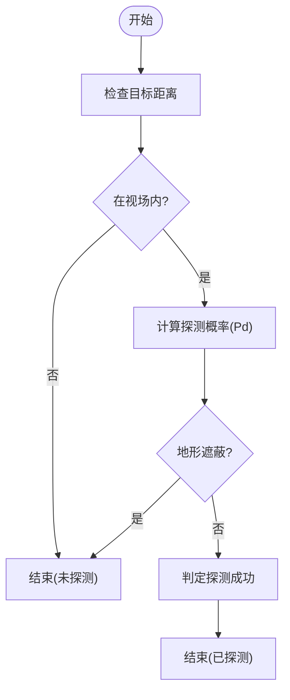
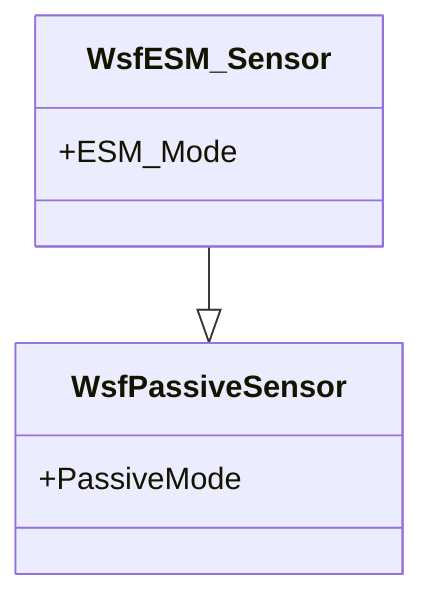
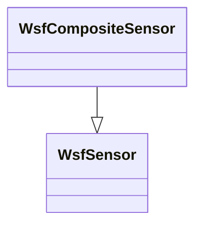
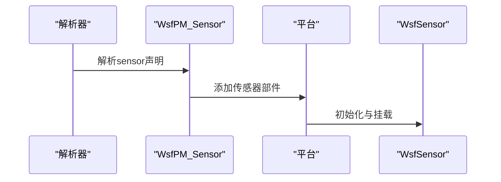
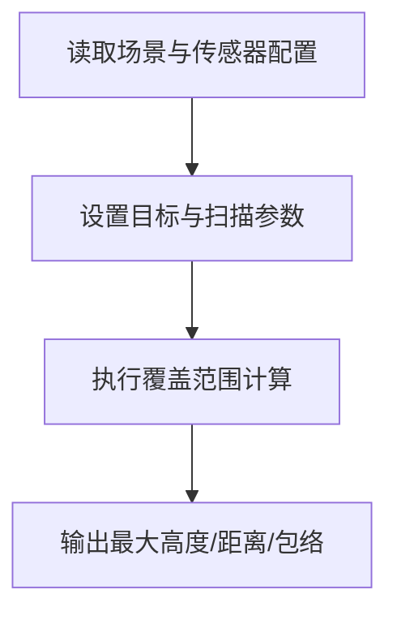
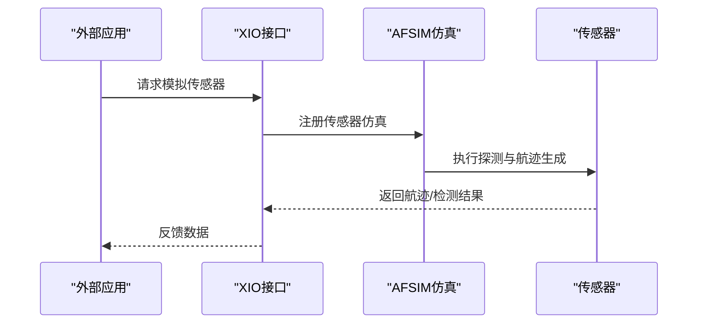
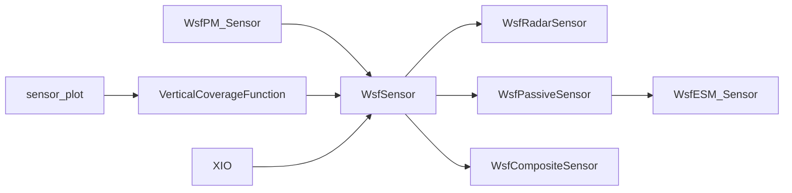

# 平台传感器集成

<cite>
**本文引用的文件**   
- [WsfSensor.hpp](file://swdev/src/core/wsf/source/sensor/WsfSensor.hpp)
- [WsfSensor.cpp](file://swdev/src/core/wsf/source/sensor/WsfSensor.cpp)
- [WsfRadarSensor.hpp](file://swdev/src/core/wsf/source/sensor/WsfRadarSensor.hpp)
- [WsfPassiveSensor.hpp](file://swdev/src/core/wsf/source/sensor/WsfPassiveSensor.hpp)
- [WsfCompositeSensor.hpp](file://swdev/src/core/wsf/source/sensor/WsfCompositeSensor.hpp)
- [WsfESM_Sensor.hpp](file://swdev/src/core/wsf_mil/source/sensor/WsfESM_Sensor.hpp)
- [WsfPM_Sensor.hpp](file://swdev/src/core/wsf_parser/source/WsfPM_Sensor.hpp)
- [VerticalCoverageFunction.hpp](file://swdev/src/core/sensor_plot_lib/source/VerticalCoverageFunction.hpp)
- [sensor_plot.cpp](file://swdev/src/sensor_plot/source/sensor_plot.cpp)
- [xio_interface_development.rst.txt](file://documentation/html/_sources/docs/xio_interface_development.rst.txt)
- [ew_radar.txt](file://training/user/10_Other_Topics/bam/scenarios/floridistan/27_floridistan_cluster_gci/sensors/radar/ew_radar.txt)
</cite>

## 目录
1. [简介](#简介)
2. [项目结构](#项目结构)
3. [核心组件](#核心组件)
4. [架构总览](#架构总览)
5. [详细组件分析](#详细组件分析)
6. [依赖关系分析](#依赖关系分析)
7. [性能与优化](#性能与优化)
8. [故障排查指南](#故障排查指南)
9. [结论](#结论)
10. [附录](#附录)

## 简介
本文件面向AFSIM平台的传感器集成，系统阐述传感器在平台上的挂载与管理、探测逻辑与数据处理流程、不同类型传感器的集成方式（雷达、红外、电子支援措施等）、参数配置与优化方法、数据融合与处理机制、干扰与对抗仿真、自定义传感器类型创建以及性能分析与评估方法。文档以代码级实现为依据，辅以可视化图示，帮助读者从概念到实现全面掌握AFSIM传感器体系。

## 项目结构
AFSIM的传感器子系统位于核心库wsf中，提供统一的传感器基类与多种具体传感器实现；解析层将输入语法映射为运行时对象；绘图与分析工具用于覆盖范围与包络分析；XIO接口支持外部应用协同仿真。

**图表来源** 
- [WsfSensor.hpp:45-91](file://swdev/src/core/wsf/source/sensor/WsfSensor.hpp#L45-L91)
- [WsfRadarSensor.hpp:33-33](file://swdev/src/core/wsf/source/sensor/WsfRadarSensor.hpp#L33-L33)
- [WsfPassiveSensor.hpp:43-43](file://swdev/src/core/wsf/source/sensor/WsfPassiveSensor.hpp#L43-L43)
- [WsfCompositeSensor.hpp:29-29](file://swdev/src/core/wsf/source/sensor/WsfCompositeSensor.hpp#L29-L29)
- [WsfESM_Sensor.hpp:24-30](file://swdev/src/core/wsf_mil/source/sensor/WsfESM_Sensor.hpp#L24-L30)
- [WsfPM_Sensor.hpp:23-30](file://swdev/src/core/wsf_parser/source/WsfPM_Sensor.hpp#L23-L30)
- [VerticalCoverageFunction.hpp:21-51](file://swdev/src/core/sensor_plot_lib/source/VerticalCoverageFunction.hpp#L21-L51)
- [sensor_plot.cpp:1-1](file://swdev/src/sensor_plot/source/sensor_plot.cpp#L1-L1)
- [xio_interface_development.rst.txt:88-94](file://documentation/html/_sources/docs/xio_interface_development.rst.txt#L88-L94)

**章节来源**
- [WsfSensor.hpp:45-91](file://swdev/src/core/wsf/source/sensor/WsfSensor.hpp#L45-L91)
- [WsfPM_Sensor.hpp:23-30](file://swdev/src/core/wsf_parser/source/WsfPM_Sensor.hpp#L23-L30)
- [VerticalCoverageFunction.hpp:21-51](file://swdev/src/core/sensor_plot_lib/source/VerticalCoverageFunction.hpp#L21-L51)
- [sensor_plot.cpp:1-1](file://swdev/src/sensor_plot/source/sensor_plot.cpp#L1-L1)
- [xio_interface_development.rst.txt:88-94](file://documentation/html/_sources/docs/xio_interface_development.rst.txt#L88-L94)

## 核心组件
- WsfSensor：所有传感器的统一基类，定义分类（主动/半主动/被动、频谱域、成像等）、模式管理、调度器与跟踪器、视场判断、EM收发器访问、脚本扩展点、线程安全标记等。
- WsfRadarSensor：雷达传感器实现，包含发射机/接收机、扫描模式、误差模型等。
- WsfPassiveSensor：被动传感器基类，适用于红外、通信侦听等。
- WsfCompositeSensor：复合传感器，组合多个子传感器能力。
- WsfESM_Sensor：电子支援措施传感器，继承自被动传感器，提供ESM模式。
- WsfPM_Sensor：解析器侧的平台部件代理，负责将输入语法映射为传感器部件。
- VerticalCoverageFunction：覆盖范围分析工具，基于场景中的传感器和目标进行计算。
- sensor_plot：传感器绘图工具入口。
- XIO接口：允许外部应用参与传感器仿真并回传航迹。

**章节来源**
- [WsfSensor.hpp:45-91](file://swdev/src/core/wsf/source/sensor/WsfSensor.hpp#L45-L91)
- [WsfRadarSensor.hpp:33-33](file://swdev/src/core/wsf/source/sensor/WsfRadarSensor.hpp#L33-L33)
- [WsfPassiveSensor.hpp:43-43](file://swdev/src/core/wsf/source/sensor/WsfPassiveSensor.hpp#L43-L43)
- [WsfCompositeSensor.hpp:29-29](file://swdev/src/core/wsf/source/sensor/WsfCompositeSensor.hpp#L29-L29)
- [WsfESM_Sensor.hpp:24-30](file://swdev/src/core/wsf_mil/source/sensor/WsfESM_Sensor.hpp#L24-L30)
- [WsfPM_Sensor.hpp:23-30](file://swdev/src/core/wsf_parser/source/WsfPM_Sensor.hpp#L23-L30)
- [VerticalCoverageFunction.hpp:21-51](file://swdev/src/core/sensor_plot_lib/source/VerticalCoverageFunction.hpp#L21-L51)
- [sensor_plot.cpp:1-1](file://swdev/src/sensor_plot/source/sensor_plot.cpp#L1-L1)
- [xio_interface_development.rst.txt:88-94](file://documentation/html/_sources/docs/xio_interface_development.rst.txt#L88-L94)

## 架构总览
传感器在AFSIM中以“模式”组织运行特性，通过调度器决定何时对目标发起探测尝试，跟踪器根据探测结果生成/更新/删除航迹。传感器可挂载于平台部件，支持多模式切换、忽略类别/侧向/领域过滤、脚本扩展、线程安全控制等。

**图表来源**
- [WsfSensor.hpp:45-91](file://swdev/src/core/wsf/source/sensor/WsfSensor.hpp#L45-L91)
- [WsfRadarSensor.hpp:33-33](file://swdev/src/core/wsf/source/sensor/WsfRadarSensor.hpp#L33-L33)
- [WsfPassiveSensor.hpp:43-43](file://swdev/src/core/wsf/source/sensor/WsfPassiveSensor.hpp#L43-L43)
- [WsfCompositeSensor.hpp:29-29](file://swdev/src/core/wsf/source/sensor/WsfCompositeSensor.hpp#L29-L29)
- [WsfESM_Sensor.hpp:24-30](file://swdev/src/core/wsf_mil/source/sensor/WsfESM_Sensor.hpp#L24-L30)

## 详细组件分析

### 传感器基类与生命周期
- 分类与特性：支持主动/半主动/被动、射频/红外/可见光/声学、成像等分类标志。
- 模式管理：通过WsfSensorModeList维护多模式，支持选择/取消选择、延迟切换。
- 调度与跟踪：可选的调度器与跟踪器分别负责探测时机与航迹管理。
- 视场与EM收发器：WithinFieldOfView结合天线方向图判断目标是否在视场内；提供EM收发器访问接口供具体传感器实现。
- 生命周期：PreInitialize/Initialize/Initialize2/Update/UpdatePosition/TurnOn/TurnOff/PartBroken等。

**图表来源**
- [WsfSensor.cpp:239-317](file://swdev/src/core/wsf/source/sensor/WsfSensor.cpp#L239-L317)
- [WsfSensor.cpp:497-511](file://swdev/src/core/wsf/source/sensor/WsfSensor.cpp#L497-L511)
- [WsfSensor.cpp:523-615](file://swdev/src/core/wsf/source/sensor/WsfSensor.cpp#L523-L615)

**章节来源**
- [WsfSensor.hpp:45-91](file://swdev/src/core/wsf/source/sensor/WsfSensor.hpp#L45-L91)
- [WsfSensor.cpp:239-317](file://swdev/src/core/wsf/source/sensor/WsfSensor.cpp#L239-L317)
- [WsfSensor.cpp:497-511](file://swdev/src/core/wsf/source/sensor/WsfSensor.cpp#L497-L511)
- [WsfSensor.cpp:523-615](file://swdev/src/core/wsf/source/sensor/WsfSensor.cpp#L523-L615)

### 雷达传感器（WSF_RADAR_SENSOR）
- 典型配置：天线方向图、功率、频率、内部损耗、扫描模式（方位/俯仰）、帧时间、天线高度、检测距离等。
- 探测流程：遵循通用模式，先做快速检查（距离、视场、遮蔽），再计算探测概率，最后地形遮蔽。
- 错误模型：可配置雷达误差模型，影响测量精度。

**图表来源**
- [WsfSensor.hpp:71-84](file://swdev/src/core/wsf/source/sensor/WsfSensor.hpp#L71-L84)
- [ew_radar.txt:15-42](file://training/user/10_Other_Topics/bam/scenarios/floridistan/27_floridistan_cluster_gci/sensors/radar/ew_radar.txt#L15-L42)

**章节来源**
- [ew_radar.txt:15-42](file://training/user/10_Other_Topics/bam/scenarios/floridistan/27_floridistan_cluster_gci/sensors/radar/ew_radar.txt#L15-L42)
- [WsfSensor.hpp:71-84](file://swdev/src/core/wsf/source/sensor/WsfSensor.hpp#L71-L84)

### 被动传感器与ESM（红外/通信侦听）
- 被动传感器基类：适用于不主动发射信号的场景，如红外成像、通信信号侦听。
- ESM传感器：继承被动传感器，提供ESM模式，支持信号截获、识别与报告。

**图表来源**
- [WsfPassiveSensor.hpp:43-43](file://swdev/src/core/wsf/source/sensor/WsfPassiveSensor.hpp#L43-L43)
- [WsfESM_Sensor.hpp:24-30](file://swdev/src/core/wsf_mil/source/sensor/WsfESM_Sensor.hpp#L24-L30)

**章节来源**
- [WsfPassiveSensor.hpp:43-43](file://swdev/src/core/wsf/source/sensor/WsfPassiveSensor.hpp#L43-L43)
- [WsfESM_Sensor.hpp:24-30](file://swdev/src/core/wsf_mil/source/sensor/WsfESM_Sensor.hpp#L24-L30)

### 复合传感器
- 复合传感器组合多个子传感器能力，可在不同模式下启用不同子传感器集合，实现复杂探测策略。

**图表来源**
- [WsfCompositeSensor.hpp:29-29](file://swdev/src/core/wsf/source/sensor/WsfCompositeSensor.hpp#L29-L29)
- [WsfSensor.hpp:45-91](file://swdev/src/core/wsf/source/sensor/WsfSensor.hpp#L45-L91)

**章节来源**
- [WsfCompositeSensor.hpp:29-29](file://swdev/src/core/wsf/source/sensor/WsfCompositeSensor.hpp#L29-L29)

### 解析器与平台部件挂载
- 解析器侧的WsfPM_Sensor作为平台部件代理，负责将输入语法中的sensor声明映射为运行时传感器部件。
- 平台部件挂载：传感器作为平台部件被添加到平台上，随平台运动与状态更新。

**图表来源**
- [WsfPM_Sensor.hpp:23-30](file://swdev/src/core/wsf_parser/source/WsfPM_Sensor.hpp#L23-L30)

**章节来源**
- [WsfPM_Sensor.hpp:23-30](file://swdev/src/core/wsf_parser/source/WsfPM_Sensor.hpp#L23-L30)

### 覆盖范围与分析工具
- VerticalCoverageFunction：基于场景中的传感器和目标，计算垂直覆盖范围，输出最大高度/距离等指标。
- sensor_plot：传感器绘图工具入口，用于可视化传感器包络与覆盖范围。

**图表来源**
- [VerticalCoverageFunction.hpp:21-51](file://swdev/src/core/sensor_plot_lib/source/VerticalCoverageFunction.hpp#L21-L51)
- [sensor_plot.cpp:1-1](file://swdev/src/sensor_plot/source/sensor_plot.cpp#L1-L1)

**章节来源**
- [VerticalCoverageFunction.hpp:21-51](file://swdev/src/core/sensor_plot_lib/source/VerticalCoverageFunction.hpp#L21-L51)
- [sensor_plot.cpp:1-1](file://swdev/src/sensor_plot/source/sensor_plot.cpp#L1-L1)

### 外部传感器仿真（XIO）
- XIO接口允许外部应用请求AFSIM模拟传感器或提供航迹反馈，便于与外部系统协同仿真。

**图表来源**
- [xio_interface_development.rst.txt:88-94](file://documentation/html/_sources/docs/xio_interface_development.rst.txt#L88-L94)

**章节来源**
- [xio_interface_development.rst.txt:88-94](file://documentation/html/_sources/docs/xio_interface_development.rst.txt#L88-L94)

## 依赖关系分析
- 组件耦合：WsfSensor为核心，其他传感器类型均继承自它；ESM依赖被动传感器；解析器依赖平台部件代理；绘图工具依赖传感器与场景。
- 外部依赖：XIO接口与外部应用交互；EM收发器与天线方向图用于视场与传播计算。
- 循环依赖：未发现直接循环依赖；各模块职责清晰。

**图表来源**
- [WsfSensor.hpp:45-91](file://swdev/src/core/wsf/source/sensor/WsfSensor.hpp#L45-L91)
- [WsfRadarSensor.hpp:33-33](file://swdev/src/core/wsf/source/sensor/WsfRadarSensor.hpp#L33-L33)
- [WsfPassiveSensor.hpp:43-43](file://swdev/src/core/wsf/source/sensor/WsfPassiveSensor.hpp#L43-L43)
- [WsfESM_Sensor.hpp:24-30](file://swdev/src/core/wsf_mil/source/sensor/WsfESM_Sensor.hpp#L24-L30)
- [WsfCompositeSensor.hpp:29-29](file://swdev/src/core/wsf/source/sensor/WsfCompositeSensor.hpp#L29-L29)
- [WsfPM_Sensor.hpp:23-30](file://swdev/src/core/wsf_parser/source/WsfPM_Sensor.hpp#L23-L30)
- [VerticalCoverageFunction.hpp:21-51](file://swdev/src/core/sensor_plot_lib/source/VerticalCoverageFunction.hpp#L21-L51)
- [sensor_plot.cpp:1-1](file://swdev/src/sensor_plot/source/sensor_plot.cpp#L1-L1)
- [xio_interface_development.rst.txt:88-94](file://documentation/html/_sources/docs/xio_interface_development.rst.txt#L88-L94)

**章节来源**
- [WsfSensor.hpp:45-91](file://swdev/src/core/wsf/source/sensor/WsfSensor.hpp#L45-L91)
- [WsfPM_Sensor.hpp:23-30](file://swdev/src/core/wsf_parser/source/WsfPM_Sensor.hpp#L23-L30)
- [VerticalCoverageFunction.hpp:21-51](file://swdev/src/core/sensor_plot_lib/source/VerticalCoverageFunction.hpp#L21-L51)
- [sensor_plot.cpp:1-1](file://swdev/src/sensor_plot/source/sensor_plot.cpp#L1-L1)
- [xio_interface_development.rst.txt:88-94](file://documentation/html/_sources/docs/xio_interface_development.rst.txt#L88-L94)

## 性能与优化
- 快速过滤：利用AllowDetectionChancesFor按类别/侧向/领域过滤目标，减少不必要的探测尝试。
- 探测顺序优化：遵循“先简单后复杂”的顺序，尽早跳过无效目标，避免昂贵的地形遮蔽计算。
- 随机阈值优化：通过RequiredPd控制探测概率阈值，可在特定分析中跳过不必要计算。
- 线程安全：传感器默认线程安全，但某些派生实现可能受限，需显式标记。
- 更新间隔：合理设置UpdateInterval，平衡实时性与计算负载。

**章节来源**
- [WsfSensor.cpp:176-196](file://swdev/src/core/wsf/source/sensor/WsfSensor.cpp#L176-L196)
- [WsfSensor.hpp:71-84](file://swdev/src/core/wsf/source/sensor/WsfSensor.hpp#L71-L84)
- [WsfSensor.hpp:130-171](file://swdev/src/core/wsf/source/sensor/WsfSensor.hpp#L130-L171)
- [WsfSensor.hpp:215-221](file://swdev/src/core/wsf/source/sensor/WsfSensor.hpp#L215-L221)
- [WsfSensor.hpp:419-451](file://swdev/src/core/wsf/source/sensor/WsfSensor.hpp#L419-L451)

## 故障排查指南
- 传感器未探测：检查是否被忽略类别/侧向/领域过滤；确认目标在视场与范围内；验证模式选择与调度器状态。
- 探测概率异常：检查RequiredPd设置与随机阈值；确认误差模型与地形遮蔽配置。
- 线程安全问题：若派生传感器非线程安全，确保单线程更新或显式标记。
- 外部仿真失败：核对XIO接口请求与反馈格式；确认外部应用端口与协议匹配。

**章节来源**
- [WsfSensor.cpp:176-196](file://swdev/src/core/wsf/source/sensor/WsfSensor.cpp#L176-L196)
- [WsfSensor.hpp:130-171](file://swdev/src/core/wsf/source/sensor/WsfSensor.hpp#L130-L171)
- [WsfSensor.hpp:215-221](file://swdev/src/core/wsf/source/sensor/WsfSensor.hpp#L215-L221)
- [xio_interface_development.rst.txt:88-94](file://documentation/html/_sources/docs/xio_interface_development.rst.txt#L88-L94)

## 结论
AFSIM的传感器体系以WsfSensor为核心，提供统一的模式管理、调度与跟踪机制，支持雷达、被动传感器、ESM等多种类型，并通过解析器与平台部件挂载实现灵活配置。覆盖范围与分析工具、XIO接口进一步增强了仿真与分析能力。通过合理的参数配置与优化策略，可实现高效、准确的传感器仿真与对抗建模。

## 附录
- 雷达传感器示例配置路径：[ew_radar.txt](file://training/user/10_Other_Topics/bam/scenarios/floridistan/27_floridistan_cluster_gci/sensors/radar/ew_radar.txt)
- 传感器绘图工具入口：[sensor_plot.cpp](file://swdev/src/sensor_plot/source/sensor_plot.cpp)
- 覆盖范围分析函数：[VerticalCoverageFunction.hpp](file://swdev/src/core/sensor_plot_lib/source/VerticalCoverageFunction.hpp)
- 外部传感器仿真接口文档：[xio_interface_development.rst.txt](file://documentation/html/_sources/docs/xio_interface_development.rst.txt)