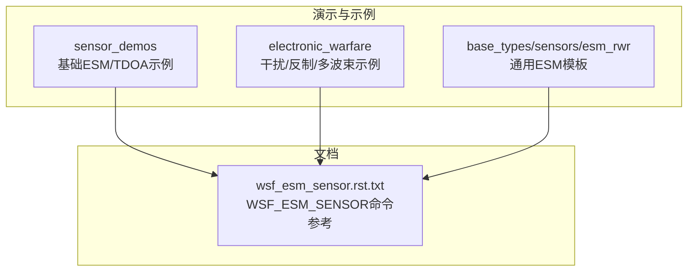
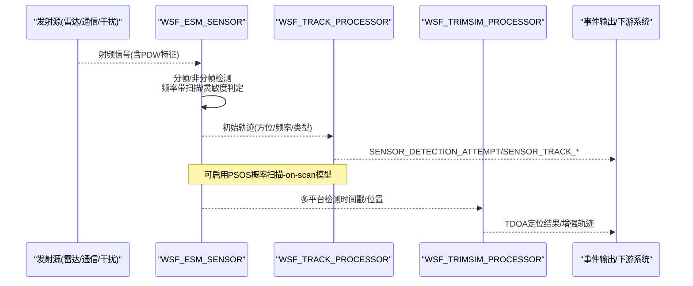
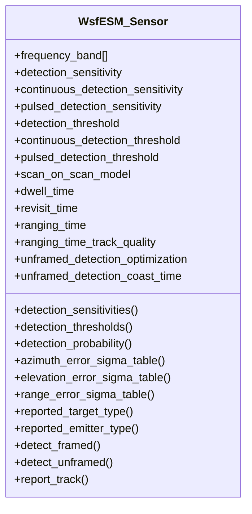
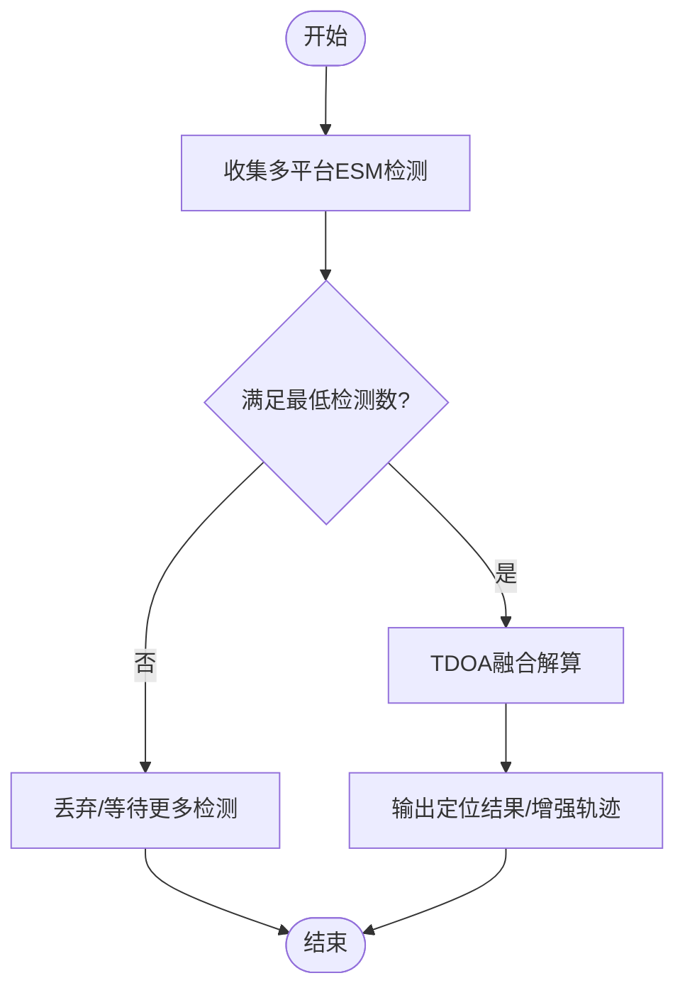
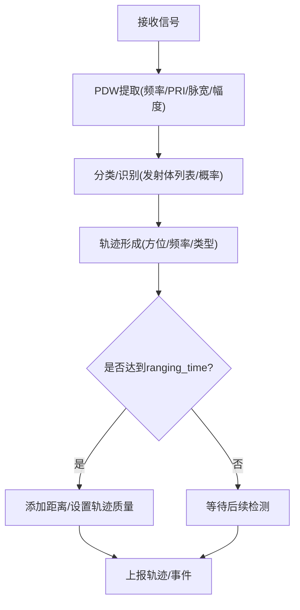
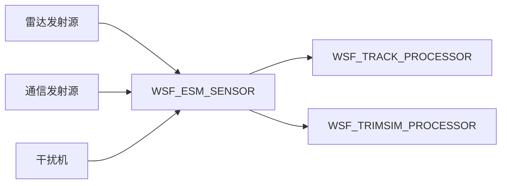

# 电子支援措施传感器集成

<cite>
**本文引用的文件**   
- [wsf_esm_sensor.rst.txt](file://documentation/html/_sources/docs/wsf_esm_sensor.rst.txt)
- [esm_demo.txt](file://demos/sensor_demos/esm_demo.txt)
- [esm_tdoa_demo.txt](file://demos/sensor_demos/esm_tdoa_demo.txt)
- [ucav_esm.txt](file://demos/electronic_warfare/test_multi_beam/sensors/esm/ucav_esm.txt)
- [generic_esm.txt](file://demos/base_types/sensors/esm_rwr/generic_esm.txt)
- [esmf_detect_jammer.txt](file://demos/electronic_warfare/esm_detect_jammer.txt)
- [esmf_detect_multi_beam_radar.txt](file://demos/electronic_warfare/esm_detect_multi_beam_radar.txt)
- [esmf_detect_multi_sensor_radar.txt](file://demos/electronic_warfare/esm_detect_multi_sensor_radar.txt)
- [agile_jamming.txt](file://demos/electronic_warfare/agile_jamming.txt)
- [repeater_jamming.txt](file://demos/electronic_warfare/repeater_jamming.txt)
- [barrage_jamming.txt](file://demos/electronic_warfare/barrage_jamming.txt)
- [spot_jamming.txt](file://demos/electronic_warfare/spot_jamming.txt)
- [rpj_jamming.txt](file://demos/electronic_warfare/rpj_jamming.txt)
- [cover_pulse_jamming.txt](file://demos/electronic_warfare/cover_pulse_jamming.txt)
- [pol_mod_jamming.txt](file://demos/electronic_warfare/pol_mod_jamming.txt)
- [simple_auto_jamming.txt](file://demos/electronic_warfare/simple_auto_jamming.txt)
- [manual_repeater_jamming.txt](file://demos/electronic_warfare/manual_repeater_jamming.txt)
- [semi-auto_repeater_jamming_1.txt](file://demos/electronic_warfare/semi-auto_repeater_jamming_1.txt)
- [jam_strobe_direction_finder.txt](file://demos/electronic_warfare/jam_strobe_direction_finder.txt)
- [jam_strobe_tracking.txt](file://demos/electronic_warfare/jam_strobe_tracking.txt)
</cite>

## 目录
1. [引言](#引言)
2. [项目结构](#项目结构)
3. [核心组件](#核心组件)
4. [架构总览](#架构总览)
5. [详细组件分析](#详细组件分析)
6. [依赖关系分析](#依赖关系分析)
7. [性能与精度考量](#性能与精度考量)
8. [故障排查指南](#故障排查指南)
9. [结论](#结论)
10. [附录：配置示例与最佳实践](#附录配置示例与最佳实践)

## 引言
本文件面向AFSIM中电子支援措施（ESM）与雷达告警接收机（RWR）传感器的集成与使用，聚焦以下目标：
- 说明WSF_ESM_SENSOR的建模能力、参数体系与数据流
- 解释电磁信号侦测、频率分析与威胁识别机制
- 文档化关键传感器参数（频率范围、灵敏度、方向图、误差模型等）
- 说明信号处理流程（脉冲描述字PDW提取、TDOA定位、多频段覆盖）
- 提供电子战场景下的传感器配置示例与干扰检测/反制仿真要点
- 展示如何配置多频段ESM系统

## 项目结构
与本主题直接相关的示例与文档主要位于：
- 演示用例：sensor_demos、electronic_warfare、base_types/sensors/esm_rwr
- 官方文档：wsf_esm_sensor.rst.txt（WSF_ESM_SENSOR命令参考）

图表来源
- [wsf_esm_sensor.rst.txt:1-562](file://documentation/html/_sources/docs/wsf_esm_sensor.rst.txt#L1-L562)
- [esm_demo.txt:1-252](file://demos/sensor_demos/esm_demo.txt#L1-L252)
- [esm_tdoa_demo.txt:1-292](file://demos/sensor_demos/esm_tdoa_demo.txt#L1-L292)
- [generic_esm.txt:1-120](file://demos/base_types/sensors/esm_rwr/generic_esm.txt#L1-L120)

章节来源
- [wsf_esm_sensor.rst.txt:1-562](file://documentation/html/_sources/docs/wsf_esm_sensor.rst.txt#L1-L562)
- [esm_demo.txt:1-252](file://demos/sensor_demos/esm_demo.txt#L1-L252)
- [esm_tdoa_demo.txt:1-292](file://demos/sensor_demos/esm_tdoa_demo.txt#L1-L292)

## 核心组件
- WSF_ESM_SENSOR：被动射频探测传感器，支持RWR/SIGINT/ELINT类载荷建模。采用“分帧（Framed）”和“非分帧（Unframed）”两种检测路径，输出轨迹（Track）报告。
- TRIMSIM_PROCESSOR：用于多平台ESM的TDOA融合处理器，可将多个平台的ESM检测进行时空关联与定位。
- 典型平台类型：地面雷达站（发射器）、空中平台（携带ESM/RWR），以及干扰机（Jammer）。

章节来源
- [wsf_esm_sensor.rst.txt:68-91](file://documentation/html/_sources/docs/wsf_esm_sensor.rst.txt#L68-L91)
- [esm_tdoa_demo.txt:88-94](file://demos/sensor_demos/esm_tdoa_demo.txt#L88-L94)

## 架构总览
下图展示了ESM/RWR在AFSIM中的端到端数据流：发射源（雷达/通信/干扰）→ ESM接收与检测 → 轨迹形成与上报 → TDOA融合（可选）→ 下游处理器/武器链。

图表来源
- [wsf_esm_sensor.rst.txt:71-91](file://documentation/html/_sources/docs/wsf_esm_sensor.rst.txt#L71-L91)
- [esm_tdoa_demo.txt:88-94](file://demos/sensor_demos/esm_tdoa_demo.txt#L88-L94)

## 详细组件分析

### WSF_ESM_SENSOR 组件分析
- 检测模式
  - 分帧（Framed）：对周期性发射体（如搜索雷达）按frame_time采样
  - 非分帧（Unframed）：对不规则发射体（跟踪雷达、通信突发、干扰）持续监测
- 频率与灵敏度
  - frequency_band：定义可侦测频带，可多次声明以支持多频段
  - detection_sensitivity / continuous_detection_sensitivity / pulsed_detection_sensitivity：最小可可靠检测功率阈值
  - detection_threshold / continuous_detection_threshold / pulsed_detection_threshold：最小信噪比阈值
  - detection_sensitivities / detection_thresholds：频率或信号类型相关的表驱动灵敏度/阈值
  - detection_probability：Pd随接收功率变化的函数（未定义时采用二元检测器）
- 扫描与时序
  - scan_on_scan_model：是否启用概率扫描-on-scan（PSOS）模型；需配合dwell_time与revisit_time
  - dwell_time / revisit_time：在指定频带驻留时长与重访间隔
- 误差与定位
  - azimuth_error_sigma_table / elevation_error_sigma_table / range_error_sigma_table：频率相关的角度/距离误差曲线
  - ranging_time / ranging_time_track_quality：延时三角测量后补充距离信息并设置轨迹质量
- 类型识别
  - reported_target_type / reported_emitter_type：按发射体列表或概率规则输出目标/发射体类型
- 优化与保持
  - unframed_detection_optimization：同一帧内对同一发射体的重复检测抑制
  - unframed_detection_coast_time：成功检测后的保持时长，避免频繁建/删迹

图表来源
- [wsf_esm_sensor.rst.txt:97-562](file://documentation/html/_sources/docs/wsf_esm_sensor.rst.txt#L97-L562)

章节来源
- [wsf_esm_sensor.rst.txt:97-562](file://documentation/html/_sources/docs/wsf_esm_sensor.rst.txt#L97-L562)

### TDOA 定位与多平台融合
- TRIMSIM_PROCESSOR：将多个平台的ESM检测进行时间差（TDOA）关联，输出更精确的位置估计
- 错误模型：支持参考时间误差、系统间延迟、传感器时序误差、大气折射残差等
- 最低检测数：minimum_detections控制参与融合的最低检测数量

图表来源
- [esm_tdoa_demo.txt:88-94](file://demos/sensor_demos/esm_tdoa_demo.txt#L88-L94)
- [esm_tdoa_demo.txt:117-125](file://demos/sensor_demos/esm_tdoa_demo.txt#L117-L125)

章节来源
- [esm_tdoa_demo.txt:88-94](file://demos/sensor_demos/esm_tdoa_demo.txt#L88-L94)
- [esm_tdoa_demo.txt:117-125](file://demos/sensor_demos/esm_tdoa_demo.txt#L117-L125)

### 信号处理流程（PDW提取与分类）
- PDW提取：从原始射频信号中提取脉冲宽度、PRI、频率、幅度等特征
- 分类与识别：基于发射体类型列表与概率规则，输出目标/发射体类型
- 轨迹形成：结合方位、频率、类型等信息生成轨迹，并可延时补充距离

图表来源
- [wsf_esm_sensor.rst.txt:71-91](file://documentation/html/_sources/docs/wsf_esm_sensor.rst.txt#L71-L91)
- [wsf_esm_sensor.rst.txt:553-562](file://documentation/html/_sources/docs/wsf_esm_sensor.rst.txt#L553-L562)

章节来源
- [wsf_esm_sensor.rst.txt:71-91](file://documentation/html/_sources/docs/wsf_esm_sensor.rst.txt#L71-L91)
- [wsf_esm_sensor.rst.txt:553-562](file://documentation/html/_sources/docs/wsf_esm_sensor.rst.txt#L553-L562)

### 多频段ESM系统配置
- 通过多次frequency_band声明实现多频段覆盖
- 可为每个频带配置独立的dwell_time与revisit_time，并结合scan_on_scan_model启用PSOS概率扫描
- 可使用detection_sensitivities/detection_thresholds为不同频点/信号类型设定差异化灵敏度/阈值

章节来源
- [wsf_esm_sensor.rst.txt:280-295](file://documentation/html/_sources/docs/wsf_esm_sensor.rst.txt#L280-L295)
- [wsf_esm_sensor.rst.txt:313-381](file://documentation/html/_sources/docs/wsf_esm_sensor.rst.txt#L313-L381)
- [wsf_esm_sensor.rst.txt:402-467](file://documentation/html/_sources/docs/wsf_esm_sensor.rst.txt#L402-L467)
- [wsf_esm_sensor.rst.txt:502-515](file://documentation/html/_sources/docs/wsf_esm_sensor.rst.txt#L502-L515)

## 依赖关系分析
- 传感器与处理器耦合：ESM通常搭配WSF_TRACK_PROCESSOR进行本地轨迹管理；TDOA需要WSF_TRIMSIM_PROCESSOR进行跨平台融合
- 与发射源的耦合：ESM被动侦测雷达/通信/干扰发射体，依赖其辐射特性（频率、调制、天线指向）
- 与干扰机的耦合：干扰机产生噪声/欺骗/转发等效应，影响ESM的检测概率与轨迹质量

图表来源
- [esm_demo.txt:119-150](file://demos/sensor_demos/esm_demo.txt#L119-L150)
- [esm_tdoa_demo.txt:138-169](file://demos/sensor_demos/esm_tdoa_demo.txt#L138-L169)

章节来源
- [esm_demo.txt:119-150](file://demos/sensor_demos/esm_demo.txt#L119-L150)
- [esm_tdoa_demo.txt:138-169](file://demos/sensor_demos/esm_tdoa_demo.txt#L138-L169)

## 性能与精度考量
- PSOS概率扫描-on-scan：开启后可更真实地反映ESM频率扫描与目标角度扫描的时间匹配概率，避免过于乐观的检测率
- 灵敏度/阈值表：针对不同频点/信号类型精细化建模，提高复杂电磁环境下的区分度
- 误差模型：方位/俯仰/距离误差随频率变化，有助于评估不同频段下的定位精度
- 延时测距：通过ranging_time模拟三角测量过程，提升轨迹三维可用性

章节来源
- [wsf_esm_sensor.rst.txt:502-515](file://documentation/html/_sources/docs/wsf_esm_sensor.rst.txt#L502-L515)
- [wsf_esm_sensor.rst.txt:517-552](file://documentation/html/_sources/docs/wsf_esm_sensor.rst.txt#L517-L552)
- [wsf_esm_sensor.rst.txt:553-562](file://documentation/html/_sources/docs/wsf_esm_sensor.rst.txt#L553-L562)

## 故障排查指南
- 无检测/漏检
  - 检查frequency_band是否覆盖目标频率
  - 校验detection_sensitivity/detection_threshold是否过严
  - 确认scan_on_scan_model与dwell_time/revisit_time配置是否合理
- 轨迹抖动/频繁建删
  - 调整unframed_detection_coast_time延长保持时间
  - 降低误报：适当提高检测阈值或引入detection_probability曲线
- TDOA不收敛
  - 确保至少minimum_detections个平台同时检测到
  - 校准reference_time_error/inter_system_time_delay等时间同步参数
- 类型识别不准确
  - 检查reported_target_type/reported_emitter_type的规则与概率分配
  - 验证发射体列表与目标实际类型的一致性

章节来源
- [wsf_esm_sensor.rst.txt:253-276](file://documentation/html/_sources/docs/wsf_esm_sensor.rst.txt#L253-L276)
- [wsf_esm_sensor.rst.txt:471-496](file://documentation/html/_sources/docs/wsf_esm_sensor.rst.txt#L471-L496)
- [esm_tdoa_demo.txt:88-94](file://demos/sensor_demos/esm_tdoa_demo.txt#L88-L94)

## 结论
WSF_ESM_SENSOR为AFSIM提供了完善的被动射频侦测能力，支持分帧与非分帧检测、多频段覆盖、概率扫描-on-scan、频率相关误差与灵敏度建模，以及与TRIMSIM_PROCESSOR的TDOA融合。通过合理的参数配置与场景设计，可在电子战环境中实现对雷达、通信与干扰信号的稳定侦测、识别与定位，并为上层决策与反制提供高质量态势输入。

## 附录：配置示例与最佳实践

### 基础ESM配置示例
- 参考文件：[esm_demo.txt](file://demos/sensor_demos/esm_demo.txt)
- 关键点
  - 定义ESM天线方向图与receiver参数（antenna_pattern、noise_power、internal_loss）
  - 设置frequency_band覆盖所需频段
  - 启用reports_location/type/frequency以便下游处理

章节来源
- [esm_demo.txt:90-113](file://demos/sensor_demos/esm_demo.txt#L90-L113)

### TDOA多平台定位示例
- 参考文件：[esm_tdoa_demo.txt](file://demos/sensor_demos/esm_tdoa_demo.txt)
- 关键点
  - 配置TRIMSIM_PROCESSOR并设置minimum_detections
  - 为ESM添加error_model（参考时间误差、系统间延迟、传感器时序误差、大气折射残差）
  - 在多平台上部署ESM并将它们加入processor的sensors列表

章节来源
- [esm_tdoa_demo.txt:88-94](file://demos/sensor_demos/esm_tdoa_demo.txt#L88-L94)
- [esm_tdoa_demo.txt:117-125](file://demos/sensor_demos/esm_tdoa_demo.txt#L117-L125)
- [esm_tdoa_demo.txt:199-206](file://demos/sensor_demos/esm_tdoa_demo.txt#L199-L206)

### 多频段ESM系统
- 参考文件：[generic_esm.txt](file://demos/base_types/sensors/esm_rwr/generic_esm.txt)、[ucav_esm.txt](file://demos/electronic_warfare/test_multi_beam/sensors/esm/ucav_esm.txt)
- 关键点
  - 多次frequency_band声明以覆盖多个频段
  - 针对各频带配置dwell_time与revisit_time
  - 使用detection_sensitivities/detection_thresholds对不同频点/信号类型差异化建模

章节来源
- [generic_esm.txt:57-114](file://demos/base_types/sensors/esm_rwr/generic_esm.txt#L57-L114)
- [ucav_esm.txt:15-38](file://demos/electronic_warfare/test_multi_beam/sensors/esm/ucav_esm.txt#L15-L38)

### 干扰检测与反制仿真
- 干扰类型示例
  - 噪声/阻塞干扰：[barrage_jamming.txt](file://demos/electronic_warfare/barrage_jamming.txt)
  - 点频干扰：[spot_jamming.txt](file://demos/electronic_warfare/spot_jamming.txt)
  - 转发式干扰：[repeater_jamming.txt](file://demos/electronic_warfare/repeater_jamming.txt)、[manual_repeater_jamming.txt](file://demos/electronic_warfare/manual_repeater_jamming.txt)、[semi-auto_repeater_jamming_1.txt](file://demos/electronic_warfare/semi-auto_repeater_jamming_1.txt)
  - 敏捷/自动干扰：[agile_jamming.txt](file://demos/electronic_warfare/agile_jamming.txt)、[simple_auto_jamming.txt](file://demos/electronic_warfare/simple_auto_jamming.txt)
  - 伪假目标/复压干扰：[rpj_jamming.txt](file://demos/electronic_warfare/rpj_jamming.txt)、[cover_pulse_jamming.txt](file://demos/electronic_warfare/cover_pulse_jamming.txt)
  - 极化调制干扰：[pol_mod_jamming.txt](file://demos/electronic_warfare/pol_mod_jamming.txt)
  - 闪烁干扰与方向查找/跟踪：[jam_strobe_direction_finder.txt](file://demos/electronic_warfare/jam_strobe_direction_finder.txt)、[jam_strobe_tracking.txt](file://demos/electronic_warfare/jam_strobe_tracking.txt)
- ESM对干扰的检测
  - 参考：[esmf_detect_jammer.txt](file://demos/electronic_warfare/esm_detect_jammer.txt)
  - 多波束雷达检测：[esmf_detect_multi_beam_radar.txt](file://demos/electronic_warfare/esm_detect_multi_beam_radar.txt)
  - 多传感器协同检测：[esmf_detect_multi_sensor_radar.txt](file://demos/electronic_warfare/esm_detect_multi_sensor_radar.txt)

章节来源
- [esmf_detect_jammer.txt:120-140](file://demos/electronic_warfare/esm_detect_jammer.txt#L120-L140)
- [esmf_detect_multi_beam_radar.txt:35-55](file://demos/electronic_warfare/esm_detect_multi_beam_radar.txt#L35-L55)
- [esmf_detect_multi_sensor_radar.txt:35-55](file://demos/electronic_warfare/esm_detect_multi_sensor_radar.txt#L35-L55)
- [barrage_jamming.txt:1-120](file://demos/electronic_warfare/barrage_jamming.txt#L1-L120)
- [spot_jamming.txt:1-120](file://demos/electronic_warfare/spot_jamming.txt#L1-L120)
- [repeater_jamming.txt:1-120](file://demos/electronic_warfare/repeater_jamming.txt#L1-L120)
- [manual_repeater_jamming.txt:1-120](file://demos/electronic_warfare/manual_repeater_jamming.txt#L1-L120)
- [semi-auto_repeater_jamming_1.txt:1-120](file://demos/electronic_warfare/semi-auto_repeater_jamming_1.txt#L1-L120)
- [agile_jamming.txt:1-120](file://demos/electronic_warfare/agile_jamming.txt#L1-L120)
- [simple_auto_jamming.txt:1-120](file://demos/electronic_warfare/simple_auto_jamming.txt#L1-L120)
- [rpj_jamming.txt:1-120](file://demos/electronic_warfare/rpj_jamming.txt#L1-L120)
- [cover_pulse_jamming.txt:1-120](file://demos/electronic_warfare/cover_pulse_jamming.txt#L1-L120)
- [pol_mod_jamming.txt:1-120](file://demos/electronic_warfare/pol_mod_jamming.txt#L1-L120)
- [jam_strobe_direction_finder.txt:1-120](file://demos/electronic_warfare/jam_strobe_direction_finder.txt#L1-L120)
- [jam_strobe_tracking.txt:1-120](file://demos/electronic_warfare/jam_strobe_tracking.txt#L1-L120)