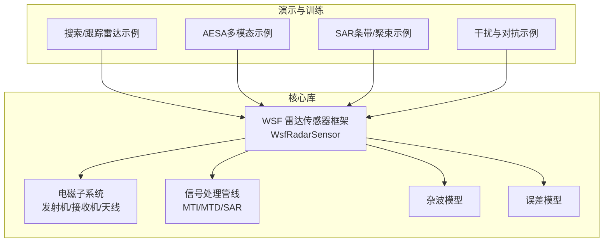
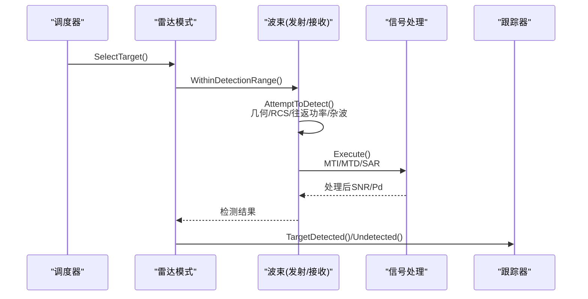
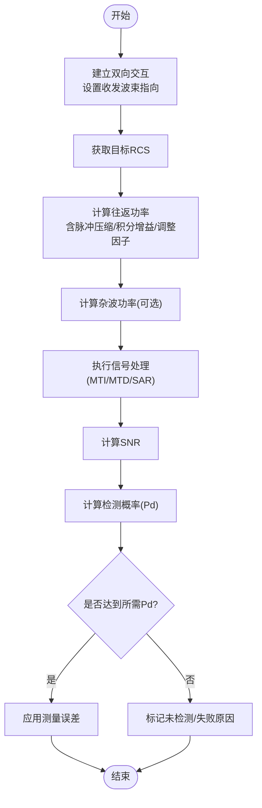
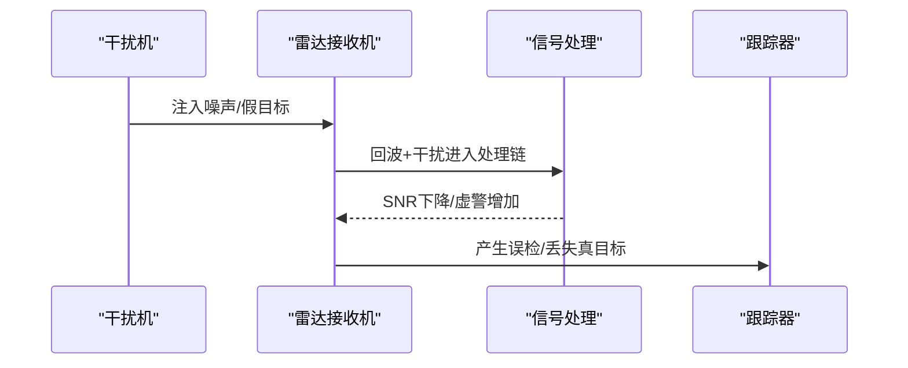
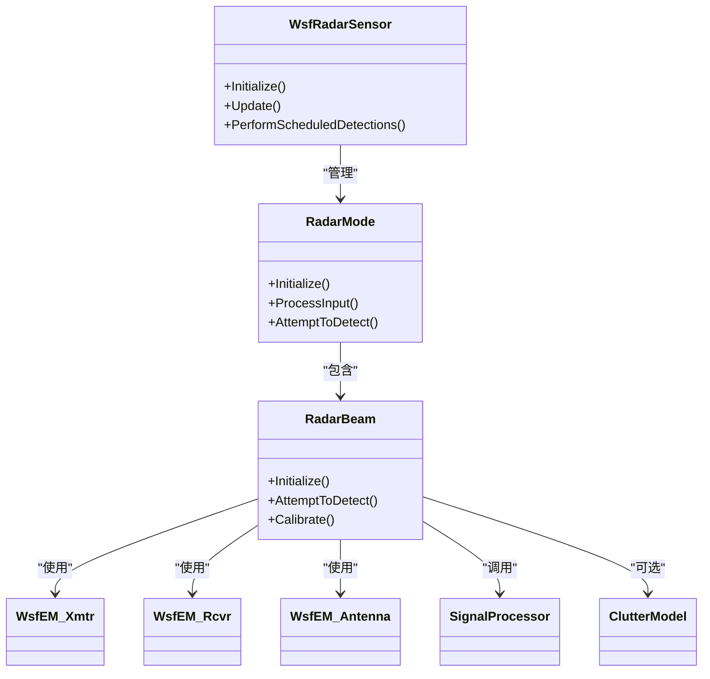

# 雷达传感器集成

<cite>
**本文引用的文件**   
- [WsfRadarSensor.cpp](file://swdev/src/core/wsf/source/sensor/WsfRadarSensor.cpp)
- [generic_fire_control_radar.txt](file://demos/base_types/sensors/radar/generic_fire_control_radar.txt)
- [blue_a2a_radar.txt](file://demos/base_types/sensors/radar/blue_a2a_radar.txt)
- [aesa.txt](file://demos/air_to_air/sensors/radar/aesa.txt)
- [mti_radar.txt](file://demos/base_types/sensors/radar/mti_radar.txt)
- [pd_radar.txt](file://demos/base_types/sensors/radar/pd_radar.txt)
- [strip_sar_demo.txt](file://demos/sensor_demos/strip_sar_demo.txt)
- [narrow_spot_sar_demo.txt](file://demos/sensor_demos/narrow_spot_sar_demo.txt)
- [bistatic_sp_noise_jamming_demo.txt](file://demos/sensor_demos/bistatic_sp_noise_jamming_demo.txt)
- [bistatic_sp_false_target_jamming_demo.txt](file://demos/sensor_demos/bistatic_sp_false_target_jamming_demo.txt)
- [clutter_demo.txt](file://demos/sensor_demos/clutter_demo.txt)
- [ew_radar.txt](file://training/user/10_Other_Topics/bam/scenarios/floridistan/27_floridistan_cluster_gci/sensors/radar/ew_radar.txt)
</cite>

## 目录
1. [简介](#简介)
2. [项目结构](#项目结构)
3. [核心组件](#核心组件)
4. [架构总览](#架构总览)
5. [详细组件分析](#详细组件分析)
6. [依赖关系分析](#依赖关系分析)
7. [性能考虑](#性能考虑)
8. [故障排查指南](#故障排查指南)
9. [结论](#结论)
10. [附录](#附录)

## 简介
本文件面向AFSIM中的雷达传感器集成，覆盖搜索雷达、火控雷达、导弹导引头、SAR与干扰对抗等典型场景。文档从系统架构、数据流、探测方程、天线与扫描模式、检测算法、信号处理（MTI/MTD/SAR）、参数配置、性能分析与优化、干扰与对抗仿真，以及自定义雷达类型创建等方面给出系统化说明，并辅以代码级图示与示例路径，便于不同技术背景的读者快速上手与深入扩展。

## 项目结构
AFSIM的雷达能力由核心库与大量演示用例共同构成：
- 核心实现位于核心库中，提供通用雷达传感器框架、发射机/接收机/天线抽象、调度与跟踪、误差模型、杂波与信号处理管线等。
- 演示用例分布在demos与training目录下，展示各类雷达传感器在搜索、跟踪、成像与电子战环境下的配置方法。

**图表来源** 
- [WsfRadarSensor.cpp:54-70](file://swdev/src/core/wsf/source/sensor/WsfRadarSensor.cpp#L54-L70)
- [aesa.txt:14-96](file://demos/air_to_air/sensors/radar/aesa.txt#L14-L96)

**章节来源**
- [WsfRadarSensor.cpp:54-70](file://swdev/src/core/wsf/source/sensor/WsfRadarSensor.cpp#L54-L70)

## 核心组件
- 雷达传感器基类与模式管理：负责模式列表、发射/接收通道、调度器与跟踪器的装配，以及更新循环与检测调度。
- 波束（Beam）：封装天线、发射机、接收机、杂波与检测器，执行探测计算、信噪比评估、概率检测与误差应用。
- 模式（Mode）：定义扫描范围、帧时间、驻留时间、报告项、信号处理器、频率敏捷等。
- 信号处理：支持简单多普勒、动目标显示（MTI）、脉冲多普勒（PD/MTD）等，用于抑制杂波与提升可检测性。
- 杂波与误差：杂波功率计算与衰减因子；方位/俯仰波束宽度、脉宽、多普勒分辨率等误差模型参数。

关键职责映射：
- 调度与跟踪：PerformScheduledDetections 驱动目标选择、检测尝试、误差应用与跟踪器更新。
- 探测链路：AttemptToDetect 完成几何、RCS、往返功率、压缩增益、积分增益、杂波、信号处理、SNR与Pd计算。
- 校准与噪声：Calibrate 根据 one_m2_detect_range / range_product / loop_gain 反推噪声或阈值，保证一致性。

**章节来源**
- [WsfRadarSensor.cpp:299-428](file://swdev/src/core/wsf/source/sensor/WsfRadarSensor.cpp#L299-L428)
- [WsfRadarSensor.cpp:561-756](file://swdev/src/core/wsf/source/sensor/WsfRadarSensor.cpp#L561-L756)
- [WsfRadarSensor.cpp:760-927](file://swdev/src/core/wsf/source/sensor/WsfRadarSensor.cpp#L760-L927)
- [WsfRadarSensor.cpp:1426-1479](file://swdev/src/core/wsf/source/sensor/WsfRadarSensor.cpp#L1426-L1479)

## 架构总览
下图展示了雷达传感器在AFSIM中的整体交互流程：调度器按策略挑选目标，模式层选择波束，波束内发射机/接收机与天线协同完成往返链路计算，信号处理模块对回波进行滤波/变换，最终输出检测结果与测量误差。

**图表来源** 
- [WsfRadarSensor.cpp:318-428](file://swdev/src/core/wsf/source/sensor/WsfRadarSensor.cpp#L318-L428)
- [WsfRadarSensor.cpp:561-756](file://swdev/src/core/wsf/source/sensor/WsfRadarSensor.cpp#L561-L756)

## 详细组件分析

### 雷达探测方程与检测算法
- 往返链路：基于发射峰值功率、天线增益、内部损耗、波长、RCS、距离与脉冲压缩比计算接收功率。
- 杂波与干扰：可选杂波模型计算杂波功率，结合接收机噪声与干扰功率得到总干扰背景。
- SNR与Pd：计算信噪比后，通过Marcum-Swerling检测器或概率表计算检测概率；支持“锁定后阈值调整”以模拟稳定跟踪后的灵敏度变化。
- 校准：支持通过 one_m2_detect_range、range_product 或 loop_gain 三种方式之一进行系统校准，自动推导噪声功率或阈值。

**图表来源** 
- [WsfRadarSensor.cpp:617-756](file://swdev/src/core/wsf/source/sensor/WsfRadarSensor.cpp#L617-L756)
- [WsfRadarSensor.cpp:760-927](file://swdev/src/core/wsf/source/sensor/WsfRadarSensor.cpp#L760-L927)

**章节来源**
- [WsfRadarSensor.cpp:617-756](file://swdev/src/core/wsf/source/sensor/WsfRadarSensor.cpp#L617-L756)
- [WsfRadarSensor.cpp:760-927](file://swdev/src/core/wsf/source/sensor/WsfRadarSensor.cpp#L760-L927)

### 天线模式与扫描模式
- 天线模式：支持圆形、矩形、表格型等多种天线方向图；可在发射/接收侧分别指定。
- 扫描模式：方位/俯仰扫描、电子扫描（AESA），配合扫描限幅与视场限制控制覆盖区域。
- 波束形成：支持隐式单波束与显式多波束；多波束模式下选择最佳结果。

参考示例：
- 搜索/跟踪雷达：方位+俯仰扫描，视场与扫描限幅分离。
- AESA雷达：电子扫描方位/俯仰，多模态（SEARCH/TWS）。

**章节来源**
- [aesa.txt:14-96](file://demos/air_to_air/sensors/radar/aesa.txt#L14-L96)
- [generic_fire_control_radar.txt:141-228](file://demos/base_types/sensors/radar/generic_fire_control_radar.txt#L141-L228)
- [blue_a2a_radar.txt:102-154](file://demos/base_types/sensors/radar/blue_a2a_radar.txt#L102-L154)

### 雷达参数设置（频率、功率、波束宽度等）
- 发射机：频率、功率、极化、占空比、脉宽、PRF、内部损耗、衰减模型、天线方向图。
- 接收机：天线方向图、噪声系数、瞬时带宽、内部损耗。
- 检测相关：Swerling模型、检测律、虚警率、所需Pd、积分脉冲数、检测概率表。
- 误差与报告：方位/俯仰/距离误差σ、速度/多普勒误差、报告项开关。

参考示例：
- 火控雷达：典型UHF/VHF频段、中等功率、窄波束、高跟踪精度。
- 机载AESA：X波段、多模态、数字波束形成、多普勒处理能力。

**章节来源**
- [generic_fire_control_radar.txt:148-228](file://demos/base_types/sensors/radar/generic_fire_control_radar.txt#L148-L228)
- [aesa.txt:46-96](file://demos/air_to_air/sensors/radar/aesa.txt#L46-L96)
- [blue_a2a_radar.txt:132-154](file://demos/base_types/sensors/radar/blue_a2a_radar.txt#L132-L154)

### 信号处理功能（MTI、MTD、SAR）
- MTI（动目标显示）：抑制静止杂波，适用于地/海杂波环境。
- MTD/脉冲多普勒（PD）：频域滤波，提高多普勒分辨与杂波抑制。
- SAR（合成孔径雷达）：条带与聚束模式，生成高分辨图像。

参考示例：
- MTI雷达：启用动目标显示与杂波模型。
- PD雷达：启用脉冲多普勒处理。
- SAR：条带与聚束两种成像模式的演示。

**章节来源**
- [mti_radar.txt:10-61](file://demos/base_types/sensors/radar/mti_radar.txt#L10-L61)
- [pd_radar.txt:51-57](file://demos/base_types/sensors/radar/pd_radar.txt#L51-L57)
- [strip_sar_demo.txt](file://demos/sensor_demos/strip_sar_demo.txt)
- [narrow_spot_sar_demo.txt](file://demos/sensor_demos/narrow_spot_sar_demo.txt)

### 雷达性能分析与优化
- 校准一致性：优先使用 one_m2_detect_range 或 range_product 进行系统级校准，避免与 signal_processor 混用导致不一致警告。
- 积分增益与检测阈值：通过 number_of_pulses_integrated 与 detector_law 调节检测性能；必要时使用 detection_probability 表精确建模。
- 杂波抑制：合理配置 clutter_model 与 clutter_attenuation_factor，结合MTI/MTD提升低可观测目标检测。
- 扫描与驻留：增大 frame_time 或 dwell_time 可提高能量积累但降低重访率；需权衡覆盖与更新速率。
- 频率敏捷：启用 alternate frequencies 与 randomize_frequency 以降低被截获与干扰风险。

**章节来源**
- [WsfRadarSensor.cpp:1017-1021](file://swdev/src/core/wsf/source/sensor/WsfRadarSensor.cpp#L1017-L1021)
- [WsfRadarSensor.cpp:1070-1148](file://swdev/src/core/wsf/source/sensor/WsfRadarSensor.cpp#L1070-L1148)
- [aesa.txt:65-85](file://demos/air_to_air/sensors/radar/aesa.txt#L65-L85)

### 雷达干扰与对抗仿真
- 噪声干扰：在 bistatic_sp_noise_jamming_demo 中演示双站SP噪声干扰对雷达接收的影响。
- 假目标干扰：在 bistatic_sp_false_target_jamming_demo 中演示SP假目标注入导致的虚假轨迹。
- 杂波与地形遮蔽：clutter_demo 演示杂波模型与地形遮蔽对检测的影响。
- ESM与雷达共存：训练示例 ew_radar.txt 展示预警雷达与ESM传感器的联合配置。

**图表来源** 
- [bistatic_sp_noise_jamming_demo.txt](file://demos/sensor_demos/bistatic_sp_noise_jamming_demo.txt)
- [bistatic_sp_false_target_jamming_demo.txt](file://demos/sensor_demos/bistatic_sp_false_target_jamming_demo.txt)
- [clutter_demo.txt](file://demos/sensor_demos/clutter_demo.txt)
- [ew_radar.txt:24-63](file://training/user/10_Other_Topics/bam/scenarios/floridistan/27_floridistan_cluster_gci/sensors/radar/ew_radar.txt#L24-L63)

**章节来源**
- [bistatic_sp_noise_jamming_demo.txt](file://demos/sensor_demos/bistatic_sp_noise_jamming_demo.txt)
- [bistatic_sp_false_target_jamming_demo.txt](file://demos/sensor_demos/bistatic_sp_false_target_jamming_demo.txt)
- [clutter_demo.txt](file://demos/sensor_demos/clutter_demo.txt)
- [ew_radar.txt:24-63](file://training/user/10_Other_Topics/bam/scenarios/floridistan/27_floridistan_cluster_gci/sensors/radar/ew_radar.txt#L24-L63)

### 创建自定义雷达传感器类型
步骤概览：
1. 定义天线方向图（antenna_pattern）。
2. 定义 sensor 类型为 WSF_RADAR_SENSOR。
3. 在 mode_template 中配置 transmitter/receiver、检测参数、误差与报告项。
4. 定义具体 mode（如 SEARCH/TRACK），设置 scan_mode、视场、帧时间、驻留时间等。
5. 可选：添加 signal_processor（simple_doppler/moving_target_indicator/pulse_doppler）与 clutter_model。
6. 在平台中添加传感器实例，并配置位置、指向与初始模式。

参考模板：
- 火控雷达：包含天线、发射/接收、检测律、误差与跟踪滤波器。
- 机载AESA：多模态、电子扫描、多普勒处理与概率检测表。

**章节来源**
- [generic_fire_control_radar.txt:141-263](file://demos/base_types/sensors/radar/generic_fire_control_radar.txt#L141-L263)
- [aesa.txt:14-129](file://demos/air_to_air/sensors/radar/aesa.txt#L14-L129)

## 依赖关系分析
- 组件耦合：
  - WsfRadarSensor 依赖 WsfEM_Xmtr/WsfEM_Rcvr/WsfEM_Antenna 完成射频链路。
  - 模式层依赖调度器与跟踪器完成检测编排与轨迹维护。
  - 信号处理管线与杂波模型作为可选增强模块参与检测链路。
- 外部依赖：
  - 场景与环境：地形遮蔽、大气衰减、杂波模型库。
  - 平台与目标：RCS签名、运动学、可见性。

**图表来源** 
- [WsfRadarSensor.cpp:54-70](file://swdev/src/core/wsf/source/sensor/WsfRadarSensor.cpp#L54-L70)
- [WsfRadarSensor.cpp:431-550](file://swdev/src/core/wsf/source/sensor/WsfRadarSensor.cpp#L431-L550)
- [WsfRadarSensor.cpp:1346-1479](file://swdev/src/core/wsf/source/sensor/WsfRadarSensor.cpp#L1346-L1479)

**章节来源**
- [WsfRadarSensor.cpp:54-70](file://swdev/src/core/wsf/source/sensor/WsfRadarSensor.cpp#L54-L70)
- [WsfRadarSensor.cpp:431-550](file://swdev/src/core/wsf/source/sensor/WsfRadarSensor.cpp#L431-L550)
- [WsfRadarSensor.cpp:1346-1479](file://swdev/src/core/wsf/source/sensor/WsfRadarSensor.cpp#L1346-L1479)

## 性能考虑
- 检测概率与虚警平衡：通过 Swerling 模型与检测律调节 Pd/Pfa；必要时使用概率表更贴近实际。
- 积分与驻留：增加积分脉冲数或驻留时间可提升能量积累，但会降低重访率与机动目标跟踪能力。
- 杂波抑制：MTI/MTD与合适的杂波模型能显著改善低可观测目标检测；注意杂波衰减因子与带宽匹配。
- 频率敏捷与随机化：启用频率列表与随机化可降低被侦测与干扰概率，同时需考虑切换延迟与同步。
- 校准一致性：避免将 one_m2_detect_range/range_product/loop_gain 与 signal_processor 混用，以免触发不一致警告。

[本节为通用指导，不直接分析具体文件]

## 故障排查指南
常见问题与定位要点：
- 检测失败（信号电平不足）：检查发射功率、天线增益、内部损耗、RCS、距离与积分增益；确认 required_pd 与 detection_threshold 设置合理。
- 校准不一致警告：当使用 signal_processor 时，避免同时设置 one_m2_detect_range/range_product/loop_gain。
- 杂波影响异常：核查 clutter_model 是否正确加载与初始化；检查 clutter_attenuation_factor 是否在有效范围。
- 多普勒处理异常：确认 PRF、脉宽与带宽匹配；检查 maximum_doppler_speed 与采样间隔是否满足奈奎斯特条件。
- 跟踪不稳定：调整 hits_to_establish_track/hits_to_maintain_track 与滤波器参数（alpha/beta）。

**章节来源**
- [WsfRadarSensor.cpp:1017-1021](file://swdev/src/core/wsf/source/sensor/WsfRadarSensor.cpp#L1017-L1021)
- [WsfRadarSensor.cpp:1151-1338](file://swdev/src/core/wsf/source/sensor/WsfRadarSensor.cpp#L1151-L1338)

## 结论
AFSIM的雷达传感器框架提供了从基础射频链路到高级信号处理的完整能力，支持多种雷达类型与复杂作战环境的仿真。通过合理的参数配置、信号处理与干扰对抗设置，用户可以在搜索、跟踪、成像与电子战场景中构建高保真的雷达系统。建议遵循校准一致性与性能权衡原则，逐步迭代优化，以获得稳定可靠的仿真结果。

[本节为总结性内容，不直接分析具体文件]

## 附录
- 常用命令与参数速查（来自示例文件）：
  - 发射机：frequency、power、polarization、duty_cycle、pulse_width、pulse_repetition_frequency、internal_loss、attenuation_model、antenna_pattern。
  - 接收机：antenna_pattern、noise_figure、instantaneous_bandwidth、internal_loss。
  - 检测：swerling_case、detector_law、probability_of_false_alarm、number_of_pulses_integrated、detection_probability、required_pd。
  - 误差与报告：azimuth_error_sigma、elevation_error_sigma、range_error_sigma、reports_location/range/range_rate/elevation/bearing/velocity/side/iff/signal_to_noise。
  - 信号处理：signal_processor simple_doppler/moving_target_indicator/pulse_doppler。
  - 杂波：clutter_model、clutter_attenuation_factor。

参考示例路径：
- [generic_fire_control_radar.txt:148-228](file://demos/base_types/sensors/radar/generic_fire_control_radar.txt#L148-L228)
- [aesa.txt:46-96](file://demos/air_to_air/sensors/radar/aesa.txt#L46-L96)
- [mti_radar.txt:10-61](file://demos/base_types/sensors/radar/mti_radar.txt#L10-L61)
- [pd_radar.txt:51-57](file://demos/base_types/sensors/radar/pd_radar.txt#L51-L57)
- [strip_sar_demo.txt](file://demos/sensor_demos/strip_sar_demo.txt)
- [narrow_spot_sar_demo.txt](file://demos/sensor_demos/narrow_spot_sar_demo.txt)
- [bistatic_sp_noise_jamming_demo.txt](file://demos/sensor_demos/bistatic_sp_noise_jamming_demo.txt)
- [bistatic_sp_false_target_jamming_demo.txt](file://demos/sensor_demos/bistatic_sp_false_target_jamming_demo.txt)
- [clutter_demo.txt](file://demos/sensor_demos/clutter_demo.txt)
- [ew_radar.txt:24-63](file://training/user/10_Other_Topics/bam/scenarios/floridistan/27_floridistan_cluster_gci/sensors/radar/ew_radar.txt#L24-L63)