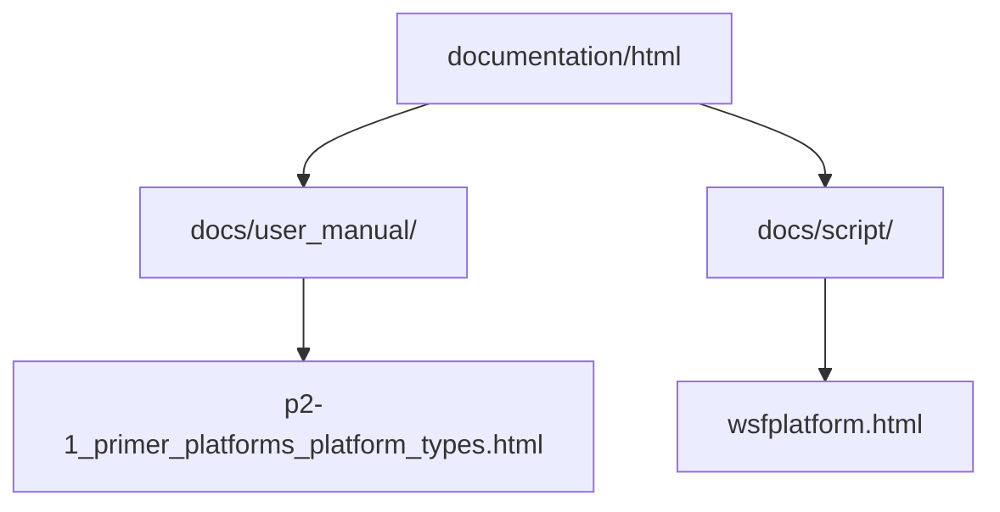
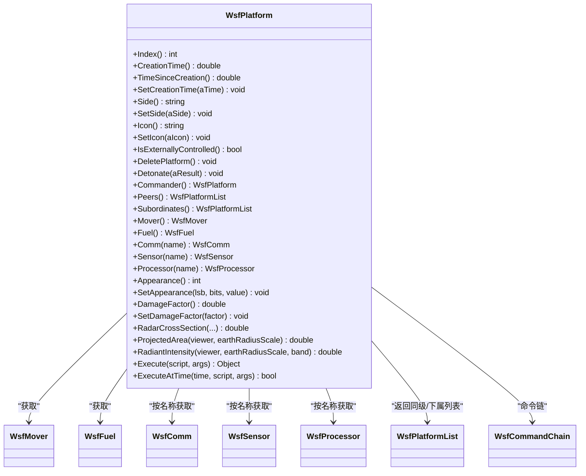
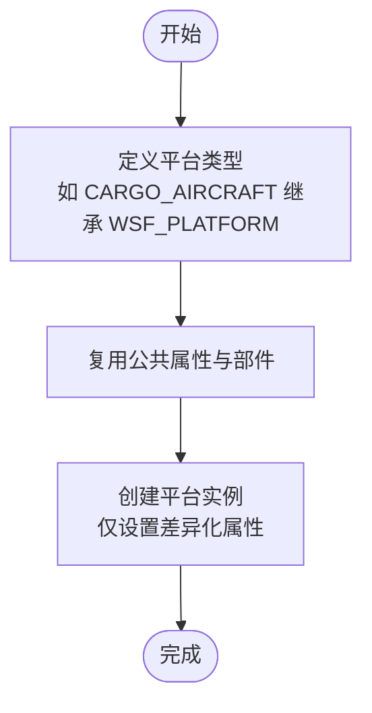
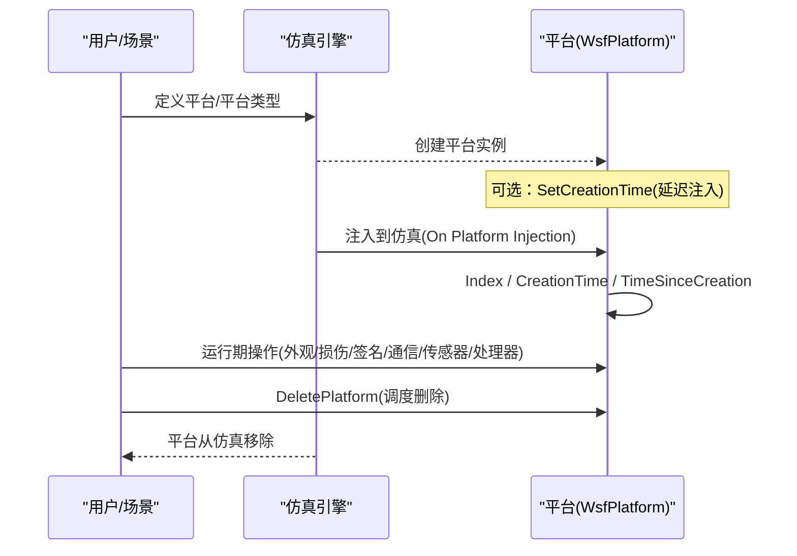
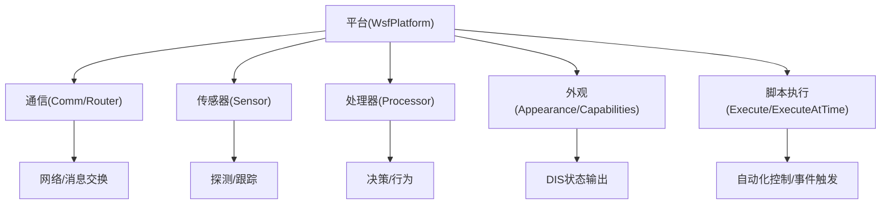
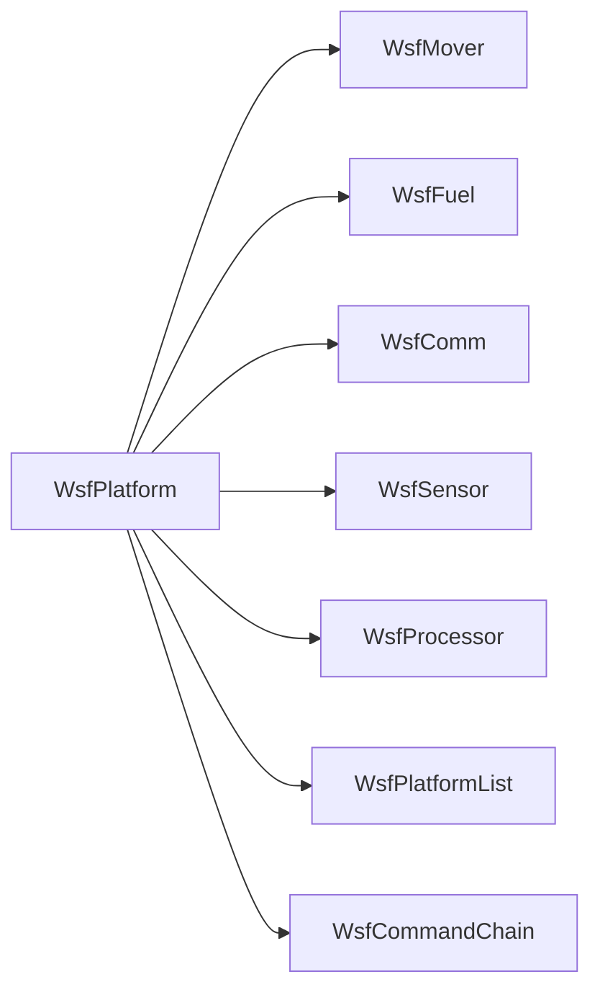

# 平台基础概念

<cite>
**本文引用的文件**   
- [p2-1_primer_platforms_platform_types.html](file://documentation/html/docs/user_manual/p2-1_primer_platforms_platform_types.html)
- [wsfplatform.html](file://documentation/html/docs/script/wsfplatform.html)
</cite>

## 目录
1. [简介](#简介)
2. [项目结构](#项目结构)
3. [核心组件](#核心组件)
4. [架构总览](#架构总览)
5. [详细组件分析](#详细组件分析)
6. [依赖关系分析](#依赖关系分析)
7. [性能考虑](#性能考虑)
8. [故障排查指南](#故障排查指南)
9. [结论](#结论)
10. [附录](#附录)

## 简介
本文件面向AFSIM仿真系统中的“平台（Platform）”基础概念，系统阐述平台对象在仿真中的核心作用、层次结构与继承关系、静态与动态属性、生命周期管理、与仿真环境的交互机制，以及平台定义语法与标识符命名约定。文档同时提供可视化图示与可操作的配置示例路径，帮助读者快速理解并上手使用平台进行仿真控制。

## 项目结构
AFSIM的用户手册与脚本API文档位于documentation/html目录下：
- 用户手册中关于平台与平台类型的入门章节位于 user_manual 子目录
- 脚本API参考中关于WsfPlatform类的详细说明位于 script 子目录

**图表来源**
- [p2-1_primer_platforms_platform_types.html:1-428](file://documentation/html/docs/user_manual/p2-1_primer_platforms_platform_types.html#L1-L428)
- [wsfplatform.html:1-800](file://documentation/html/docs/script/wsfplatform.html#L1-L800)

**章节来源**
- [p2-1_primer_platforms_platform_types.html:1-428](file://documentation/html/docs/user_manual/p2-1_primer_platforms_platform_types.html#L1-L428)
- [wsfplatform.html:1-800](file://documentation/html/docs/script/wsfplatform.html#L1-L800)

## 核心组件
- 平台（Platform）：仿真实体（如飞行器、舰船、导弹等）的封装，承载身份、状态、子系统与行为逻辑。
- 平台类型（Platform Type）：用于抽象和复用平台共有的属性与部件，支持单继承链，便于大规模场景的组织与维护。
- WsfPlatform类：脚本侧的平台对象接口，提供平台索引、创建时间、外观、损伤、签名、通信、传感器、处理器、导航、感知、轨迹、命令链等能力。

关键要点：
- 平台必须继承一个平台类型，默认类型为WSF_PLATFORM。
- 平台可包含Mover（运动）、Sensor（传感器）、Comm（通信）、Processor（处理器）等部件。
- 平台类型可被其他平台类型继承，形成“祖辈类型”链。

**章节来源**
- [p2-1_primer_platforms_platform_types.html:72-140](file://documentation/html/docs/user_manual/p2-1_primer_platforms_platform_types.html#L72-L140)
- [p2-1_primer_platforms_platform_types.html:192-258](file://documentation/html/docs/user_manual/p2-1_primer_platforms_platform_types.html#L192-L258)
- [wsfplatform.html:72-116](file://documentation/html/docs/script/wsfplatform.html#L72-L116)

## 架构总览
下图展示平台与其主要子系统之间的关系，以及平台在脚本API中的角色。

**图表来源**
- [wsfplatform.html:117-800](file://documentation/html/docs/script/wsfplatform.html#L117-L800)

## 详细组件分析

### 平台的层次结构与继承关系
- 平台类型是平台定义的父模板，所有平台实例必须继承单一父类型。
- 平台类型之间可以形成继承链（例如：WSF_PLATFORM <- CARGO_AIRCRAFT <- ...），便于复用公共属性与部件。
- 通过平台类型集中维护通用信息（如图标、空间域、类别），平台实例仅保留差异化信息（如名称、初始位置、航向）。

**图表来源**
- [p2-1_primer_platforms_platform_types.html:84-140](file://documentation/html/docs/user_manual/p2-1_primer_platforms_platform_types.html#L84-L140)
- [p2-1_primer_platforms_platform_types.html:192-258](file://documentation/html/docs/user_manual/p2-1_primer_platforms_platform_types.html#L192-L258)

**章节来源**
- [p2-1_primer_platforms_platform_types.html:84-140](file://documentation/html/docs/user_manual/p2-1_primer_platforms_platform_types.html#L84-L140)
- [p2-1_primer_platforms_platform_types.html:192-258](file://documentation/html/docs/user_manual/p2-1_primer_platforms_platform_types.html#L192-L258)

### 平台的基本属性与分类
- 静态属性（通常在平台或平台类型中定义）：
  - 名称、图标、空间域、类别、尺寸（长宽高）、质量（空重、燃油、载荷）、外观（DIS Appearance字段）、能力（DIS Capabilities字段）等。
- 动态属性（运行时由仿真引擎更新或通过脚本访问）：
  - 位置、姿态、速度、加速度、损伤因子、隐身因子、红外/光学/雷达签名状态与尺度因子、GPS可用性、燃料剩余等。

这些属性可通过WsfPlatform的方法读取或设置，例如外观、损伤、签名状态与尺度因子、投影面积、辐射强度、雷达散射截面等。

**章节来源**
- [wsfplatform.html:471-718](file://documentation/html/docs/script/wsfplatform.html#L471-L718)

### 平台的生命周期管理
- 创建与注入：
  - 平台可在场景文件中定义，或在地图显示中创建；也可通过脚本在on_platform_injection回调中延迟注入。
  - 可使用SetCreationTime指定注入时间（仅在on_platform_injection上下文中有效）。
- 运行期：
  - 平台拥有唯一索引（Index）与创建时间（CreationTime），并可查询自创建以来的时长（TimeSinceCreation）。
- 销毁：
  - 调用DeletePlatform将调度删除，在当前脚本上下文返回后执行。

**图表来源**
- [wsfplatform.html:141-236](file://documentation/html/docs/script/wsfplatform.html#L141-L236)

**章节来源**
- [wsfplatform.html:141-236](file://documentation/html/docs/script/wsfplatform.html#L141-L236)

### 平台与仿真环境的交互机制
- 外部控制：
  - IsExternallyControlled判断平台是否由外部实体（如DIS接口）控制。
- 通信与路由：
  - 通过Comm与Router对象进行通信设备与路由器的开关与访问。
- 传感器与处理器：
  - Sensor与Processor对象用于感知与决策控制，可开启/关闭。
- 外观与能力：
  - Appearance与Capabilities字段用于DIS实体状态与能力字段的读写。
- 脚本调用：
  - Execute/ExecuteScript/ExecuteAtTime等平台脚本方法，允许在平台上下文中执行脚本或定时执行。

**图表来源**
- [wsfplatform.html:238-470](file://documentation/html/docs/script/wsfplatform.html#L238-L470)
- [wsfplatform.html:720-788](file://documentation/html/docs/script/wsfplatform.html#L720-L788)

**章节来源**
- [wsfplatform.html:238-470](file://documentation/html/docs/script/wsfplatform.html#L238-L470)
- [wsfplatform.html:720-788](file://documentation/html/docs/script/wsfplatform.html#L720-L788)

### 平台定义的基本语法与配置示例
- 平台类型定义：
  - 使用platform_type块定义平台类型，并继承WSF_PLATFORM或其他已有类型。
- 平台实例定义：
  - 使用platform块定义具体平台，引用已定义的平台类型，并设置差异化属性（如position、heading等）。
- 典型属性：
  - icon、spatial_domain、category、position、heading等。

建议参考以下文档段落以获取完整语法与示例：
- 平台与平台类型概述与快速入门
- 平台定义步骤与地图显示创建流程
- 平台类型抽象与复用最佳实践

**章节来源**
- [p2-1_primer_platforms_platform_types.html:84-140](file://documentation/html/docs/user_manual/p2-1_primer_platforms_platform_types.html#L84-L140)
- [p2-1_primer_platforms_platform_types.html:147-213](file://documentation/html/docs/user_manual/p2-1_primer_platforms_platform_types.html#L147-L213)
- [p2-1_primer_platforms_platform_types.html:215-258](file://documentation/html/docs/user_manual/p2-1_primer_platforms_platform_types.html#L215-L258)

### 平台标识符系统与命名约定
- 平台名称：
  - 每个平台具有唯一名称，用于场景文件与脚本中引用。
- 平台索引：
  - Index返回平台在仿真中的唯一且不变的索引号，适合稳定引用。
- 平台类型名称：
  - 平台类型名称用于继承与复用，需遵循一致的命名规范（如大写+下划线）。
- 团队/阵营（Side）：
  - 可通过SetSide/Side设置与查询平台所属阵营，常用于敌我识别与规则判定。

**章节来源**
- [wsfplatform.html:141-194](file://documentation/html/docs/script/wsfplatform.html#L141-L194)

### 如何使用平台属性进行仿真控制
- 外观与能力：
  - Appearance/SetAppearance用于设置DIS实体外观位段；Capabilities/SetCapability用于设置能力标志。
- 损伤与不可摧毁：
  - DamageFactor/SetDamageFactor控制损伤程度；Indestructible/SetIndestructible标记平台不可摧毁。
- 签名控制：
  - SetSignatureState统一设置红外/光学/雷达签名状态；各签名类型还提供独立的状态与尺度因子控制。
- 几何与观测：
  - ProjectedArea/RadiantIntensity/RadarCrossSection用于计算不同观测条件下的可见性与探测特性。
- 通信与设备控制：
  - TurnCommOn/Off、TurnSensorOn/Off、TurnProcessorOn/Off、TurnRouterOn/Off控制设备启停。

**章节来源**
- [wsfplatform.html:471-718](file://documentation/html/docs/script/wsfplatform.html#L471-L718)
- [wsfplatform.html:238-470](file://documentation/html/docs/script/wsfplatform.html#L238-L470)

## 依赖关系分析
- 平台对子系统对象的依赖：
  - Mover、Fuel、Comm、Sensor、Processor等均为平台的关键子系统，平台通过对应方法获取与操控。
- 平台与命令链的关系：
  - Commander/Peers/Subordinates/CommandChain等方法体现平台在指挥链中的层级关系。
- 平台与脚本系统的关系：
  - Execute/ExecuteAtTime等方法使平台能够作为脚本执行的上下文，实现自动化控制。

**图表来源**
- [wsfplatform.html:238-470](file://documentation/html/docs/script/wsfplatform.html#L238-L470)

**章节来源**
- [wsfplatform.html:238-470](file://documentation/html/docs/script/wsfplatform.html#L238-L470)

## 性能考虑
- 合理使用平台类型：
  - 将公共属性与部件抽象到平台类型中，减少重复定义，提升场景构建效率与一致性。
- 控制设备启停：
  - 在不需要时关闭传感器、处理器与通信设备，可降低仿真开销。
- 避免频繁修改DIS外观与能力字段：
  - Appearance/Capabilities字段变更可能触发回调或状态同步，应谨慎批量更新。
- 合理设置延迟注入：
  - 使用SetCreationTime在合适时机注入平台，避免不必要的早期计算。

[本节为一般性指导，不直接分析具体文件]

## 故障排查指南
- 平台未出现在地图显示：
  - 检查平台类型是否正确继承，并确保平台定义了必要的icon与spatial_domain。
- 平台无法被脚本引用：
  - 确认平台名称或Index使用正确；若通过外部控制，注意IsExternallyControlled状态。
- 设备无法启停：
  - 检查Comm/Sensor/Processor/Router的名称与索引；确保设备存在且未被外部控制覆盖。
- 外观/能力字段无效：
  - 确认SetAppearance/SetCapability的参数范围与位段定义；必要时参考DIS接口文档。

**章节来源**
- [p2-1_primer_platforms_platform_types.html:147-213](file://documentation/html/docs/user_manual/p2-1_primer_platforms_platform_types.html#L147-L213)
- [wsfplatform.html:197-236](file://documentation/html/docs/script/wsfplatform.html#L197-L236)
- [wsfplatform.html:471-718](file://documentation/html/docs/script/wsfplatform.html#L471-L718)

## 结论
平台是AFSIM仿真的核心抽象，承载实体的身份、状态与行为。通过平台类型实现复用与扩展，结合WsfPlatform提供的丰富API，用户可以灵活地定义、控制与管理仿真中的各类实体。掌握平台的层次结构、属性体系、生命周期与交互机制，是构建高质量、可扩展仿真场景的基础。

[本节为总结性内容，不直接分析具体文件]

## 附录
- 相关主题链接（用户手册）：
  - 平台与平台类型
  - 移动器与航线
  - 传感器与签名
  - 处理器
  - 通信
  - 武器

**章节来源**
- [p2-1_primer_platforms_platform_types.html:259-266](file://documentation/html/docs/user_manual/p2-1_primer_platforms_platform_types.html#L259-L266)