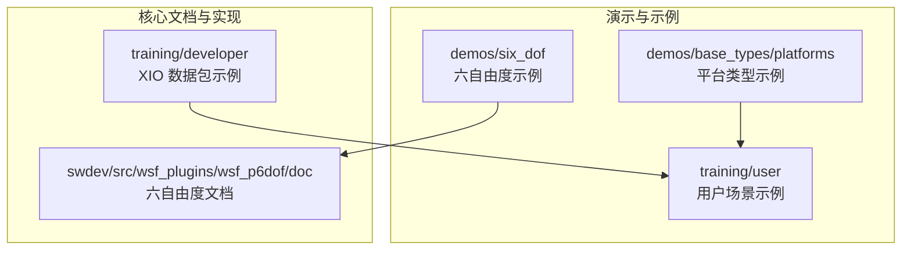
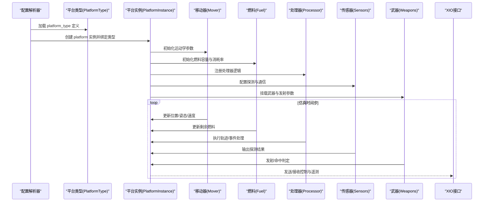
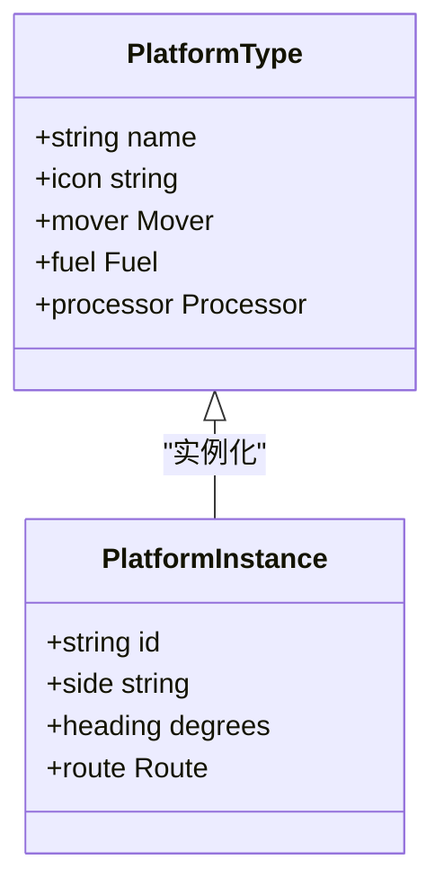
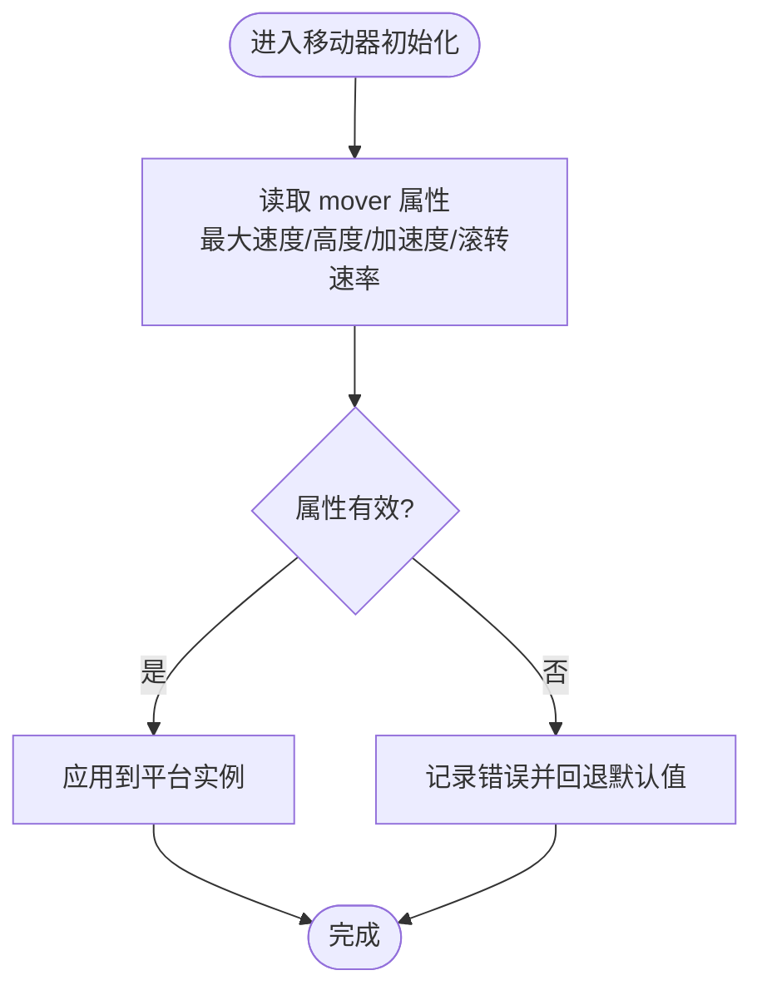
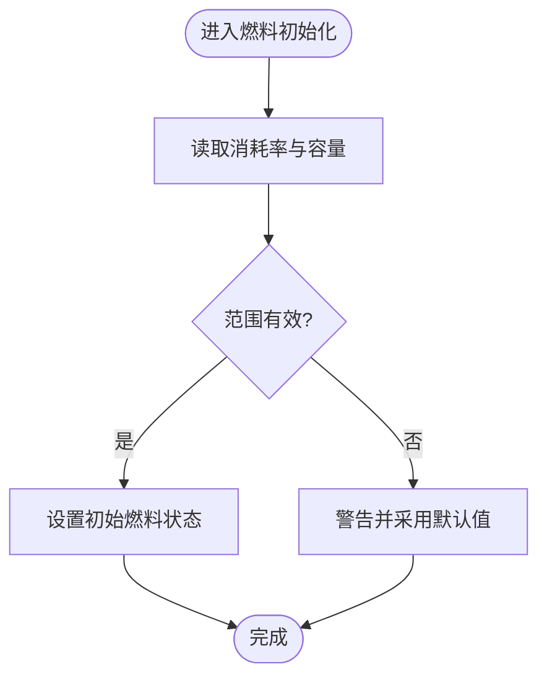
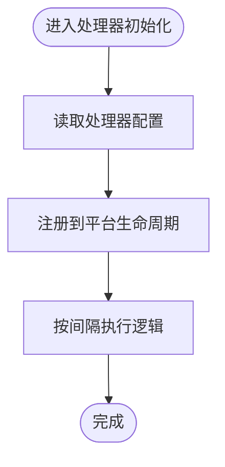
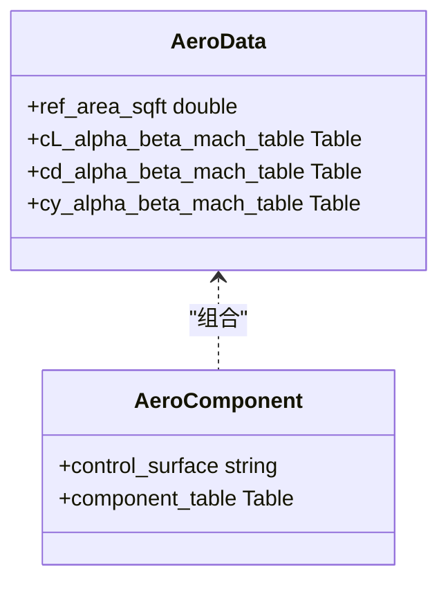
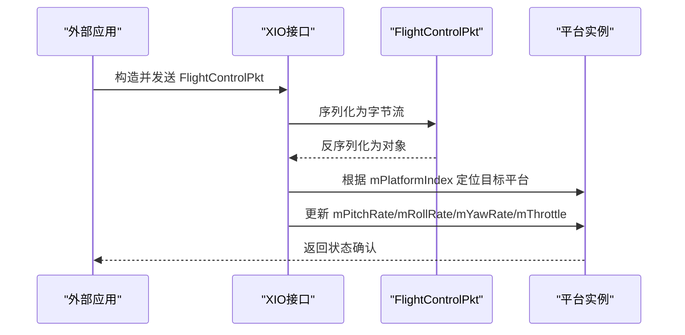
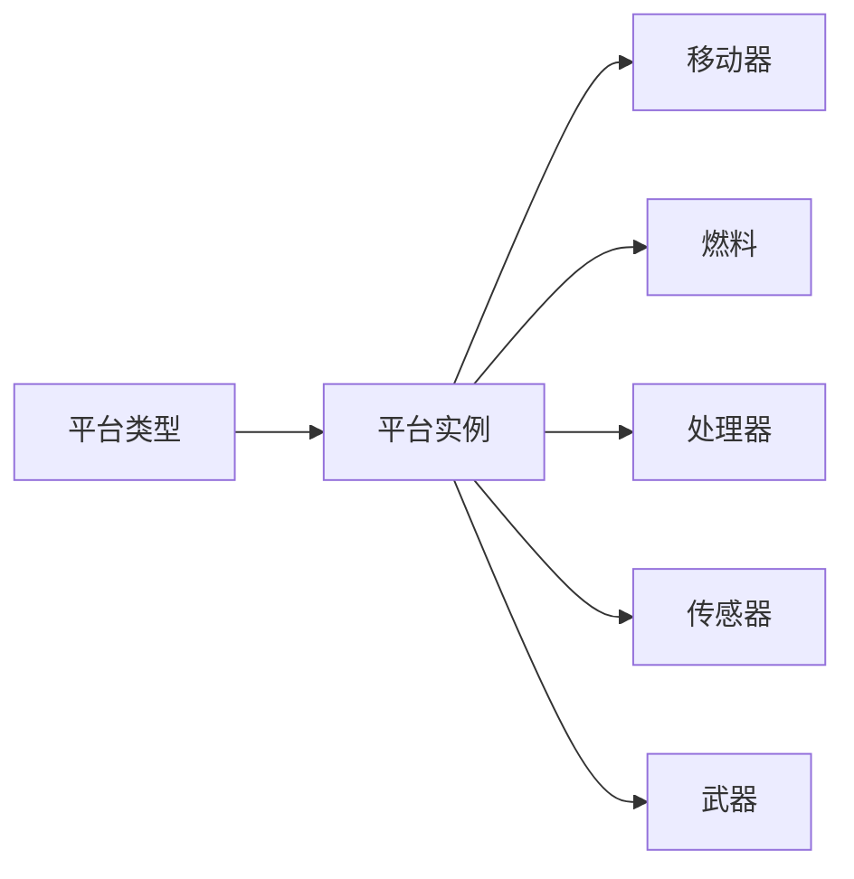

# 平台属性管理

<cite>
**本文引用的文件**   
- [bomber.txt](file://demos/base_types/platforms/bomber.txt)
- [red_laydown.txt](file://training/user/4_Sensors/scenarios/floridistan/scenarios/red_laydown.txt)
- [aero_rb6.txt](file://demos/six_dof/six_dof_types/weapons/sam-mr/aero/aero_rb6.txt)
- [p6dof_aerodynamics_data.rst](file://swdev/src/wsf_plugins/wsf_p6dof/doc/p6dof_aerodynamics_data.rst)
- [FlightControlPkt.hpp](file://training/developer/core/labs/solution/xio/source/FlightControlPkt.hpp)
</cite>

## 目录
1. [简介](#简介)
2. [项目结构](#项目结构)
3. [核心组件](#核心组件)
4. [架构总览](#架构总览)
5. [详细组件分析](#详细组件分析)
6. [依赖关系分析](#依赖关系分析)
7. [性能考虑](#性能考虑)
8. [故障排查指南](#故障排查指南)
9. [结论](#结论)
10. [附录](#附录)

## 简介
本文件系统性梳理 AFSIM 中“平台属性管理”的机制与实践，覆盖以下主题：
- 平台属性的分类与组织结构（基本属性、性能属性、传感器属性、武器属性等）
- 属性定义语法与数据类型系统
- 属性的访问与修改机制（含运行时更新）
- 继承与覆盖规则
- 属性验证与默认值处理
- 属性序列化与持久化
- 使用 Python 脚本批量处理平台属性
- 属性调试与监控工具使用方法

AFSIM 通过平台类型（platform_type）与平台实例（platform）组织属性；平台类型定义可复用的模板，平台实例在场景中引用并赋予具体值。属性按功能域划分为多个子系统（如移动器 mover、燃料 fuel、处理器 processor、传感器 sensors、武器 weapons 等），并通过声明式文本配置进行描述。

## 项目结构
AFSIM 仓库中与平台属性相关的典型位置包括：
- demos/base_types/platforms：基础平台类型示例，展示 mover、fuel、processor 等属性的组合方式
- training/user：用户训练场景，包含 platform 实例的定义与使用
- demos/six_dof：六自由度模型相关的气动数据与属性组织
- swdev/src/wsf_plugins/wsf_p6dof/doc：六自由度气动数据的文档说明
- training/developer：开发者示例，展示 XIO 数据包结构与序列化接口

图表来源
- [bomber.txt:13-58](file://demos/base_types/platforms/bomber.txt#L13-L58)
- [red_laydown.txt:12-46](file://training/user/4_Sensors/scenarios/floridistan/scenarios/red_laydown.txt#L12-L46)
- [aero_rb6.txt:18-26](file://demos/six_dof/six_dof_types/weapons/sam-mr/aero/aero_rb6.txt#L18-L26)
- [p6dof_aerodynamics_data.rst:15-22](file://swdev/src/wsf_plugins/wsf_p6dof/doc/p6dof_aerodynamics_data.rst#L15-L22)
- [FlightControlPkt.hpp:24-43](file://training/developer/core/labs/solution/xio/source/FlightControlPkt.hpp#L24-L43)

章节来源
- [bomber.txt:13-58](file://demos/base_types/platforms/bomber.txt#L13-L58)
- [red_laydown.txt:12-46](file://training/user/4_Sensors/scenarios/floridistan/scenarios/red_laydown.txt#L12-L46)

## 核心组件
平台属性管理的核心由以下组件构成：
- 平台类型（platform_type）：定义可复用的属性模板，包含 mover、fuel、processor 等子块
- 平台实例（platform）：在场景中创建实体，引用平台类型并设置具体属性值
- 移动器（mover）：描述平台的运动学特性与约束（速度、加速度、高度限制等）
- 燃料（fuel）：描述燃料消耗率与容量
- 处理器（processor）：附加逻辑模块（如轨迹管理、事件处理）
- 传感器（sensors）：探测、通信、电子战等能力
- 武器（weapons）：挂载武器及其发射、制导参数
- 气动数据（aero_data/aero_component）：六自由度模型的气动特性表与分量

上述组件通过声明式语法组织，形成层次化的属性树，便于扩展与维护。

章节来源
- [bomber.txt:13-58](file://demos/base_types/platforms/bomber.txt#L13-L58)
- [p6dof_aerodynamics_data.rst:15-22](file://swdev/src/wsf_plugins/wsf_p6dof/doc/p6dof_aerodynamics_data.rst#L15-L22)

## 架构总览
平台属性在 AFSIM 中的整体流程如下：
- 解析阶段：读取平台类型与平台实例定义，构建属性树
- 初始化阶段：根据平台类型生成实例对象，填充默认值与校验
- 运行阶段：各子系统（mover、fuel、processor、sensors、weapons）按时间步更新状态
- 外部交互：通过 XIO 数据包与其他应用交换控制或遥测信息

图表来源
- [bomber.txt:13-58](file://demos/base_types/platforms/bomber.txt#L13-L58)
- [red_laydown.txt:12-46](file://training/user/4_Sensors/scenarios/floridistan/scenarios/red_laydown.txt#L12-L46)
- [FlightControlPkt.hpp:24-43](file://training/developer/core/labs/solution/xio/source/FlightControlPkt.hpp#L24-L43)

## 详细组件分析

### 平台类型与平台实例
- 平台类型（platform_type）用于定义可复用的属性模板，例如 BOMBER 类型定义了 mover、fuel、processor 等子块
- 平台实例（platform）在场景中引用平台类型，并赋予具体属性值（如 side、heading、route 等）

图表来源
- [bomber.txt:13-58](file://demos/base_types/platforms/bomber.txt#L13-L58)
- [red_laydown.txt:12-46](file://training/user/4_Sensors/scenarios/floridistan/scenarios/red_laydown.txt#L12-L46)

章节来源
- [bomber.txt:13-58](file://demos/base_types/platforms/bomber.txt#L13-L58)
- [red_laydown.txt:12-46](file://training/user/4_Sensors/scenarios/floridistan/scenarios/red_laydown.txt#L12-L46)

### 移动器（Mover）属性
- 移动器描述平台的运动学特性，包括最大速度、最大/最小高度、加速度限制、滚转速率限制等
- 这些属性直接影响平台的机动能力与飞行包线

图表来源
- [bomber.txt:18-39](file://demos/base_types/platforms/bomber.txt#L18-L39)

章节来源
- [bomber.txt:18-39](file://demos/base_types/platforms/bomber.txt#L18-L39)

### 燃料（Fuel）属性
- 燃料模块描述燃料消耗率与容量，支持变量消耗率
- 初始量与最大量决定平台的续航能力

图表来源
- [bomber.txt:41-49](file://demos/base_types/platforms/bomber.txt#L41-L49)

章节来源
- [bomber.txt:41-49](file://demos/base_types/platforms/bomber.txt#L41-L49)

### 处理器（Processor）属性
- 处理器用于附加逻辑，如轨迹管理、事件处理等
- 可通过 update_interval、purge_interval 等参数控制行为频率

图表来源
- [bomber.txt:52-56](file://demos/base_types/platforms/bomber.txt#L52-L56)

章节来源
- [bomber.txt:52-56](file://demos/base_types/platforms/bomber.txt#L52-L56)

### 六自由度气动数据（Aero Data）
- 六自由度模型的气动数据分为两类：主气动数据（aero_data）与分量气动数据（aero_component）
- aero_data 定义非控制面产生的气动特性与参考面积；aero_component 定义控制面或活动部件的气动贡献
- 数据通常以表格形式提供，作为 Mach 与攻角/侧滑角的函数

图表来源
- [p6dof_aerodynamics_data.rst:15-22](file://swdev/src/wsf_plugins/wsf_p6dof/doc/p6dof_aerodynamics_data.rst#L15-L22)
- [aero_rb6.txt:18-26](file://demos/six_dof/six_dof_types/weapons/sam-mr/aero/aero_rb6.txt#L18-L26)

章节来源
- [p6dof_aerodynamics_data.rst:15-22](file://swdev/src/wsf_plugins/wsf_p6dof/doc/p6dof_aerodynamics_data.rst#L15-L22)
- [aero_rb6.txt:18-26](file://demos/six_dof/six_dof_types/weapons/sam-mr/aero/aero_rb6.txt#L18-L26)

### 运行时属性更新与 XIO 接口
- AFSIM 支持通过 XIO 数据包与其他应用交换控制指令与遥测数据
- FlightControlPkt 展示了如何定义包含平台索引与控制参数的数据包结构，并进行序列化/反序列化

图表来源
- [FlightControlPkt.hpp:24-43](file://training/developer/core/labs/solution/xio/source/FlightControlPkt.hpp#L24-L43)

章节来源
- [FlightControlPkt.hpp:24-43](file://training/developer/core/labs/solution/xio/source/FlightControlPkt.hpp#L24-L43)

## 依赖关系分析
平台属性之间的依赖关系如下：
- 平台实例依赖平台类型提供的模板
- 移动器依赖平台实例的运动学上下文
- 燃料模块依赖平台实例的状态（如速度、高度）
- 处理器可订阅平台事件并触发其他子系统行为
- 传感器与武器依赖平台实例的位置、姿态与状态

图表来源
- [bomber.txt:13-58](file://demos/base_types/platforms/bomber.txt#L13-L58)
- [red_laydown.txt:12-46](file://training/user/4_Sensors/scenarios/floridistan/scenarios/red_laydown.txt#L12-L46)

章节来源
- [bomber.txt:13-58](file://demos/base_types/platforms/bomber.txt#L13-L58)
- [red_laydown.txt:12-46](file://training/user/4_Sensors/scenarios/floridistan/scenarios/red_laydown.txt#L12-L46)

## 性能考虑
- 合理设置处理器更新间隔（update_interval）与清理间隔（purge_interval），避免频繁计算导致性能下降
- 对大型场景中的平台实例，建议复用平台类型以减少内存占用
- 六自由度气动数据表较大时，应优化插值算法与缓存策略
- 使用 XIO 接口进行外部交互时，注意数据包大小与频率，避免阻塞仿真主循环

## 故障排查指南
- 属性未生效：检查平台类型与实例是否正确绑定，确认属性拼写与单位
- 移动器异常：核对速度、高度、加速度限制是否超出物理可行范围
- 燃料耗尽过早：检查消耗率与容量设置是否合理
- 处理器无响应：确认处理器已注册且间隔配置正确
- XIO 通信失败：检查数据包字段是否与接收端一致，确保平台索引正确

章节来源
- [bomber.txt:18-56](file://demos/base_types/platforms/bomber.txt#L18-L56)
- [FlightControlPkt.hpp:24-43](file://training/developer/core/labs/solution/xio/source/FlightControlPkt.hpp#L24-L43)

## 结论
AFSIM 的平台属性管理通过平台类型与实例的组合，提供了灵活且可扩展的属性组织方式。借助 mover、fuel、processor、sensors、weapons 等子系统，以及六自由度气动数据与 XIO 接口，用户能够精确建模复杂平台的动态行为。遵循本文的分类、语法、继承与验证规范，并结合调试与性能优化建议，可有效提升仿真质量与效率。

## 附录
- 属性定义语法要点
  - 使用 platform_type 定义模板，platform 创建实例
  - 子块（mover、fuel、processor 等）通过缩进与 end_ 关键字组织
  - 数值属性需带单位（如 ft、knots、rad/sec、lb/s）
- 数据类型系统
  - 标量：整数、浮点数
  - 向量：位置、速度、加速度
  - 表格：气动系数表、环境数据表
  - 枚举：side、status 等离散值
- 继承与覆盖
  - 平台实例继承平台类型的默认属性
  - 实例中显式定义的属性覆盖默认值
- 验证与默认值
  - 解析阶段进行范围与类型校验
  - 无效值回退至默认值并记录警告
- 序列化与持久化
  - 平台属性可导出为 JSON/CSV 格式（参考 tools/convert_platforms_to_json.py）
  - XIO 数据包支持二进制序列化
- Python 脚本批量处理
  - 遍历 platforms 目录，批量修改属性值
  - 结合正则表达式替换属性键值
- 调试与监控
  - 启用处理器日志输出
  - 使用事件管道（event_pipe）跟踪关键状态变化
  - 通过 XIO 实时注入控制指令并观察响应