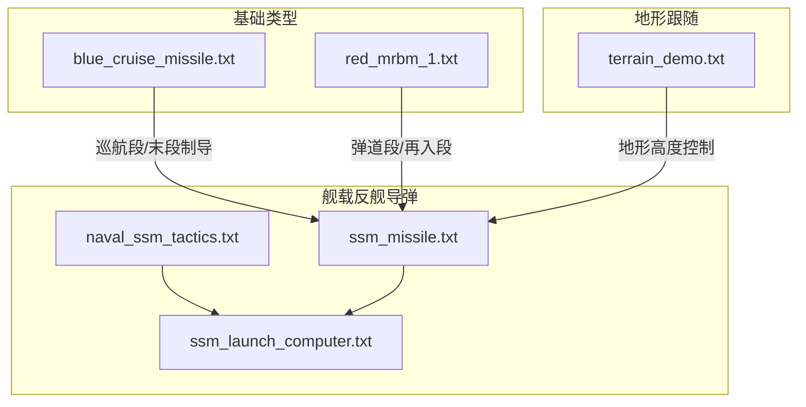
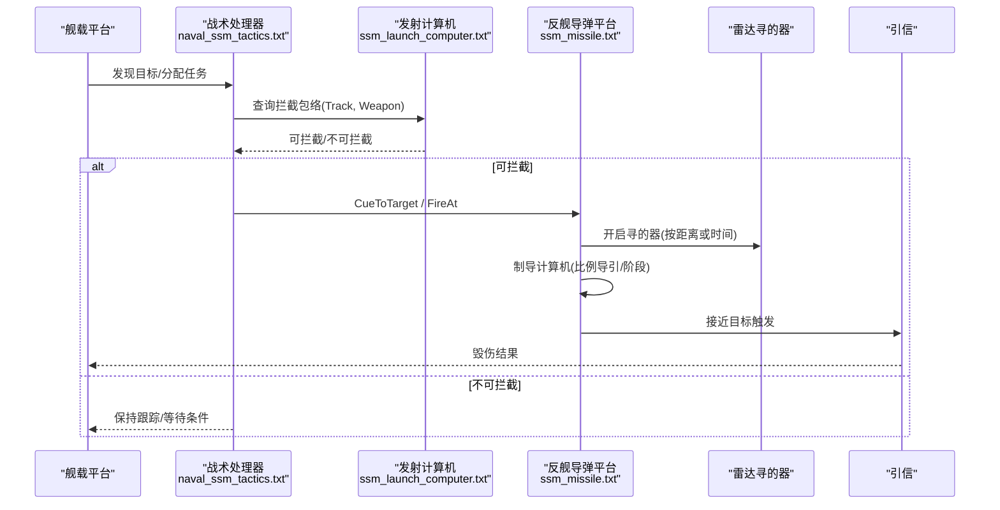
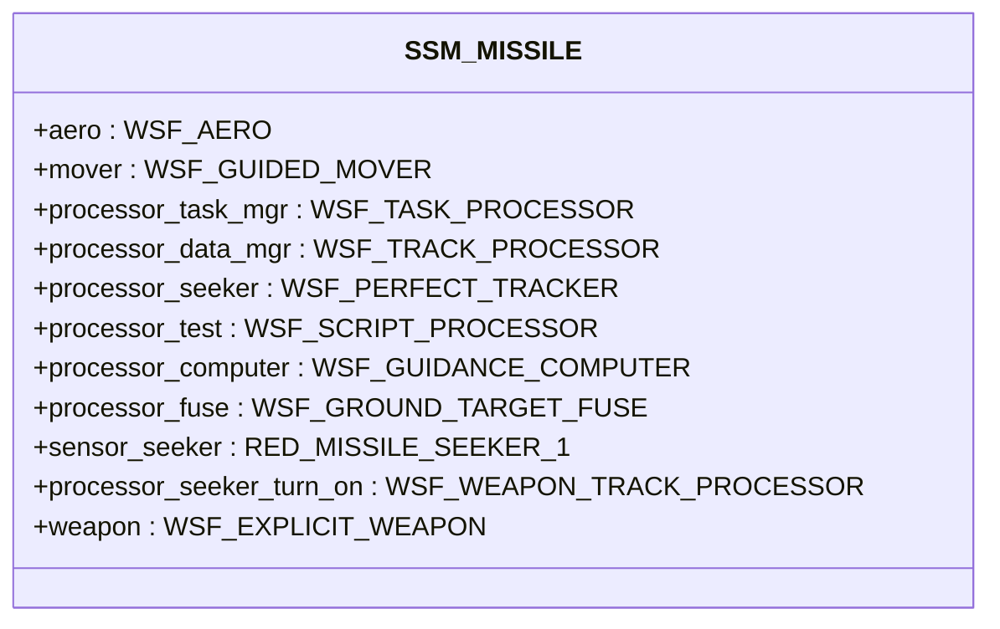
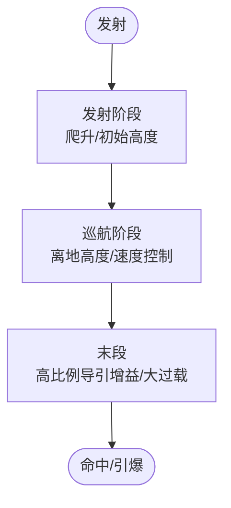
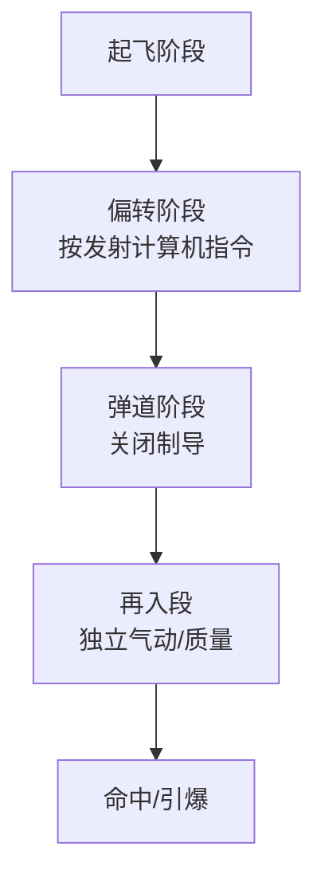
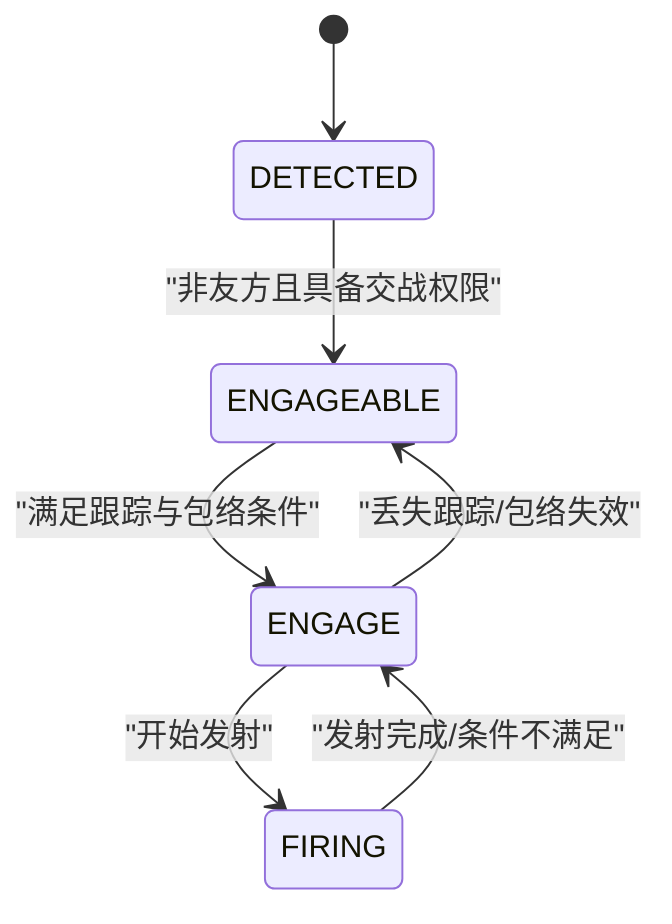
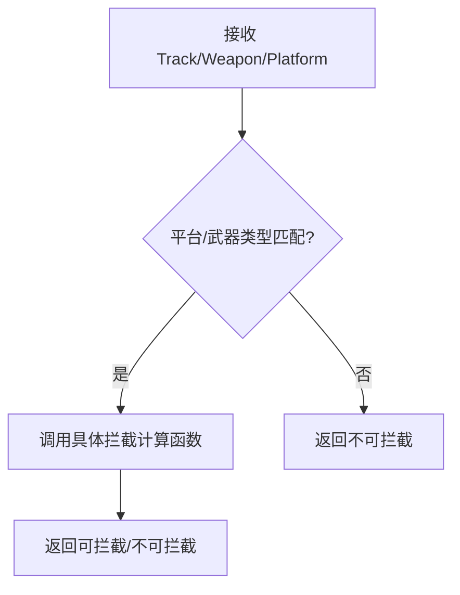
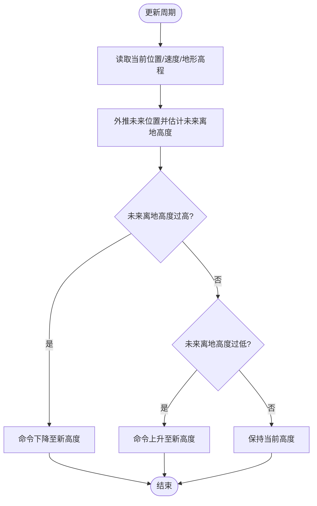
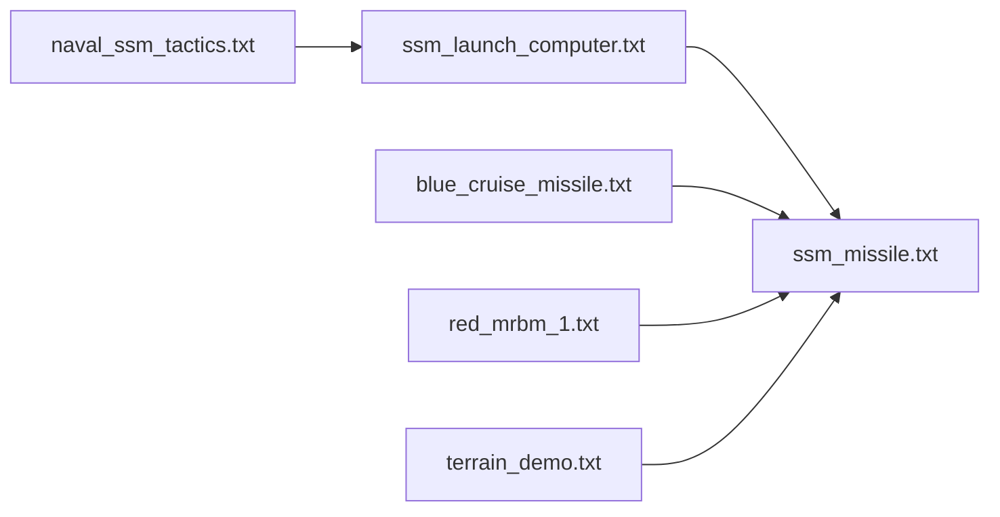

# 反舰导弹系统

<cite>
**本文引用的文件**   
- [demos/ship_ad/weapons/ssm/ssm_missile.txt](file://demos/ship_ad/weapons/ssm/ssm_missile.txt)
- [demos/base_types/weapons/ssm/blue_cruise_missile.txt](file://demos/base_types/weapons/ssm/blue_cruise_missile.txt)
- [demos/base_types/weapons/ssm/red_mrbm_1.txt](file://demos/base_types/weapons/ssm/red_mrbm_1.txt)
- [demos/ship_ad/platforms/naval_ssm_tactics.txt](file://demos/ship_ad/platforms/naval_ssm_tactics.txt)
- [demos/ship_ad/weapons/ssm/ssm_launch_computer.txt](file://demos/ship_ad/weapons/ssm/ssm_launch_computer.txt)
- [demos/terrain_following/terrain_demo.txt](file://demos/terrain_following/terrain_demo.txt)
</cite>

## 目录
1. [简介](#简介)
2. [项目结构](#项目结构)
3. [核心组件](#核心组件)
4. [架构总览](#架构总览)
5. [详细组件分析](#详细组件分析)
6. [依赖关系分析](#依赖关系分析)
7. [性能与仿真特性](#性能与仿真特性)
8. [故障排查指南](#故障排查指南)
9. [结论](#结论)
10. [附录：作战运用与战术编队最佳实践](#附录作战运用与战术编队最佳实践)

## 简介
本文件面向AFSIM中的反舰导弹（SSM）体系，聚焦以下目标：
- 梳理反舰导弹类型（巡航导弹、弹道导弹、超音速反舰导弹等）及其在AFSIM中的建模方式。
- 解释飞行轨迹规划与地形跟随能力。
- 文档化末段制导模式与目标识别机制。
- 说明多弹头分导与突防策略的配置思路。
- 展示与平台（潜艇、飞机、舰船）的集成方式。
- 提供突防概率分析与舰艇防御对抗的评估方法。
- 总结作战运用与战术编队的最佳实践。

## 项目结构
本仓库中与反舰导弹相关的示例与定义主要分布在以下路径：
- 舰载反舰导弹武器与战术：demos/ship_ad/weapons/ssm, demos/ship_ad/platforms
- 基础类型中的巡航导弹与中程弹道导弹：demos/base_types/weapons/ssm
- 地形跟随演示：demos/terrain_following

**图示来源** 
- [demos/ship_ad/weapons/ssm/ssm_missile.txt:1-127](file://demos/ship_ad/weapons/ssm/ssm_missile.txt#L1-L127)
- [demos/base_types/weapons/ssm/blue_cruise_missile.txt:1-125](file://demos/base_types/weapons/ssm/blue_cruise_missile.txt#L1-L125)
- [demos/base_types/weapons/ssm/red_mrbm_1.txt:1-422](file://demos/base_types/weapons/ssm/red_mrbm_1.txt#L1-L422)
- [demos/ship_ad/platforms/naval_ssm_tactics.txt:1-235](file://demos/ship_ad/platforms/naval_ssm_tactics.txt#L1-L235)
- [demos/ship_ad/weapons/ssm/ssm_launch_computer.txt:1-47](file://demos/ship_ad/weapons/ssm/ssm_launch_computer.txt#L1-L47)
- [demos/terrain_following/terrain_demo.txt:1-95](file://demos/terrain_following/terrain_demo.txt#L1-L95)

**章节来源**
- [demos/ship_ad/weapons/ssm/ssm_missile.txt:1-127](file://demos/ship_ad/weapons/ssm/ssm_missile.txt#L1-L127)
- [demos/base_types/weapons/ssm/blue_cruise_missile.txt:1-125](file://demos/base_types/weapons/ssm/blue_cruise_missile.txt#L1-L125)
- [demos/base_types/weapons/ssm/red_mrbm_1.txt:1-422](file://demos/base_types/weapons/ssm/red_mrbm_1.txt#L1-L422)
- [demos/ship_ad/platforms/naval_ssm_tactics.txt:1-235](file://demos/ship_ad/platforms/naval_ssm_tactics.txt#L1-L235)
- [demos/ship_ad/weapons/ssm/ssm_launch_computer.txt:1-47](file://demos/ship_ad/weapons/ssm/ssm_launch_computer.txt#L1-L47)
- [demos/terrain_following/terrain_demo.txt:1-95](file://demos/terrain_following/terrain_demo.txt#L1-L95)

## 核心组件
- 反舰导弹平台与武器定义
  - 包含气动外形、推进器、传感器、处理器（任务管理、跟踪、寻的）、引信、通信链路等。
- 巡航导弹平台
  - 多级推进（助推+涡扇），三段式制导（发射、巡航、末段）。
- 中程弹道导弹（MRBM）
  - 多级固体火箭推进，弹道段无制导，再入段独立气动与质量模型。
- 舰载反舰导弹战术处理器
  - 探测—交战—发射状态机，拦截包络判定，火力分配与齐射间隔。
- 发射计算机
  - 根据平台类型与武器类型进行拦截可行性判断。
- 地形跟随脚本
  - 基于地形高程的动态高度控制，用于低空突防。

**章节来源**
- [demos/ship_ad/weapons/ssm/ssm_missile.txt:1-127](file://demos/ship_ad/weapons/ssm/ssm_missile.txt#L1-L127)
- [demos/base_types/weapons/ssm/blue_cruise_missile.txt:1-125](file://demos/base_types/weapons/ssm/blue_cruise_missile.txt#L1-L125)
- [demos/base_types/weapons/ssm/red_mrbm_1.txt:1-422](file://demos/base_types/weapons/ssm/red_mrbm_1.txt#L1-L422)
- [demos/ship_ad/platforms/naval_ssm_tactics.txt:1-235](file://demos/ship_ad/platforms/naval_ssm_tactics.txt#L1-L235)
- [demos/ship_ad/weapons/ssm/ssm_launch_computer.txt:1-47](file://demos/ship_ad/weapons/ssm/ssm_launch_computer.txt#L1-L47)
- [demos/terrain_following/terrain_demo.txt:1-95](file://demos/terrain_following/terrain_demo.txt#L1-L95)

## 架构总览
反舰导弹系统在AFSIM中以“平台类型 + 处理器 + 传感器 + 武器”的方式组合实现。典型数据流如下：
- 平台类型定义气动、推进、传感器与处理器。
- 任务处理器负责目标跟踪与发射决策。
- 发射计算机计算拦截包络并授权发射。
- 导弹平台执行制导律（比例导引、速度追踪、阶段切换）。
- 引信在接近目标时触发毁伤效果。

**图示来源** 
- [demos/ship_ad/platforms/naval_ssm_tactics.txt:78-102](file://demos/ship_ad/platforms/naval_ssm_tactics.txt#L78-L102)
- [demos/ship_ad/platforms/naval_ssm_tactics.txt:124-146](file://demos/ship_ad/platforms/naval_ssm_tactics.txt#L124-L146)
- [demos/ship_ad/platforms/naval_ssm_tactics.txt:196-231](file://demos/ship_ad/platforms/naval_ssm_tactics.txt#L196-L231)
- [demos/ship_ad/weapons/ssm/ssm_launch_computer.txt:18-29](file://demos/ship_ad/weapons/ssm/ssm_launch_computer.txt#L18-L29)
- [demos/ship_ad/weapons/ssm/ssm_launch_computer.txt:34-46](file://demos/ship_ad/weapons/ssm/ssm_launch_computer.txt#L34-L46)
- [demos/ship_ad/weapons/ssm/ssm_missile.txt:91-106](file://demos/ship_ad/weapons/ssm/ssm_missile.txt#L91-L106)
- [demos/ship_ad/weapons/ssm/ssm_missile.txt:70-85](file://demos/ship_ad/weapons/ssm/ssm_missile.txt#L70-L85)
- [demos/ship_ad/weapons/ssm/ssm_missile.txt:87-89](file://demos/ship_ad/weapons/ssm/ssm_missile.txt#L87-L89)

## 详细组件分析

### 反舰导弹平台（SSM_MISSILE）
- 气动与推进
  - 亚音速/超音速阻力系数、最大马赫数、参考面积、升力上限。
  - 单级固体发动机推力与燃烧时间。
- 处理器链
  - 任务处理器（WSF_TASK_PROCESSOR）
  - 跟踪处理器（WSF_TRACK_PROCESSOR）
  - 完美跟踪器（WSF_PERFECT_TRACKER）
  - 脚本处理器（WSF_SCRIPT_PROCESSOR）用于动态调整制导参数
  - 制导计算机（WSF_GUIDANCE_COMPUTER）配置比例导引增益、G限幅、指令延迟
  - 地面目标引信（WSF_GROUND_TARGET_FUSE）设置最大飞行时间与引爆逻辑
- 传感器
  - 雷达寻的器（RED_MISSILE_SEEKER_1）
  - 滤波器（FILTER_TACTICS）设定测距/方位/俯仰测量噪声
  - 武器跟踪处理器（WSF_WEAPON_TRACK_PROCESSOR）控制寻的器开时机（按距离或时间）
- 武器定义
  - 显式武器（WSF_EXPLICIT_WEAPON）含发射偏移、齐射间隔、方位 slew、倾角、初速增量等

**图示来源** 
- [demos/ship_ad/weapons/ssm/ssm_missile.txt:16-38](file://demos/ship_ad/weapons/ssm/ssm_missile.txt#L16-L38)
- [demos/ship_ad/weapons/ssm/ssm_missile.txt:40-89](file://demos/ship_ad/weapons/ssm/ssm_missile.txt#L40-L89)
- [demos/ship_ad/weapons/ssm/ssm_missile.txt:91-106](file://demos/ship_ad/weapons/ssm/ssm_missile.txt#L91-L106)
- [demos/ship_ad/weapons/ssm/ssm_missile.txt:114-124](file://demos/ship_ad/weapons/ssm/ssm_missile.txt#L114-L124)

**章节来源**
- [demos/ship_ad/weapons/ssm/ssm_missile.txt:16-38](file://demos/ship_ad/weapons/ssm/ssm_missile.txt#L16-L38)
- [demos/ship_ad/weapons/ssm/ssm_missile.txt:40-89](file://demos/ship_ad/weapons/ssm/ssm_missile.txt#L40-L89)
- [demos/ship_ad/weapons/ssm/ssm_missile.txt:91-106](file://demos/ship_ad/weapons/ssm/ssm_missile.txt#L91-L106)
- [demos/ship_ad/weapons/ssm/ssm_missile.txt:114-124](file://demos/ship_ad/weapons/ssm/ssm_missile.txt#L114-L124)

### 巡航导弹（BLUE_CRUISE_MISSILE）
- 多级推进：助推段（固体）+ 巡航段（涡扇）
- 三段制导：
  - 发射阶段：爬升角与初始高度
  - 巡航阶段：离地高度与速度控制，最大过载限制
  - 末段：提高比例导引增益，增大最大俯仰角与过载
- 传感器与引信：当前未配置终端传感器；使用地面目标引信

**图示来源** 
- [demos/base_types/weapons/ssm/blue_cruise_missile.txt:48-69](file://demos/base_types/weapons/ssm/blue_cruise_missile.txt#L48-L69)
- [demos/base_types/weapons/ssm/blue_cruise_missile.txt:71-96](file://demos/base_types/weapons/ssm/blue_cruise_missile.txt#L71-L96)
- [demos/base_types/weapons/ssm/blue_cruise_missile.txt:98-99](file://demos/base_types/weapons/ssm/blue_cruise_missile.txt#L98-L99)

**章节来源**
- [demos/base_types/weapons/ssm/blue_cruise_missile.txt:27-36](file://demos/base_types/weapons/ssm/blue_cruise_missile.txt#L27-L36)
- [demos/base_types/weapons/ssm/blue_cruise_missile.txt:48-69](file://demos/base_types/weapons/ssm/blue_cruise_missile.txt#L48-L69)
- [demos/base_types/weapons/ssm/blue_cruise_missile.txt:71-96](file://demos/base_types/weapons/ssm/blue_cruise_missile.txt#L71-L96)
- [demos/base_types/weapons/ssm/blue_cruise_missile.txt:98-99](file://demos/base_types/weapons/ssm/blue_cruise_missile.txt#L98-L99)

### 中程弹道导弹（RED_MRBM_1）
- 三级固体火箭推进：一级、二级、整流罩/再入体
- 制导阶段：
  - 起飞阶段：短暂垂直爬升
  - 偏转阶段：按发射计算机指令进入预定飞行路径角
  - 弹道阶段：关闭制导处理器，纯弹道飞行
- 再入段：独立气动与质量模型，供末端估算
- 发射计算机：表面到表面弹道表，要求提供升弧角

**图示来源** 
- [demos/base_types/weapons/ssm/red_mrbm_1.txt:236-280](file://demos/base_types/weapons/ssm/red_mrbm_1.txt#L236-L280)
- [demos/base_types/weapons/ssm/red_mrbm_1.txt:284-320](file://demos/base_types/weapons/ssm/red_mrbm_1.txt#L284-L320)
- [demos/base_types/weapons/ssm/red_mrbm_1.txt:373-386](file://demos/base_types/weapons/ssm/red_mrbm_1.txt#L373-L386)
- [demos/base_types/weapons/ssm/red_mrbm_1.txt:390-421](file://demos/base_types/weapons/ssm/red_mrbm_1.txt#L390-L421)

**章节来源**
- [demos/base_types/weapons/ssm/red_mrbm_1.txt:192-232](file://demos/base_types/weapons/ssm/red_mrbm_1.txt#L192-L232)
- [demos/base_types/weapons/ssm/red_mrbm_1.txt:236-280](file://demos/base_types/weapons/ssm/red_mrbm_1.txt#L236-L280)
- [demos/base_types/weapons/ssm/red_mrbm_1.txt:284-320](file://demos/base_types/weapons/ssm/red_mrbm_1.txt#L284-L320)
- [demos/base_types/weapons/ssm/red_mrbm_1.txt:373-386](file://demos/base_types/weapons/ssm/red_mrbm_1.txt#L373-L386)
- [demos/base_types/weapons/ssm/red_mrbm_1.txt:390-421](file://demos/base_types/weapons/ssm/red_mrbm_1.txt#L390-L421)

### 舰载反舰导弹战术处理器（NAVAL_SSM_TACTICS）
- 状态机：DETECTED → ENGAGEABLE → ENGAGE → FIRING
- 关键逻辑：
  - 目标IFF判别、存活性检查
  - 传感器跟踪请求与跟踪质量阈值
  - 拦截包络判定（调用发射计算机）
  - 武器选择、齐射规模、发射时序
- 变量与接口：
  - SENSOR_NAME、SENSOR_TRACK_MODE、WEAPON_NAME
  - REQUIRED_TRACK_QUALITY、SALVO_SIZE
  - FiringNow()、InterceptResultsKnown()、InInterceptEnvelopeOf()

**图示来源** 
- [demos/ship_ad/platforms/naval_ssm_tactics.txt:150-167](file://demos/ship_ad/platforms/naval_ssm_tactics.txt#L150-L167)
- [demos/ship_ad/platforms/naval_ssm_tactics.txt:169-194](file://demos/ship_ad/platforms/naval_ssm_tactics.txt#L169-L194)
- [demos/ship_ad/platforms/naval_ssm_tactics.txt:196-231](file://demos/ship_ad/platforms/naval_ssm_tactics.txt#L196-L231)

**章节来源**
- [demos/ship_ad/platforms/naval_ssm_tactics.txt:28-42](file://demos/ship_ad/platforms/naval_ssm_tactics.txt#L28-L42)
- [demos/ship_ad/platforms/naval_ssm_tactics.txt:78-102](file://demos/ship_ad/platforms/naval_ssm_tactics.txt#L78-L102)
- [demos/ship_ad/platforms/naval_ssm_tactics.txt:124-146](file://demos/ship_ad/platforms/naval_ssm_tactics.txt#L124-L146)
- [demos/ship_ad/platforms/naval_ssm_tactics.txt:150-231](file://demos/ship_ad/platforms/naval_ssm_tactics.txt#L150-L231)

### 发射计算机（SSM_LaunchComputer）
- 根据平台子类型（如MISSILE_SHIP）或武器类型（SSM_MISSILE）调用具体拦截计算函数。
- 返回是否可拦截（canIntercept）。

**图示来源** 
- [demos/ship_ad/weapons/ssm/ssm_launch_computer.txt:18-29](file://demos/ship_ad/weapons/ssm/ssm_launch_computer.txt#L18-L29)
- [demos/ship_ad/weapons/ssm/ssm_launch_computer.txt:34-46](file://demos/ship_ad/weapons/ssm/ssm_launch_computer.txt#L34-L46)

**章节来源**
- [demos/ship_ad/weapons/ssm/ssm_launch_computer.txt:18-29](file://demos/ship_ad/weapons/ssm/ssm_launch_computer.txt#L18-L29)
- [demos/ship_ad/weapons/ssm/ssm_launch_computer.txt:34-46](file://demos/ship_ad/weapons/ssm/ssm_launch_computer.txt#L34-L46)

### 地形跟随（Terrain Following）
- 通过脚本处理器周期性读取平台当前位置、速度与地形高程，预测前方地形变化。
- 若前方为山谷则下降高度，若前方为山丘则上升高度，保持离地高度在命令值附近。
- 适用于低空突防场景，降低被雷达探测概率。

**图示来源** 
- [demos/terrain_following/terrain_demo.txt:10-45](file://demos/terrain_following/terrain_demo.txt#L10-L45)

**章节来源**
- [demos/terrain_following/terrain_demo.txt:10-45](file://demos/terrain_following/terrain_demo.txt#L10-L45)

## 依赖关系分析
- 战术处理器依赖发射计算机进行拦截包络判定。
- 反舰导弹平台依赖传感器（雷达寻的器）与处理器链（任务、跟踪、制导、引信）。
- 巡航导弹与弹道导弹分别提供不同阶段的制导与推进模型，供战术与发射计算机评估。
- 地形跟随作为可选模块，影响巡航段的离地高度控制。

**图示来源** 
- [demos/ship_ad/platforms/naval_ssm_tactics.txt:1-235](file://demos/ship_ad/platforms/naval_ssm_tactics.txt#L1-L235)
- [demos/ship_ad/weapons/ssm/ssm_launch_computer.txt:1-47](file://demos/ship_ad/weapons/ssm/ssm_launch_computer.txt#L1-L47)
- [demos/ship_ad/weapons/ssm/ssm_missile.txt:1-127](file://demos/ship_ad/weapons/ssm/ssm_missile.txt#L1-L127)
- [demos/base_types/weapons/ssm/blue_cruise_missile.txt:1-125](file://demos/base_types/weapons/ssm/blue_cruise_missile.txt#L1-L125)
- [demos/base_types/weapons/ssm/red_mrbm_1.txt:1-422](file://demos/base_types/weapons/ssm/red_mrbm_1.txt#L1-L422)
- [demos/terrain_following/terrain_demo.txt:1-95](file://demos/terrain_following/terrain_demo.txt#L1-L95)

**章节来源**
- [demos/ship_ad/platforms/naval_ssm_tactics.txt:1-235](file://demos/ship_ad/platforms/naval_ssm_tactics.txt#L1-L235)
- [demos/ship_ad/weapons/ssm/ssm_launch_computer.txt:1-47](file://demos/ship_ad/weapons/ssm/ssm_launch_computer.txt#L1-L47)
- [demos/ship_ad/weapons/ssm/ssm_missile.txt:1-127](file://demos/ship_ad/weapons/ssm/ssm_missile.txt#L1-L127)
- [demos/base_types/weapons/ssm/blue_cruise_missile.txt:1-125](file://demos/base_types/weapons/ssm/blue_cruise_missile.txt#L1-L125)
- [demos/base_types/weapons/ssm/red_mrbm_1.txt:1-422](file://demos/base_types/weapons/ssm/red_mrbm_1.txt#L1-L422)
- [demos/terrain_following/terrain_demo.txt:1-95](file://demos/terrain_following/terrain_demo.txt#L1-L95)

## 性能与仿真特性
- 制导处理器更新频率与积分步长
  - 反舰导弹制导计算机更新间隔与导弹移动器积分步长影响精度与计算开销。
- 传感器滤波与跟踪质量
  - 雷达寻的器的测量噪声与跟踪质量阈值影响发射时机与命中率。
- 地形跟随对能耗与机动性的影响
  - 频繁的高度调整会增加推进消耗与机动载荷。
- 齐射间隔与火力密度
  - 齐射间隔影响饱和攻击效果与敌方拦截系统的反应时间。

[本节为通用指导，不涉及具体文件分析]

## 故障排查指南
- 无法发射
  - 检查拦截包络判定是否返回可拦截（发射计算机与战术处理器）。
  - 确认传感器跟踪质量达到阈值。
- 导弹未开启寻的器
  - 检查武器跟踪处理器的开启条件（按距离或时间）。
- 制导异常或失稳
  - 检查比例导引增益、G限幅与指令延迟参数。
- 地形跟随无效
  - 确认地形数据已加载，脚本处理器更新周期与命令高度合理。

**章节来源**
- [demos/ship_ad/platforms/naval_ssm_tactics.txt:124-146](file://demos/ship_ad/platforms/naval_ssm_tactics.txt#L124-L146)
- [demos/ship_ad/platforms/naval_ssm_tactics.txt:196-231](file://demos/ship_ad/platforms/naval_ssm_tactics.txt#L196-L231)
- [demos/ship_ad/weapons/ssm/ssm_missile.txt:91-106](file://demos/ship_ad/weapons/ssm/ssm_missile.txt#L91-L106)
- [demos/ship_ad/weapons/ssm/ssm_missile.txt:70-85](file://demos/ship_ad/weapons/ssm/ssm_missile.txt#L70-L85)
- [demos/terrain_following/terrain_demo.txt:10-45](file://demos/terrain_following/terrain_demo.txt#L10-L45)

## 结论
AFSIM提供了完整的反舰导弹建模与仿真能力，涵盖从平台定义、传感器与处理器链、制导律、引信到战术与发射计算机的全流程。通过巡航导弹与弹道导弹的多阶段模型，结合地形跟随与雷达寻的，可实现低空突防与末段精确打击。战术处理器与发射计算机的组合确保了合理的火力分配与拦截包络判定，支持饱和攻击与多弹头分导的战术需求。

[本节为总结，不涉及具体文件分析]

## 附录：作战运用与战术编队最佳实践
- 多弹头分导技术
  - 利用显式武器的齐射间隔与数量配置，实现多弹头同时或分批到达，提升突防概率。
  - 结合不同导弹类型（巡航/弹道/超音速）形成混合编队，增加敌方拦截难度。
- 突防策略
  - 巡航段采用地形跟随与低空飞行，减少雷达探测概率。
  - 末段提高比例导引增益与大过载机动，提升命中精度与抗干扰能力。
- 平台集成
  - 舰载平台：通过战术处理器与发射计算机协调多艘舰艇的火力。
  - 空中平台：将反舰导弹挂载于飞机，利用高空高速投放扩大射程。
  - 水下平台：潜艇隐蔽发射，配合水面/空中平台进行协同打击。
- 防御对抗
  - 针对敌方近防系统与电子战，采用多方向、多高度、多波次攻击。
  - 利用假目标与干扰（AFSIM中可通过电子战模块扩展）分散敌方注意力。
- 评估指标
  - 突防概率：考虑敌方拦截系统响应时间、火力密度与导弹机动能力。
  - 命中率：受传感器精度、制导律与引信触发逻辑影响。
  - 生存性：平台在发射前与发射后的被探测与被拦截风险。

[本节为概念性内容，不涉及具体文件分析]