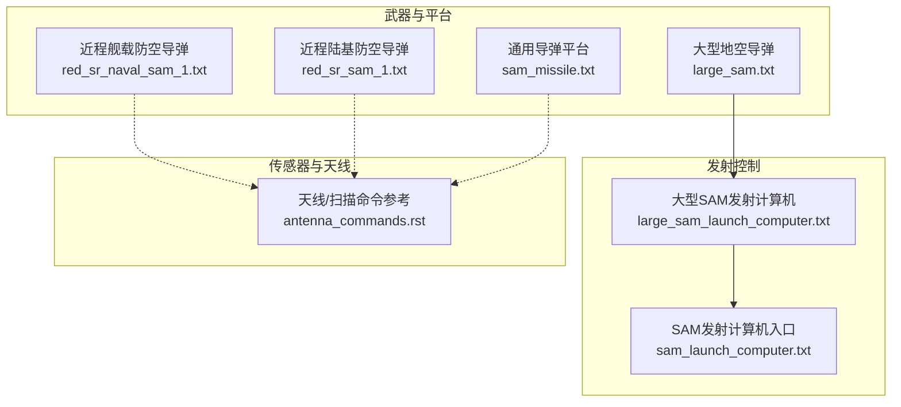
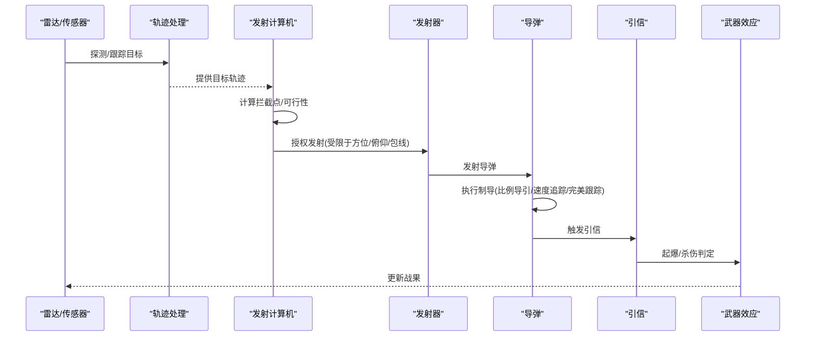
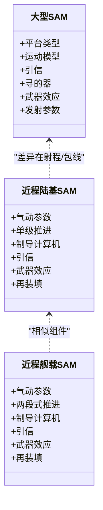
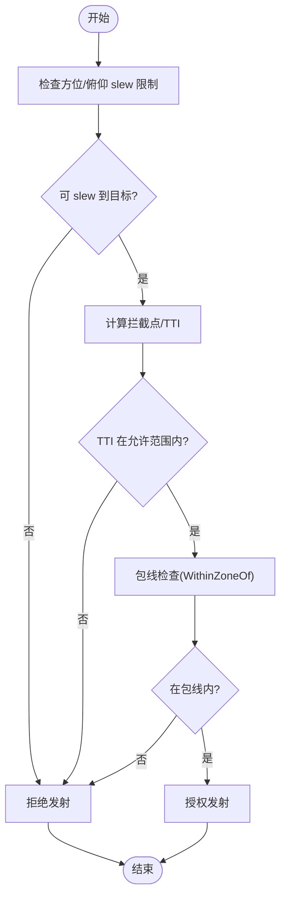
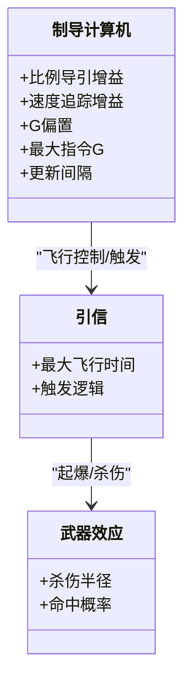
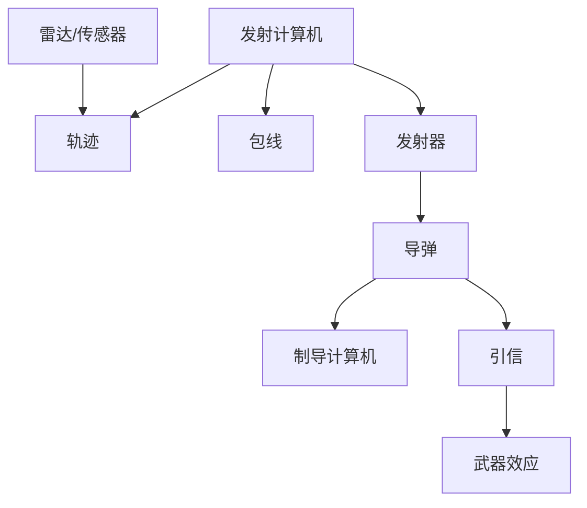
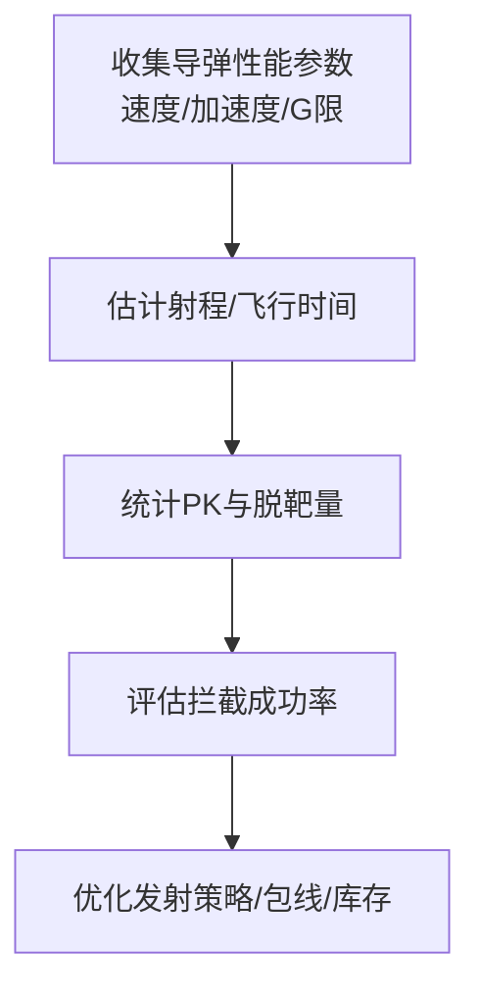

# 地空导弹系统

<cite>
**本文引用的文件**   
- [large_sam.txt](file://demos/iads/weapons/sam/large_sam.txt)
- [large_sam_launch_computer.txt](file://demos/iads/weapons/sam/large_sam_launch_computer.txt)
- [sam_launch_computer.txt](file://demos/iads/weapons/sam/sam_launch_computer.txt)
- [sam_missile.txt](file://demos/launcher/weapons/sam/sam_missile.txt)
- [red_sr_naval_sam_1.txt](file://demos/ship_ad/weapons/sam/red_sr_naval_sam_1.txt)
- [red_sr_sam_1.txt](file://demos/ship_ad/weapons/sam/red_sr_sam_1.txt)
- [antenna_commands.rst](file://swdev/src/core/wsf/doc/antenna_commands.rst)
</cite>

## 目录
1. [引言](#引言)
2. [项目结构](#项目结构)
3. [核心组件](#核心组件)
4. [架构总览](#架构总览)
5. [详细组件分析](#详细组件分析)
6. [依赖关系分析](#依赖关系分析)
7. [性能与拦截概率评估](#性能与拦截概率评估)
8. [故障排查指南](#故障排查指南)
9. [结论](#结论)
10. [附录](#附录)

## 引言
本文件面向AFSIM中的地空导弹（SAM）系统，聚焦以下目标：
- 对地空导弹进行分类（近程、中程、远程、舰载防空导弹），并给出在仓库中的对应示例。
- 说明发射配置（发射器类型、方位/俯仰限制、发射条件）。
- 文档化制导模式与跟踪机制（比例导引、速度追踪、完美跟踪等）。
- 说明导弹防御系统集成方式（雷达引导、火力控制、交战包线）。
- 展示不同型号的性能特点与作战能力。
- 提供拦截概率计算与效果评估方法。
- 给出地空导弹防御体系的构建与优化建议。

## 项目结构
与地空导弹相关的核心内容主要分布在以下路径：
- 陆基/通用SAM示例与发射计算机脚本：demos/iads/weapons/sam
- 舰载防空导弹示例：demos/ship_ad/weapons/sam
- 通用导弹平台定义（含制导计算机、引信等）：demos/launcher/weapons/sam
- 天线/传感器扫描与视场命令参考：swdev/src/core/wsf/doc/antenna_commands.rst

**图示来源** 
- [large_sam.txt:1-94](file://demos/iads/weapons/sam/large_sam.txt#L1-L94)
- [sam_missile.txt:1-70](file://demos/launcher/weapons/sam/sam_missile.txt#L1-L70)
- [red_sr_naval_sam_1.txt:1-99](file://demos/ship_ad/weapons/sam/red_sr_naval_sam_1.txt#L1-L99)
- [red_sr_sam_1.txt:1-90](file://demos/ship_ad/weapons/sam/red_sr_sam_1.txt#L1-L90)
- [large_sam_launch_computer.txt:1-49](file://demos/iads/weapons/sam/large_sam_launch_computer.txt#L1-L49)
- [sam_launch_computer.txt:1-31](file://demos/iads/weapons/sam/sam_launch_computer.txt#L1-L31)
- [antenna_commands.rst:40-210](file://swdev/src/core/wsf/doc/antenna_commands.rst#L40-L210)

**章节来源**
- [large_sam.txt:1-94](file://demos/iads/weapons/sam/large_sam.txt#L1-L94)
- [sam_missile.txt:1-70](file://demos/launcher/weapons/sam/sam_missile.txt#L1-L70)
- [red_sr_naval_sam_1.txt:1-99](file://demos/ship_ad/weapons/sam/red_sr_naval_sam_1.txt#L1-L99)
- [red_sr_sam_1.txt:1-90](file://demos/ship_ad/weapons/sam/red_sr_sam_1.txt#L1-L90)
- [large_sam_launch_computer.txt:1-49](file://demos/iads/weapons/sam/large_sam_launch_computer.txt#L1-L49)
- [sam_launch_computer.txt:1-31](file://demos/iads/weapons/sam/sam_launch_computer.txt#L1-L31)
- [antenna_commands.rst:40-210](file://swdev/src/core/wsf/doc/antenna_commands.rst#L40-L210)

## 核心组件
- 大型地空导弹（远/中程示例）：包含平台类型、运动模型、引信、寻的器、武器效应与武器发射参数（数量、间隔、方位/俯仰限制）。
- 通用导弹平台：包含气动数据、推进、制导计算机（比例导引/速度追踪）、引信、通信上行链路。
- 近程舰载防空导弹：两阶段推进、制导计算机、引信、武器效应与再装填参数。
- 近程陆基防空导弹：单级推进、制导计算机、引信、武器效应与再装填参数。
- 发射计算机脚本：用于判断是否可拦截（拦截点、最大飞行时间、包线检查）。
- 天线/传感器命令：扫描模式、电子波束指向、视场与范围限制等。

**章节来源**
- [large_sam.txt:26-93](file://demos/iads/weapons/sam/large_sam.txt#L26-L93)
- [sam_missile.txt:12-68](file://demos/launcher/weapons/sam/sam_missile.txt#L12-L68)
- [red_sr_naval_sam_1.txt:23-98](file://demos/ship_ad/weapons/sam/red_sr_naval_sam_1.txt#L23-L98)
- [red_sr_sam_1.txt:23-89](file://demos/ship_ad/weapons/sam/red_sr_sam_1.txt#L23-L89)
- [large_sam_launch_computer.txt:16-48](file://demos/iads/weapons/sam/large_sam_launch_computer.txt#L16-L48)
- [sam_launch_computer.txt:18-30](file://demos/iads/weapons/sam/sam_launch_computer.txt#L18-L30)
- [antenna_commands.rst:105-189](file://swdev/src/core/wsf/doc/antenna_commands.rst#L105-L189)

## 架构总览
地空导弹系统在AFSIM中的典型交互流程如下：
- 雷达/传感器发现并跟踪目标，生成轨迹。
- 发射计算机根据轨迹、平台位置与包线约束，计算拦截点与可行性。
- 若满足条件，则向发射器下发指令，考虑方位/俯仰 slew 限制与库存。
- 导弹按制导模式飞行，引信在合适时机起爆，武器效应对目标造成伤害。

**图示来源**
- [sam_launch_computer.txt:18-30](file://demos/iads/weapons/sam/sam_launch_computer.txt#L18-L30)
- [large_sam_launch_computer.txt:16-48](file://demos/iads/weapons/sam/large_sam_launch_computer.txt#L16-L48)
- [large_sam.txt:80-93](file://demos/iads/weapons/sam/large_sam.txt#L80-L93)
- [sam_missile.txt:39-52](file://demos/launcher/weapons/sam/sam_missile.txt#L39-L52)
- [red_sr_naval_sam_1.txt:62-75](file://demos/ship_ad/weapons/sam/red_sr_naval_sam_1.txt#L62-L75)
- [red_sr_sam_1.txt:51-64](file://demos/ship_ad/weapons/sam/red_sr_sam_1.txt#L51-L64)

## 详细组件分析

### 分类与代表型号
- 近程地空导弹（短程）
  - 示例：red_sr_sam_1（陆基）、red_sr_naval_sam_1（舰载）
  - 特征：射程较短、机动过载较高、再装填时间短，适合低空/超低空目标拦截。
- 中程/远程地空导弹
  - 示例：large_sam（大型地空导弹）
  - 特征：更大射程、更高速度、更严格的发射包线与更高的G限。
- 舰载防空导弹
  - 示例：red_sr_naval_sam_1
  - 特征：双段式推进、舰载环境下的俯仰限制与再装填逻辑。

**图示来源**
- [red_sr_sam_1.txt:23-89](file://demos/ship_ad/weapons/sam/red_sr_sam_1.txt#L23-L89)
- [red_sr_naval_sam_1.txt:23-98](file://demos/ship_ad/weapons/sam/red_sr_naval_sam_1.txt#L23-L98)
- [large_sam.txt:26-93](file://demos/iads/weapons/sam/large_sam.txt#L26-L93)

**章节来源**
- [red_sr_sam_1.txt:23-89](file://demos/ship_ad/weapons/sam/red_sr_sam_1.txt#L23-L89)
- [red_sr_naval_sam_1.txt:23-98](file://demos/ship_ad/weapons/sam/red_sr_naval_sam_1.txt#L23-L98)
- [large_sam.txt:26-93](file://demos/iads/weapons/sam/large_sam.txt#L26-L93)

### 发射配置
- 发射器类型
  - 显式武器（WSF_EXPLICIT_WEAPON）：支持数量、齐射间隔、方位/俯仰 slew 限制。
- 发射角度限制
  - 方位角 slew 限制：通常覆盖全向（-180°~180°）。
  - 俯仰角 slew 限制：常见为低限约10°，高限70°~80°，以兼顾低空目标与超俯仰需求。
- 发射条件
  - 由发射计算机脚本决定：计算拦截点、比较最大飞行时间与包线约束。
  - 库存与再装填：部分型号具备库存阈值、增量与再装填时间。

**图示来源**
- [large_sam_launch_computer.txt:16-48](file://demos/iads/weapons/sam/large_sam_launch_computer.txt#L16-L48)
- [large_sam.txt:80-93](file://demos/iads/weapons/sam/large_sam.txt#L80-L93)
- [red_sr_naval_sam_1.txt:82-98](file://demos/ship_ad/weapons/sam/red_sr_naval_sam_1.txt#L82-L98)
- [red_sr_sam_1.txt:71-89](file://demos/ship_ad/weapons/sam/red_sr_sam_1.txt#L71-L89)

**章节来源**
- [large_sam.txt:80-93](file://demos/iads/weapons/sam/large_sam.txt#L80-L93)
- [red_sr_naval_sam_1.txt:82-98](file://demos/ship_ad/weapons/sam/red_sr_naval_sam_1.txt#L82-L98)
- [red_sr_sam_1.txt:71-89](file://demos/ship_ad/weapons/sam/red_sr_sam_1.txt#L71-L89)
- [large_sam_launch_computer.txt:16-48](file://demos/iads/weapons/sam/large_sam_launch_computer.txt#L16-L48)

### 制导模式与跟踪机制
- 比例导引（Proportional Navigation）
  - 通过制导计算机设置比例增益，提高拦截精度。
- 速度追踪（Velocity Pursuit）
  - 作为备选或辅助策略，提升对高机动目标的适应性。
- 完美跟踪（Perfect Tracker）
  - 用于简化仿真场景，忽略跟踪误差。
- 引信与战斗部
  - 空中目标引信（WSF_AIR_TARGET_FUSE）设定最大飞行时间；武器效应（WSF_GRADUATED_LETHALITY）定义杀伤半径与命中概率。

**图示来源**
- [sam_missile.txt:42-52](file://demos/launcher/weapons/sam/sam_missile.txt#L42-L52)
- [red_sr_naval_sam_1.txt:65-75](file://demos/ship_ad/weapons/sam/red_sr_naval_sam_1.txt#L65-L75)
- [red_sr_sam_1.txt:54-64](file://demos/ship_ad/weapons/sam/red_sr_sam_1.txt#L54-L64)
- [large_sam.txt:39-45](file://demos/iads/weapons/sam/large_sam.txt#L39-L45)

**章节来源**
- [sam_missile.txt:39-52](file://demos/launcher/weapons/sam/sam_missile.txt#L39-L52)
- [red_sr_naval_sam_1.txt:62-75](file://demos/ship_ad/weapons/sam/red_sr_naval_sam_1.txt#L62-L75)
- [red_sr_sam_1.txt:51-64](file://demos/ship_ad/weapons/sam/red_sr_sam_1.txt#L51-L64)
- [large_sam.txt:39-45](file://demos/iads/weapons/sam/large_sam.txt#L39-L45)

### 导弹防御系统集成（雷达引导与火力控制）
- 雷达/传感器
  - 使用天线命令定义扫描模式、电子波束指向、视场与范围限制，确保对目标的持续跟踪与照射。
- 火力控制
  - 发射计算机负责将雷达轨迹转换为发射指令，结合包线与库存进行决策。
- 集成要点
  - 扫描与视场需与发射器的方位/俯仰 slew 限制匹配。
  - 包线检查应基于拦截点与目标高度/相对高度。

**图示来源**
- [antenna_commands.rst:105-189](file://swdev/src/core/wsf/doc/antenna_commands.rst#L105-L189)
- [sam_launch_computer.txt:18-30](file://demos/iads/weapons/sam/sam_launch_computer.txt#L18-L30)
- [large_sam.txt:80-93](file://demos/iads/weapons/sam/large_sam.txt#L80-L93)

**章节来源**
- [antenna_commands.rst:105-189](file://swdev/src/core/wsf/doc/antenna_commands.rst#L105-L189)
- [sam_launch_computer.txt:18-30](file://demos/iads/weapons/sam/sam_launch_computer.txt#L18-L30)
- [large_sam.txt:80-93](file://demos/iads/weapons/sam/large_sam.txt#L80-L93)

## 依赖关系分析
- 组件耦合
  - 发射计算机依赖轨迹输入与平台包线；发射器依赖方位/俯仰 slew 限制；导弹依赖制导计算机与引信；武器效应依赖引信触发。
- 外部依赖
  - 天线/传感器命令影响雷达跟踪质量与视场，间接影响发射决策。
- 潜在循环
  - 发射计算机与发射器之间无直接循环；导弹与引信为单向依赖。

**图示来源**
- [sam_launch_computer.txt:18-30](file://demos/iads/weapons/sam/sam_launch_computer.txt#L18-L30)
- [large_sam_launch_computer.txt:16-48](file://demos/iads/weapons/sam/large_sam_launch_computer.txt#L16-L48)
- [large_sam.txt:80-93](file://demos/iads/weapons/sam/large_sam.txt#L80-L93)
- [sam_missile.txt:39-52](file://demos/launcher/weapons/sam/sam_missile.txt#L39-L52)

**章节来源**
- [sam_launch_computer.txt:18-30](file://demos/iads/weapons/sam/sam_launch_computer.txt#L18-L30)
- [large_sam_launch_computer.txt:16-48](file://demos/iads/weapons/sam/large_sam_launch_computer.txt#L16-L48)
- [large_sam.txt:80-93](file://demos/iads/weapons/sam/large_sam.txt#L80-L93)
- [sam_missile.txt:39-52](file://demos/launcher/weapons/sam/sam_missile.txt#L39-L52)

## 性能与拦截概率评估
- 性能指标
  - 速度与加速度：由运动模型与推进参数决定（例如平均速度、最大横向加速度、推力与燃烧时间）。
  - 机动性：由制导计算机的最大指令G与G偏置决定。
  - 射程与飞行时间：由引信最大飞行时间与导弹速度估算。
- 拦截概率
  - 武器效应模块定义了杀伤半径与命中概率（PK），可用于统计拦截成功率。
  - 可通过脚本记录每次交战的PK值与脱靶量，进行后处理分析。
- 效果评估
  - 利用武器效应脚本输出交战信息（如命中距离、PK、PK退化等），汇总评估体系效能。

**图示来源**
- [large_sam.txt:48-78](file://demos/iads/weapons/sam/large_sam.txt#L48-L78)
- [sam_missile.txt:55-57](file://demos/launcher/weapons/sam/sam_missile.txt#L55-L57)
- [red_sr_naval_sam_1.txt:78-80](file://demos/ship_ad/weapons/sam/red_sr_naval_sam_1.txt#L78-L80)
- [red_sr_sam_1.txt:67-69](file://demos/ship_ad/weapons/sam/red_sr_sam_1.txt#L67-L69)

**章节来源**
- [large_sam.txt:48-78](file://demos/iads/weapons/sam/large_sam.txt#L48-L78)
- [sam_missile.txt:55-57](file://demos/launcher/weapons/sam/sam_missile.txt#L55-L57)
- [red_sr_naval_sam_1.txt:78-80](file://demos/ship_ad/weapons/sam/red_sr_naval_sam_1.txt#L78-L80)
- [red_sr_sam_1.txt:67-69](file://demos/ship_ad/weapons/sam/red_sr_sam_1.txt#L67-L69)

## 故障排查指南
- 无法 slew 到目标
  - 检查发射器的方位/俯仰 slew 限制是否与目标方位一致。
- 包线检查失败
  - 确认拦截点与目标相对高度是否在包线内；必要时调整包线定义或发射计算机逻辑。
- 库存不足或再装填抑制
  - 检查武器的库存阈值、增量与再装填时间；确认抑制标志位。
- 跟踪误差过大
  - 检查寻的器/跟踪处理器参数（如更新间隔）；必要时切换至更精确的跟踪模式。

**章节来源**
- [large_sam.txt:80-93](file://demos/iads/weapons/sam/large_sam.txt#L80-L93)
- [red_sr_naval_sam_1.txt:82-98](file://demos/ship_ad/weapons/sam/red_sr_naval_sam_1.txt#L82-L98)
- [red_sr_sam_1.txt:71-89](file://demos/ship_ad/weapons/sam/red_sr_sam_1.txt#L71-L89)
- [large_sam_launch_computer.txt:16-48](file://demos/iads/weapons/sam/large_sam_launch_computer.txt#L16-L48)

## 结论
AFSIM中的地空导弹系统通过模块化组件（平台、运动模型、制导计算机、引信、武器效应）与脚本化的发射计算机，实现了从雷达引导到火力控制的完整闭环。通过对不同型号的参数对比与拦截概率统计，可以评估并优化地空导弹防御体系的整体效能。

## 附录
- 关键命令与参数参考
  - 天线/传感器命令：扫描模式、电子波束指向、视场与范围限制。
  - 武器参数：数量、齐射间隔、方位/俯仰 slew 限制、库存与再装填。
  - 制导参数：比例导引增益、速度追踪增益、最大指令G、更新间隔。
  - 引信参数：最大飞行时间。
  - 武器效应：杀伤半径与命中概率。

**章节来源**
- [antenna_commands.rst:105-189](file://swdev/src/core/wsf/doc/antenna_commands.rst#L105-L189)
- [large_sam.txt:80-93](file://demos/iads/weapons/sam/large_sam.txt#L80-L93)
- [sam_missile.txt:39-52](file://demos/launcher/weapons/sam/sam_missile.txt#L39-L52)
- [red_sr_naval_sam_1.txt:62-75](file://demos/ship_ad/weapons/sam/red_sr_naval_sam_1.txt#L62-L75)
- [red_sr_sam_1.txt:51-64](file://demos/ship_ad/weapons/sam/red_sr_sam_1.txt#L51-L64)