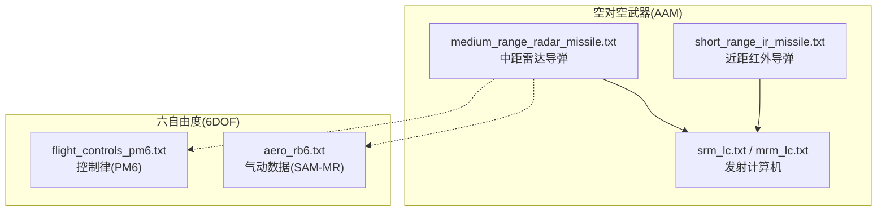
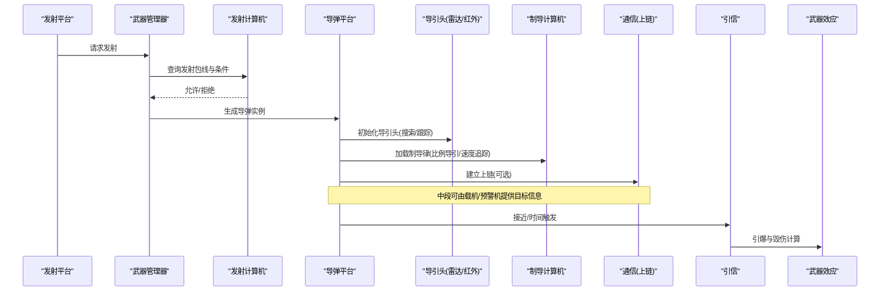
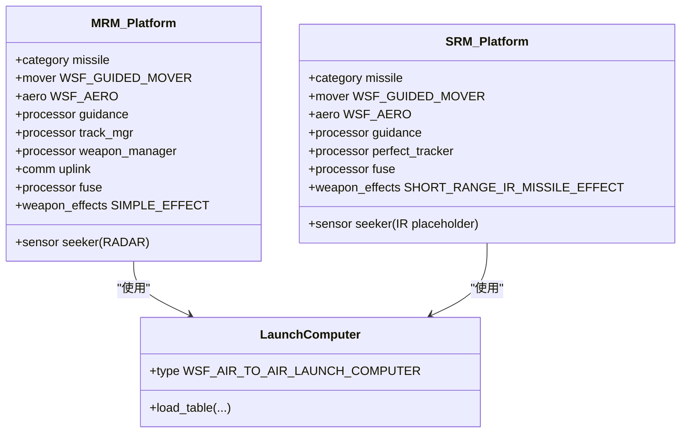
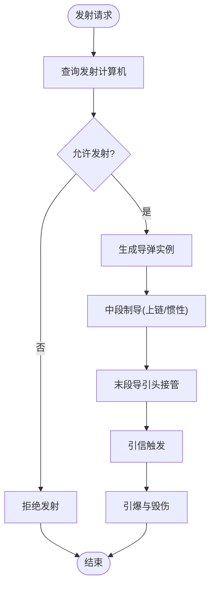
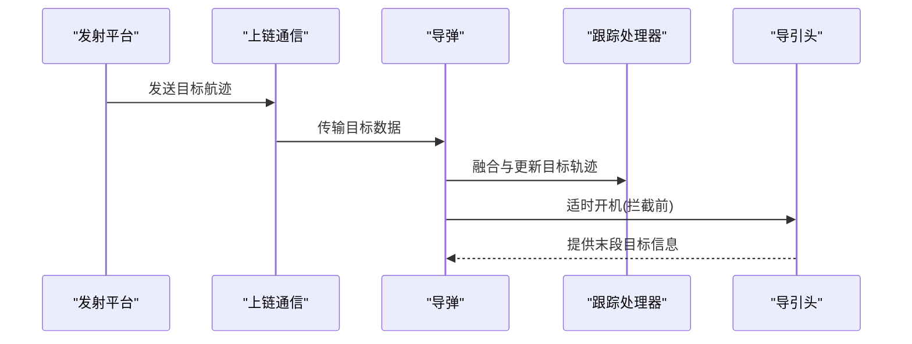
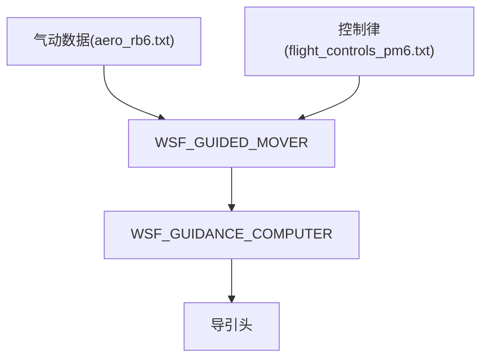
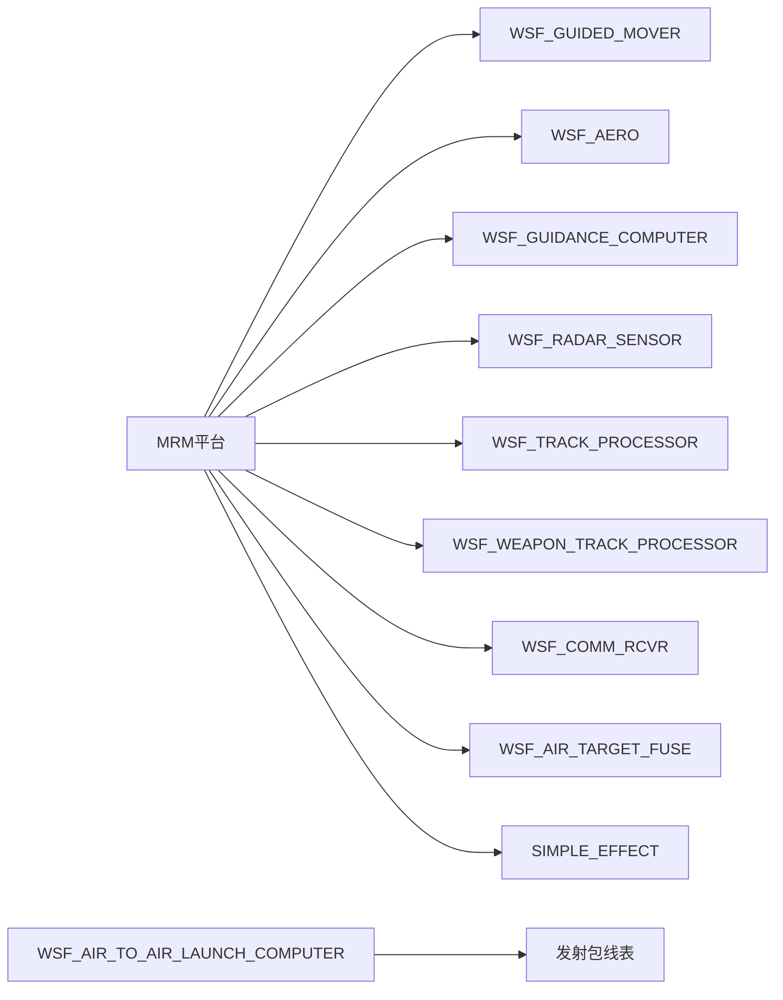

# 平台武器系统

<cite>
**本文引用的文件**   
- [medium_range_radar_missile.txt](file://demos/air_to_air/weapons/aam/medium_range_radar_missile.txt)
- [short_range_ir_missile.txt](file://demos/air_to_air/weapons/aam/short_range_ir_missile.txt)
- [srm_lc.txt](file://demos/air_to_air/weapons/aam/srm_lc.txt)
- [mrm_lc.txt](file://demos/air_to_air/weapons/aam/mrm_lc.txt)
- [flight_controls_pm6.txt](file://demos/six_dof/six_dof_types/weapons/aam-mr/controls/flight_controls_pm6.txt)
- [aero_rb6.txt](file://demos/six_dof/six_dof_types/weapons/sam-mr/aero/aero_rb6.txt)
</cite>

## 目录
1. [简介](#简介)
2. [项目结构](#项目结构)
3. [核心组件](#核心组件)
4. [架构总览](#架构总览)
5. [详细组件分析](#详细组件分析)
6. [依赖关系分析](#依赖关系分析)
7. [性能与仿真方法](#性能与仿真方法)
8. [故障排查指南](#故障排查指南)
9. [结论](#结论)
10. [附录](#附录)

## 简介
本文件面向AFSIM平台的武器系统，聚焦于“武器在平台上的挂载与管理、发射条件与逻辑、不同类型武器的集成方式（空空导弹、地空导弹、反舰导弹等）、制导模式与攻击策略配置、武器性能与效果仿真、武器与传感器的协同机制、自定义武器类型创建、以及战术运用与效果评估”。文档以仓库中的示例武器定义为核心依据，结合六自由度（6DOF）气动与控制数据，给出从概念到实现的可操作说明。

## 项目结构
AFSIM的武器相关示例主要位于 demos 目录下：
- 空对空武器（AAM）：demos/air_to_air/weapons/aam/
- 六自由度武器气动与控制：demos/six_dof/six_dof_types/weapons/

典型文件组织如下：
- 武器平台类型与子系统（传感器、处理器、通信、引信、效应器）
- 发射计算机（Launch Computer）
- 气动与控制参数（6DOF）

图示来源
- [medium_range_radar_missile.txt:116-259](file://demos/air_to_air/weapons/aam/medium_range_radar_missile.txt#L116-L259)
- [short_range_ir_missile.txt:115-209](file://demos/air_to_air/weapons/aam/short_range_ir_missile.txt#L115-L209)
- [srm_lc.txt:10-12](file://demos/air_to_air/weapons/aam/srm_lc.txt#L10-L12)
- [mrm_lc.txt:10-12](file://demos/air_to_air/weapons/aam/mrm_lc.txt#L10-L12)
- [aero_rb6.txt:1-26](file://demos/six_dof/six_dof_types/weapons/sam-mr/aero/aero_rb6.txt#L1-L26)
- [flight_controls_pm6.txt:18-38](file://demos/six_dof/six_dof_types/weapons/aam-mr/controls/flight_controls_pm6.txt#L18-L38)

章节来源
- [medium_range_radar_missile.txt:116-259](file://demos/air_to_air/weapons/aam/medium_range_radar_missile.txt#L116-L259)
- [short_range_ir_missile.txt:115-209](file://demos/air_to_air/weapons/aam/short_range_ir_missile.txt#L115-L209)
- [srm_lc.txt:10-12](file://demos/air_to_air/weapons/aam/srm_lc.txt#L10-L12)
- [mrm_lc.txt:10-12](file://demos/air_to_air/weapons/aam/mrm_lc.txt#L10-L12)
- [aero_rb6.txt:1-26](file://demos/six_dof/six_dof_types/weapons/sam-mr/aero/aero_rb6.txt#L1-L26)
- [flight_controls_pm6.txt:18-38](file://demos/six_dof/six_dof_types/weapons/aam-mr/controls/flight_controls_pm6.txt#L18-L38)

## 核心组件
- 武器平台类型（platform_type）：定义导弹的运动学（mover）、气动（aero）、制导计算机（processor）、传感器（sensor）、通信（comm）、引信（fuse）、武器效应（weapon_effects）。
- 武器定义（weapon）：将具体导弹平台类型与发射机绑定，并指定发射间隔、齐射间隔、方位角扫描范围等。
- 发射计算机（launch_computer）：根据目标状态、平台状态和弹道包线表判定是否满足发射条件。
- 传感器（sensor）：如雷达导引头，负责搜索、跟踪、锁定目标；可开启/关闭，支持多模式。
- 处理器（processor）：包括制导计算机、跟踪处理器、武器管理器等，协调导弹各子系统的时序与行为。
- 通信（comm）：用于上链数据（Uplink），支持半主动或被动雷达导引头的中段更新。
- 引信（fuse）：决定命中判据与爆炸时机。
- 武器效应（weapon_effects）：杀伤半径、概率、毁伤模型等。

章节来源
- [medium_range_radar_missile.txt:116-259](file://demos/air_to_air/weapons/aam/medium_range_radar_missile.txt#L116-L259)
- [short_range_ir_missile.txt:115-209](file://demos/air_to_air/weapons/aam/short_range_ir_missile.txt#L115-L209)

## 架构总览
下图展示空对空导弹的典型架构：平台层（发射方）通过武器管理器与发射计算机决策发射；导弹侧由导引头、制导计算机、推进器、引信与效应器组成，并通过通信链路接收中段指令。

图示来源
- [medium_range_radar_missile.txt:149-229](file://demos/air_to_air/weapons/aam/medium_range_radar_missile.txt#L149-L229)
- [short_range_ir_missile.txt:124-183](file://demos/air_to_air/weapons/aam/short_range_ir_missile.txt#L124-L183)
- [srm_lc.txt:10-12](file://demos/air_to_air/weapons/aam/srm_lc.txt#L10-L12)
- [mrm_lc.txt:10-12](file://demos/air_to_air/weapons/aam/mrm_lc.txt#L10-L12)

## 详细组件分析

### 空对空导弹（AAM）
- 中距雷达导弹（MRM）
  - 平台类型：包含WSF_GUIDED_MOVER、WSF_AERO、WSF_GUIDANCE_COMPUTER、WSF_RADAR_SENSOR、WSF_TRACK_PROCESSOR、WSF_WEAPON_TRACK_PROCESSOR、WSF_COMM_RCVR、WSF_AIR_TARGET_FUSE、SIMPLE_EFFECT。
  - 导引头：雷达导引头，支持搜索/跟踪模式，具备天线波束宽度、增益、探测距离、跟踪质量等参数。
  - 制导：两阶段（LAUNCH/TERMINAL），使用比例导引与速度追踪组合，限制最大过载。
  - 通信：支持上链，可在拦截前一定时间开启雷达导引头。
  - 武器定义：绑定平台类型、武器效应、发射计算机、发射延迟/间隔/齐射间隔、方位角扫描范围。
- 近距红外导弹（SRM）
  - 平台类型：包含WSF_GUIDED_MOVER、WSF_AERO、WSF_GUIDANCE_COMPUTER、WSF_PERFECT_TRACKER（用于观测/理想跟踪）、WSF_AIR_TARGET_FUSE、SIMPLE_EFFECT。
  - 导引头：示例中使用雷达传感器占位，实际为红外寻的；同时提供完美跟踪器作为参考。
  - 发射计算机：基于表格的WSF_AIR_TO_AIR_LAUNCH_COMPUTER。

图示来源
- [medium_range_radar_missile.txt:116-259](file://demos/air_to_air/weapons/aam/medium_range_radar_missile.txt#L116-L259)
- [short_range_ir_missile.txt:115-209](file://demos/air_to_air/weapons/aam/short_range_ir_missile.txt#L115-L209)
- [srm_lc.txt:10-12](file://demos/air_to_air/weapons/aam/srm_lc.txt#L10-L12)
- [mrm_lc.txt:10-12](file://demos/air_to_air/weapons/aam/mrm_lc.txt#L10-L12)

章节来源
- [medium_range_radar_missile.txt:116-259](file://demos/air_to_air/weapons/aam/medium_range_radar_missile.txt#L116-L259)
- [short_range_ir_missile.txt:115-209](file://demos/air_to_air/weapons/aam/short_range_ir_missile.txt#L115-L209)
- [srm_lc.txt:10-12](file://demos/air_to_air/weapons/aam/srm_lc.txt#L10-L12)
- [mrm_lc.txt:10-12](file://demos/air_to_air/weapons/aam/mrm_lc.txt#L10-L12)

### 地空导弹（SAM）与反舰导弹（SSM）集成要点
- SAM（地空导弹）
  - 气动与控制：可复用六自由度气动与控制数据（如 aam-mr 的控制律与 sam-mr 的气动数据），通过WSF_GUIDED_MOVER与WSF_AERO进行整合。
  - 导引头：通常为雷达/红外复合导引头，配置搜索/跟踪模式、波束宽度、增益、探测距离等。
  - 发射计算机：按目标高度、速度、相对位置查表判定发射包线。
- SSM（反舰导弹）
  - 运动学与气动：低空掠海飞行，需考虑地形跟随与低空气动特性。
  - 导引头：末端雷达/红外导引头，中段可由平台/卫星/预警机提供目标更新。
  - 武器效应：针对舰船目标的毁伤模型（穿透、破片、燃烧等）。

注：本节为通用集成指导，未直接引用具体代码文件。

### 发射条件与发射逻辑
- 发射计算机（WSF_AIR_TO_AIR_LAUNCH_COMPUTER）
  - 通过外部表格（如 srm_launch_computer_table.1.1.txt、mrm_launch_computer_table.1.1.txt）定义不同条件下的发射包线。
  - 输入通常包括：目标距离、相对速度、高度差、角度等；输出为允许/禁止发射。
- 武器管理器（WSF_WEAPON_TRACK_PROCESSOR）
  - 控制导引头开启时机（例如在预计拦截前若干秒开启雷达）。
  - 管理上链开关与数据融合。
- 发射流程
  - 平台发起发射请求 → 武器管理器调用发射计算机 → 若允许则生成导弹实例 → 导弹进入中段制导 → 末段导引头接管 → 引信引爆。

图示来源
- [srm_lc.txt:10-12](file://demos/air_to_air/weapons/aam/srm_lc.txt#L10-L12)
- [mrm_lc.txt:10-12](file://demos/air_to_air/weapons/aam/mrm_lc.txt#L10-L12)
- [medium_range_radar_missile.txt:211-216](file://demos/air_to_air/weapons/aam/medium_range_radar_missile.txt#L211-L216)

章节来源
- [srm_lc.txt:10-12](file://demos/air_to_air/weapons/aam/srm_lc.txt#L10-L12)
- [mrm_lc.txt:10-12](file://demos/air_to_air/weapons/aam/mrm_lc.txt#L10-L12)
- [medium_range_radar_missile.txt:211-216](file://demos/air_to_air/weapons/aam/medium_range_radar_missile.txt#L211-L216)

### 武器与传感器的协同工作机制
- 导引头（Sensor）
  - 雷达导引头：搜索→跟踪→锁定，支持方位/俯仰扫描、帧时间、探测距离、跟踪质量等。
  - 红外导引头：示例中以雷达传感器占位，但可通过替换为红外传感器实现真实红外寻的。
- 跟踪处理器（Track Processor）
  - 主跟踪处理器（master_track_processor）负责多源数据融合与目标轨迹维护。
- 通信（Comm）
  - 上链网络（weapons_subnet）用于载机/预警机向导弹发送目标更新。
- 武器管理器（Weapon Manager）
  - 控制导引头开启时机（如“拦截前若干秒”），避免过早开机暴露自身。

图示来源
- [medium_range_radar_missile.txt:195-229](file://demos/air_to_air/weapons/aam/medium_range_radar_missile.txt#L195-L229)
- [short_range_ir_missile.txt:158-174](file://demos/air_to_air/weapons/aam/short_range_ir_missile.txt#L158-L174)

章节来源
- [medium_range_radar_missile.txt:195-229](file://demos/air_to_air/weapons/aam/medium_range_radar_missile.txt#L195-L229)
- [short_range_ir_missile.txt:158-174](file://demos/air_to_air/weapons/aam/short_range_ir_missile.txt#L158-L174)

### 自定义武器类型创建步骤
- 定义签名与天线
  - 红外/光学/雷达签名（infrared_signature/optical_signature/radar_signature）
  - 导引头天线模式（antenna_pattern）
- 定义传感器（sensor）
  - 雷达/红外导引头参数（搜索/跟踪模式、波束宽度、增益、探测距离、跟踪质量）
- 定义气动（aero）
  - 阻力系数随马赫数变化、参考面积、升力系数上限、展弦比、奥斯瓦尔德因子等
- 定义平台类型（platform_type）
  - mover（WSF_GUIDED_MOVER）：质量、燃料、推力、比冲、推力持续时间、更新间隔、aero
  - processor（WSF_GUIDANCE_COMPUTER）：比例导引增益、速度追踪增益、g偏置、最大过载、更新间隔
  - sensor（导引头）：off/on、internal_link、mode_template
  - comm（uplink）：network_name、internal_link
  - processor（track_mgr/data_mgr）：master_track_processor、fused_track_reporting、purge_interval
  - processor（weapon_manager）：turn_on_sensor at_time/at_range、coast_time、uplink_required
  - processor（fuse）：max_time_of_flight_to_detonate
  - weapon_effects：杀伤半径与概率或球型毁伤模型
- 定义武器（weapon）
  - launched_platform_type、weapon_effects、launch_computer、firing_delay/firing_interval/salvo_interval、slew_mode/azimuth_slew_limits

章节来源
- [medium_range_radar_missile.txt:22-33](file://demos/air_to_air/weapons/aam/medium_range_radar_missile.txt#L22-L33)
- [medium_range_radar_missile.txt:39-52](file://demos/air_to_air/weapons/aam/medium_range_radar_missile.txt#L39-L52)
- [medium_range_radar_missile.txt:58-93](file://demos/air_to_air/weapons/aam/medium_range_radar_missile.txt#L58-L93)
- [medium_range_radar_missile.txt:95-111](file://demos/air_to_air/weapons/aam/medium_range_radar_missile.txt#L95-L111)
- [medium_range_radar_missile.txt:116-259](file://demos/air_to_air/weapons/aam/medium_range_radar_missile.txt#L116-L259)
- [short_range_ir_missile.txt:32-40](file://demos/air_to_air/weapons/aam/short_range_ir_missile.txt#L32-L40)
- [short_range_ir_missile.txt:45-51](file://demos/air_to_air/weapons/aam/short_range_ir_missile.txt#L45-L51)
- [short_range_ir_missile.txt:57-92](file://demos/air_to_air/weapons/aam/short_range_ir_missile.txt#L57-L92)
- [short_range_ir_missile.txt:94-113](file://demos/air_to_air/weapons/aam/short_range_ir_missile.txt#L94-L113)
- [short_range_ir_missile.txt:115-209](file://demos/air_to_air/weapons/aam/short_range_ir_missile.txt#L115-L209)

### 六自由度（6DOF）气动与控制
- 气动数据（aero_rb6.txt）
  - 定义主体气动与部件气动，参考面积、阻力系数曲线等
- 控制律（flight_controls_pm6.txt）
  - 舵面映射（stick_back/stick_right/rudder_right）与偏转范围

图示来源
- [aero_rb6.txt:1-26](file://demos/six_dof/six_dof_types/weapons/sam-mr/aero/aero_rb6.txt#L1-L26)
- [flight_controls_pm6.txt:18-38](file://demos/six_dof/six_dof_types/weapons/aam-mr/controls/flight_controls_pm6.txt#L18-L38)

章节来源
- [aero_rb6.txt:1-26](file://demos/six_dof/six_dof_types/weapons/sam-mr/aero/aero_rb6.txt#L1-L26)
- [flight_controls_pm6.txt:18-38](file://demos/six_dof/six_dof_types/weapons/aam-mr/controls/flight_controls_pm6.txt#L18-L38)

## 依赖关系分析
- 武器平台类型依赖：
  - mover（WSF_GUIDED_MOVER）依赖 aero（WSF_AERO）
  - processor（WSF_GUIDANCE_COMPUTER）依赖 seeker（sensor）与 track_mgr（WSF_TRACK_PROCESSOR）
  - weapon_manager（WSF_WEAPON_TRACK_PROCESSOR）依赖 seeker 与 uplink（WSF_COMM_RCVR）
  - fuse（WSF_AIR_TARGET_FUSE）依赖武器效应（SIMPLE_EFFECT/WSF_GRADUATED_LETHALITY）
- 发射计算机依赖：
  - WSF_AIR_TO_AIR_LAUNCH_COMPUTER 依赖外部表格（srm_lc.txt/mrm_lc.txt）

图示来源
- [medium_range_radar_missile.txt:149-229](file://demos/air_to_air/weapons/aam/medium_range_radar_missile.txt#L149-L229)
- [srm_lc.txt:10-12](file://demos/air_to_air/weapons/aam/srm_lc.txt#L10-L12)
- [mrm_lc.txt:10-12](file://demos/air_to_air/weapons/aam/mrm_lc.txt#L10-L12)

章节来源
- [medium_range_radar_missile.txt:149-229](file://demos/air_to_air/weapons/aam/medium_range_radar_missile.txt#L149-L229)
- [srm_lc.txt:10-12](file://demos/air_to_air/weapons/aam/srm_lc.txt#L10-L12)
- [mrm_lc.txt:10-12](file://demos/air_to_air/weapons/aam/mrm_lc.txt#L10-L12)

## 性能与仿真方法
- 推进与能量
  - 推力、比冲、燃料质量、推力持续时间决定射程与机动能力
- 气动与机动
  - 阻力系数随马赫数变化、参考面积、升力系数上限、展弦比、奥斯瓦尔德因子影响转弯率与能耗
- 导引与制导
  - 比例导引增益、速度追踪增益、g偏置、最大过载影响拦截成功率
- 传感器性能
  - 导引头探测距离、跟踪质量、帧时间、波束宽度影响发现与锁定概率
- 武器效应
  - 杀伤半径与概率（radius_and_pk）或球型毁伤模型（minimum/maximum_radius/damage/threshold/exponent）
- 仿真建议
  - 使用六自由度（6DOF）验证高机动拦截场景
  - 调整发射包线表以匹配不同高度/速度条件
  - 通过上链与多传感器融合提升中段精度

章节来源
- [medium_range_radar_missile.txt:149-175](file://demos/air_to_air/weapons/aam/medium_range_radar_missile.txt#L149-L175)
- [medium_range_radar_missile.txt:178-182](file://demos/air_to_air/weapons/aam/medium_range_radar_missile.txt#L178-L182)
- [medium_range_radar_missile.txt:31-33](file://demos/air_to_air/weapons/aam/medium_range_radar_missile.txt#L31-L33)
- [short_range_ir_missile.txt:188-201](file://demos/air_to_air/weapons/aam/short_range_ir_missile.txt#L188-L201)

## 故障排查指南
- 导引头无法跟踪
  - 检查导引头模式（SEARCH/TRACK）与frame_time设置
  - 确认internal_link至track_mgr/weapon_manager是否正确
- 上链数据丢失
  - 检查network_name与internal_link配置
  - 确认武器管理器turn_on_sensor时机合理
- 发射被拒绝
  - 核查发射计算机表格参数与当前平台/目标状态
- 引信未触发
  - 检查max_time_of_flight_to_detonate与接近阈值
- 机动不足
  - 调整WSF_GUIDANCE_COMPUTER的proportional_navigation_gain/velocity_pursuit_gain/g_bias与maximum_commanded_g

章节来源
- [medium_range_radar_missile.txt:195-229](file://demos/air_to_air/weapons/aam/medium_range_radar_missile.txt#L195-L229)
- [medium_range_radar_missile.txt:163-175](file://demos/air_to_air/weapons/aam/medium_range_radar_missile.txt#L163-L175)
- [medium_range_radar_missile.txt:178-182](file://demos/air_to_air/weapons/aam/medium_range_radar_missile.txt#L178-L182)
- [srm_lc.txt:10-12](file://demos/air_to_air/weapons/aam/srm_lc.txt#L10-L12)
- [mrm_lc.txt:10-12](file://demos/air_to_air/weapons/aam/mrm_lc.txt#L10-L12)

## 结论
AFSIM的武器系统通过平台类型、传感器、处理器、通信与效应器的模块化组合，实现了从发射决策、中段制导到末段拦截的全流程仿真。空对空导弹示例展示了雷达/红外导引头、比例导引与上链通信的典型用法；六自由度气动与控制数据为高精度机动提供了基础。用户可据此扩展地空导弹、反舰导弹等类型，并通过发射计算机与武器效应配置实现多样化战术与效果评估。

## 附录
- 术语
  - 导引头（Seeker）：导弹末段感知目标的传感器
  - 上链（Uplink）：载机/预警机向导弹发送目标更新的通信链路
  - 比例导引（Proportional Navigation）：经典制导律，使导弹加速度与视线角速率成正比
  - 武器效应（Weapon Effects）：描述命中后的毁伤模型
- 参考示例路径
  - 空对空武器：demos/air_to_air/weapons/aam/
  - 六自由度气动与控制：demos/six_dof/six_dof_types/weapons/