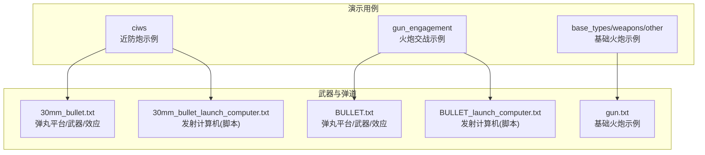
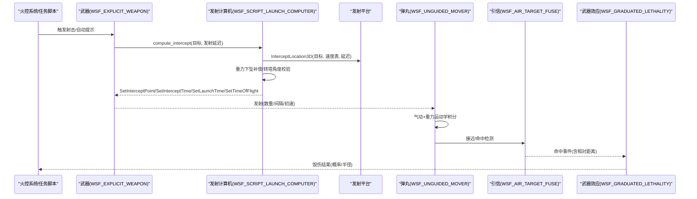
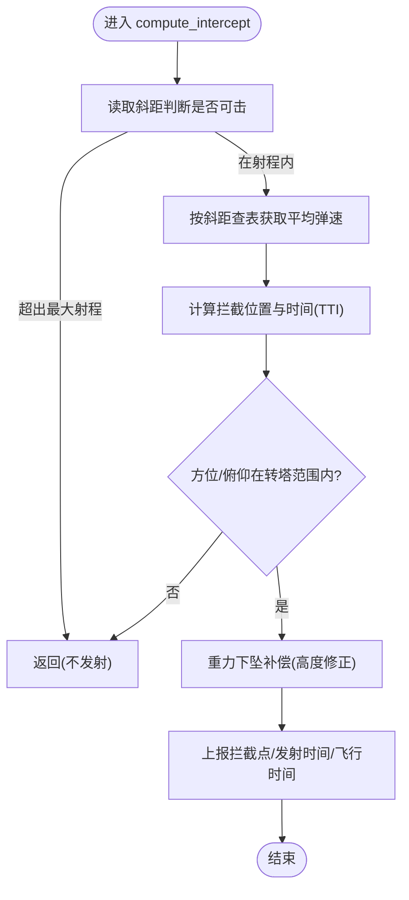
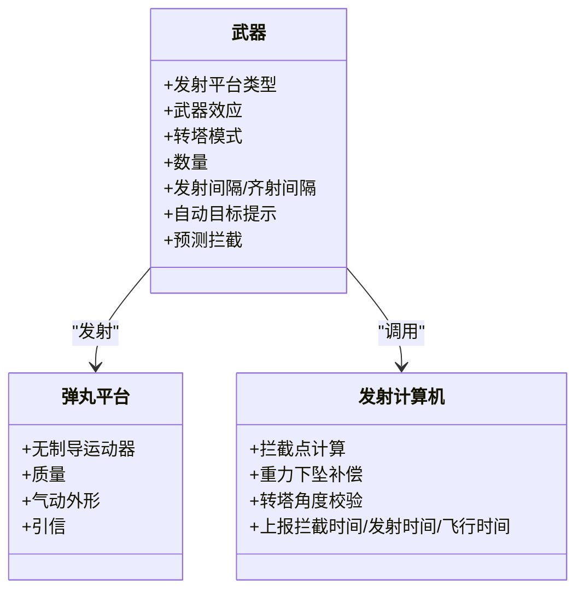
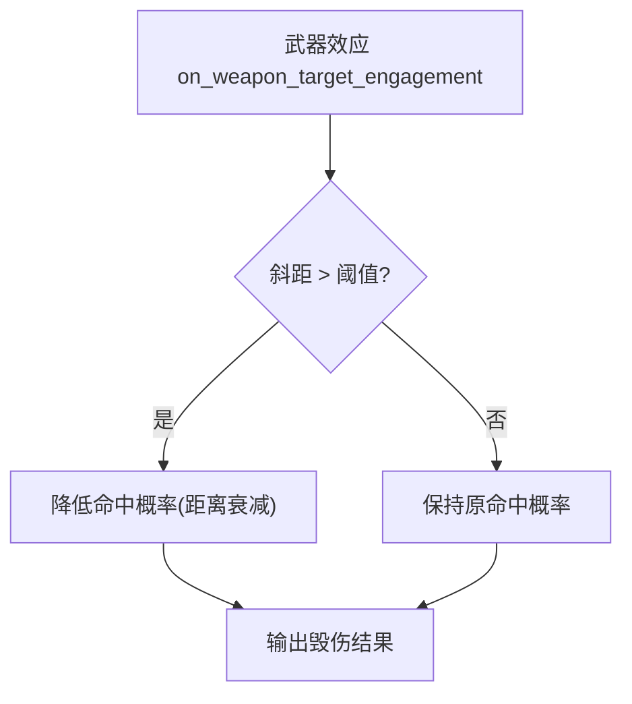
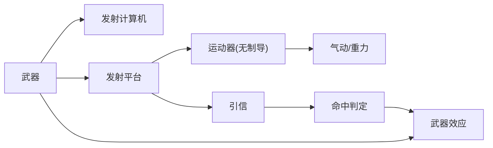

# 火炮系统

<cite>
**本文引用的文件**   
- [30mm_bullet.txt](file://demos/ciws/weapons/guns/30mm_bullet.txt)
- [30mm_bullet_launch_computer.txt](file://demos/ciws/weapons/guns/30mm_bullet_launch_computer.txt)
- [BULLET.txt](file://demos/gun_engagement/weapons/guns/BULLET.txt)
- [BULLET_buildertool.txt](file://demos/gun_engagement/weapons/guns/BULLET_buildertool.txt)
- [BULLET_launch_computer.txt](file://demos/gun_engagement/weapons/guns/BULLET_launch_computer.txt)
- [gun.txt](file://demos/base_types/weapons/other/gun.txt)
</cite>

## 目录
1. [简介](#简介)
2. [项目结构](#项目结构)
3. [核心组件](#核心组件)
4. [架构总览](#架构总览)
5. [详细组件分析](#详细组件分析)
6. [依赖关系分析](#依赖关系分析)
7. [性能与精度考量](#性能与精度考量)
8. [故障排查指南](#故障排查指南)
9. [结论](#结论)
10. [附录：战术运用与作战场景](#附录战术运用与作战场景)

## 简介
本文件面向AFSIM中的火炮（近防炮、舰炮等）建模与仿真，聚焦以下主题：
- 不同类型火炮的配置方式（以近防炮与通用舰炮为例）
- 射击参数设置（射程、射速、散布、杀伤半径与命中概率）
- 瞄准与跟踪机制（发射计算机、拦截点计算、重力下坠补偿）
- 与火控系统的集成（自动目标提示、预测拦截、方位/俯仰转塔限制）
- 弹药类型与装药配置（弹丸气动、引信、武器效应）
- 命中概率与毁伤评估（渐变杀伤模型、距离衰减）
- 战术运用最佳实践与典型作战场景

## 项目结构
仓库中与火炮相关的示例主要位于 demos 子目录：
- ciws（近防炮）：包含30mm弹丸与发射计算机定义
- gun_engagement（火炮交战）：包含通用弹丸、构建工具与发射计算机生成脚本
- base_types/weapons/other：基础类型中的通用火炮示例

图示来源
- [30mm_bullet.txt:1-81](file://demos/ciws/weapons/guns/30mm_bullet.txt#L1-L81)
- [30mm_bullet_launch_computer.txt:1-269](file://demos/ciws/weapons/guns/30mm_bullet_launch_computer.txt#L1-L269)
- [BULLET.txt:1-67](file://demos/gun_engagement/weapons/guns/BULLET.txt#L1-L67)
- [BULLET_launch_computer.txt:1-260](file://demos/gun_engagement/weapons/guns/BULLET_launch_computer.txt#L1-L260)
- [gun.txt:1-122](file://demos/base_types/weapons/other/gun.txt#L1-L122)

章节来源
- [30mm_bullet.txt:1-81](file://demos/ciws/weapons/guns/30mm_bullet.txt#L1-L81)
- [BULLET.txt:1-67](file://demos/gun_engagement/weapons/guns/BULLET.txt#L1-L67)
- [gun.txt:1-122](file://demos/base_types/weapons/other/gun.txt#L1-L122)

## 核心组件
- 弹丸平台（platform_type）
  - 使用无制导运动器（WSF_UNGUIDED_MOVER），定义质量、气动外形与更新间隔
  - 装配引信处理器（WSF_AIR_TARGET_FUSE），设定粗/细更新间隔与接近/命中探测范围
- 武器（weapon）
  - 指定发射的弹丸平台类型、武器效应、转塔模式（方位/俯仰）、数量、发射间隔/齐射间隔
  - 支持自动目标提示与预测拦截点
- 武器效应（weapon_effects）
  - 采用渐变杀伤模型（WSF_GRADUATED_LETHALITY），定义杀伤半径与命中概率曲线
- 发射计算机（launch_computer）
  - 基于脚本实现拦截点计算、重力下坠补偿、转塔角度校验、发射时间/飞行时间上报

章节来源
- [30mm_bullet.txt:24-47](file://demos/ciws/weapons/guns/30mm_bullet.txt#L24-L47)
- [30mm_bullet.txt:50-78](file://demos/ciws/weapons/guns/30mm_bullet.txt#L50-L78)
- [BULLET.txt:19-40](file://demos/gun_engagement/weapons/guns/BULLET.txt#L19-L40)
- [BULLET.txt:43-64](file://demos/gun_engagement/weapons/guns/BULLET.txt#L43-L64)
- [gun.txt:24-45](file://demos/base_types/weapons/other/gun.txt#L24-L45)
- [gun.txt:49-65](file://demos/base_types/weapons/other/gun.txt#L49-L65)
- [gun.txt:102-121](file://demos/base_types/weapons/other/gun.txt#L102-L121)

## 架构总览
火炮系统在AFSIM中由“平台—武器—弹丸—引信—武器效应—发射计算机”构成闭环。发射计算机根据目标轨迹与弹道特性计算拦截点并补偿重力下坠；武器按配置进行齐射；弹丸在运动中受气动与重力影响；引信判定命中；武器效应依据距离与概率对目标造成毁伤。

图示来源
- [30mm_bullet_launch_computer.txt:11-268](file://demos/ciws/weapons/guns/30mm_bullet_launch_computer.txt#L11-L268)
- [BULLET_launch_computer.txt:4-259](file://demos/gun_engagement/weapons/guns/BULLET_launch_computer.txt#L4-L259)
- [30mm_bullet.txt:24-78](file://demos/ciws/weapons/guns/30mm_bullet.txt#L24-L78)
- [BULLET.txt:19-64](file://demos/gun_engagement/weapons/guns/BULLET.txt#L19-L64)
- [gun.txt:24-121](file://demos/base_types/weapons/other/gun.txt#L24-L121)

## 详细组件分析

### 近防炮（CIWS）30mm 弹丸与发射计算机
- 弹丸平台
  - 无制导运动器，质量约0.671 kg，气动阻力系数随马赫数变化
  - 引信：粗/细更新间隔与接近/命中探测范围（米级）
- 武器
  - 齐射间隔约0.0142857秒（对应约70发/秒），数量1200
  - 自动目标提示与预测拦截开启
  - 转塔模式为方位+俯仰，俯仰上限约85度
- 发射计算机
  - 根据斜距查表选择平均弹速（考虑减速）
  - 计算拦截时间与位置，并进行重力下坠补偿
  - 检查转塔角度是否在允许范围内，再上报拦截点与时间

图示来源
- [30mm_bullet_launch_computer.txt:11-268](file://demos/ciws/weapons/guns/30mm_bullet_launch_computer.txt#L11-L268)

章节来源
- [30mm_bullet.txt:24-78](file://demos/ciws/weapons/guns/30mm_bullet.txt#L24-L78)
- [30mm_bullet_launch_computer.txt:11-268](file://demos/ciws/weapons/guns/30mm_bullet_launch_computer.txt#L11-L268)

### 通用火炮（Gun Engagement）弹丸与发射计算机
- 弹丸平台
  - 无制导运动器，质量约0.671 kg，气动阻力系数随马赫数变化
  - 引信：粗/细更新间隔与接近/命中探测范围（米级）
- 武器
  - 齐射间隔约0.0142857秒，数量1200
  - 自动目标提示与预测拦截开启
  - 转塔模式为方位+俯仰，俯仰上限约85度
- 发射计算机
  - 与CIWS类似，但速度表与数值略有差异（不同示例数据）
  - 同样执行拦截点计算、重力下坠补偿与转塔角度校验

图示来源
- [BULLET.txt:19-64](file://demos/gun_engagement/weapons/guns/BULLET.txt#L19-L64)
- [BULLET_launch_computer.txt:4-259](file://demos/gun_engagement/weapons/guns/BULLET_launch_computer.txt#L4-L259)

章节来源
- [BULLET.txt:19-64](file://demos/gun_engagement/weapons/guns/BULLET.txt#L19-L64)
- [BULLET_launch_computer.txt:4-259](file://demos/gun_engagement/weapons/guns/BULLET_launch_computer.txt#L4-L259)

### 基础类型火炮（Base Types Gun）
- 弹丸平台
  - 无制导运动器，质量约0.4 kg，气动阻力系数随马赫数变化
  - 引信：粗/细更新间隔
- 武器效应
  - 渐变杀伤模型，杀伤半径10 m，命中概率0.9；并在超距时降低命中概率（距离衰减）
- 发射计算机
  - 固定弹速（示例中为3000 ft/s），计算拦截点与重力下坠补偿
- 武器
  - 小口径高射炮风格，转塔角度限制较小（±1度），数量较少，发射间隔较长

图示来源
- [gun.txt:49-65](file://demos/base_types/weapons/other/gun.txt#L49-L65)

章节来源
- [gun.txt:24-121](file://demos/base_types/weapons/other/gun.txt#L24-L121)

### 构建工具（Builder Tool）
- 通过附加处理器记录“地面距离—平均弹速”映射，用于离线生成发射计算机的速度表
- 单发武器测试平台，便于验证弹道与速度衰减

章节来源
- [BULLET_buildertool.txt:1-48](file://demos/gun_engagement/weapons/guns/BULLET_buildertool.txt#L1-L48)

## 依赖关系分析
- 组件耦合
  - 武器依赖发射计算机完成拦截点计算
  - 弹丸平台依赖运动器与引信进行物理与命中逻辑
  - 武器效应依赖命中事件与相对距离进行毁伤评估
- 外部依赖
  - 地球重力常量（用于重力下坠补偿）
  - 平台接口（斜距、拦截位置、相对方位/俯仰）

图示来源
- [30mm_bullet.txt:24-78](file://demos/ciws/weapons/guns/30mm_bullet.txt#L24-L78)
- [BULLET.txt:19-64](file://demos/gun_engagement/weapons/guns/BULLET.txt#L19-L64)
- [gun.txt:24-121](file://demos/base_types/weapons/other/gun.txt#L24-L121)

章节来源
- [30mm_bullet.txt:24-78](file://demos/ciws/weapons/guns/30mm_bullet.txt#L24-L78)
- [BULLET.txt:19-64](file://demos/gun_engagement/weapons/guns/BULLET.txt#L19-L64)
- [gun.txt:24-121](file://demos/base_types/weapons/other/gun.txt#L24-L121)

## 性能与精度考量
- 射速与火力密度
  - 齐射间隔约0.0142857秒，对应约70发/秒的高射速，适合近程防空压制
- 射程与弹速
  - 发射计算机按斜距查表选择平均弹速，体现弹丸减速特性；有效射程通常在2 km以内（示例中超过2000 m直接拒绝）
- 散布与命中概率
  - 渐变杀伤模型结合杀伤半径与命中概率；基础类型火炮在超距时降低命中概率
- 转塔机动性
  - 近防炮俯仰上限较高（约85度），适合迎角较大的空中目标；基础类型火炮转塔角度较小（±1度），更偏向水平面目标
- 引信与更新频率
  - 粗/细更新间隔与接近/命中探测范围影响命中判定的实时性与准确性

章节来源
- [30mm_bullet.txt:50-78](file://demos/ciws/weapons/guns/30mm_bullet.txt#L50-L78)
- [BULLET.txt:50-64](file://demos/gun_engagement/weapons/guns/BULLET.txt#L50-L64)
- [gun.txt:49-65](file://demos/base_types/weapons/other/gun.txt#L49-L65)
- [30mm_bullet_launch_computer.txt:11-268](file://demos/ciws/weapons/guns/30mm_bullet_launch_computer.txt#L11-L268)
- [BULLET_launch_computer.txt:4-259](file://demos/gun_engagement/weapons/guns/BULLET_launch_computer.txt#L4-L259)

## 故障排查指南
- 未产生拦截点或发射
  - 检查斜距是否超过发射计算机的最大射程阈值
  - 检查转塔方位/俯仰是否在允许范围内
- 命中概率异常低
  - 检查武器效应的距离衰减逻辑（如基础类型火炮在超距时降低命中概率）
  - 检查引信的接近/命中探测范围是否合理
- 弹道偏差较大
  - 检查发射计算机的重力下坠补偿是否正确应用
  - 检查弹丸气动参数与质量设置是否与预期一致
- 射速不符合预期
  - 检查齐射间隔与数量配置
  - 检查自动目标提示与预测拦截是否启用

章节来源
- [30mm_bullet_launch_computer.txt:11-268](file://demos/ciws/weapons/guns/30mm_bullet_launch_computer.txt#L11-L268)
- [BULLET_launch_computer.txt:4-259](file://demos/gun_engagement/weapons/guns/BULLET_launch_computer.txt#L4-L259)
- [gun.txt:49-65](file://demos/base_types/weapons/other/gun.txt#L49-L65)
- [30mm_bullet.txt:41-47](file://demos/ciws/weapons/guns/30mm_bullet.txt#L41-L47)
- [BULLET.txt:34-39](file://demos/gun_engagement/weapons/guns/BULLET.txt#L34-L39)

## 结论
AFSIM中的火炮系统通过“武器—发射计算机—弹丸—引信—武器效应”的模块化设计，提供了灵活的近防炮与舰炮建模能力。示例展示了高射速、短射程、高精度拦截的典型特征，并通过渐变杀伤模型与距离衰减实现合理的命中概率与毁伤评估。用户可根据具体需求调整气动、引信、武器效应与发射计算机策略，以适配不同火炮类型与战术场景。

## 附录：战术运用与作战场景
- 近防炮（CIWS）
  - 适用场景：末端防空、反导拦截、反快艇/无人机群
  - 要点：高射速、短射程、大俯仰角；优先在近距离内形成火力密度
- 舰炮（通用火炮）
  - 适用场景：水面打击、岸轰支援、伴随防空
  - 要点：根据目标类型调整转塔角度限制与齐射间隔；注意远距离命中概率衰减
- 高射炮（基础类型）
  - 适用场景：中低空防空、区域压制
  - 要点：小转塔角度限制意味着更适合水平面目标；需配合雷达/光电传感器提升命中率

[本节为概念性内容，不直接分析具体文件]