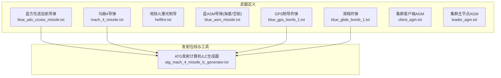
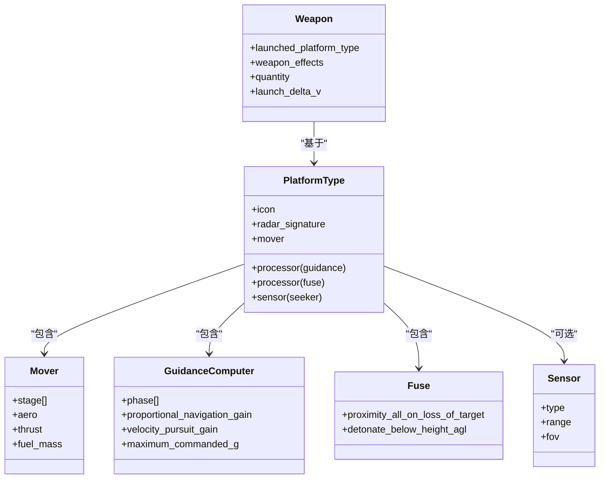
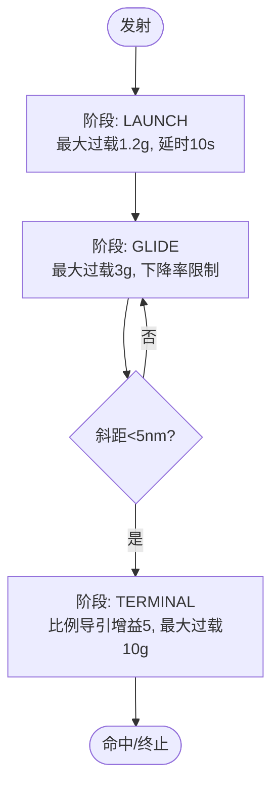
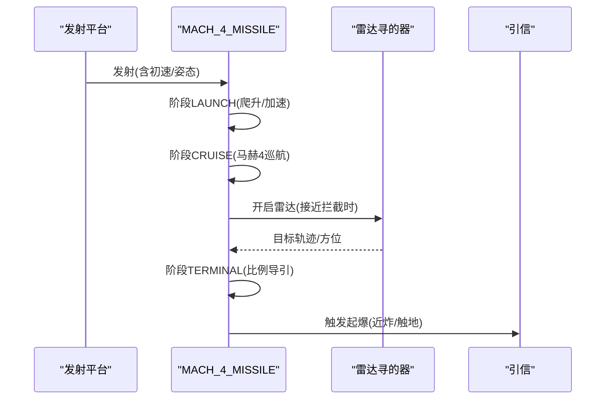
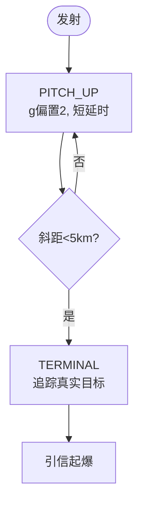
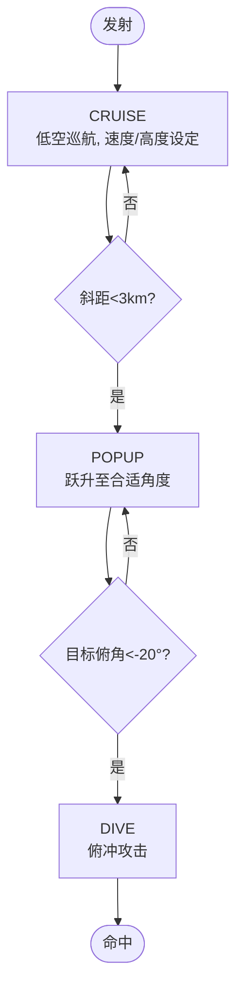
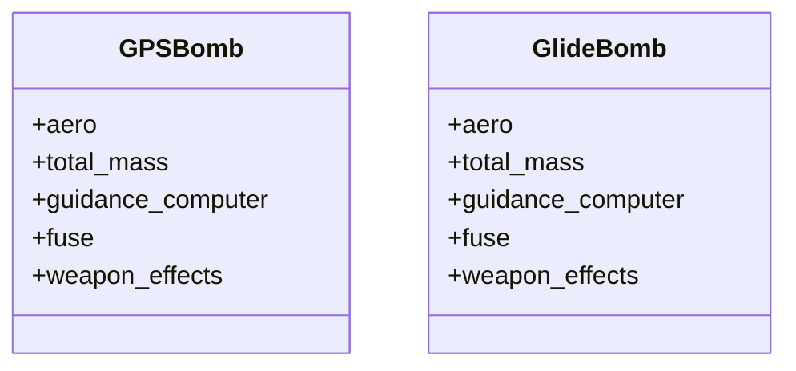
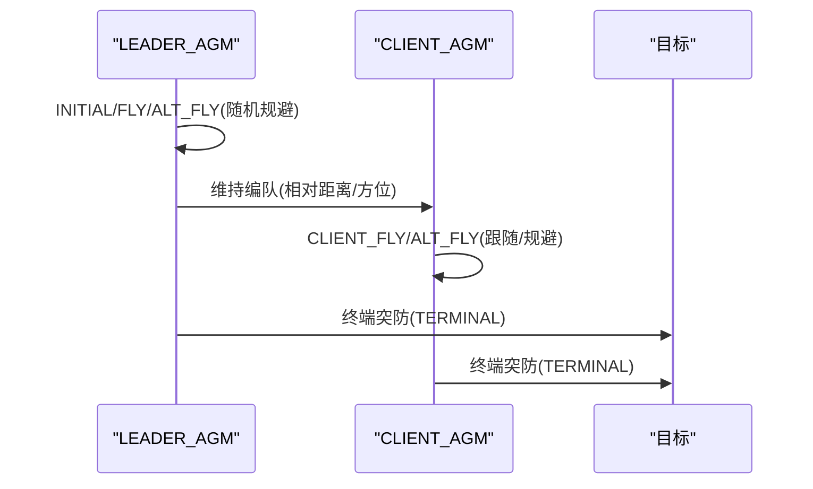
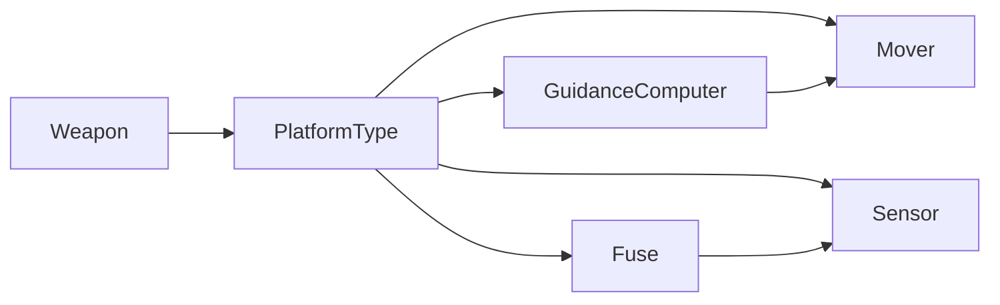

# 空地导弹系统

<cite>
**本文引用的文件**   
- [blue_adv_cruise_missile.txt](file://demos/base_types/weapons/agm/blue_adv_cruise_missile.txt)
- [mach_4_missile.txt](file://demos/base_types/weapons/agm/mach_4_missile.txt)
- [atg_mach_4_missile_lc_generator.txt](file://demos/base_types/weapons/agm/atg_mach_4_missile_lc_generator.txt)
- [client_agm.txt](file://demos/cyber/weapons/agm/client_agm.txt)
- [leader_agm.txt](file://demos/cyber/weapons/agm/leader_agm.txt)
- [hellfire.txt](file://demos/laser_designator/weapons/agm/hellfire.txt)
- [blue_asm_missile.txt](file://demos/new_guidance/weapons/agm/blue_asm_missile.txt)
- [blue_gps_bomb_1.txt](file://demos/alternate_locations/weapons/agm/blue_gps_bomb_1.txt)
- [blue_glide_bomb_1.txt](file://demos/alternate_locations/weapons/agm/blue_glide_bomb_1.txt)
</cite>

## 目录
1. [引言](#引言)
2. [项目结构](#项目结构)
3. [核心组件](#核心组件)
4. [架构总览](#架构总览)
5. [详细组件分析](#详细组件分析)
6. [依赖关系分析](#依赖关系分析)
7. [性能与精度评估](#性能与精度评估)
8. [故障排查指南](#故障排查指南)
9. [结论](#结论)
10. [附录：配置要点与参数速查](#附录配置要点与参数速查)

## 引言
本文件面向AFSIM中的“空地导弹（AGM）”体系，系统化梳理以下主题：
- 空地导弹类型：反辐射/反雷达、巡航导弹、精确制导炸弹、激光制导武器等
- 发射条件与投放包线：高度-速度-距离三维约束、LAR/LC生成方法
- 制导模式：GPS/INS、惯性导航、比例导引、激光半主动、地形/航线跟随等
- 平台集成与挂载管理：武器在攻击机上的挂载、发射计算机与任务处理器协同
- 载荷配置与性能参数：气动、推进、弹道、杀伤效果
- 打击精度与毁伤评估：命中概率、毁伤半径、渐进式毁伤模型
- 战术运用指导与实战案例：典型场景、编队协同、抗干扰与突防策略

## 项目结构
仓库中关于AGM的示例与定义主要位于 demos 子目录下的 weapons/agm 及相关演示场景。关键文件包括：
- 巡航导弹与高超音速导弹：base_types/weapons/agm
- 激光制导武器：laser_designator/weapons/agm
- 新型制导与航路制导：new_guidance/weapons/agm
- GPS/滑翔炸弹：alternate_locations/weapons/agm
- 网络对抗/集群协同：cyber/weapons/agm

图表来源
- [blue_adv_cruise_missile.txt:1-113](file://demos/base_types/weapons/agm/blue_adv_cruise_missile.txt#L1-L113)
- [mach_4_missile.txt:1-161](file://demos/base_types/weapons/agm/mach_4_missile.txt#L1-L161)
- [hellfire.txt:1-95](file://demos/laser_designator/weapons/agm/hellfire.txt#L1-L95)
- [blue_asm_missile.txt:1-127](file://demos/new_guidance/weapons/agm/blue_asm_missile.txt#L1-L127)
- [blue_gps_bomb_1.txt:1-101](file://demos/alternate_locations/weapons/agm/blue_gps_bomb_1.txt#L1-L101)
- [blue_glide_bomb_1.txt:1-70](file://demos/alternate_locations/weapons/agm/blue_glide_bomb_1.txt#L1-L70)
- [atg_mach_4_missile_lc_generator.txt:1-87](file://demos/base_types/weapons/agm/atg_mach_4_missile_lc_generator.txt#L1-L87)

章节来源
- [blue_adv_cruise_missile.txt:1-113](file://demos/base_types/weapons/agm/blue_adv_cruise_missile.txt#L1-L113)
- [mach_4_missile.txt:1-161](file://demos/base_types/weapons/agm/mach_4_missile.txt#L1-L161)
- [hellfire.txt:1-95](file://demos/laser_designator/weapons/agm/hellfire.txt#L1-L95)
- [blue_asm_missile.txt:1-127](file://demos/new_guidance/weapons/agm/blue_asm_missile.txt#L1-L127)
- [blue_gps_bomb_1.txt:1-101](file://demos/alternate_locations/weapons/agm/blue_gps_bomb_1.txt#L1-L101)
- [blue_glide_bomb_1.txt:1-70](file://demos/alternate_locations/weapons/agm/blue_glide_bomb_1.txt#L1-L70)
- [atg_mach_4_missile_lc_generator.txt:1-87](file://demos/base_types/weapons/agm/atg_mach_4_missile_lc_generator.txt#L1-L87)

## 核心组件
- 平台类型与武器类型分离：platform_type 描述飞行体（气动、推进、传感器、处理器），weapon 描述可挂载/发射的弹药对象及其杀伤效果
- 运动器 mover：WSF_GUIDED_MOVER 支持多阶段推进、展开翼面、初始抛投滑行
- 制导处理器 guidance：WSF_GUIDANCE_COMPUTER 实现多阶段制导逻辑（发射、巡航、末段）
- 引信 fuse：WSF_GROUND_TARGET_FUSE / WSF_WEAPON_FUSE 控制起爆时机与条件
- 传感器 sensor：雷达/红外/激光跟踪器，用于目标探测与末制导
- 通信与任务处理器：WSF_COMM_TRANSCEIVER、WSF_TASK_PROCESSOR、WSF_TRACK_PROCESSOR 支持数据链与任务编排

章节来源
- [blue_adv_cruise_missile.txt:64-113](file://demos/base_types/weapons/agm/blue_adv_cruise_missile.txt#L64-L113)
- [mach_4_missile.txt:51-161](file://demos/base_types/weapons/agm/mach_4_missile.txt#L51-L161)
- [hellfire.txt:22-95](file://demos/laser_designator/weapons/agm/hellfire.txt#L22-L95)
- [blue_asm_missile.txt:35-127](file://demos/new_guidance/weapons/agm/blue_asm_missile.txt#L35-L127)
- [blue_gps_bomb_1.txt:43-101](file://demos/alternate_locations/weapons/agm/blue_gps_bomb_1.txt#L43-L101)
- [blue_glide_bomb_1.txt:26-70](file://demos/alternate_locations/weapons/agm/blue_glide_bomb_1.txt#L26-L70)

## 架构总览
下图展示AGM在AFSIM中的典型架构：平台挂载武器，发射后由引导计算机驱动运动器，按阶段切换制导律；传感器提供末制导信息；引信根据条件起爆；杀伤效果作用于目标。

图表来源
- [blue_adv_cruise_missile.txt:64-113](file://demos/base_types/weapons/agm/blue_adv_cruise_missile.txt#L64-L113)
- [mach_4_missile.txt:51-161](file://demos/base_types/weapons/agm/mach_4_missile.txt#L51-L161)
- [hellfire.txt:22-95](file://demos/laser_designator/weapons/agm/hellfire.txt#L22-L95)
- [blue_asm_missile.txt:35-127](file://demos/new_guidance/weapons/agm/blue_asm_missile.txt#L35-L127)
- [blue_gps_bomb_1.txt:43-101](file://demos/alternate_locations/weapons/agm/blue_gps_bomb_1.txt#L43-L101)
- [blue_glide_bomb_1.txt:26-70](file://demos/alternate_locations/weapons/agm/blue_glide_bomb_1.txt#L26-L70)

## 详细组件分析

### 蓝方先进巡航导弹（JSOW类）
- 类型定位：防区外巡航/滑翔武器，具备GPS/INS中段制导与末端红外寻的
- 气动与推进：折叠翼/展开翼两种气动外形；两阶段质量与推力配置
- 制导阶段：LAUNCH→GLIDE→TERMINAL，最大过载与俯仰角限制
- 杀伤效果：渐进式毁伤模型，半径与峰值毁伤参数可调

图表来源
- [blue_adv_cruise_missile.txt:64-113](file://demos/base_types/weapons/agm/blue_adv_cruise_missile.txt#L64-L113)

章节来源
- [blue_adv_cruise_missile.txt:1-113](file://demos/base_types/weapons/agm/blue_adv_cruise_missile.txt#L1-L113)

### 马赫4导弹（助推-冲压发动机）
- 类型定位：高超声速巡航导弹，具备雷达末制导能力
- 气动与推进：三阶段（助推、二次点火、冲压持续），不同马赫数阻力曲线
- 制导阶段：LAUNCH→CRUISE→TERMINAL，速度/高度/角度约束
- 传感器与数据链：内置雷达寻的器，任务/跟踪处理器

图表来源
- [mach_4_missile.txt:51-161](file://demos/base_types/weapons/agm/mach_4_missile.txt#L51-L161)

章节来源
- [mach_4_missile.txt:1-161](file://demos/base_types/weapons/agm/mach_4_missile.txt#L1-L161)

### 地狱火激光制导导弹
- 类型定位：直升机/无人机常用激光半主动制导反坦克导弹
- 传感器：激光跟踪器，带编码与视场角限制
- 制导逻辑：发射后短暂抬头，进入终端追踪真实目标位置
- 引信：时间/高度/近炸组合，避免过早或过晚起爆

图表来源
- [hellfire.txt:22-95](file://demos/laser_designator/weapons/agm/hellfire.txt#L22-L95)

章节来源
- [hellfire.txt:1-95](file://demos/laser_designator/weapons/agm/hellfire.txt#L1-L95)

### 蓝ASM导弹（海基/空射型）
- 类型定位：亚音速/低空掠海巡航导弹，具备预编程航路与末段跃升/俯冲
- 制导阶段：CRUISE→POPUP→DIVE，强调低空突防与末段机动
- 航路：可在mover中预编程航点，结合制导计算机进行修正

图表来源
- [blue_asm_missile.txt:35-127](file://demos/new_guidance/weapons/agm/blue_asm_missile.txt#L35-L127)

章节来源
- [blue_asm_missile.txt:1-127](file://demos/new_guidance/weapons/agm/blue_asm_missile.txt#L1-L127)

### GPS制导炸弹与滑翔炸弹
- GPS制导炸弹：无动力滑翔+GPS/INS修正，适合高空投放
- 滑翔炸弹：高升阻比气动外形，具备较远射程
- 两者均使用WSF_GUIDANCE_COMPUTER进行比例导引/速度追踪修正

图表来源
- [blue_gps_bomb_1.txt:43-101](file://demos/alternate_locations/weapons/agm/blue_gps_bomb_1.txt#L43-L101)
- [blue_glide_bomb_1.txt:26-70](file://demos/alternate_locations/weapons/agm/blue_glide_bomb_1.txt#L26-L70)

章节来源
- [blue_gps_bomb_1.txt:1-101](file://demos/alternate_locations/weapons/agm/blue_gps_bomb_1.txt#L1-L101)
- [blue_glide_bomb_1.txt:1-70](file://demos/alternate_locations/weapons/agm/blue_glide_bomb_1.txt#L1-L70)

### 集群协同AGM（主/从节点）
- 主节点（LEADER_AGM）：负责编队协调、随机规避、终端突防
- 从节点（CLIENT_AGM）：保持与主节点相对距离/方位，动态调整航向/高度/速度
- 制导逻辑：脚本变量控制偏离范围、相位时间与终端条件

图表来源
- [leader_agm.txt:44-169](file://demos/cyber/weapons/agm/leader_agm.txt#L44-L169)
- [client_agm.txt:42-205](file://demos/cyber/weapons/agm/client_agm.txt#L42-L205)

章节来源
- [leader_agm.txt:1-169](file://demos/cyber/weapons/agm/leader_agm.txt#L1-L169)
- [client_agm.txt:1-205](file://demos/cyber/weapons/agm/client_agm.txt#L1-L205)

## 依赖关系分析
- 平台与武器的耦合：weapon.launched_platform_type 指向 platform_type，确保发射平台与武器类型的匹配
- 处理器依赖：guidance 依赖 mover 的状态（位置、速度、姿态），fuse 依赖传感器/环境（高度、斜距）
- 传感器依赖：seeker 为可选模块，影响末制导精度与可用条件（如激光编码、雷达RCS）

图表来源
- [blue_adv_cruise_missile.txt:64-113](file://demos/base_types/weapons/agm/blue_adv_cruise_missile.txt#L64-L113)
- [mach_4_missile.txt:51-161](file://demos/base_types/weapons/agm/mach_4_missile.txt#L51-L161)
- [hellfire.txt:22-95](file://demos/laser_designator/weapons/agm/hellfire.txt#L22-L95)
- [blue_asm_missile.txt:35-127](file://demos/new_guidance/weapons/agm/blue_asm_missile.txt#L35-L127)
- [blue_gps_bomb_1.txt:43-101](file://demos/alternate_locations/weapons/agm/blue_gps_bomb_1.txt#L43-L101)
- [blue_glide_bomb_1.txt:26-70](file://demos/alternate_locations/weapons/agm/blue_glide_bomb_1.txt#L26-L70)

章节来源
- [blue_adv_cruise_missile.txt:64-113](file://demos/base_types/weapons/agm/blue_adv_cruise_missile.txt#L64-L113)
- [mach_4_missile.txt:51-161](file://demos/base_types/weapons/agm/mach_4_missile.txt#L51-L161)
- [hellfire.txt:22-95](file://demos/laser_designator/weapons/agm/hellfire.txt#L22-L95)
- [blue_asm_missile.txt:35-127](file://demos/new_guidance/weapons/agm/blue_asm_missile.txt#L35-L127)
- [blue_gps_bomb_1.txt:43-101](file://demos/alternate_locations/weapons/agm/blue_gps_bomb_1.txt#L43-L101)
- [blue_glide_bomb_1.txt:26-70](file://demos/alternate_locations/weapons/agm/blue_glide_bomb_1.txt#L26-L70)

## 性能与精度评估
- 投放包线与LAR/LC生成：通过 atg_mach_4_missile_lc_generator.txt 可按发射平台高度/马赫数与目标距离生成发射包线（LAR）与发射计算机（LC）
- 精度影响因素：
  - 制导律参数：比例导引增益、速度追踪增益、最大过载
  - 传感器质量：激光编码稳定性、雷达RCS与噪声、更新间隔
  - 环境因素：地形遮挡、大气衰减、GNSS可用性
- 毁伤评估：
  - 渐进式毁伤（WSF_GRADUATED_LETHALITY）：半径与峰值毁伤
  - 球形毁伤（WSF_SPHERICAL_LETHALITY）：最小/最大半径与损伤阈值

章节来源
- [atg_mach_4_missile_lc_generator.txt:30-87](file://demos/base_types/weapons/agm/atg_mach_4_missile_lc_generator.txt#L30-L87)
- [blue_adv_cruise_missile.txt:59-61](file://demos/base_types/weapons/agm/blue_adv_cruise_missile.txt#L59-L61)
- [blue_gps_bomb_1.txt:70-82](file://demos/alternate_locations/weapons/agm/blue_gps_bomb_1.txt#L70-L82)
- [blue_glide_bomb_1.txt:49-57](file://demos/alternate_locations/weapons/agm/blue_glide_bomb_1.txt#L49-L57)

## 故障排查指南
- 发射失败或无法进入巡航：
  - 检查阶段转换条件（如 phase_time、target_slant_range）是否满足
  - 确认推进阶段 thrust_duration 与燃料质量设置合理
- 末制导丢失：
  - 检查传感器开关时机（turn_on_sensor）、视场角与最大作用距离
  - 验证激光编码一致性与跟踪器更新间隔
- 引信异常：
  - 核对 proximity_all_on_loss_of_target 与 detonate_below_height_agl 设置
  - 确认 time_of_flight_to_arm 与 maximum_time_of_flight 合理
- 包线不匹配：
  - 重新运行 LC 生成工具，调整 altitude_and_mach 与 target_ranges/target_offsets

章节来源
- [mach_4_missile.txt:87-145](file://demos/base_types/weapons/agm/mach_4_missile.txt#L87-L145)
- [hellfire.txt:56-83](file://demos/laser_designator/weapons/agm/hellfire.txt#L56-L83)
- [blue_adv_cruise_missile.txt:81-104](file://demos/base_types/weapons/agm/blue_adv_cruise_missile.txt#L81-L104)
- [blue_gps_bomb_1.txt:53-63](file://demos/alternate_locations/weapons/agm/blue_gps_bomb_1.txt#L53-L63)
- [blue_glide_bomb_1.txt:36-46](file://demos/alternate_locations/weapons/agm/blue_glide_bomb_1.txt#L36-L46)

## 结论
AFSIM中的AGM体系以“平台类型+武器类型”解耦为核心，通过WSF_GUIDED_MOVER与WSF_GUIDANCE_COMPUTER实现多阶段、多模式的制导与控制。示例覆盖了巡航导弹、高超音速导弹、激光制导武器、GPS/滑翔炸弹以及集群协同AGM，提供了完整的配置范式与战术演练基础。实际应用中，应结合LAR/LC包线生成、传感器质量与环境因素，综合优化制导律与毁伤模型，以获得更贴近实战的性能与精度。

## 附录：配置要点与参数速查
- 平台类型关键字段：
  - icon、radar_signature、mover.stage[].aero/thrust/fuel_mass、processor.guidance.phase[]、processor.fuse.*、sensor.*
- 武器类型关键字段：
  - launched_platform_type、weapon_effects、quantity、launch_delta_v、aux_data.lar_meters
- 常见制导参数：
  - proportional_navigation_gain、velocity_pursuit_gain、maximum_commanded_g、commanded_altitude/speed
- 传感器参数：
  - wavelength、maximum_range、azimuth_field_of_view、elevation_field_of_view、reports_bearing/elevation/location
- 毁伤模型：
  - WSF_GRADUATED_LETHALITY：radius_and_pk
  - WSF_SPHERICAL_LETHALITY：minimum_radius、maximum_radius、threshold_damage、exponent

章节来源
- [blue_adv_cruise_missile.txt:32-113](file://demos/base_types/weapons/agm/blue_adv_cruise_missile.txt#L32-L113)
- [mach_4_missile.txt:16-161](file://demos/base_types/weapons/agm/mach_4_missile.txt#L16-L161)
- [hellfire.txt:9-95](file://demos/laser_designator/weapons/agm/hellfire.txt#L9-L95)
- [blue_asm_missile.txt:15-127](file://demos/new_guidance/weapons/agm/blue_asm_missile.txt#L15-L127)
- [blue_gps_bomb_1.txt:23-101](file://demos/alternate_locations/weapons/agm/blue_gps_bomb_1.txt#L23-L101)
- [blue_glide_bomb_1.txt:10-70](file://demos/alternate_locations/weapons/agm/blue_glide_bomb_1.txt#L10-L70)