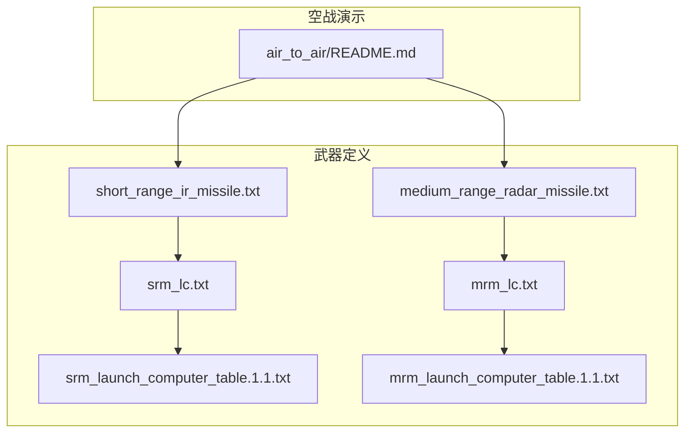
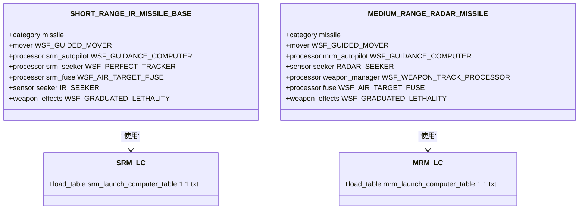
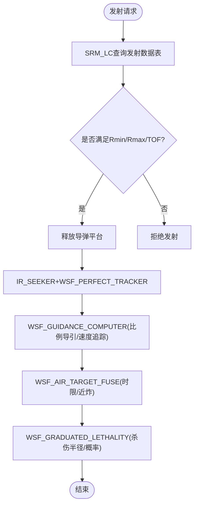
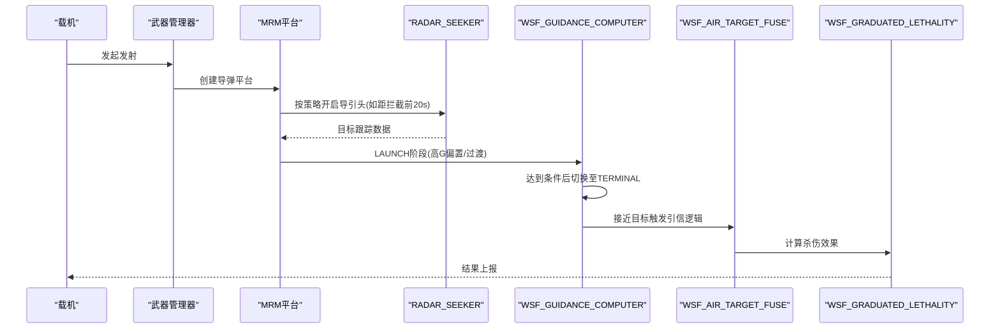
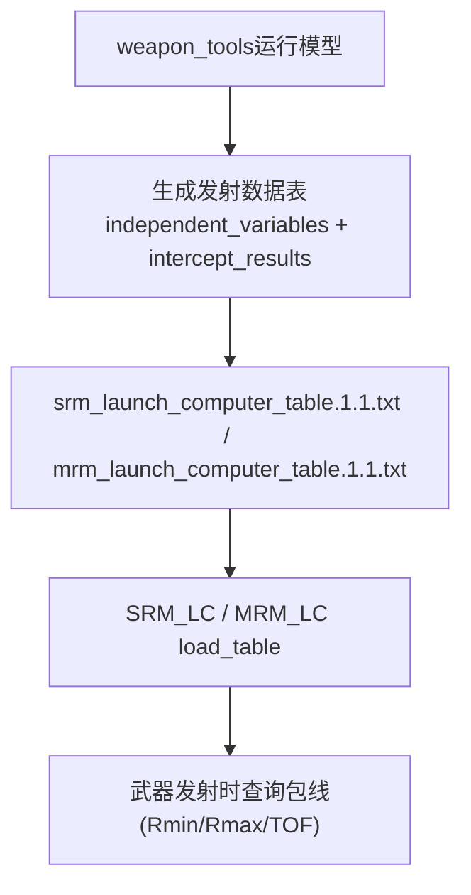
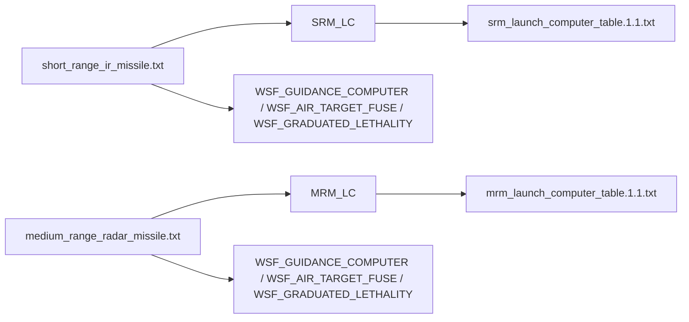

# 空空导弹系统

<cite>
**本文引用的文件**   
- [air_to_air/README.md](file://demos/air_to_air/README.md)
- [short_range_ir_missile.txt](file://demos/air_to_air/weapons/aam/short_range_ir_missile.txt)
- [medium_range_radar_missile.txt](file://demos/air_to_air/weapons/aam/medium_range_radar_missile.txt)
- [srm_lc.txt](file://demos/air_to_air/weapons/aam/srm_lc.txt)
- [mrm_lc.txt](file://demos/air_to_air/weapons/aam/mrm_lc.txt)
- [srm_launch_computer_table.1.1.txt](file://demos/air_to_air/weapons/aam/srm_launch_computer_table.1.1.txt)
- [mrm_launch_computer_table.1.1.txt](file://demos/air_to_air/weapons/aam/mrm_launch_computer_table.1.1.txt)
</cite>

## 目录
1. [简介](#简介)
2. [项目结构](#项目结构)
3. [核心组件](#核心组件)
4. [架构总览](#架构总览)
5. [详细组件分析](#详细组件分析)
6. [依赖关系分析](#依赖关系分析)
7. [性能与包线分析](#性能与包线分析)
8. [故障排查指南](#故障排查指南)
9. [结论](#结论)
10. [附录：战术运用最佳实践](#附录战术运用最佳实践)

## 简介
本文件面向AFSIM中的空空导弹系统，聚焦于短程红外导弹与中程雷达导弹两类典型武器，说明其类型分类、制导模式配置、发射计算机（含ATA4生成器与发射数据表）的使用方法、性能参数设置、与载机的集成和挂载管理，以及拦截包线与作战效能评估方法，并给出战术运用的最佳实践。文档内容严格基于仓库内示例与定义文件进行梳理与归纳，便于不同技术背景的读者理解与使用。

## 项目结构
在AFSIM的air_to_air演示中，空空导弹相关定义集中在weapons/aam目录下，包含短程红外导弹与中程雷达导弹的平台、传感器、气动、处理器、引信、武器效果及发射计算机等定义；同时提供对应的发射计算机表文件，用于表征在不同交战条件下的最小/最大射程与飞行时间等结果。

图表来源
- [air_to_air/README.md:1-101](file://demos/air_to_air/README.md#L1-L101)
- [short_range_ir_missile.txt:1-238](file://demos/air_to_air/weapons/aam/short_range_ir_missile.txt#L1-L238)
- [medium_range_radar_missile.txt:1-260](file://demos/air_to_air/weapons/aam/medium_range_radar_missile.txt#L1-L260)
- [srm_lc.txt:1-13](file://demos/air_to_air/weapons/aam/srm_lc.txt#L1-L13)
- [mrm_lc.txt:1-13](file://demos/air_to_air/weapons/aam/mrm_lc.txt#L1-L13)
- [srm_launch_computer_table.1.1.txt:1-36](file://demos/air_to_air/weapons/aam/srm_launch_computer_table.1.1.txt#L1-L36)
- [mrm_launch_computer_table.1.1.txt:1-36](file://demos/air_to_air/weapons/aam/mrm_launch_computer_table.1.1.txt#L1-L36)

章节来源
- [air_to_air/README.md:1-101](file://demos/air_to_air/README.md#L1-L101)

## 核心组件
- 短程红外导弹（SRM）
  - 平台类型：SHORT_RANGE_IR_MISSILE_BASE
  - 传感器：IR_SEEKER（以雷达传感器模拟红外导引头行为，配合WSF_PERFECT_TRACKER提供理想跟踪）
  - 处理器：WSF_GUIDANCE_COMPUTER（比例导引+速度追踪）、WSF_AIR_TARGET_FUSE（空对空引信）
  - 推进与气动：WSF_AERO、WSF_GUIDED_MOVER（质量、燃料、比冲、推力、推力持续时间、更新间隔）
  - 武器效果：WSF_GRADUATED_LETHALITY（渐变杀伤半径与概率）
  - 发射计算机：SRM_LC（加载srm_launch_computer_table.1.1.txt）

- 中程雷达导弹（MRM）
  - 平台类型：MEDIUM_RANGE_RADAR_MISSILE
  - 传感器：RADAR_SEEKER（主动雷达导引头），WSF_WEAPON_TRACK_PROCESSOR控制开机时机
  - 处理器：WSF_GUIDANCE_COMPUTER（分阶段LAUNCH/TERMINAL）、WSF_AIR_TARGET_FUSE
  - 推进与气动：WSF_AERO、WSF_GUIDED_MOVER
  - 武器效果：WSF_GRADUATED_LETHALITY
  - 发射计算机：MRM_LC（加载mrm_launch_computer_table.1.1.txt）

章节来源
- [short_range_ir_missile.txt:94-209](file://demos/air_to_air/weapons/aam/short_range_ir_missile.txt#L94-L209)
- [medium_range_radar_missile.txt:95-259](file://demos/air_to_air/weapons/aam/medium_range_radar_missile.txt#L95-L259)
- [srm_lc.txt:10-12](file://demos/air_to_air/weapons/aam/srm_lc.txt#L10-L12)
- [mrm_lc.txt:10-12](file://demos/air_to_air/weapons/aam/mrm_lc.txt#L10-L12)

## 架构总览
空空导弹在AFSIM中以“平台类型”为核心，组合以下子系统：
- 运动器（Mover）：负责推进、质量、燃料、气动与轨迹积分
- 制导计算机（Guidance Computer）：实现比例导引、速度追踪、G限与相位切换
- 导引头（Seeker）：红外或雷达传感器，结合跟踪处理器提供目标信息
- 引信（Fuse）：空对空引信逻辑，决定起爆条件与时限
- 武器效果（Weapon Effects）：杀伤半径与概率模型
- 发射计算机（Launch Computer）：根据发射数据表计算可发射包线（Rmin/Rmax/TOF等）

图表来源
- [short_range_ir_missile.txt:115-209](file://demos/air_to_air/weapons/aam/short_range_ir_missile.txt#L115-L209)
- [medium_range_radar_missile.txt:116-259](file://demos/air_to_air/weapons/aam/medium_range_radar_missile.txt#L116-L259)
- [srm_lc.txt:10-12](file://demos/air_to_air/weapons/aam/srm_lc.txt#L10-L12)
- [mrm_lc.txt:10-12](file://demos/air_to_air/weapons/aam/mrm_lc.txt#L10-L12)

## 详细组件分析

### 短程红外导弹（SRM）
- 导引头与跟踪
  - 使用IR_SEEKER（雷达传感器模拟红外导引头）与WSF_PERFECT_TRACKER提供理想跟踪数据，适合简化仿真与快速验证。
- 制导算法
  - WSF_GUIDANCE_COMPUTER配置比例导引增益、速度追踪增益、G偏置与最大指令G限，update_interval为0.1s。
- 推进与机动性
  - WSF_GUIDED_MOVER定义总质量、燃料质量、比冲、推力与推力持续时间；WSF_AERO提供阻力系数随马赫数变化曲线与参考面积、升力系数上限等，用于估算最大转弯率（约30G）。
- 引信与杀伤
  - WSF_AIR_TARGET_FUSE设定最大飞行时间起爆；WSF_GRADUATED_LETHALITY定义杀伤半径与命中概率。
- 发射计算机
  - SRM_LC加载srm_launch_computer_table.1.1.txt，该表定义了独立变量（射手/目标高度、马赫数、目标方位角、目标前置角）与拦截结果（Rmin/Rmax/Rne及其TOF），用于计算可发射包线。

图表来源
- [short_range_ir_missile.txt:137-151](file://demos/air_to_air/weapons/aam/short_range_ir_missile.txt#L137-L151)
- [short_range_ir_missile.txt:188-209](file://demos/air_to_air/weapons/aam/short_range_ir_missile.txt#L188-L209)
- [srm_launch_computer_table.1.1.txt:21-35](file://demos/air_to_air/weapons/aam/srm_launch_computer_table.1.1.txt#L21-L35)

章节来源
- [short_range_ir_missile.txt:94-209](file://demos/air_to_air/weapons/aam/short_range_ir_missile.txt#L94-L209)
- [srm_launch_computer_table.1.1.txt:1-36](file://demos/air_to_air/weapons/aam/srm_launch_computer_table.1.1.txt#L1-L36)

### 中程雷达导弹（MRM）
- 导引头与跟踪
  - 使用RADAR_SEEKER作为主动雷达导引头；WSF_WEAPON_TRACK_PROCESSOR控制导引头开机时机（例如距拦截前若干秒或距离），支持无上链主动模式。
- 制导算法
  - WSF_GUIDANCE_COMPUTER分为LAUNCH与TERMINAL两阶段，分别配置不同的比例导引增益与G偏置，并在LAUNCH阶段后自动切换到TERMINAL。
- 推进与机动性
  - WSF_GUIDED_MOVER与WSF_AERO定义推进与气动特性，支持更高速度与更远距离的拦截任务。
- 引信与杀伤
  - WSF_AIR_TARGET_FUSE与WSF_GRADUATED_LETHALITY同SRM类似。
- 发射计算机
  - MRM_LC加载mrm_launch_computer_table.1.1.txt，提供与SRM类似的独立变量与拦截结果维度，但数值范围更大，体现中程导弹的远距能力。

图表来源
- [medium_range_radar_missile.txt:163-182](file://demos/air_to_air/weapons/aam/medium_range_radar_missile.txt#L163-L182)
- [medium_range_radar_missile.txt:204-216](file://demos/air_to_air/weapons/aam/medium_range_radar_missile.txt#L204-L216)
- [medium_range_radar_missile.txt:250-259](file://demos/air_to_air/weapons/aam/medium_range_radar_missile.txt#L250-L259)

章节来源
- [medium_range_radar_missile.txt:95-259](file://demos/air_to_air/weapons/aam/medium_range_radar_missile.txt#L95-L259)
- [mrm_launch_computer_table.1.1.txt:1-36](file://demos/air_to_air/weapons/aam/mrm_launch_computer_table.1.1.txt#L1-L36)

### 发射计算机与ATA4生成器
- ATA4生成器
  - 通过weapon_tools运行模型生成发射计算机表（launch_computer_table），包含独立变量（射手/目标高度、马赫数、目标方位角、前置角）与拦截结果（Rmin/Rmax/Rne及其TOF）。
- 发射数据表
  - srm_launch_computer_table.1.1.txt与mrm_launch_computer_table.1.1.txt分别对应SRM与MRM的包线数据，供SRM_LC与MRM_LC加载使用。
- 使用方法
  - 在武器定义中引用launch_computer对象，并通过include_once加载对应的lc文件；lc文件中再load_table指向具体的表文件。

图表来源
- [srm_launch_computer_table.1.1.txt:10-35](file://demos/air_to_air/weapons/aam/srm_launch_computer_table.1.1.txt#L10-L35)
- [mrm_launch_computer_table.1.1.txt:10-35](file://demos/air_to_air/weapons/aam/mrm_launch_computer_table.1.1.txt#L10-L35)
- [srm_lc.txt:10-12](file://demos/air_to_air/weapons/aam/srm_lc.txt#L10-L12)
- [mrm_lc.txt:10-12](file://demos/air_to_air/weapons/aam/mrm_lc.txt#L10-L12)

章节来源
- [srm_lc.txt:10-12](file://demos/air_to_air/weapons/aam/srm_lc.txt#L10-L12)
- [mrm_lc.txt:10-12](file://demos/air_to_air/weapons/aam/mrm_lc.txt#L10-L12)
- [srm_launch_computer_table.1.1.txt:10-35](file://demos/air_to_air/weapons/aam/srm_launch_computer_table.1.1.txt#L10-L35)
- [mrm_launch_computer_table.1.1.txt:10-35](file://demos/air_to_air/weapons/aam/mrm_launch_computer_table.1.1.txt#L10-L35)

## 依赖关系分析
- 武器与发射计算机
  - SRM与MRM分别在各自武器定义中引用SRM_LC与MRM_LC，而LC又依赖对应的发射数据表。
- 传感器与跟踪
  - SRM使用IR_SEEKER+WSF_PERFECT_TRACKER；MRM使用RADAR_SEEKER+WSF_WEAPON_TRACK_PROCESSOR。
- 处理器链路
  - 两者均使用WSF_GUIDANCE_COMPUTER进行制导，WSF_AIR_TARGET_FUSE进行引信逻辑，WSF_GRADUATED_LETHALITY进行杀伤建模。

图表来源
- [short_range_ir_missile.txt:188-209](file://demos/air_to_air/weapons/aam/short_range_ir_missile.txt#L188-L209)
- [medium_range_radar_missile.txt:250-259](file://demos/air_to_air/weapons/aam/medium_range_radar_missile.txt#L250-L259)
- [srm_lc.txt:10-12](file://demos/air_to_air/weapons/aam/srm_lc.txt#L10-L12)
- [mrm_lc.txt:10-12](file://demos/air_to_air/weapons/aam/mrm_lc.txt#L10-L12)
- [srm_launch_computer_table.1.1.txt:10-35](file://demos/air_to_air/weapons/aam/srm_launch_computer_table.1.1.txt#L10-L35)
- [mrm_launch_computer_table.1.1.txt:10-35](file://demos/air_to_air/weapons/aam/mrm_launch_computer_table.1.1.txt#L10-L35)

章节来源
- [short_range_ir_missile.txt:188-209](file://demos/air_to_air/weapons/aam/short_range_ir_missile.txt#L188-L209)
- [medium_range_radar_missile.txt:250-259](file://demos/air_to_air/weapons/aam/medium_range_radar_missile.txt#L250-L259)

## 性能与包线分析
- 射程与速度
  - SRM与MRM的WSF_GUIDED_MOVER定义了总质量、燃料质量、比冲、推力与推力持续时间，直接影响加速段与续航能力。
  - 通过WSF_AERO的阻力系数随马赫数变化与参考面积、升力系数上限，可估算最大过载与转弯速率（SRM注释中提及约30G）。
- 包线（Rmin/Rmax/Rne与TOF）
  - 发射数据表提供了不同独立变量下的拦截结果，包括最小/最大射程与相对横向偏移（Rne）及其飞行时间（TOF）。
  - 可通过改变射手/目标高度、马赫数、目标方位角与前置角，观察包线的变化趋势，从而优化发射时机与战术位置。
- 动能与能量管理
  - 推进参数与气动参数的匹配决定了导弹在末段的能量保持能力，影响终端机动性与命中率。

章节来源
- [short_range_ir_missile.txt:124-135](file://demos/air_to_air/weapons/aam/short_range_ir_missile.txt#L124-L135)
- [short_range_ir_missile.txt:94-113](file://demos/air_to_air/weapons/aam/short_range_ir_missile.txt#L94-L113)
- [medium_range_radar_missile.txt:149-160](file://demos/air_to_air/weapons/aam/medium_range_radar_missile.txt#L149-L160)
- [medium_range_radar_missile.txt:95-111](file://demos/air_to_air/weapons/aam/medium_range_radar_missile.txt#L95-L111)
- [srm_launch_computer_table.1.1.txt:10-35](file://demos/air_to_air/weapons/aam/srm_launch_computer_table.1.1.txt#L10-L35)
- [mrm_launch_computer_table.1.1.txt:10-35](file://demos/air_to_air/weapons/aam/mrm_launch_computer_table.1.1.txt#L10-L35)

## 故障排查指南
- 导引头未开机或无法跟踪
  - 检查WSF_WEAPON_TRACK_PROCESSOR的turn_on_sensor配置（时间与距离条件），确保在预期时刻开启导引头。
- 发射被拒绝
  - 核查发射数据表的独立变量是否与当前场景一致；确认SRM_LC/MRM_LC是否正确加载了对应表文件。
- 制导不稳定或过早进入末段
  - 调整WSF_GUIDANCE_COMPUTER的比例导引增益与G偏置，检查phase切换条件（如LAUNCH阶段的next_phase触发条件）。
- 杀伤效果异常
  - 检查WSF_GRADUATED_LETHALITY的半径与概率参数，以及WSF_AIR_TARGET_FUSE的最大飞行时间设置。

章节来源
- [medium_range_radar_missile.txt:204-216](file://demos/air_to_air/weapons/aam/medium_range_radar_missile.txt#L204-L216)
- [srm_lc.txt:10-12](file://demos/air_to_air/weapons/aam/srm_lc.txt#L10-L12)
- [mrm_lc.txt:10-12](file://demos/air_to_air/weapons/aam/mrm_lc.txt#L10-L12)
- [medium_range_radar_missile.txt:163-182](file://demos/air_to_air/weapons/aam/medium_range_radar_missile.txt#L163-L182)
- [short_range_ir_missile.txt:149-151](file://demos/air_to_air/weapons/aam/short_range_ir_missile.txt#L149-L151)
- [short_range_ir_missile.txt:188-209](file://demos/air_to_air/weapons/aam/short_range_ir_missile.txt#L188-L209)

## 结论
AFSIM的空空导弹系统通过平台类型将运动器、制导计算机、导引头、引信与武器效果有机组合，并以发射计算机与发射数据表驱动可发射包线计算。短程红外导弹与中程雷达导弹在导引头与跟踪策略上存在差异，前者侧重简化跟踪与快速验证，后者强调主动雷达导引与末段精确制导。通过合理配置推进与气动参数、调整制导与引信逻辑，并结合发射数据表进行包线分析与战术优化，可在仿真中有效评估空空导弹的性能与作战效能。

## 附录：战术运用最佳实践
- 发射时机选择
  - 依据发射数据表的Rmin/Rmax/TOF，选择目标方位角与前置角有利的窗口，避免过远或过近的不可发射区。
- 导引头开关策略
  - 对于主动雷达导弹，合理设置导引头开机时机，平衡探测距离与隐蔽性。
- 制导参数调优
  - 根据目标机动特征调整比例导引增益与G偏置，提升末端拦截成功率。
- 能量管理
  - 优化推进与气动参数，确保末段具备足够的机动能力以应对高G规避。
- 多弹协同
  - 利用 salvo_interval 与 firing_interval 控制齐射节奏，提高饱和攻击效果。

章节来源
- [medium_range_radar_missile.txt:250-259](file://demos/air_to_air/weapons/aam/medium_range_radar_missile.txt#L250-L259)
- [srm_launch_computer_table.1.1.txt:10-35](file://demos/air_to_air/weapons/aam/srm_launch_computer_table.1.1.txt#L10-L35)
- [mrm_launch_computer_table.1.1.txt:10-35](file://demos/air_to_air/weapons/aam/mrm_launch_computer_table.1.1.txt#L10-L35)