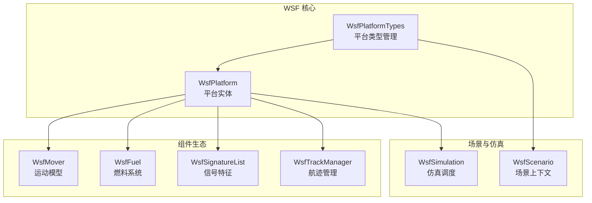
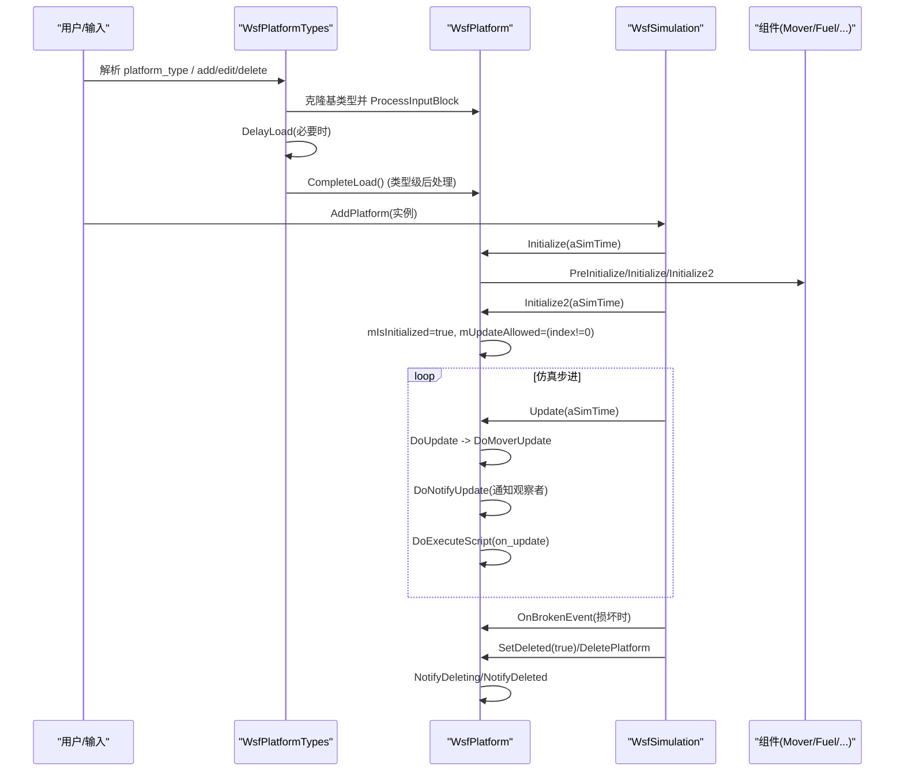
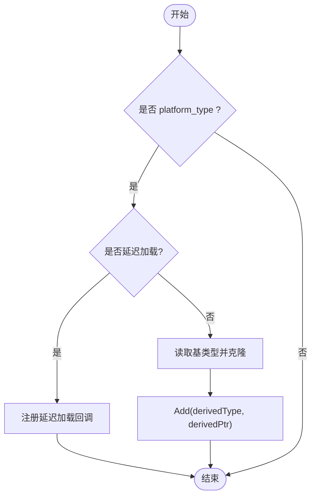
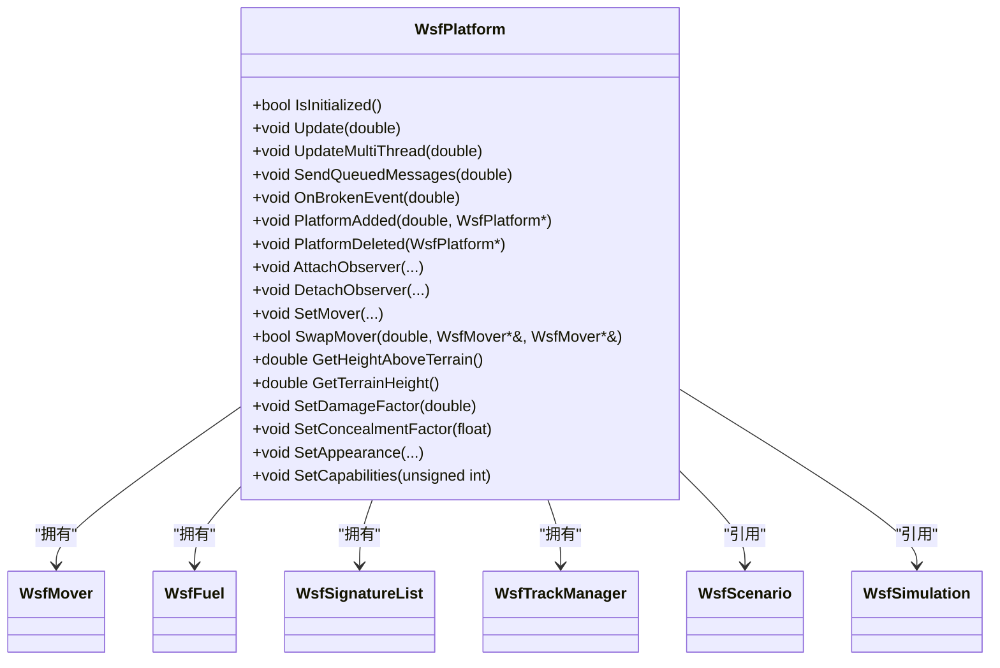
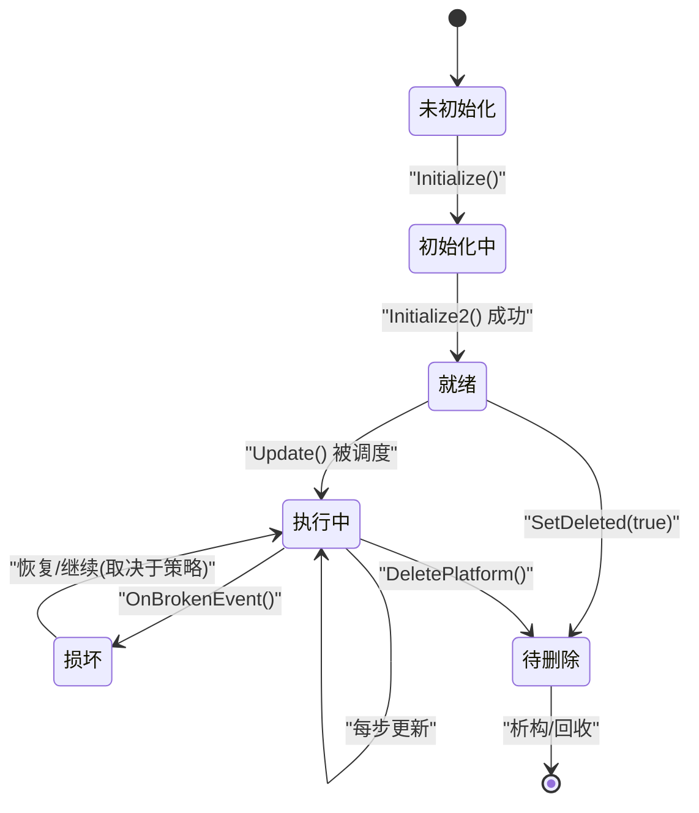
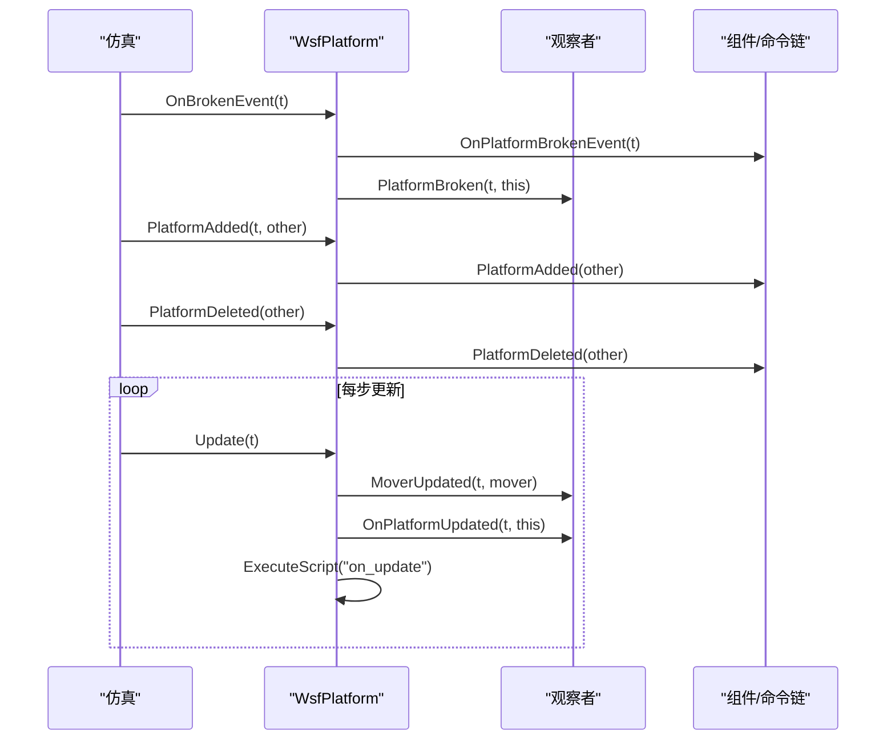
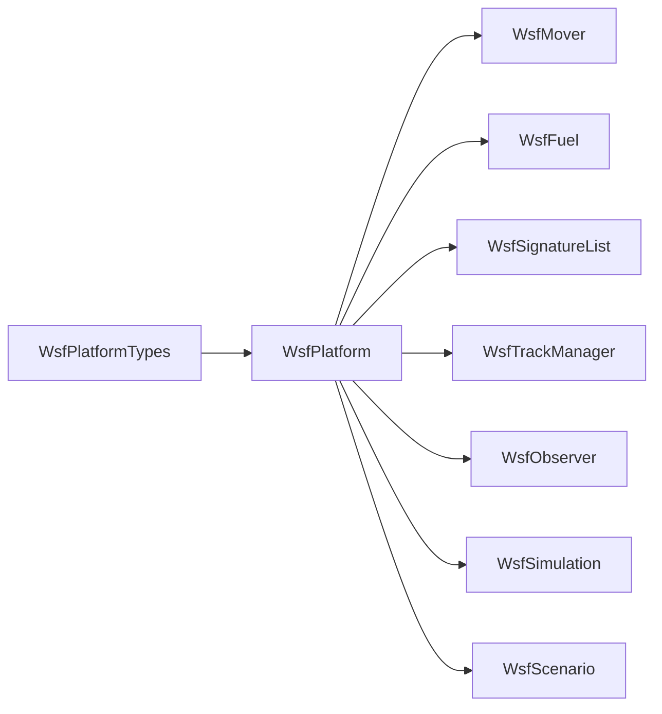

# 平台生命周期管理

<cite>
**本文引用的文件**   
- [WsfPlatform.hpp](file://swdev/src/core/wsf/source/WsfPlatform.hpp)
- [WsfPlatform.cpp](file://swdev/src/core/wsf/source/WsfPlatform.cpp)
- [WsfPlatformTypes.hpp](file://swdev/src/core/wsf/source/WsfPlatformTypes.hpp)
- [WsfPlatformTypes.cpp](file://swdev/src/core/wsf/source/WsfPlatformTypes.cpp)
</cite>

## 目录
1. [简介](#简介)
2. [项目结构](#项目结构)
3. [核心组件](#核心组件)
4. [架构总览](#架构总览)
5. [详细组件分析](#详细组件分析)
6. [依赖关系分析](#依赖关系分析)
7. [性能考虑](#性能考虑)
8. [故障排查指南](#故障排查指南)
9. [结论](#结论)
10. [附录](#附录)

## 简介
本文件系统性阐述 AFSIM 中“平台（Platform）”的生命周期管理，覆盖创建、初始化、运行与销毁各阶段；解释状态管理机制（就绪、激活、执行、完成等）；文档化事件处理与回调机制；说明平台间通信与协调；给出资源管理与内存优化建议；包含故障处理与恢复思路；并提供大规模平台仿真监控与管理方法以及调试诊断工具使用要点。

## 项目结构
围绕平台生命周期管理的核心代码位于 WSF 核心库：
- 类型系统与加载：WsfPlatformTypes（平台类型定义、延迟加载、类型实例化）
- 平台实体：WsfPlatform（平台对象、组件装配、初始化两阶段、更新循环、脚本执行、观察者通知、破坏/删除语义）

图表来源
- [WsfPlatformTypes.hpp:18-33](file://swdev/src/core/wsf/source/WsfPlatformTypes.hpp#L18-L33)
- [WsfPlatformTypes.cpp:36-40](file://swdev/src/core/wsf/source/WsfPlatformTypes.cpp#L36-L40)
- [WsfPlatform.hpp:108-115](file://swdev/src/core/wsf/source/WsfPlatform.hpp#L108-L115)

章节来源
- [WsfPlatformTypes.hpp:18-33](file://swdev/src/core/wsf/source/WsfPlatformTypes.hpp#L18-L33)
- [WsfPlatformTypes.cpp:36-40](file://swdev/src/core/wsf/source/WsfPlatformTypes.cpp#L36-L40)
- [WsfPlatform.hpp:108-115](file://swdev/src/core/wsf/source/WsfPlatform.hpp#L108-L115)

## 核心组件
- WsfPlatformTypes：负责平台类型的注册、继承、延迟加载与最终 CompleteLoad 钩子调用，确保所有平台类型在仿真开始前完成二次处理。
- WsfPlatform：平台的核心实现，封装了：
  - 生命周期：构造、AssignToSimulation、Initialize/Initialize2、Update/DoUpdate、销毁
  - 组件装配：Mover/Fuel/SignatureList/TrackManager 等持久指针维护
  - 状态标志：mIsInitialized、mUpdateAllowed、mIsBroken、mIsDeleted 等
  - 事件与回调：OnBrokenEvent、PlatformAdded/Deleted、观察者通知
  - 脚本执行：on_update、on_damage_received、on_platform_deleted 等

章节来源
- [WsfPlatformTypes.hpp:18-33](file://swdev/src/core/wsf/source/WsfPlatformTypes.hpp#L18-L33)
- [WsfPlatformTypes.cpp:48-98](file://swdev/src/core/wsf/source/WsfPlatformTypes.cpp#L48-L98)
- [WsfPlatform.hpp:108-115](file://swdev/src/core/wsf/source/WsfPlatform.hpp#L108-L115)
- [WsfPlatform.cpp:249-403](file://swdev/src/core/wsf/source/WsfPlatform.cpp#L249-L403)

## 架构总览
下图展示平台从类型到实例、再到仿真运行的关键流程与交互。

图表来源
- [WsfPlatformTypes.cpp:48-98](file://swdev/src/core/wsf/source/WsfPlatformTypes.cpp#L48-L98)
- [WsfPlatformTypes.cpp:107-119](file://swdev/src/core/wsf/source/WsfPlatformTypes.cpp#L107-L119)
- [WsfPlatform.cpp:249-403](file://swdev/src/core/wsf/source/WsfPlatform.cpp#L249-L403)
- [WsfPlatform.cpp:747-819](file://swdev/src/core/wsf/source/WsfPlatform.cpp#L747-L819)
- [WsfPlatform.cpp:855-897](file://swdev/src/core/wsf/source/WsfPlatform.cpp#L855-L897)

## 详细组件分析

### 平台类型系统（WsfPlatformTypes）
- 职责
  - 提供 Get/Get(const&) 访问器以获取场景关联的平台类型列表
  - LoadType 处理 platform_type 命令，支持延迟加载与依赖检查
  - CompleteLoad 遍历所有类型并调用其 CompleteLoad 钩子
- 关键点
  - 通过 Clone(baseType) 派生新类型，避免重复解析
  - 延迟加载通过 DeferredInput 推迟实际解析，减少启动开销
  - 完成后统一触发 CompleteLoad，便于进行跨类型后处理

图表来源
- [WsfPlatformTypes.cpp:48-98](file://swdev/src/core/wsf/source/WsfPlatformTypes.cpp#L48-L98)
- [WsfPlatformTypes.cpp:107-119](file://swdev/src/core/wsf/source/WsfPlatformTypes.cpp#L107-L119)

章节来源
- [WsfPlatformTypes.hpp:18-33](file://swdev/src/core/wsf/source/WsfPlatformTypes.hpp#L18-L33)
- [WsfPlatformTypes.cpp:36-40](file://swdev/src/core/wsf/source/WsfPlatformTypes.cpp#L36-L40)
- [WsfPlatformTypes.cpp:48-98](file://swdev/src/core/wsf/source/WsfPlatformTypes.cpp#L48-L98)
- [WsfPlatformTypes.cpp:107-119](file://swdev/src/core/wsf/source/WsfPlatformTypes.cpp#L107-L119)

### 平台实体（WsfPlatform）
- 生命周期阶段
  - 构造与绑定
    - 构造函数设置脚本上下文、地形上下文、组件父对象
    - AssignToSimulation 将平台绑定到仿真，初始化地形与唯一ID
  - 初始化（两阶段）
    - Initialize：设置时间基准、组、脚本上下文、变量初始化、组件 PreInitialize/Initialize
    - Initialize2：组件 Initialize2、标记 mIsInitialized=true、根据索引开启 mUpdateAllowed
  - 运行期更新
    - Update/UpdateMultiThread 调用 DoUpdate/DoUpdateMultiThread
    - DoUpdate：DoMoverUpdate -> DoNotifyUpdate -> DoExecuteScript
    - DoSendQueuedMessages：转发 Mover/Fuel 的队列消息
  - 销毁
    - 析构函数禁止直接删除仍在仿真中的平台，要求通过 DeletePlatform
    - 清理组件、签名列表、地形上下文
- 状态与标志
  - mIsInitialized：是否完成初始化
  - mUpdateAllowed：是否允许进入更新逻辑
  - mIsBroken/mIsDeleted：损坏/待删除
  - mUpdateLocked：多线程更新锁
  - mHasOnUpdateScript：是否存在 on_update 脚本
- 组件装配与持久指针
  - ComponentAdded/ComponentDeleted 回调维护 mMoverPtr/mFuelPtr/mNavErrorPtr/mMasterTrackManagerPtr
  - SetMover/SwapMover 安全替换运动模型，保证初始化顺序与状态一致性
- 事件与回调
  - OnBrokenEvent：按 on_broken 策略禁用/移除移动，关闭子系统，广播 PlatformBroken
  - PlatformAdded/PlatformDeleted：向组件与命令链分发平台增删事件
  - 观察者：AttachObserver/DetachObserver + NotifyUpdating/NotifyDeleting
- 脚本能力
  - ExecuteScript/ExecuteScriptAtTime/HasScript
  - on_update、on_damage_received、on_platform_deleted 等脚本钩子

图表来源
- [WsfPlatform.hpp:108-115](file://swdev/src/core/wsf/source/WsfPlatform.hpp#L108-L115)
- [WsfPlatform.hpp:149-153](file://swdev/src/core/wsf/source/WsfPlatform.hpp#L149-L153)
- [WsfPlatform.hpp:165-206](file://swdev/src/core/wsf/source/WsfPlatform.hpp#L165-L206)
- [WsfPlatform.hpp:285-302](file://swdev/src/core/wsf/source/WsfPlatform.hpp#L285-L302)
- [WsfPlatform.hpp:401-414](file://swdev/src/core/wsf/source/WsfPlatform.hpp#L401-L414)
- [WsfPlatform.hpp:468-533](file://swdev/src/core/wsf/source/WsfPlatform.hpp#L468-L533)
- [WsfPlatform.hpp:567-574](file://swdev/src/core/wsf/source/WsfPlatform.hpp#L567-L574)
- [WsfPlatform.hpp:582-591](file://swdev/src/core/wsf/source/WsfPlatform.hpp#L582-L591)
- [WsfPlatform.cpp:249-403](file://swdev/src/core/wsf/source/WsfPlatform.cpp#L249-L403)
- [WsfPlatform.cpp:747-819](file://swdev/src/core/wsf/source/WsfPlatform.cpp#L747-L819)
- [WsfPlatform.cpp:855-897](file://swdev/src/core/wsf/source/WsfPlatform.cpp#L855-L897)
- [WsfPlatform.cpp:1104-1162](file://swdev/src/core/wsf/source/WsfPlatform.cpp#L1104-L1162)
- [WsfPlatform.cpp:1167-1233](file://swdev/src/core/wsf/source/WsfPlatform.cpp#L1167-L1233)
- [WsfPlatform.cpp:1325-1390](file://swdev/src/core/wsf/source/WsfPlatform.cpp#L1325-L1390)

章节来源
- [WsfPlatform.hpp:108-115](file://swdev/src/core/wsf/source/WsfPlatform.hpp#L108-L115)
- [WsfPlatform.hpp:149-153](file://swdev/src/core/wsf/source/WsfPlatform.hpp#L149-L153)
- [WsfPlatform.hpp:165-206](file://swdev/src/core/wsf/source/WsfPlatform.hpp#L165-L206)
- [WsfPlatform.hpp:285-302](file://swdev/src/core/wsf/source/WsfPlatform.hpp#L285-L302)
- [WsfPlatform.hpp:401-414](file://swdev/src/core/wsf/source/WsfPlatform.hpp#L401-L414)
- [WsfPlatform.hpp:468-533](file://swdev/src/core/wsf/source/WsfPlatform.hpp#L468-L533)
- [WsfPlatform.hpp:567-574](file://swdev/src/core/wsf/source/WsfPlatform.hpp#L567-L574)
- [WsfPlatform.hpp:582-591](file://swdev/src/core/wsf/source/WsfPlatform.hpp#L582-L591)
- [WsfPlatform.cpp:249-403](file://swdev/src/core/wsf/source/WsfPlatform.cpp#L249-L403)
- [WsfPlatform.cpp:747-819](file://swdev/src/core/wsf/source/WsfPlatform.cpp#L747-L819)
- [WsfPlatform.cpp:855-897](file://swdev/src/core/wsf/source/WsfPlatform.cpp#L855-L897)
- [WsfPlatform.cpp:1104-1162](file://swdev/src/core/wsf/source/WsfPlatform.cpp#L1104-L1162)
- [WsfPlatform.cpp:1167-1233](file://swdev/src/core/wsf/source/WsfPlatform.cpp#L1167-L1233)
- [WsfPlatform.cpp:1325-1390](file://swdev/src/core/wsf/source/WsfPlatform.cpp#L1325-L1390)

### 状态机与转换
- 初始态：未初始化（mIsInitialized=false），不可更新（mUpdateAllowed=false）
- 初始化完成：Initialize2 成功 => mIsInitialized=true；若已加入仿真（index!=0）=> mUpdateAllowed=true
- 运行态：Update 驱动 DoUpdate，依次执行运动更新、观察者通知、脚本执行
- 损坏态：OnBrokenEvent 根据 on_broken 策略处置（移除/禁用移动/关闭子系统），并广播 PlatformBroken
- 删除态：SetDeleted(true) 或 DeletePlatform 后，触发 NotifyDeleting/NotifyDeleted，最终由仿真调度释放

图表来源
- [WsfPlatform.cpp:249-403](file://swdev/src/core/wsf/source/WsfPlatform.cpp#L249-L403)
- [WsfPlatform.cpp:747-819](file://swdev/src/core/wsf/source/WsfPlatform.cpp#L747-L819)
- [WsfPlatform.cpp:855-897](file://swdev/src/core/wsf/source/WsfPlatform.cpp#L855-L897)
- [WsfPlatform.cpp:1555-1570](file://swdev/src/core/wsf/source/WsfPlatform.cpp#L1555-L1570)

章节来源
- [WsfPlatform.cpp:249-403](file://swdev/src/core/wsf/source/WsfPlatform.cpp#L249-L403)
- [WsfPlatform.cpp:747-819](file://swdev/src/core/wsf/source/WsfPlatform.cpp#L747-L819)
- [WsfPlatform.cpp:855-897](file://swdev/src/core/wsf/source/WsfPlatform.cpp#L855-L897)
- [WsfPlatform.cpp:1555-1570](file://swdev/src/core/wsf/source/WsfPlatform.cpp#L1555-L1570)

### 事件处理与回调
- 平台损坏事件：OnBrokenEvent 触发组件 OnPlatformBrokenEvent，并广播 PlatformBroken
- 平台增删事件：PlatformAdded/PlatformDeleted 分发给组件与命令链
- 观察者通知：DoNotifyUpdate 调用 WsfObserver::MoverUpdated 与本地观察者 OnPlatformUpdated
- 脚本回调：on_update（每次更新）、on_damage_received（损伤增加时）、on_platform_deleted（自身删除时）

图表来源
- [WsfPlatform.cpp:785-797](file://swdev/src/core/wsf/source/WsfPlatform.cpp#L785-L797)
- [WsfPlatform.cpp:800-819](file://swdev/src/core/wsf/source/WsfPlatform.cpp#L800-L819)
- [WsfPlatform.cpp:855-897](file://swdev/src/core/wsf/source/WsfPlatform.cpp#L855-L897)
- [WsfPlatform.cpp:908-963](file://swdev/src/core/wsf/source/WsfPlatform.cpp#L908-L963)

章节来源
- [WsfPlatform.cpp:785-797](file://swdev/src/core/wsf/source/WsfPlatform.cpp#L785-L797)
- [WsfPlatform.cpp:800-819](file://swdev/src/core/wsf/source/WsfPlatform.cpp#L800-L819)
- [WsfPlatform.cpp:855-897](file://swdev/src/core/wsf/source/WsfPlatform.cpp#L855-L897)
- [WsfPlatform.cpp:908-963](file://swdev/src/core/wsf/source/WsfPlatform.cpp#L908-L963)

### 平台间通信与协调
- 通过组件与命令链：PlatformAdded/PlatformDeleted 会通知所有组件与命令链，便于雷达/通信/处理器等子系统感知其他平台变化
- 外部控制与影子平台：IsExternallyControlled/IsExternallyMoved/IsExternalShadow 用于 DIS/网络集成场景，配合影子平台进行可视化校验
- 外观与能力字段：SetAppearance/SetCapabilities 变更会触发观察者回调，供外部系统同步显示或决策

章节来源
- [WsfPlatform.cpp:908-963](file://swdev/src/core/wsf/source/WsfPlatform.cpp#L908-L963)
- [WsfPlatform.hpp:228-270](file://swdev/src/core/wsf/source/WsfPlatform.hpp#L228-L270)
- [WsfPlatform.cpp:1273-1322](file://swdev/src/core/wsf/source/WsfPlatform.cpp#L1273-L1322)

### 资源管理与内存优化
- 组件所有权：平台拥有 Mover/Fuel/SignatureList/TrackManager 等组件，析构前必须通过 DeleteAllComponents 释放
- 延迟加载：platform_type 支持延迟加载，减少启动阶段解析成本
- 最小更新间隔：DoUpdate/DoUpdateMultiThread 基于 MinimumMoverTimestep 过滤频繁更新，降低开销
- 多核更新：UpdateMultiThread 仅执行 DoMoverUpdate，避免脚本与通知带来的额外开销
- 观察者优先：DoNotifyUpdate 先广播 MoverUpdated，再遍历本地观察者，减少重复计算

章节来源
- [WsfPlatform.cpp:140-166](file://swdev/src/core/wsf/source/WsfPlatform.cpp#L140-L166)
- [WsfPlatformTypes.cpp:48-98](file://swdev/src/core/wsf/source/WsfPlatformTypes.cpp#L48-L98)
- [WsfPlatform.cpp:747-773](file://swdev/src/core/wsf/source/WsfPlatform.cpp#L747-L773)
- [WsfPlatform.cpp:785-797](file://swdev/src/core/wsf/source/WsfPlatform.cpp#L785-L797)

### 故障处理与恢复
- 损坏策略：on_broken 支持 remove/disable/disabled_but_movable 三种行为
- 损伤回调：SetDamageFactor 在损伤增大时触发 on_damage_received 脚本，便于自定义降级逻辑
- 删除保护：析构函数禁止直接删除仍在仿真中的平台，需通过 DeletePlatform 走标准流程
- 恢复路径：可通过重新挂载 Mover、重置 DamageFactor（若业务允许）等方式尝试恢复

章节来源
- [WsfPlatform.cpp:855-897](file://swdev/src/core/wsf/source/WsfPlatform.cpp#L855-L897)
- [WsfPlatform.cpp:1361-1390](file://swdev/src/core/wsf/source/WsfPlatform.cpp#L1361-L1390)
- [WsfPlatform.cpp:140-166](file://swdev/src/core/wsf/source/WsfPlatform.cpp#L140-L166)

### 大规模平台仿真监控与管理
- 批量创建：优先使用 platform_type 与延迟加载，减少启动开销
- 更新节流：利用 MinimumMoverTimestep 与 UpdateMultiThread 降低高频更新成本
- 观测点：通过 WsfObserver 接口订阅 MoverUpdated/PlatformBroken/PlatformAppearanceChanged 等事件，集中采集指标
- 分类与分组：使用 Category/Group 对平台进行组织，便于统计与筛选
- 外部集成：借助 IsExternallyControlled/IsExternallyMoved 与影子平台，结合 DIS/XIO 接口进行分布式仿真与可视化

章节来源
- [WsfPlatformTypes.cpp:48-98](file://swdev/src/core/wsf/source/WsfPlatformTypes.cpp#L48-L98)
- [WsfPlatform.cpp:747-773](file://swdev/src/core/wsf/source/WsfPlatform.cpp#L747-L773)
- [WsfPlatform.cpp:785-797](file://swdev/src/core/wsf/source/WsfPlatform.cpp#L785-L797)
- [WsfPlatform.hpp:550-574](file://swdev/src/core/wsf/source/WsfPlatform.hpp#L550-L574)
- [WsfPlatform.hpp:228-270](file://swdev/src/core/wsf/source/WsfPlatform.hpp#L228-L270)

### 调试与诊断工具
- 日志输出：Initialize/Initialize2 失败时记录错误信息，便于定位组件初始化问题
- 脚本钩子：on_update/on_damage_received/on_platform_deleted 可插入诊断逻辑
- 注释与事件：Comment 可在指定时间注入注释事件，辅助回放与分析
- 外观/能力字段：SetAppearance/SetCapabilities 变更会触发观察者回调，便于 UI 同步与问题复现

章节来源
- [WsfPlatform.cpp:314-352](file://swdev/src/core/wsf/source/WsfPlatform.cpp#L314-L352)
- [WsfPlatform.cpp:800-819](file://swdev/src/core/wsf/source/WsfPlatform.cpp#L800-L819)
- [WsfPlatform.cpp:1503-1532](file://swdev/src/core/wsf/source/WsfPlatform.cpp#L1503-L1532)
- [WsfPlatform.cpp:1273-1322](file://swdev/src/core/wsf/source/WsfPlatform.cpp#L1273-L1322)

## 依赖关系分析
- 低耦合高内聚：WsfPlatform 通过组件角色（Mover/Fuel/TrackManager/SignatureList）解耦功能模块
- 间接依赖：通过 WsfScenario/WsfSimulation 获取全局上下文与调度能力
- 事件解耦：通过 WsfObserver 与脚本钩子实现松耦合的事件传播

图表来源
- [WsfPlatformTypes.hpp:18-33](file://swdev/src/core/wsf/source/WsfPlatformTypes.hpp#L18-L33)
- [WsfPlatform.hpp:108-115](file://swdev/src/core/wsf/source/WsfPlatform.hpp#L108-L115)

章节来源
- [WsfPlatformTypes.hpp:18-33](file://swdev/src/core/wsf/source/WsfPlatformTypes.hpp#L18-L33)
- [WsfPlatform.hpp:108-115](file://swdev/src/core/wsf/source/WsfPlatform.hpp#L108-L115)

## 性能考虑
- 最小更新步长：DoUpdate/DoUpdateMultiThread 依据 MinimumMoverTimestep 过滤更新，避免过度刷新
- 多线程更新：UpdateMultiThread 仅执行运动更新，减少脚本与通知开销
- 延迟加载：platform_type 延迟解析，缩短启动时间
- 观察者批处理：DoNotifyUpdate 先广播 MoverUpdated，再遍历本地观察者，降低重复计算
- 组件懒加载：TrackManager 按需创建与初始化，避免不必要的开销

章节来源
- [WsfPlatform.cpp:747-773](file://swdev/src/core/wsf/source/WsfPlatform.cpp#L747-L773)
- [WsfPlatform.cpp:785-797](file://swdev/src/core/wsf/source/WsfPlatform.cpp#L785-L797)
- [WsfPlatformTypes.cpp:48-98](file://swdev/src/core/wsf/source/WsfPlatformTypes.cpp#L48-L98)
- [WsfPlatform.cpp:1441-1461](file://swdev/src/core/wsf/source/WsfPlatform.cpp#L1441-L1461)

## 故障排查指南
- 初始化失败
  - 检查 Initialize/Initialize2 返回与日志，确认组件 PreInitialize/Initialize/Initialize2 是否全部成功
  - 验证 platform_type 依赖是否满足，必要时启用延迟加载
- 平台不更新
  - 确认 mIsInitialized 与 mUpdateAllowed 状态，检查是否已加入仿真且 index!=0
  - 检查 MinimumMoverTimestep 是否过大导致更新被跳过
- 平台损坏/删除异常
  - 检查 on_broken 策略是否符合预期
  - 确认是否通过 DeletePlatform 而非直接析构删除平台
- 脚本未执行
  - 确认是否存在对应脚本（HasScript），并在合适时机调用 ExecuteScript/ExecuteScriptAtTime
  - 检查 on_update 是否在 DoExecuteScript 中被触发

章节来源
- [WsfPlatform.cpp:249-403](file://swdev/src/core/wsf/source/WsfPlatform.cpp#L249-L403)
- [WsfPlatform.cpp:747-819](file://swdev/src/core/wsf/source/WsfPlatform.cpp#L747-L819)
- [WsfPlatform.cpp:855-897](file://swdev/src/core/wsf/source/WsfPlatform.cpp#L855-L897)
- [WsfPlatform.cpp:1072-1082](file://swdev/src/core/wsf/source/WsfPlatform.cpp#L1072-L1082)

## 结论
AFSIM 的平台生命周期管理以 WsfPlatform 为核心，结合 WsfPlatformTypes 的类型系统与延迟加载机制，提供了稳健的创建、初始化、运行与销毁流程。通过两阶段初始化、最小更新步长、多线程更新、观察者与脚本钩子，系统在可扩展性与性能之间取得良好平衡。针对大规模仿真，推荐采用类型化建模、延迟加载、观察者订阅与分组分类等手段，以获得更好的可观测性与可维护性。

## 附录
- 常用 API 速查
  - 创建与绑定：AssignToSimulation、Initialize、Initialize2
  - 运行控制：Update、UpdateMultiThread、SendQueuedMessages
  - 状态查询：IsInitialized、IsBroken、IsDeleted、IsPaused、IsStopped、IsExtrapolating
  - 组件管理：SetMover、SwapMover、GetTrackManager、GetSignatureList
  - 事件与回调：OnBrokenEvent、PlatformAdded、PlatformDeleted、AttachObserver、DetachObserver
  - 脚本：ExecuteScript、ExecuteScriptAtTime、HasScript

章节来源
- [WsfPlatform.hpp:149-206](file://swdev/src/core/wsf/source/WsfPlatform.hpp#L149-L206)
- [WsfPlatform.hpp:285-302](file://swdev/src/core/wsf/source/WsfPlatform.hpp#L285-L302)
- [WsfPlatform.hpp:401-414](file://swdev/src/core/wsf/source/WsfPlatform.hpp#L401-L414)
- [WsfPlatform.hpp:468-533](file://swdev/src/core/wsf/source/WsfPlatform.hpp#L468-L533)
- [WsfPlatform.hpp:567-574](file://swdev/src/core/wsf/source/WsfPlatform.hpp#L567-L574)
- [WsfPlatform.cpp:249-403](file://swdev/src/core/wsf/source/WsfPlatform.cpp#L249-L403)
- [WsfPlatform.cpp:747-819](file://swdev/src/core/wsf/source/WsfPlatform.cpp#L747-L819)
- [WsfPlatform.cpp:1072-1082](file://swdev/src/core/wsf/source/WsfPlatform.cpp#L1072-L1082)