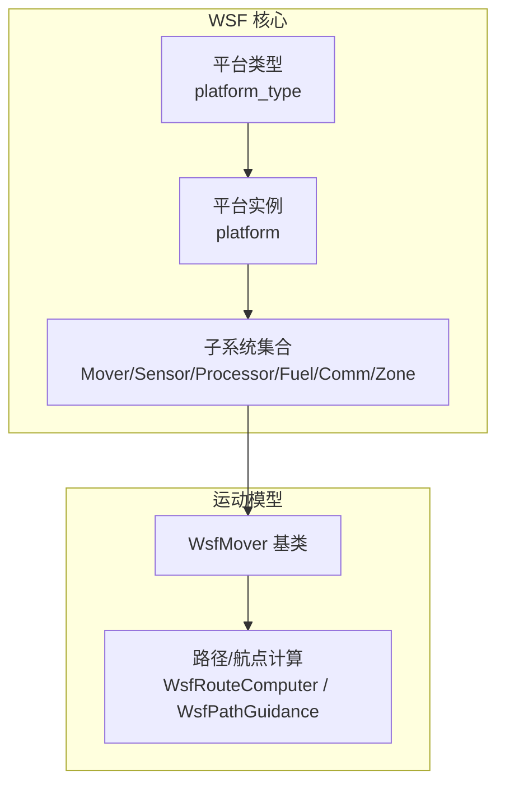
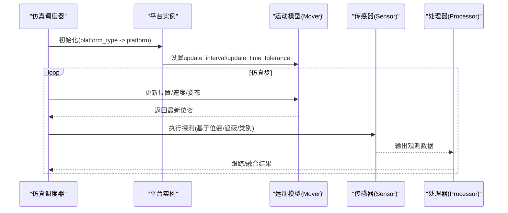
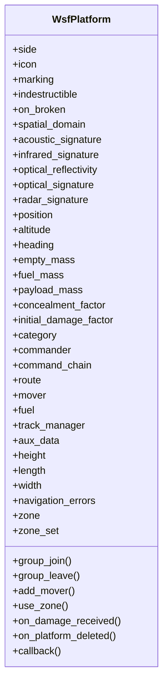
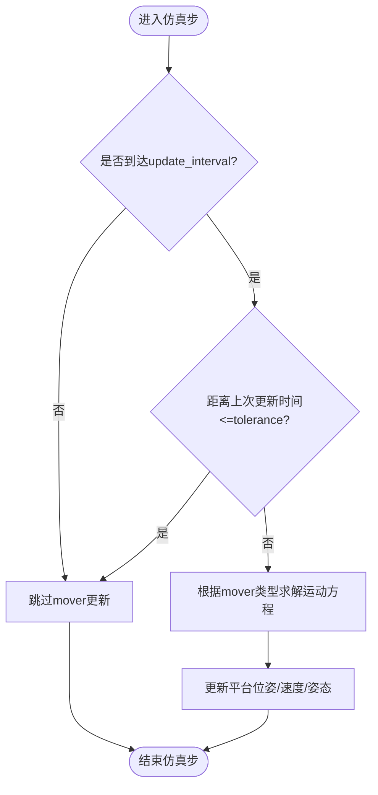
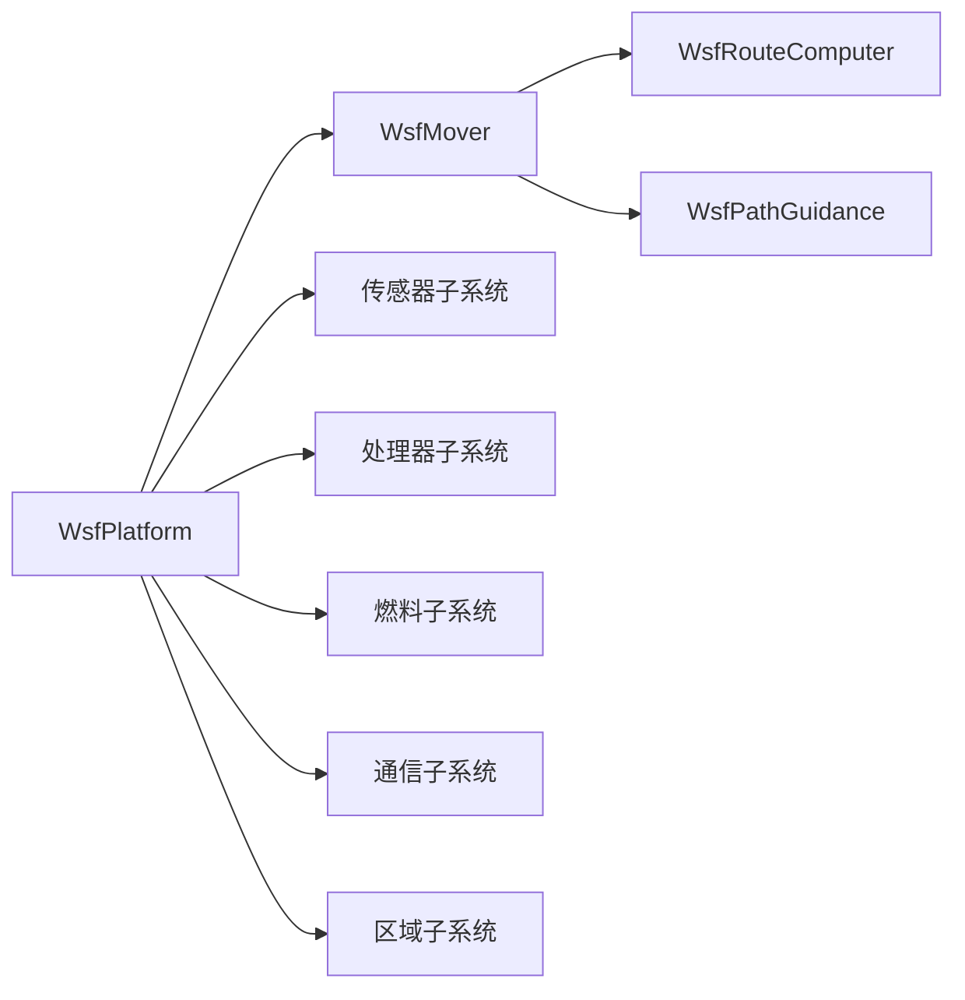

# 平台系统

<cite>
**本文引用的文件**   
- [platform.rst](file://swdev/src/core/wsf/doc/platform.rst)
- [mover.rst](file://swdev/src/core/wsf/doc/mover.rst)
- [WsfPlatform.hpp](file://swdev/src/core/wsf/source/WsfPlatform.hpp)
- [WsfPlatform.cpp](file://swdev/src/core/wsf/source/WsfPlatform.cpp)
- [WsfPlatformTypes.hpp](file://swdev/src/core/wsf/source/WsfPlatformTypes.hpp)
- [WsfPlatformTypes.cpp](file://swdev/src/core/wsf/source/WsfPlatformTypes.cpp)
- [WsfMover.hpp](file://swdev/src/core/wsf/source/mover/WsfMover.hpp)
- [WsfMoverTypes.hpp](file://swdev/src/core/wsf/source/mover/WsfMoverTypes.hpp)
- [WsfRouteComputer.hpp](file://swdev/src/core/wsf/source/mover/WsfRouteComputer.hpp)
- [WsfPathGuidance.hpp](file://swdev/src/core/wsf/source/mover/WsfPathGuidance.hpp)
</cite>

## 目录
1. [简介](#简介)
2. [项目结构](#项目结构)
3. [核心组件](#核心组件)
4. [架构总览](#架构总览)
5. [详细组件分析](#详细组件分析)
6. [依赖关系分析](#依赖关系分析)
7. [性能考虑](#性能考虑)
8. [故障排查指南](#故障排查指南)
9. [结论](#结论)
10. [附录](#附录)

## 简介
本文件系统化阐述 AFSIM 平台系统的概念、层次结构与继承关系，覆盖平台对象在仿真中的作用、属性定义与管理（静态与动态）、运动模型（Mover）及其约束、传感器集成方式、武器挂载与发射机制、平台配置语法参考与示例、状态管理与生命周期控制，以及自定义平台类型扩展、性能优化与调试方法。文档面向不同技术背景的读者，提供由浅入深的说明与可视化图示。

## 项目结构
AFSIM 的平台系统以 WSF（Warfare Simulation Framework）为核心，围绕“平台”这一抽象实体组织：
- 平台类型（platform_type）用于定义可复用的模板；平台实例（platform）基于类型创建并参与仿真。
- 平台子系统包括 Mover（运动模型）、Sensor（传感器）、Processor（处理器）、Fuel（燃料）、Comm（通信）、Zone（区域）等。
- 脚本接口提供生命周期回调与运行时行为扩展能力。

图表来源
- [platform.rst:92-138](file://swdev/src/core/wsf/doc/platform.rst#L92-L138)
- [mover.rst:28-33](file://swdev/src/core/wsf/doc/mover.rst#L28-L33)
- [WsfMover.hpp:25-25](file://swdev/src/core/wsf/source/mover/WsfMover.hpp#L25-L25)
- [WsfRouteComputer.hpp:20-20](file://swdev/src/core/wsf/source/mover/WsfRouteComputer.hpp#L20-L20)
- [WsfPathGuidance.hpp:21-21](file://swdev/src/core/wsf/source/mover/WsfPathGuidance.hpp#L21-L21)

章节来源
- [platform.rst:92-138](file://swdev/src/core/wsf/doc/platform.rst#L92-L138)
- [mover.rst:28-33](file://swdev/src/core/wsf/doc/mover.rst#L28-L33)

## 核心组件
- 平台类型与实例
  - platform_type：定义可复用平台模板，包含静态属性与默认子系统。
  - platform：创建仿真中的具体实体，继承自 platform_type，支持运行时修改。
- 平台子系统
  - mover：定义平台运动域与运动方程，如飞行器、车辆、舰船、空间体等。
  - sensor：挂载于平台，执行探测逻辑，受平台姿态、遮蔽、类别等影响。
  - processor：信号处理、跟踪、融合等。
  - fuel：燃料消耗建模，可与 mover 协同更新质量。
  - comm：通信链路建立与消息传递。
  - zone/zone_set：相对或绝对区域定义，用于探测包络、交战区等。
- 脚本接口
  - on_initialize/on_update 等生命周期回调，on_damage_received 等事件回调。
  - 通过 _.script_commands.script_variables/script 扩展运行时行为。

章节来源
- [platform.rst:16-89](file://swdev/src/core/wsf/doc/platform.rst#L16-L89)
- [platform.rst:487-536](file://swdev/src/core/wsf/doc/platform.rst#L487-L536)
- [platform.rst:540-593](file://swdev/src/core/wsf/doc/platform.rst#L540-L593)

## 架构总览
平台系统在运行期遵循如下流程：
- 解析场景文件，构建 platform_type 树，再实例化 platform。
- 为每个 platform 装配子系统（mover/sensor/processor/fuel/comm/zone）。
- 仿真步进中，调度器按 update_interval 调用 mover 更新位置/速度/姿态。
- 传感器依据平台姿态与目标几何进行探测，处理器生成跟踪/融合结果。
- 武器挂载与发射通过平台子系统（如 launcher/weapons）触发，结合 mover 的轨迹与传感器探测结果完成交战。

图表来源
- [mover.rst:38-52](file://swdev/src/core/wsf/doc/mover.rst#L38-L52)
- [platform.rst:465-486](file://swdev/src/core/wsf/doc/platform.rst#L465-L486)

## 详细组件分析

### 平台对象与层次结构
- 平台类型（platform_type）作为模板，集中定义静态属性（如尺寸、雷达/红外/光学特性、类别、初始损伤因子等）与默认子系统。
- 平台实例（platform）继承类型，可在运行时修改属性与子系统（如添加/编辑/删除组件），并通过脚本接口响应事件。
- 平台具有指挥链（commander/command_chain）、分组（group_join/group_leave）、地理坐标（position/MGRS/geo_point）等上下文信息。

图表来源
- [platform.rst:176-536](file://swdev/src/core/wsf/doc/platform.rst#L176-L536)
- [platform.rst:540-593](file://swdev/src/core/wsf/doc/platform.rst#L540-L593)

章节来源
- [platform.rst:92-138](file://swdev/src/core/wsf/doc/platform.rst#L92-L138)
- [platform.rst:176-536](file://swdev/src/core/wsf/doc/platform.rst#L176-L536)
- [platform.rst:540-593](file://swdev/src/core/wsf/doc/platform.rst#L540-L593)

### 平台属性定义与管理（静态与动态）
- 静态属性（定义于 platform_type）：
  - 标识与外观：side、icon、marking、category、clear_categories。
  - 物理与毁伤：empty_mass、fuel_mass、payload_mass、initial_damage_factor、indestructible、on_broken。
  - 感知特性：acoustic_signature、infrared_signature、optical_reflectivity、optical_signature、radar_signature。
  - 几何与定位：length、width、height、position、altitude、heading、mgrs_coordinate、geo_point。
  - 导航与时间：creation_time、nutation_update_interval、precession_nutation_update_interval。
- 动态属性（platform 实例运行时）：
  - 通过脚本接口与子系统（如 fuel、mover、sensor、processor）改变状态与行为。
  - 使用 add/edit/delete <component> 管理子系统。
  - 使用 track_manager、aux_data、navigation_errors 等扩展功能。

章节来源
- [platform.rst:176-536](file://swdev/src/core/wsf/doc/platform.rst#L176-L536)

### 运动模型（Mover）
- Mover 是平台的子系统，定义运动域与运动方程，平台仅能定义一种 mover。
- 关键命令：
  - update_interval：周期性调用 mover 的时间间隔；为零则按需调用。
  - update_time_tolerance：位置更新的时间容差，小于等于该值时忽略重复更新。
- 典型类型（详见预定义 mover 类型文档）：飞行器、车辆、舰船、空间体、路线跟随等。
- 与路径/航点的关系：
  - route 子命令提供航点序列，供 mover 沿路径移动。
  - WsfRouteComputer/WsfPathGuidance 负责路径计算与引导。

图表来源
- [mover.rst:38-52](file://swdev/src/core/wsf/doc/mover.rst#L38-L52)
- [platform.rst:465-486](file://swdev/src/core/wsf/doc/platform.rst#L465-L486)
- [WsfRouteComputer.hpp:20-20](file://swdev/src/core/wsf/source/mover/WsfRouteComputer.hpp#L20-L20)
- [WsfPathGuidance.hpp:21-21](file://swdev/src/core/wsf/source/mover/WsfPathGuidance.hpp#L21-L21)

章节来源
- [mover.rst:28-52](file://swdev/src/core/wsf/doc/mover.rst#L28-L52)
- [platform.rst:465-486](file://swdev/src/core/wsf/doc/platform.rst#L465-L486)

### 传感器集成方式（挂载与探测逻辑）
- 传感器作为平台子系统挂载，探测逻辑受以下因素影响：
  - 平台位姿与朝向（由 mover 提供）。
  - 遮蔽因子（concealment_factor）与类别（category）。
  - 平台自身的雷达/红外/光学签名特性。
- 传感器输出至处理器进行跟踪、关联与融合。
- 可通过 zone/zone_set 限定探测包络或交战区域。

章节来源
- [platform.rst:241-301](file://swdev/src/core/wsf/doc/platform.rst#L241-L301)
- [platform.rst:391-406](file://swdev/src/core/wsf/doc/platform.rst#L391-L406)
- [platform.rst:514-529](file://swdev/src/core/wsf/doc/platform.rst#L514-L529)

### 武器挂载与发射机制
- 武器通常作为平台子系统（如 weapons/launcher）挂载，发射条件与目标探测结果相关。
- 发射时机可由 route.callback 或脚本逻辑触发，结合传感器探测与处理器跟踪结果。
- 发射后，武器平台继承父平台的位姿与速度，并按自身 mover 与制导逻辑飞行。

章节来源
- [platform.rst:487-509](file://swdev/src/core/wsf/doc/platform.rst#L487-L509)
- [platform.rst:586-593](file://swdev/src/core/wsf/doc/platform.rst#L586-L593)

### 平台配置语法参考与示例
- 基本语法
  - platform_type <new-type-name> <source-type-name> ... end_platform_type
  - platform <platform-name> <platform-type-name> ... end_platform
  - edit platform <platform-name> ... end_platform
- 常用子命令
  - side/icon/marking/category/clear_categories
  - indestructible/on_broken/spatial_domain
  - acoustic_signature/infrared_signature/optical_reflectivity/optical_signature/radar_signature
  - position/altitude/heading/mgrs_coordinate/geo_point
  - empty_mass/fuel_mass/payload_mass/concealment_factor/initial_damage_factor
  - route/end_route
  - add_mover/mover/end_mover
  - fuel/end_fuel
  - add/edit/delete <component>
  - track_manager/end_track_manager
  - aux_data/end_aux_data
  - height/length/width
  - navigation_errors/end_navigation_errors
  - use_zone/zone/zone_set
- 脚本接口
  - on_initialize/on_initialize2/on_update
  - on_damage_received/on_platform_deleted/on_commander_deleted/on_peer_deleted/on_subordinate_deleted
  - callback <callback-name> <callback-type> end_callback

章节来源
- [platform.rst:103-172](file://swdev/src/core/wsf/doc/platform.rst#L103-L172)
- [platform.rst:176-536](file://swdev/src/core/wsf/doc/platform.rst#L176-L536)
- [platform.rst:540-593](file://swdev/src/core/wsf/doc/platform.rst#L540-L593)

### 平台状态管理与生命周期控制
- 生命周期阶段
  - 创建：platform_type 定义模板，platform 实例化加入仿真。
  - 初始化：on_initialize/on_initialize2 回调。
  - 运行：on_update 循环驱动，mover 更新位姿，传感器/处理器工作。
  - 受损：on_damage_received 回调，根据 indestructible/on_broken 决定移除/禁用/继续运动。
  - 销毁：on_platform_deleted 回调前清理资源。
- 指挥链与分组
  - commander/command_chain 定义指挥关系，group_join/group_leave 管理分组。
- 导航误差与辅助数据
  - navigation_errors 定义平台感知位置的误差模型。
  - aux_data 存储附加数据供脚本或外部工具使用。

章节来源
- [platform.rst:103-172](file://swdev/src/core/wsf/doc/platform.rst#L103-L172)
- [platform.rst:446-464](file://swdev/src/core/wsf/doc/platform.rst#L446-L464)
- [platform.rst:531-536](file://swdev/src/core/wsf/doc/platform.rst#L531-L536)
- [platform.rst:540-593](file://swdev/src/core/wsf/doc/platform.rst#L540-L593)

### 自定义平台类型与扩展
- 通过 platform_type 继承现有类型，新增或覆盖属性与子系统。
- 使用 add/edit/delete <component> 动态管理子系统。
- 通过脚本接口扩展运行时行为（如自定义 damage 处理、传感器自适应策略）。
- 结合 route.callback 或脚本逻辑实现复杂任务编排。

章节来源
- [platform.rst:122-138](file://swdev/src/core/wsf/doc/platform.rst#L122-L138)
- [platform.rst:487-509](file://swdev/src/core/wsf/doc/platform.rst#L487-L509)
- [platform.rst:540-593](file://swdev/src/core/wsf/doc/platform.rst#L540-L593)

## 依赖关系分析
- 平台与子系统耦合
  - platform 聚合 mover/sensor/processor/fuel/comm/zone 等子系统。
  - mover 依赖路径/航点计算（WsfRouteComputer/WsfPathGuidance）。
- 类型与实例解耦
  - platform_type 提供静态模板，platform 实例化后独立演化。
- 脚本与子系统交互
  - 脚本接口通过 WsfPlatform 暴露方法与回调，驱动子系统行为。

图表来源
- [WsfPlatform.hpp:43-43](file://swdev/src/core/wsf/source/WsfPlatform.hpp#L43-L43)
- [WsfMover.hpp:25-25](file://swdev/src/core/wsf/source/mover/WsfMover.hpp#L25-L25)
- [WsfRouteComputer.hpp:20-20](file://swdev/src/core/wsf/source/mover/WsfRouteComputer.hpp#L20-L20)
- [WsfPathGuidance.hpp:21-21](file://swdev/src/core/wsf/source/mover/WsfPathGuidance.hpp#L21-L21)

章节来源
- [WsfPlatform.hpp:43-43](file://swdev/src/core/wsf/source/WsfPlatform.hpp#L43-L43)
- [WsfMoverTypes.hpp:21-21](file://swdev/src/core/wsf/source/mover/WsfMoverTypes.hpp#L21-L21)

## 性能考虑
- 合理设置 mover.update_interval 与 update_time_tolerance，避免频繁更新导致 CPU 开销过大。
- 对大规模平台群，优先使用静态属性与预定义类型减少运行时分配。
- 传感器探测范围与频率需权衡精度与性能，必要时使用 zone 限制探测区域。
- 利用脚本接口仅在必要时执行复杂逻辑，避免在高频回调中进行昂贵计算。

[本节为通用指导，不直接分析具体文件]

## 故障排查指南
- 平台未更新位置
  - 检查 mover.update_interval 是否为 0 且未被按需调用；确认 update_time_tolerance 是否过大导致忽略更新。
- 平台被误删或无法恢复
  - 检查 indestructible 与 on_broken 配置；确认 on_damage_received 脚本是否正确处理损坏状态。
- 传感器无探测结果
  - 核对平台 spatial_domain、category、concealment_factor 与传感器配置；检查 zone/zone_set 是否限制了探测包络。
- 武器未发射
  - 检查 route.callback 或脚本触发条件；确认传感器/处理器已产生有效跟踪结果。

章节来源
- [mover.rst:38-52](file://swdev/src/core/wsf/doc/mover.rst#L38-L52)
- [platform.rst:199-223](file://swdev/src/core/wsf/doc/platform.rst#L199-L223)
- [platform.rst:232-301](file://swdev/src/core/wsf/doc/platform.rst#L232-L301)
- [platform.rst:514-529](file://swdev/src/core/wsf/doc/platform.rst#L514-L529)
- [platform.rst:540-593](file://swdev/src/core/wsf/doc/platform.rst#L540-L593)

## 结论
AFSIM 平台系统以 platform_type 与 platform 为核心，通过丰富的子系统（尤其是 mover）与脚本接口，实现了从静态模板到动态仿真的完整闭环。合理配置平台属性、运动模型与传感器/武器子系统，并结合生命周期回调与路径规划，能够高效构建多域、多分辨率的仿真场景。遵循本文的配置语法与最佳实践，可显著提升仿真准确性与运行效率。

[本节为总结性内容，不直接分析具体文件]

## 附录
- 预定义 mover 类型与传感器类型请参考对应文档章节。
- 更多示例场景位于 demos 目录下，可按需参考与复用。

[本节为补充信息，不直接分析具体文件]