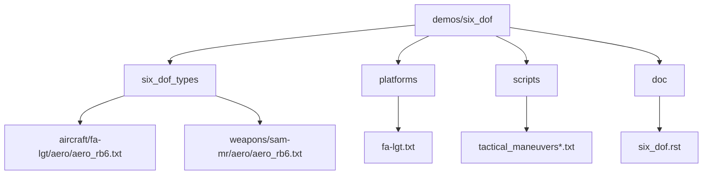
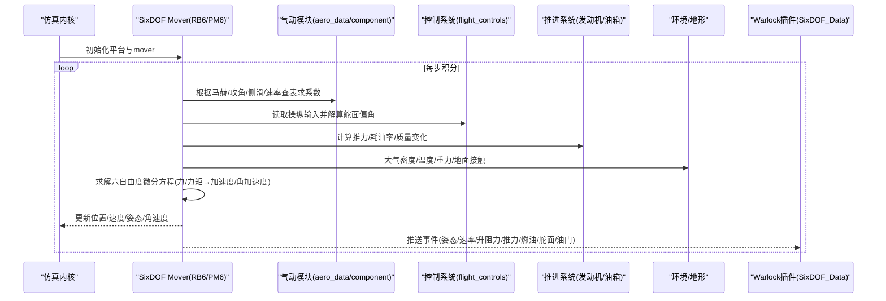
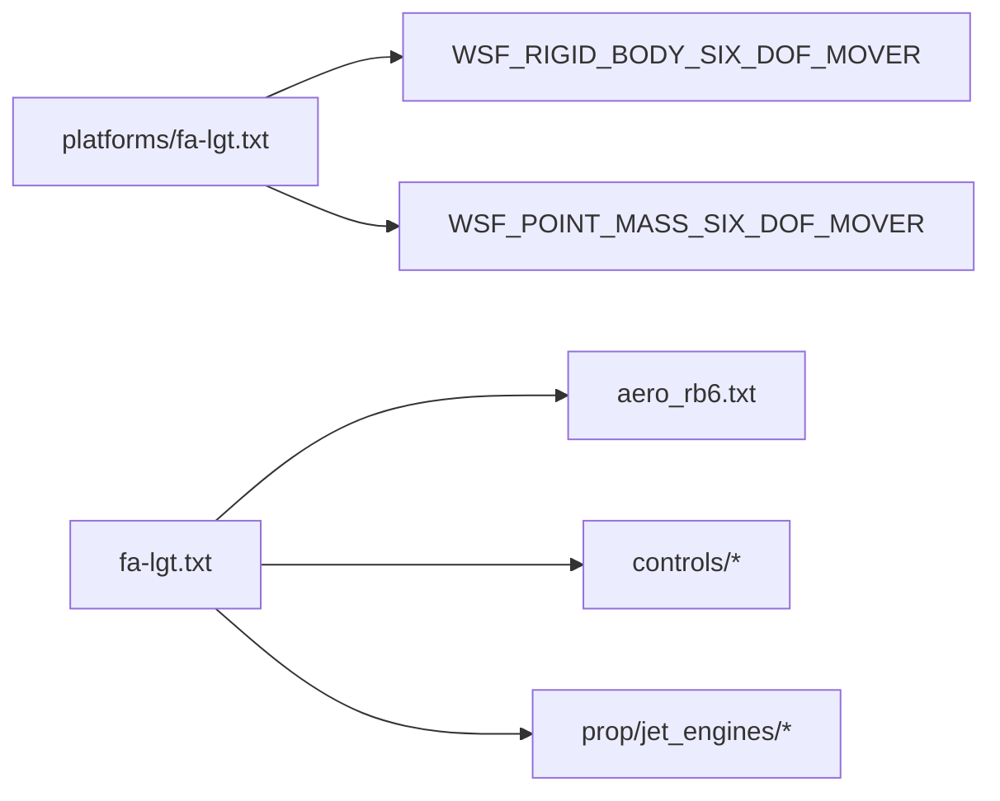

# 六自由度模型

<cite>
**本文引用的文件**   
- [demos/six_dof/doc/six_dof.rst](file://demos/six_dof/doc/six_dof.rst)
- [swdev/src/wsf_plugins/wsf_p6dof/doc/p6dof_aerodynamics_data.rst](file://swdev/src/wsf_plugins/wsf_p6dof/doc/p6dof_aerodynamics_data.rst)
- [demos/six_dof/six_dof_types/aircraft/fa-lgt/aero/aero_rb6.txt](file://demos/six_dof/six_dof_types/aircraft/fa-lgt/aero/aero_rb6.txt)
- [demos/six_dof/platforms/fa-lgt.txt](file://demos/six_dof/platforms/fa-lgt.txt)
- [demos/six_dof/six_dof_types/aircraft/fa-lgt/fa-lgt.txt](file://demos/six_dof/six_dof_types/aircraft/fa-lgt/fa-lgt.txt)
- [demos/six_dof/six_dof_types/weapons/sam-mr/aero/aero_rb6.txt](file://demos/six_dof/six_dof_types/weapons/sam-mr/aero/aero_rb6.txt)
- [demos/six_dof/six_dof_types/weapons/aam-mr/controls/flight_controls_pm6.txt](file://demos/six_dof/six_dof_types/weapons/aam-mr/controls/flight_controls_pm6.txt)
- [swdev/src/warlock/plugins/SixDOF_Data/source/SixDOF_DataSimInterface.cpp](file://swdev/src/warlock/plugins/SixDOF_Data/source/SixDOF_DataSimInterface.cpp)
</cite>

## 目录
1. [简介](#简介)
2. [项目结构](#项目结构)
3. [核心组件](#核心组件)
4. [架构总览](#架构总览)
5. [详细组件分析](#详细组件分析)
6. [依赖关系分析](#依赖关系分析)
7. [性能与调优](#性能与调优)
8. [故障排查指南](#故障排查指南)
9. [结论](#结论)
10. [附录](#附录)

## 简介
本文件面向AFSIM中的六自由度（SixDOF）运动模型，系统阐述其动力学方程的数学基础、姿态角与力矩的关系、气动数据文件格式与参数含义、质量属性与惯性矩对运动的影响，以及飞行包线、操纵面响应、发动机推力等关键参数的配置方法。同时提供复杂战术机动动作的构建思路，并给出仿真验证与校准流程、性能调优与调试技巧，帮助读者从入门到进阶掌握SixDOF建模与使用。

## 项目结构
AFSIM的SixDOF示例集中在demos/six_dof目录下，包含平台定义、环境配置、飞行器/导弹的气动与控制数据、脚本与场景等。核心组织方式如下：
- six_dof_types：按对象类型（飞机、武器、航天器）组织气动、控制、推进等数据
- platforms：平台类型定义，绑定SixDOF mover与环境
- scripts：战术机动、包线测试、性能测试等脚本
- doc：演示说明文档

图表来源
- [demos/six_dof/doc/six_dof.rst:1-229](file://demos/six_dof/doc/six_dof.rst#L1-L229)
- [demos/six_dof/platforms/fa-lgt.txt:1-74](file://demos/six_dof/platforms/fa-lgt.txt#L1-L74)

章节来源
- [demos/six_dof/doc/six_dof.rst:1-229](file://demos/six_dof/doc/six_dof.rst#L1-L229)

## 核心组件
- SixDOF Mover：刚体RB6与质点PM6两种实现，分别用于高保真六自由度动力学与简化动力学
- 气动数据：aero_data（主体气动）与aero_component（可动部件气动）
- 控制系统：control_inputs与flight_controls将操纵输入映射为舵面偏角
- 推进系统：发动机推力曲线与燃油箱/转移逻辑
- 环境与地形：大气模型、重力场、地形交互（起落架接地）
- 事件输出：核心数据、运动学、发动机燃料、自动驾驶、控制输入/舵面、受力/力矩等

章节来源
- [demos/six_dof/platforms/fa-lgt.txt:18-41](file://demos/six_dof/platforms/fa-lgt.txt#L18-L41)
- [demos/six_dof/six_dof_types/aircraft/fa-lgt/fa-lgt.txt:20-169](file://demos/six_dof/six_dof_types/aircraft/fa-lgt/fa-lgt.txt#L20-L169)

## 架构总览
SixDOF仿真在运行时由Mover驱动动力学积分，结合气动计算、控制律、推进系统与传感器/处理器进行闭环仿真。外部工具（如Warlock）通过插件接口读取Mover状态与事件数据。

图表来源
- [demos/six_dof/platforms/fa-lgt.txt:28-41](file://demos/six_dof/platforms/fa-lgt.txt#L28-L41)
- [swdev/src/warlock/plugins/SixDOF_Data/source/SixDOF_DataSimInterface.cpp:64-104](file://swdev/src/warlock/plugins/SixDOF_Data/source/SixDOF_DataSimInterface.cpp#L64-L104)

## 详细组件分析

### 六自由度动力学方程与物理原理
- 坐标系约定：机体轴系（x前向、y右翼、z下），姿态角采用滚转φ、俯仰θ、偏航ψ；速度分量(u,v,w)，角速率(p,q,r)
- 平动方程：m·du/dt = X, m·dv/dt = Y, m·dw/dt = Z（X,Y,Z为外力分量）
- 转动方程：I·dp/dt + (Iz-Iy)qr = L, I·dq/dt + (Ix-Iz)pr = M, I·dr/dt + (Iy-Ix)pq = N（L,M,N为外力矩）
- 姿态运动学：欧拉角速率与角速率之间的转换矩阵（避免奇点，通常用四元数或Tait-Bryan角）
- 初始条件：发射/起飞时的位置、速度、姿态、角速度需合理设置，否则易发散或不稳定

说明：上述为通用六自由度动力学框架，AFSIM内部以数值积分器求解。

章节来源
- [demos/six_dof/doc/six_dof.rst:17-29](file://demos/six_dof/doc/six_dof.rst#L17-L29)

### 姿态角（滚转、俯仰、偏航）与力矩的关系
- 滚转（φ）与滚转力矩L：主要由副翼差动、滚转阻尼clp/clq/clr等导数决定
- 俯仰（θ）与俯倾力矩M：主要由升降舵/水平尾、俯仰阻尼cmq/cmp/cm_alphadot等导数决定
- 偏航（ψ）与偏航力矩N：主要由方向舵、偏航阻尼cnr/cnp等导数决定
- 交叉耦合：例如滚转引起偏航（cln）、俯仰引起滚转（clq）等，需在气动导数表中体现

章节来源
- [swdev/src/wsf_plugins/wsf_p6dof/doc/p6dof_aerodynamics_data.rst:251-372](file://swdev/src/wsf_plugins/wsf_p6dof/doc/p6dof_aerodynamics_data.rst#L251-L372)

### 气动数据文件格式与参数含义
- aero_data（主体气动）
  - 几何参数：wing_chord_ft、wing_span_ft、wing_area_sqft或ref_area_sqft
  - 参考点：aero_center_x/y/z（气动力/力矩参考点）
  - 稳定性导数表：cL_alpha_beta_mach_table、cd_alpha_beta_mach_table、cy_*、cm_*、cn_*、cl_*等，维度为马赫×攻角/侧滑/角速率
  - 模式切换：aero_mode支持多模态（如干净/高阻）
- aero_component（可动部件气动）
  - type唯一标识（如Aileron_Right、Horizontal_Stab_Left、Vertical_Tail等）
  - 各舵面对应一组系数表（cL_angle_*、cd_angle_*、cm_angle_*、cn_angle_*、cl_angle_*等）
  - ref_area_sqft可覆盖全局参考面积

示例文件路径
- [demos/six_dof/six_dof_types/aircraft/fa-lgt/aero/aero_rb6.txt:32-430](file://demos/six_dof/six_dof_types/aircraft/fa-lgt/aero/aero_rb6.txt#L32-L430)
- [demos/six_dof/six_dof_types/aircraft/fa-lgt/aero/aero_rb6.txt:440-800](file://demos/six_dof/six_dof_types/aircraft/fa-lgt/aero/aero_rb6.txt#L440-L800)
- [demos/six_dof/six_dof_types/weapons/sam-mr/aero/aero_rb6.txt:467-546](file://demos/six_dof/six_dof_types/weapons/sam-mr/aero/aero_rb6.txt#L467-L546)

章节来源
- [swdev/src/wsf_plugins/wsf_p6dof/doc/p6dof_aerodynamics_data.rst:15-128](file://swdev/src/wsf_plugins/wsf_p6dof/doc/p6dof_aerodynamics_data.rst#L15-L128)
- [swdev/src/wsf_plugins/wsf_p6dof/doc/p6dof_aerodynamics_data.rst:149-372](file://swdev/src/wsf_plugins/wsf_p6dof/doc/p6dof_aerodynamics_data.rst#L149-L372)
- [swdev/src/wsf_plugins/wsf_p6dof/doc/p6dof_aerodynamics_data.rst:441-613](file://swdev/src/wsf_plugins/wsf_p6dof/doc/p6dof_aerodynamics_data.rst#L441-L613)

### 质量属性与惯性矩对运动的影响
- 质量mass影响平动惯性与能量消耗
- 惯性矩Ixx/Iyy/Izz影响三轴转动惯量，越大则角加速度越小、响应越慢
- 重心位置center_of_mass_x/y/z影响静稳定度与配平特性
- 燃油质量与重心随时间变化，导致动态配平和稳定性漂移

示例文件路径
- [demos/six_dof/six_dof_types/aircraft/fa-lgt/fa-lgt.txt:27-35](file://demos/six_dof/six_dof_types/aircraft/fa-lgt/fa-lgt.txt#L27-L35)
- [demos/six_dof/six_dof_types/aircraft/fa-lgt/fa-lgt.txt:177-185](file://demos/six_dof/six_dof_types/aircraft/fa-lgt/fa-lgt.txt#L177-L185)

章节来源
- [demos/six_dof/six_dof_types/aircraft/fa-lgt/fa-lgt.txt:27-35](file://demos/six_dof/six_dof_types/aircraft/fa-lgt/fa-lgt.txt#L27-L35)

### 飞行包线与性能测试
- 飞行包线（dog house plot）：在不同高度/速度下的可持续/不可控/不可飞区域
- 包线生成脚本：six_dof_flight_envelope.txt
- 耗油包线：six_dof_fuel_burn_envelope.txt
- 航程/续航：six_dof_range_endurance_test.txt

章节来源
- [demos/six_dof/doc/six_dof.rst:176-211](file://demos/six_dof/doc/six_dof.rst#L176-L211)

### 操纵面响应与控制系统
- control_inputs：定义摇杆/脚蹬/油门范围与映射
- flight_controls：将操纵输入转换为舵面偏角（如stick_back/stick_right/rudder_right）
- 舵面与aero_component.type必须一致且区分大小写

示例文件路径
- [demos/six_dof/six_dof_types/weapons/aam-mr/controls/flight_controls_pm6.txt:18-39](file://demos/six_dof/six_dof_types/weapons/aam-mr/controls/flight_controls_pm6.txt#L18-L39)

章节来源
- [swdev/src/wsf_plugins/wsf_p6dof/doc/p6dof_aerodynamics_data.rst:484-493](file://swdev/src/wsf_plugins/wsf_p6dof/doc/p6dof_aerodynamics_data.rst#L484-L493)

### 发动机推力与燃油系统
- 发动机推力曲线：通过prop/jet_engines/*.txt引入
- 燃油箱：max_fuel_quantity、current_fuel_quantity、flow/fill/xfer rate、重心坐标
- 多油箱与燃油转移：可实现前后/左右油箱间转移，影响重心与稳定性

示例文件路径
- [demos/six_dof/six_dof_types/aircraft/fa-lgt/fa-lgt.txt:37-167](file://demos/six_dof/six_dof_types/aircraft/fa-lgt/fa-lgt.txt#L37-L167)

章节来源
- [demos/six_dof/six_dof_types/aircraft/fa-lgt/fa-lgt.txt:37-167](file://demos/six_dof/six_dof_types/aircraft/fa-lgt/fa-lgt.txt#L37-L167)

### 复杂战术机动动作构建
- 基于脚本的战术机动：tactical_maneuvers系列脚本
- 基于WsfSixDOF_Maneuver对象的机动序列：alternate_tactical_maneuvers
- 编队、追击、空战、巡航导弹末端机动等示例

章节来源
- [demos/six_dof/doc/six_dof.rst:100-113](file://demos/six_dof/doc/six_dof.rst#L100-L113)
- [demos/six_dof/doc/six_dof.rst:88-99](file://demos/six_dof/doc/six_dof.rst#L88-L99)
- [demos/six_dof/doc/six_dof.rst:57-86](file://demos/six_dof/doc/six_dof.rst#L57-L86)

### 六自由度仿真验证与校准
- 包线验证：运行six_dof_flight_envelope.txt，对比理论/风洞数据
- 耗油与航程：运行six_dof_fuel_burn_envelope.txt与six_dof_range_endurance_test.txt
- 自动舵支持表生成：six_dof_generate_secondary_aero_file.txt，为PID控制器提供前馈/限幅数据
- 与3DOF/空气 movers对比：six_dof_waypoint.txt展示差异

章节来源
- [demos/six_dof/doc/six_dof.rst:176-223](file://demos/six_dof/doc/six_dof.rst#L176-L223)

## 依赖关系分析
- 平台类型FA-LGT_RB6/PM6绑定WSF_RIGID_BODY_SIX_DOF_MOVER/WSF_POINT_MASS_SIX_DOF_MOVER
- 飞行器对象类型FA-LGT_RB6/PM6引用气动、控制、推进数据
- 事件输出频率由platforms/fa-lgt.txt中event_*_data控制

图表来源
- [demos/six_dof/platforms/fa-lgt.txt:18-41](file://demos/six_dof/platforms/fa-lgt.txt#L18-L41)
- [demos/six_dof/six_dof_types/aircraft/fa-lgt/fa-lgt.txt:20-26](file://demos/six_dof/six_dof_types/aircraft/fa-lgt/fa-lgt.txt#L20-L26)

章节来源
- [demos/six_dof/platforms/fa-lgt.txt:18-41](file://demos/six_dof/platforms/fa-lgt.txt#L18-L41)
- [demos/six_dof/six_dof_types/aircraft/fa-lgt/fa-lgt.txt:20-26](file://demos/six_dof/six_dof_types/aircraft/fa-lgt/fa-lgt.txt#L20-L26)

## 性能与调优
- 积分步长与更新间隔：mover.update_interval越小精度越高但耗时增加
- 事件输出频率：event_*_data降低可降低IO开销
- 气动表插值：减少不必要的三维表维度，合并相似部件
- 控制律与自动驾驶：使用autopilot_support_tables提升收敛性
- 并行与多线程：大规模实体时评估线程数与内存占用

章节来源
- [demos/six_dof/platforms/fa-lgt.txt:28-41](file://demos/six_dof/platforms/fa-lgt.txt#L28-L41)
- [demos/six_dof/doc/six_dof.rst:213-223](file://demos/six_dof/doc/six_dof.rst#L213-L223)

## 故障排查指南
- 现象：姿态发散/振荡
  - 检查aero_center与重心是否匹配
  - 核对use_legacy_derivatives与use_reduced_frequency一致性
  - 校验aero_mode与aero_component名称大小写匹配
- 现象：无法维持平飞/失速
  - 检查cL/cd表范围与马赫/攻角覆盖
  - 确认发动机推力与耗油率设置
- 现象：舵面无响应
  - 核对flight_controls.control_surface与aero_component.type一致
- 现象：着陆冲击异常
  - 检查起落架弹簧/阻尼/摩擦系数与接地点坐标

章节来源
- [swdev/src/wsf_plugins/wsf_p6dof/doc/p6dof_aerodynamics_data.rst:113-128](file://swdev/src/wsf_plugins/wsf_p6dof/doc/p6dof_aerodynamics_data.rst#L113-L128)
- [swdev/src/wsf_plugins/wsf_p6dof/doc/p6dof_aerodynamics_data.rst:484-493](file://swdev/src/wsf_plugins/wsf_p6dof/doc/p6dof_aerodynamics_data.rst#L484-L493)

## 结论
AFSIM的SixDOF模型通过严谨的气动导数表、灵活的控制系统与推进系统配置，能够支撑从战斗机到导弹、航天器的多样化仿真需求。正确理解六自由度动力学、姿态与力矩关系、气动数据格式与质量属性，是构建高保真模型的关键。借助内置的包线/耗油/航程测试与自动舵支持表生成工具，可高效完成验证与校准。配合合理的性能调优与调试策略，可在保证精度的前提下获得良好的仿真效率。

## 附录
- 常用命令与字段说明
  - aero_data：主体气动与稳定性导数表
  - aero_component：可动部件气动与舵面映射
  - mass_properties：质量与惯性矩、重心
  - propulsion_data：发动机与燃油箱/转移
  - flight_controls：操纵输入到舵面偏角的映射
- 典型文件路径
  - 气动数据：demos/six_dof/six_dof_types/aircraft/fa-lgt/aero/aero_rb6.txt
  - 平台定义：demos/six_dof/platforms/fa-lgt.txt
  - 对象类型：demos/six_dof/six_dof_types/aircraft/fa-lgt/fa-lgt.txt
  - 控制映射：demos/six_dof/six_dof_types/weapons/aam-mr/controls/flight_controls_pm6.txt
  - 演示文档：demos/six_dof/doc/six_dof.rst