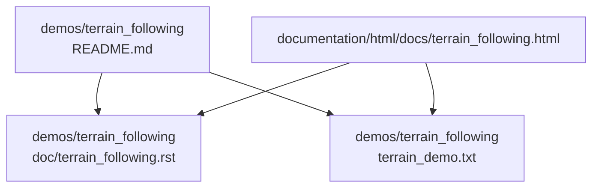
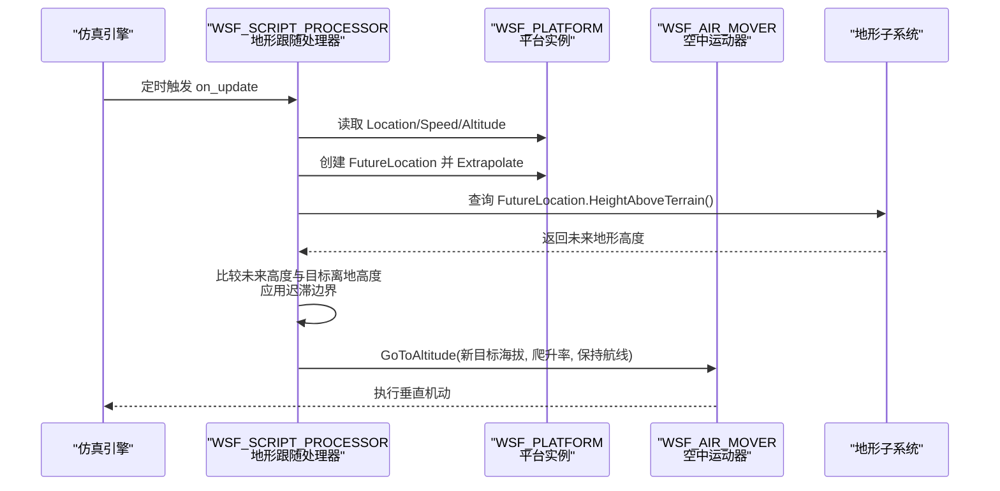
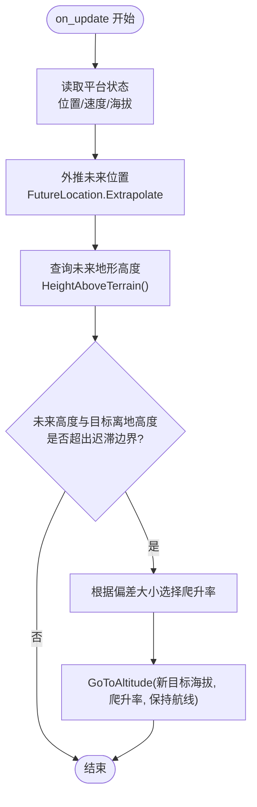
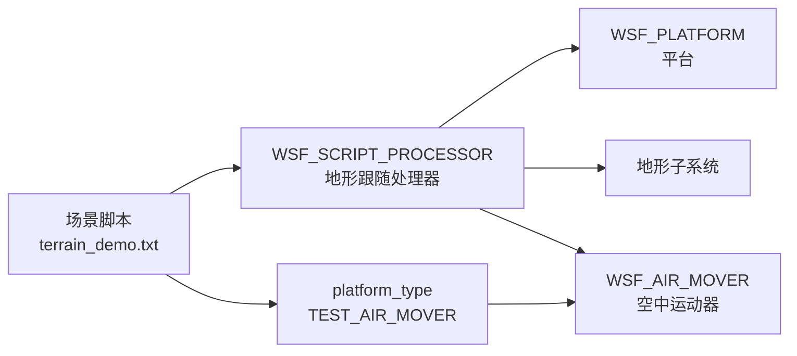

# 地形跟随模型

<cite>
**本文引用的文件**   
- [demos/terrain_following/README.md](file://demos/terrain_following/README.md)
- [demos/terrain_following/doc/terrain_following.rst](file://demos/terrain_following/doc/terrain_following.rst)
- [demos/terrain_following/terrain_demo.txt](file://demos/terrain_following/terrain_demo.txt)
- [documentation/html/docs/terrain_following.html](file://documentation/html/docs/terrain_following.html)
</cite>

## 目录
1. [简介](#简介)
2. [项目结构](#项目结构)
3. [核心组件](#核心组件)
4. [架构总览](#架构总览)
5. [详细组件分析](#详细组件分析)
6. [依赖关系分析](#依赖关系分析)
7. [性能考虑](#性能考虑)
8. [故障排查指南](#故障排查指南)
9. [结论](#结论)
10. [附录](#附录)

## 简介
本文件面向AFSIM中的“地形跟随”能力，基于仓库内提供的演示脚本与文档，系统说明：
- 地形跟随的原理与控制流程
- DEM（数字高程模型）数据的加载与使用方式
- 参数配置项（目标离地高度、容差、爬升率限制等）
- 地形规避与威胁规避的集成现状与建议
- 不同地形环境下的跟随策略与自适应调整思路
- 典型应用场景（低空突防、山谷导航）
- 地形数据准备与预处理工具使用方法
- 仿真精度验证与性能优化技巧

## 项目结构
地形跟随演示位于 demos/terrain_following 目录，包含：
- README.md：功能要点与注意事项
- doc/terrain_following.rst：官方演示文档源
- terrain_demo.txt：可运行的场景脚本，定义处理器、平台、航线与地形数据入口

图示来源
- [demos/terrain_following/README.md:1-62](file://demos/terrain_following/README.md#L1-L62)
- [demos/terrain_following/doc/terrain_following.rst:1-45](file://demos/terrain_following/doc/terrain_following.rst#L1-L45)
- [demos/terrain_following/terrain_demo.txt:1-95](file://demos/terrain_following/terrain_demo.txt#L1-L95)
- [documentation/html/docs/terrain_following.html:77-138](file://documentation/html/docs/terrain_following.html#L77-L138)

章节来源
- [demos/terrain_following/README.md:1-62](file://demos/terrain_following/README.md#L1-L62)
- [demos/terrain_following/doc/terrain_following.rst:1-45](file://demos/terrain_following/doc/terrain_following.rst#L1-L45)
- [demos/terrain_following/terrain_demo.txt:1-95](file://demos/terrain_following/terrain_demo.txt#L1-L95)
- [documentation/html/docs/terrain_following.html:77-138](file://documentation/html/docs/terrain_following.html#L77-L138)

## 核心组件
- WSF_SCRIPT_PROCESSOR（地形跟随处理器）
  - 周期性 on_update 中读取平台当前位置、速度、当前海拔与未来位置的地形高度
  - 根据未来地形高度与目标离地高度的偏差，计算新目标海拔并调用 GoToAltitude 保持原航线仅改变高度
  - 通过上下限容差（迟滞）避免频繁指令抖动
- WSF_AIR_MOVER（空中运动器）
  - 提供 Location、Speed、Altitude、HeightAboveTerrain 等接口
  - 支持 GoToAltitude(目标海拔, 爬升率, 保持航线)
  - 可通过 mover 属性设置最大爬升率与过载限制
- 地形子系统
  - 通过 terrain 块加载DEM数据（示例为DTED）
  - 提供 HeightAboveTerrain 查询与 TerrainElevApprox 近似查询

章节来源
- [demos/terrain_following/terrain_demo.txt:10-45](file://demos/terrain_following/terrain_demo.txt#L10-L45)
- [demos/terrain_following/terrain_demo.txt:47-60](file://demos/terrain_following/terrain_demo.txt#L47-L60)
- [demos/terrain_following/terrain_demo.txt:80-92](file://demos/terrain_following/terrain_demo.txt#L80-L92)

## 架构总览
地形跟随在AFSIM中的执行链路如下：
- 场景初始化时加载地形数据
- 每 update_interval 触发一次处理器 on_update
- 处理器查询平台状态与未来位置的地形高度
- 根据偏差与迟滞边界决定是否需要更新目标海拔
- 调用空中运动器的 GoToAltitude 实现沿原航线的垂直机动

图示来源
- [demos/terrain_following/terrain_demo.txt:10-45](file://demos/terrain_following/terrain_demo.txt#L10-L45)
- [demos/terrain_following/terrain_demo.txt:47-60](file://demos/terrain_following/terrain_demo.txt#L47-L60)

## 详细组件分析

### 地形跟随算法与控制逻辑
- 前瞻预测：基于当前速度与方向外推一个未来位置，获取该点的地形高度
- 偏差判定：将未来地形高度与目标离地高度进行比较，结合上下限容差形成迟滞带
- 速率选择：根据偏差大小选择不同爬升率（例如小偏差用较低速率，大偏差用较高速率）
- 指令输出：调用 GoToAltitude 指定目标海拔与爬升率，并保持原航线不变
- 安全边界：未对负海拔进行显式检查，极端情况下可能穿越地表以下

图示来源
- [demos/terrain_following/terrain_demo.txt:17-44](file://demos/terrain_following/terrain_demo.txt#L17-L44)

章节来源
- [demos/terrain_following/terrain_demo.txt:17-44](file://demos/terrain_following/terrain_demo.txt#L17-L44)
- [demos/terrain_following/README.md:9-20](file://demos/terrain_following/README.md#L9-L20)
- [demos/terrain_following/doc/terrain_following.rst:29-44](file://demos/terrain_following/doc/terrain_following.rst#L29-L44)

### 参数配置与可调项
- 目标离地高度（COMMANDED_HEIGHT_ABOVE_TERRAIN）
  - 控制飞行器应保持的目标海拔与地形之间的间隙
  - 可在处理器脚本变量或平台类型中覆盖
- 高度容差（HEIGHT_TOLERANCE）
  - 用于构建迟滞带，避免指令频繁抖动
- 爬升率限制（maximum_climb_rate）
  - 在 WSF_AIR_MOVER 中设置，限制垂直机动速率上限
- 更新间隔（update_interval）
  - 控制地形跟随处理器的刷新频率
- 其他
  - 示例中定义了 MaxRate 与 Rate 两个速率档位，按偏差阈值切换

章节来源
- [demos/terrain_following/terrain_demo.txt:10-16](file://demos/terrain_following/terrain_demo.txt#L10-L16)
- [demos/terrain_following/terrain_demo.txt:47-51](file://demos/terrain_following/terrain_demo.txt#L47-L51)
- [demos/terrain_following/terrain_demo.txt:53-58](file://demos/terrain_following/terrain_demo.txt#L53-L58)

### DEM数据格式与处理方法
- 数据格式
  - 示例使用 DTED（Digital Terrain Elevation Data）作为DEM输入
- 加载方式
  - 在场景文件的 terrain 块中声明 dted 路径
- 查询接口
  - HeightAboveTerrain：查询某地理坐标的地形高度
  - TerrainElevApprox：近似查询给定经纬度的地形高度（用于初始化校验）
- 注意事项
  - 若未正确加载DEM，HeightAboveTerrain/TerrainElevApprox 可能返回无效值，需进行自检提示

章节来源
- [demos/terrain_following/terrain_demo.txt:80-92](file://demos/terrain_following/terrain_demo.txt#L80-L92)

### 地形规避与威胁规避集成
- 地形规避
  - 当前演示未实现地形规避（不检测负海拔），仅做高度跟随
  - 建议扩展：在 on_update 中加入最小离地高度硬约束与越界保护
- 威胁规避
  - 当前演示未集成威胁感知与规避逻辑
  - 建议扩展：在处理器中接入威胁传感器/规则，动态调整目标离地高度或临时退出地形跟随模式

章节来源
- [demos/terrain_following/README.md:18-20](file://demos/terrain_following/README.md#L18-L20)
- [demos/terrain_following/doc/terrain_following.rst:41-44](file://demos/terrain_following/doc/terrain_following.rst#L41-L44)

### 不同地形环境下的跟随策略与自适应调整
- 平原/缓坡
  - 可采用较小爬升率与较大容差，减少指令抖动
- 山地/峡谷
  - 提高前瞻距离（Extrapolate 步长）与爬升率上限，增强响应性
- 海岸线/起伏剧烈区域
  - 引入分段策略：在接近高差突变区时提升速率档位并收紧容差
- 自适应建议
  - 根据历史高度误差方差动态调节 HEIGHT_TOLERANCE
  - 依据速度变化调整前瞻步长，保证足够的前视裕度

[本节为概念性内容，无需列出具体文件来源]

### 典型应用场景
- 低空突防
  - 设定较小的 COMMANDED_HEIGHT_ABOVE_TERRAIN，配合较高爬升率以快速贴地飞行
- 山谷导航
  - 增大前瞻距离，确保在山谷转弯前完成高度调整；必要时临时提高容差以平滑指令

[本节为概念性内容，无需列出具体文件来源]

## 依赖关系分析
- 处理器依赖平台接口（Location/Speed/Altitude/HeightAboveTerrain）
- 处理器依赖地形子系统（HeightAboveTerrain/TerrainElevApprox）
- 处理器驱动空中运动器（GoToAltitude）
- 场景通过 platform_type 与 processor 组合装配

图示来源
- [demos/terrain_following/terrain_demo.txt:10-45](file://demos/terrain_following/terrain_demo.txt#L10-L45)
- [demos/terrain_following/terrain_demo.txt:47-60](file://demos/terrain_following/terrain_demo.txt#L47-L60)

章节来源
- [demos/terrain_following/terrain_demo.txt:10-60](file://demos/terrain_following/terrain_demo.txt#L10-L60)

## 性能考虑
- 更新频率（update_interval）
  - 更短的间隔带来更高响应性但增加CPU开销
- 前瞻步长（Extrapolate 距离）
  - 更大的前瞻距离有助于提前应对地形变化，但会增加地形查询成本
- 速率档位切换
  - 合理设置阈值可减少不必要的指令切换，降低控制抖动
- 地形数据规模
  - 高分辨率DEM会显著影响查询性能，建议在离线阶段进行分级缓存或分块加载

[本节为通用指导，无需列出具体文件来源]

## 故障排查指南
- 未加载DEM导致的高度查询异常
  - 现象：TerrainElevApprox 返回0或 HeightAboveTerrain 异常
  - 处理：确认 terrain 块中已正确声明 dted 路径，并确保路径有效
- 指令频繁抖动
  - 现象：目标海拔频繁变更
  - 处理：增大 HEIGHT_TOLERANCE，或引入迟滞逻辑
- 爬升率不足导致无法及时响应
  - 现象：遇到陡坡或深谷时高度滞后
  - 处理：提高 maximum_climb_rate 或增大速率档位阈值
- 负海拔穿越风险
  - 现象：在极端地形下出现负海拔
  - 处理：在处理器中加入最小离地高度硬约束与越界保护

章节来源
- [demos/terrain_following/terrain_demo.txt:80-92](file://demos/terrain_following/terrain_demo.txt#L80-L92)
- [demos/terrain_following/README.md:18-20](file://demos/terrain_following/README.md#L18-L20)

## 结论
AFSIM的地形跟随演示通过 WSF_SCRIPT_PROCESSOR 与 WSF_AIR_MOVER 的组合，实现了沿固定航线的高度跟随控制。其核心在于前瞻地形高度查询、迟滞边界与速率档位切换。当前版本未内置地形规避与威胁规避，用户可根据任务需求扩展。通过合理配置目标离地高度、容差与爬升率，并结合DEM数据质量与前瞻步长，可在多种地形环境下实现稳定、高效的低空突防与山谷导航。

[本节为总结性内容，无需列出具体文件来源]

## 附录
- 相关文档页面
  - 官方演示HTML文档：documentation/html/docs/terrain_following.html
- 参考要点
  - 演示脚本的关键点与限制已在 README 与 RST 文档中明确说明

章节来源
- [documentation/html/docs/terrain_following.html:77-138](file://documentation/html/docs/terrain_following.html#L77-L138)
- [demos/terrain_following/README.md:9-20](file://demos/terrain_following/README.md#L9-L20)
- [demos/terrain_following/doc/terrain_following.rst:29-44](file://demos/terrain_following/doc/terrain_following.rst#L29-L44)