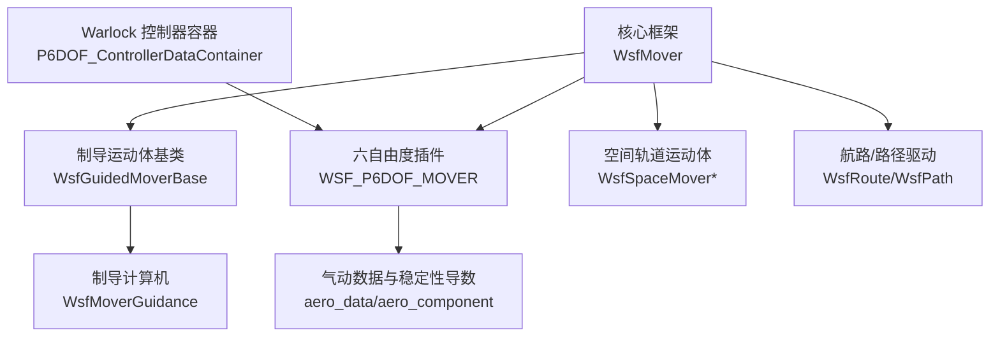
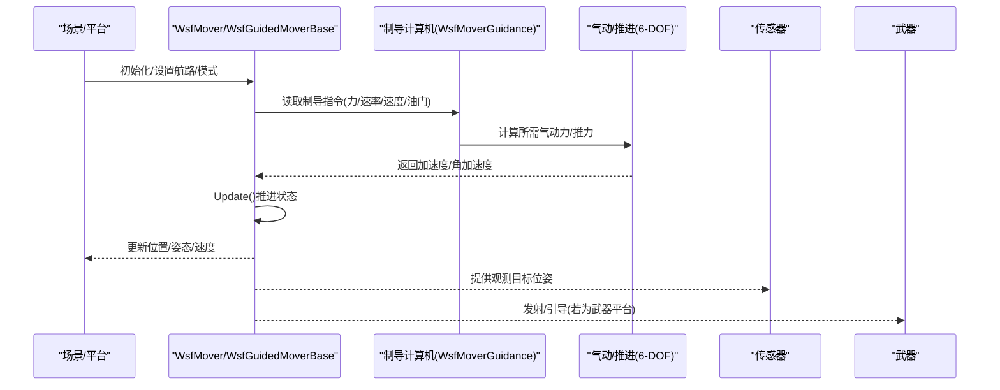
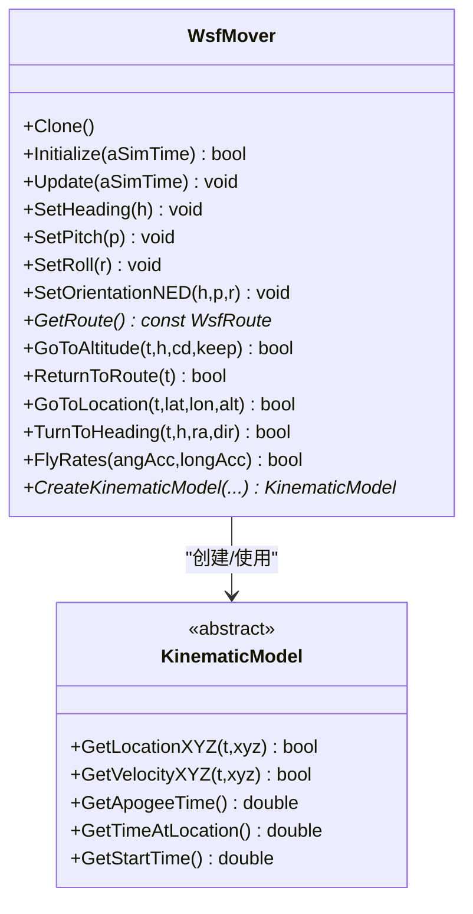
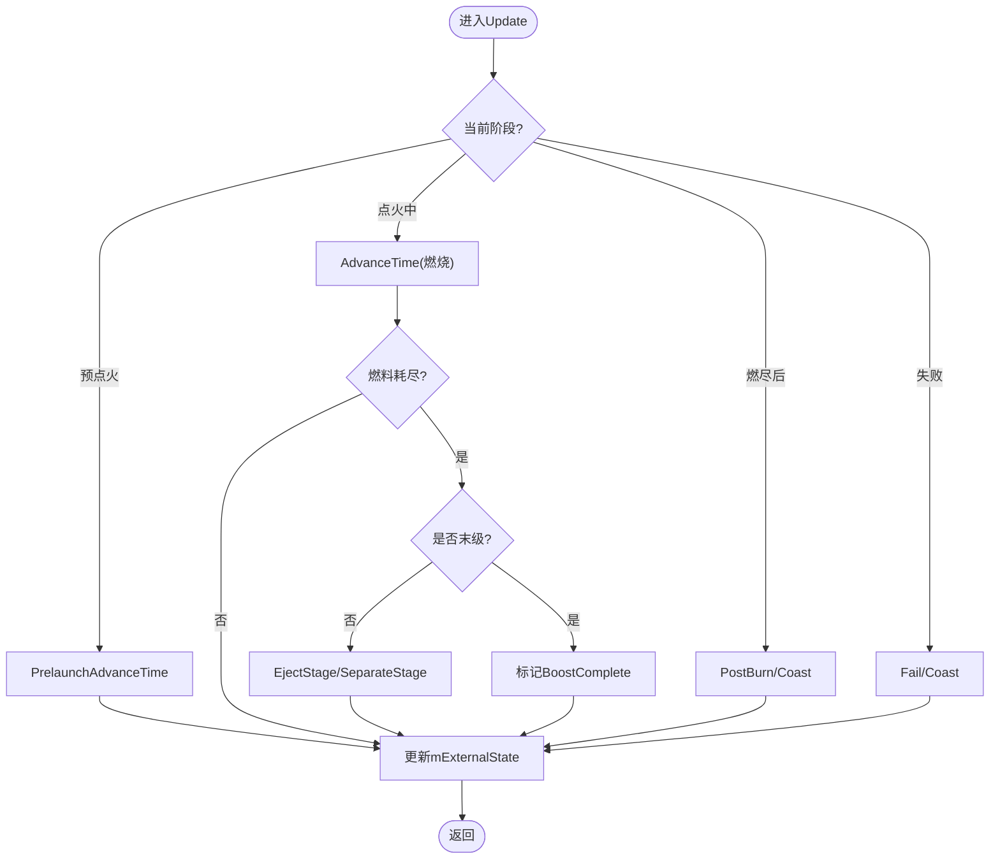
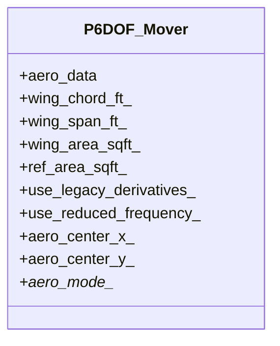
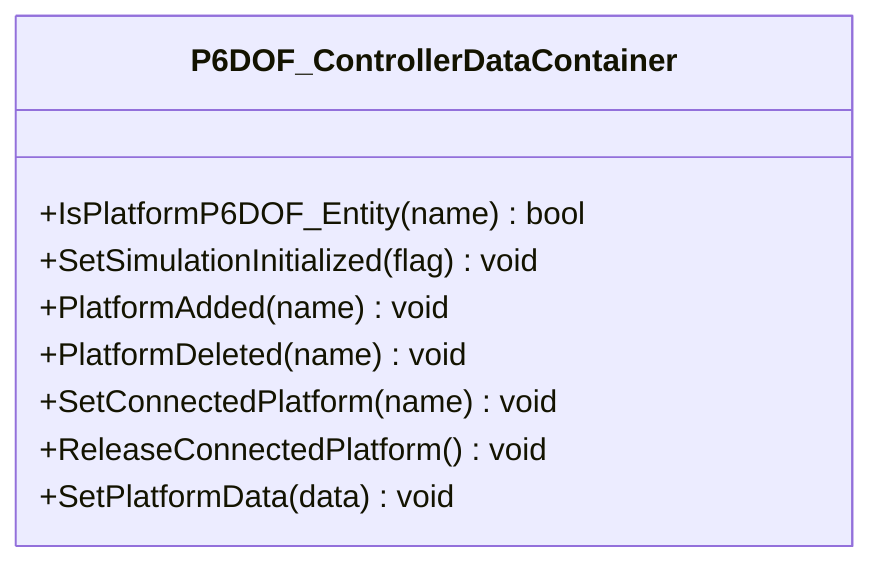
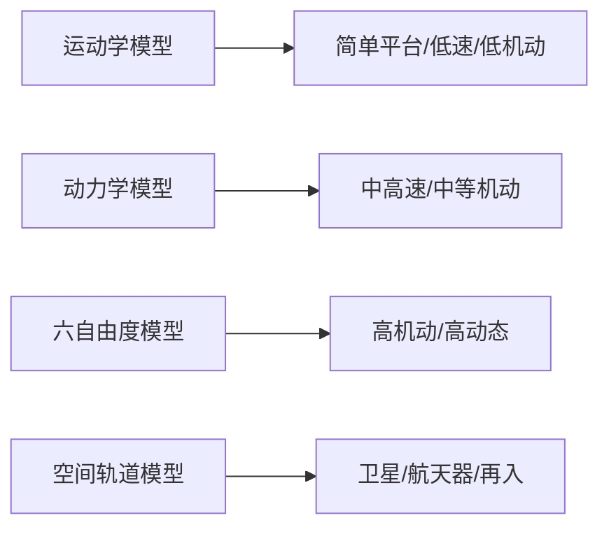
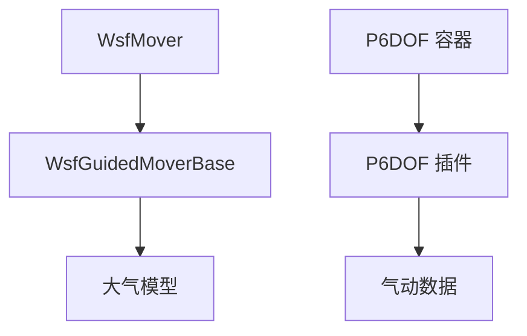

# 平台运动模型

<cite>
**本文引用的文件**   
- [WsfMover.hpp](file://swdev/src/core/wsf/source/mover/WsfMover.hpp)
- [WsfGuidedMoverBase.hpp](file://swdev/src/core/wsf_mil/source/mover/WsfGuidedMoverBase.hpp)
- [p6dof_aerodynamics_data.rst](file://swdev/src/wsf_plugins/wsf_p6dof/doc/p6dof_aerodynamics_data.rst)
- [P6DOF_ControllerDataContainer.cpp](file://swdev/src/warlock/plugins/P6DOF_Controller/source/P6DOF_ControllerDataContainer.cpp)
- [six_dof.rst](file://demos/six_dof/doc/six_dof.rst)
- [six_dof_with_brawler.rst](file://demos/six_dof_with_brawler/doc/six_dof_with_brawler.rst)
</cite>

## 目录
1. [简介](#简介)
2. [项目结构](#项目结构)
3. [核心组件](#核心组件)
4. [架构总览](#架构总览)
5. [详细组件分析](#详细组件分析)
6. [依赖关系分析](#依赖关系分析)
7. [性能考虑](#性能考虑)
8. [故障排查指南](#故障排查指南)
9. [结论](#结论)
10. [附录](#附录)

## 简介
本文件面向AFSIM平台的“平台运动模型”子系统，系统性梳理运动学、动力学与六自由度（6-DOF）模型的类型、约束与方程，说明飞行器、车辆、舰船、导弹等平台的运动特性与参数配置方法；阐述运动模型与传感器、武器的集成方式；提供自定义运动模型的开发指南、轨迹规划与控制算法要点，并给出验证与测试建议。文档同时结合仓库中的示例场景与文档，帮助读者快速构建逼真的仿真场景。

## 项目结构
AFSIM的运动模型能力由核心框架与插件共同实现：
- 核心框架提供统一的运动基类与通用接口，所有具体运动模型均继承自该基类。
- 制导/武器域在核心基础上扩展出“制导运动体”抽象，支持多级推进、阶段分离、推力控制等导弹相关能力。
- 六自由度插件提供高保真气动数据与积分求解器，用于飞机、导弹等高动态平台的精细建模。
- Warlock可视化控制器通过容器管理已注册的6-DOF运动体，便于外部工具联动。

图表来源
- [WsfMover.hpp:31-389](file://swdev/src/core/wsf/source/mover/WsfMover.hpp#L31-L389)
- [WsfGuidedMoverBase.hpp:33-283](file://swdev/src/core/wsf_mil/source/mover/WsfGuidedMoverBase.hpp#L33-L283)
- [p6dof_aerodynamics_data.rst:26-142](file://swdev/src/wsf_plugins/wsf_p6dof/doc/p6dof_aerodynamics_data.rst#L26-L142)
- [P6DOF_ControllerDataContainer.cpp:1-81](file://swdev/src/warlock/plugins/P6DOF_Controller/source/P6DOF_ControllerDataContainer.cpp#L1-L81)

章节来源
- [WsfMover.hpp:31-389](file://swdev/src/core/wsf/source/mover/WsfMover.hpp#L31-L389)
- [WsfGuidedMoverBase.hpp:33-283](file://swdev/src/core/wsf_mil/source/mover/WsfGuidedMoverBase.hpp#L33-L283)
- [p6dof_aerodynamics_data.rst:26-142](file://swdev/src/wsf_plugins/wsf_p6dof/doc/p6dof_aerodynamics_data.rst#L26-L142)
- [P6DOF_ControllerDataContainer.cpp:1-81](file://swdev/src/warlock/plugins/P6DOF_Controller/source/P6DOF_ControllerDataContainer.cpp#L1-L81)

## 核心组件
- WsfMover（运动体基类）
  - 统一维护平台运动学状态（位置、姿态、速度、加速度等），提供更新调度、模式切换、航路与路径控制、属性系统等通用接口。
  - 提供KinematicModel抽象，供预测未来位置/时间/远地点等使用。
- WsfGuidedMoverBase（制导运动体基类）
  - 在WsfMover之上封装制导/推进逻辑：阶段点火/分离、推力/油门指令、最小地形高度、大气环境、轨迹输出等。
  - 将制导计算机的力矩/速率/速度/油门指令映射到实际运动推进。
- P6DOF 插件（六自由度）
  - 提供气动外形、稳定性导数表、参考面积/翼展等参数化定义，支持多气动模态（如炸弹干净/高阻）。
- Warlock P6DOF 控制器容器
  - 维护已注册6-DOF运动体集合，跟踪连接平台生命周期，为外部可视化工具提供查询与同步。

章节来源
- [WsfMover.hpp:31-389](file://swdev/src/core/wsf/source/mover/WsfMover.hpp#L31-L389)
- [WsfGuidedMoverBase.hpp:33-283](file://swdev/src/core/wsf_mil/source/mover/WsfGuidedMoverBase.hpp#L33-L283)
- [p6dof_aerodynamics_data.rst:26-142](file://swdev/src/wsf_plugins/wsf_p6dof/doc/p6dof_aerodynamics_data.rst#L26-L142)
- [P6DOF_ControllerDataContainer.cpp:1-81](file://swdev/src/warlock/plugins/P6DOF_Controller/source/P6DOF_ControllerDataContainer.cpp#L1-L81)

## 架构总览
下图展示从场景到运动体、再到传感器/武器的典型调用链与数据流。

图表来源
- [WsfMover.hpp:61-129](file://swdev/src/core/wsf/source/mover/WsfMover.hpp#L61-L129)
- [WsfGuidedMoverBase.hpp:73-126](file://swdev/src/core/wsf_mil/source/mover/WsfGuidedMoverBase.hpp#L73-L126)
- [p6dof_aerodynamics_data.rst:26-142](file://swdev/src/wsf_plugins/wsf_p6dof/doc/p6dof_aerodynamics_data.rst#L26-L142)

## 详细组件分析

### 运动体基类 WsfMover
- 职责
  - 维护运动学状态与更新调度（Update间隔、容差、线程安全标志）。
  - 提供导航API：转向、爬升/俯冲、回到航路、飞向指定点/标签/速度等。
  - 提供KinematicModel接口，用于外推预测（位置/速度/远地点/到达时间）。
  - 属性系统：以键值对形式暴露可配置能力（如最大过载、爬升率等）。
- 关键行为
  - Initialize/Initialize2/ProcessInput/Update构成标准生命周期。
  - SetHeading/SetPitch/SetRoll/SetOrientationNED用于姿态设定。
  - GetRoute/GetDefaultRoute/GoToWaypoint/FindAndSetPath等用于航路/路径控制。
  - ThreadSafe标记决定是否允许多线程并行更新。

图表来源
- [WsfMover.hpp:31-389](file://swdev/src/core/wsf/source/mover/WsfMover.hpp#L31-L389)

章节来源
- [WsfMover.hpp:31-389](file://swdev/src/core/wsf/source/mover/WsfMover.hpp#L31-L389)

### 制导运动体基类 WsfGuidedMoverBase
- 职责
  - 封装导弹/火箭等多级推进体的完整飞行过程：预点火滑行、点火燃烧、燃尽滑翔、级间分离、失败处理。
  - 接收制导计算机指令：侧向/法向力、横滚/俯仰/偏航速率、速度/油门指令、发动机停止时间、最小地形高度等。
  - 提供阶段事件回调（点火/燃尽/分离）、轨迹输出、初始条件写入等。
- 关键行为
  - AdvanceTime为纯虚函数，子类负责推进积分与状态推进。
  - IsExtrapolating/IsPaused/IsStopped反映当前阶段与状态。
  - EjectStage/IgniteStage/SeparateStage管理多级推进。

图表来源
- [WsfGuidedMoverBase.hpp:141-283](file://swdev/src/core/wsf_mil/source/mover/WsfGuidedMoverBase.hpp#L141-L283)

章节来源
- [WsfGuidedMoverBase.hpp:33-283](file://swdev/src/core/wsf_mil/source/mover/WsfGuidedMoverBase.hpp#L33-L283)

### 六自由度模型（P6DOF）
- 气动数据
  - aero_data定义几何参数（翼弦、翼展、翼面积或参考面积）、稳定性导数表（随马赫数与迎角/侧滑角变化）、气动中心、阻尼/耦合项等。
  - 支持“气动模态”（如炸弹干净/高阻），不同模态切换对应不同气动特性。
- 数值积分
  - 通过积分器推进六自由度微分方程，结合大气模型与推进模型得到加速度/力矩。
- 配置要点
  - 选择参考面积或机翼几何参数之一。
  - 根据需求启用“减缩频率”导数或传统导数。
  - 合理设置气动中心与惯性参数，确保纵向/横向静稳性。

图表来源
- [p6dof_aerodynamics_data.rst:26-142](file://swdev/src/wsf_plugins/wsf_p6dof/doc/p6dof_aerodynamics_data.rst#L26-L142)

章节来源
- [p6dof_aerodynamics_data.rst:26-142](file://swdev/src/wsf_plugins/wsf_p6dof/doc/p6dof_aerodynamics_data.rst#L26-L142)

### Warlock P6DOF 控制器容器
- 职责
  - 维护已注册的6-DOF运动体集合，跟踪连接平台名称与生命周期。
  - 提供查询某平台是否为6-DOF实体、设置/释放连接平台等方法。
- 作用
  - 作为可视化/调试工具的桥梁，确保外部系统与仿真内核的状态一致。

图表来源
- [P6DOF_ControllerDataContainer.cpp:1-81](file://swdev/src/warlock/plugins/P6DOF_Controller/source/P6DOF_ControllerDataContainer.cpp#L1-L81)

章节来源
- [P6DOF_ControllerDataContainer.cpp:1-81](file://swdev/src/warlock/plugins/P6DOF_Controller/source/P6DOF_ControllerDataContainer.cpp#L1-L81)

### 概念总览：运动模型分类与适用场景
- 运动学模型（Kinematic）
  - 基于速度/航向/爬升率等直接驱动位置与姿态，适用于低复杂度平台（如地面车辆、简单航线无人机）。
- 动力学模型（Dynamic）
  - 引入质量、推力、阻力、升力等物理量，常用于直升机、固定翼、巡航导弹等。
- 六自由度模型（6-DOF）
  - 解算平移+旋转微分方程，适合高机动飞行器、空空导弹、战术弹道导弹等。
- 空间轨道模型（Orbital/Space）
  - 基于轨道力学与摄动项，适用于卫星、航天器、再入飞行器。

[本节为概念性内容，不直接分析具体文件]

## 依赖关系分析
- 耦合关系
  - WsfGuidedMoverBase 强依赖 WsfMover 提供的通用运动能力。
  - 6-DOF 插件依赖气动数据与大气模型，并通过积分器推进状态。
  - Warlock 容器仅依赖已注册的6-DOF运动体集合，弱耦合于仿真内核。
- 潜在循环依赖
  - 运动体与传感器/武器之间通过事件/回调通信，避免直接双向引用。
- 外部依赖
  - 大气模型、地理坐标转换、轨迹/航路数据结构等。

图表来源
- [WsfMover.hpp:31-389](file://swdev/src/core/wsf/source/mover/WsfMover.hpp#L31-L389)
- [WsfGuidedMoverBase.hpp:33-283](file://swdev/src/core/wsf_mil/source/mover/WsfGuidedMoverBase.hpp#L33-L283)
- [p6dof_aerodynamics_data.rst:26-142](file://swdev/src/wsf_plugins/wsf_p6dof/doc/p6dof_aerodynamics_data.rst#L26-L142)
- [P6DOF_ControllerDataContainer.cpp:1-81](file://swdev/src/warlock/plugins/P6DOF_Controller/source/P6DOF_ControllerDataContainer.cpp#L1-L81)

章节来源
- [WsfMover.hpp:31-389](file://swdev/src/core/wsf/source/mover/WsfMover.hpp#L31-L389)
- [WsfGuidedMoverBase.hpp:33-283](file://swdev/src/core/wsf_mil/source/mover/WsfGuidedMoverBase.hpp#L33-L283)
- [p6dof_aerodynamics_data.rst:26-142](file://swdev/src/wsf_plugins/wsf_p6dof/doc/p6dof_aerodynamics_data.rst#L26-L142)
- [P6DOF_ControllerDataContainer.cpp:1-81](file://swdev/src/warlock/plugins/P6DOF_Controller/source/P6DOF_ControllerDataContainer.cpp#L1-L81)

## 性能考虑
- 更新调度
  - 合理设置UpdateInterval与UpdateTimeTolerance，避免过度更新导致CPU占用过高。
- 线程安全
  - 对非线程安全的运动体（编队、混合运动体等）禁用多线程更新，减少锁竞争。
- 积分步长
  - 6-DOF积分步长需兼顾精度与性能；在高机动段适当减小步长，平飞段增大步长。
- 气动数据插值
  - 稳定性导数表维度与分辨率影响插值开销，应权衡精度与查表成本。
- I/O与日志
  - 轨迹输出与阶段事件日志仅在需要时开启，避免频繁磁盘I/O。

[本节为通用指导，不直接分析具体文件]

## 故障排查指南
- 常见问题
  - 运动体未更新：检查UpdateInterval与UpdateTimeTolerance设置是否正确；确认UpdateAllowed返回true。
  - 6-DOF不可见：确认Warlock容器已注册该平台且连接平台正确。
  - 导弹未点火/未分离：检查阶段参数（预点火/预分离时间）、燃料源与推进模型配置。
  - 轨迹异常：核对气动中心、参考面积、惯性参数与大气模型一致性。
- 诊断手段
  - 使用WriteKinematicStatus/轨迹输出定位问题阶段。
  - 通过容器IsPlatformP6DOF_Entity判断平台类型。
  - 在脚本中访问属性（PropertyExists/GetProperty*）校验配置。

章节来源
- [WsfMover.hpp:96-129](file://swdev/src/core/wsf/source/mover/WsfMover.hpp#L96-L129)
- [WsfGuidedMoverBase.hpp:139-176](file://swdev/src/core/wsf_mil/source/mover/WsfGuidedMoverBase.hpp#L139-L176)
- [P6DOF_ControllerDataContainer.cpp:26-81](file://swdev/src/warlock/plugins/P6DOF_Controller/source/P6DOF_ControllerDataContainer.cpp#L26-L81)

## 结论
AFSIM的平台运动模型以WsfMover为核心，向上扩展制导运动体与六自由度插件，向下对接航路/路径与传感器/武器。通过合理的参数配置与调优，可在不同平台类型上实现从简单运动学到高保真六自由度的逼真仿真。建议在开发自定义运动体时遵循基类契约，明确更新调度、线程安全与属性接口，并结合示例场景进行验证与回归测试。

[本节为总结性内容，不直接分析具体文件]

## 附录

### 参数配置与调优要点
- 运动学/动力学
  - 最大过载、最大爬升率、转弯半径限制、速度包线。
- 六自由度
  - 参考面积/翼展/翼弦、气动中心、稳定性导数表、减缩频率开关、气动模态。
- 制导/推进
  - 阶段点火/分离延迟、最小地形高度、油门/速度指令范围、发动机停止时间。
- 更新调度
  - UpdateInterval、UpdateTimeTolerance、ThreadSafe标志。

[本节为通用指导，不直接分析具体文件]

### 与传感器、武器的集成方式
- 传感器
  - 通过WsfMover提供的位姿/速度信息生成观测数据；注意更新频率与传感器刷新周期匹配。
- 武器
  - 武器平台使用WsfGuidedMoverBase或其派生类；制导计算机输出力/速率/速度/油门指令，运动体执行推进与姿态控制。

[本节为通用指导，不直接分析具体文件]

### 自定义运动模型开发指南
- 步骤
  - 继承WsfMover或WsfGuidedMoverBase，实现Update/AdvanceTime等核心方法。
  - 实现必要的导航API（如GoToAltitude/TurnToHeading）。
  - 注册属性（RegisterProperty）并在ProcessInput中解析输入。
  - 如需6-DOF，提供aero_data与惯性参数，并确保积分器稳定。
- 最佳实践
  - 保持线程安全声明准确；必要时禁用多线程更新。
  - 使用KinematicModel提供预测接口，便于传感器/武器提前评估。
  - 通过事件回调（阶段点火/分离）与外部系统解耦。

[本节为通用指导，不直接分析具体文件]

### 轨迹规划与控制算法
- 航路/路径
  - 使用WsfRoute/WsfPath定义航点与转向策略；支持标签跳转、最近点回归。
- 制导律
  - 比例导引、视线导引、能量管理等；通过SetCommandedSpeed/Throttle与SetYandZForces实现。
- 地形跟随
  - 设置MinimumHeightAboveTerrain，避免碰撞；结合地形高程数据进行前瞻修正。

[本节为通用指导，不直接分析具体文件]

### 使用示例与场景构建
- 六自由度示例
  - demos/six_dof 与 demos/six_dof_with_brawler 展示了刚体与质点6-DOF运动体的用法与对比。
- 场景组织
  - 在platform_type中定义运动体类型，在platform实例中绑定具体运动体与传感器/武器。

章节来源
- [six_dof.rst:27-27](file://demos/six_dof/doc/six_dof.rst#L27-L27)
- [six_dof_with_brawler.rst:27-27](file://demos/six_dof_with_brawler/doc/six_dof_with_brawler.rst#L27-L27)

### 验证与测试方法
- 单元测试
  - 针对KinematicModel预测接口进行时间/位置/速度一致性校验。
- 场景回归
  - 使用现有demo场景（如six_dof、six_dof_with_brawler）进行回归比对。
- 性能基准
  - 在不同UpdateInterval与积分步长下测量CPU占用与帧率，确定最优配置。

[本节为通用指导，不直接分析具体文件]