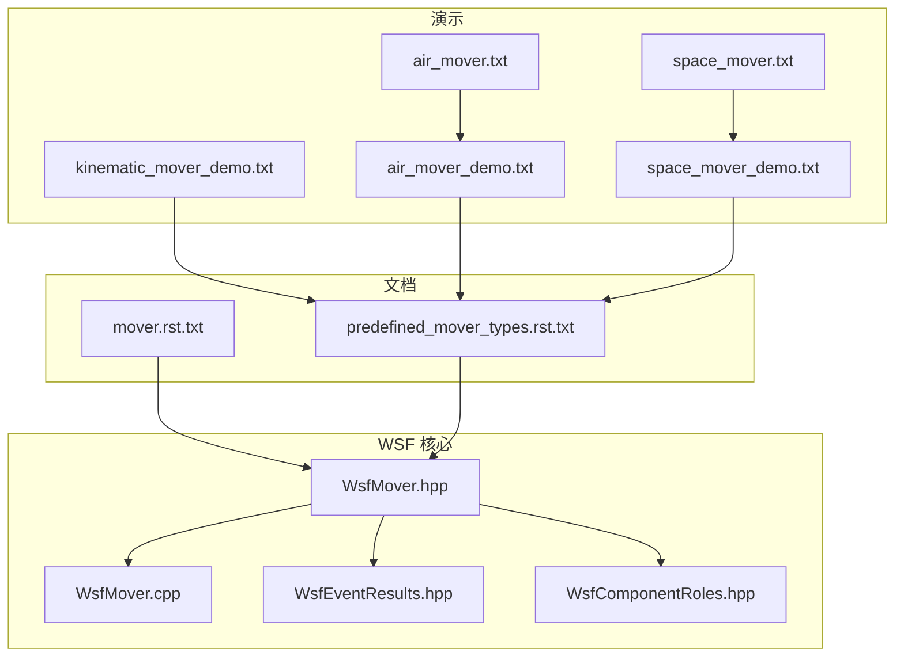
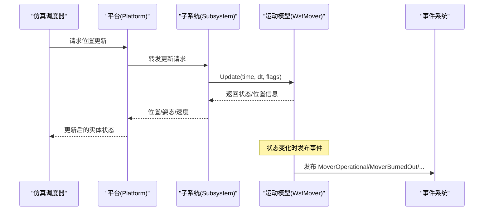
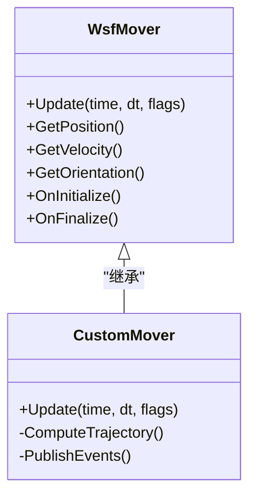
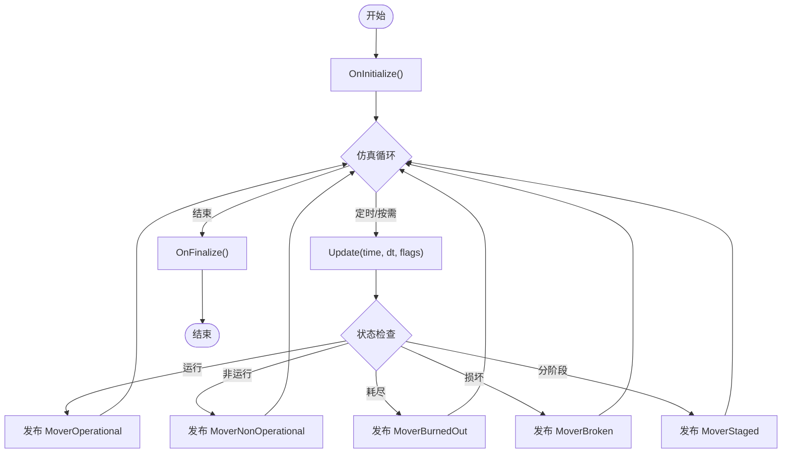
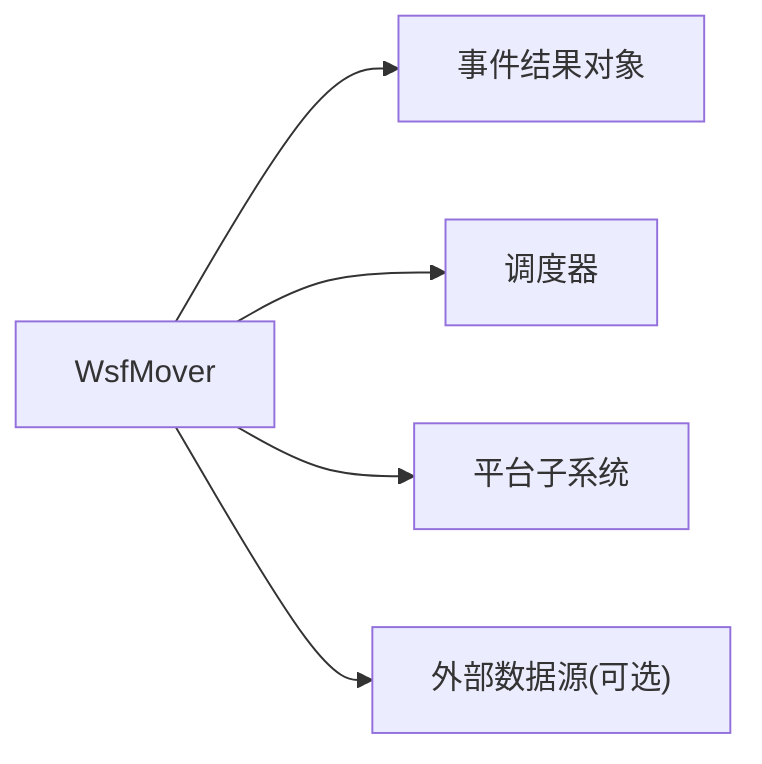

# 自定义运动模型开发

<cite>
**本文引用的文件**   
- [WsfMover.hpp](file://swdev/src/core/wsf/source/mover/WsfMover.hpp)
- [WsfMover.cpp](file://swdev/src/core/wsf/source/mover/WsfMover.cpp)
- [WsfEventResults.hpp](file://swdev/src/core/wsf/source/WsfEventResults.hpp)
- [WsfComponentRoles.hpp](file://swdev/src/core/wsf/source/WsfComponentRoles.hpp)
- [mover.rst.txt](file://documentation/html/_sources/docs/mover.rst.txt)
- [predefined_mover_types.rst.txt](file://documentation/html/_sources/docs/predefined_mover_types.rst.txt)
- [kinematic_mover_demo.txt](file://demos/kinematic_mover/kinematic_mover_demo.txt)
- [air_mover_demo.txt](file://demos/multiresolution_demos/air_mover_demo.txt)
- [space_mover_demo.txt](file://demos/multiresolution_demos/space_mover_demo.txt)
- [air_mover.txt](file://demos/multiresolution_demos/movers/air_mover.txt)
- [space_mover.txt](file://demos/multiresolution_demos/movers/space_mover.txt)
</cite>

## 目录
1. [引言](#引言)
2. [项目结构](#项目结构)
3. [核心组件](#核心组件)
4. [架构总览](#架构总览)
5. [详细组件分析](#详细组件分析)
6. [依赖关系分析](#依赖关系分析)
7. [性能考虑](#性能考虑)
8. [故障排查指南](#故障排查指南)
9. [结论](#结论)
10. [附录](#附录)

## 引言
本文件面向希望在 AFSIM 中开发“自定义运动模型（Mover）”的工程师与分析师，系统阐述运动模型的基类继承结构、接口规范、生命周期管理、事件处理机制、注册与加载方式，以及从需求到实现再到测试验证的完整流程。文档同时提供 C++ 与 Python 两种语言的开发思路与示例路径，并给出性能优化与调试技巧，帮助你将自定义模型无缝集成到现有仿真框架中。

## 项目结构
AFSIM 的运动模型能力位于 WSF（Warfare Simulation Framework）核心库中，相关头文件与实现位于 core/wsf/source/mover 目录；预定义运动类型与脚本接口文档位于 documentation/html/_sources/docs；演示场景位于 demos 下多个子目录。

图示来源
- [WsfMover.hpp:1-200](file://swdev/src/core/wsf/source/mover/WsfMover.hpp#L1-L200)
- [WsfMover.cpp:1-200](file://swdev/src/core/wsf/source/mover/WsfMover.cpp#L1-L200)
- [WsfEventResults.hpp:1200-1300](file://swdev/src/core/wsf/source/WsfEventResults.hpp#L1200-L1300)
- [WsfComponentRoles.hpp:90-110](file://swdev/src/core/wsf/source/WsfComponentRoles.hpp#L90-L110)
- [mover.rst.txt:1-55](file://documentation/html/_sources/docs/mover.rst.txt#L1-L55)
- [predefined_mover_types.rst.txt:1-46](file://documentation/html/_sources/docs/predefined_mover_types.rst.txt#L1-L46)
- [kinematic_mover_demo.txt](file://demos/kinematic_mover/kinematic_mover_demo.txt)
- [air_mover_demo.txt](file://demos/multiresolution_demos/air_mover_demo.txt)
- [space_mover_demo.txt](file://demos/multiresolution_demos/space_mover_demo.txt)
- [air_mover.txt](file://demos/multiresolution_demos/movers/air_mover.txt)
- [space_mover.txt](file://demos/multiresolution_demos/movers/space_mover.txt)

章节来源
- [mover.rst.txt:1-55](file://documentation/html/_sources/docs/mover.rst.txt#L1-L55)
- [predefined_mover_types.rst.txt:1-46](file://documentation/html/_sources/docs/predefined_mover_types.rst.txt#L1-L46)

## 核心组件
- WsfMover：所有运动模型的抽象基类，定义了位置更新、时间步控制、状态查询等核心接口。
- 预定义运动类型：包括航线型（如 WSF_AIR_MOVER、WSF_GROUND_MOVER、WSF_KINEMATIC_MOVER 等）、跟随型（WSF_HYBRID_MOVER、WSF_OFFSET_MOVER）等，供平台直接配置使用。
- 事件结果：针对运动模型的生命周期与运行状态，框架提供一系列事件结果对象（如损坏、耗尽、非运行、运行、分阶段等）。
- 组件角色：在 WSF 组件系统中，运动模型被标记为 mover 角色，便于调度与发现。

章节来源
- [WsfMover.hpp:1-200](file://swdev/src/core/wsf/source/mover/WsfMover.hpp#L1-L200)
- [WsfMover.cpp:1-200](file://swdev/src/core/wsf/source/mover/WsfMover.cpp#L1-L200)
- [WsfEventResults.hpp:1200-1300](file://swdev/src/core/wsf/source/WsfEventResults.hpp#L1200-L1300)
- [WsfComponentRoles.hpp:90-110](file://swdev/src/core/wsf/source/WsfComponentRoles.hpp#L90-L110)
- [predefined_mover_types.rst.txt:1-46](file://documentation/html/_sources/docs/predefined_mover_types.rst.txt#L1-L46)

## 架构总览
下图展示了自定义运动模型在 AFSIM 中的整体架构：平台通过子系统挂载一个 mover；仿真调度器按 update_interval 或按需触发 mover 的位置更新；mover 内部根据具体算法计算新位置、姿态、速度等；当发生关键状态变化时，向事件管道发布相应的事件结果。

图示来源
- [WsfMover.hpp:1-200](file://swdev/src/core/wsf/source/mover/WsfMover.hpp#L1-L200)
- [WsfMover.cpp:1-200](file://swdev/src/core/wsf/source/mover/WsfMover.cpp#L1-L200)
- [WsfEventResults.hpp:1200-1300](file://swdev/src/core/wsf/source/WsfEventResults.hpp#L1200-L1300)

## 详细组件分析

### 基类与继承结构
- 基类：WsfMover 是所有运动模型的抽象基类，提供统一的接口契约，包括位置更新、时间步控制、状态查询等。
- 派生类：用户自定义运动模型应继承自 WsfMover，并重写关键方法以实现特定运动逻辑。
- 预定义类型：WSF 内置多种预定义 mover 类型，可作为参考实现或直接复用。

图示来源
- [WsfMover.hpp:1-200](file://swdev/src/core/wsf/source/mover/WsfMover.hpp#L1-L200)
- [WsfMover.cpp:1-200](file://swdev/src/core/wsf/source/mover/WsfMover.cpp#L1-L200)

章节来源
- [WsfMover.hpp:1-200](file://swdev/src/core/wsf/source/mover/WsfMover.hpp#L1-L200)
- [WsfMover.cpp:1-200](file://swdev/src/core/wsf/source/mover/WsfMover.cpp#L1-L200)

### 生命周期管理与事件处理
- 初始化与销毁：OnInitialize/OnFinalize 用于资源准备与清理。
- 位置更新：Update 是核心回调，由调度器按 update_interval 或按需调用。
- 事件发布：当运动模型进入不同运行状态（如运行、非运行、耗尽、损坏、分阶段），通过事件结果对象发布事件，供观察者订阅。

图示来源
- [WsfMover.hpp:1-200](file://swdev/src/core/wsf/source/mover/WsfMover.hpp#L1-L200)
- [WsfMover.cpp:1-200](file://swdev/src/core/wsf/source/mover/WsfMover.cpp#L1-L200)
- [WsfEventResults.hpp:1200-1300](file://swdev/src/core/wsf/source/WsfEventResults.hpp#L1200-L1300)

章节来源
- [WsfEventResults.hpp:1200-1300](file://swdev/src/core/wsf/source/WsfEventResults.hpp#L1200-L1300)
- [mover.rst.txt:1-55](file://documentation/html/_sources/docs/mover.rst.txt#L1-L55)

### 编程接口与 API 使用方法
- 基类接口：
  - Update(time, dt, flags)：在指定时间步内执行运动学计算，输出新的位置、速度、姿态等。
  - GetPosition()/GetVelocity()/GetOrientation()：查询当前状态。
  - OnInitialize()/OnFinalize()：生命周期钩子。
- 配置命令：
  - update_interval：周期性调用间隔（秒），默认 0 表示按需调用。
  - update_time_tolerance：位置更新的容忍时间阈值，避免频繁更新。
- 脚本接口：WSF 脚本层暴露 WsfMover 类，可在脚本中访问与扩展。

章节来源
- [mover.rst.txt:1-55](file://documentation/html/_sources/docs/mover.rst.txt#L1-L55)
- [WsfMover.hpp:1-200](file://swdev/src/core/wsf/source/mover/WsfMover.hpp#L1-L200)

### 开发流程：从需求到实现再到测试验证
- 需求分析：明确运动域（空域/地面/水面/空间）、约束条件（包线、航路、地形）、目标轨迹与机动策略。
- 设计建模：选择合适的基础类型（航线型/跟随型/六自由度等），确定是否需自定义算法。
- 代码实现：
  - C++：继承 WsfMover，重写 Update 等方法，必要时实现 OnInitialize/OnFinalize。
  - Python：通过脚本接口扩展行为或使用脚本驱动的运动模型。
- 单元测试：对关键算法进行数值验证（轨迹精度、稳定性、边界条件）。
- 集成测试：将自定义 mover 挂载到平台，运行演示场景，观察事件输出与轨迹一致性。
- 性能评估：统计 Update 调用频率、CPU 占用、内存增长，优化热点路径。

章节来源
- [predefined_mover_types.rst.txt:1-46](file://documentation/html/_sources/docs/predefined_mover_types.rst.txt#L1-L46)
- [WsfMover.hpp:1-200](file://swdev/src/core/wsf/source/mover/WsfMover.hpp#L1-L200)

### 多语言开发示例
- C++ 示例要点：
  - 继承 WsfMover，实现 Update 以计算新位置/速度/姿态。
  - 在 OnInitialize 中完成参数读取与资源分配。
  - 在 OnFinalize 中释放资源。
  - 通过事件结果对象发布状态变更事件。
- Python 示例要点：
  - 使用脚本接口访问 WsfMover 提供的属性与方法。
  - 通过脚本驱动轨迹生成或外部数据驱动运动。
  - 结合事件管道记录与分析运行状态。

章节来源
- [WsfMover.hpp:1-200](file://swdev/src/core/wsf/source/mover/WsfMover.hpp#L1-L200)
- [mover.rst.txt:1-55](file://documentation/html/_sources/docs/mover.rst.txt#L1-L55)

### 注册与加载机制
- 组件角色：运动模型在 WSF 中被标记为 mover 角色，便于调度器识别与实例化。
- 预定义类型：WSF 内置多种预定义 mover 类型，可通过平台配置文件直接引用。
- 自定义类型：
  - C++：编译为插件或静态库，并在框架启动时注册到类型工厂。
  - Python：通过脚本动态加载与实例化，或在平台配置中引用脚本定义的 mover。

章节来源
- [WsfComponentRoles.hpp:90-110](file://swdev/src/core/wsf/source/WsfComponentRoles.hpp#L90-L110)
- [predefined_mover_types.rst.txt:1-46](file://documentation/html/_sources/docs/predefined_mover_types.rst.txt#L1-L46)

### 集成到现有仿真框架
- 平台挂载：在平台定义中添加 mover 子系统，并设置 update_interval 与 update_time_tolerance。
- 事件观测：订阅 MoverOperational/MoverBurnedOut/MoverBroken/MoverNonOperational/MoverStaged 等事件，用于监控与可视化。
- 场景验证：使用演示场景快速验证自定义 mover 的行为是否符合预期。

章节来源
- [mover.rst.txt:1-55](file://documentation/html/_sources/docs/mover.rst.txt#L1-L55)
- [WsfEventResults.hpp:1200-1300](file://swdev/src/core/wsf/source/WsfEventResults.hpp#L1200-L1300)

## 依赖关系分析
- 内部依赖：
  - WsfMover 依赖事件结果对象以发布状态变更。
  - 调度器依据 update_interval 与 update_time_tolerance 决定调用时机。
- 外部依赖：
  - 平台子系统与事件管道。
  - 可选的外部数据源（脚本、文件、网络）。

图示来源
- [WsfMover.hpp:1-200](file://swdev/src/core/wsf/source/mover/WsfMover.hpp#L1-L200)
- [WsfEventResults.hpp:1200-1300](file://swdev/src/core/wsf/source/WsfEventResults.hpp#L1200-L1300)

章节来源
- [WsfMover.hpp:1-200](file://swdev/src/core/wsf/source/mover/WsfMover.hpp#L1-L200)
- [WsfEventResults.hpp:1200-1300](file://swdev/src/core/wsf/source/WsfEventResults.hpp#L1200-L1300)

## 性能考虑
- 合理设置 update_interval：仅在必要时更新位置，减少不必要的计算开销。
- 使用 update_time_tolerance：避免高频重复更新，提升整体效率。
- 算法优化：
  - 预计算与缓存常用数据（如插值表、环境参数）。
  - 避免在 Update 中进行昂贵 I/O 或锁竞争。
- 并行与批处理：在大规模实体场景中，尽量将计算任务向批处理方向优化。
- 性能剖析：利用工具统计 Update 耗时与调用次数，定位瓶颈。

[本节为通用指导，不直接分析具体文件]

## 故障排查指南
- 常见问题：
  - 位置不更新：检查 update_interval 是否为 0 且未被按需触发；确认 Update 是否被正确调用。
  - 事件未触发：确认状态判断逻辑是否正确，事件发布是否在关键分支中执行。
  - 性能退化：检查是否存在频繁 I/O、锁竞争或复杂计算。
- 诊断步骤：
  - 启用事件输出，观察 MoverOperational/MoverBurnedOut/MoverBroken/MoverNonOperational/MoverStaged 等事件。
  - 打印关键变量（位置、速度、姿态、时间戳）以验证计算链路。
  - 逐步缩小问题范围，隔离外部依赖影响。

章节来源
- [WsfEventResults.hpp:1200-1300](file://swdev/src/core/wsf/source/WsfEventResults.hpp#L1200-L1300)
- [mover.rst.txt:1-55](file://documentation/html/_sources/docs/mover.rst.txt#L1-L55)

## 结论
通过继承 WsfMover 并遵循其接口规范，开发者可以在 AFSIM 中构建高度可定制的 motion model。结合预定义 mover 类型、事件系统与脚本接口，既能快速原型验证，也能实现高性能生产级仿真。建议从需求分析入手，采用迭代式开发与测试验证，持续优化性能与稳定性，最终将自定义模型无缝集成到现有仿真框架中。

[本节为总结性内容，不直接分析具体文件]

## 附录
- 演示场景参考：
  - 运动学运动模型演示：[kinematic_mover_demo.txt](file://demos/kinematic_mover/kinematic_mover_demo.txt)
  - 空中运动模型演示：[air_mover_demo.txt](file://demos/multiresolution_demos/air_mover_demo.txt)
  - 空间运动模型演示：[space_mover_demo.txt](file://demos/multiresolution_demos/space_mover_demo.txt)
  - 预定义空中运动模型定义：[air_mover.txt](file://demos/multiresolution_demos/movers/air_mover.txt)
  - 预定义空间运动模型定义：[space_mover.txt](file://demos/multiresolution_demos/movers/space_mover.txt)

章节来源
- [kinematic_mover_demo.txt](file://demos/kinematic_mover/kinematic_mover_demo.txt)
- [air_mover_demo.txt](file://demos/multiresolution_demos/air_mover_demo.txt)
- [space_mover_demo.txt](file://demos/multiresolution_demos/space_mover_demo.txt)
- [air_mover.txt](file://demos/multiresolution_demos/movers/air_mover.txt)
- [space_mover.txt](file://demos/multiresolution_demos/movers/space_mover.txt)