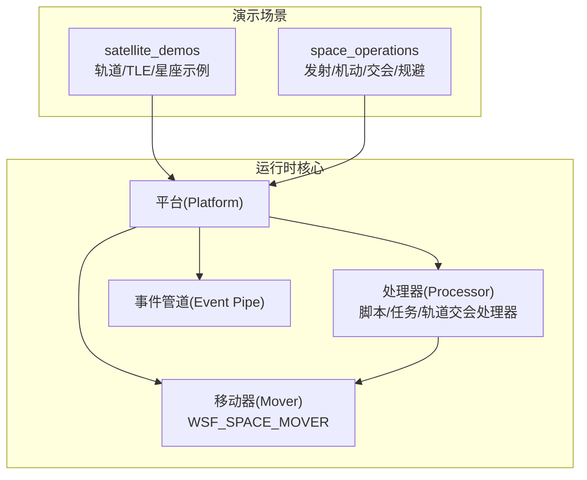
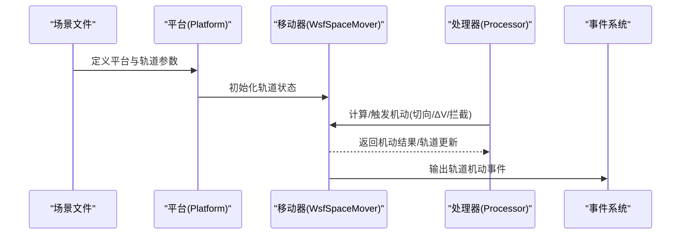
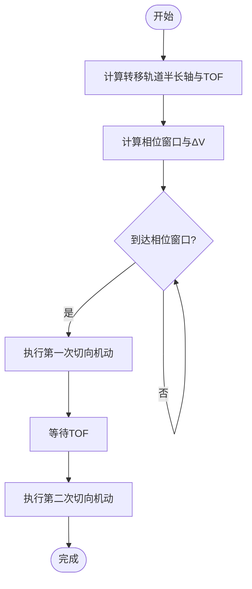
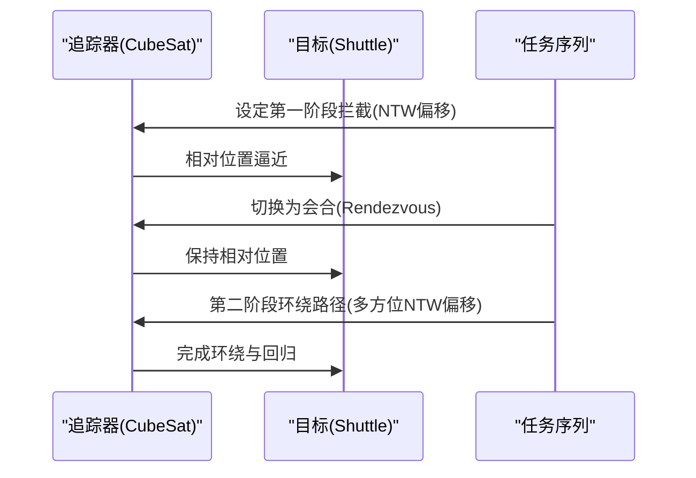
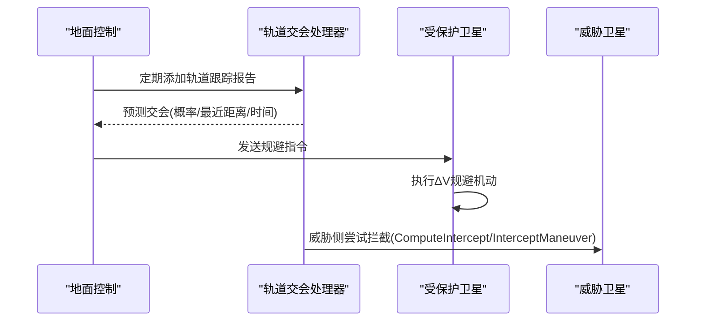
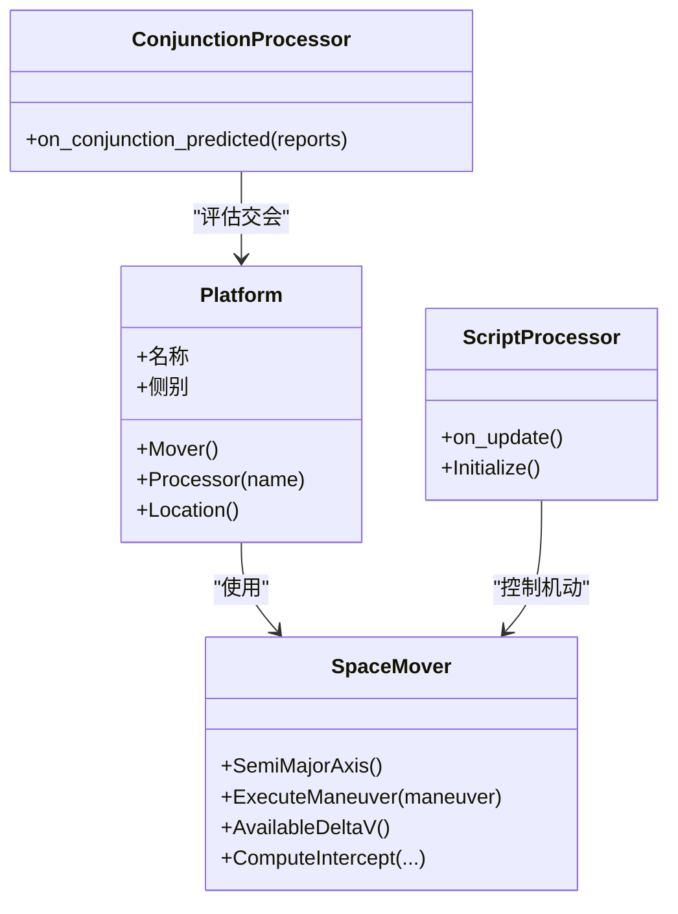

# 轨道力学模型

<cite>
**本文引用的文件**   
- [6th_Hohmann_leo_orbit_transfer_demo.txt](file://demos/satellite_demos/6th_Hohmann_leo_orbit_transfer_demo.txt)
- [proximity_operations.txt](file://demos/space_operations/proximity_operations.txt)
- [conjunction_avoidance.txt](file://demos/space_operations/conjunction_avoidance.txt)
- [README.md（space_operations）](file://demos/space_operations/README.md)
- [README.md（satellite_demos）](file://demos/satellite_demos/README.md)
</cite>

## 目录
1. [引言](#引言)
2. [项目结构](#项目结构)
3. [核心组件](#核心组件)
4. [架构总览](#架构总览)
5. [详细组件分析](#详细组件分析)
6. [依赖关系分析](#依赖关系分析)
7. [性能与精度考虑](#性能与精度考虑)
8. [故障排查指南](#故障排查指南)
9. [结论](#结论)
10. [附录：轨道参数配置速查](#附录轨道参数配置速查)

## 引言
本文件面向AFSIM中的轨道力学建模与空间任务仿真，聚焦以下目标：
- 说明开普勒轨道要素与轨道力学基本原理在AFSIM中的体现
- 解释LEO、MEO、GEO、Hohmann转移等典型轨道类型的特点与应用
- 文档化轨道参数配置方法（半长轴、偏心率、倾角、升交点赤经、近地点幅角、真近点角/平近点角等）
- 说明摄动效应的建模思路（地球非球形引力、大气阻力、日月引力等）
- 展示轨道预测、轨道修正、交会对接等高级功能
- 提供太空任务规划与星座管理的实践示例
- 给出轨道计算精度控制与性能优化建议

## 项目结构
AFSIM的轨道相关能力主要通过“平台+移动器”的方式实现，其中WSF_SPACE_MOVER负责轨道动力学与机动。演示场景集中在两个目录：
- demos/satellite_demos：卫星基础能力与TLE/轨道定义示例，包含Hohmann转移演示
- demos/space_operations：空间操作（发射、机动、交会、会合、碰撞规避等）综合示例

图表来源
- [6th_Hohmann_leo_orbit_transfer_demo.txt:23-33](file://demos/satellite_demos/6th_Hohmann_leo_orbit_transfer_demo.txt#L23-L33)
- [proximity_operations.txt:21-26](file://demos/space_operations/proximity_operations.txt#L21-L26)
- [conjunction_avoidance.txt:143-196](file://demos/space_operations/conjunction_avoidance.txt#L143-L196)

章节来源
- [README.md（satellite_demos）:1-49](file://demos/satellite_demos/README.md#L1-L49)
- [README.md（space_operations）:1-47](file://demos/space_operations/README.md#L1-L47)

## 核心组件
- WSF_SPACE_MOVER：轨道移动器，承载开普勒轨道状态与机动执行，支持轨道参数设置、轨道积分、机动构造与执行、拦截解算等。
- 脚本处理器（WSF_SCRIPT_PROCESSOR）：用于触发轨道机动、计算相位窗口、编排多段任务序列。
- 轨道交会处理器（WSF_ORBITAL_CONJUNCTION_PROCESSOR）：基于轨道预测进行碰撞风险评估与告警。
- 事件系统（Event Pipe/Event Output）：记录轨道机动事件、轨迹与关键时间戳。

章节来源
- [6th_Hohmann_leo_orbit_transfer_demo.txt:23-33](file://demos/satellite_demos/6th_Hohmann_leo_orbit_transfer_demo.txt#L23-L33)
- [proximity_operations.txt:21-26](file://demos/space_operations/proximity_operations.txt#L21-L26)
- [conjunction_avoidance.txt:143-196](file://demos/space_operations/conjunction_avoidance.txt#L143-L196)

## 架构总览
下图展示了从场景配置到轨道推进与机动的整体流程：

图表来源
- [6th_Hohmann_leo_orbit_transfer_demo.txt:74-181](file://demos/satellite_demos/6th_Hohmann_leo_orbit_transfer_demo.txt#L74-L181)
- [proximity_operations.txt:48-151](file://demos/space_operations/proximity_operations.txt#L48-L151)
- [conjunction_avoidance.txt:143-196](file://demos/space_operations/conjunction_avoidance.txt#L143-L196)

## 详细组件分析

### Hohmann转移轨道（双脉冲）
- 原理：通过两次切向脉冲将航天器从初始圆轨道转移到目标圆轨道，第一次在近地点加速进入椭圆转移轨道，第二次在远地点再次加速进入目标轨道。
- AFSIM实现要点：
  - 使用脚本处理器计算转移轨道半长轴、飞行时间（TOF）、所需ΔV与相位窗口
  - 在正确相位窗口执行第一个切向机动，随后启用第二个处理器在TOF后执行第二次切向机动
  - 通过WsfTangentManeuver构造切向机动并调用ExecuteManeuver执行

图表来源
- [6th_Hohmann_leo_orbit_transfer_demo.txt:87-116](file://demos/satellite_demos/6th_Hohmann_leo_orbit_transfer_demo.txt#L87-L116)
- [6th_Hohmann_leo_orbit_transfer_demo.txt:145-181](file://demos/satellite_demos/6th_Hohmann_leo_orbit_transfer_demo.txt#L145-L181)
- [6th_Hohmann_leo_orbit_transfer_demo.txt:183-205](file://demos/satellite_demos/6th_Hohmann_leo_orbit_transfer_demo.txt#L183-L205)

章节来源
- [6th_Hohmann_leo_orbit_transfer_demo.txt:10-17](file://demos/satellite_demos/6th_Hohmann_leo_orbit_transfer_demo.txt#L10-L17)
- [6th_Hohmann_leo_orbit_transfer_demo.txt:23-33](file://demos/satellite_demos/6th_Hohmann_leo_orbit_transfer_demo.txt#L23-L33)
- [6th_Hohmann_leo_orbit_transfer_demo.txt:74-181](file://demos/satellite_demos/6th_Hohmann_leo_orbit_transfer_demo.txt#L74-L181)
- [6th_Hohmann_leo_orbit_transfer_demo.txt:183-205](file://demos/satellite_demos/6th_Hohmann_leo_orbit_transfer_demo.txt#L183-L205)

### 近距离操作与交会对接（Intercept/Rendezvous）
- 原理：通过一系列相对运动机动（如NTW坐标系偏移）逐步接近目标，最终实现相对静止或稳定跟踪。
- AFSIM实现要点：
  - 使用mission_sequence编排多个maneuver（intercept/rendezvous），以delta_time驱动
  - 每个目标target指定相对平台的offset（如ntw坐标）
  - 通过事件输出记录轨道机动发起与完成

图表来源
- [proximity_operations.txt:48-151](file://demos/space_operations/proximity_operations.txt#L48-L151)
- [proximity_operations.txt:155-163](file://demos/space_operations/proximity_operations.txt#L155-L163)

章节来源
- [proximity_operations.txt:10-19](file://demos/space_operations/proximity_operations.txt#L10-L19)
- [proximity_operations.txt:21-26](file://demos/space_operations/proximity_operations.txt#L21-L26)
- [proximity_operations.txt:28-37](file://demos/space_operations/proximity_operations.txt#L28-L37)
- [proximity_operations.txt:39-153](file://demos/space_operations/proximity_operations.txt#L39-L153)
- [proximity_operations.txt:155-163](file://demos/space_operations/proximity_operations.txt#L155-L163)

### 碰撞规避（Conjunction Avoidance）
- 原理：地面控制中心通过轨道交会处理器评估潜在碰撞风险，必要时下发指令让受保护卫星执行小ΔV规避机动。
- AFSIM实现要点：
  - 使用WSF_ORBITAL_CONJUNCTION_PROCESSOR进行碰撞概率与最近距离评估
  - 通过on_conjunction_predicted回调发送消息给受保护平台
  - 受保护平台收到消息后执行随机方向的小ΔV机动（WsfDeltaV_Maneuver）

图表来源
- [conjunction_avoidance.txt:143-196](file://demos/space_operations/conjunction_avoidance.txt#L143-L196)
- [conjunction_avoidance.txt:26-52](file://demos/space_operations/conjunction_avoidance.txt#L26-L52)
- [conjunction_avoidance.txt:88-127](file://demos/space_operations/conjunction_avoidance.txt#L88-L127)

章节来源
- [conjunction_avoidance.txt:9-11](file://demos/space_operations/conjunction_avoidance.txt#L9-L11)
- [conjunction_avoidance.txt:14-63](file://demos/space_operations/conjunction_avoidance.txt#L14-L63)
- [conjunction_avoidance.txt:66-129](file://demos/space_operations/conjunction_avoidance.txt#L66-L129)
- [conjunction_avoidance.txt:131-221](file://demos/space_operations/conjunction_avoidance.txt#L131-L221)

### 轨道参数与开普勒要素
- 半长轴（semi_major_axis）：决定轨道大小与周期
- 偏心率（eccentricity）：描述轨道形状（圆/椭圆）
- 倾角（inclination）：轨道平面相对赤道面的倾斜
- 升交点赤经（raan）：轨道升交点在惯性系中的经度
- 近地点幅角（argument_of_periapsis）：近地点相对升交点的角度
- 真近点角/平近点角（true_anomaly / mean_anomaly）：描述卫星在轨道上的位置

AFSIM中通过WSF_SPACE_MOVER直接设置这些参数，或在脚本中读取/修改。

章节来源
- [6th_Hohmann_leo_orbit_transfer_demo.txt:29-33](file://demos/satellite_demos/6th_Hohmann_leo_orbit_transfer_demo.txt#L29-L33)
- [proximity_operations.txt:31-36](file://demos/space_operations/proximity_operations.txt#L31-L36)
- [proximity_operations.txt:42-47](file://demos/space_operations/proximity_operations.txt#L42-L47)
- [conjunction_avoidance.txt:54-61](file://demos/space_operations/conjunction_avoidance.txt#L54-L61)
- [conjunction_avoidance.txt:70-77](file://demos/space_operations/conjunction_avoidance.txt#L70-L77)

### 轨道类型与典型应用
- LEO（低地球轨道）：常用于遥感、通信星座、空间站；示例中采用约400 km高度圆轨道
- MEO（中地球轨道）：导航卫星常用（如GPS/Galileo/GLONASS）
- GEO（地球同步轨道）：通信与气象观测；可通过TLE或轨道参数定义
- Hohmann转移：燃料效率较高的轨道转移方式，适用于LEO-GEO或不同LEO轨道间转移

章节来源
- [6th_Hohmann_leo_orbit_transfer_demo.txt:10-17](file://demos/satellite_demos/6th_Hohmann_leo_orbit_transfer_demo.txt#L10-L17)
- [6th_Hohmann_leo_orbit_transfer_demo.txt:29-33](file://demos/satellite_demos/6th_Hohmann_leo_orbit_transfer_demo.txt#L29-L33)

### 摄动效应建模思路
- 地球非球形引力（J2/J3…项）：可在高精度轨道积分中启用相应重力场模型
- 大气阻力：对LEO影响显著，需结合大气密度模型与卫星弹道系数
- 日月引力与太阳辐射压：对中高轨与深空任务重要
- AFSIM扩展点：通过自定义处理器或外部脚本在轨道积分过程中注入摄动力或调整轨道参数

注：本节为概念性说明，具体实现需结合AFSIM内核扩展与数据模型。

[本节不直接分析具体源文件]

### 轨道预测、轨道修正与交会对接
- 轨道预测：WSF_ORBITAL_CONJUNCTION_PROCESSOR可基于轨道跟踪数据进行交会风险评估
- 轨道修正：脚本处理器根据相位窗口或任务需求触发切向/ΔV机动
- 交会对接：mission_sequence编排intercept/rendezvous，实现相对运动控制

章节来源
- [conjunction_avoidance.txt:143-196](file://demos/space_operations/conjunction_avoidance.txt#L143-L196)
- [6th_Hohmann_leo_orbit_transfer_demo.txt:74-181](file://demos/satellite_demos/6th_Hohmann_leo_orbit_transfer_demo.txt#L74-L181)
- [proximity_operations.txt:48-151](file://demos/space_operations/proximity_operations.txt#L48-L151)

### 太空任务规划与星座管理
- 星座生成：通过TLE文件或轨道参数批量定义卫星轨道
- 任务编排：利用脚本处理器与任务处理器协调发射、入轨、编队、通信链路建立
- 示例参考：satellite_demos与space_operations下的星座与通信链路场景

章节来源
- [README.md（satellite_demos）:1-49](file://demos/satellite_demos/README.md#L1-L49)
- [README.md（space_operations）:1-47](file://demos/space_operations/README.md#L1-L47)

## 依赖关系分析
- 平台（Platform）依赖移动器（WSF_SPACE_MOVER）进行轨道推进
- 处理器（Processor）依赖平台与移动器接口进行机动控制与状态查询
- 事件系统（Event Pipe/Output）依赖平台与处理器的事件钩子

图表来源
- [6th_Hohmann_leo_orbit_transfer_demo.txt:74-181](file://demos/satellite_demos/6th_Hohmann_leo_orbit_transfer_demo.txt#L74-L181)
- [proximity_operations.txt:21-26](file://demos/space_operations/proximity_operations.txt#L21-L26)
- [conjunction_avoidance.txt:143-196](file://demos/space_operations/conjunction_avoidance.txt#L143-L196)

章节来源
- [6th_Hohmann_leo_orbit_transfer_demo.txt:23-33](file://demos/satellite_demos/6th_Hohmann_leo_orbit_transfer_demo.txt#L23-L33)
- [proximity_operations.txt:21-26](file://demos/space_operations/proximity_operations.txt#L21-L26)
- [conjunction_avoidance.txt:14-63](file://demos/space_operations/conjunction_avoidance.txt#L14-L63)

## 性能与精度考虑
- 轨道积分步长与更新间隔：WSF_SPACE_MOVER.update_interval影响计算精度与性能，需在精度与实时性之间权衡
- 处理器更新频率：脚本处理器的update_interval应匹配机动时序与相位窗口检测需求
- 事件输出量：合理启用event_output与event_pipe，避免过多事件导致I/O瓶颈
- 轨道预测范围：WSF_ORBITAL_CONJUNCTION_PROCESSOR的search_interval、search_step_size、prediction_model影响交会评估的计算开销与准确性
- 机动策略：优先使用切向机动（能量效率高），减少不必要的ΔV消耗

章节来源
- [proximity_operations.txt:21-26](file://demos/space_operations/proximity_operations.txt#L21-L26)
- [6th_Hohmann_leo_orbit_transfer_demo.txt:74-78](file://demos/satellite_demos/6th_Hohmann_leo_orbit_transfer_demo.txt#L74-L78)
- [conjunction_avoidance.txt:143-152](file://demos/space_operations/conjunction_avoidance.txt#L143-L152)

## 故障排查指南
- 机动未触发：检查脚本处理器的on_update逻辑与相位窗口判断条件
- 相位窗口偏差：核对TOF与相位计算公式，确认Earth.GRAVITATIONAL_PARAMETER与轨道半长轴取值
- ΔV不足：验证AvailableDeltaV与机动ΔV预算是否匹配
- 交会评估异常：检查WSF_ORBITAL_CONJUNCTION_PROCESSOR的参数（search_interval、filter_cut_distance、default_variance等）
- 事件缺失：确认event_pipe与event_output已启用并写入正确文件

章节来源
- [6th_Hohmann_leo_orbit_transfer_demo.txt:145-181](file://demos/satellite_demos/6th_Hohmann_leo_orbit_transfer_demo.txt#L145-L181)
- [conjunction_avoidance.txt:143-196](file://demos/space_operations/conjunction_avoidance.txt#L143-L196)
- [proximity_operations.txt:155-163](file://demos/space_operations/proximity_operations.txt#L155-L163)

## 结论
AFSIM通过WSF_SPACE_MOVER与处理器体系提供了完整的轨道力学建模与空间任务仿真能力。借助脚本处理器可实现复杂的轨道转移与交会对接任务；轨道交会处理器则支持碰撞风险评估与规避决策。结合TLE与轨道参数定义，能够高效构建星座与任务场景。在实际工程中，应根据任务需求平衡轨道积分精度与计算性能，并通过事件系统与日志完善调试与验证流程。

[本节不直接分析具体源文件]

## 附录：轨道参数配置速查
- 半长轴（semi_major_axis）：单位km，决定轨道周期与能量
- 偏心率（eccentricity）：0为圆轨道，>0为椭圆轨道
- 倾角（inclination）：单位deg，轨道面相对赤道面倾斜
- 升交点赤经（raan）：单位deg，升交点经度
- 近地点幅角（argument_of_periapsis）：单位deg，近地点相对升交点角度
- 真近点角/平近点角（true_anomaly / mean_anomaly）：单位deg，轨道位置参数

章节来源
- [6th_Hohmann_leo_orbit_transfer_demo.txt:29-33](file://demos/satellite_demos/6th_Hohmann_leo_orbit_transfer_demo.txt#L29-L33)
- [proximity_operations.txt:31-36](file://demos/space_operations/proximity_operations.txt#L31-L36)
- [proximity_operations.txt:42-47](file://demos/space_operations/proximity_operations.txt#L42-L47)
- [conjunction_avoidance.txt:54-61](file://demos/space_operations/conjunction_avoidance.txt#L54-L61)
- [conjunction_avoidance.txt:70-77](file://demos/space_operations/conjunction_avoidance.txt#L70-L77)