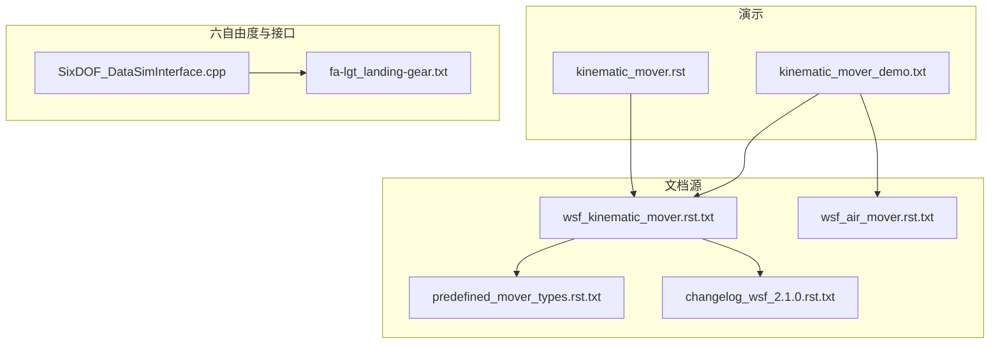
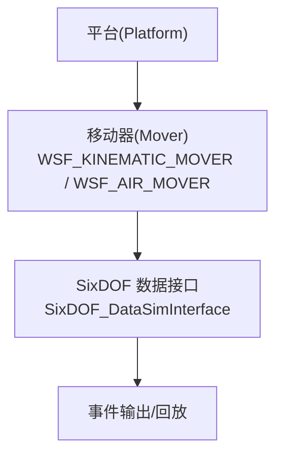
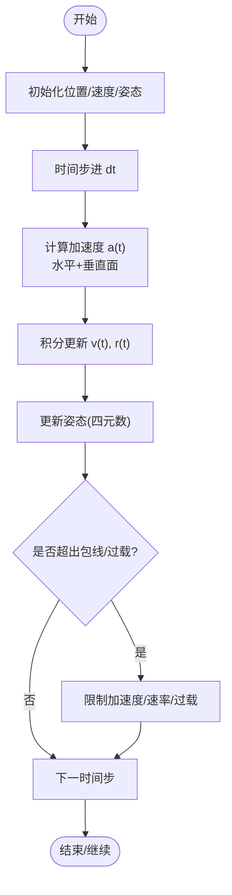
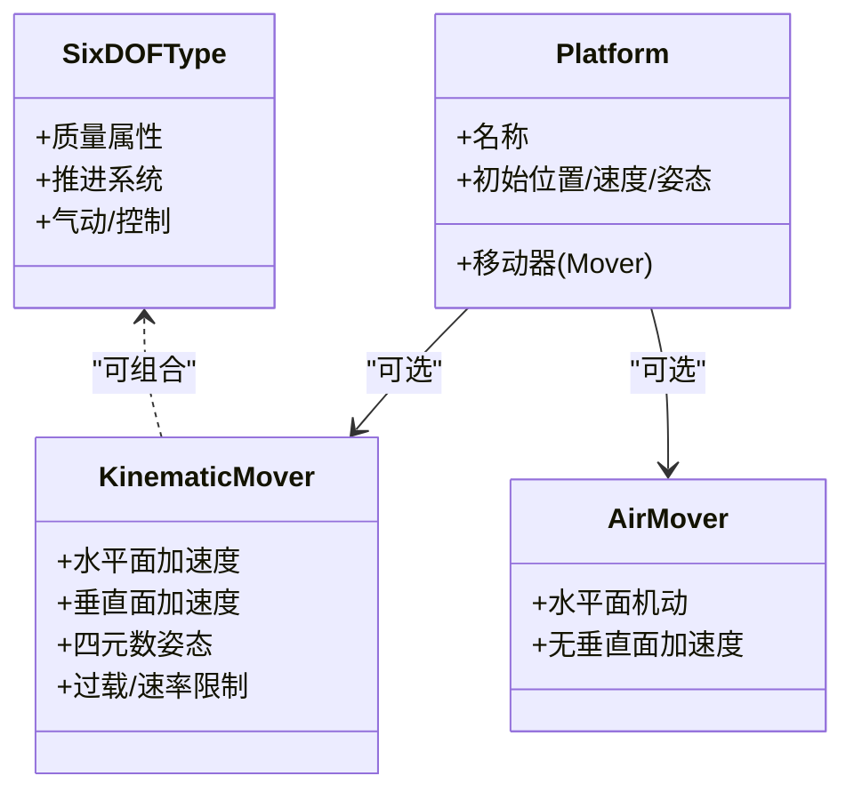
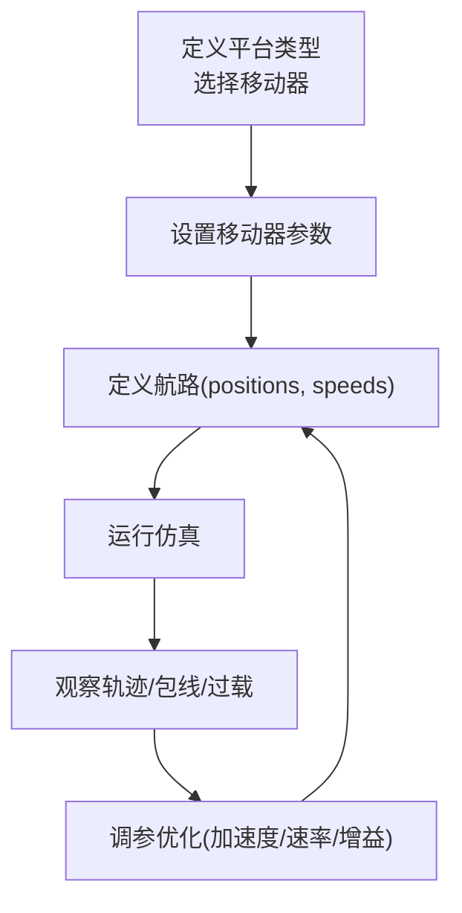
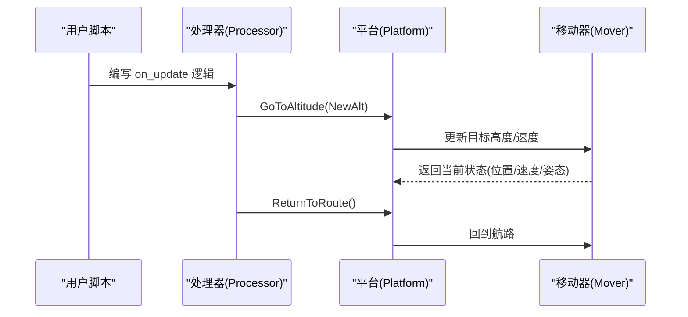
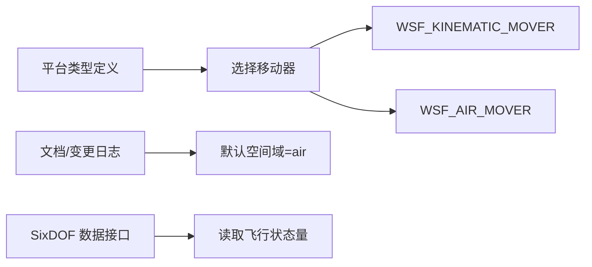

# 运动学模型

<cite>
**本文引用的文件**   
- [kinematic_mover_demo.txt](file://demos/kinematic_mover/kinematic_mover_demo.txt)
- [kinematic_mover.rst](file://demos/kinematic_mover/doc/kinematic_mover.rst)
- [wsf_kinematic_mover.rst.txt](file://documentation/html/_sources/docs/wsf_kinematic_mover.rst.txt)
- [wsf_air_mover.rst.txt](file://documentation/html/_sources/docs/wsf_air_mover.rst.txt)
- [predefined_mover_types.rst.txt](file://documentation/html/_sources/docs/predefined_mover_types.rst.txt)
- [changelog_wsf_2.1.0.rst.txt](file://documentation/html/_sources/docs/changelog/wsf_2.1.0.rst.txt)
- [SixDOF_DataSimInterface.cpp](file://swdev/src/warlock/plugins/SixDOF_Data/source/SixDOF_DataSimInterface.cpp)
- [fa-lgt_landing-gear.txt](file://swdev/src/wsf_plugins/wsf_six_dof/test_mission/six_dof_types/aircraft/fa-lgt/fa-lgt_landing-gear.txt)
</cite>

## 目录
1. [简介](#简介)
2. [项目结构](#项目结构)
3. [核心组件](#核心组件)
4. [架构总览](#架构总览)
5. [详细组件分析](#详细组件分析)
6. [依赖关系分析](#依赖关系分析)
7. [性能考虑](#性能考虑)
8. [故障排查指南](#故障排查指南)
9. [结论](#结论)
10. [附录](#附录)

## 简介
本文件系统性梳理 AFSIM 中的“运动学模型”，重点围绕 WSF_KINEMATIC_MOVER（运动学移动器）与 WSF_AIR_MOVER（空气移动器）的差异、数学基础、平台类型约束、参数配置方法、轨迹定义方式，以及典型场景应用与调优建议。文档面向不同技术背景的读者，提供从概念到实现的多层次说明，并附带可视化图示与可追溯的源码引用。

## 项目结构
AFSIM 仓库中与运动学模型直接相关的材料主要分布在：
- 演示用例：demos/kinematic_mover/ 下的脚本与文档
- 官方文档源：documentation/html/_sources/docs/ 下关于 mover 类型的 RST 文档
- 六自由度相关示例与接口：swdev 下的 SixDOF 数据接口与示例类型定义

**图表来源**
- [kinematic_mover_demo.txt:1-228](file://demos/kinematic_mover/kinematic_mover_demo.txt#L1-L228)
- [kinematic_mover.rst:1-39](file://demos/kinematic_mover/doc/kinematic_mover.rst#L1-L39)
- [wsf_kinematic_mover.rst.txt:12-101](file://documentation/html/_sources/docs/wsf_kinematic_mover.rst.txt#L12-L101)
- [wsf_air_mover.rst.txt:86-86](file://documentation/html/_sources/docs/wsf_air_mover.rst.txt#L86-L86)
- [predefined_mover_types.rst.txt:27-27](file://documentation/html/_sources/docs/predefined_mover_types.rst.txt#L27-L27)
- [changelog_wsf_2.1.0.rst.txt:50-50](file://documentation/html/_sources/docs/changelog/wsf_2.1.0.rst.txt#L50-L50)
- [SixDOF_DataSimInterface.cpp:41-107](file://swdev/src/warlock/plugins/SixDOF_Data/source/SixDOF_DataSimInterface.cpp#L41-L107)
- [fa-lgt_landing-gear.txt:20-74](file://swdev/src/wsf_plugins/wsf_six_dof/test_mission/six_dof_types/aircraft/fa-lgt/fa-lgt_landing-gear.txt#L20-L74)

**章节来源**
- [kinematic_mover_demo.txt:1-228](file://demos/kinematic_mover/kinematic_mover_demo.txt#L1-L228)
- [kinematic_mover.rst:1-39](file://demos/kinematic_mover/doc/kinematic_mover.rst#L1-L39)
- [wsf_kinematic_mover.rst.txt:12-101](file://documentation/html/_sources/docs/wsf_kinematic_mover.rst.txt#L12-L101)
- [wsf_air_mover.rst.txt:86-86](file://documentation/html/_sources/docs/wsf_air_mover.rst.txt#L86-L86)
- [predefined_mover_types.rst.txt:27-27](file://documentation/html/_sources/docs/predefined_mover_types.rst.txt#L27-L27)
- [changelog_wsf_2.1.0.rst.txt:50-50](file://documentation/html/_sources/docs/changelog/wsf_2.1.0.rst.txt#L50-L50)

## 核心组件
- WSF_KINEMATIC_MOVER（运动学移动器）
  - 在水平面与垂直面均计算加速度，提供更平滑的三维运动学轨迹
  - 基于四元数姿态数学模型，支持更真实的偏航、俯仰、滚转等姿态演化
  - 适用于需要精确姿态与三维机动能力的平台（如飞行器）
- WSF_AIR_MOVER（空气移动器）
  - 仅在水平面进行机动计算，不处理垂直面加速度
  - 适合简化二维平面机动或不需要复杂姿态的场景
- 预定义移动器类型
  - 包括 WSF_KINEMATIC_MOVER、WSF_FIRES_MOVER、WSF_FORMATION_FLYER 等
  - 自 2.1.0 起，部分移动器的默认空间域调整为 air，以改善传感器可见性

**章节来源**
- [wsf_kinematic_mover.rst.txt:34-34](file://documentation/html/_sources/docs/wsf_kinematic_mover.rst.txt#L34-L34)
- [wsf_kinematic_mover.rst.txt:72-72](file://documentation/html/_sources/docs/wsf_kinematic_mover.rst.txt#L72-L72)
- [wsf_kinematic_mover.rst.txt:98-101](file://documentation/html/_sources/docs/wsf_kinematic_mover.rst.txt#L98-L101)
- [wsf_air_mover.rst.txt:86-86](file://documentation/html/_sources/docs/wsf_air_mover.rst.txt#L86-L86)
- [predefined_mover_types.rst.txt:27-27](file://documentation/html/_sources/docs/predefined_mover_types.rst.txt#L27-L27)
- [changelog_wsf_2.1.0.rst.txt:50-50](file://documentation/html/_sources/docs/changelog/wsf_2.1.0.rst.txt#L50-L50)

## 架构总览
下图展示 AFSIM 中平台、移动器与仿真数据接口之间的交互关系。平台通过 mover 驱动其位置、速度、姿态等状态；SixDOF 数据接口从 mover 读取飞行包线内的关键量（高度、空速、马赫数、动态压力、姿态角、过载、力与推力、燃油等），并生成事件供外部使用。

**图表来源**
- [kinematic_mover_demo.txt:28-43](file://demos/kinematic_mover/kinematic_mover_demo.txt#L28-L43)
- [SixDOF_DataSimInterface.cpp:41-107](file://swdev/src/warlock/plugins/SixDOF_Data/source/SixDOF_DataSimInterface.cpp#L41-L107)

**章节来源**
- [kinematic_mover_demo.txt:28-43](file://demos/kinematic_mover/kinematic_mover_demo.txt#L28-L43)
- [SixDOF_DataSimInterface.cpp:41-107](file://swdev/src/warlock/plugins/SixDOF_Data/source/SixDOF_DataSimInterface.cpp#L41-L107)

## 详细组件分析

### 运动学基础与数学模型
- 基本关系
  - 位置 r(t)、速度 v(t)、加速度 a(t) 满足微分关系：v = dr/dt，a = dv/dt
  - 在三维空间中，WSF_KINEMATIC_MOVER 同时考虑水平面与垂直面的加速度，从而能产生更真实的轨迹弯曲与爬升/下降过程
- 姿态与旋转
  - 内部采用四元数表示姿态，避免万向节锁问题，提升数值稳定性
  - 支持偏航(yaw)、俯仰(pitch)、滚转(roll)及其导数的跟踪与控制
- 速度与包线
  - 可从 mover 获取空速(KCAS)、马赫数(Mach)、动态压力等，用于评估飞行包线与机动能力
  - 过载(nx, ny, nz)与可用机动过载(gAvail)可用于限制与评估机动强度

**图表来源**
- [wsf_kinematic_mover.rst.txt:72-72](file://documentation/html/_sources/docs/wsf_kinematic_mover.rst.txt#L72-L72)
- [SixDOF_DataSimInterface.cpp:50-76](file://swdev/src/warlock/plugins/SixDOF_Data/source/SixDOF_DataSimInterface.cpp#L50-L76)

**章节来源**
- [wsf_kinematic_mover.rst.txt:72-72](file://documentation/html/_sources/docs/wsf_kinematic_mover.rst.txt#L72-L72)
- [SixDOF_DataSimInterface.cpp:50-76](file://swdev/src/warlock/plugins/SixDOF_Data/source/SixDOF_DataSimInterface.cpp#L50-L76)

### 平台类型与运动学约束
- 飞行器
  - 推荐使用 WSF_KINEMATIC_MOVER，以获得三维机动与真实姿态
  - 可通过最大线性加速度、径向加速度、机体转弯率、滚转率等参数约束机动能力
- 车辆/舰船
  - 通常使用更简化的移动器（如 WSF_AIR_MOVER 仅水平面机动），或在陆地/海洋域中使用专用移动器
  - 若需更复杂的动力学（如六自由度），可结合六自由度类型定义与推进/质量属性
- 六自由度示例
  - 示例类型包含质量属性、推进系统、起落架等，体现更完整的动力学建模

**图表来源**
- [kinematic_mover_demo.txt:28-43](file://demos/kinematic_mover/kinematic_mover_demo.txt#L28-L43)
- [fa-lgt_landing-gear.txt:20-74](file://swdev/src/wsf_plugins/wsf_six_dof/test_mission/six_dof_types/aircraft/fa-lgt/fa-lgt_landing-gear.txt#L20-L74)

**章节来源**
- [kinematic_mover_demo.txt:28-43](file://demos/kinematic_mover/kinematic_mover_demo.txt#L28-L43)
- [fa-lgt_landing-gear.txt:20-74](file://swdev/src/wsf_plugins/wsf_six_dof/test_mission/six_dof_types/aircraft/fa-lgt/fa-lgt_landing-gear.txt#L20-L74)

### 参数配置方法
- 移动器参数（WSF_KINEMATIC_MOVER）
  - initial_speed：初始速度
  - target_speed：目标速度
  - maximum_linear_acceleration：最大线性加速度
  - maximum_radial_acceleration：最大径向加速度
  - maximum_body_turn_rate：最大机体转弯率
  - maximum_body_roll_rate：最大机体滚转率
  - proportional_navigation_gain：比例导航增益
  - velocity_pursuit_gain：速度追踪增益
  - update_interval：更新间隔
- 航路与速度剖面
  - route 块内定义多个 position 点，每个点可指定 altitude、speed
  - 可使用 label/goto 形成循环航路
- 与 WSF_AIR_MOVER 的差异
  - AIR_MOVER 仅提供 turn_rate_limit 等水平面机动参数，不包含垂直面加速度

**图表来源**
- [kinematic_mover_demo.txt:76-88](file://demos/kinematic_mover/kinematic_mover_demo.txt#L76-L88)
- [kinematic_mover_demo.txt:90-103](file://demos/kinematic_mover/kinematic_mover_demo.txt#L90-L103)
- [kinematic_mover_demo.txt:197-202](file://demos/kinematic_mover/kinematic_mover_demo.txt#L197-L202)

**章节来源**
- [kinematic_mover_demo.txt:76-88](file://demos/kinematic_mover/kinematic_mover_demo.txt#L76-L88)
- [kinematic_mover_demo.txt:90-103](file://demos/kinematic_mover/kinematic_mover_demo.txt#L90-L103)
- [kinematic_mover_demo.txt:197-202](file://demos/kinematic_mover/kinematic_mover_demo.txt#L197-L202)

### 轨迹与行为定义
- 航路点与速度剖面
  - 在 route 中按顺序定义 position，可附加 altitude 与 speed，形成三维轨迹与速度变化
  - 使用 label 与 goto 构建循环或重复段
- 动态指令
  - 通过处理器脚本调用 GoToAltitude、ReturnToRoute 等方法改变高度或回到航路
- 对比 WSF_AIR_MOVER
  - AIR_MOVER 不支持垂直面加速度，轨迹差异可在回放中直观比较

**图表来源**
- [kinematic_mover_demo.txt:45-71](file://demos/kinematic_mover/kinematic_mover_demo.txt#L45-L71)
- [kinematic_mover_demo.txt:90-103](file://demos/kinematic_mover/kinematic_mover_demo.txt#L90-L103)

**章节来源**
- [kinematic_mover_demo.txt:45-71](file://demos/kinematic_mover/kinematic_mover_demo.txt#L45-L71)
- [kinematic_mover_demo.txt:90-103](file://demos/kinematic_mover/kinematic_mover_demo.txt#L90-L103)

### 配置文件示例与参数调优指南
- 示例要点
  - 使用 WSF_KINEMATIC_MOVER 的平台 flyer1/flyer2/flyer3 展示不同机动限制
  - 使用 WSF_AIR_MOVER 的平台 flyer4 对比水平面机动差异
  - 通过处理器脚本在不同时间段切换高度或返回航路
- 调优建议
  - 根据任务需求调整 maximum_linear_acceleration 与 maximum_radial_acceleration，平衡机动性与能耗
  - 合理设置 maximum_body_turn_rate 与 maximum_body_roll_rate，避免过度姿态变化导致不稳定
  - 调整 proportional_navigation_gain 与 velocity_pursuit_gain，影响追踪与制导性能
  - 适当增大 update_interval 可降低回放文件大小，但会牺牲轨迹精度

**章节来源**
- [kinematic_mover_demo.txt:73-107](file://demos/kinematic_mover/kinematic_mover_demo.txt#L73-L107)
- [kinematic_mover_demo.txt:109-150](file://demos/kinematic_mover/kinematic_mover_demo.txt#L109-L150)
- [kinematic_mover_demo.txt:152-192](file://demos/kinematic_mover/kinematic_mover_demo.txt#L152-L192)
- [kinematic_mover_demo.txt:194-227](file://demos/kinematic_mover/kinematic_mover_demo.txt#L194-L227)
- [kinematic_mover.rst:27-38](file://demos/kinematic_mover/doc/kinematic_mover.rst#L27-L38)

### 简单场景应用
- 三架飞机沿相同航路（偏移）飞行，分别使用不同的 WSF_KINEMATIC_MOVER 限制
- 第四架飞机使用 WSF_AIR_MOVER，便于对比水平面机动差异
- 通过处理器脚本在特定时间段执行高度切换与回航操作，验证轨迹跟随与机动能力

**章节来源**
- [kinematic_mover_demo.txt:1-20](file://demos/kinematic_mover/kinematic_mover_demo.txt#L1-L20)
- [kinematic_mover_demo.txt:73-227](file://demos/kinematic_mover/kinematic_mover_demo.txt#L73-L227)

## 依赖关系分析
- 平台与移动器
  - 平台类型声明中指定 mover 类型（WSF_KINEMATIC_MOVER 或 WSF_AIR_MOVER）
- 文档与变更
  - 预定义移动器类型列表中包含 WSF_KINEMATIC_MOVER
  - 版本变更日志指出部分移动器默认空间域改为 air，以提升传感器可见性
- 六自由度接口
  - SixDOF 数据接口从 mover 读取大量飞行状态量，用于事件输出与外部集成

**图表来源**
- [kinematic_mover_demo.txt:28-43](file://demos/kinematic_mover/kinematic_mover_demo.txt#L28-L43)
- [predefined_mover_types.rst.txt:27-27](file://documentation/html/_sources/docs/predefined_mover_types.rst.txt#L27-L27)
- [changelog_wsf_2.1.0.rst.txt:50-50](file://documentation/html/_sources/docs/changelog/wsf_2.1.0.rst.txt#L50-L50)
- [SixDOF_DataSimInterface.cpp:41-107](file://swdev/src/warlock/plugins/SixDOF_Data/source/SixDOF_DataSimInterface.cpp#L41-L107)

**章节来源**
- [kinematic_mover_demo.txt:28-43](file://demos/kinematic_mover/kinematic_mover_demo.txt#L28-L43)
- [predefined_mover_types.rst.txt:27-27](file://documentation/html/_sources/docs/predefined_mover_types.rst.txt#L27-L27)
- [changelog_wsf_2.1.0.rst.txt:50-50](file://documentation/html/_sources/docs/changelog/wsf_2.1.0.rst.txt#L50-L50)
- [SixDOF_DataSimInterface.cpp:41-107](file://swdev/src/warlock/plugins/SixDOF_Data/source/SixDOF_DataSimInterface.cpp#L41-L107)

## 性能考虑
- 更新间隔(update_interval)
  - 较小的间隔提高轨迹精度，但会增加回放文件大小与计算开销
  - 演示中设置为 0.1 sec，需注意回放体积
- 机动限制
  - 过高的加速度/速率可能导致数值不稳定或资源消耗增加
  - 建议根据平台物理特性与任务需求逐步调参
- 空间域与传感器可见性
  - 确保移动器的默认空间域为 air（自 2.1.0 起已修正），以避免传感器忽略目标

**章节来源**
- [kinematic_mover_demo.txt:18-19](file://demos/kinematic_mover/kinematic_mover_demo.txt#L18-L19)
- [changelog_wsf_2.1.0.rst.txt:50-50](file://documentation/html/_sources/docs/changelog/wsf_2.1.0.rst.txt#L50-L50)

## 故障排查指南
- 轨迹不平滑或姿态异常
  - 检查 maximum_body_turn_rate 与 maximum_body_roll_rate 是否过大
  - 确认 WSF_KINEMATIC_MOVER 的参数设置与航路点密度匹配
- 回放文件过大
  - 适当增大 update_interval，减少记录频率
- 传感器无法看到目标
  - 确认移动器的默认空间域是否为 air（参考版本变更日志）
- 速度变化不均匀
  - 若希望两点间速度均匀变化，不要指定 maximum_linear_acceleration（参考 Suppressor 转换说明）

**章节来源**
- [kinematic_mover_demo.txt:18-19](file://demos/kinematic_mover/kinematic_mover_demo.txt#L18-L19)
- [changelog_wsf_2.1.0.rst.txt:50-50](file://documentation/html/_sources/docs/changelog/wsf_2.1.0.rst.txt#L50-L50)

## 结论
WSF_KINEMATIC_MOVER 提供了三维运动学与姿态演化的能力，适合对轨迹与机动有较高要求的飞行器平台；WSF_AIR_MOVER 则适用于简化水平面机动的场景。通过合理的参数配置与航路定义，可以在 AFSIM 中构建逼真的平台运动轨迹。结合演示用例与官方文档，用户可以快速上手并进行参数调优，以满足不同任务需求。

## 附录
- 常用命令与参数（来自文档索引）
  - WSF_KINEMATIC_MOVER.detailed_debug
  - WSF_KINEMATIC_MOVER.prefer_canopy_up
  - WSF_KINEMATIC_MOVER.bank_to_turn
  - WSF_KINEMATIC_MOVER.broach_at_sea_level
  - WSF_KINEMATIC_MOVER.target_speed
  - WSF_KINEMATIC_MOVER.initial_speed
  - WSF_KINEMATIC_MOVER.initial_flight_path_angle
  - WSF_KINEMATIC_MOVER.maximum_linear_acceleration
  - WSF_KINEMATIC_MOVER.maximum_radial_acceleration

**章节来源**
- [command_index.idx:18339-18356](file://documentation/html/command_index.idx#L18339-L18356)